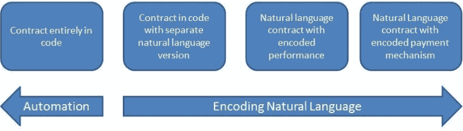
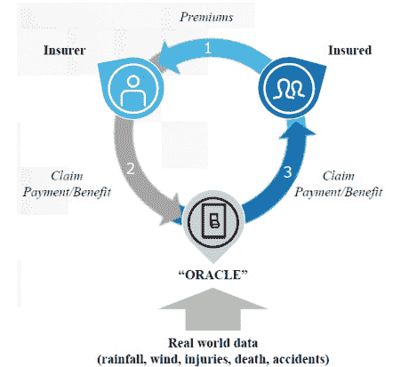
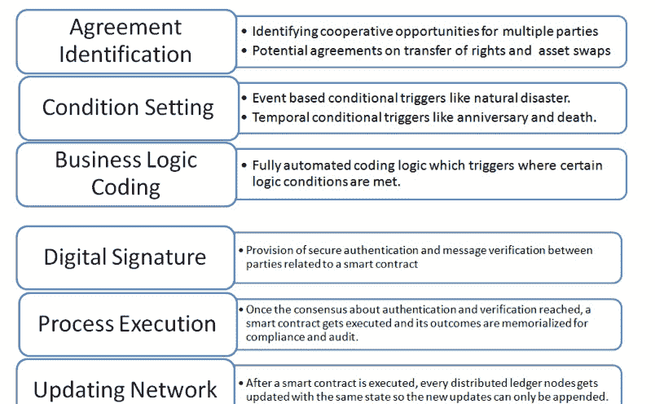
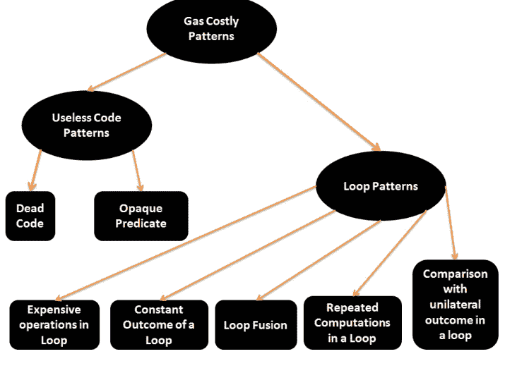
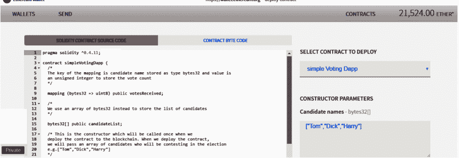
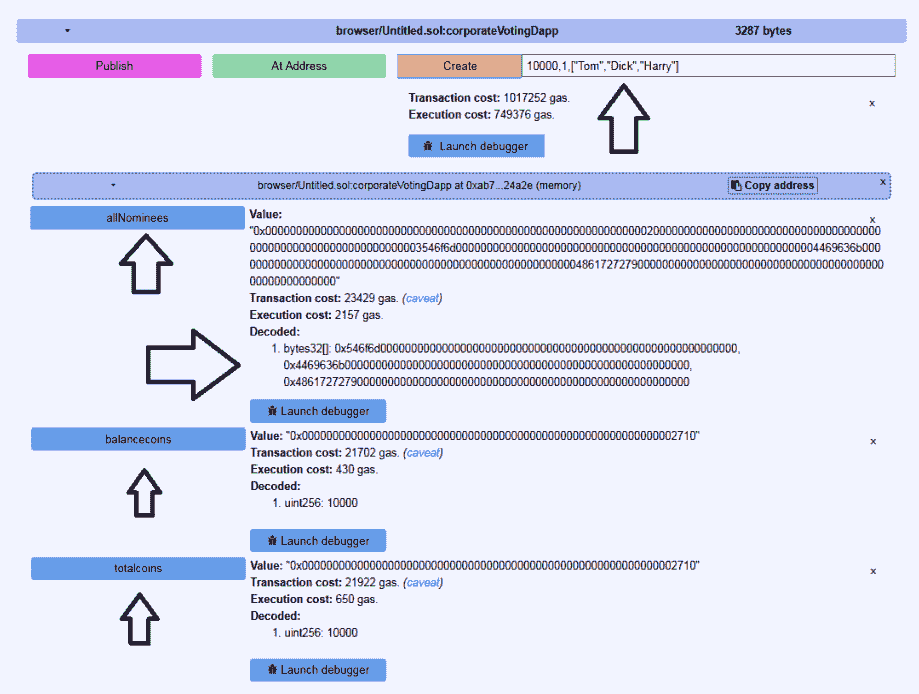

## 深入智能合约

在本章中，我们将深入探讨智能合约的设计。我们首先理解智能合约的教科书式定义。然后，我们继续理解不同的智能合约模型以及代码在智能合约中的作用。接着，我们了解智能合约的基本结构，并看看智能合约是如何工作的。然后，我们将重点转向一些高级主题，例如智能合约优化、审计和 ERC20 合规性。最后，我们通过构建投票 DApp 的动手练习来结束本章。

学完本章后，你将能够：

- 定义智能合约并理解各种设计模型
- 领会代码在智能合约中的作用
- 形象化理解智能合约的基本结构
- 理解智能合约的优化、审计和合规性
- 理解使用智能合约的投票 DApp 的设计

## 是什么让合约变得"智能"？

早在区块链和互联网出现之前很久的模拟时代，我们就已经拥有了基本上可以执行智能合约的机械设备，那就是自动售货机，如*图 5.1* 所示。当你以某种货币支付一定金额后，你就可以选择产品代码。一旦代码被确认，产品就会从机器中出来。如果你不付款，产品就不会出来。如果你在付款后延迟超过等待时间阈值，或出现任何机械故障导致你的会话过期，产品也不会出来。


图 5.1：自动售货机

我们可以看到，智能合约的概念早在区块链和互联网之前就已经存在了。因此，即使在定义智能合约之前，我们也必须先澄清围绕它的种种误解。排在首位的一个误解是：智能合约是否具有智能。答案是否定的，它既聪明又愚笨，但并不具有智能。为了理解这个微妙的概念，让我们用智能手机来类比。你的手机会在你想到拨号之前就替你拨打电话吗？例如，你正身处一场骚乱之中；设备是否会利用 GPS 或其他内置应用感知到类似骚乱的情况，并代表你拨打 911 或当地报警电话？不会，对吧？（理想情况下，它不应触发此类电话，因为这非常依赖上下文。你也许实际上正待在一个安全屋里，而误报可能会造成麻烦。）然而，智能手机可能会智能地处理信息，并闪烁显示一条建议。它如何以特定方式处理信息，取决于某个特定应用给出的指令（以代码形式存储）。因此，智能手机上那些能够以某种期望方式处理信息的应用，使得智能手机变得智能。另一个误解是：智能合约就是几行计算机代码。为了理解这一点，让我们来看看下一节中给出的智能合约的定义和设计。


## 定义与设计

智能合约最初由尼克·萨博（Nick Szabo）在其 1996 年发表的论文《*智能合约：数字市场的构建模块*》中正式定义。他将其描述如下：

> “智能合约是一组以数字形式规定的承诺，包括各方在其中履行这些承诺的协议。”

没错，就是这样。这就是定义。呃！这有什么好激动的呢？让我们稍微加点料。如果仔细观察这个定义，我们会发现它由四个具体要素组成：

- **一组承诺：** 这些基本上就是商业条件。例如，朱迪（Judy）和阿什利（Ashley）是共同拥有一家拍卖公司的商业伙伴。一个简单的商业条件可以如下：
  - `IF` 拍卖销售产生利润 `THEN` 按 60:40 的比例分配利润金额
  - `ELSE IF` 拍卖销售刚好收支平衡 `THEN` 各向福利基金捐赠 100 英镑
  - `ELSE IF` 拍卖销售出现亏损 `THEN` 按 70:30 的比例收回亏损金额

此类商业条件可以采用由合作伙伴签署的合同形式，也可以通过应用于各自商业账户的基于规则的操作来实施。

- **以数字形式规定：** 智能合约由人类可读的代码行，以及将其条件和结果规定并转换为由 1 和 0 组成的机器级二进制代码的软件组成。合同条款或基于规则的查找以代码形式嵌入软件中。
- **协议：** 一套规定各方应如何处理与智能合约相关数据的规则。这些规则集通常通过计算机算法实现，是基于技术的、规则驱动的操作，可实现诸如支付释放等操作。
- **各方在其中履行：** 这是智能合约定义中最棘手的要素。一旦智能合约部署在区块链上，它便不可撤销。已编码的智能合约通常无法被阻止执行。自动执行是智能合约的灵魂。

然而代码可能存在缺陷，如果合约本质上遇到了未满足的条件，合约就可能停止执行。这就是为什么在将智能合约部署到公共或活跃区块链之前，我们需要对其进行审计。在此之前，我们需要了解智能合约的各种设计模型。

从区块链的角度来看，智能合约是位于“区块”内的一段代码。一旦部署，它就成为网络共识状态的一部分。区块充当一个软件生成的容器，用于打包智能合约的消息。这些消息可以是输入、输出或指向其他计算机代码的指针。无论智能合约如何设计，它们都涉及代码。但这引出了一个常见的误解，即智能合约仅由代码组成。

事实上，智能合约设计模型构成一个完整的谱系，如图 5.2 所示：



图 5.2：智能合约分布在一个谱系上，来源：数字商会，2016 年 11 月

随着我们在开发更多基于智能合约的去中心化应用（DApps）方面不断深入，可能会出现更多变体。因此，研究代码的作用变得非常重要，因为代码在任何智能合约中都占据相当大的比例。

## 代码在智能合约中的作用

所有智能合约都涉及代码，而所有代码都有缺陷。即使没有，它们最终也会出现缺陷。今天的需求可能成为明天的缺陷。在进入 21 世纪之前，许多计算和数据库系统中的年份格式用 YY 而不是 YYYY 表示。那是为了节省额外字节的要求。

在接近 20 世纪 90 年代末时，程序员意识到这将会变得多么混乱，因为一旦过了 2000 年，YY 年份格式就会变得有歧义。19-11-17 会被理解为 1917 年 11 月 19 日，还是 2017 年 11 月 19 日？有些人自作聪明，他们拥有 YYYY 格式的奢侈条件，但算法却只是将日期回滚到了 1900 年。历史书籍将这一事件记录为千禧年缺陷，即 Y2K 缺陷。

尽管世界各地的组织都对其计算机系统进行了检查、修复和升级以应对这一预期问题，但不知道有多少问题未被记录。关键在于，代码并不总是按照实施它的各方所期望的方式运行。消息会延迟，口令会被转储，数据在传输过程中可能会损坏。在智能合约上链之前，需要考虑此类事件的责任影响。这些事件需要成为合约整体计划的一部分。否则，它就只是有风险的合约，而不是智能合约。

因此，代码的作用不仅仅止于审计，随着时间推移，还需要考虑合约的法律层面。一旦智能合约上链，它就被视为法律。但任何理性的人都会争辩说，我们日后总是可以修改法律。为什么智能合约就不能这样做呢？当然可以，而且是通过预言机（oracles）来实现的。我们

对智能合约进行预言机化（oraclize），使其能够通过接收来自可靠来源的外部数据来自我修订，如图 5.3 所示，这里使用了一个简单的保险合约。这样的预言机引擎在提供数据馈送的同时会附带一个真实性证明，从而使馈送防篡改，并独立于第三方馈送 API 以及区块链协议上的预言机服务引擎。一个类似的类比是，在本地珠宝店购买一颗经过认证的钻石。如果一颗钻石拥有外部真实性认证，例如 GIA 或 AGSL，该认证规定了其 4C（克拉、切工、净度和颜色），并且保证无冲突。那么它的转售价值就与我们所购买的商店无关：



图 5.3：预言机化的保险合约，来源：数字商会，2016 年 11 月

我们将在“优化与审计”一节中更多地探讨智能合约的预言机层面。在此之前，我们需要了解智能合约的基本结构；否则，我们可能无法对预言机引擎及其如何融入整体架构有一个清晰的认知。

## 智能合约设计的基本结构

区块链技术已成为推动智能合约概念在商业交易世界中发展的喷气燃料。大型企业机构正迅速采用这一概念，以保持对竞争对手的领先优势。这促成了行业范围内的一项倡议，即对智能合约设计框架进行形式化。四大审计公司之一的德勤（Deloitte）与数字商会咨询委员会合作，提出了一个六点式结构来形式化智能合约设计，如图 5.4 所示：



图 5.4：智能合约设计的六点结构，来源：数字商会，2016 年 11 月

## 智能合约优化

在第 2 章《Grokking Ethereum》中，我们讨论了以太币和 gas 的概念（回想一下自助餐和汽车燃料的类比）。优化不足的智能合约会消耗超出必要的 gas。此类智能合约的创建者和用户在区块链上部署和运行它们时，总是会被多收费。Xiapu Luo 等人（来自香港理工大学和中国电子科技大学的一组区块链研究者）已经识别出七种此类高 gas 消耗的编程模式，这些模式分为两类，如图 5.5 所示。第一类是无用代码模式（useless code pattern），由于部署期间字节码大小的增加以及运行时字节码的移除，会带来额外的 gas 成本。第二类涉及使用循环的高成本操作：



图 5.5：高 gas 消耗的编程模式

图 5.6 展示了表示这些完全未优化代码模式的伪代码。理想情况下，这需要用字节码来描绘，但


pseudo-code has been used for ease of understanding. Pattern 1 is an example of dead code because we will never reach the print statement in line 4 due to the `inner-if` condition at line 3 stating `y*y <20`. If you are still wondering what just happened, then go upward toward the `outer-if` condition at line 2 which states `y >5`. This means y, which is an unsigned integer, can only have values greater than 5, that is 6 and higher. Hence `y*y` always returns an integer equal or greater than 36. In other words `(36 or more) < 20` always return a `false` condition, so we always ignore any statement that occurs inside this `inner-if` condition.

Interestingly, when the solidity compiler generates the bytecode of this logic, it never removes lines 3 and 4, which are practically ignored at runtime, and this wastes money in terms of gas consumption. Opaque predicate outcomes are identified without any execution. If we look into the pseudo-code of pattern 2, line 3, `y>2` is `true` by default; hence it is redundant. It can be removed to save gas. In the second category, we see that moving expensive operations out of the loop can save gas. For example, in the pseudo-code of pattern 3, since the variable `sumout` is stored in the storage, line 4 calls `SLOAD` to load `sumout` on the stack and a `SSTORE` to save the outcome of the `ADD` operation to the storage. Normally, the storage-related operations consume a lot of gas, and hence, are very expensive. An optimized compiler generally assigns `sumout` to a local variable `temp` that resides in the stack, then adds `j` to `temp` inside the loop, and finally assigns `temp` to `sumout` after the loop.

Such optimization reduces the storage-related operations from 2x to just 2, that is, one `SLOAD` and one `SSTORE`:

```
pattern #1 dead code
function q1 (uint y) {
if ( y > 5)
  if ( y*y < 20)
    print("you can't reach me!");
}
```

```
pattern #2 opaque predicate
function q2 (uint y) {
if ( y > 5)
  if ( y > 2)
    print("think out-of-the-case!");
}
```

```
pattern #3
expensive operations of a loop
uint sumout = 0;
function q3 (uint y){
for ( uint j = 0; j < y; j++)
  sumout += j;
}
```

```
pattern #4
constant outcome of a loop
function q4 () returns (uint){
uint sumout = 0;
for ( uint j = 1; j <= 100 ; j++)
  sumout += j;
return sumout;
}
```

```
pattern #7
comparison with unilateral outcome in a loop
function q7 (uint z , uint x)
returns (uint){
for ( int i = 0; i < 100 ; i++)
  if (z > 0)
    x+=z;
return x;
}
```

```
pattern #6
repeated computations in loop
uint y = 1;
uint z = 2;
function q8 (uint j){
uint sumout = 0;
for ( uint k = 1; k <= j ; k++)
  sumout = sumout + y + z;
}
```

```
pattern #5
loop fusion
function q5 (uint y){
uint n = 0;
uint w = 0;
for ( uint j = 0; j < y; j++)
  n += j;
for ( uint k = 0; k < y; k++)
  w -= k;
}
```

## Figure 5.6: Pseudo-code of gas-costly pattern

In pattern 4, the outcome of the loop is a constant value and deterministic in nature. Rather than using a loop, we can just use a statement, such as return 5050, and assign it to sumout, minimizing gas usage. Pattern 5 illustrates the need for a loop fusion where we combine several loops into one to minimize gas usage. We can combine the summation and subtraction step of n and w inside a single loop rather than running them in sequential separate loops. Pattern 6 depicts repeated computation in a loop. The summation of y+z is very expensive due to the use of a SLOAD operation before ADD. This can be avoided by summing up y+z outside the loop and then reusing the result inside the loop.

And, lastly, pattern 7 shows unilateral redundant comparison inside a loop. In simple words, z>0 can safely go outside the loop without loss of functionality and in turn minimize gas cost as we are preventing the same comparison from occurring 100 times, which gives the same result anyway. It is noteworthy, that as we increase the loop counters, the gas cost keeps on multiplying, which can make a smart contract quite expensive to operate.

Apart from changes to the programming pattern, optimization can be achieved at runtime by tinkering with the Ethereum virtual machine. We already saw in *Chapter 2, Grokking Ethereum*, how EVM interacts with swarm and whisper to run DApps on a blockchain using smart contracts. EVM basically allows us to execute arbitrary code in a trustless environment in which the outcome is fully deterministic. EVM operates on 256 bit integers and requires 256 bit arithmetic. Because of the 256 bit nature of the EVM, the gas can theoretically be 2^256-1 but actually never will because the cost incurred by such an execution would be way too much. Instead, there is a cap of using up to 2^64, which present processors have native support for and can generally be optimized. Even though 2^64 is still "too costly", it is a very nice constraint to have and allows us to hard-cap the gas on something the computer can natively understand. The EVM natively uses a quadratic-memory gas calculation, where for each word of 32 bytes there is a cost associated with memory expansion. This capping of 64 bit has also put a limit on the expansion of associated memory with the expansion never going beyond 2^64-1.

Lastly, the performance at blockchain level can be optimized by a process called **sharding**. Currently, all the transactions and calculations that are performed on an Ethereum blockchain need to be run by all of the nodes. So, each node has to perform every calculation. And that is of course inefficient if scaled. That is not a characteristic that is desirable worldwide. If we want to make complex decentralized applications run efficiently on the public blockchain, we need to speed up the execution process compared to the present day's runtimes. What Ethereum performs today in terms of execution speed is comparable to that of what happened in the late 1980's computers. Roughly, this is about 7-15 transactions per second. So it is really too low for practical purposes. Sharding is one of the main proposals for how we can increase in terms of performance at scale, the other two being using different altcoins and increasing the block size. The problem with increasing the block size is that even though we could accomplish more transactions or operations in one go, it will become increasingly difficult for normal computers to act as nodes due to the heavy blocks on the entire chain. General purpose computer hardware wouldn't be enough to act as a node, and the entire ecosystem will tend towards centralization and monopolistic cartel-like behavior, because only those operators that have massive hardware support will be able to act as nodes by downloading the complete blockchain on their machines.

The idea of using different altcoins is not to make the public blockchain overloaded, and use separate blockchains to execute different operations. This is sometimes called **merge-mining** on sidechains. This is good performance-wise, but overall security is low when we have a segregated consensus acting on isolated blockchains, which eventually makes the 51% attack more likely.

Coming back now to the main proposal of sharding. Sharding is a philosophy where we give away the notion of sequential executions of processes on each node of a blockchain. Rather, we split up the entire execution into sizable chunks called shards and many nodes process such shards in parallel. Users of one node computing one shard are not able to communicate with users of another node who are computing another shard. This is one of the main challenges while implementing sharding. For example, consider you live in Dublin but you have to attend an urgent business conference in London. And no, you cannot Skype talk as the session might turn out to be a solid deal. To top it off, the meet-up session might stretch to the entire day. Hence, you have to book a flight and reserve a hotel yet still want to make sure both operations are atomic—either both succeed or neither do. Now, if the flight ticket application and hotel room booking applications are on the same shard, they will be done in a sequential manner, and if one of the bookings fails, the other rolls back before committing. But if these are on different shards, unless we have cross-shard communication, this can land us in a big mess, the worst being that the hotel gets booked but the flight remains unreserved. One way to solve it is by using asynchronous, cross-shard communication. In simple words, one shard books the flight, and another shard books the hotel room. Then the shards message each other to acknowledge each other. Finally, the shards send us a confirmation. This is what we discussed in Chapter 1, *Blockchain Basics*, as eventual consistency (recall the CAP theorem). Vitalik Buterin and other co-founders of Ethereum


拥有更好的分片计划。这是为了将整个分片活动从智能合约和 DApp 开发者中抽象出来，并在运行时内部处理。这在某种程度上类似于大数据行业中为 HIVE QL 开发者提供的构建在 HDFS 之上的 map-reduce 框架。这将使开发者能够更专注于 DApp 和智能合约功能，而非性能层面的分片操作。想象一下拥有一张附带机票的优惠券，其中包含预订好的酒店房间。分片是一个非常困难，如果不是不可能的话，要在区块链社区中解决的任务，而区块链社区仍在开发中。如此复杂的机制要经受住时间的考验，需要强有力的审计和严格的合规性，这将是我们下一个讨论的话题。

## 智能合约审计与合规

目前，智能合约的审计仅限于由高级开发者进行同行评审。虽然区块链社区中尚未出现用于审计智能合约代码的完善文档框架，但在研究社区中已经取得了许多值得注意的实质性进展：

- Xiapu Luo 等人推出了一款名为 **GAS-costly pattern checker (GASPER)** 的专有工具，利用该工具他们已识别出具有本节前面讨论的多种类型的 gas 昂贵模式的公开智能合约
- Juels 等人诊断出智能合约可以促进犯罪，并展示了犯罪智能合约如何被促成以泄露机密信息、窃取加密密钥以及各种现实世界犯罪
- Atzei 等人研究了一系列利用合约漏洞来窃取或篡改资产的攻击
- Zhang 等人开发了 TOWN CRIER，其旨在为智能合约提供可信数据，因为许多智能合约的应用需要来自区块链外部的数据
- Kosba 等人开发了 HAWK，这是一个去中心化的智能合约系统，使开发者能够编写隐私保留的智能合约
- Luu 等人开发了 Oyente，这是一种新颖的基于符号执行的工具，可发现以太坊智能合约中的安全漏洞
- Bhargavan 等人使用形式化验证来分析智能合约

让我们现在回到 Oraclize 引擎，它类似于 TOWN CRIER。在 Solidity 中，继承 Oraclize 合约非常简单。这为我们提供了诸如 `oraclize_query` 等函数，可直接利用该技术。Oraclize 原生集成于最广泛使用的公共区块链协议，例如以太坊和比特币。私下里，以太坊链目前可以通过使用 Ethereum-bridge 与 Oraclize 集成。对 Oraclize 的有效数据请求，无论是通过原生区块链集成还是通过 HTTP API 进行，都应指定以下参数，如 Oraclize 文档中所述：

- **一种数据源类型：** 数据源是数据的可信提供者。它可以是一个网站或网络 API，例如 Reuters、Weather.com、BBC.com，或运行在硬件强制的 **trusted execution environment (TEE)** 中的安全应用程序，或在云提供商中运行的可审计的锁定虚拟机实例。
- **一个查询：** 查询是一组需要被评估的参数，以便完成特定数据源类型请求。查询的中间结果可能需要被解析。
- **一种真实性证明类型（可选）：** Oraclize 设计为充当不可信的中介。可选地，对 Oraclize 的请求可以指定一个真实性证明。并非所有证明都与所有数据源类型兼容。

Oraclize 与以太坊智能合约之间的交互是异步的。如 *Figure 5.7* 所示，任何数据请求都由两个步骤组成，如 Oraclize 文档中所述：

1. 首先，在最常见的情况下，由用户广播执行智能合约函数的交易。该函数包含一个特殊指令，使其对 Oraclize 可见，而 Oraclize 不断监控以太坊区块链以寻找此类指令和数据请求。
2. 其次，根据此类请求的<|message|>

分配了特定的地址。在我们的示例输入中，我们使用了三位候选人 [Tom、Dick 和 Harry]。

这个 DApp 更有趣的地方在于，当我们将其部署到区块链上时，构造函数只能被调用一次。与普通的 Web 应用程序不同——在普通 Web 应用中，每次同名的新部署都会覆盖旧代码——区块链上部署的代码是不可变的。也就是说，如果我们修改合约并重新部署，旧合约仍将原封不动地存留在区块链上，连同所有存储数据一起。新的部署只会创建一个独立的新合约实例。

代码档案中还提供了一个企业版的投票应用，名为 `corporateVotingDapp.sol`，其中包含对每个函数的详细注释。该版本将 DAO 的购币能力与投票功能结合在一起。在这个智能合约中，除了候选人名称数组之外，我们还传递了两个额外的参数。这两个参数分别是可供选民使用的代币总量，以及每个代币对应的以太币单位。

例如，输入 `10000,1, [Tom、Dick 和 Harry]` 意味着我们有一个投票合约，其中最多有 10,000 个代币可供选民使用，每个代币价值 1 个以太币，选民可以为三位候选人投票。如果某位选民使用 100 个代币投给了 Tom，那么其他选民可以使用剩余的 9,900 个代币投票给这三位候选人中的任意一位。

*图 5.8* 展示了带有必要注释的投票 DApp 的 Solidity 智能合约。*图 5.9、图 5.10、图 5.11、图 5.12 和图 5.13* 展示了私有区块链上的投票 DApp。*图 5.14 和图 5.15* 展示了 Remix 浏览器中简单版和企业版投票 DApp 的候选人得票数输出：

```solidity
pragma solidity ^0.4.11;
contract simpleVotingDapp {
    /*
    The key of the mapping is candidate name stored as type bytes32 and value is
    an unsigned integer to store the vote count
    */
    mapping (bytes32 => uint8) public votesReceived;
    /*
    We use an array of bytes32 instead to store the list of candidates
    */
    bytes32[] public candidateList;
    /* This is the constructor which will be called once when we
    deploy the contract to the blockchain. When we deploy the contract,
    we will pass an array of candidates who will be contesting in the election
    e.g.["Tom","Dick","Harry"]
    */

    function simpleVotingDapp(bytes32[] candidateNames) {
        candidateList = candidateNames;
    }

    // This function returns the total votes a candidate has received so far
    function totalVotesFor(bytes32 candidate) returns (uint8) {
        if (validCandidate(candidate) == false) revert();
        return votesReceived[candidate];
    }

    // This function increments the vote count for the specified candidate. This
    // is equivalent to casting a vote
    function voteForCandidate(bytes32 candidate) {
        if (validCandidate(candidate) == false) revert();
        votesReceived[candidate] += 1;
    }

    function validCandidate(bytes32 candidate) returns (bool) {
        for(uint i = 0; i < candidateList.length; i++) {
            if (candidateList[i] == candidate) {
                return true;
            }
        }
        return false;
    }
}
```

图 5.8：简单的 votingDapp.sol



图 5.9：私有区块链上以候选人数组作为构造函数参数的 VotingDapp


图 5.10：矿工在私有区块链上部署合约


图 5.11：为候选人 2 投票


图 5.12：候选人 2 的投票交易已完成


图 5.13：候选人 2 投票交易成功后，得票数从 0 变为 1

图 5.14：Remix 浏览器上的 VotingDapp



图 5.15：Remix 浏览器上的企业版 votingDapp

至此，本章即将结束。话虽如此，智能合约仍然是一个快速发展的主题。在第 6 章《Solidity 深入》中，我们将讨论 Solidity 编程语言，以及它如何帮助创建复杂的智能合约。

# 总结

在本章开始时，我们破除了关于智能合约的迷思。我们意识到，智能合约无法自行做出决策，需要算法触发才能实现这样的功能。我们还研究了智能合约的原始定义，并认识到智能合约模型位于一个从编码自然语言到完全自动化的频谱上。我们了解到，代码在智能合约中的作用包括优化、审计和遵守合规要求的明智组合。我们讨论了 Solidity 编译器未能优化的高 Gas 成本代码模式，并将其归类为无用代码和昂贵循环。然后，我们简要了解了如何使用预言机化来提供真实数据，以及 GitHub 归档上的一个问题如何催生了 ERC20 标准。最后，我们在私有区块链上部署了一个去中心化投票应用，以此结束本章。在第 6 章《Solidity 深入》中，我们将深入探讨图灵完备的 Solidity 编程语言。
