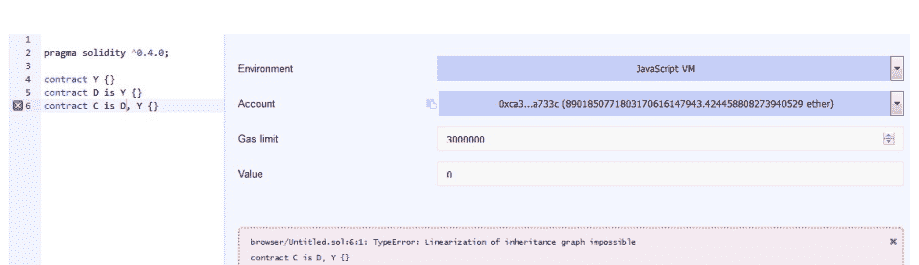
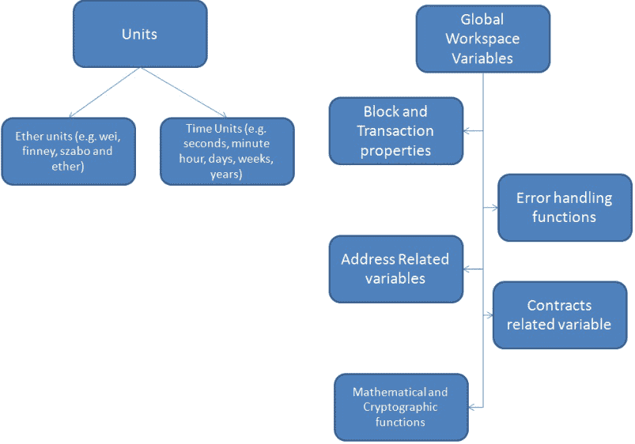
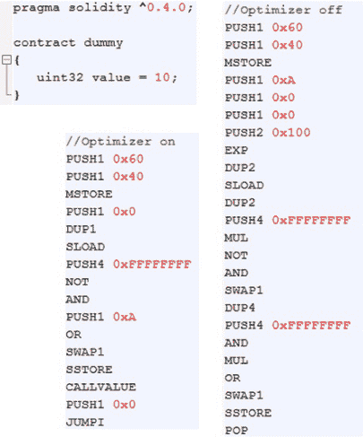
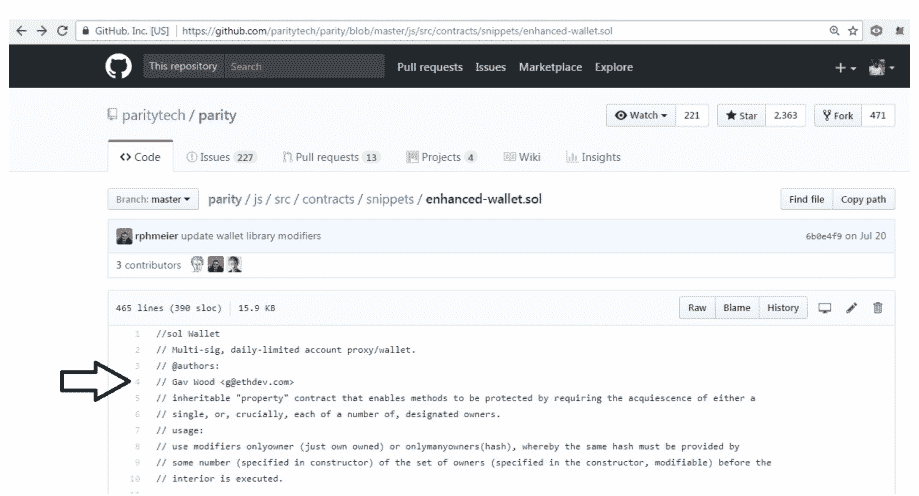
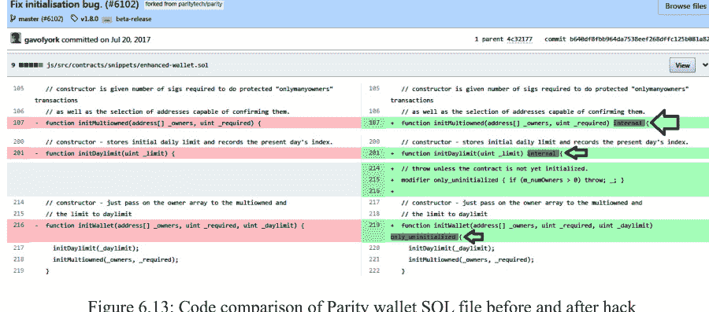

# Solidity 深入

本章将全面介绍以太坊区块链上图灵完备的 Solidity 语言。我们将首先一窥其设计决策，以及我们究竟为什么需要一门像 Solidity 这样的新语言。接下来的部分将涵盖 Solidity 语言的细微差别及其使用的基本语法。具体来说，我们将涵盖面向合约的特性、函数、事件、继承、库、表达式、控制结构、单位和变量。然后，我们将一窥优化器和调试选项。最后，我们将分析导致近期以太坊区块链 Parity 钱包被黑客攻击的代码缺陷，该攻击盗取了价值约 3000 万美元的以太币。

学习完本章后，你将能够：

+   - 认识到 Solidity 相对于其他高级语言的必要性
+   - 理解 Solidity 的细微差别、语法和特性
+   - 一窥 Solidity 优化器和调试选项
+   - 分析 3000 万美元 Parity 钱包攻击事件背后的缺陷

# 对 Solidity 的需求

让我告诉你们一个关于程序员的肮脏秘密。在整个工程界中，我们是最懒惰的一群技术人员。我们非常努力地工作，就是为了保持懒惰。我们恪守这样一句誓言：

> “如果说需要是发明之母，那么懒惰就是发明之父。”

难怪我们如此热爱开源运动。重用另一个懒惰程序员的代码正是我们所梦寐以求的。而为了增添一点虚伪的色彩，我们也从不忘记抱怨或批评原始代码有多么混乱，以及我们是多么英勇地驱赶了那些 bug，并将其整理成文档，使之成为 2.0 或更高版本。这就是我们的天性。

但是，有时在这片懒惰极客的土地上，会出现一个异类，他完全从头开始编写一些全新的东西。整个懒惰社区随后会嘲笑这些粗糙的代码。渐渐地，这个异类消除了新东西中的 bug，并开始获得关注。尽管如此，我们仍然无视它。此时，这个异类已经继续去做另一件新事物了，而他在获得关注期间的一些狂热追随者正在核心代码之上进行构建。然后，我们懒惰的社区开始与之对抗。批评者发起了著名的 X 与 Y 之争，在在线论坛上提问：“作为一个刚辍学、没有工作的新鲜人，我应该选择哪种语言？是应该选 X——我祖母在大学时用过的那种，还是应该选 Y——我误以为我的孙子会用的那种？”到这个时候，五年已经过去了，这个新事物在 IEEE 最受欢迎编程语言排行榜上高歌猛进，世界一流大学鼓励我们学习它，业界也在尝试围绕它的使用制定事实标准和框架。而我们这些懒惰的领主们，却在疯狂地寻找它的免费副本，以便安装并“掌握”它。

而且，不，它不是 Python（尽管你的猜测已经足够接近了），我指的是……


referring to, in our chapters context. It is good old JavaScript (with the de facto standard as ECMAScript) and the outlier is Brendan Eich.

A programming language design is done with a particular operating environment in mind and a list of target tasks it needs to complete. All design decisions, features that are to be supported, and ones that need to be dropped, are driven by these two distinct factors. In the case of Ethereum, the operating environment was the **Ethereum virtual machine (EVM)**, which would take care of the second factor, to perform the entire assigned task over the Ethereum blockchain.

But who would pass the instructions to the EVM? We need some sort of human machine interface. Hence, the **application binary interface (ABI)** was introduced. The sole aim of this interface was to make machine code portable across the blockchain. It is analogous to an **application programming interface (API)**, where we make the source code portable across various high-level languages.

But the ABI was not enough to make complex abstractions such as a wallet or an oracle. The ABI is static, strongly typed, and known at compilation time. The need for a Turing-complete programming language that could totally adapt with the EVM and seamlessly couple with the ABI was obvious. It needed to have the user-rich features of JavaScript bundled with the assembly level, high performance of C++. Gavin Wood proposed a design of such a language and code-named it solidity. This language, along with the capability of writing a smart contract, also included properties such as safe language subsets, static analysis, in-built test-generations, executing environments, named components, contracts as class entities, and the ability of a contract to map segment information to storage.

The EVM is just a very different beast. The decision to make a language specifically tailored to the EVM execution environment has helped the Ethereum community to prevent the problem of highly sub-optimal code execution. But a new language comes with its own set of grammar rules and features, which we will be discussing in the next section.

## Nuances, syntax, and features of solidity

The most striking feature of solidity lies in its resemblance to ECMA Script standards (ES6 Harmony). To begin with, a solidity source file layout contains an arbitrary number of contract definitions along with pragma directives and optional imports at a global scope along with comments.

### Pragma, import, and comments

A pragma directive of solidity always has versions in the form 0.x.0 or x.0.0, as shown in *Figure 6.1*. This ensures that any future version of the solidity compiler is ignored that might introduce incompatibility:

```
pragma solidity ^0.4.0;
```

Figure 6.1: Pragma directives

Although solidity does not have the ability to export or spool-out results yet, it supports import statements, which are very similar to JavaScript. This keyword is used at contract compile time in our local build environment. Once a contract gets deployed on a blockchain using EVM, it can neither read nor write files. *Figure 6.2*, lists down a few uses of the import statement at the global scope:

```
import "filename";
import * as symbolName from "filename";
import {symbol1 as alias, symbol2} from "filename";
import "github.com/ethereum/dapp-bin/library/iterable_mapping.sol" as it_mapping
```

Figure 6.2: Import syntax with global scope

Comments in solidity are of three types. These are single-line comments, multi-line comments, and the undocumented `natspec` comment, as depicted in *Figure 6.3*. Natspec comments are used directly above a function definition and the `@` tags provide a confirmation to the user during static code analysis of whether a variable described in the comment is actually used in the code or not:

```
// This is a single-line comment.
/*
This is
multi-line comment.
*/
/** @title natspec comments */
```

Figure 6.3: Comments in solidity

### Class properties of a contract

Solidity is often called a contract-oriented language, as every operation that can occur on the blockchain must reside inside the scope of a contract. A contract serves as a template definition for the functions and variables, very similar to the definition inside a class for an object-oriented language. Like a class, contracts can inherit from other contracts.

A contract can contain declarations ranging from functions and function modifiers, state variables, events, enum, and struct types. *Figure 6.4* summarizes these declarations in a tabular representation.

For further details and nuances, solidity has a freely available public documentation site. The document is generated using the sphinx package of the Python language and can be accessed at http://solidity.readthedocs.io/en/develop/index.html:

| Declaration | Description | Example |
|---|---|---|
| State Variables | Permanently stored values in contract storage | `uint32,bool, ufixed,address` |
| Functions | Executable code units inside a contract | ```solidity
contract SampleContract {
    function newfunction() payable { // Function
        // code
    }
}
``` |
| Function Modifiers | Used as a declarative way of amending semantics of functions | ```solidity
contract newContract {
    address public bidder;

    modifier onlyBidder() { // Modifier
        require(msg.sender == bidder);
        _;
    }

    function abort() onlyBidder { // Modifier usage
        // code
    }
}
``` |
| Events | Used for EVM logging facility and Convenience Interface | ```solidity
contract newAuction {
    event HighBidIncrease(address bidder, uint amount); // Event

    function bid() payable {
        // code
        HighBidIncrease(msg.sender, msg.value); // Triggering event
    }
}
``` |
| Structs Types | Customized type to group several variables | ```solidity
contract VotApp {
    struct Electorate { // Struct
        uint identity;
        bool voted;
        address delegate;
        uint vote;
    }
}
``` |
| Enum Types | Customized type with a finite set of values | ```solidity
contract Volcano {
    enum State { Active, Extinct, Dormant } // Enum
}
``` |

Figure 6.4: Summarized declarations of solidity

### Functions

Solidity has basically two types of function calls. One is the internal, also called a message call, which does not make an actual call to the EVM. Another is the external function call, which is part of the contract interface and can be called from other contracts via transactions. These functions are mostly efficient when the contract is receiving large arrays of data. An external function cannot make internal calls.

Function visibility has classified solidity into four types, namely `external`, `internal`, `public`, and `private`. The private visibility only prevents other contracts from accessing or modifying information residing in the contract, but it is still visible to the whole world on the live public blockchain.

During this entire book, we have been trying to build contracts and deploy them over a blockchain. A contract, once deployed on the blockchain, continues to run forever. But real life has some constraints; we might not want certain contracts to continue after a certain period of time. For example, we might not want to renew our car insurance contract as we plan to sell the car. That is why we need some mechanism to terminate or kill a contract.

*Figure 6.5* represents a killer contract that has a function, which when executed, kills a live contract, and takes it off the blockchain. Actually it is done by an in-built EVM operation, `selfdestruct`. It needs an input parameter in terms of the address to send the remaining ethers and the killing occurs, which takes away the contract from the blockchain:

```
pragma solidity ^0.4.11;

contract MyKillerContract {
    address owner;

    function MyKillerContract() public {
        owner = msg.sender;
    }

    function getCreator() public constant returns(address) {
        return owner;
    }

    function kill() public {
        if(msg.sender == owner) {
            selfdestruct(msg.sender);
        }
    }
}
```

Figure 6.5: Killer contract using selfdestruct operation

Apart from `selfdestruct`, a function can be declared as a `view`, `pure`, `getter`, and `fallback` function. A `view` declaration ensures that the state of a function is not modified. A `pure` declaration ensures the function is not read and does not modify the state of a function. The compiler automatically creates a `getter` function for all state variables, hence they have external visibility. Fallbacks are basically nameless functions that generally do not have arguments and cannot return anything. This chapter's last section on Parity hack will discuss fallback function in greater details.


## 事件

智能合约可以通过事件方便地使用 EVM 的日志记录功能。那么如何通过事件来实现这一点呢？嗯，JavaScript 在这里可以派上用场。在开发 DApp 时，前端几乎总是 JavaScript 页面，大多使用 Node.js 或 web3.js。这些页面会监听事件，并在 DApp 的用户界面中发起 JavaScript 调用。

当此类事件调用发生时，参数会被存储到交易日志中。这些日志是区块链中的一种特殊数据结构，并且与合约的地址相关联。只要区块可访问，这些日志就会一直存在。我们无法在合约内部访问事件或日志数据，这需要 PoW。事件是可继承的，也是调试智能合约的绝佳工具。

## 继承

在继承方面，Solidity 模仿了 Python 语言。它支持一般继承、多重继承和多态。简单来说，继承是指合约从父合约复制属性的特性。在多重继承的情况下，合约会从多个合约复制属性。多态指的是一种通用合约，可以被许多其他合约复用。

例如，一个 `eat()` 合约可以被 `human()` 合约、`birds()` 合约以及 `animal()` 合约使用。在 Solidity 中，`is` 是用于合约继承的关键字。

多重继承有时会导致死锁问题。图 6.6 以 Solidity 为例说明了这个问题，它会给出一个特殊的错误：`Linearization of inheritance graph impossible`（继承图线性化不可能）。这是因为 `c` 请求 `Y` 覆盖 `D`。这是通过在第 6 行按 `D, Y` 的顺序指定 `D` 和 `Y` 来实现的。但 `D` 本身在第 5 行已经请求覆盖 `Y`。这就产生了无法解决的矛盾。因此，Solidity 遵循 Python 的标准，强制只能遵循特定的顺序，否则就会引发这样的错误：



图 6.6：Solidity 中的死锁问题

关于库调用的更多陷阱，请参阅本章末尾的“Parity 黑客攻击”一节。在此之前，请耐心等待。

## 表达式与控制结构

表达式和控制结构总结为以下 10 个要点。如需了解更多细节，请查阅 Solidity 文档，或在 Ethereum Stack Exchange 论坛上提问：

- 合约的输入参数与变量的声明方式相同。输出参数在 `return` 关键字之后，以类似于输入参数的方式声明。两者都可以在函数体中用作表达式。函数可以返回多个输出，但输出的数量必须与输出参数的数量一致。
- 与 JavaScript 一样，Solidity 拥有大多数常见的控制结构，但没有 `go to` 和 `switch`。与 C 和 JavaScript 不同，Solidity 目前还没有非布尔类型到布尔类型的转换。
- Solidity 允许在内部进行递归函数调用，即函数调用自身。这些调用在 EVM 中会被转换为单个 `JUMP` 操作。使用此关键字还可以调用外部合约，但由于它能够改变其他合约的内部函数状态，可能导致黑客攻击，因此具有潜在的高度危险性。所以，必须仔细编写代码并测试漏洞。
- 合约可以使用 `new` 关键字创建新合约。但使用 `new` 进行递归调用是不可能的，因为在创建之前需要预先知道新合约的主体。（在想区块链蠕虫恶意软件会如何利用递归吗？真是邪恶的想法！！）
- Solidity 中表达式求值的优先级顺序尚未正式确定，但采用 JavaScript 的默认优先级是安全的，而且根据文档，这是最安全的（http://Solidity.readthedocs.io/en/develop/miscellaneous.html#order）。
- 有趣的是，使用 `uint8` 比使用 `uint32` 消耗更多的 gas。这是因为状态变量需要为 `uint8` 做额外的填充操作。因此，为了使用未被充分利用的变量，建议使用 `struct` 类型，这样可以高效地利用空间，从而降低 gas 消耗。
- 无论状态如何，变量的默认值通常都是零状态。对于 `bool` 类型，为 `false`。对于无符号整数，如 `uint`、`uint8` 和 `uint32`，为 0。对于静态声明的数组，默认情况下所有数组元素都持有该类型的零状态值。对于动态声明的数组（如 `bytes` 和 `string`），字段为空。
- Solidity 继承了 JavaScript 的作用域规则。因此，在函数内声明的变量无论声明位置在哪里，都会保留在整个函数的作用域内。
- 自 Solidity 0.4.13 版本起，`throw` 关键字已被弃用。对于异常处理和触发异常，使用 `revert ()`。可以使用 `assert` 和 `require` 关键字来检查条件。Solidity 目前还无法捕获异常。
- 低级汇编操作码，如 `call`、`delegatecall` 和 `callcode`，在调用账户不存在时会返回 `success`。开发人员有责任在使用这些操作进行调用之前检查合约是否存在。

## 单位与变量

*图 6.7* 展示了全局工作区中可用的单位和变量的类别。这些参数基本上用于定义嵌入到智能合约中的区块链的各种属性：



图 6.7：Solidity 的单位和全局可用变量分类

## 优化器与调试选项

在上一章中，我们研究了在智能合约优化方面，高 gas 成本的编码模式如何被分为两类。在本节中，我们将尝试理解 Solidity 编译器的内部优化器是如何工作的。该优化器的唯一目标是生成汇编操作码，并随后从高级编程结构生成机器码，从而降低运行时的 gas 成本。

我们将以高层视角审视优化器，以一个简单的合约为对象，观察在有优化器和没有优化器的情况下，汇编操作码是如何生成的。这也可以作为调试 Solidity 智能合约、在 gas 成本方面获得更好性能的一种选择。

那么，当 Solidity 优化器被输入一段代码时，会发生什么呢？它基本上会在 JUMPS 和 JUMPDESTS 操作码处将指令序列拆分为原子指令块。它作用于汇编代码，因此也可以被其他语言使用。

在这些原子指令块内部究竟会发生什么呢？这些块会被分析，对内存、栈或存储的每一次修改都会被记录为一个表达式。这些表达式由一个指令和一个参数列表组成，这些参数本质上是指向另一个表达式的指针。

其主要动机是找到等价表达式，并将它们归并到一个表达式类中。这是一个递归过程，在此过程结束时，我们便知道哪个表达式必须位于 EVM 栈上，并拥有一份存储和内存修改的列表。关于指令块的这份元数据会与连接这些块的原子块存储在一起。

除此之外，有关内存、存储和栈配置的信息会被转发到下一个块。如果我们知道所有 `JUMP` 和 `JUMPI` 指令的目标，甚至可以构建整个程序的**控制流图（CFG）**。

最后，每个块中的代码会被完全重新生成，并基于这些表达式构建依赖图。然后，这些表达式会被放置在块末尾的栈上。任何不属于该依赖图的操作都会被移除。现在，代码按照它们在原始 Solidity 代码中出现的顺序生成，这也同样适用于内存和存储的修改。最后，所有这些生成的值都需要正确地位于栈上。*图 6.8* 展示了在后台完成上述所有步骤以降低运行时整体 gas 成本后，优化器输出到 EVM 的结果：

```
// code snippet fed to optimizer
var x = 8;
data[8] = 10;
if (data[x] != x + 2)  // data[8] != 6+2 is false condition
    return 3;
else
    return 1;

// optimizer returns to assembly to reduce gas-cost
data[8] = 10;
return 1;
```

图 6.8：Solidity 优化器输出到 EVM 的示意图

现在，我们已经从高层了解了 Solidity 优化器在输入一段 Solidity 代码片段时是如何工作的，接下来让我们看看在有代码优化器和没有代码优化器的情况下生成的汇编指令。*图 6.9* 展示了 Solidity 合约以及正在生成的汇编操作码。如你所见，由于 `optimizer-off`，汇编操作码会发生许多变化。除了上一节描述的事件之外，这也是一个有效的调试选项：


```solidity
pragma solidity ^0.4.0;

contract dummy
{
    uint32 value = 10;
}
```

```text
//Optimizer on
PUSH1 0x60
PUSH1 0x40
MSTORE
PUSH1 0x0
DUP1
SLOAD
PUSH4 0xffffffff
NOT
AND
PUSH1 0xa
OR
SWAP1
SSTORE
CALLVALUE
PUSH1 0x0
JUMPI
```

```text
//Optimizer off
PUSH1 0x60
PUSH1 0x40
MSTORE
PUSH1 0xa
PUSH1 0x0
PUSH1 0x100
EXP
DUP2
SLOAD
DUP2
PUSH4 0xffffffff
MUL
NOT
AND
SWAP1
DUP4
PUSH4 0xffffffff
AND
MUL
OR
SWAP1
SSTORE
POP
```



Figure 6.9: Opcode generation with and without optimizer

## Parity hack demystified

Parity (https://parity.io/) is a UK-based, venture capitalist-funded, tech start-up company. They provide an Ethereum client, also called Parity, which has an extensive Ethereum wallet and DApp environment for contract deployment. The entire application is written and compiled in the RUST language. The wallets are multi-sig. Multi-sig wallets, in simple words, are wallets that require at least two separate agreements to spend a token from the wallet. These wallets are supposed to be more secure than normal single-sig wallets.

Unfortunately, on July 19, 2017, three multi-sig wallets were exploited from a total of 596 wallets with similar vulnerabilities. Figure 6.10 shows these compromised accounts in Etherscan, the public Ethereum block explorer. When the Parity team got alerted of this hack, they tackled this situation by forming a "White Hat Group" and used the same vulnerability to siphon all the tokens from the remaining 593 wallets into a safe repository so that the hacker could not lay their hands on these wallets. Even then, the damage done by exploiting the three wallets was around 83,017 ETH (~ $30 million on July 2017):


Figure 6.10: Parity Multi-Sig Hacker account on Etherscan (https://goo.gl/CZCEji)

To become a professional smart contract developer, especially in solidity, it is very important to learn from the previous mistakes of senior developers. So let us walk through the solidity code snippet of the Parity wallet to understand the vulnerability that led to this hack. We are going to learn what actually happened in the source code, step-by-step, and at the end we will see how the Parity team fixed this issue. We will refer to the original source file present in the GitHub archives and take a look at the fixes that were made in the code in order to prevent such hacks in the future. And we will study that by looking at the history of GitHub commits to this project. Sounds like a post-mortem analysis from a Sherlock Holmes' crime scene, doesn't it? Bring on the magnifying glass, my dear Watson!!

First of all, we need to understand how this hack happened because this hack was not a flaw in the Ethereum blockchain or Ethereum virtual machine. This hack did not happen because Ethereum itself had some technical loophole or vulnerability. Neither was the hack due to a flaw in the solidity language. The Parity client did not have any vulnerabilities either. (Now you might be thinking, "Then who let the dogs out!? Who? Who? Who?!’). My dear Watson, the flaw was actually in the piece of source code the Parity team gave to the users who wanted to create their own multi-sig wallet smart contracts. Being open source software, they are bound to give such source code to anyone under the creative commons license of the open source coding practice.

For example, I want to use the Parity client but I want to use my own multi-sig wallet. Then, the Parity team would give me a snippet or rather a template of source code with some pre-defined function calls and library calls already written inside the code template in which I can code my own logic of multi-sig functionality, yet remain compatible to interact with the Parity client over the Ethereum blockchain to transfer and store ethers. The flaw was in that snippet of source code. A villainous hacker could manipulate it to exploit the main Parity client deployed over the live Ethereum blockchain.

For instance, imagine you have installed CCTV cameras in each of your rooms for extra security. You lock every door and gate, and keep the duplicate keys under your favorite flowerpot in case of an emergency. Somehow, you totally forget to switch on privacy mode for your YouTube account, and all your home-locking activity is getting live fed into your normally "private" YouTube channel, which you think is still secure. Now, if a random thief, living nearby, was watching some random videos on YouTube and accidentally stumbled on your live feed channel, he will know where you keep the extra pair of keys. And it is just a matter of time; the thief will enter your home without even breaking or raising any alarms, and steal your valuables.

At this stage, you might be thinking that this is going to be a complex code debugging operation, with many senior developers such as Gavin Wood himself involved in fixing the code, even though he had not developed it. I also thought the same when the news hit the media channels. But we will see in a short while, how simple the flaw was and how easily such flaws can get overlooked even after many rounds of peer review.

Let us now get inside the code logic. Firstly, we will locate the actual code in GitHub. The path of the code (also depicted in Figure 6.11) is:

- https://github.com/mayukhdifferent/parity/blob/master/js/src/contracts/snippets/enhanced-wallet.sol



Figure 6.11: enhanced-wallet.sol at Parity GitHub archives

Here, you will notice that the author is Gavin Wood himself. Actually, this is the post-hack enhanced version, where the crucial bug fix was provided by Gavin Wood himself, as shown in Figure 6.11. The funny thing about viral media is that even though it spreads catastrophic news like wild fire, it also suppresses many parts of credible news that also deserves applause. The strategy and fix employed by the Parity team to stop the Parity hack midway actually saved 593 equally vulnerable wallets valued at around $179 million, approximately six times greater than the $30 million loss. Gavin Wood and the entire Parity team deserves applause for this on-the-feet thinking and risk mitigation strategy. It is very easy to act clever and wise once a theft has happened, but it takes real presence of mind to stop a heist from happening mid-way, which the team of developers at Parity has shown.

Let us now study the enhanced-wallet.sol file. This wallet code consists of four contracts, namely WalletEvents, WalletAbi, WalletLibrary, and Wallet. Each contract consists of several functions. For ease of understanding, a simpler

version of the wallet has been shown in Figure 6.12, which concentrates only on the bare minimum code snippet required to understand the vulnerability.

Before we start talking about the workings of this simplified contract, we need to understand what libraries are. When we're deploying our smart contracts on the Ethereum blockchain to build a decentralized application, we'll need to use certain functionalities that many other DApps will have used as well. Instead of coding these common functionalities from scratch, we bundle up such functionalities into a library. Now, this bundled-up library package can not only be used by me but also by several other developers who want to have this common set of functionalities in their decentralized applications. In this way, we are creating reusable coding assets.

When we develop multi-sig wallets for Parity, our code basically uses a helper library. Figure 6.12 has one such helper library named `WalletLibrary`. This has a function called `initWallet`. So, one thing this library contract could do is initialize a wallet. If we are building our own wallet contract code, we can call this library function from our contract to initialize the wallet.

Also, we can check whether an address is the owner of a wallet by calling the `isOwner` function instead of implementing it in our wallet contract. So, the library contract is basically a bundled product of standard helper functions:


```solidity
contract WalletLibrary{
    function initWallet(){
        //coding logic
    }
    function addOwner(address owner){
        //coding logic
    }
    function isOwner(address _adr) constant returns (bool){
        //coding logic
    }
}
contract Wallet{
    function isOwner(address _adr) constant returns (bool){
        return _walletLibrary.delegatecall(msg.data);
    }
    function() payable{
        // gets called when no other function matches
        _walletLibrary.delegatecall(msg.data);
        //delegatecall is a pre-defined identifier for inline assembly opcode
    }
    address constant _walletLibrary = 0xcafecafecafecafecafecafecafecafe;
}
```

Figure 6.12: Simplified code snippet wallet.sol to understand the Parity hack

现在，如果我们观察 Wallet 合约中的代码，会发现它也拥有一个 isOwner 函数。但是，它本身并没有实现任何功能，而是仅仅将调用委托给了 WalletLibrary 合约中的 isOwner 函数。

基本上，Wallet 合约是在对 WalletLibrary 合约说：“大哥，我只是一个小钱包，但你拥有所有那些可爱的小函数在为你跑腿做文书工作。请也帮我做一些吧。看，我没有那么多仆从函数。你能租借一些你的给我吗？不用担心 gas，我已经搞定了。我的用户刚刚给我充值了一堆 ether。”

除了 Library 合约中的辅助函数之外，我们在 Wallet 合约中还存在一种特殊的函数定义。奇怪的是，它没有名字。payable 是 solidity 的一个关键字，用来表示函数执行的操作，但该函数本质上是无名的。这些函数被称为 fallback 函数。理想情况下，当我们在 wallet 合约本身中找不到任何匹配的函数名时，它就会被调用。

嗯，听起来有点棘手，对吧？让我们以更简单的方式来理解这个概念。我们有一个名为 wallet 的合约。这个钱包有两个函数。一个是无名函数。另一个是有名字的函数，名字是 isOwner。现在，一个新手用户使用我们的 wallet 合约调用一个名为 donateEther 的函数。由于这个外来函数 donateEther 与我们 wallet 合约中存在的任何函数都不匹配，默认情况下会调用无名的 fallback 函数，而该函数内部包含一个 delegatecall 操作。

因此，无名的 fallback function() 基本上是在说：“大哥 walletLibrary，你看我的用户调用了这个不知道是什么的 donateEther 函数。我完全不知道这个函数是什么。我自己内部也没有它的定义。你能请检查一下这是否是你那些可爱的小辅助函数之一吗。”

walletLibrary 回复道：“抱歉兄弟，没找到。我这里也没有这个 donateEther 函数。向用户抛出一些异常吧，伙计。他们会明白出了点问题。”

在这种情况下，Fallback 函数在欺骗性地优雅。不仅它优雅地将调用委托回了辅助库，还执行了一些错误处理。但这正是欺骗潜入的地方。如果作为黑客，我们调用从我的 wallet 合约执行一个名为 initWallet 的函数呢？按照规则，这个函数在 wallet 合约内部并不存在。所以，fallback 函数会将调用委托给辅助 walletLibrary 合约。有趣的是，initWallet 函数确实存在于 walletLibrary 中。注意，这些调用现在正由 EVM 自动进行。黑客只需要向他自己的 wallet 合约传递函数名参数并在 EVM 上部署即可。一旦 initWallet 函数通过黑客的 wallet 合约被初始化，黑客就能够接管 Library 合约并将所有者地址更改为他自己的钱包地址，这有助于将某些其他用户地址的所有 ether 资金转入黑客的钱包，如图 6.11 所示。

因此，漏洞在于客户端 wallet 的 fallback 函数调用，该调用在没有任何安全检查的情况下被委托。这真的很灾难性，因为 Parity 团队将无法控制用户钱包。作为战术措施，他们利用了同样的漏洞，实际上从每一个剩余的钱包中窃取资金，金额达 1.79 亿美元，并存入安全港，就像他们对价值 3000 万美元的 ether 所做的那样。

作为战略解决方案，他们不得不修改其 walletLibrary，而其代码在他们控制之下。更改在图 6.13 中显示，取自 GitHub，展示了 Parity 攻击前后的场景：



Figure 6.13: Code comparison of Parity wallet SOL file before and after hack

正如我们在图 6.13 中看到的，Parity 团队已将关键字 only_uninitialized 添加到 initWallet 函数中，这确保 walletLibrary 只能在未初始化时执行。如果外部钱包尝试使用 delegatecall 执行 initWallet，则执行将被停止，因为实时钱包已经初始化，因此不能由其他函数调用重新初始化。

类似地，internal 关键字已被用于限制关键函数的作用域，防止它们被外部函数调用执行。initWallet 不能设为 internal，因为它必须保持为 public 函数，并且在构造函数中仍需要从 wallet 合约调用。

因此，你可以看到，仅仅缺少 internal 和 only_uninitialized 这样的单个关键字就导致了数百万美元的损失。因此，正如我们在前几章中所说，智能合约审计是一个非常重要的领域，我们需要领域专家，否则我们可能会经常面临此类危险。直到现在，我们主要集中在智能合约开发的后端。在下一章中，我们将深入探讨使用 web3.js 进行前端 Web 开发的精彩世界，以及它如何帮助区块链相关产品和服务吸引大量用户。

## Summary

Solidity 是一种仍在进行中但文档完善的语言，随着用户在区块链上实现智能合约时遇到各种问题而逐步发展。在本章中，我们涵盖了这种新语言的几个基本方面。我们首先赞扬了 JavaScript 以及它如何发展成为 Web 开发的强大语言。Solidity 正是基于这一传统而被选用于区块链。然后我们继续探讨这种语言为我们提供的各种细微差别，以其新的合约导向编程概念。我们随后深入研究了 solidity 优化器的内部工作原理，并使用事件和裸机汇编操作码探索了调试选项。我们以讨论和分析 Parity 钱包攻击作为本章的结尾，这有助于更深入地了解库和 fallback 函数在确保智能合约行业未来方面所发挥的重要但脆弱的作用。说实话，这只是开始，我们才刚刚触及技术冰山一角。

在第 7 章 *Primer on Web3.js* 中，我们将介绍 web3.js 并探索其作为区块链用户界面的潜力。
