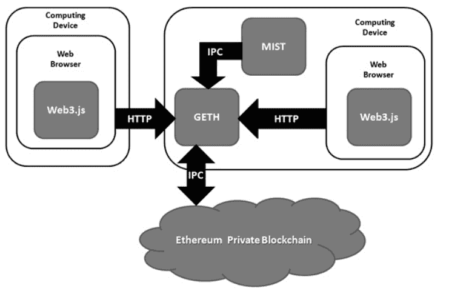
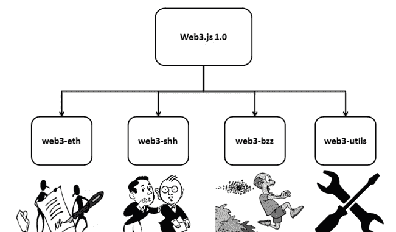
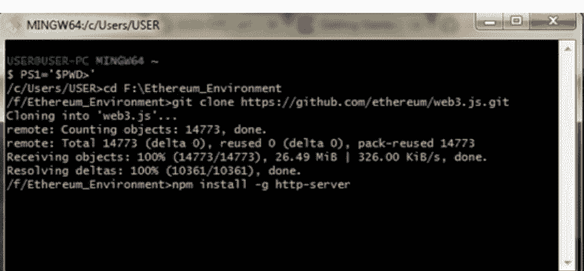
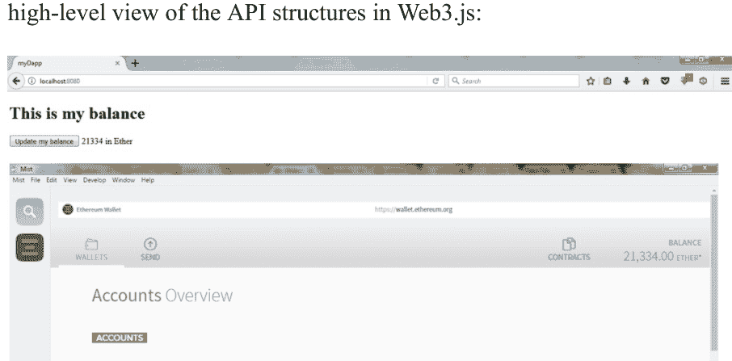
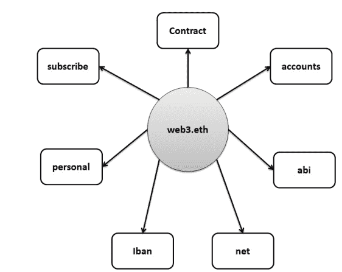
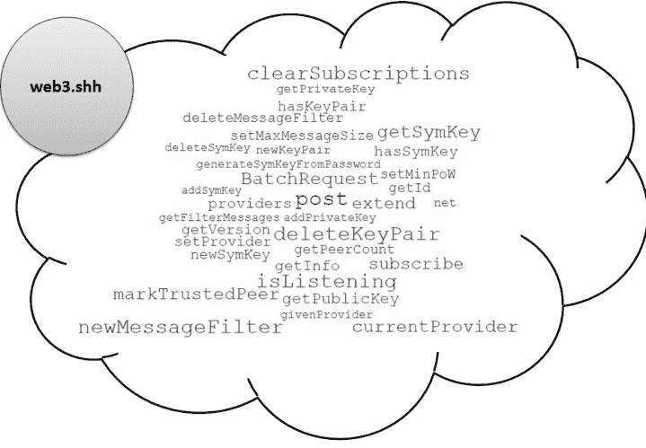
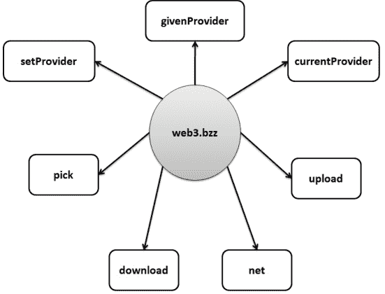
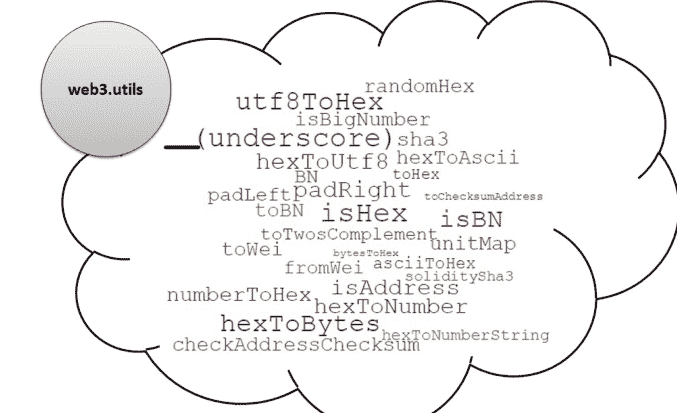

## Primer on Web3.js

在本章中，我们介绍 Web3.js，这是一个用 JavaScript 编写的特殊应用程序编程接口库。该接口将我们的 Web 浏览器与 Ethereum 区块链节点连接起来。我们将从了解 geth、Web3.js 和 Mist 之间的差异开始本章。然后我们将学习如何导入此 API 库并与 geth 连接。我们将随后探索 Web3.js 库内部的 API 结构。我们以研究所有权合约的设计作为本章的结尾。

学习完本章后，你将能够做到以下几点：

- Differentiate between Mist, geth, and Web3.js
- Realize how Web3.js interacts with the Ethereum blockchain
- Use Web3.js to run a basic smart contract
- Know the API structure of Web3.js library
- Understand the design of an ownership contract


## Web3.js 在以太坊生态系统中的作用

戴尔·卡内基，这位著名的自我提升训练师，曾说过财务成功有15%归因于技术技能，其余85%则归因于表达思想和激发人们热情的能力。区块链可能是由可靠的计算原理支持的前沿技术，但要使其取得财务成功，我们需要在人们中实现大规模采用。为此，我们需要一个每个人都能理解的接口。

Web3.js 是一项可以帮助我们在这一领域的技术。Web3.js 为以太坊提供了 JavaScript 绑定，然后可用于使用 Web 堆栈构建直观的用户界面。



图 7.1：Web3.js 通过 geth 与私有区块链交互

它提供了一个抽象层来隐藏区块链上智能合约复杂的内部运作。简单来说，使用 JavaScript 实现的 Web 应用程序通过 Web3.js 库与以太坊节点通信或与区块链上的智能合约进行交易。

图 7.1 说明了这种交互。图 7.2 清楚地区分了 Mist、geth 和 Web3.js。在此表中，我们可以看到 Mist 和 geth 使用 IPC，而 Web3.js 使用远程过程调用（RPC）。

在以太坊生态系统中，IPC 通常在计算机本地工作。IPC 通常涉及 geth 在我们计算机的本地文件系统中创建一个 IPC 管道，命名为 geth.ipc。现在同一台计算机中的不同进程可以使用此管道与 geth 控制台创建双向通信。另一方面，RPC 在不同计算机之间工作，除非我们严格指定通过 RPC 端点连接到 localhost，例如使用 localhost:8545 或 127.0.0.1:8545。

| Mist | Geth | Web3.js |
|---|---|---|
| 它是一个浏览器 | 它是一个命令行界面 | 它是一个 API 库 |
| 主要使用 JavaScript 实现 | 主要使用 Golang 实现 | 主要使用 JavaScript 实现 |
| 它用作钱包并且可以在区块链上运行 DApps | 它是运行完整以太坊节点或私有区块链的工具 | 它使用用户触发事件与以太坊节点交互 |
| 使用进程间通信（IPC） | 使用进程间通信（IPC） | 使用远程过程调用（RPC） |

图 7.2：Mist 与 geth 与 Web3.js

有趣的是，geth 和 Web3.js 中的 IPC 和 RPC 都使用一个名为 JSON-RPC 的通用协议。JavaScript 对象表示法（JSON）是一种轻量级的数据交换格式，用于人类与机器交互。人类发现这种格式易于阅读和编写。机器发现这种格式易于解析和生成。这种数据格式完全独立于语言，基本上由两种结构组成：名称-值对和有序的值列表。

JSON-RPC 是一种无状态的轻量级 RPC 协议，使用 RFC 4627 作为数据格式。**请求评论（RFC）** 由 IETF 发布（请参阅 _第 2 章，Grokking Ethereum_）。

典型的 JSON-RPC 请求示例如下：

```json
{"jsonrpc":"2.0","method":"eth_coinbase","params":[],"id": 67}
```

在前面的示例中，我们有一个包含四个属性的列表：

- `jsonrpc`：这是一个字符串，指定 JSON-RPC 协议的版本。这里版本为 `"2.0"`。
- `method`：这是一个包含要调用的方法的字符串。
- `params`：这包含在调用方法期间要使用的参数值。
- `id`：这是客户端建立的标识符。如果指定，我们让服务器知道我们期望一个响应。否则，服务器假设该消息为通知。

截至撰写本文时，Web3.js 的工作版本为 0.x.x；1.0 版本仍未发布。一旦 Web3.js 版本 1.0 发布，其库将支持如 _图 7.3_ 所示的一组模块。

每个模块为以太坊生态系统贡献特定的功能：

- web3-eth 模块用于在以太坊区块链上开发智能合约
- web3-shh 模块用于使用 whisper 协议进行点对点通信
- `web3-bzz` 模块用于使用 swarm 协议进行去中心化文件存储
- `web3-utils` 模块用于 DApp 开发并包含有用的辅助函数

这在以下图中可视化：



图 7.3：Web3.js 在以太坊生态系统中的模块



图 7.4：从 GitHub 安装 Web3.js 和 http-server

一旦 HTTP 服务器安装完成，我们就可以使用 http-server 命令启动服务器。要终止服务器实例，我们需要按 Ctrl + C。现在我们使用 Cygwin 打开 geth 节点，使用以下 geth 命令：

```
> geth -datadir=./chaindata/ --rpc --rpccorsdomain "*"
```

这是跨源资源共享（CORS）。例如，假设您想使用单个 Web 页面应用程序向多个服务器发送和接收数据，这就是 CORS 发挥作用的地方。它充当浏览器同源安全策略的变通方法。在使用 Web3.js 设置私有区块链后，我们编写一个名为 myDapp 的基本合约来获取我的钱包余额。此文件命名为 index.html 并放置在 web3.js 文件夹之外。

图 7.5 显示了调用 Web3.js 库的 HTML 脚本，使用 JavaScript 代码：

```
<!doctype html>
<html>
<head>
<title>myDapp</title>
<script src="web3.js/dist/web3.min.js"></script>
<script type="text/javascript">
    if (typeof web3 !== 'undefined') {
        web3 = new Web3(web3.currentProvider);
    } else {
        // set the provider you want from Web3.providers
        web3 = new Web3(new Web3.providers.HttpProvider("http://localhost:8545"));
    }
    function getBalance() {
        document.getElementById("myBalance").innerText =
        web3.fromWei(web3.eth.getBalance(web3.eth.accounts[0]), "ether");
    }
</script>
</head>
<body>
<h1>This is my balance</h1>
<button onclick="getBalance()">Update my balance</button>
<span id="myBalance"></span> in Ether
</body>
</html>
```

图 7.5：index.html 中的 Web3.js 库

当我们在 Web 浏览器中打开此 index.html 文件并按下余额按钮时，它会返回我私有区块链中存在的以太币数量，这可以通过打开 Mist 浏览器来验证。这种比较在图 7.6 中说明。在下一节中，我们将对 Web3.js 中的 API 结构有一个高层次的了解。



图 7.6：Mist 与基于 Web3.js 的 Dapp 的以太币余额比较

## Web3.js 的 API 结构

让我非常诚实地告诉你，浏览 Web3.js 库以找到我们合约所需的合适函数可能会令人困惑。这就是我们需要将 Web3.js 1.0 文档视为我们完美的旅游指南手册的原因。整个文档可免费获取，网址为 https://web3js.readthedocs.io/en/1.0/index.html。

在本节中，我们将可视化重要 API 的地图，以便当我们实际编写合约时，可以直接跳转到 Web3.js 文档的各部分以获取规范和参数使用模式。

如图 7.3 所示，我们有四个子模块，即 web3-eth、web3-shh、web3-bzz 和 web3-utils。在图 7.4 中，我们将 web3-eth 模块细分为重要的子 API 模块。每个子模块都有若干辅助函数，可由智能合约调用。

要完成通过辅助函数可用的任何通用任务，调用的智能合约必须花费操作所需的以太币。

```
web3.eth.personal.sign(dataToSign, address, password, [callback])
```

下面是一个调用此函数并将输出打印到控制台的示例：

```
web3.eth.personal.sign("Dear Lord", "0x11f4d0A3c12e86D4D5F39D213F9E19D048296DAe", "password")
"0x30955ed65396facf86c53e6219c52D4daeDe92aa4941d89635409de4c9c9f9466d4e9aaec999"
```

以下是 web3.eth 的 API 子模块：




## 图 7.7：web3.eth 的 API 子模块

简而言之，web3.eth 模块的 API 子模块中的函数有助于完成以下任务：

- web3.eth.subscribe：用于订阅区块链上发生的特定事件。
- web3.eth.Contract：可以像操作 JavaScript 对象一样，轻松地与区块链上的智能合约进行交互。
- web3.eth.accounts：用于生成数据、以太坊账户，并对交易进行签名。
- web3.eth.personal：允许我们的合约与以太坊节点账户进行交互。
- web3.eth.Iban：用于在以太坊地址与 IBAN（国际银行账户号码）和 BBAN（基本银行账户号码）之间进行转换。
- web3.eth.abi：允许合约对参数进行解码和编码，转换为**应用程序二进制接口（ABI）**，以便向**以太坊虚拟机（EVM）**发起函数调用。
- `web3.eth.net`：帮助我们的合约与以太坊节点的网络属性进行交互。除了 utils 之外，该子模块在所有 web3 模块中都是通用的；因此，它用 `web3.*.net` 表示，其中 * 可以是 `eth`、`shh` 或 `buzz`。

类似地，*图 7.8* 描绘了 `web3.shh` 模块的 33 个 API 子模块。忽略 `web3.shh.net` 模块后，其余 32 个子模块中的每一个都是一个函数，具有不同的输入和输出参数定义，并利用 Whisper 协议进行点对点通信：

- `setProvider`：更改其模块的提供者。
- `providers`：包含当前可用的提供者。
- `givenProvider`：返回浏览器当前的本地提供者。
- `currentProvider`：返回当前设置的提供者或 null。
- `batchRequest`：创建并执行批量请求。
- `extend`：允许扩展 web3 模块。
- `getId`：获取当前网络 ID。
- `isListening`：检查节点是否正在监听对等节点。
- `getPeerCount`：获取已连接对等节点的数量。
- `getVersion`：获取正在运行的 Whisper 的版本。
- `getInfo`：获取当前 Whisper 节点的信息。
- `setMaxMessageSize`：设置 Whisper 节点允许的最大消息大小。
- `setMinPoW`：设置节点所需的最小 PoW。
- `markTrustedPeer`：将特定的受信任对等节点标记为可信，允许其发送过期或历史消息。
- `newKeyPair`：生成新的公钥和私钥对，用于消息加密和解密。
- `addPrivateKey`：存储由私钥派生的密钥对，并返回其 ID。
- `deleteKeyPair`：如果存在，删除指定的密钥。
- `hasKeyPair`：检查 Whisper 节点中是否存在与给定 ID 匹配的密钥对的私钥。
- `getPublicKey`：返回指定密钥对 ID 的公钥。
- `getPrivateKey`：返回指定密钥对 ID 的私钥。
- `newSymKey`：生成一个随机对称密钥，并将其存储在某个 ID 下。
- `addSymKey`：存储密钥并返回一个 ID。
- `generateSymKeyFromPassword`：从密码生成密钥并存储，然后返回其 ID。
- `hasSymKey`：检查与给定 ID 一起存储的对称密钥。
- `getSymKey`：返回与给定 ID 关联的对称密钥。
- `deleteSymKey`：删除与给定 ID 关联的对称密钥。
- `post`：将 Whisper 消息发布到网络。
- `subscribe`：订阅传入的 Whisper 消息。
- `clearSubscriptions`：清除对 Whisper 节点的订阅。
- `newMessageFilter`：在节点内创建新的过滤器。
- `deleteMessageFilter`：删除节点中的消息过滤器。
- `getFilterMessages`：检索自上次调用此函数以来收到的、且符合新过滤条件的消息。



## 图 7.8：web3.shh 的 API 子模块

*图 7.9* 列出了 web3.bzz 模块的 API 子模块。这些函数与 Swarm 交互：

- `setProvider`：更改其模块的提供者。
- `givenProvider`：返回兼容以太坊浏览器的本地当前提供者。
- `currentProvider`：返回当前提供者的 URL 或 NULL。
- `upload`：将文件、文件夹或原始数据上传到 Swarm。
- `download`：从 Swarm 下载文件和文件夹，以缓冲区形式或保存到磁盘。
- `pick`：打开文件选择器，帮助在浏览器中选择文件。
- `net`：允许我们与以太坊节点网络属性进行交互。



## 图 7.9：web3.bzz 的 API 子模块

*图 7.10* 展示了 web3.utils 模块的 28 个 API 子模块。这些是合约执行与节点相关的基本操作时常用的函数。例如，`web3.utils.sha3()` 会为传入该函数的字符串字面量生成哈希。此函数有一个别名 `web3.utils.keccak256()`。还有一个特殊的函数，它提供有用的辅助功能，而无需扩展任何内置对象。它被称为下划线函数，通常定义为 `web3.utils._()`。为方便起见，这里列出了这些函数：

- `randomHex`：根据给定的字节大小生成加密强度高的伪随机 HEX 字符串。
- `_`：提供日常函数辅助功能，如 `map`、`filter` 和调用，以及更专业的功能，如函数绑定、JavaScript 模板化、创建快速索引和深度相等性测试。
- BN：在 JavaScript 中计算大数运算。
- isBN：检查给定值是否是 BN.js 实例。
- isBigNumber：检查给定值是否是 BigNumber.js 实例。
- sha3：计算输入的 sha3。
- soliditySha3：通过 ABI 转换并紧密打包给定输入参数，然后计算其 sha3 哈希。
- isHex：检查给定字符串是否是 HEX 字符串。
- isHexStrict：检查以 0x 为前缀的字符串是否是 HEX 字符串。
- isAddress：检查给定字符串是否是有效的以太坊地址。
- toChecksumAddress：将大写或小写的以太坊地址转换为校验和地址。
- checkAddressChecksum：检查给定地址的校验和。
- toHex：自动将任何给定值转换为 HEX。
- toBN：将值转换为 BN.js 实例，用于 JavaScript 中的大数运算。
- hexToNumberString：将给定 HEX 值以字符串形式返回其数字表示。
- hexToNumber：返回给定 HEX 值的数字表示。
- `numberToHex`：返回给定数字值的 HEX 表示。
- `hexToUtf8`：返回给定 HEX 值的 UTF-8 字符串表示。
- `hexToAscii`：返回给定 HEX 值的 ASCII 字符串表示。
- `utf8ToHex`：返回给定 UTF-8 字符串的 HEX 表示。
- `asciiToHex`：返回给定 ASCII 字符串的 HEX 表示。
- `hexToBytes`：从给定的 HEX 字符串返回字节数组。
- `bytesToHex`：从字节数组返回 HEX 字符串。
- `toWei`：将任何 ether 值转换为 wei。
- `fromWei`：将任何 wei 值转换为 ether 值。
- `unitMap`：显示所有可能的 ether 值以及它们对应的 wei 数量。
- `padLeft`：在字符串左侧添加填充，常用于为 HEX 字符串添加填充。
- `padRight`：在字符串右侧添加填充，常用于为 HEX 字符串添加填充。
- `toTwosComplement`：将负数转换为二进制补码：



## 图 7.10：web3.utils 的 API 子模块

## 图 7.11：所有权智能合约

```
pragma solidity ^0.4.19;
contract OwnershipContract
{
    struct FileMapping
    {
        uint timestamp;
        string owner;
    }

    mapping (string => FileMapping) files;

    event FileLogStatus(bool status, uint timestamp, string owner, string fileHash);

    //Used to store the owner of file at the block timestamp
    function set(string owner, string fileHash) public
    {
        //Here we are checking for default value i.e., all bits are 0
        if(files[fileHash].timestamp == 0)
        {
            files[fileHash] = FileMapping(block.timestamp, owner);

            //triggering an event to notify the frontend
            FileLogStatus(true, block.timestamp, owner, fileHash);
        }
        else
        {
            //returning out a false status to the frontend
            FileLogStatus(false, block.timestamp, owner, fileHash);
        }
    }

    //this is used to get file information
    function get(string fileHash) internal view returns (uint timestamp, string owner)
    {
        return (files[fileHash].timestamp, files[fileHash].owner);
    }
}
```

图 7.12 中显示的相应 web3.js 文件可以嵌入到 JavaScript 文件中：

```
var browser_untitled_sol_ownershipcontractcontract = web3.eth.contract([{"constant":false,"inputs":[{"name":"fileHash","type":"string"}],"name":"get","outputs":[{"name":"timestamp","type":"uint256"},{"name":"owner","type":"string"}],"payable":false,"stateMutability":"nonpayable","type":"function"},{"constant":false,"inputs":[{"name":"owner","type":"string"},{"name":"fileHash","type":"string"}],"name":"set","outputs":[],"payable":false,"stateMutability":"nonpayable","type":"function"},{"anonymous":false,"inputs":[{"indexed":false,"name":"status","type":"bool"},{"indexed":false,"name":"timestamp","type":"uint256"},{"indexed":false,"name":"owner","type":"string"},{"indexed":false,"name":"fileHash","type":"string"}],"name":"FileLogStatus","type":"event"}]);
var browser_untitled_sol_ownershipcontract = browser_untitled_sol_ownershipcontractcontract.new(
  from: web3.eth.accounts[0],
...
```

## 图 7.12：Solidity 合约对应的 Web3.js 代码


正如你所见，我们并未深入探讨如何在 JavaScript 代码中实现这个 Web3.js 版的所有权合约的细节来开发前端应用。

在 _第 8 章，从零开始开发加密货币_ 中，我们将更仔细地审视实现方式，在其中我们将从零开始开发一种加密货币代币。

## Summary

本章首先明确区分了 geth、Mist 和 Web3.js，以及它们如何通过 IPC 和 HTTP 在以太坊区块链上协同运行。两者都被看到使用了 JSON-RPC 协议。然后我们继续将 Web3.js 库划分为四个主要模块，即 eth、shh、bzz 和 utils。我们还看到了如何在使用纯 JavaScript 调用 Web3.js 库来在私有区块链上运行智能合约。我们学习了如何探索 Web3.js 库的各种 API 子模块和函数。本章以一个所有权合约的 Solidity 实现及其 Web3.js 等效代码生成作为结尾。

在第 8 章，*从零开始开发加密货币* 中，我们将从零开始开发一种加密货币代币并学习有关 **首次代币发行 (ICO)** 的知识。
