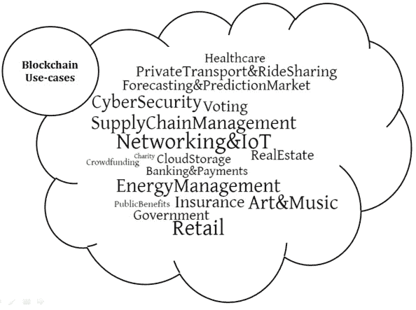
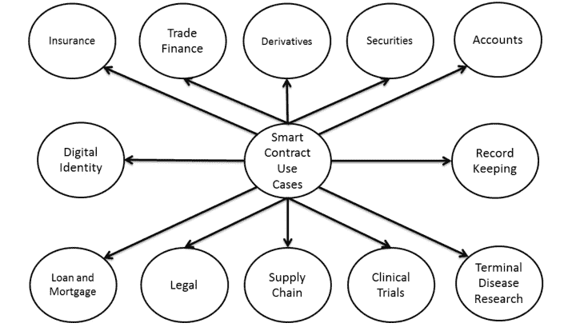
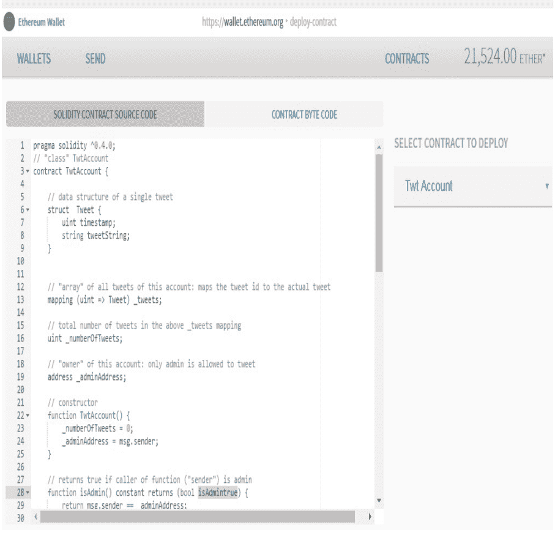
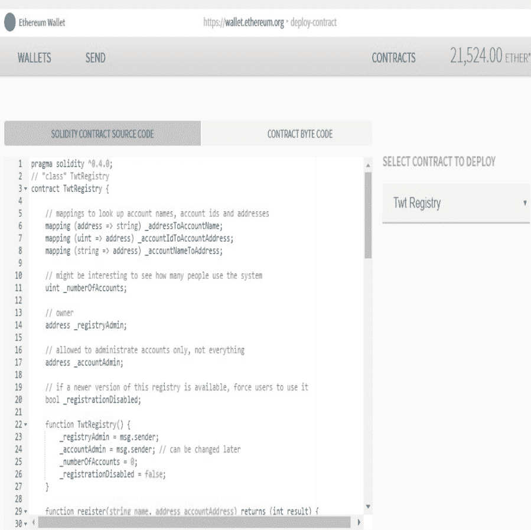
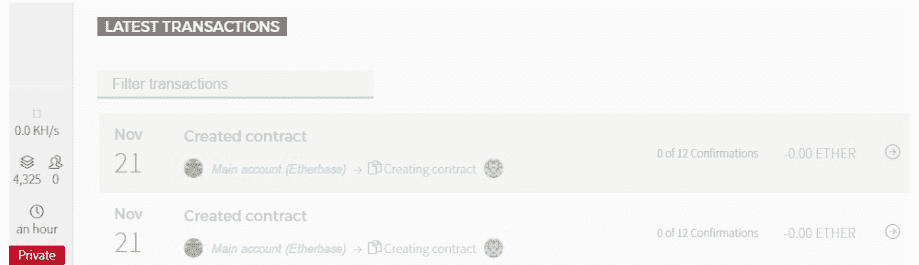
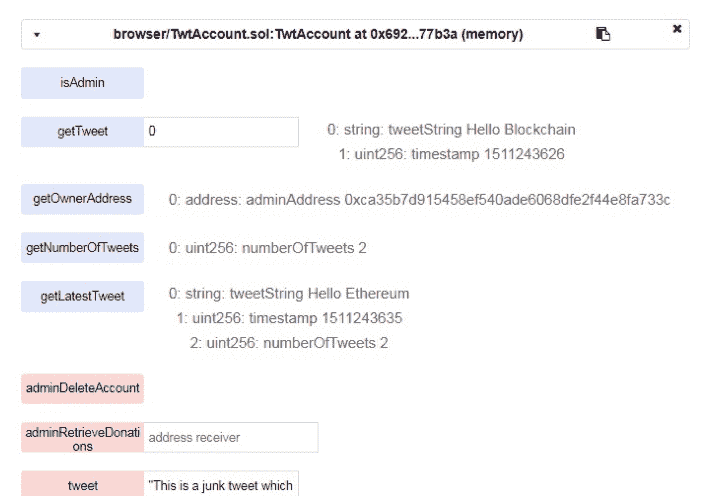

## 企业用例

本章重点介绍区块链和智能合约如何渗透到行业中。我们首先介绍互联网货币的概念，并探讨智能合约如何开始在各个行业影响技术、社会和经济。具体来说，我们将探索 18 个区块链用例和 12 个智能合约用例。我们以设计命令行界面为基础的去中心化微型博客平台的各个模块并将其部署在私有区块链上作为本章的结尾。

学习完本章后，你将能够：

- 欣赏互联网货币的概念
- 了解智能合约和区块链的各种用例
- 理解微型博客 DApp 的构建模块
- 探索 DApp 的安全性和管理属性

> “What you seek is seeking you”
> — Rumi

在开始本章之前，我想请你退一步，思考一下前面这句引言，这句话出自著名的 13 世纪波斯逊尼派穆斯林诗人贾拉勒·阿丁·穆罕默德·鲁米之口。这句臭名昭著的六个词的引言蕴含着神秘而深刻的哲学。

例如，如果你在寻找生活伴侣，那么在这个世界上就有人在寻找一个像你这样的人。

现在让我们举一个最简单的技术例子。我们都在网上搜索，对吧？我们通常会用 Google 搜索（从没听过有人说，让我们用 Bing 搜索，或让我们用 DuckDuckGo 搜索，虽然这也很正常），而且这还是免费的。但在这个网络经济中，当我们免费获得某样东西时，我们必须明白我们本身就是产品。你可能会问，为谁？为广告商、市场研究人员、产品设计师——对他们来说，我们就是产品。我们点击的链接、我们查看的产品、我们进行的交易、我们喜欢的语录、我们听的歌曲——我们在网上做的几乎每一个动作都被记录下来。甚至我们在最喜欢的聊天应用中输入给朋友发送的最小的信息，然后删除以发送更正式的信息，那也被记录下来。这些信息被卖给公司、数据巨头和产品制造商，他们得以窥见我们真正私密的心理。他们利用我们的心理作为产品来创造产品或这些产品的广告，而我们最终会点击它们并为搜索引擎公司创造收入。所以，我们在网上寻求得越多，它就越寻求我们。

对于一个注重隐私的人来说，这无疑令人担忧。我们脑中会自然产生一个显而易见的问题，*"为什么我的个性会让别人而不是我自己获利？"* 当然，我们从平台那里获得了服务，但这不应该以牺牲我们的个性和隐私为代价。这正是去中心化和去中心化应用的种子萌芽的想法，在那里我们的个性是我们自己的责任，没有中间人/机器应该在未经我们明确许可的情况下从中获利。

寻求爱情和知识是可以的，但我们内心还有一个更大的怪物需要喂养。那就是渴望被认可、渴望在社会中受人尊重、渴望成为有权势和掌控我们所处社会内部运作的人。 somehow，在人类文明的世代传承中，寻求和赚取金钱给我们带来了这种认可。虽然另外两种，知识和爱情，可以积累并提供更多认可，但大多数普通人觉得金钱可以在我们有生之年带来名声。因此我们与银行的共生关系开始了，因为某种程度上它让我们相信我们的钱在它们那里是安全的，如果我们长期存放，还会增值。然后出现了股市，一种合法化且受监管的赌博，有时可以使我们的钱翻倍，前提是我们愿意冒一切风险。然后出现了衍生品、债券、期货，以及法规和合规；金融警察会保护我们免受众多诱人却有风险的诱惑的侵害。

但在 2008 年 9 月 15 日这个不幸的日子，当一家拥有 150 年历史的投资银行雷曼兄弟申请破产时，全世界都意识到银行并不像它们声称的那样安全。然而，人们仍然需要钱，银行必须继续存在。2009 年 1 月 3 日，一个匿名实体中本聪引入了比特币的概念，这引发了普通民众与所谓受监管金融机构之间的权力斗争。

这些金融机构最初认为，如果只是忽视这场革命，这场加密经济很快就会自然死亡。像乌龟缩回壳中一样，金融世界开始忽视这场正在进行的革命。但加密货币在过去八年中不断发展。区块链技术不仅将货币带到了互联网，而且智能合约的引入使货币变得可编程。

我们对金钱的寻求把我们带到了一个新范式，互联网货币。在这里，金钱不仅仅是交换媒介，也是表达媒介。在上一章中，我们讨论了 ICO，它本质上是将人类思想转化为加密货币代币。我们正处于一个技术十字路口，金钱正在寻求我们。它通过将我们的想法转变为人们可以购买的代币来寻求我们。如果我们的想法取得成功，我们的代币也会成功。

互联网货币中这种新获得的自由，缺乏任何广泛接受的框架或指导，导致了科技行业非常动荡的局面。可编程货币并不等同于某个新的网络应用或软件。区块链上不可变性的概念本身就使互联网货币的设计成为企业架构师的噩梦。他们不能再像数据科学家或软件开发者那样思考。他们必须更像固件开发者或建筑工人那样思考。这就像为活人打造定制住宅。我们可以在平面规划阶段提出任何想要的更改，但一旦批准并建成房屋后，在不更改原始平面图的情况下修改一个房间就极其困难。

同样，如果原始平面图存在一些薄弱点和脆弱的盲点，小偷就可以闯入并偷走所有贵重物品，就像我们在以太坊 DAO 和 Parity 黑客事件中所看到的那样。对于这项技术，我们需要退一步，鼓励单体架构，而非模块化架构，因为前者更紧凑，对黑客攻击的脆弱性更小：



图 9.1：区块链用例


## 银行与支付

区块链将以互联网颠覆媒体行业的方式颠覆银行业。它正在摧毁因国界而产生的监管和合规问题，因为比特币和以太坊等加密货币能够在几秒钟内完成跨境交易，且转账费用大幅降低。这将发达国家的投资者与发展中国家的创新者连接起来。巴克莱等银行正在实施区块链以加强其运营能力。银行也在为基于区块链的初创企业提供种子资金并进行投资。

## 保险

全球保险市场建立在信任之上。区块链是管理信任的一种新方式。它可用于验证被保险人的身份，并使用 oraclize 等框架与实时数据交互，在赔付期间对保额进行调整。用于汽车和农作物保险的智能合约在确定赔付方面可以发挥强大作用，而无需任何显著的人为干预。

Fizzy.axa 是法国保险巨头 AXA 推出的基于以太坊的保险产品。这些是智能合约，可在航班延误超过两小时时自动触发赔付。

## 预测与预测市场

区块链即将革新预测行业。我们可以使用智能合约下注，中奖金额将自动转入我们的账户。任何具有挑战性的事件，如选举结果、超级碗比赛结果和世界杯决赛选手预测，都可以转化为一种自动化且合法化的赌博游戏。

App.Augur.net 是一个基于以太坊的预测市场平台，我们可以在此下注并以以太币进行货币交易。它是完全去中心化的。

## 慈善

由于中间人和托管的低效而导致的腐败是慈善领域常见的难题。这些问题阻碍了资金到达真正需要的人手中。区块链通过提供捐赠追踪功能来颠覆慈善领域，确保我们的资金到达正确的人手中。

在以太坊生态系统中，giveth.io 引入了一种名为流动承诺的概念，本质上是一个智能合约，可以直接将以太币资金转移给某人，或通过自动化代理承诺转移资金，并在分布式账本上进行透明追踪。每当资金被移动时，捐赠者都会收到通知并可以否决任何操作。

它还提供了一个平台来发展去中心化的利他主义社区，可以将资金分配给活动并追踪捐赠是否实现了预定义目标。

其源代码和开发状态可在以下 GitHub 链接进行追踪：`https://github.com/Giveth`。

## 公共福利

区块链是透明分配社会福利资金的良好框架。养老金、军队福利、奖学金和失业救济金可以在不遭受缓慢、腐败和官僚主义的情况下进行发放。

GovCoin Systems Limited 已与巴克莱银行和伦敦大学学院合作，利用区块链和智能合约开发社会福利分配系统，该系统将由英国政府就业与养老金部进行试点。

## 能源管理

电网和公用事业行业高度集中化。要购买天然气、燃料和电力，我们必须通过公共电网或授权的私人公司。即使是生产商也必须通过高度监管的渠道出售基本公用事业。区块链也可以通过引入点对点公用事业共享框架来打破这种垄断。

德国电力公司 RWE 已与基于以太坊的区块链初创公司 Slock.it 合作，开发用于电动汽车的去中心化汽车充电站。

## 艺术与音乐

非法艺术拍卖和音乐盗版一直是娱乐行业的挑战。加上经纪人和唱片公司的佣金，艺术家被窃取的资金比例相当严重。区块链提供了一个透明的系统，可直接从消费者向艺术家付款，并使用唯一签名存储艺术品的身份。

Maecenas 是一个开放的区块链平台，用于以去中心化的方式访问和拍卖美术作品。Mycelia 是一个在线音乐平台，可直接从消费者向艺术家付款。

## 零售

当我们从 Spencers 或食品集市购买每月必需品时，我们信任零售系统会向商品的实际生产者付款。区块链可以在没有中间实体的情况下连接生产者与消费者。这可能导致零售价格大幅下降。

https://www.openbazaar.org/ 是一个基于比特币、区块链的在线点对点商店，允许每个人开设自己的 eShop 并在没有任何中间实体佣金的情况下销售产品。该平台接受比特币交易。

## 房地产

买卖房地产可能涉及缺乏透明度、官僚主义、公共记录错误和欺诈。区块链可以减少基于纸质的记录保存并加快交易速度。

智能合约可以帮助自动化追踪、转让产权、验证所有权并确保文件准确性。

印度安得拉邦州政府已与瑞典初创公司 ChromaWay 合作，构建基于区块链的土地登记解决方案。据估计，印度各地支付给土地登记员的贿赂总额达 7 亿美元。

## 网络安全

网络安全与区块链具有共生关系。两者都需要彼此成长并相互颠覆。区块链的基本基础建立在密码学哈希函数之上，而区块链仍处于起步阶段，因此网络安全至关重要。

量子计算是对现代非对称密码学的真正威胁。Iota.org 是一种下一代、基于图谱的分布式账本技术，声称可以克服这一量子威胁并增强 DLT 的安全性。

## 群众募资

区块链通过引入首次代币发行概念将众筹提升到全新水平。正如我们在引言和前一章中所讨论的，我们在建立一个具有适当审计的共识监管的 ICO 框架方面还有很长的路要走。目前，ICO 领域可以被视为加密股权代币的“狂野西部”情况。

## 网络与物联网

区块链可以实现机器之间无需人工干预的通信和微支付。机器经济是一个新兴领域，将在推动自动化创新方面发挥关键作用。

Project Oaken 是一个获奖的、基于以太坊的智能合约项目，利用物联网为自动驾驶和手动汽车支付自动过路费给收费站。该原型使用特斯拉成功测试，并在迪拜区块链黑客松中赢得 10 万美元。目前，Oaken Innovations 已与丰田研究和麻省理工学院媒体实验室合作，研究此类原型以实现自主驾驶未来。

## 投票

> “人民知道有选举就足够了。投票的人决定不了任何事。计票的人决定一切。”
> 
> - 约瑟夫·斯大林

根据《哈佛商业评论》，数据科学家可能是最性感的工作，但它在预测 2016 年美国大选方面惨遭失败。操纵投票系统可能是为了转移对主要数据科学失败的注意力而提出的阴谋论，但也不能完全排除。区块链技术由于其不可变性，可以为此类民主进程带来奇迹。

https://www.democracy.earth/ 和 https://followmyvote.com/ 是由风险投资公司资助的基于区块链的投票应用。它们也有计划和路线图在不久的将来纳入智能合约。


## 政府

政府系统往往容易滋生腐败、效率低下且不够透明。实施基于区块链的系统可以显著提高安全性、透明度和效率，通过减少政府运作中的官僚开支。

爱沙尼亚正计划开设加密银行。迪拜的目标是到2020年将政府文件上传到区块链上。

## 私人交通与拼车

事实上，Uber 和 Ola 已经颠覆了出租车和公共交通行业。区块链可以通过提供去中心化的点对点共享模式，将这一进程再推进一步。这将帮助司机群体在没有不必要的中介佣金的情况下赚取更多收入。

Oaken Innovations 和 MIT Media Lab 已与丰田合作开展另一个关于收费的项目，用于开发点对点拼车 DApp。位于以色列特拉维夫的 Lazooz.org 已推出一个由社区拥有的去中心化交通系统，并提供拼车服务。

## 云存储

区块链允许云存储被加密且高度分散，使其对攻击更具鲁棒性。集中式服务器上的数据容易受到数据丢失、黑客攻击和人为错误的影响。

Storj.io 是一个使用区块链的加密云存储网络。但存储和检索的定价仍然是一个挑战。Swarm 和 IPFS 也有潜力在费用结构最低的情况下发展成成熟的云存储。

## 医疗保健

区块链等技术对于健康记录行业来说可能是一大福音，可用于防篡改的个人健康记录，而这一领域在很大程度上依赖政府机构和传统存储系统。它可以让公众有能力对抗无意义的政治操弄。账本向公众开放，包含匿名的患者数据，从入院到出院全程记录。不允许任何修改，不允许任何篡改。

MedRec 就是这样一个在 MIT Media Lab 内孵化的项目，它开发了一个基于以太坊私有链的医疗记录原型系统。这个去中心化应用可以将患者记录与外部数据源连接起来，例如 Fitbit（使用物联网的实时身体活动追踪应用）和 23andMe（通过唾液样本进行 DNA 性状检测的应用）。MedRec 还允许患者安全地授权不同的医生、医疗服务提供者、研究人员，甚至患者的子孙后代访问他们的个人健康信息。

## 智能合约用例

在本节中，我们将讨论智能合约作为一种技术如何颠覆社会及其经济的方方面面。

图9.2展示了智能合约的12个用例：



图9.2：智能合约用例

### 保险

大多数保险流程本质上是分离的，且涉及许多人工干预。智能合约与物联网相结合，可以做出具有自我意识的决策，实现自动化保险赔付。

通过减少验证报告和保单中的重复工作，它增加了节省。

### 贸易金融

智能合约促进了更快的信用证和付款发起，从而简化了国际转账。这提高了资产的流动性，提高了创建合同协议的效率，并促进了更快的付款审批。

### 衍生品

智能合约通过简化交易后流程，消除了交易生命周期中的重复过程。它支持头寸的实时估值、自动化外部事件处理以及自动化结算义务，同时处理触发的交易事件。

### 证券

智能合约可以促进自动化的股息支付、股票分割和负债管理。

它还通过绕开中介机构和管理资本化来降低运营风险。

由于证券基于分布式账本，它提供了数字化、透明且可追溯的端到端工作流程。

### 账户

使用智能合约进行去中心化的财务记录可以提高透明度和数据完整性，从而带来市场稳定。由于金融数据的可访问性增强，对资本金额的洞察力也得到了改善。

### 数字身份

智能合约可以使个人控制并拥有自己的数字身份。然后，每个人都可以选择将哪些个人数据作为 KYC 信息暴露给第三方。

这将降低交易对手方的数据泄露，并提高合规性和互操作性。

### 记录保持

自动合规、自动续约、自动释放和自动化商业代码备案是智能合约的一些主要优势。

这反过来又可以减少法律费用，跟踪贷款和抵押品价值，并自动归档。

### 贷款和抵押贷款

目前，抵押贷款是一个非常混乱且需要人工操作的过程。智能合约可以通过连接抵押交易中的不同参与方来使这一过程自动化，从而减少出错的可能性。

它提高了服务记录的可见性，并在抵押财产还清后自动释放对该财产的控制权。

### 法律

使用智能合约，诸如财产转让之类的法律服务可以做到无欺诈且无缝。交易高效且透明。审计和保证成本也得以降低。

### 供应链

智能合约简化了复杂的多方交付系统，并在产品跟踪方面实现了精细化；可追溯性和验证得到增强，从而减少了欺诈和盗窃。预言机在供应链中扮演着重要角色，为智能合约提供外部数据。

### 临床试验

智能合约提高了跨机构的可见性，打破了地理边界，这可以为临床试验带来巨大好处。它能够对患者数据进行同意跟踪，提高数据隐私性，简化试验流程，并通过提高独立研究人员对试验结果的可复现性来优化试验设置。

### 绝症研究

癌症等绝症在协作研究方面有其自身的挑战，原因在于数据隐私问题和激励不一致。智能合约可以通过在许多部门之间提供高效数据共享来释放数据的力量，同时保护患者隐私。它还有助于实时可见性和政策执行，同时满足监管要求和患者同意。

## 去中心化微博

在本节中，我们将探讨一个基于以太坊的基础微博平台的设计。使用这些平台，新用户可以注册获得个人微博账户，他们可以用该账户在去中心化的以太坊私有链上发布匿名推文，默认情况下禁用评论。

但为什么我们需要去中心化的区块链来发推文，更重要的是为什么用户是匿名的？要回答这个问题，我们需要了解正常集中式微博平台的行政和安全约束，我们将在下一节中讨论。

### 行政与安全约束

流行的微博平台，如 Twitter、Tumblr 和微博（中国的微博变体，由新浪和腾讯主导），本质上都是集中式社交网络服务，容易出现问题。

这些问题主要存在于两个不同的维度。一个是技术性的，另一个是社会性的。在技术维度上，这类服务的迅速普及导致基础设施管理成本不断增加。这在生产环境中进行可扩展性部署时引发了许多行政问题。

例如，最近美国总统特朗普的 Twitter 账号 @POTUS 由于技术故障自动屏蔽了许多关注者。这类故障可能相当严重，因为自动化交易机器人会不断监控推文情绪，并决定全球证券交易所的各种股票价格，这可能导致市值在眨眼间蒸发数十亿美元。

在社会维度上，我们看到针对合法微博账户的网络喷子和在线虐待行为在增长。曾有案例显示，人们因为自己的种族、性别或宗教而失业、政治家被迫辞职、名人被罚款。

即使在我们的生活中，如果我们的直接上司或人力资源部门的人在关注我们的微博账号，我们也会感到在公开场合发微博有很大的压力。因此，在社会维度上，个人自由和安全成为一个重大问题。

去中心化微博平台可以通过提供一个去中心化的平台以及


anonymity respectively. However, it is important to note that anonymity is a choice rather than a mandate while using decentralized technologies like a blockchain. In simple terms, using a blockchain does not make us anonymous automatically; rather, it is an add-on feature that needs to be separately implemented on top of a blockchain.

The idea of this decentralized platform under discussion was originally conceived by a software developer named **Jahn Bertsch**. The entire functional logic was implemented in the Solidity programming language. It has two main smart contracts. An account related smart contract (`TwtAccount.sol`) and a user-registration related smart contract (`TwtRegistry.sol`). When these two smart contracts are deployed on the private blockchain, they interact with each other to form a command-line interface-based, decentralized, microblogging platform.

In the subsequent sections, we will dive into the individual Solidity file, set up the service on the private blockchain, and check how these smart contracts perform in CLI and remix browser mode.

## TwtAccount.sol

This solidity file models a single Twitter account on a blockchain. *Figure 9.3* summarizes the important functions present in this twitter account contract:

```
contract TwtAccount{

    function TwtAccount()

    function getOwnerAddress() constant returns(address adminAddress)
    function adminDeleteAccount()
    function adminRetrieveDonations(address receiver)

    function getLatestTweet() constant
    returns(string tweetString,uint256 timestamp,uint256 numberOfTweets)

    function isAdmin() constant returns(bool isAdmin)

    function getTweet(uint256 tweetId) constant
    returns(string tweetString,uint256 timestamp)

    function getNumberOfTweets() constant returns(uint256 numberOfTweets)
    function tweet(string tweetString) constant returns(int256 result)
}
```

Figure 9.3: TwtAccount contract summary

Now, let us understand explicitly what each function in this smart contract does. *Figure 9.4* denotes the start of the account contract where `TwtAccount()` is a constructor function. Tweet denotes the data structure of a single tweet. The mapping denotes an array of all tweets to a particular tweet, account, which helps in retrieving each tweet by their `tweetID`. The other two variables denote the owner of the account and the total count of tweets by the particular owner:

```
pragma solidity ^0.4.0;
contract TwtAccount {

    struct Tweet {
        uint timestamp;
        string tweetString;
    }
    mapping (uint => Tweet) _tweets;
    uint _numberOfTweets;
    address _adminAddress;

    function TwtAccount() {
        _numberOfTweets = 0;
        _adminAddress = msg.sender;
    }
}
```

```
function getTweet(uint tweetId) constant returns (string tweetString, uint timestamp) {
    // returns two values
    tweetString = _tweets[tweetId].tweetString;
    timestamp = _tweets[tweetId].timestamp;
}

function getLatestTweet() constant returns (string tweetString, uint timestamp, uint numberOfTweets)
{
    // returns three values
    tweetString = _tweets[_numberOfTweets - 1].tweetString;
    timestamp = _tweets[_numberOfTweets - 1].timestamp;
    numberOfTweets = _numberOfTweets;
}
```

Figure 9.7: Important tweet retrieval functions

The following Figure 9.8 summarizes the remaining functions of the account contract. getNumberOfTweets() returns the count of tweets by the account owner. getOwnerAddress() returns the account owner's blockchain address. The function adminRetrieveDonations() can be further developed to allow the account owner to retrieve any donations they have received from other users. So, this contract can then behave as a donation wallet that can tweet messages. We have muted this functionality to keep the contract simple. The function adminDeleteAccount() kills his tweeter account and retrieves all donations received:

```
function getNumberOfTweets() constant returns (uint numberOfTweets) {
    return _numberOfTweets;
}

function getOwnerAddress() constant returns (address adminAddress) {
    return _adminAddress;
}

function adminRetrieveDonations(address receiver) {
    if (isAdmin()) {
        receiver.transfer(this.balance);
    }
}

function adminDeleteAccount() {
    if (isAdmin()) {
        selfdestruct(_adminAddress);
    }
}
```

Figure 9.8: Miscellaneous functions

But to have a new tweeter account, we need user registration. This action is achieved by the TwtRegistry smart contract that is described in the next section.

## TwtRegistry.sol

This contract is used to register a new user with a tweeter account. Figure 9.9 summarizes the functions available in this registry contract:

```
contract TwtRegistry{
function TwtRegistry()
function adminUnregister(string name)
function register(string name,address accountAddress)returns(int256 result)
function getNumberOfAccounts()constant returns(uint256 numberOfAccounts)
function adminRetrieveDonations()
function getAddressOfName(string name)constant returns(address addr)
function adminDeleteRegistry()
function adminSetAccountAdministrator(address accountAdmin)
function adminSetRegistrationDisabled(bool registrationDisabled)
function getNameOfAddress(address addr)constant returns(string name)
function unregister()returns(string unregisteredAccountName)
function getAddressOfId(uint256 id)constant returns(address addr)
}
```

Figure 9.9: TwtRegistry contract summary

Similar to an account contract, TwtRegistry() is a constructor function, and different variables and mappings have been used to see the number of users, force them to use a newer version of registration updates, and administrate accounts using bool _registrationDisabled as shown in Figure 9.10:

```
pragma solidity ^0.4.0;
contract TwtRegistry {
    mapping (address => string) _addressToAccountName;
    mapping (uint => address) _accountIdToAccountAddress;
    mapping (string => address) _accountNameToAddress;
    uint _numberOfAccounts;
    address _registryAdmin;
    address _accountAdmin;
    bool _registrationDisabled;
    function TwtRegistry() {
        _registryAdmin = msg.sender;
        _accountAdmin = msg.sender;
        _numberOfAccounts = 0;
        _registrationDisabled = false;
    }
```

Figure 9.10: Constructor, variables, and mapping

The register() function, as shown in Figure 9.11, is used to create new

```
function unregister() returns (string unregisteredAccountName) {
    unregisteredAccountName = _addressToAccountName[msg.sender];
    _addressToAccountName[msg.sender] = "";
    _accountNameToAddress[unregisteredAccountName] = address(0);
    // _accountIdToAccountAddress is never deleted on purpose
}

function adminUnregister(string name) {
    if (msg.sender == _registryAdmin || msg.sender == _accountAdmin) {
        address addr = _accountNameToAddress[name];
        _addressToAccountName[addr] = "";
        _accountNameToAddress[name] = address(0);
        // _accountIdToAccountAddress is never deleted on purpose
    }
}

function adminSetRegistrationDisabled(bool registrationDisabled) {
    // currently, the code of the registry can not be updated once it is
    // deployed. if a newer version of the registry is available, account
    // registration can be disabled
    if (msg.sender == _registryAdmin) {
        _registrationDisabled = registrationDisabled;
    }
}
```

Figure 9.13: Registration related functions

Lastly, we have the miscellaneous functions similar to those discussed in the accounts smart contracts, as shown in Figure 9.14:

```
function adminSetAccountAdministrator(address accountAdmin) {
    if (msg.sender == _registryAdmin) {
        _accountAdmin = accountAdmin;
    }
}

function adminRetrieveDonations() {
    if (msg.sender == _registryAdmin) {
        _registryAdmin.transfer(this.balance);
    }
}

function adminDeleteRegistry() {
    if (msg.sender == _registryAdmin) {
        selfdestruct(_registryAdmin);
    }
}
```

Figure 9.14: Misc functions of TwtRegistry contract


## 私有区块链上的服务设置

在我们的私有区块链上设置推文服务非常简单。首先，我们需要在项目文件夹中使用 geth 命令行启动我们的 **进程间通信 (IPC)**，如 _第 3 章《智能合约的 Hello World》_ 中所述。

```bash
$ geth --datadir=./chaindata/
```

然后我们打开 Mist 浏览器并进入新合约选项。_图 9.15_ 表示在我们的私有区块链上部署智能合约账户：



图 9.15： 在 Mist 中编译 TwtAccount

我们以图 9.16 所示的类似方式编译注册表智能合约。在点击部署按钮之前，我们需要在 geth 命令行中使用 `$ miner.start(1)` 命令启动私有矿工。我们可以使用 `$ miner.stop(0)` 命令停止矿工：



图 9.16： 在 Mist 中编译 TwtRegistry

要部署这些合约，我们需要指定 gas 数量并提供密码 new123456，如第 3 章《智能合约的 Hello World》中所做。然后这些合约在矿工确认后在私有区块链中设置，如图 9.17 所示：



图 9.17： 推文合约正在被挖矿

请注意，我们需要将 Mist 浏览器升级到 0.9.2 或更高版本，否则源代码将无法编译，这是由于旧编译器中的某些错误所致。此外，该编译器中存在一个正在进行的错误，会隐藏现有的覆盖声明。一种变通方法是不要对函数和变量使用相同的名称。在这里，我们使用变量名 isAdminTrue 代替 isAdmin。

### 读取推文

通过对智能合约进行后挖矿，函数可以从智能合约账户中使用，以读取用户在私有区块链上发布的推文。在这里，我们在图 9.18 中通过使用 Remix 浏览器展示了一个不同的变体。我们作为测试在区块链上部署了三条推文：

- Tweet0: "Hello Blockchain."
- Tweet1: "Hello Ethereum."
- Tweet2: "This is a junk tweet which contains spurious characters in order to exceed the 160 character limit which is being used as a negative test case and check the correctness of the smart contract operation."

我们可以在图 9.18 中看到推文数量仅返回两条，因为第三条推文被拒绝了：



图 9.18： 使用 Remix 浏览器进行 Tweeter 智能合约测试

### 总结

我们从了解互联网货币背后的概念开始了本章。我们看到可编程货币就像建造一栋混凝土房屋，需要大量的前期规划。然后我们讨论了智能合约和区块链的各种用例。我们列出了社会和经济几乎每个方面都可能被这项革命性技术颠覆。我们通过设计一个去中心化的微型博客应用程序并将其部署到我们的私有区块链中结束了本章。

在第 10 章 _BaaS 和暗网市场_ 中，我们将讨论某些企业级框架，它们使用以太坊区块链来设置开发平台。我们还将一窥暗网市场以及如何安全地探索它。
