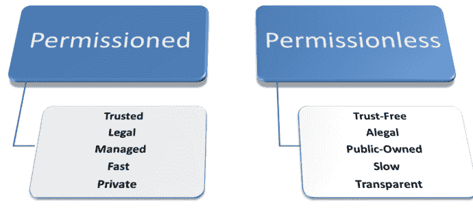
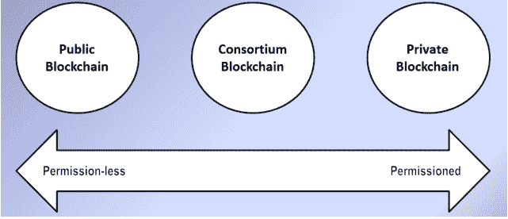
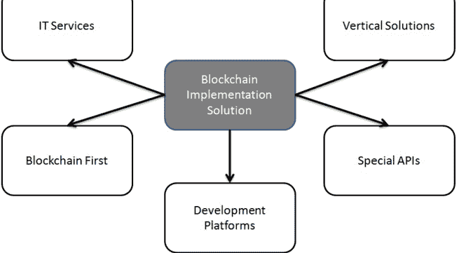
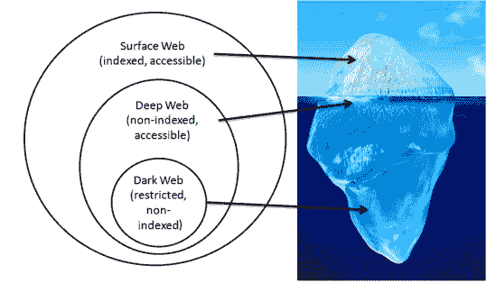
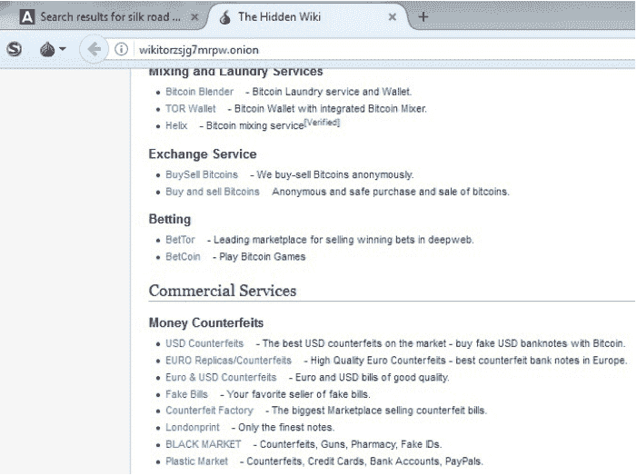
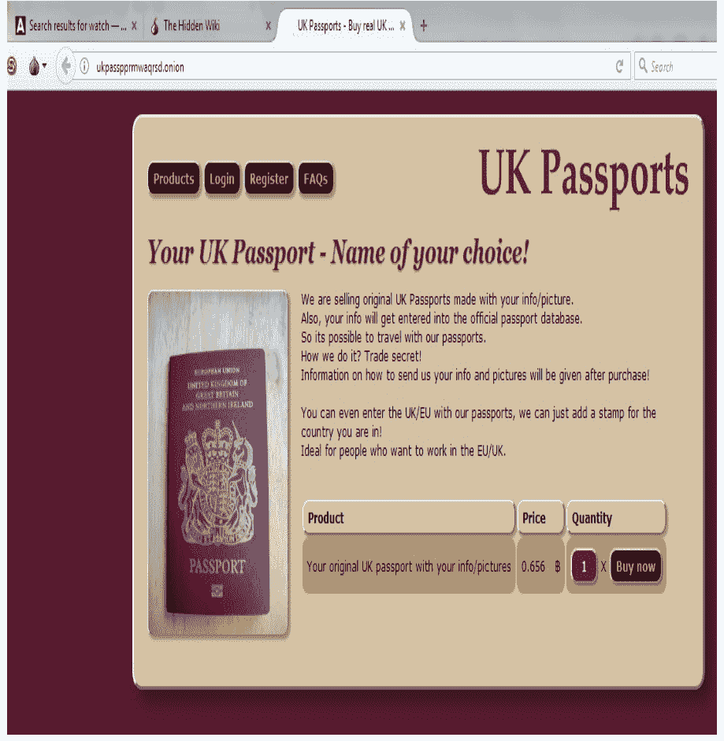

## BaaS 和暗网市场

本章向您介绍各种特定于智能合约和区块链开发的平台。我们将从关于许可光谱上的私有、联盟和公共区块链的讨论开始。然后我们将深入探讨 **区块链即服务 (BaaS)** 的概念并介绍企业平台，例如 Hyperledger、Azure 和 AWS。我们通过探索神秘的暗网市场并附带洗钱说明来结束本章。

学习本章后，您将能够：

- 识别不同类型的区块链
- 理解区块链即服务的概念
- 了解 Hyperledger、Azure 和 AWS
- 探索暗网市场

###  playful privacy

您可能已经注意到，在之前的章节中，所有示例都是在私有区块链上编写的，我们在第 3 章 _Hello World of Smart Contracts_ 中使用创世区块创建了它。这样做是因为私有区块链是行业所偏好的；除了让事情变得更容易玩之外，无需等待区块或花费真钱。加密货币如 ETH 和 ETC 位于以太坊区块链之上，与我们的私有链相比是完全不同的链类型。困惑吗？

让我们深入研究不同类型的区块链以了解这种分类。

### 区块链类型

在深入研究区块链类型之前，我们必须熟悉分布式账本技术 aka DLT 的许可光谱概念。区块链是一种 DLT，并在许可光谱中存在。

要理解许可光谱，我们需要确定该光谱的两个极端。在一端，我们必须寻求实体完全许可才能参与共识，而在另一极端，我们无需向任何实体寻求任何许可即可参与共识。

许可极端的有趣之处在于，我们没有义务向参与共识的任何人透露我们的身份。随着我们向完全许可移动，在许可的中部光谱某处，需要透露此身份方面才能参与共识，只是为了验证我们在共识中的权益。当我们到达完全许可时，我们需要识别自己并获得当局的许可才能参与共识。

任何实体或当局寻求许可的这种意识形态危及去中心化的理念，并且是区块链社区和传统企业中严重且经常激烈辩论的话题。

回到 DLT，区块链被称为许可区块链，如果：

- 它限制了可以为系统状态共识做出贡献的参与者
- 只有一组受限的已识别用户有权验证区块交易
- 当局可以限制访问已批准的可以创建智能合约的参与者
- 需要当局许可才能发送/接收交易

许可区块链最终使用 RAFT 或 Paxos 等共识算法（参见第 1 章《区块链基础》），因为其所有参与者的身份都被揭示。为验证区块所花费的精力不会由系统奖励，参与者最终通过充当中介向终端用户收取费用。

企业级金融机构喜欢这种许可区块链的概念，因为它们可以享受比特币或其他加密货币提供的无边界交易设施，但在其私有高速网络中具有精细的访问控制、参与机构批准组内的隐私以及在其内网上的可扩展性。

另一方面，许可区块链是：

- 任何人都可以加入网络
- 任何人都可以参与区块验证过程
- 任何人都可以创建智能合约

以太坊和比特币区块链是许可区块链的绝佳示例。区块验证过程类似于挖矿，并且由系统高度激励。这些区块链使用 PoW 等共识算法，未来可能是 PoS，其中参与者可能需要透露其所有权以申领其权益。但参与本质上仍然是无许可的，与所有权揭示无关。

图 10.1 总结了区分许可光谱两个极端的关键特征：



图 10.1： 许可型与无许可型

比特币和以太坊区块链是经过强化的区块链平台。它们经受住了时间的考验，即使在多次黑客攻击和偶尔的市场崩盘后也是如此。Andreas Antonopoulos 写了以下关于比特币的内容，这几乎完全适用于以太坊：

> "Bitcoin is a sewer rat. It's missing a leg. Its snout was badly mangled in an accident in the last year. It's not allergic to anything. In fact, it's probably got a couple of strains of bubonic plague on it which it treats like a common cold. You have a system that is antifragile and dynamic and robust.
>
> Let's take it, cut off its beard, take away its piercings, put it in a suit, call it blockchain, and present it to the board. It's safe. It's got borders. We can apply the same regulations. We can put barriers to entry and create an anti-competitive environment to control who has access. It will be more efficient than our existing banking system."

此时，我们可以介绍三种广泛的区块链类型，即公共、私有和联盟。联盟区块链有时被称为联邦区块链。图 10.2 沿许可光谱说明了这三种类型：




Figure 10.2: Types of blockchain on permission spectrum

## Private blockchains

Private blockchains take advantage of blockchain technology by setting up private groups that can verify transactions internally. Write permissions are centralized, like traditional database management systems. Read permissions may be restricted or public to a certain extent. These blockchains have their niche use cases because of their scalability, compliance to data privacy rules, and other regulatory guidelines. Such blockchains can reduce cost but are not disruptive. MONAX and multichain are prominent players in the private blockchain space.

## Public blockchains

Public blockchains are based on state-of-the-art consensus algorithms, are open source, permissionless, and provide incentives to transaction validating effort:

- Anyone can start running a public node by downloading the free code on their local device
- Anyone can participate in the consensus by validating transactions in the network, thus determining what block gets added to the chain along with the current state
- Anyone in the world can do valid transactions and reflect them on a blockchain

Using a public block explorer, anyone can read transactions, making it transparent yet pseudonymous. Bitcoin, Namecoin, Ethereum, Bitcoin Cash, Ethereum Classic, and Litecoin are just a few of the hundreds of examples of public blockchain protocols.

## Consortium blockchains

Consortium blockchains operate within a group of stakeholders. Unlike public blockchains, they don't allow any random person with access to the internet to participate in the process of transaction verification. Consortium blockchains are highly scalable and provide transaction privacy. These blockchains are mostly used in the banking and corporate sector, where various banks form a consortium to interact in their own intra-network to replace legacy systems, reduce transaction costs and data redundancies, and simplify document handling using smart compliance mechanisms.

Bankchain is a consortium that has come together for building and exploring blockchain solutions. The member list can be retrieved from the following link where it is listed in a chronological manner: http://www.bankchain.org.in/members.php.

Some prominent names in these lists include State Bank of India, Deutsche Bank, Dubai Islamic Bank, and even tech corporations such as Intel. This consortium has tied up a blockchain start-up called Primechain Technologies to roll out various beta version DApps by the end of 2017. One of the DApps is Primechain-KYC, which is a smart contract-based solution deployed on a permissioned consortium blockchain to share Know-Your-Customer (KYC), Anti-Money-Laundering (AML), and Countering the Financing of Terrorism (CFT) data.

Primechain Technologies has, in turn, partnered with Microsoft to provide a blockchain-as-a-service model to the consortium members using the Azure developmental platform. Other prominent consortium blockchains are R3 (Banking), EWF (Energy), B3i (Insurance), and Corda (legal).

In the following sections, we will try to understand what blockchain-as-a-service implies, and how various enterprises are providing different

## Blockchain-as-a-service

There is a diverse landscape of solutions and approaches to implement a blockchain. *Figure 10.3* represents a broad classification of such approaches. Blockchain-as-a-service is an industry practice that merges the *development platform approach* with the *IT services approach* to provide tangible blockchain-based solutions to clients:



Figure 10.3: Blockchain implementation solution

We have seen in the previous chapters that we need several software components, such as geth, node.js, and Java runtime environments along with programming tools, such as Solidity and web3.js, on top of an operating system to develop a complete end-to-end, blockchain-based, decentralized application from scratch.

This is fine for making a new and highly customized product to a certain extent, but to implement a repeatable and scalable service, coding from scratch is equivalent to reinventing the wheel.

The big players in the cloud computing industry, such as IBM (Bluemix), Microsoft (Azure), and Amazon (AWS), have realized this gap and have come up with this BaaS model. They have seen the potential benefits of offering blockchain services in the cloud, where clients and users benefit from avoiding the overhead of hardware investment, as well as the problem of configuring and setting up a working blockchain network.

Using BaaS, developers have access to single-click, drag-and-drop, cloud-based blockchain environments, that allow for rapid prototyping and deployment of DApps and smart contracts.

## Enterprise platforms for BaaS

In this section, we will introduce a few enterprise platforms with BaaS offerings using three pointers. All these platforms provide a freemium version of the development platform to develop consortium blockchain-based applications.

### IBM Hyperledger

Hyperledger was introduced in 2015 by the Linux Foundation as an umbrella project to advance cross-industry blockchain technologies. Hyperledger Fabric is one of the blockchain projects that provides permissioned consortium blockchains, where users on the network must enroll through a membership service provider. IBM (Bluemix) has partnered with Hyperledger to offer BaaS to its customers. It has also been leveraged with the cognitive capabilities of IBM Watson to provide IoT-based solutions.

### Microsoft Azure EBaaS

Initially, Microsoft collaborated with ConsenSys to offer **Ethereum blockchain-as-a-service (EBaaS)** on the Microsoft Azure cloud platform.
Then they announced Project Bletchley to provide consortium, blockchain-based solutions to their clients. Now they are building an enterprise smart contract framework on top of the existing infrastructure that follows a multi-trust model, which will allow their clients to harness their DApp development skills.

### Amazon Eris

Amazon announced they would be offering the BaaS in collaboration with the Digital Currency Group. They developed Eris on top of the Amazon cloud, which is a platform for building, testing, maintaining, and operating distributed applications with a blockchain backend to wrangle complex smart contracts.

Unfortunately, this service is currently unavailable to new users and is provided to old cloud-based clients of Amazon.

## Dark web marketplace

To really understand the dark web, we need to differentiate it from the normal web. By normal web, we imply the surface web that we browse using a web page address, or search using natural language typed into search engines, such as Google or Bing. There is yet another type of web called the deep web. Figure 10.4 depicts the three strata of the web using an iceberg analogy:



Figure 10.4: Web kernel diagram and iceberg analogy

In simple words, the surface web is anything on the internet that a search engine can find and index. The deep web is something a search engine cannot find. To understand intuitively how search engines find a page, we can do a manual exercise by going to any news channel website and then keep clicking on the articles as they come up.

So, we navigate throughout the article by clicking on some web links, which lands us to a new page of articles. This is what, in search engine parlance, is called web crawling. Now, there are many other sites such as Expedia or Airbnb, which cannot be fully explored just by crawling. We need to provide inputs such as flight date, departure city, arrival city, economy or business class, and number of hotel rooms required in order to move through such pages. They even ask for our name, email, and contacts, which then takes us to new web content. Such websites cannot be explored using a search engine alone. These are parts of the deep web.

The dark web can be considered as a subset of the deep web that has been intentionally hidden and is inaccessible through standard web browsers. So, even though both the surface web and deep web can be explored using a standard browser such as Chrome, Firefox, IE, Opera, or Safari, to navigate through the dark web we need a totally new browser called the Tor browser (there is also I2P and others, but Tor is more prominent). The website address ends with `.onion` suggesting the file type.

*Figure 10.5* shows such an `.onion` site called Hidden Wiki using the Tor browser. Note that, the opposite is true; that is, Tor can be used to browse the surface web pages:



Figure 10.5: Hidden Wiki on the dark web

As you can observe in the Hidden Wiki, the dark web is full of illegal ongoing activities, ranging from drug dealing and counterfeiting, to hired assassination and illegal arms purchase.


图10.6展示了这样一个伪造英国护照的网站。此外，你还可以注意到支付方式严格使用加密货币，例如比特币。许多网站也接受以太坊。这是因为加密货币具有来源匿名性的特点：



图10.6：提供英国护照的假身份证

遗憾的是，这类网站的生命周期很短，并且不断更换域名。由麻省理工学院（MIT）研究人员 Virgil Griffith 等人进行的一项研究表明，他们在爬取过程中追踪到的 .onion 网页中，超过87%会丢失。他们还指出，“暗网”中的“网”这个词是一种误称，它实际上是一系列高度孤立的暗黑孤岛。

这种孤立的结构使得暗网成为洗钱者的避风港。洗钱看似复杂，但可以分解为三个阶段，正如**反洗钱专家认证协会（ACAMS）**指南中所引用的：

1. **第一阶段。**
   **放置**：将犯罪活动所得的现金或其他资产进行物理处置。
2. **第二阶段。**
   **分层**：通过层层金融交易将非法所得与其来源分离，以掩盖所得的来源。
3. **第三阶段。**
   **整合**：将资金重新投入经济中，使其看起来像是正常的商业或个人交易，从而为非法财富提供表面上的合法性。

例如，毒贩可以利用暗网上的限时抢购活动，向全球客户匿名销售产品，并以以太坊或比特币收取费用。然后，这些加密货币可以用于加密货币交易，或者你可以在交易所将它们兑换成其他加密货币。随后，从交易所获得这些“干净”的货币可以再兑换回法定货币。

至此，本章就结束了。到目前为止，你已经意识到，使加密货币和区块链成为尖端技术并造福人类的各种特性，同样可能被用于许多非法活动。我们有责任将这个潘多拉魔盒用于造福人类。

## 智能简历项目

在本节中，我们将开发一个基于智能合约的简历。这个基础合约最初由纽约的智能合约开发者 Ryan Hendricks 设计，包含两个关键模块：

- 库（`cvSections`）
- 合约（`cvContract`）

该合约可以进一步细分为三个部分：

1. 合约定义与构造函数
2. 新建个人资料模块
3. 编辑个人资料模块

图10.7展示了由各种结构体数据类型组成的库函数：

```solidity
library cvSections {

    struct Profile {
        string _name; string _title; string _summary; string _website; string _phone; string _email;string _description;
    }
    struct Role {
        string _company; string _Role; string _startDate; string _endDate; string _summary; string _highlights;
    }
    struct Education {
        string _institution; string _focusArea; int32 _startYear; int32 _finishYear;
    }
    struct Project {
        string name; string link; string description;
    }
    struct Publication {
        string name; string link; string language;
    }
    struct Skill {
        string name; int32 level;
    }
}
```

图10.7：库定义

`library`中的每个结构体定义都有不同的参数集。接下来，我们看图*10.8*，它展示了合约定义：

```solidity
contract cvContract {
    mapping (string => string) Profile;
    address owner;

    cvSections.Project[] public projects;
    cvSections.Education[] public educations;
    cvSections.Skill[] public skills;
    cvSections.Publication[] public publications;

    // =========
    // ==== CONSTRUCTOR ====
    // =========
    function cvContract() public{
        owner = msg.sender;
    }

    modifier onlyOwner {
        require(msg.sender == owner);
        _;
    }
}
```

图10.8：cvContract 定义

该合约能够管理来自不同人员的多份简历。这是通过 `setProfile` 和 `getProfile` 模块实现的。*图10.9* 展示了 `setProfile` 模块：

```solidity
// ======================
// ===== ADD NEW PROFILE =====
// ======================
function setProfileData (string key, string value) public onlyOwner() {
    Profile[key] = value;
}

function editProfileData (string key, string value) public onlyOwner() {
    Profile[key] = value;
}

function editProject (bool operation, string name, string link, string description ) public onlyOwner() {
    if (operation) {
        projects.push(cvSections.Project(name, description, link));
    } else {
        delete projects[projects.length - 1];
    }
}

function editEducation (bool operation, string name, string specialty, int32 year_start, int32 year_finish ) public onlyOwner() {
    // == similar logic goes here
}

function editSkill(bool operation, string name, int32 level) public onlyOwner() {
    // == similar logic goes here
}

function editPublication (bool operation, string name, string link, string language) public onlyOwner() {
    // == similar logic goes here
}
```

图10.9：新建个人资料模块

类似地，*图10.10* 展示了获取个人资料数据，用于在对主简历合约进行追加或更新后进行校验：

```solidity
// ========= Retrieving Profile data =========
// ====== Retrieving Profile data ======
function getProfileData (string arg) public constant returns (string) {
    return Profile[arg];
}

function getSize(string arg) public view returns (uint) {
    if (keccak256(arg) == keccak256("projects")) { return projects.length; }
    if (keccak256(arg) == keccak256("educations")) { return educations.length; }
    if (keccak256(arg) == keccak256("publications")) { return publications.length; }
    if (keccak256(arg) == keccak256("skills")) { return skills.length; }
    revert();
}
```

图10.10：获取个人资料模块

一旦整个合约编译完成，Remix 的输出结果如图10.11所示：

图10.11：cvContract

上述截图中的蓝色图标用于获取数据，粉色图标用于输入数据。

我们可以添加多个个人资料以及其他属性，如出版物和技能，如图10.12所示：

图10.12：设置/获取技能

此外，我们可以将此智能合约的代码提交到 GitHub，然后将其引入 Ethercast，如图10.13所示：

图10.13：Ethercast

这样，我们就能开发并发布一个基于智能合约的简历演示/原型，最终可以部署到公共以太坊链或私有链上。

## 总结

本章首先对私有链、联盟链和公有链进行了概念性增强的讨论。我们了解到，公有链本质上大多是无许可的，而私有链则是严格有许可的。因此，行业倾向于采用联盟链这一中间方式，以在利益相关者之间实现民主。随后，我们列出了一些有助于搭建此类联盟链的开发平台。来自 IBM 的 Hyperledger、微软的 Azure 和 AWS Cloud 为我们提供了令人振奋的联盟链路线图。接着，我们探讨了洗钱的概念，以及自加密货币发展之初，暗网市场是如何被用来助长这一不断加剧的经济瘟疫的。在本章结尾，我们以平衡的视角讨论了智能合约和区块链的概念如何打开了一系列新的潘多拉魔盒，以及我们作为技术专家，有责任从中提炼出有益之处。

在第11章《高级主题与未来展望》中，我们将讨论区块链和智能合约这一不断扩展领域中一些高级主题，并总结本书所学的知识。


