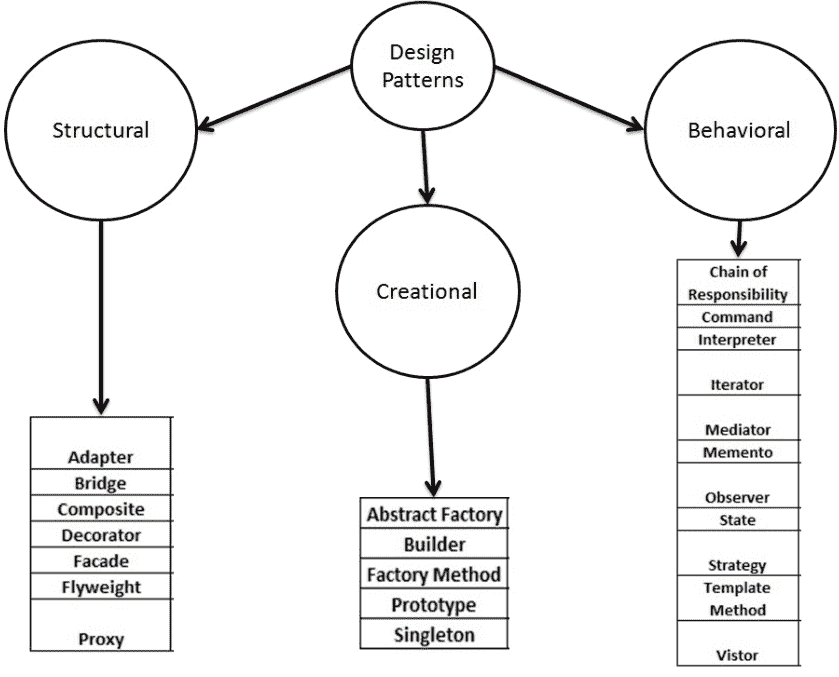
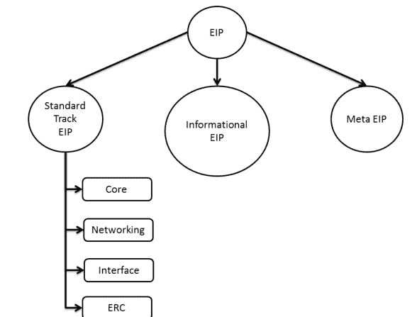
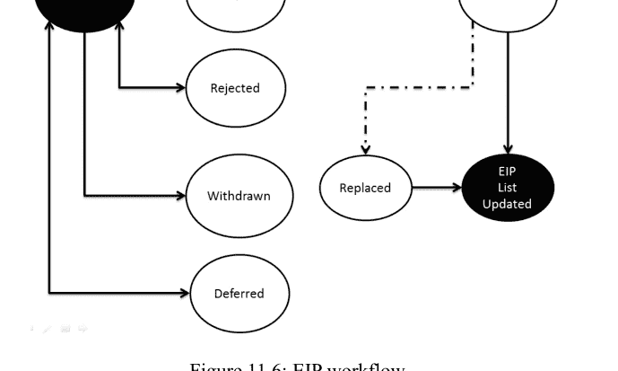
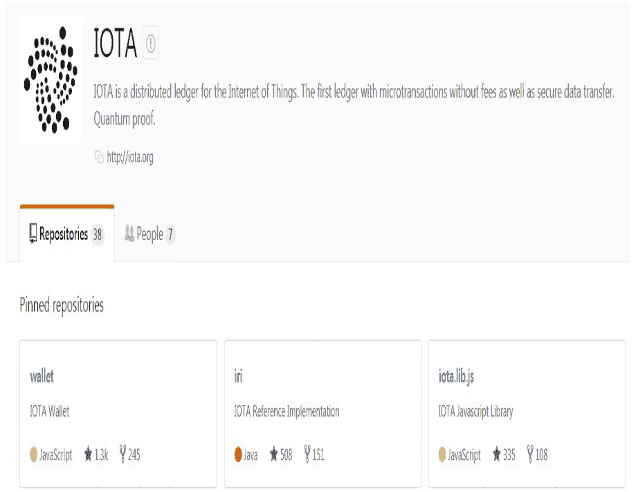
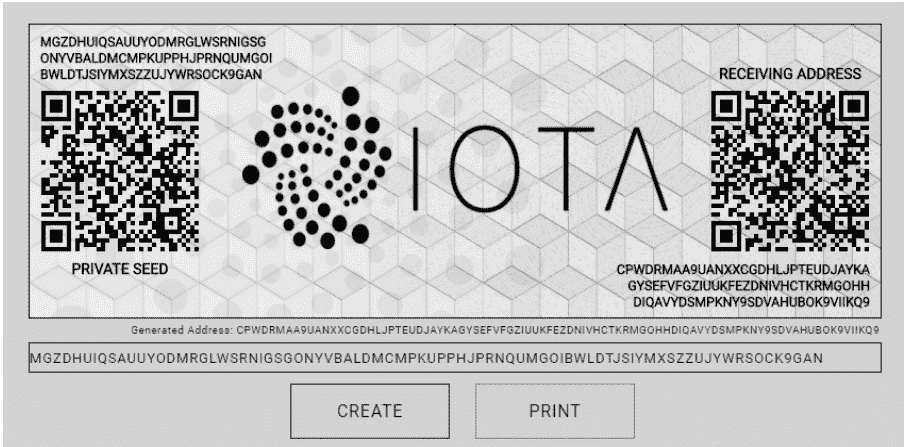
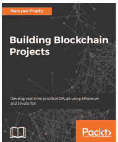
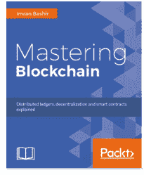

## 高级主题与未来之路

本章涉及与以太坊和区块链相关的若干高级主题。我们讨论了五个广泛的主题，以进一步拓展你的研究兴趣和学术追求。我们首先介绍一个关于可在企业级智能合约开发中应用的常见设计模式的章节。然后我们转向去中心化自治公司和社会的主题。我们专门用一个章节讨论**以太坊改进提案 (EIP)**，其中我们讨论了提案的生命周期。联盟区块链概念将通过案例研究重新审视。我们以一个独特的主题 Tangle 结束本章，并提供指标以探索以图为基础的分布式账本技术这一新兴领域，特别强调 IOTA。

学习完本章后，你将能够：

- 识别不同的设计模式
- 理解 DACs 和 DAS 的概念
- 理解以太坊改进提案生命周期
- 使用案例研究讨论联盟区块链
- 领会 Tangle 和 IOTA 背后的概念

### 常见设计模式

最近，我爸爸退休了，并在烹饪的爱好中找到慰藉。他有一套自己的香料，甚至不与我妈妈分享。从鸡肉到鹰嘴豆，他准备的任何菜肴都有他招牌 masala 调味料的典型味道。他认为味道不在于他使用的香料，而在于他在设计食谱时混合香料所应用的模式。

那么，什么是设计模式？在软件工程术语中，它通常是一段伪代码，代表一种通用解决方案，可在开发应用程序时重复使用，以避免重新造轮子的情况。一个常见的例子就是基于密码的用户身份验证功能。大多数应用程序都需要这种基本功能，并且设计几乎相似。用户必须先向应用程序注册。然后应用程序会发送 OTP 或确认链接来设置新密码并注册新用户。一旦已注册用户需要登录，他们必须向应用程序提供用户名和密码。应用程序随后会在其注册数据库中检查该用户名和密码，并据此允许或阻止用户。

软件设计模式大致分为三类，如 *Figure 11.1* 所示：

- **结构型：** 此类模式处理实体之间的关系，使这些实体更容易协同工作
- **创建型：** 此类模式使在特定情况下创建对象变得更容易
- **行为型：** 此类模式用于在两个或多个实体之间灵活通信。



Figure 11.1: Software design patterns

这三个类别也被称为 **四人帮 (GoF)** 设计模式，指的是其四位作者，即 Erich Gamma、Richard Helm、Ralph Johnson 和 John Vlissides。*Figure 11.2* 简要解释了每个 GoF 设计模式。

**Creational patterns**

| Pattern | Description |
| --- | --- |
| Abstract Factory | Allows for the creation of objects without specifying their concrete type |
| Builder | Used to create complex objects |
| Factory Method | Creates objects without specifying the exact class to create |
| Prototype | Creates a new object from an existing object |
| Singleton | Ensures only one instance of an object is created |

**Structural patterns**

| Pattern | Description |
| --- | --- |
| Adapter | Allows for two incompatible classes to work together by wrapping an interface around one of the existing classes |
| Bridge | Decouples an abstraction so two classes can vary independently |
| Composite | Takes a group of objects into a single object |
| Decorator | Allows for an object's behavior to be extended dynamically at run time |
| Facade | Provides a simple interface to a more complex underlying object |
| Flyweight | Reduces the cost of complex object models |
| Proxy | Provides a placeholder interface to an underlying object to control access, reduce cost, or reduce complexity |

**Behavioral patterns**

| Pattern | Description |
| --- | --- |
| Chain of Responsibility | Delegates commands to a chain of processing objects |
| Command | Creates objects which encapsulate actions and parameters |
| Interpreter | Implements a specialized language |
| Iterator | Accesses the elements of an object sequentially without exposing its underlying representation |
| Mediator | Allows loose coupling between classes by being the only class that has detailed knowledge of their methods |
| Memento | Provides the ability to restore an object to its previous state |
| Observer | Is a publish/subscribe pattern which allows a number of observer objects to see an event |
| State | Allows an object to alter its behavior when its internal state changes |
| Strategy | Allows one of a family of algorithms to be selected on-the-fly at run-time |
| Template Method | Defines the skeleton of an algorithm as an abstract class, allowing its sub-classes to provide concrete behavior |
| Visitor | Separates an algorithm from an object structure by moving the hierarchy of methods into one object |

Figure 11.2: GoF design pattern summary

在以下章节中，我们将讨论以太坊区块链上智能合约开发者经常使用的一些设计模式：

#### Restricting access

访问限制是智能合约的常见功能。在之前的章节中，我们讨论了外部合约如何利用 Parity 库合约中的访问相关漏洞，自毁整个钱包库并冻结价值 3 亿美元的以太币。我们永远无法阻止任何人或计算机读取合约的状态。我们可以通过使用加密使其变得困难一些。

开发者唯一需要牢记的是合约的状态是公开的，然后以无问题的方式设计它。我们可以通过在实体地址上使用函数修饰符来限制允许修改合约的实体数量。此类地址可以维护在**访问控制列表 (ACL)** 上，但有一个警告：对于公共区块链，只读访问将对任何人开放。

修饰符用于更改函数的正文。如果使用此类修饰符，它们会在前面加上一个检查，只有在函数由某个地址调用时才会通过。

这种设计实现是一种结构型设计模式。

#### Token systems

这些与行为型设计模式相关。令牌系统类似于模板方法，其中算法的骨架被定义为抽象类，允许子类提供具体行为。

在之前的章节中，我们讨论了 ERC20 标准如何为以太坊基于的令牌系统实现兼容性。ERC20 不是代码、软件或技术。它是一个技术规范。

Figure 11.3 描绘了一个示例 ERC20 标准合约接口，其中包含推荐的函数定义：

```
contract ERC20 {
    function totalSupply() constant returns (uint totalSupply);
    function balanceOf(address _owner) constant returns (uint balance);
    function transfer(address _to, uint _value) returns (bool success);
    function transferFrom(address _from, address _to, uint _value) returns (bool success);
    function approve(address _spender, uint _value) returns (bool success);
    function allowance(address _owner, address _spender) constant returns (uint remaining);
    event Transfer(address indexed _from, address indexed _to, uint _value);
    event Approval(address indexed _owner, address indexed _spender, uint _value);
}
```

Figure 11.3: ERC20 token system

#### Factory pattern

这种设计模式是一种创建型设计模式。使用此模式，可以在不指定确切创建类的情况下创建对象。

Figure 11.4 是一个简单的中心 (`Barrel`)，它从模板部署合约 (`Whisky`) 并跟踪已创建的合约。

`Whisky` 是源文件的一部分，因此 `Barrel` 在编译期间可以“看到它”。`Whisky` 的字节码将成为 `Barrel` 的一部分，因此 `newWhisky()` 调用知道该怎么做。

在中心 (`Barrel`) 部署后，不必再部署模板 (`Whisky`)。

我们可以通过在前者中调用一个函数来创建后者任意多个。


```solidity
pragma solidity ^0.4.11;

contract Barrel {
    address[] public contracts;
    function getContractCount()
        public
        constant
        returns(uint contractCount)
    {
        return contracts.length;
    }
    function newWhisky()
        public
        returns(address newContract)
    {
        Whisky c = new Whisky();
        contracts.push(c);
        return c;
    }
}

contract Whisky {
    function getFlavor()
        public
        constant
        returns (string flavor)
    {
        return "single malt";
    }
}
```

图11.4：Barrel 和 Whisky 的工厂模式

## 注册表

注册表主要是数据设计模式。它有助于以人类可读的形式引用合约或地址。它通常包含名称到地址的关联。它类似于外观（facade，字面意思是具有欺骗性的外表）设计模式，属于结构设计模式类别。

在 Solidity 编程语言中，注册表模式可以使用 `mapping` 关键字来实现。它用于组织值类型，例如布尔值、整数、地址和结构体。它由两个主要部分组成：`_KeyType` 和 `_ValueType`。它们的语法如下：

```
mapping (_KeyType => _ValueType) mapName
```

## 投票系统

投票系统是复杂的设计模式，包含许多更简单的设计模式，如工厂、代理、备忘录、组合、观察者和责任链。这种复杂的设计模式本身可以用作独立的应用程序。

实现完全去中心化的投票系统仍然是一个开放性的挑战，因为设计任何投票系统都需要以下模块：

-   **投票者**：进行投票的人。他们必须是可识别的，以避免重复投票。但他们的投票必须是私密的。
-   **认证器**：该模块认证投票者的身份。
-   **用户**：他们基本上是志愿者，帮助投票者正确使用投票流程，但不影响投票者的决定。
-   **选举官员**：该模块监督投票过程中可能出现的任何差异。
-   **管理员**：该模块维护认证器以及投票者选择的匿名性。
-   **研究者**：他们基本上是统计代理，用于检测异常并维护计数。
-   **数据库**：这是存储投票交易以及投票者身份的仓库。

DAS 是一种平行现实，其中政府的作用减弱，所有流程的控制权直接传递给参与者。DAS 仅仅处于发展的起步阶段，但它是未来。这个未来不在于聊天机器人、自动驾驶汽车或增强现实，而在于信息流动的不同方式、固有偏见和分布式系统。它将改变我们与社会其他人沟通和互动的方式。

## 以太坊改进提案

要成为一名成功的以太坊智能合约开发者，除了技术和架构知识外，我们还需要具备理解设计文档的能力。这类文档对任何开发者来说都是圣杯，能够提供对任何功能背后各种复杂细节和基本原理的必要洞见。对于以太坊社区中的开发者来说，这类设计文档由全球许多资深开发者维护，被称为以太坊改进提案。

以太坊改进提案是一份向以太坊社区提供信息的设计文档。它用于提出新的以太坊功能、新流程或新环境。EIP 为拟议功能提供简洁的技术规范和原理说明。EIP 的作者负责在社区内建立共识，并记录批评者的意见。任何人都可以通过 EIP 提出新的实现方案，如果社区同意，该提案就会成为实现的一部分。

EIP 的目的和指南由 Martin Becze 和 Hudson Jameson 编写。它们大量借鉴了 Amir Taaki 撰写的比特币改进提案（BIP-0001），而 BIP-0001 又受到 Python 增强提案（PEP-0001）的启发。这些提案的版权根据 CC0 被放弃，并可在以下 GitHub 链接上免费向公众提供：

https://github.com/ethereum/EIPs

在接下来的章节中，我们将讨论关于 EIP 的最低限度细节，使您能够自行浏览 EIP 的 GitHub，而不会因信息过载而迷失方向。

## EIP 背后的原理

EIP 便于跟踪实现进度。理想情况下，每个实现都应列为一个 EIP。这使参与者和投资者能够方便地了解给定库或实现的当前状态。

## EIP 的类型

*图11.5展示了以太坊社区推荐的各种改进提案类型。主要来说，提案分为三种类型：*

-   **标准轨道 EIP**：这些提案会影响以太坊的实现。例如，改变区块大小、交易有效性规则以及应用互操作性都可以成为此类提案的一部分。
-   **信息类 EIP**：这些提案标记任何设计问题或提供通用指南。但是，此类提案不会引入新功能。
-   **元 EIP**：这些也称为流程 EIP。此类提案建议对指南和流程进行更改。与信息类 EIP 不同，一旦实施，用户不能忽略这些 EIP：



图11.5：EIP 的分类

标准轨道 EIP 进一步分为四个子类别：

-   **核心**：这些提案主要与共识密切相关，涉及对以太坊协议和实现策略的根本性更改。例如，EIP7 提出了一个新的操作码 `DELEGATECALL`。
-   **网络**：这些提案主要涉及对 swarm、whisper、devp2p 和轻客户端子协议实现的更改。例如，EIP8 提出了 Homestead 版本的 devp2p 前向兼容性要求。
-   **接口**：这些提案为 ABI 接口或 RPC 标准提供改进。例如，EIP6 提议重命名 suicide 操作码。
-   **ERC**：这些主要是**征求意见（RCs）**，我们在前一章讨论过这样一个提案，ERC20。这些提案涉及应用级标准和约定。例如，EIP20 提出了 ERC20 代币合规性。

## EIP 生命周期

提案的生命周期相当直接。在典型的顺利路径上，提案诞生于一个改进以太坊的想法。这样的想法通过 EIP 草案正式化。一旦 EIP 获得了以太坊社区的信任，提案就会被接受并分配一个 EIP 编号。然后使用代码实现，并赋予最终状态；或者如果它是一份指南，则会在 GitHub 上变为 Active（活动）状态。EIP 列表最终会更新为最终确定的 EIP 提案编号。如果提案遭到普通社区的强烈反对，其生命周期可能会发生巨大变化：



图11.6：EIP 工作流

从技术上讲，“生命周期”是一种误称。我们通常应将其称为提案工作流。这是因为提案本身不会改变自己的状态；需要外部人为干预来更改提案的状态。图11.6 展示了提案从草案开始，直到最终确定并更新到 EIP 列表上的不同状态。另请注意，EIP 可能会被取代，从而使较旧的 EIP 过时。对于信息类 EIP，将其变为 Active（活动）状态等同于最终状态。


- **测试用例：** 本节对于核心 EIP 变更是强制性的，但对于其他 EIP 提案是可选的，其中列出了一些正向和负向测试用例。
- **实施：** 在 EIP 的状态变为“final”之前，必须完成本节的说明。
- **版权：** EIP 始终以公共领域发布，所有版权均已放弃。

*图 11.7* 说明了一个已获得最终状态编号 EIP6 的示例 EIP：

## 前言

EIP: 6  
Title: Renaming SUICIDE opcode  
Author: Hudson Jameson <hudson@hudsonjameson.com>  
Status: Final  
Type: Standards Track  
Layer: Applications  
Created: 2015-11-22  

## 摘要

本 EIP 中提出的解决方案是将以太坊编程语言中 SUICIDE 操作码的名称改为 SELFDESTRUCT。

## 动机

心理健康对许多人来说是一个非常现实的问题，细微的概念也能产生影响。那些正在经历丧失或抑郁的人会受益于在我们的编程语言中不再看到自杀一词。据估计，全球有 3.5 亿人遭受抑郁症困扰。如果我们希望生态系统发展到各类开发者，我们需要经常审查以太坊编程语言的语义。

由 DEVolution, GmbH 委托并由 Least Authority 执行的以太坊安全审计建议如下：

> 将指令名称 "suicide" 替换为含义较少的词，如 "self-destruct"、"destroy"、"terminate" 或 "close"，尤其是因为这是一个描述合约自然结束的术语。

我们更改自杀一词的主要原因是表明人比代码更重要，以太坊是一个足够成熟的项目，能够认识到改变的必要性。自杀是一个沉重的话题，我们应该尽一切可能不影响那些在开发社区中遭受抑郁或最近因自杀失去亲人的人。以太坊是一个年轻的平台，如果我们在其生命早期就实施这一改变，将会减少很多麻烦。

## 实施

SELFDESTRUCT 被添加为 SUICIDE 操作码的别名，而不是替换它。

## 版权

版权及相关权利通过 CC0 放弃。

## 联盟链

正如我们在上一章讨论的那样，联盟链介于私有链和公有链之间，也处于权限光谱的中间位置。在本节中，我们将以银行采用的联盟链为例进行案例研究。

银行需要区块链来使资金转账更快、更简单、更便宜。如果将公有区块链用于此目的，其限制如下：

- **速度**：银行需要在实时进行交易，而以太坊确认一笔交易大约需要 12 秒。
- **权限**：任何人都可以参与公有区块链的共识。但银行更倾向于保持权威或聘请监管机构。
- **安全性**：由于参与者数量有限，工作量证明不够安全。
- **隐私**：基本上分为身份隐私和数据隐私，在公有以太坊区块链上维护此类隐私相当困难。

联盟链通常采用权威证明，不需要挖矿。这是一种共识机制，通过参考验证者列表来达成真相。这些验证者主要是被允许参与共识的一组节点。

### R3 Corda 案例研究

R3 是一家分布式账本公司，已开发出区块链平台 Corda，可帮助提供大量机构金融服务。

Corda 的设计用于记录和处理金融协议，并实现本文件中包含的愿景。

Corda 平台还支持智能合约。在 Corda 中，更新是通过消耗现有状态对象并产生新状态对象的交易来应用的。共识有两个方面：交易有效性和交易唯一性。

Corda 上的智能合约称为 CorDapp。CorDapp 通常用 Java 或 Kotlin 编写。

CorDApps 由以下关键组件组成：

- **状态：** 这定义了达成一致的事实
- **合约：** 这定义了构成有效账本更新的内容
- **服务：** 这在节点内提供长期存在的实用工具
- **序列化白名单：** 这限制了节点将接收的类型的范围

Corda 的节点结构如下：

```
├─ certificates  // The node's certificates
├─ corda-webserver.jar // The built-in node webserver
├─ corda.jar  // The core Corda libraries
├─ logs // The node logs
├─ node.conf // The node's configuration files
├─ persistence.mv.db // The node's database
└─ plugins // The CorDapps JARs installed on the node
```

一个节点可以有四种广泛的功能类别：

- **网络地图**：这提供了一种将身份解析为物理节点地址和相关公钥的方法
- **公证人**：这见证状态花费，并对交易是否为双花有最终决定权
- **预言机**：这通过提供影响交易有效性的事实，将账本与外部世界连接起来
- **常规模式**：这启动与其它节点、公证人和预言机通信的协议，并演进其私有账本

## 超越区块链的 Tangle

我们将整本书都致力于基于区块链的智能合约开发。但还有另一种加密货币生态系统并非基于区块链。这些是基于有向无环图或 DAG 的系统。这类系统被称为图型分布式账本技术。一些值得注意的基于 DAG 的 DLT 有 DagCoin、Byteball、Hashgraph 和 Tangle。

DagCoin 是由区块链自由加密货币先驱 Sergio Demian Lerner 在 2012 年推出的首个基于 DAG 的 DLT。随后不久由 Anton Churyumov 推出了 Byteball。Hashgraph 目前是基于 DAG 的私有 DLT，由 Leemon Baird 发明。Tangle 技术于 2016 年 4 月 3 日由 Sergey Popov 以白皮书形式引入。Tangle 上的加密货币旨在支持 **物联网 (IoT)** 设备之间的交易，因此恰当地命名为 Iota。

在以下章节中，我们将探讨传统区块链的不足、Tangle 背后的技术、Iota 的 GitHub 分析，以及如何购买和存储 Iota 加密货币。

### 区块链的不足

传统区块链在货币交易方面存在两个主要问题：

- **矿池寡头垄断**：考虑到挖矿奖励的竞争性，拥有高端技术的矿池使个人矿工的流程无利可图。此外，随着挖矿奖励的减少，当我们达到挖矿阈值时，例如在比特币中，目前为 12.5 BTC；此前为 25 BTC，从 50 BTC 下降，矿工将收取高额交易费用以证明挖矿和交易验证的电力成本。
- 交易验证过程缓慢且无法加速。

### Tangle 解析

Tangle 是一种基于有向无环图的新型数据结构。这种数据结构没有区块、没有链、也没有矿工。

那么在没有矿工的情况下，Tangle 上的公共账本如何实现共识或验证交易呢？这是通过让想要进行交易的<|message|>用户验证并批准两笔过去的交易来实现的。这种独特的方式确保整个网络对已批准交易的当前状态达成共识。

一笔 Iota 交易可以分解为三个不同步骤：

1. **签名：** 我们用私钥对交易输入进行签名。
2. **尖端选择：马尔可夫链蒙特卡洛 (MCMC)：** 这种采样方法用于随机选择两个尖端，将由我们的交易验证，即 `branchTransaction` 和 `trunkTransaction`。
3. **工作量证明：** 为了让我们的交易被网络接受，我们需要做一些 PoW，类似于 HashCash 但不像比特币。

Iota 的编码交易由 2,673 个 trytes 组成。Tryte 是字节的三进制等价物。它通常由以 9 开头的字母字符表示。其余数字用 A 到 Z 表示。Iota 使用平衡三进制系统。为了使三进制代码对人类可读，Iota 开发者创建了数字的字母映射，如 *图 11.8* 所示：


并且利用一种新设计的 ternary 哈希函数 curl，使得它在一定程度上免疫于量子计算威胁，因为我们发送了 Iota 后就不能再使用该地址

## Iota GitHub 分析

如果你去 GitHub 搜索 Iota，你会进入一个链接 Iota 加密货币仓库的页面。Iota 的 GitHub 页面包含三个主要仓库，即钱包、**Iota 参考实现 (IRI)**，以及 Iota JavaScript 库。*图 11.9* 描述了这些仓库：



图 11.9：Iota GitHub (https://github.com/iotaledger)

在这三个仓库中，IRI 是最有趣的仓库。那么 IRI 是什么？它是 Iota 协议的参考实现。就像比特币一样，Iota 也是运行在名为 Tangle 的 DAG 基于数据库上的协议，而不是区块链。现在，IRI 代表了 Iota 的蓝图。因此，当 Iota 开发者用 Java 制作参考实现时，他们实际上是在告诉世界，“*这就是 Iota 功能的工作方式，并且使用这个参考实现，我们可以用任何其他图灵完备的编程语言来设置 Iota 客户端或 Iota 节点。*”

现在如果我们退一步思考一会儿，我们会意识到，使用这个参考实现，我们甚至可以使用 Solidity —— 一种图灵完备的编程语言 —— 来开发一个 Iota 客户端、节点，甚至智能合约。可能性是无穷的，也相当令人兴奋。不是吗？

接下来是 Iota 钱包。它是用 JavaScript 编写的，并且是一个 electron 应用。那么 electron 是什么？它是一种工具，程序员可以用它将网站打包为原生应用程序。基本上，当我们想要为 macOS、Windows 或 Linux 开发原生应用程序时，一种方法是完全从头开始编码，这耗时且令人困惑，因为我们必须维护多个不同的代码库。相反，我们可以编写一个网站并将其打包为 Windows、macOS 或 Linux 应用程序。现在，如果我们想要进行更改或进一步开发应用程序，我们只需进一步开发这个网站并再次打包。Electron 在许多其他加密货币项目中也越来越受欢迎。

最后，我们有一个 JavaScript 库。它为其他开发者提供编码工具和 API。假设作为一名开发者，我们想要创建一个网站来与 Iota 协议交互。我们可以使用他们的 JavaScript 库来调用各种 Iota 功能。

在下一节中，我们将看到如何购买和存储 Iota 加密货币。

### Iota 的购买与存储

目前，Iota 不能直接使用法币购买。它可以从 Bitfinex 或 Binance 等加密交易所使用以太币或比特币购买。

购买 Iota 需要遵循以下步骤：

- 1. 在 coinbase 创建一个账户。
- 2. 在 coinbase 购买 BTC 或 ETH。
- 3. 在 Bitfinex 或 Binance 开设账户。
- 4. 将一些 BTC 或 ETH 转移到 Bitfinex 或 Binance。
- 5. 使用 BTC 或 ETH 下单购买 Iota。Iota 以百万计出售，称为 MIOTA。

Iota 的存储本质上非常简单。我们可以将 Iota 存储在 Iota GitHub 提供的 Iota 钱包中。或者我们可以使用以下链接提供的纸钱包：https://arancauchi.github.io/IOTA-Paper-Wallet/。

要创建纸钱包，我们需要输入 81 位代码并生成二维码，如 *图 11.10* 所示。然后我们可以打印钱包并将其存放在安全的地方：



图 11.10：Iota 纸钱包

从 Tangle 出发，超越区块链，我们可能会进入技术进步的令人兴奋的新阶段。我们很快将体验到机器对机器经济，这将由物联网设备促进，而 Iota 最终可能会统治加密货币排行榜。

这就结束了本书。但你进入这个令人兴奋的智能合约世界的旅程才刚刚开始。查阅遍布 YouTube 频道、GitHub 链接、Reddit 帖子和堆栈交换论坛的更广泛社区。你现在拥有在所有恐惧-不确定-怀疑（FUD）中利用这项技术改变世界的力量；你所需要的只是创造一些优秀源代码的能力。

Exit 0

## 总结

我们从设计模式的快速介绍开始本章，并讨论了用于智能合约开发的常见模式，例如限制访问、工厂模式、代币系统、注册表和投票系统。然后我们继续了解去中心化自治公司和社会的概念，以及它们与 DAO 的不同之处。在了解提案生命周期后，我们探讨了与以太坊相关的一些关键提案。选择了几个案例研究以了解联盟区块链的未来影响。我们通过对 Iota 加密货币的 GitHub 分析以及对 Tangle 的介绍，简要介绍了基于图的分布式账本的世界，结束了本章。

## 你可能喜欢的其他书籍

如果你喜欢这本书，你可能对 Packt 出版的其他这些书籍感兴趣：



### Building Blockchain Projects

Narayan Prusty

ISBN: 978-1-78712-214-7

- 了解区块链技术的基础知识
- 实现区块链技术及其特性，并了解可以实现什么
- 使用 Solidity 和 Web3.js 构建 DApps
- 了解 geth 命令和密码学
- 创建以太坊钱包
- 探索联盟区块链



### Mastering Blockchain

Imran Bashir

ISBN: 978-1-78712-544-5

- 精通区块链技术的理论和技术基础
- 充分理解去中心化的概念、其影响以及与区块链技术的关联
- 通过实际示例体验密码学如何用于保护数据
- 掌握区块链的内部运作以及比特币和替代加密货币背后的相关机制
- 理解智能合约的理论基础
- 识别并检查区块链技术在货币以外的应用
- 调查包括 Hyperledger、Corda 在内的替代区块链解决方案，以及更多
- 探索区块链技术的研究主题和未来范围

## 留下评论 - 让其他读者知道你的想法

请通过在你购买此书的网站上留下评论，与他人分享你对这本书的想法。如果你是在 Amazon 购买本书，请在本书的 Amazon 页面上留下诚实的评论。这对其他潜在读者至关重要，他们可以利用你的公正意见来做出购买决定；我们可以了解客户对我们产品的看法，我们的作者可以看到他们与 Packt 合作创作的书名的反馈。只需要你花费几分钟时间，但对其他潜在客户、我们的作者和 Packt 来说都很有价值。谢谢！

