# Power BI 专家级数据建模（第二版）


# 本书涵盖内容

*第 1 章，Power BI 数据建模简介*，简要介绍了 Power BI 的不同功能以及数据建模的重要性。本章还揭示了与 Power BI 许可相关的一些重要注意事项，这些注意事项可能会影响您的数据模型。本章介绍了一种迭代式数据建模方法，可确保 Power BI 实现具有敏捷性。

*第 2 章，数据分析表达式与数据建模*，不会详细讨论 DAX，因为本书第 3 部分和第 4 部分会大量使用 DAX 来解决不同的数据建模挑战。因此，我们只关注那些更难理解且与数据建模密切相关的 DAX 功能。本章首先简要介绍 DAX，然后直接进入虚拟表和时间智能功能及其在现实场景中的应用。

*第 3 章，Power Query 编辑器中的数据处理准备*，简要介绍了 Power Query 的组件及其应用。本章阐述了创建查询参数和用户定义函数的重要性，并通过实际用例和场景展示了它们在构建更灵活、更易维护的模型方面的强大功能。

*第 4 章，从各种数据源获取数据*，阐述了如何从 Power BI 中更常用的不同数据源获取数据。然后，解释了数据源认证的重要性，这有助于您对将要处理的数据类型设定预期。这对于估算数据建模工作量尤其有帮助。本章还介绍了不同的连接模式。

*第 5 章，常见数据准备步骤*，结合实际动手场景介绍了常见的数据准备步骤。将您到目前为止在本书中学到的知识与本章讨论的步骤相结合，将为您进入后续章节并更高效地构建数据模型奠定坚实的基础。

建模者应始终乐于接受新的挑战。您可能会遇到本章讨论的一些高级业务需求，也可能会遇到不同但类似的情况。本章想要传达的信息是：在面对新的业务挑战时要自由思考，并尝试创新以取得最佳结果。

*第 11 章，行级安全和对象级安全*，阐述了如何在 Power BI 数据模型中实现行级安全（RLS）和对象级安全（OLS）。处理 RLS 和 OLS 可能很复杂，要知道如何处理不同情况，需要深入了解数据建模和筛选器传播概念。本章的目标是将这些知识传授给您，以便您设计和实现高性能、低维护的数据模型。

*第 12 章，在 Power BI 中处理更高级的数据仓库概念*，解释了来自数据仓库的两个概念：**缓慢变化维度（SCD）** 和退化维度。本章还演示了何时以及如何在 Power BI 数据模型中实现这些概念。

*第 13 章，数据流简介*，简要介绍了 Power BI 中另一个可用功能——数据流。本章旨在介绍基础知识，帮助您为学习之旅打下坚实基础。本章还说明了如何导出/导入数据流，以及无代码/低代码体验和查询计划在数据流中的工作原理。

*第 14 章，复合模型中与 Power BI 数据集和 Analysis Services 的 DirectQuery 连接*，介绍了与复合模型相关的新术语，并讨论了如何以更少的麻烦解决更复杂的场景。本章还涵盖了通过 DirectQuery 连接到 Power BI 数据集或 Azure Analysis Services 时复合模型中的 RLS 挑战，并解释了在创建 RLS 后为参与者设置数据集权限所面临的挑战。

*第 15 章，新增选项、功能和 DAX 函数*，介绍了字段参数、Power BI 数据市场（Datamarts）以及一些新的 DAX 函数。其中一个主要功能是字段参数，它允许开发人员创建动态报告，用户可以使用一个

为了获得最佳性能，建议配备 8 GB 内存和 64 位处理器。

-   **软件**：在装有 Windows 8.1 或 Windows Server 2012 R2 或更高版本的 Windows 机器上，从 Microsoft Store 或 Power BI 网站安装最新版本的 Power BI Desktop。您需要安装 .NET Framework 4.6.2 或更高版本，以及 Microsoft Edge 浏览器（不再支持 Internet Explorer）。Power BI Desktop 会自动安装 WebView2。建议使用 Windows 客户端版本（如 Windows 10），而不是 Windows Server。Power BI Desktop 不支持 Internet Explorer 增强安全配置。
-   **安全**：您需要拥有有效的 Power BI 帐户才能登录 Power BI Desktop 并发布报表。您还需要有权访问要在报表中使用的数据源和服务。

以下是 Power BI Desktop 的下载链接：

-   来自 Microsoft Store 的 Power BI Desktop：  
    https://aka.ms/pbidesktopstore
-   来自网页的 Power BI Desktop：https://www.microsoft.com/en-us/download/details.aspx?id=58494

您可以以个人身份注册 Power BI 服务。请在此处了解更多信息：https://learn.microsoft.com/en-us/power-bi/fundamentals/service-self-service-signup-for-power-bi?WT.mc_id=DP-MVP-5003466.

> 注意
>
> 自 2021 年 1 月 31 日起，Power BI Desktop 不再支持 Windows 7。

# Tabular Editor

DAX 调试输出（DAX Debug Output）是一个免费的社区工具，允许开发人员查看在 Power BI Desktop 中运行的 DAX 表达式的结果。这有助于排查和优化复杂的 DAX 公式和度量值。该工具目前处于公开预览阶段，开发人员尚未发布太多关于其系统要求的信息。它目前适用于 Power BI Desktop 2022 年 8 月版或更高版本。DAX Debug Output 可从此处下载：  
https://github.com/pbidax/DAXDebugOutput/releases/tag/v0.1.0-beta.

如果您使用的是本书的数字版本，我们建议您自己输入代码，或通过 GitHub 仓库（链接在下一节中提供）获取代码。这样做将帮助您避免因复制和粘贴代码而可能产生的错误。

# 下载示例代码文件

本书的代码包托管在 GitHub 上，地址为  
https://github.com/PacktPublishing/Expert-Data-Modeling-with-Power-BI-Second-Edition。我们丰富的图书和视频目录中还有其他代码包，可在 https://github.com/PacktPublishing/ 获取。快来查看吧！

# 下载彩色图片

我们还提供了一个 PDF 文件，其中包含本书使用的截图/图表的彩色图片。您可以在此处下载：  
https://packt.link/XAVMa.

# 使用的约定

本书通篇使用了多种文本约定。

CodeInText：表示文本中的代码词、数据库表名、文件夹名称、文件名、文件扩展名、路径名、虚拟 URL、用户输入、


## Power BI 中的数据建模

在本节中，我们将从整体角度快速介绍 Power BI 中的数据建模。我们假设您了解 Power Query 是什么、DAX 是什么，并且熟悉星型模式的基本概念。在本节中，您将了解 DAX 中的虚拟表和时间智能功能，以及如何在实际场景中实现强大的模型。

本节包含以下章节：

- 第 1 章，Power BI 中的数据建模简介
- 第 2 章，数据分析表达式与数据建模

## 国家产业集群高管峰会 2019

国家产业集群高管峰会是唯一一个专门面向竞争性产业集群高层管理人员的全国性会议。该会议每年举办一次，汇聚了来自全球超过 25 个国家的 40 多位集群高管、政策制定者和技术领袖。

即将举行的 2019 年峰会将于 2019 年 9 月 10 日至 13 日在科罗拉多州布雷肯里奇的 Beaver Run Resort 举行。今年会议的重点是“数字时代的商业智能与集群分析”。我们将探索利用数据分析和 AI 提升竞争力与经济增长的最佳方法和解决方案。

### 峰会主题

- 集群分析与商业智能
- 人工智能促进集群发展与区域增长
- 利用大数据提升竞争力
- 展望产业集群的未来

### 参会对象

本次峰会面向高水平、国际化的受众，包括：

- 集群经理和高管
- 经济发展专业人士
- 技术供应商和顾问
- 公共政策与政府官员

建议尽早注册，并可通过在线方式注册。有关活动、赞助机会和摘要提交的更多信息，请访问峰会官方网站。

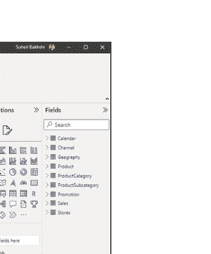

#### 活动详情

- **日期：** 2019 年 9 月 10 日至 13 日
- **地点：** 科罗拉多州布雷肯里奇 Beaver Run Resort
- **网站：** www.nationalclustersummit.com

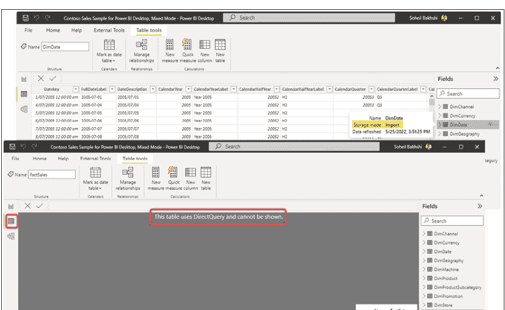

图 1.5：数据视图；存储模式：DirectQuery

## 模型视图

顾名思义，模型视图是我们将所有部分拼接在一起的地方。在模型视图中，我们可以查看表之间的现有关系、创建新关系、设置字段格式、定义同义词，以及显示和隐藏字段。下图展示了选择 Store 表时 Contoso Sales Sample 的模型视图：

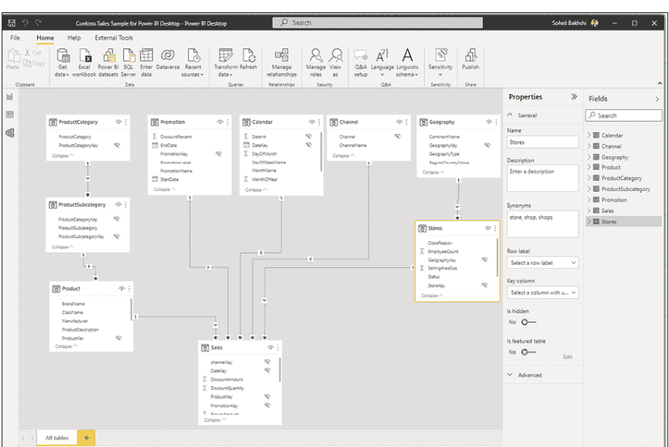

图 1.6：模型视图

## 数据可视化层

在这一层，我们通过创建有意义且专业外观的数据可视化来让数据生动起来。数据可视化层可通过报表视图（Power BI Desktop 中的默认视图）访问。

## 报表视图

在报表视图中，我们可以构建叙述性可视化，帮助企业做出数据驱动的决策。我们还可以在报表视图的“字段”窗格中使用 DAX 创建分析计算，例如计算表、计算列和度量值，但这并不意味着这些对象属于数据可视化层。实际上，它们属于数据模型层。

下图展示了 Sales & Returns Sample 的报表视图：

- 筛选查询也是 Power Query 中的一个转换步骤，它会更改查询的结果集。因此，当我们将数据导入数据模型时，结果集*不会*更改，除非我们更改参数值，这会更改 **Product** 查询的结果集，并将新的结果集导入数据模型。
- 默认情况下，查询参数值不会加载到数据模型中，除非开发人员设置 **启用加载**。设置 **启用加载** 只会从参数列表中加载选定的值，而不是整个列表。
- 当我们谈论 **切片器** 可视化时，我们指的是数据可视化层。这意味着 **切片器** 只能访问已加载到数据模型中的数据。

所以，答案是*不*。将清洗后的数据导入数据模型后，数据可视化层才可访问这些数据。

现在，我们了解了 Power BI 中的数据流，接下来需要更深入地学习 Power BI 中的数据建模。

## Power BI 中数据建模的含义

数据建模无疑是 Power BI 开发中最重要的部分之一。理解 Power BI 中数据建模的目的与事务系统中的数据模型之间的区别至关重要。在事务系统中，目标是拥有一个针对记录事务数据而优化的模型。然而，Power BI 中设计良好的数据模型必须针对查询数据并通过聚合数据来减小数据集大小进行优化。

实际上，并非每个人都能拥有数据仓库，因此知道如何在 Power BI 中创建数据模型是一项至关重要的技能。虽然从各种数据源获取所有数据并将其导入 Power BI 很有诱惑力，但回答业务问题很快就会变成处理时间很长的复杂查询，这并不理想。最佳实践是

## 雪花化

**雪花化**是指当我们没有完美的星型模式，而维度表围绕事实表时的情况。在某些情况下，我们会将一些描述级别存储在不同的表中。因此，模型中的某些维度会与其他更详细描述维度的表相关联。雪花化是对维度表进行规范化。在某些情况下，雪花化是不可避免的；然而，在 Power BI 中进行数据建模（遵循星型模式时）的一般经验法则是尽可能避免雪花化，以拥有更简单、性能更高的模型。下图展示了 Adventure Works Internet Sales 中的雪花化：

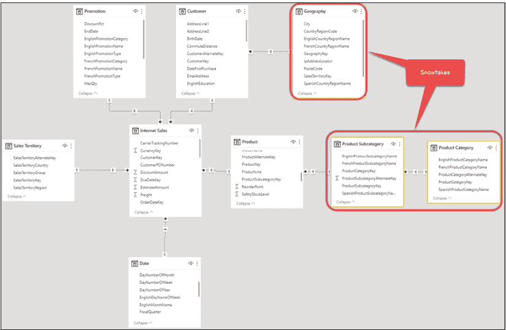

图 1.10：Adventure Works Internet Sales 雪花化

我们可以通过将 **Product Category** 和 **Product Subcategory** 反规范化为 **Product** 表来避免前面模型中的雪花化。下一节将解释反规范化。

## 理解反规范化

在现实场景中，并非每个人都能拥有一个按照星型模式预先构建的数据仓库。实际上，数据仓库设计中的雪花化是不可避免的。数据模型通常连接到各种数据源，包括事务性数据库系统以及非事务性数据源，例如 Excel 文件和 CSV 文件。因此，我们几乎总是需要对模型进行一定程度的反规范化。根据业务需求，我们可能会同时存在某些规范化和某些反规范化。现实情况是，对于规范化和反规范化的程度没有特定规则。一般经验法是反规范化模型，使每个维度尽可能描述所有相关细节。

在前面来自 **Adventure Works DW** 的示例中，我们看到了 **Product Category** 和 **Product Subcategory** 的雪花化，可以将其反规范化为 **Product** 维度。

让我们进行一次动手练习。

按照以下步骤将 **Product Category** 和 **Product Subcategory** 反规范化为 **Product** 维度。

注意

您需要从此处下载 Adventure Works 的 `Internet Sales.pbix` 文件：

https://github.com/PacktPublishing/Expert-Data-Modeling-with-Power-BI-Second-Edition/blob/28e2af1762336ab5236a3b3961c41e9020de8200/Samples/Chapter%2001/Adventure%20Works,%20Internet%20Sales.pbix

您还需要从此处下载作为 PBIX 文件中数据源的 Excel 文件：

https://github.com/PacktPublishing/Expert-Data-Modeling-with-Power-BI-Second-

Edition/blob/28e2af1762336ab5236a3b3961c41e9020de8200/Samples/AdventureWorksDW(xlsx)/AdventureWorksDW2017.xlsx

在开始之前，让我们先设置示例文件。打开 Adventure Works，Internet Sales.pbix 文件，然后按如下方式更改 Adventure Works DW Excel 路径参数：

- a. 单击“转换数据”下拉按钮。
- b. 单击“编辑参数”。
- c. 输入 AdventureWorksDW2017.xlsx 文件的保存位置路径。
- d. 单击“确定”。

下图说明了上述步骤：

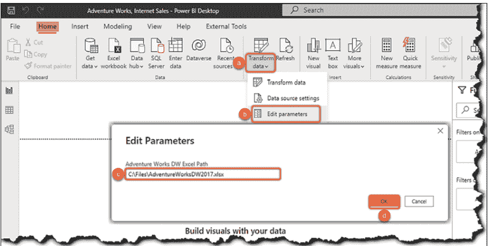

图 1.11：设置 Adventure Works，Internet Sales.pbix 示例文件

更改参数值后，我们必须应用更改。

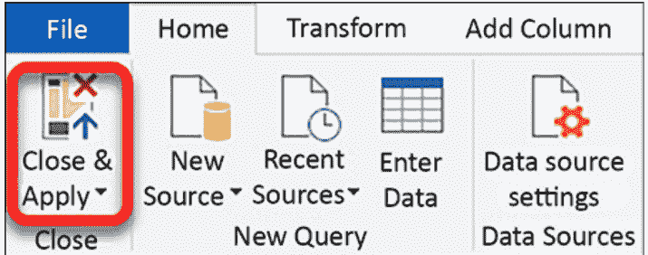

图 1.20：将数据导入数据模型

我们现在已经实现了目标：我们反规范化了 Product Category 和 Product Subcategory 表，因此不再加载这两个表，而是将 EnglishProductCategoryName 和 EnglishProductSubcategoryName 作为 Product 表中的新列。因此，数据模型现在更简单了，我们加载的数据更少，从而获得更好的性能。

任务完成！

## Power BI 许可注意事项

此时，您可能想知道 Power BI 许可如何影响数据建模。确实有影响，因为每个许可层级都附带一组可能影响数据建模的功能。尽管如此，无论许可层级如何，Power BI Desktop 都是免费的。本节解释了一些与数据建模相关的许可注意事项。

下表是 Microsoft 网站上根据不同许可分别发布的 Power BI 功能对比的简化版本：

| Power BI 许可证 | 单个数据集的最大大小 | 增量数据加载 | 混合表 | 计算组 | 共享数据集 | Power BI 数据流 | Power BI Datamart |
|---|---|---|---|---|---|---|---|
| 免费 | 1 | 否 | 否 | 是 | 否 | 否 | 否 |
| 专业版 | 1 | 是 | 否 | 是 | 是 | 是 | 否 |
| Power BI 报表服务器 | 2 | 是 | 否 | 是 | 不适用 | 不适用 | 不适用 |
| Embedded EM1/A1 | 3 | 是 | 是 | 是 | 是 | 是 | 是 |
| Embedded EM2/A2 | 5 | 是 | 是 | 是 | 是 | 是 | 是 |
| Embedded EM3/A3 | 10 | 是 | 是 | 是 | 是 | 是 | 是 |
| Premium P1/A4 | 25 | 是 | 是 | 是 | 是 | 是 | 是 |
| Premium P2/A5 | 50 | 是 | 是 | 是 | 是 | 是 | 是 |
| Premium P3/A6 | 100 | 是 | 是 | 是 | 是 | 是 | 是 |
| Premium P4 | 200 | 是 | 是 | 是 | 是 | 是 | 是 |
| Premium P5 | 400 | 是 | 是 | 是 | 是 | 是 | 是 |
| 每用户高级版 (PPU) | 100 | 是 | 是 | 是 | 是 | 是 | 是 |

图 1.21：Power BI 功能对比的简化版本

接下来的几个小节将简要解释每个功能。

### 单个数据集的最大大小

如上表所示，在免费或专业版许可下，发布到 Power BI 服务的每个数据集限制为 1 GB。因此，管理文件大小非常重要。有几种方法可以将文件大小保持在限制以下，如下所示：

- 仅导入必要的列。
- 尽可能只导入部分数据。向业务方解释技术限制，并询问是否可以筛选掉某些数据。例如，业务方可能不需要分析 10 年的数据，因此可以在 Power Query 中筛选掉较旧的数据。
- 使用聚合。在许多情况下，您可能以非常低的粒度存储源中的数据。但是，业务方需要在更高的粒度上进行数据分析。因此，您可以将数据聚合到更高的粒度，然后将其导入数据模型。例如，您可能以分钟级别存储数据，而业务方只需要按天级别分析这些数据。
- 考虑禁用 Power BI Desktop 中的自动日期/时间设置。

现在，如果您考虑后一点，并结合时间智能函数，您会发现这个问题很快就会变得非常严重。

计算组解决了这类问题。我们将在*第 10 章，高级数据建模技术*中介绍计算组。

### 共享数据集

顾名思义，共享数据集在 Power BI 服务中的*工作区*内跨各种报表使用。因此，它仅在 Power BI 专业版和 Power BI 高级版许可中可用。此功能对数据建模者来说非常关键。它在创建通用数据集方面提供了更大的灵活性，可以在单个数据集中满足业务需求，而不是拥有多个可能有许多共同点的数据集。

### Power BI 数据流

数据流，也称为 Power Query Online，在 Power BI 服务中提供了一种集中式的数据准备机制，组织中的其他人可以利用它。就像在 Power BI Desktop 中使用 Power Query 进行数据准备一样，我们可以在数据流中准备、清理和转换数据。与 Power BI Desktop 中的 Power Query 查询在发布到 Power BI 服务后被隔离在数据集内不同，使用数据流，我们可以在整个组织内共享所有数据准备、清理和转换过程。

我们可以在工作区内创建 Power BI 数据流，这对专业版和高级版用户可用。我们将在*第 13 章，数据流简介*中介绍 Power BI 数据流。

### Power BI Datamart

**Datamart** 功能是 2022 年 5 月宣布的一项新功能。Datamart 的主要目的是使组织能够构建连接多个数据的自助式、无代码/低代码分析解决方案

这些问题引导我们走向各种设计可能性。我们必须识别潜在的风险、限制和相关成本，并与客户讨论。在我们得到答案后，就可以自信地采取下一步措施，设计一个最能满足业务需求、降低风险并很好地适应技术限制的数据模型。

## 基于业务逻辑的数据准备

到目前为止，我们有很多事情要做。我们必须从多个来源获取数据，并完成数据准备步骤。既然我们已经对业务逻辑有了很多了解，我们就可以采取适当的数据准备步骤。例如，如果业务方需要连接到 OData 数据源并获取所需列的列表，我们可以在考虑到所有设计风险和技术限制的情况下更有效地准备数据。在有意识地准备数据之后，我们进入下一步，数据建模。

## 数据建模

如果我们正确地完成了前面的步骤，我们就可以更高效地构建模型。我们需要在考虑所有业务需求、设计可能性、风险和技术限制的同时，从分析的角度思考问题。例如，如果业务方无法容忍超过 5 分钟的数据延迟，我们可能需要考虑使用 DirectQuery。使用 DirectQuery 会带来一些限制和性能风险。因此，我们必须考虑最能满足业务需求的设计方法。我们将在第 4 章，从各种来源获取数据，的数据集存储模式部分中介绍 DirectQuery。

## 测试逻辑

数据建模中最平凡但最重要的步骤之一是测试我们为满足需求而实现的所有业务逻辑。我们不仅需要测试数据以确保结果准确，还需要从性能和用户体验的角度测试解决方案。请为来自最终用户的大量混合反馈和有时严厉的批评做好准备，尤其是当我们认为一切正常的时候。

## 在基本数据可视化中演示业务逻辑

在我们对数据建模时，我们不需要担心数据可视化。与业务 SME（主题专家）确认是确保所有报告逻辑正确的最快方法。从 SME 获得确认的最快方法是尽可能以最简单的方式演示逻辑，例如使用页面上的表格和矩阵视觉对象以及一些切片器。在向 SME 演示解决方案时，不要忘记强调可视化仅用于与他们确认报告逻辑，而不是实际的产品交付。在现实世界中，我们在演示过程中会有许多新的讨论和惊喜，这通常意味着我们正处于第二次迭代的开始，因此我们开始收集有关所需更改和新需求（如果有）的信息。

随着我们多次重复上述步骤，我们逐渐成为专业的数据建模者。本书也遵循迭代方法，因此我们会在不同章节之间来回切换以涵盖一些场景。

在下一节中，我们将简要介绍专业数据建模者是如何思考的。

## 像专业数据建模者一样思考

没有人能在一夜之间成为某方面的专家。我们会犯很多错误，并从中学习。专业来自于经验。要获得经验，我们需要大量练习。让我分享一个关于我自己的简短背景故事。那时候，在 90 年代末，我


## 数据分析表达式与数据建模

上一章讨论了 Power BI 具有不同的层：数据准备、数据建模和数据可视化。本章讨论数据分析表达式（DAX）及其与数据建模的关系。虽然数据建模和 DAX 相互关联，以至于你无法想象其中一个没有另一个，但我们本书的目标并不是只关注 DAX。数据建模涵盖了更广泛的概念，而 DAX 是开发人员必须在数据模型中实现业务逻辑时使用的表达式语言。我们假设你对 DAX 具有中级知识水平；因此，本书不涵盖基础 DAX 概念，例如 DAX 语法。相反，我们专注于更高级的概念并结合实际场景。

本章涵盖以下主题：

- 理解虚拟表
- 理解虚拟表中的关系
- 时间智能

### 理解虚拟表

DAX 中虚拟表的概念有些令人困惑且被误解，但它是 DAX 中最强大和最重要的概念之一。当我们谈论虚拟表时，我们指的是使用某些 DAX 函数或构造函数构建的内存中表。虚拟表中的数据要么源自数据模型中的数据，要么是我们为特定目的构造的数据。

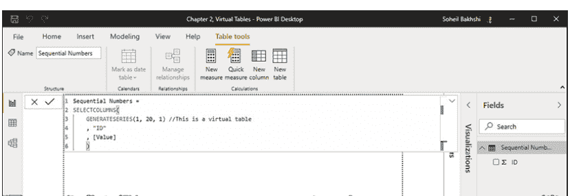

图 2.3：计算表和虚拟表

我们首先使用前面的代码创建了一个带有 **Value** 列的虚拟表。然后，我们将 **Value** 列重命名为 **ID**，最后，我们用结果填充了一个计算表。

在前面的场景中，我们使用虚拟表创建了一个计算表。在下面的场景中，我们将演示虚拟表用于度量的用法。

让我们进一步进行一个更复杂的场景。

从以下 URL 下载 `Chapter 2, Virtual Tables 02, Adventure Works, Internet Sales.pbix` 样本：

https://github.com/PacktPublishing/Expert-Data-Modeling-with-Power-BI-Second-Edition/blob/main/Samples/Chapter%2002/Chapter%202%2C%20Virtual%20Tables%2002%2C%20Adventure%20Works%2C%20Internet%20Sales.pbix

在 **Internet Sales** 表中创建一个度量，以计算产品列表价格高于 $1,000 时的订购数量。将该度量命名为 **Orders with List Price Bigger than or Equal to $1,000**：

**Note**: GOOD PRACTICE

计算为客户购买的产品列表价格大于 $1,000 且数量超过 4 件的订单数量。将该度量命名为 **Order Qty for Customers Buying More than 4 Products with List Price Bigger Than $1,000.**

为了解决此场景，我们需要创建一个客户虚拟表，这些客户对价格超过 $1,000 的产品下了超过 4 个订单。以下代码将处理此操作：

```
Order Qty for Customers Buying More than 4 Products with List Price Bigger Than $1,000 =
SUMX(
    FILTER(
        VALUES(Customer[CustomerKey]) //Virtual table
        , [Orders with List Price Bigger than or Equal to $1,000] > 4
    )
    , [Orders with List Price Bigger than or Equal to $1,000]
)
```

分析前面的计算有助于我们更好地理解虚拟表的强大功能：

- 此处的虚拟表只有一个列，即 **CustomerKey**。请记住，此列仅在当前计算中可访问。
- 然后，我们使用 `FILTER()` 函数过滤 `VALUES()` 的结果，仅显示对列表价格超过 $1,000 的产品下了超过 4 个订单的客户键。
- 最后，我们对 `FILTER()` 的结果求和这些数量。

我们现在可以在报表页面上放置一个表格视觉对象，然后从 **Customer** 表中选择 **First Name** 和 **Last Name** 以及我们刚刚创建的新度量。以下图显示了订购了超过 4 件价格超过 $1,000 的商品的客户：

| First Name | Last Name | Order Qty for Customers Buying More than 4 Products with List Price Bigger Than $1,000 |
|---|---|---|
| Adriana | Gonzalez | 5 |
| Brad | She | 5 |
| Brandi | Gill | 5 |
| Francisco | Sara | 5 |
| Janet | Munoz | 5 |
| Kaitlyn | Henderson | 5 |
| Margaret | He | 5 |
| Maurice | Shan | 6 |
| Nichole | Nara | 5 |
| Randall | Dominguez | 5 |
| Rosa | Hu | 5 |
| Total |  | 56 |

图 2.6：按客户的 Order Qty for Customers Buying More than 4 Products with List Price Bigger Than $1,000 表

如前所述，我们可以使用所有返回表值的 DAX 函数来创建虚拟表。但是，下表中列出的函数是最常用的：

| ADDCOLUMNS() | CALENDARAUTO() | FILTERS() | SELECTCOLUMNS() | VALUES() |
|---|---|---|---|---|
| ADDMISSINGITEMS() | CALCULATETABLE() | GENERATESERIES() | SUMMARIZE() | Table Constructor {} |
| ALL() | CROSSJOIN() | INTERSECT() | SUMMARIZECOLUMNS() |  |
| ALLEXCEPT() | DATATABLE() | NATURALINNERJOIN() | TOPN() |  |
| ALLSELECTED() | DISTINCT() | NATURALLEFTOUTERJOIN() | TREATAS() |  |
| CALENDAR() | EXCEPT() | RELATEDTABLE() | UNION() |  |

图 2.7：常用函数

虚拟表仅在内存中可用。此外，它们在 Power BI Desktop 的模型视图中不可见。因此，它们有点难以理解。然而，仍然有一些方法可以测试虚拟表并直观地看到结果，我们将在下一节中介绍。

### 可视化显示虚拟表的结果

在本节中，我们解释如何查看虚拟表的结果。观察虚拟表的输出总是有益的，而不仅仅是。

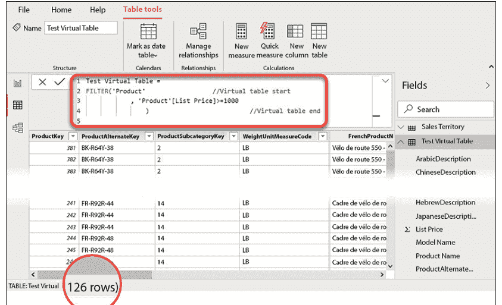

图 2.8：在 Power BI Desktop 计算表中可视化显示虚拟表

### 使用 DAX Studio

DAX Studio 是由 SQLBI 的出色团队创建的最受欢迎的第三方工具之一，可免费下载。你可以从工具的官方网站获取它（https://daxstudio.org/）。你可以使用 DAX Studio 轻松查看虚拟表的结果。首先，你需要在从 DAX Studio 连接之前打开你的 Power BI 文件（*.pbix）。打开 DAX Studio 并按照以下步骤操作：

1. 点击 PBI/SSDT Model。
2. 选择所需的 Power BI Desktop 实例。
3. 输入 EVALUATE 语句，然后将计算的虚拟表部分复制并粘贴到新行上：

```
FILTER('Product' //Virtual table start
    , 'Product'[List Price]>=1000
) //Virtual table end
```

- 假设虚拟表是从数据模型中现有的物理表派生的。虚拟表与原始物理表之间存在关系，这就是所谓的 **lineage**。
- 在某些情况下，我们在一次计算中创建了多个虚拟表。然后，我们在程序上在这些虚拟表之间创建关系。在某些其他情况下，我们可能需要用新的关系替换现有关系。这种关系称为 **virtual relationship**。

无论哪种方式，该关系都不是数据模型中的物理关系。它是在计算本身中创建的，并在计算运行期间驻留在内存中。因此，理解虚拟关系至关重要。所以，让我们通过一个实际场景来了解。

企业要求你按 **Product Category**、**Product Subcategory** 和 **Product** 计算平均产品标准成本。

为了解决此场景，请打开样本文件：`Chapter 2, Virtual Tables 03, Avg Product Standard Cost.pbix`。查看数据模型。它非常简单。它仅由两个表组成，**Product** 和 **Internet Sales**。正如你所见，我们可以在度量中使用来自 **Internet Sales** 表的 **ProductStandardCost** 列。以下图显示了数据模型：


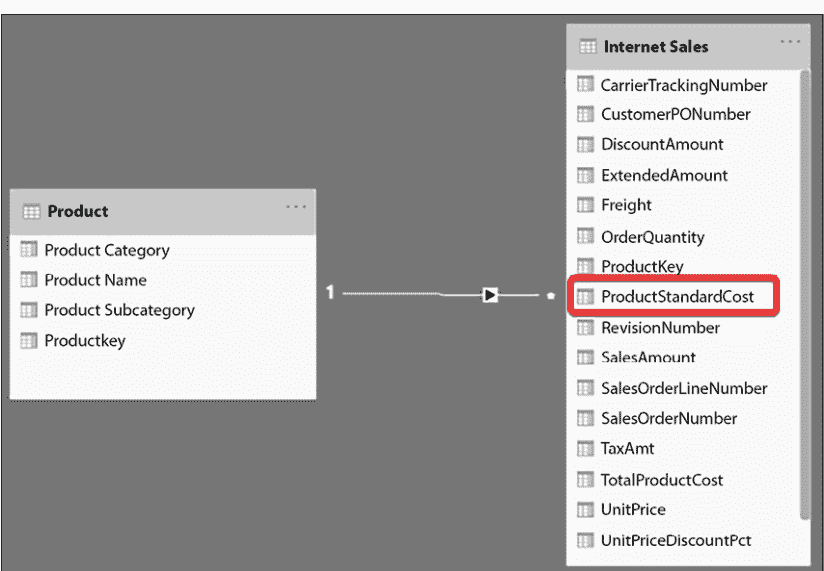

### 图 2.10：Product 与 Internet Sales

下一步是创建一个度量值来计算平均产品标准成本：

```
Avg. Product Standard Costs =
AVERAGE('Internet Sales'[ProductStandardCost])
```

让我们通过以下步骤测试所创建的度量值：

-   在报表画布上放置一个矩阵视觉对象。
-   将 Product 表中的 Product Category、Product Subcategory 和 Product 列放入矩阵视觉对象的“行”区域。
-   将 Avg. Product Standard Costs 度量值放入矩阵的“值”区域。

以下截图说明了这些步骤：

### 图 2.11：按 Product Category、Product Subcategory 和 Product 可视化 Avg. Product Standard Costs

很简单吧！但让我们更深入地查看底层数据，以确保计算是正确的。在 Power BI Desktop 的左侧窗格中单击“数据视图”，然后点击 Internet Sales 表。

如下图所示，每笔交易都有一个 ProductStandardCost 值。换句话说，我们考虑了从供应商供货到商品售出的所有产品成本：

### 图 2.12：每笔交易都有 ProductStandardCost 值

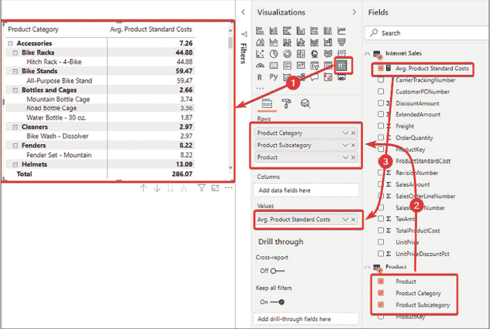

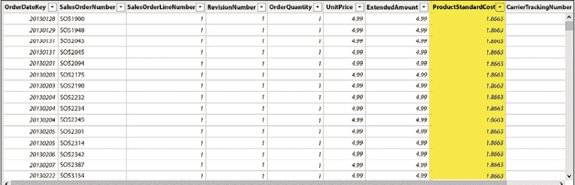

产品成本通常是变动的，而且会随时间变化。因此，在我们的场景中，确认情况是否如此至关重要。如果是，那么前面的计算就是正确的。

现在，让我们让场景变得更具挑战性一些。为了确认我们对需求的理解是否正确，我们请业务方确认：他们是否会计算一件商品从开始到售出为止的所有成本。如果是这样，我们就需要将产品成本保留在 **Internet Sales** 表中。

业务方的回答是，他们需要显示商品上架前的当前产品标准成本。换句话说，每个产品关联的标准成本只有一个固定值。因此，在这个特定场景中，我们不需要在 **Internet Sales** 表的 **ProductStandardCost** 列中保留成本历史。相反，我们必须将 **ProductStandardCost** 列移动到 **Product** 表中。

因此，前面的计算是不正确的。通过将 **ProductStandardCost** 列移动到 **Product** 表，每个产品只关联一个产品标准成本。这就是数据建模如何帮助我们降低 DAX 表达式的复杂度。但为了演示虚拟表，我们再创建一个度量值并分析结果。在创建度量值之前，让我们再次回顾一下需求。

我们需要按 **Product Category**、**Product Subcategory** 和 **Product** 获取产品标准成本的平均值。每个产品只有一个当前产品标准成本。因此，我们可以创建一个虚拟表，将 **ProductKey** 列和 **ProductStandardCost** 列并排放置。请注意，这两个列来自不同的表。然而，由于这两个表之间已经存在物理关系，我们可以轻松地在单个虚拟表中让这两个列并排。

下面的度量值满足了上述需求：

```
Avg. Product Standard Costs Correct =
AVERAGEX(
    SUMMARIZE (
        'Internet Sales'
        , 'Product'[ProductKey]
        , 'Internet Sales'[ProductStandardCost]
    )
    , 'Internet Sales'[ProductStandardCost]
)
```

现在，我们可以将新度量值添加到之前放在报表画布上的矩阵视觉对象中，以同时查看两个度量值。这样，我们就可以快速看到两种计算之间的差异。总计尤其显示了两者之间的巨大差异。下图显示了这些差异：

| Product Category | Avg. Product Standard Costs | Avg. Product Standard Costs Correct |
|---|---:|---:|
| Accessories | 7.26 | 12.02 |
| Bike Racks | 44.88 | 44.88 |
| Bike Stands | 59.47 | 59.47 |
| Bottles and Cages | 2.66 | 2.99 |
| Cleaners | 2.97 | 2.97 |
| Fenders | 8.22 | 8.22 |
| Helmets | 13.09 | 13.09 |
| Hydration Packs | 20.57 | 20.57 |
| Tires and Tubes | 5.30 | 7.29 |
| Bikes | 1,105.71 | 918.41 |
| Mountain Bikes | 1,094.39 | 1,004.64 |
| Road Bikes | 1,113.45 | 881.46 |
| Touring Bikes | 1,102.87 | 885.93 |
| Clothing | 22.34 | 25.56 |
| Caps | 6.92 | 6.92 |
| Gloves | 9.16 | 9.16 |
| Jerseys | 39.97 | 40.03 |
| Shorts | 26.18 | 26.18 |
| Socks | 3.36 | 3.36 |
| Vests | 23.75 | 23.75 |
| Total | 286.07 | 679.19 |

### 图 2.13：比较为 Avg. Product Standard Costs 创建的两个度量值

让我们分析上面的度量值，看看它是如何工作的。

AVERAGEX() 函数是一个迭代器函数，它会遍历其表参数的所有行，以计算其表达式参数。这里，我们使用 SUMMARIZE() 函数创建了虚拟表。

如下图所示，我们在 **Internet Sales** 表之上创建了一个虚拟表。我们从 **Product** 表中获取按 **ProductKey** 分组的 **ProductStandardCost** 值：


### 图 2.14：在两个表之上创建的虚拟表

这怎么可能呢？其原理如下。

如前所述，`AVERAGEX()` 函数是一个迭代器函数。它会遍历由 `SUMMARIZE()` 函数创建的虚拟表中的每一行。`SUMMARIZE()` 函数通过两个表之间现有的关系，从 **Internet Sales** 表中获取 **ProductStandardCost** 列的值，并按 **Product** 表中相关的 **ProductKey** 实例进行分组。当我们在 DAX Studio 中运行上述计算的 `SUMMARIZE()` 部分时，可以看到 `SUMMARIZE()` 只检索了 158 行，而 **Internet Sales** 表有超过 60,000 行。原因在于 **Internet Sales** 表与 **Product** 表之间现有的关系。

下图显示了在 DAX Studio 中运行上述计算中 `SUMMARIZE()` 部分所得的结果：

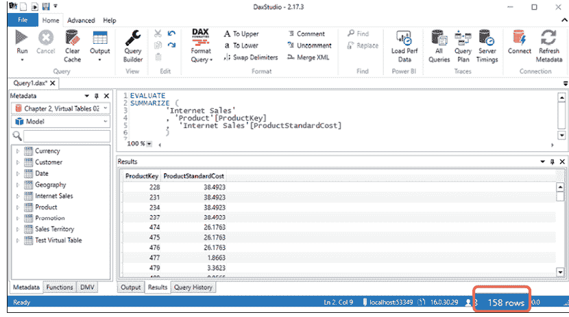

### 图 2.15：在 DAX Studio 中运行上述计算中 SUMMARIZE() 部分所得的结果

到目前为止，一切正常。

另一个需要注意的要点是，我们在度量值内部创建了一个虚拟表。当我们将 Product Category、Product Subcategory 和 Product 列放入矩阵视觉对象时，它们会为 Avg. Product Standard Costs Correct 度量值显示正确的值。我们并没有在 Internet Sales 与 SUMMARIZE() 函数创建的虚拟表之间物理创建任何关系。为什么我们仍能得到正确的结果呢？

答案在于派生虚拟表与原始物理表之间的沿袭。虚拟表从 Product 表继承了与 Internet Sales 表的关系。换句话说，虚拟表通过 ProductKey 与 Product 表具有一对一的虚拟关系。因此，当我们将 Product Category、Product Subcategory 和 Product 列放入矩阵视觉对象时，筛选器会传播到 Product 表和 Internet Sales 表。下图说明了虚拟表如何与 Product 表和 Internet Sales 表关联：

最后一个需求，也是到目前为止最令人困惑的一个，就是：如果两个表之间存在物理关系，则参与连接的列必须具有相同的沿袭。如果表之间没有物理关系，则参与连接的列不得与数据模型中的任何物理列存在沿袭关系。因此，我们需要断开连接列的沿袭。否则，`NATURALINNERJOIN()` 函数将无法工作。我们需要使用表达式而不是实际的列名来断开沿袭。因此，我们为 `'Internet Sales'[OrderDate]` 加上 0 天，并将 `'Exchange Rates'[CurrencyKey]` 乘以 1，以断开这两列的沿袭。

最终，我们得到了所需的结果集，因此可以将 `[SalesAmount]` 乘以 `[AverageRate]`，得到以美元计的销售额。

下图并排显示了 **Internet Sales**（未考虑汇率）与 **Internet Sales USD** 两个度量值：

| Product Category | Internet Sales | Internet Sales USD |
|---|---:|---:|
| Accessories | 700,759.96 | $640,920.11 |
| All-Purpose Bike Stand | 39,591.00 | $35,628.69 |
| Bike Wash - Dissolver | 7,218.60 | $6,352.51 |
| Fender Set - Mountain | 46,619.58 | $41,974.10 |
| Hitch Rack - 4-Bike | 39,360.00 | $35,934.55 |
| HL Mountain Tire | 48,860.00 | $42,839.80 |
| HL Road Tire | 27,970.80 | $24,531.24 |
| Hydration Pack - 70 oz. | 40,307.67 | $35,307.84 |
| LL Mountain Tire | 21,541.38 | $19,092.44 |
| LL Road Tire | 22,435.56 | $21,492.01 |
| ML Mountain Tire | 34,818.39 | $31,580.66 |
| ML Road Tire | 23,140.74 | $20,554.35 |
| Mountain Bottle Cage | 20,229.75 | $18,814.51 |
| Mountain Tire Tube | 15,444.05 | $13,759.74 |
| Patch Kit/8 Patches | 7,307.39 | $6,595.31 |
| Road Bottle Cage | 15,390.88 | $13,953.77 |
| Total | 29,358,677.22 | $26,054,827.45 |


下一节，我们将探讨数据建模中的**时间智能**。

## 时间智能与数据建模

**时间智能**是 Power BI 中功能最强大、最常用的功能之一。对于具有 SQL 开发背景的人来说，很清楚在诸如 SQL Server 这样的关系数据库系统中构建时间智能分析有多么困难。在 Power BI 中，只需使用少量时间智能函数，即可轻松实现这些复杂计算。本节将简要介绍在 Power BI 中使用时间智能函数时的常见挑战。

Power BI 中目前有 35 个时间智能函数。
你可以在 Microsoft 网站上找到完整的函数列表：
https://docs.microsoft.com/en-us/dax/time-intelligence-functions-dax?WT.mc_id=DP-MVP-5003466.

## 在日期维度中检测有效日期

在处理时间智能中的周期性计算时，通常很难仅让有效日期显示在视觉对象中。

让我们通过一个场景来看如何做到这一点。

业务需要查看以下计算：
- 互联网销售月度累计（MTD）
- 互联网销售上月累计（LMTD）
- 互联网销售年度累计（YTD）
- 互联网销售去年累计（LYTD）

## 互联网销售去年同月至今（LY MTD）

使用现有的 DAX 函数编写上述度量值非常简单。计算如下。

要计算 MTD，请使用以下 DAX 表达式：

```
Internet Sales MTD =
TOTALMTD(
    [Internet Sales]
    , 'Date'[Full Date]
)
```

使用以下 DAX 表达式计算 LMTD：

```
Internet Sales LMTD =
TOTALMTD(
    [Internet Sales]
    , DATEADD('Date'[Full Date], -1, MONTH)
)
```

使用以下 DAX 表达式计算 YTD：

```
Internet Sales YTD =
TOTALYTD(
    [Internet Sales]
    , 'Date'[Full Date]
)
```

使用以下 DAX 表达式计算 LYTD：

```
Internet Sales LYTD =
TOTALYTD (
    [Internet Sales]
    , DATEADD('Date'[Full Date], -1, YEAR)
)
```

最后，使用以下 DAX 表达式计算 LY MTD：

```
Internet Sales LY MTD =
TOTALMTD(
    [Internet Sales]
    , SAMEPERIODLASTYEAR('Date'[Full Date])
)
```

注意

SAMEPERIODLASTYEAR('Date'[Full Date]) 和 DATEADD('Date'[Full Date], -1, YEAR) 作用相同。我们使用了不同的函数来展示各种可能性。

然后，我们可以在报表画布上放置一个表视觉对象，将计算结果与 **Date** 表中的 **Full Date** 并排显示。一切看起来都很好，除非我们对 **Full Date** 列按降序排序，这时我们会发现问题。许多日期的 **Internet Sales**、**Internet Sales MTD** 和 **Internet Sales LMTD** 度量值会出现空值。同时，**Internet Sales YTD** 度量值也出现了大量重复值。

下图展示了结果：

图 2.21：周期性时间智能计算中与未来日期相关的问题

这确实是预期行为。日期维度必须覆盖从 1 月 1 日到 12 月 31 日的所有日期。因此，对于未来日期，预计 Internet Sales、Internet Sales MTD 和 Internet Sales LMTD 度量值会出现空值，而 Internet Sales YTD 度量值则会出现重复值。下图通过向下滚动表视觉对象显示了更多结果。我们可以看到，最后一个有有效交易的日期是 28/01/2014，这意味着所有前述度量值都必须在该日期之前完成其计算：

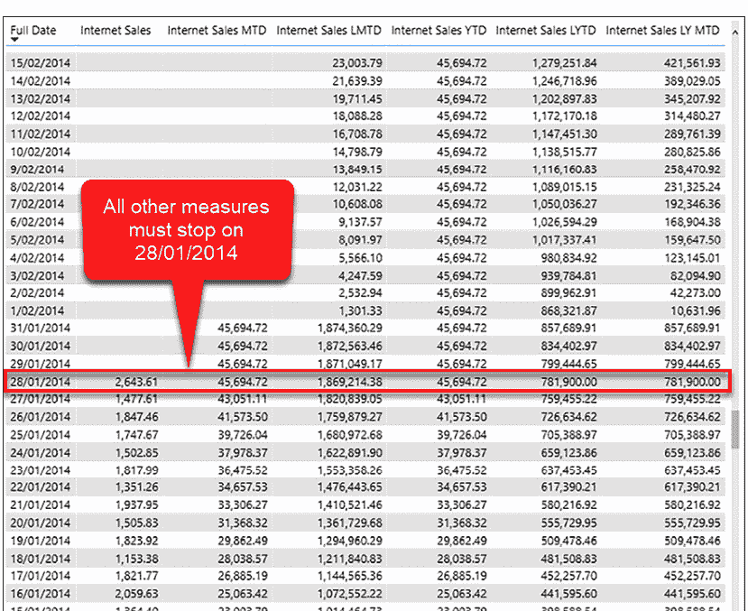

图 2.22：最后一个有效日期是 28/01/2014

解决该问题的一种方法是对无效日期返回 BLANK()。以下计算显示了 Internet Sales MTD Blanking Invalid Dates 度量值，如果某个日期没有交易，则返回 null：

```
Internet Sales MTD Blanking Invalid Dates =
VAR lastorderDate = MAX('Internet Sales'[OrderDateKey])
RETURN
IF(
    MAX('Date'[DateKey]) <= lastorderDate
    , TOTALMTD(
        [Internet Sales]
        , 'Date'[Full Date]
    )
)
```

在上述度量值中，我们做的事情很简单。我们从 **Internet Sales** 表中获取 **OrderDateKey** 的最大值，然后添加一个条件：如果 **OrderDateKey** 值不存在，则返回空白；否则返回 `TOTALMTD()` 计算。

下图显示了 `Internet Sales MTD Blanking Invalid Dates` 度量值的结果：

| Full Date | Internet Sales | Internet Sales MTD Blanking Invalid Dates |
|---|---|---|
| 28/01/2014 | 2,643.61 | 45,694.72 |
| 27/01/2014 | 1,477.61 | 43,051.11 |
| 26/01/2014 | 1,847.46 | 41,573.50 |
| 25/01/2014 | 1,747.67 | 39,726.04 |
| 24/01/2014 | 1,502.85 | 37,978.37 |
| 23/01/2014 | 1,817.99 | 36,475.52 |
| 22/01/2014 | 1,351.26 | 34,657.53 |
| 21/01/2014 | 1,937.95 | 33,306.27 |
| 20/01/2014 | 1,505.83 | 31,368.32 |
| 19/01/2014 | 1,823.92 | 29,862.49 |
| 18/01/2014 | 1,153.38 | 28,038.57 |
| 总计 | 29,358,677.22 | |

图 2.23：Internet Sales MTD 空值无效日期

虽然这种计算可能适用于某些场景，但在其他一些场景（例如我们的场景）中，它并不是正确的计算。更仔细地查看结果会发现一个问题。下图揭示了这一问题：

| Full Date | Internet Sales | Internet Sales MTD Blanking Invalid Dates |
|---|---|---|
| 7/02/2011 | 21,088.06 | 119,199.78 |
| 8/02/2011 | 17,891.35 | 137,091.13 |
| 9/02/2011 | 21,469.62 | 158,560.75 |
| 10/02/2011 | 11,929.73 | 170,490.48 |
| 11/02/2011 | 14,313.08 | 184,803.56 |
| 12/02/2011 | 21,113.06 | 205,916.62 |
| 14/02/2011 | 3,578.27 | 209,494.89 |
| 15/02/2011 | 21,266.34 | 230,761.23 |
| 16/02/2011 | 17,109.47 | 247,870.70 |
| 17/02/2011 | 21,266.34 | 269,137.04 |
| 18/02/2011 | 28,016.32 | 297,153.36 |
| 总计 | 29,358,677.22 | |

*注释：缺少 13/02/2011*

```
CALCULATETABLE(
    VALUES('Date'[Full Date])
    , 'Date'[IsValidDate] = TRUE()
)
, -1
, MONTH
)
```

使用以下 DAX 表达式计算带有效日期的 Internet Sales YTD：

```
Internet Sales YTD with Valid Dates =
CALCULATE(
    TOTALYTD(
        [Internet Sales]
    , CALCULATETABLE(
            VALUES('Date'[Full Date])
        , 'Date'[IsValidDate] = TRUE()
        )
    )
)
```

使用以下 DAX 表达式计算带有效日期的 Internet Sales LYTD：

```
Internet Sales LYTD with Valid Dates =
TOTALYTD (
    [Internet Sales]
    , DATEADD(
        CALCULATETABLE(
            VALUES('Date'[Full Date])
        , 'Date'[IsValidDate] = true()
        )
    , -1
    , YEAR
    )
)
```

最后，使用以下 DAX 表达式计算带有效日期的 Internet Sales LY MTD：

```
Internet Sales LY MTD with Valid Dates =
TOTALMTD(
    [Internet Sales]
    , SAMEPERIODLASTYEAR(
        CALCULATETABLE(
            VALUES('Date'[Full Date])
            , 'Date'[IsValidDate] = TRUE()
        )
    )
)
```

下图显示了在不使用 IsValidDate 列筛选视觉对象的情况下，将上述度量值放入表视觉对象中的结果：

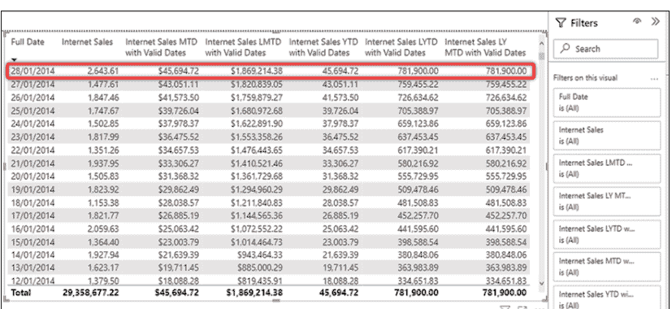

图 2.26：使用改进度量值后的周期性计算

该方法还修复了在切片器视觉对象中使用 Full Date 列时显示无效日期的问题。如果只显示切片器中的有效日期会更好。下图展示了一个显示来自 Date 表的 Full Range Dates 范围的切片器视觉对象，旁边是另一个仅显示 Valid Dates 的切片器视觉对象：

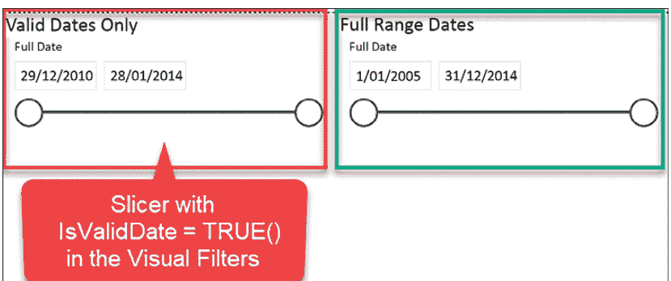

图 2.27：按 IsValidDate 筛选的日期切片器

在上图中，我们使用了 IsValidDate 标志列来筛选左侧切片器的值。

## 逐期计算

在许多情况下，企业需要进行逐期计算，例如同比（year-over-year）和环比（month-over-month）计算。逐期计算因企业而异，但原理相同。本节讨论的范围更广。我们在此使用的场景基于一个现实且需求量很大的业务需求：动态度量值选择。在本节中，我们学习如何使用 Power BI Desktop 中开箱即用的功能来解决一些数据可视化挑战。2022 年 5 月，微软发布了一项名为 Fields Parameters（字段参数）的新功能。

让我们继续动态度量值选择场景。业务要求你分析不同时期的互联网销售额，如下所示：
- 互联网销售额的环比差异
- 互联网销售额的同比差异


让我们基于场景的公式创建一个度量，并看看会出什么问题：

```
Internet Sales MoM Variance = [Internet Sales] − [Internet Sales LM]
```

现在将新的度量放入表格视觉对象中。以下图表显示了结果：

| Full Date | Internet Sales | Internet Sales LM | Internet Sales MoM Variance |
|---|---:|---:|---:|
| 29/12/2010 | 14,477.34 |  | 14,477.34 |
| 30/12/2010 | 13,931.52 |  | 13,931.52 |
| 31/12/2010 | 15,012.18 |  | 15,012.18 |
| 1/01/2011 | 7,156.54 |  | 7,156.54 |
| 2/01/2011 | 15,012.18 |  | 15,012.18 |
| 3/01/2011 | 14,313.08 |  | 14,313.08 |
| 4/01/2011 | 7,855.64 |  | 7,855.64 |
| 5/01/2011 | 7,855.64 |  | 7,855.64 |
| 6/01/2011 | 20,909.78 |  | 20,909.78 |
| 7/01/2011 | 10,556.53 |  | 10,556.53 |
| 8/01/2011 | 14,313.08 |  | 14,313.08 |
| … | … | … | … |
| 23/01/2011 | 17,534.79 |  | 17,534.79 |
| 24/01/2011 | 28,041.32 |  | 28,041.32 |
| 25/01/2011 | 19,785.36 |  | 19,785.36 |
| 26/01/2011 | 17,688.07 |  | 17,688.07 |
| 27/01/2011 | 14,402.34 |  | 14,402.34 |
| 28/01/2011 | 15,012.18 |  | 15,012.18 |
| 29/01/2011 | 17,891.35 | 14,477.34 | 3,414.01 |
| 30/01/2011 | 10,734.81 | 13,931.52 | -3,196.71 |
| **Total** | **29,358,677.22** | **29,358,677.22** | **0.00** |

Figure 2.29: The variance values for the first 28 rows do not make sense

正如你所见，方差值要到 **28/01/2011** 之后才开始合理。原因很容易理解。过去 28 天没有销售，因此我们必须剔除这些值。可能首先想到的解决方案之一是消除 **Internet Sales LM** 的空值。度量如下所示：

```
Internet Sales MoM Variance Incorrect =
IF(
    NOT(ISBLANK([Internet Sales LM]))
    , [Internet Sales] - [Internet Sales LM]
)
```

在前面的计算中，我们说如果 **Internet Sales LM** 不为空，则获取方差；否则显示空白。

但该计算存在一个问题。以下图表显示了该问题：

| Full Date | Internet Sales | Internet Sales LM | Internet Sales Mom Variance Incorrect |
|---|---|---|---|
| 17/02/2011 | 21,266.34 | 11,255.63 | 10,010.71 |
| 18/02/2011 | 28,016.32 | 14,313.08 | 13,703.24 |
| 19/02/2011 | 17,688.07 | 38,241.29 | -20,553.22 |
| 20/02/2011 | 10,531.53 | 15,012.18 | -4,480.65 |
| 21/02/2011 | 28,968.70 | 10,734.81 | 18,233.89 |
| 22/02/2011 | 7,652.36 | 11,433.91 | -3,781.55 |
| 23/02/2011 | 24,691.33 | 17,534.79 | 7,156.54 |
| 24/02/2011 | 7,156.54 | 28,041.32 | -20,884.78 |
| 25/02/2011 | 7,156.54 | 19,785.36 | -12,628.82 |
| 26/02/2011 | 19,785.36 | 17,688.07 | 2,097.29 |
| 27/02/2011 | 24,691.33 | 14,402.34 | 10,288.99 |
| 28/02/2011 | 20,859.78 | 15,012.18 | 5,847.60 |
| 1/03/2011 | 14,313.08 | 17,534.79 | -3,221.71 |
| 2/03/2011 | 35,782.70 | 15,711.28 | 20,071.42 |
| 3/03/2011 | 11,433.91 | 25,390.43 | -13,956.52 |
| 4/03/2011 | 21,119.06 | 14,313.08 | 799.98 |
| 5/03/2011 | 10,734.81 | 11,255.63 | -520.82 |
| 6/03/2011 | 22,168.72 | 13,906.52 | 8,262.20 |
| 7/03/2011 | 15,012.18 | 21,088.06 | -6,075.88 |
| 8/03/2011 | 10,734.81 | 17,891.35 | -7,156.54 |
| 9/03/2011 | 24,463.05 | 21,469.62 | 2,993.43 |
| 10/03/2011 | 10,734.81 | 11,929.73 | -1,194.92 |
| 11/03/2011 |  | 14,313 | -14,313.08 |
| 12/03/2011 | 6,978.26 | 21,? | -14,134.80 |
| 13/03/2011 | 8,351.46 |  |  |
| 14/03/2011 | 17,891.35 | 3,578.27 | 14,313.08 |
| 15/03/2011 | 14,313.08 | 21,266.34 | -6,953.26 |
| 16/03/2011 | 15,012.18 | 17,109.47 | -2,097.29 |
| 17/03/2011 | 13,956.52 | 21,266.34 | -7,309.82 |
| 18/03/2011 | 17,891.35 | 28,016.32 | -10,124.97 |
| 19/03/2011 | 25,568.71 | 17,688.07 | 7,880.64 |
| 20/03/2011 | 7,156.54 | 10,531.53 | -3,374.99 |
| 21/03/2011 | 22,307.98 | 28,968.70 | -6,660.72 |
| Total | 29,358,677.22 | 29,358,677.22 | 0.00 |

*Callouts: "There are no sales on 13/02/2011" and "The variance should be 8,351.46"*

Figure 2.30: The calculation results in incorrect variance values when there are no sales in a particular day

前述计算还有另一个问题。计算会为未来日期显示上个月的销售额，这是错误的。我们在按 Full Date 以降序排序结果时可以看到该问题。图 2.31 说明了该问题：

```
Internet Sales MOM Variance =
VAR firstValidDateWithSalesLM =
FIRSTNONBLANK(ALL('Date'[Full Date]), [Internet Sales LM])
VAR lastValidDateWithSalesLM = LASTNONBLANK(ALL('Date'[Full Date]), [Internet Sales])
RETURN
    SUMX(
        FILTER(
            VALUES('Date'[Full Date])
            , 'Date'[Full Date] >= firstValidDateWithSalesLM
            && 'Date'[Full Date] <=
lastValidDateWithSalesLM
        )
        , [Internet Sales] - [Internet Sales LM]
    )
```

让我们看看前面的计算是如何工作的。

+   - `firstValidDateWithSalesLM` 变量计算出托管 `Internet Sales LM` 度量的 **Date** 表中的第一个非空白日期。
+   - `lastValidDateWithSalesLM` 变量计算出包含 `Internet Sales` 度量的 **Date** 表中的最后一个非空白日期。
+   - 在 `FILTER()` 中，我们生成一个虚拟表，获取落在 `firstValidDateWithSalesLM` 和 `LastValidDateWithSalesLM` 之间的有效日期。
+   - 最后，`SUMX()` 函数遍历虚拟表的行，计算方差。

前述逻辑保证我们仅为有效日期范围获取有效值。有效日期范围从 **Internet Sales LM** 有交易的第一个日期开始，到 **Internet Sales** 有交易的最后一个日期结束。

以下图表显示了结果：

Figure 2.32: The correct calculation shows the correct results when Internet Sales LM is blank and stops the calculation at the last date with an Internet Sales value

现在我们知道了逻辑，我们可以按如下方式创建另一个度量 Internet Sales LY：

```
Internet Sales YoY Variance =
VAR firstValidDateWithSalesLY =
FIRSTNONBLANK(ALL('Date'[Full Date]), [Internet Sales LY])
VAR lastValidDateWithSalesLY = LASTNONBLANK(ALL('Date'[Full Date]), [Internet Sales])
RETURN
    SUMX(
        FILTER(
            VALUES('Date'[Full Date])
            , 'Date'[Full Date] >= firstValidDateWithSalesLY
            && 'Date'[Full Date] <=
lastValidDateWithSalesLY
```

```
)\n, [Internet Sales] - [Internet Sales LY])
```

到目前为止，我们已经理清了初始度量；现在我们可以使用 **Fields Parameters** 功能来实现场景的其余部分。

# Implementing dynamic measure selection with Fields Parameters

微软于 2022 年 5 月为 Power BI Desktop 宣布了一项新功能，使动态字段选择，例如动态度量选择和动态列选择，更易于管理。因此，我们可以使用 Fields Parameters 以更易于管理的方式实现 *period-over-period* 挑战。当我们谈论 *period-over-period* 计算时，期间是方程中的动态部分，例如同比、环比、周同比等。我们的场景需要 **Internet Sales YoY Variance** 和 **Internet Sales MoM Variance**。因此，当终端用户询问关于 *Internet Sales Variance period-over-period* 的问题时，他们指的是前述度量中的一个。

让我们重新审视场景条件：

+   - 报表仅包含一个面积图。
+   - 报表使用户能够在同比或环比计算之间进行选择。

在开始实施解决方案之前，让我们提出一些说明：

+   - Fields Parameters 与 **Query Parameters** 不同。Fields Parameters 可从数据模型访问，但 Query Parameters 可在 **Power Query Editor** 中访问。
+   - 实现动态度量选择并不是 Fields Parameters 的唯一用例。本节讨论此用例以解决


我们还可以看到 Power BI 自动生成的用于创建新计算表的 DAX 表达式，如下图所示：

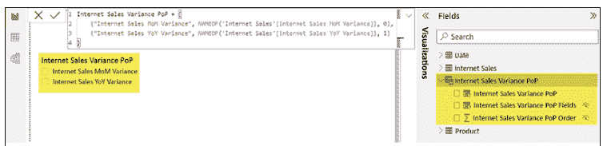

图 2.34：定义字段参数所带来的变化

到目前为止，我们已经创建了所需的字段参数。让我们按照以下步骤完成场景的实现：

- 8. 在报告页面上放置一个面积图
- 9. 将 Date 表中的 Full Date 列放到 x 轴
- 10. 将 Internet Sales Variance PoP 表中的 Internet Sales Variance PoP 列放到 y 轴

如下图所示，该图表同时显示 Internet Sales MoM Variance 和 Internet Sales YoY Variance 两个度量值。因此，用户可以选择在图表上显示哪一个度量值，也可以同时选择两个，或者都不选择。但该场景要求用户始终只选择一个度量值。以下步骤展示了我们如何实现这一点：

- 11. 选择切片器
- 12. 在“可视化”窗格中单击“格式视觉对象”选项卡
- 13. 展开“切片器设置”
- 14. 在“选择”部分中，打开“单选”选项

现在，用户可以选择要在面积图上显示的所需度量值。下图展示了上述步骤：

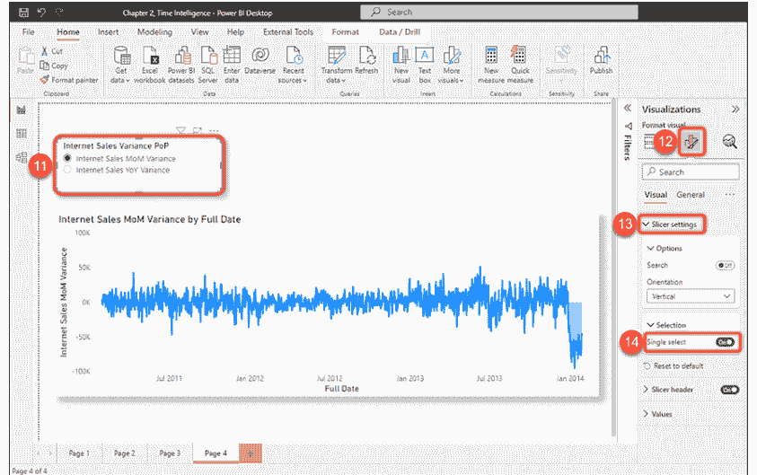

图 2.35：将切片器选择选项更改为单选

到目前为止，我们已经解决了若干与时间智能相关的场景。我们学习了如何通过考虑有效日期范围来创建更准确计算指标的度量值。我们还实现了动态度量选择。下一节将讨论如何使用 DAX 生成 Date 维度。

## 使用 DAX 生成 Date 维度

考虑一个没有任何日期值的数据模型是不现实的。在许多情况下，多个日期描述一个事实。此外，我们通常需要使用多个日期元素（如年、季度、月、会计年度、公共假日等）来分析事实。另外，DAX 中的时间智能函数在与 Date 表配合时表现最佳。因此，在任何模型中都不可避免地需要有一个 Date 表。本节介绍如何在 Power BI 中使用 DAX 创建 Date 表。

在开始之前，请注意以下注意事项：

- 如果源系统中已经存在 **Date** 表，我们不需要再使用 DAX 创建另一个。除非我们有充分的理由，否则最好避免创建多个 **Date** 表。
- **Date** 表必须至少有一列具有 `Date` 或 `DateTime` 数据类型。
- 包含日期值的列必须按天粒度（而不是年/月）设置。
- **Date** 列必须从开始年份的 1 月 1 日开始，一直到结束年份的 12 月 31 日。
- **Date** 表中的日期范围必须是连续的，因此日期之间不能有间隙。

一个好的做法是请业务方提供他们希望覆盖的日期范围。我们可以通过查看事实表来找到数据模型中的最小日期，从而确定开始日期。但结束日期通常没那么简单。所以我们必须询问业务方以了解与日期相关的需求。有些人希望结束日期是当前年份的 12 月 31 日，而另一些人则要求更广的日期范围。

以下两个 DAX 函数可以帮助我们确定日期范围：

- `CALENDARAUTO()`：在整个数据模型中搜索所有具有 `Date` 或 `DateTime` 数据类型的列，并找到最小和最大日期。最后，它会生成一个名为 **Date** 的列，该列以 1 月 1 日作为第一天开始，以 12 月 31 日作为最后一天结束。这很方便，但你需要小心。它也会考虑*出生日期*或*死亡日期*，这可能会导致模型中出现不相关的日期。如果数据包含过去的未知日期（01/01/1900）和未来的未知日期（31/12/9999），`CALENDARAUTO()` 函数也会考虑这些日期，从而导致 **Date** 表不必要地过大。因此，我们必须调整结果。
- `CALENDAR()`：接受一个开始日期和一个结束日期。开始日期和结束日期都必须为 `Date` 或 `DateTime` 数据类型。与

CALENDARAUTO() 类似，CALENDAR() 函数也会生成一个包含日期值的 Date 列。但与 CALENDARAUTO() 不同，它不会自动从开始日期的 1 月 1 日开始，也不会在结束日期的 12 月 31 日结束。请记住，日期维度需要从开始年份的 1 月 1 日开始，到结束年份的 12 月 31 日结束。因此，我们需要调整结果。

如前所述，如果由于任何原因我们无法从业务方获得开始年份和结束年份，那么我们需要使用上述 DAX 函数之一。如果我们使用 CALENDAR() 函数并且模型中有许多 Date 或 DateTime 列，这会很费力。因此，我们可以始终使用 CALENDARAUTO() 函数，它会根据模型中所有 Date 或 DateTime 列自动生成日期。但是，我们需要审查结果。虽然使用 CALENDARAUTO() 或 CALENDAR() 函数可行，但在使用 DAX 创建 Date 表之前还有其他要点需要考虑。许多 Power BI 开发人员使用上述任一函数创建新的计算表，然后添加计算列。虽然这种方法可行，但并不理想。原因是我们创建了一些计算列。计算列是即时生成的。无论我们是否在视觉对象中使用它们，数据都会在创建时加载到内存中，并且我们需要关闭 Power BI 文件才能释放已分配的内存。

另一方面，计算表与内存的交互方式不同。计算表也是即时创建的。但是，除非我们在视觉对象中使用列，否则数据不会加载到内存中。因此，最佳实践是在用于创建计算表的 DAX 表达式中添加 Date 表中所需的列，而不是先创建计算表，然后再将这些列作为计算列添加。

以下 DAX 表达式使用 CALENDARAUTO() 生成一个基本的 Date 表：

```
Date =
VAR firstOrderDate = MIN('Internet Sales'[OrderDate])
VAR lastOrderDate = MAX('Internet Sales'[OrderDate])
RETURN
ADDCOLUMNS (
```

## Internet Sales LYTD

日历层次结构包含以下级别：

- Year
- Month
- Full Date

> 注意
> 
> **Internet Sales** 与 **Date** 表之间的关系是在 **Internet Sales** 的 **OrderDateKey** 和 **Date** 表的 **DateKey** 之间创建的。**OrderDateKey** 和 **DateKey** 都是 `Number` 数据类型（整数）。

上述度量值的 DAX 表达式如下：

使用以下 DAX 表达式计算 `Internet Sales MTD`：

```
Internet Sales MTD =
TOTALMTD(
    [Internet Sales]
    , 'Date'[Full Date]
)
```

使用以下 DAX 表达式计算 `Internet Sales YTD`：

```
Internet Sales YTD =
TOTALYTD(
    [Internet Sales]
    , 'Date'[Full Date])
```

使用以下 DAX 表达式计算 `Internet Sales LMTD`：

```
Internet Sales LMTD=
TOTALMTD(
```

```
[Internet Sales]
, DATEADD('Date'[Full Date], -1, MONTH)
)
```

使用以下 DAX 表达式计算 Internet Sales LYTD：

```
Internet Sales LYTD =
TOTALYTD(
    [Internet Sales]
    , SAMEPERIODLASTYEAR('Date'[Full Date])
)
```

我们在报告画布上放置了一个表视觉对象，并将上述度量值放在 Internet Sales 度量值旁边。下图显示了结果：

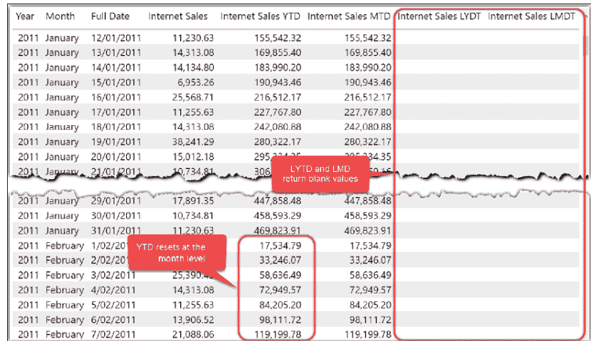

图 2.37：我们的时间智能函数无法正常工作

如图 2.37 所示，时间智能函数无法正常工作。解决此问题的一种方法是将 ALL('Date') 添加到所有计算中，然后一切都会按预期工作。

使用以下 DAX 表达式计算 Internet Sales MTD：


下一步是将所有 **DateTime** 列格式化为 **Time**。下图显示了运行上述 DAX 表达式的结果：

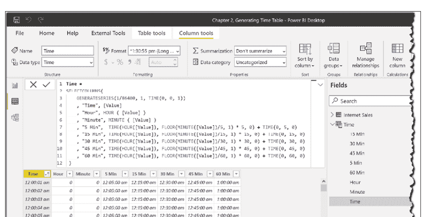

## 图 2.40：使用 DAX 生成时间表

## 注意

> 上图显示了按 **Time** 列升序排序的结果。

下一步是在 **Internet Sales** 表的 **Order Time** 列与 **Time** 表之间创建关系。

下图展示了我们如何向报表画布添加一些面积图，并按不同的时间桶可视化 **Internet Sales**：

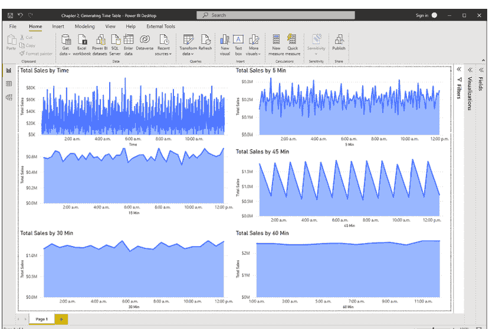

图 2.41：按不同时间桶可视化 Internet Sales

最佳实践是尽可能将所有数据转换（例如生成日期表或时间表）移动到源系统。如果由于任何原因无法做到这一点，那么最好在 Power Query 编辑器中处理这些转换。

## 总结

在本章中，我们讨论了 DAX 的不同方面以及它如何影响我们的数据建模。我们考察了一些真实场景和挑战，以及如何使用 DAX 解决它们。

在下一章中，我们将更详细地了解 Power Query (M) 表达式语言。我们还将通过一些实际操作场景，在 Power Query 中逐步准备星型架构。

## 加入我们的 Discord！

加入 Packt Discord 服务器上的大数据与分析社区！

与 558 位其他成员一起交流，享受免费的语音和文本聊天。

https://packt.link/ips2H


## 在 Power BI 中介绍 Power Query M 公式语言

Power Query 是 Microsoft 提供的一种数据准备技术，可以连接到来自各种技术的许多不同数据源，使企业能够集成数据、转换数据、使其可用于分析，并从中获得有意义的见解。Power Query 目前可以连接到许多数据源。

它还提供了一个**自定义连接器软件开发工具包（SDK）**，第三方可以使用它来创建自己的数据连接器。Power Query 最初作为 Excel 加载项引入，很快成为 Microsoft 数据平台中数据准备和转换的重要组成部分。

Power Query 目前与一些 Microsoft 产品集成，例如 **Dataverse**（也称为 **Common Data Service (CDS)**）、**SQL Server Analysis Services 表格模型 (SSAS Tabular)**、**SQL Server Integration Services (SSIS)**、**Azure Data Factory (ADF)** 和 **Azure Analysis Services (AAS)**，以及 Power BI 和 Excel。因此，了解 Power Query 有助于数据专业人员支持多种技术中的数据准备。你可以通过以下链接在 Microsoft 官方网站上找到使用 Power Query 的 Microsoft 产品和服务的完整列表：

https://docs.microsoft.com/en-us/power-query/power-query-what-is-power-query?WT.mc_id=DP-MVP-5003466#where-can-you-use-power-query

Power Query M 是一种公式语言，能够连接到各种数据源，以混合和匹配这些数据源之间的数据，然后将其加载到单个数据集中。在本节中，我们将介绍 Power Query M。

## Power Query 区分大小写

虽然 Power Query 是一种*区分大小写*的语言，但**数据分析表达式（DAX）**不区分大小写，这可能会让一些开发人员感到困惑。Power Query 和 DAX 是截然不同的两个领域，它们在 Power BI 中结合在一起，负责处理数据工作的不同方面。Power Query 不仅在语法上区分大小写，在与数据交互时也区分大小写。例如，如果我们运行以下函数，就会收到错误消息：

```
datetime.localnow()
```

这是因为正确的语法如下：

```
DateTime.LocalNow()
```

忽略 Power Query 在数据交互中的大小写敏感性可能会成为一个难以识别且耗时的问题。一个真实世界的例子是：当我们从一个包含小写字符的数据源获取**全局唯一标识符（GUID）**值时，然后从另一个包含大写字符的数据源获取其他一些 GUID 值。当我们在 Power Query 中匹配这些值以合并两个查询时，不会得到任何匹配的值。但如果我们将小写 GUID 转换为大写，这些值就会匹配。

在 Power Query 中比较两个字符大小写不同的字符串值不会引发任何错误。数据混搭引擎只是比较两个值并返回 *false*，因为这两个字符串不相同。因此没有错误可引发；但结果是不正确的。

例如，以下两个 GUID 值在 Power Query 中不相等，而在 DAX 中相等：

```
D5E99E0E-0737-45B2-B62A-4170B3FEFC0E
d5e99e0e-0737-45b2-b62a-4170b3fefc0e
```

## 查询

在 Power Query 中，查询包含由 `let` 和 `in` 语句封装的**表达式**、**变量**和**值**。`let` 和 `in` 语句块的结构如下：

```
let
    Variablename = expression1,
    #"Variable name" = expression2
in
    #"Variable name"
```

如上述结构所示，变量名中可以包含空格。但是，我们需要使用井号（#）后跟引号来封装变量名，例如 #"Variable Name"。通过在查询中定义变量，我们在 Power Query 中创建了一个查询公式步骤。查询公式步骤可以引用任何先前的步骤。最后，查询输出是紧跟在 in 语句之后的变量。每个步骤都必须以逗号结尾，除了 in 语句之前的最后一个步骤。

## 表达式

在 Power Query 中，表达式是产生值的公式。例如，下图显示了一些表达式及其结果值：


图 3.1：表达式及其值

**记录值**：记录是一组构成数据行的字段。要创建记录，我们使用方括号 []。在方括号内，我们写出*字段名*和一个*等号*，后跟字段的*值*。我们使用逗号分隔不同的字段及其值，如下所示：

```
[
    First Name = "Soheil"
  , Last Name = "Bakhshi"
  , Occupation = "Consultant"
]
```

下图显示了该表达式及其值：

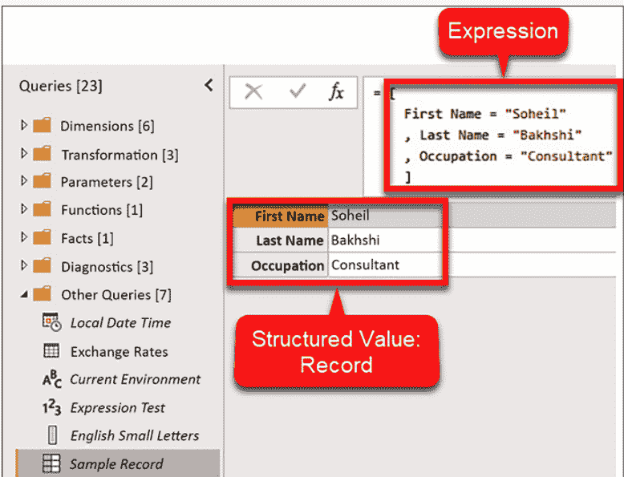

图 3.3：在 Power Query 中定义记录

注意
定义记录时，我们不需要将字段名放在引号中。如上图所示，记录是垂直显示的。

我们可以展开结构化列以获取其基元值，如下图所示：

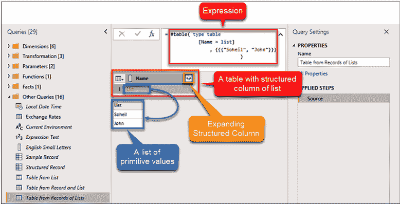

图 3.6：带有结构化列的表 下图显示了将结构化列展开为新行后的结果：

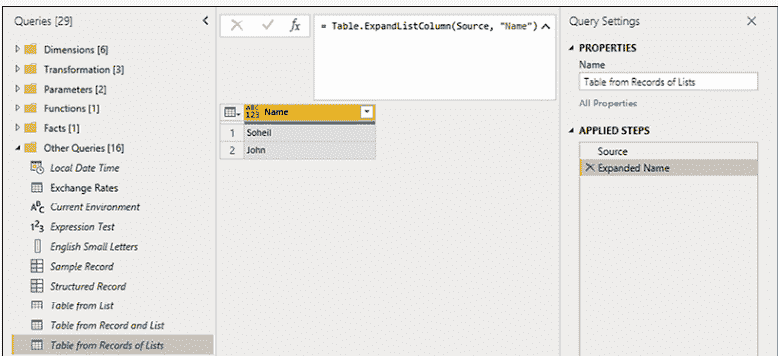

图 3.7：带有展开的结构化列的表

函数值：函数是接受输入参数并产生结果的值。要创建函数，我们将参数列表（如果有）放在括号中，后跟输出数据类型。我们使用 goes-to 符号（=>），后跟函数定义。例如，以下函数计算当前日期的月末日期：

```powerquery
() as date =>
Date.EndOfMonth(Date.From(DateTime.LocalNow()))
```

上述函数没有任何输入参数，但会产生输出。下图显示了一个无参数函数调用，该函数返回当前日期（今天）的月末日期：

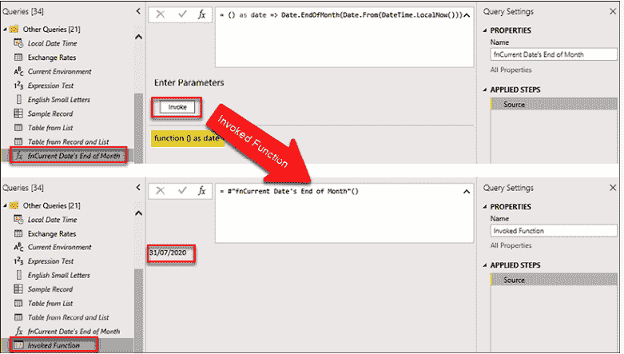

图 3.8：调用自定义函数

## 类型

在 Power Query 中，值具有类型。**类型值**对其他值进行分类。类型有两个常规类别：**基元类型**和**自定义类型**。

## 基元类型

值可以具有基元类型，如下所示：

- `binary`


- 日期
- 日期时间
- 日期时间区域
- 持续时间
- 列表
- 逻辑
- 空值
- 数字
- 记录
- 文本
- 时间
- 类型
- 函数
- 表
- 任意
- 无

在前面的列表中，any 类型很有意思。所有其他 Power Query 类型都与 any 类型兼容。但是，我们不能说某个值的类型是 any。

使用 is 运算，我们可以检查某个值的类型是否与指定的基本类型兼容。例如，以下表达式返回 false，因为“1”的类型是 text，而不是 number：

```
"1" is number
```

但以下表达式返回 true：

```
1 is number
```

4. 数据视图窗格
5. 状态栏

下图显示了前面的各个部分：

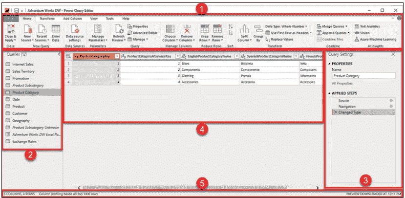

图 3.11：Power Query 编辑器的各个部分

以下各节将介绍 Power Query 编辑器中与数据建模相关的一些功能和工具。

## 查询窗格

此部分显示所有活动和非活动查询及组。查询包括表、列表、记录、自定义函数、参数和常量值。接下来的几节将讨论这些内容。

## 表

表查询包括来自数据源的表、使用“输入数据”在 Power BI 中创建的表、构造表，以及引用其他表查询的表。表的图标为 🗂。

## 自定义函数

函数查询是我们在**Power Query 编辑器**中创建的函数。我们可以在其他查询中调用和重复使用自定义函数。自定义函数的图标为 *fx*。

## 查询参数

通过查询参数，我们可以将查询中原本必须硬编码的各个部分参数化。在**查询**窗格中，我们可以通过以下图标找到查询参数：[图标]。

## 常量值

在某些情况下，我们可能会有一个返回常量结果的查询，其中包括文本、日期时间、日期、日期时间区域等。我们可以根据查询图标快速识别具有常量输出的查询，图标取决于结果的数据类型。例如，如果查询输出为 `datetime`，则查询图标会是[日历图标]；如果输出为 `text`，则图标会是 AᴮC。

## 组

我们可以按如下方式对查询进行分组，从而组织**查询**窗格：

- 在键盘上按住 *Ctrl* 键，并从**查询**窗格中单击所需的表，以选择要分组的相关表。
- 右键单击鼠标，然后选择**移动到组**。
- 从上下文菜单中单击**新建组...**。

下图显示了对选定表进行分组的前述步骤：

查询 [16]
  维度 [6]
    销售区域
    促销
    日期
    产品
    客户
    地理位置
  转换 [3]
    产品子类别
    产品类别
    产品子类别...
  参数 [2]
    Adventure Works DW...
    环境（开发）
  函数 [1]
    GenerateDate
  事实 [1]
    Internet Sales
  其他查询 [3]
    本地日期时间
    汇率
    当前环境

图 3.13：Power Query 编辑器中组织后的查询

## 查询设置窗格

此窗格位于 Power Query 编辑器窗口的右侧，其中包含所有查询属性，以及应用于所选查询（来自“查询”窗格）的所有转换步骤。如果选中的是查询参数，则“查询设置”窗格会消失。

“查询设置”窗格包含两部分：属性和应用的步骤，如下图所示：

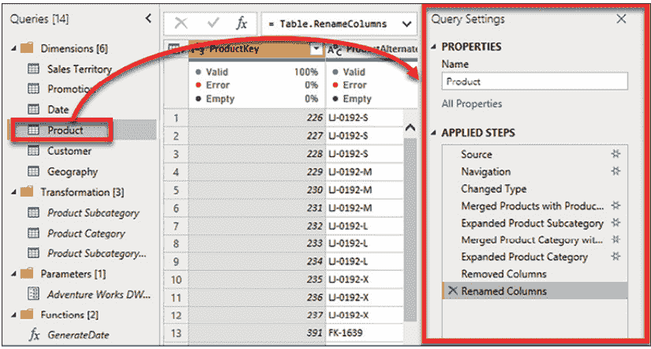

图 3.14：Power Query 编辑器中的“查询设置”窗格

## 查询属性

我们可以在“名称”文本框中输入新名称，以重命名选定的查询。我们还可以单击“所有属性”来设置其他属性，如下图所示：

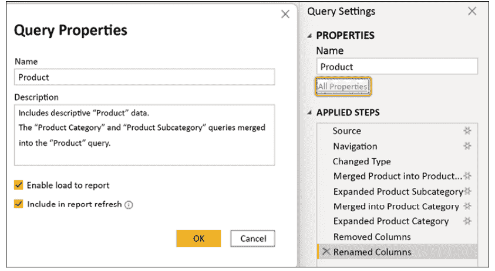

图 3.15：“查询设置”窗格中的查询属性

在前面的图像中，我们可以看到以下内容：

- **名称**：这同样是查询名称。
- **说明**：我们可以为查询输入一些说明。这很有用，因为它可以帮助我们编写文档。
- **启用加载到报表**：启用后，数据将从源系统加载到数据模型中。如图 3.15 所示，我们将 Product 查询与另外两个查询合并。每个查询可能来自不同的数据源。禁用此选项后，数据不会加载到数据模型中。但是，如果其他查询引用了此查询，数据仍会经过应用于此查询的所有转换步骤。
- **包括在报表刷新中**：在某些情况下，我们只需要将数据加载到模型中一次，因此不需要将该查询包括在报表刷新中。启用此选项后，每当数据模型刷新时，该查询都会刷新。我们可以在 Power BI Desktop 中单击“刷新”按钮来刷新数据模型；也可以在将报表发布到 Power BI 服务后，从 Power BI 服务中刷新数据。无论采用哪种方式，如果对某个查询禁用此选项，该查询将不再包含在未来的数据刷新中。

> 注意
> **包括在报表刷新中**选项取决于**启用加载到报表**选项。因此，如果禁用了**启用加载到报表**，**包括在报表刷新中**也会被禁用。在更复杂的场景中，对于作为转换查询创建的查询，禁用**启用加载到报表**是一种常见技术。

如下图所示，我们还可以在**查询**窗格中右键单击查询，以访问查询属性以及**启用加载**和**包括在报表刷新中**设置：

图 3.16：从“查询”窗格访问“启用加载”和“包括在报表刷新中”设置

## 应用的步骤

“应用的步骤”按顺序包含应用于选定查询的转换步骤。每个步骤通常都会引用前一个步骤，但

- **属性**：我们可以使用此选项为选定的转换步骤添加说明，以更详细地解释其作用和工作方式。

下图显示了前述选项：

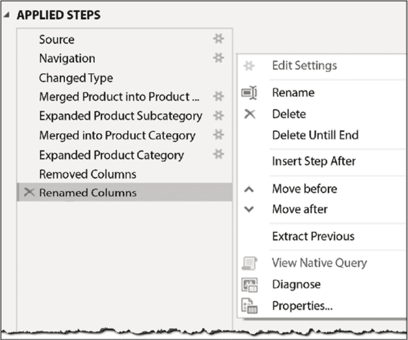

图 3.17：右键单击“应用的步骤”窗格中的转换步骤时显示的上下文菜单选项

到目前为止，我们已经详细了解了**查询设置**窗格。下一节将介绍**数据视图**窗格。

图 3.19：从“查询”窗格中选择自定义函数时的数据视图窗格

所选查询的结果。下图显示了所选查询检索本地日期和时间时的数据视图窗格：

查询 [16]
  维度 [6]
    销售区域
    促销
    日期
    产品
    客户
    地理位置
  转换 [3]
    产品子类别
    产品类别
    产品子类别...
  参数 [2]
    Adventure Works DW...
    环境（开发）
  函数 [1]
    fx GenerateDate

## 输入参数

开始年份
示例：123
结束年份
示例：123

- 调用
- 清除

```
function (Start Year as number, End Year as number) as any
```

所选用户定义函数的输入参数

## 图 3.20：查询输出为常量值时的数据视图窗格

根据查询结果的数据类型，功能区中会显示不同的转换工具。图 3.21 显示了引用 Environment 参数的查询结果，该参数是一个查询参数。因此，Current Environment 查询的结果会根据 Environment 查询参数中所选的值而变化。

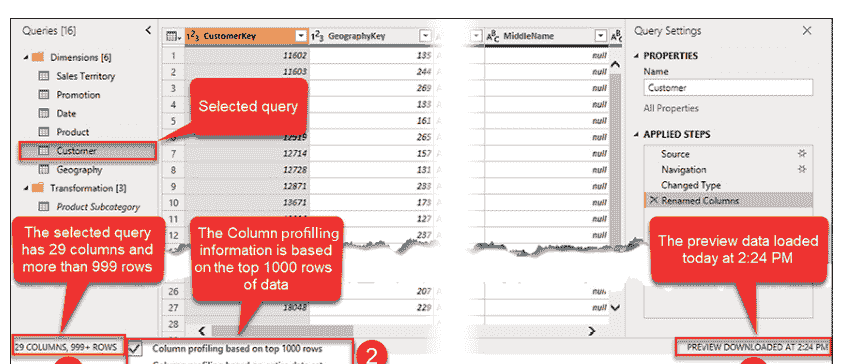

# 图 3.22：Power Query 编辑器中的状态栏

在前面的图像中，我们可以看到以下功能：

1. 列数：我们可以快速了解表的宽度。
2. 用于列分析的行数：这有助于我们判断所提供的分析信息是否可信。在某些情况下，当列分析设置基于 1000 行（默认设置）进行计算时，会显示不正确的信息。
3. 数据预览刷新的时间。

## 高级编辑器

高级编辑器包含与选定查询相关的所有表达式。我们可以使用高级编辑器创建新查询或修改现有查询。高级编辑器可以从 Power Query 编辑器中的多个位置访问，如图 3.23 所示。

若要使用高级编辑器，请按以下步骤操作：

1. 从“查询”窗格中选择一个查询。


- 2. 从功能区上的**开始**选项卡中单击**高级编辑器**，或右键单击查询，然后从上下文菜单中选择**高级编辑器**。下图展示了这两种方式：

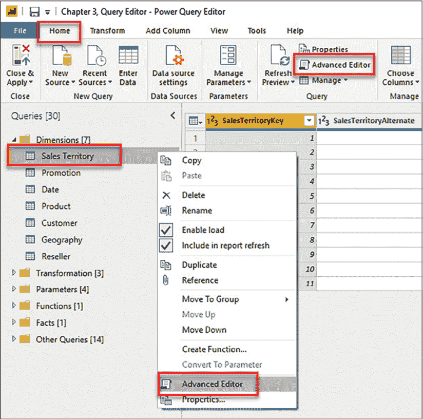

图 3.23：打开高级编辑器

## 面向数据建模人员的 Power Query 功能简介

本节介绍 **Power Query 编辑器**中当前可用的一些功能，这些功能可帮助数据建模人员快速识别和修复错误。数据建模人员可以了解列（而非整个数据集）内的数据质量、统计信息和数据分布。例如，数据建模人员可以快速查看列的基数、列中有多少空值等。

如前所述，**列质量**、**列分布**和**列配置文件**功能提供的信息默认是基于前 **1000** 行数据计算的，这有时会导致信息不准确。对于较少的数据量，较好的做法是将**列配置文件**设置为基于整个数据集进行计算。但是，对于较大的数据量，此方法可能需要一段时间才能加载列分析信息，因此如果处理的是大型表，请谨慎更改此设置。

要从状态栏更改上述设置，请按以下步骤操作：

- 1. 单击**基于前 1000 行进行列分析**下拉列表。
- 2. 选择**基于整个数据集进行列分析**。

下图说明了如何执行此操作：

图 3.24：将列分析设置为基于整个数据集进行计算

让我们仔细看看这些功能。下一节将解释 Power Query 编辑器中的列质量功能。

### 列质量

我们还可以通过单击飞出菜单右下角的省略号按钮，从飞出菜单中执行一些操作，如下图所示：

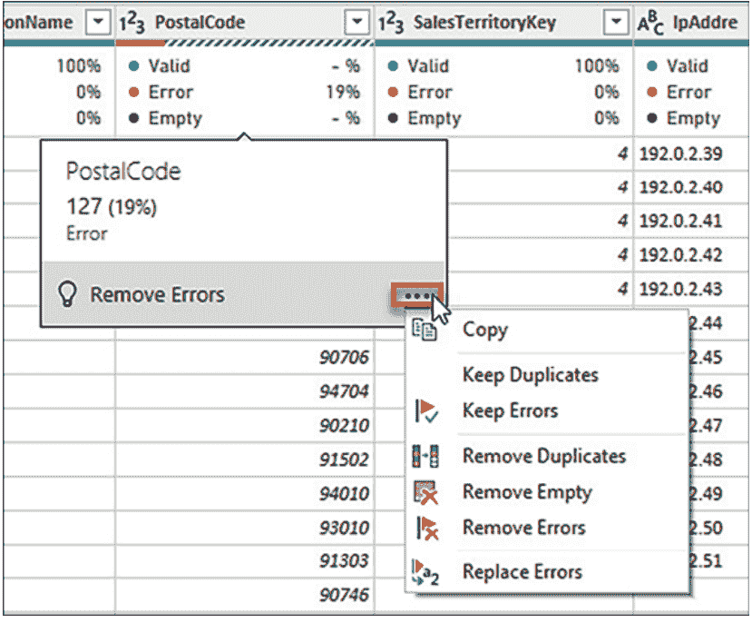

图 3.27：列质量框飞出菜单中可用的选项

上图显示，我们可以复制数据质量信息，这有助于编写文档。我们还可以从飞出菜单中对错误执行一些操作，例如删除任何错误。最好尽可能审查并修复错误，但我们只在必要时才删除错误。

列质量功能还有其他使用案例，可以在实际场景中帮助我们。

我们想要从 Customer 表中删除所有有效数据不足 10% 的列。在此场景中，我们使用 Chapter 3, Query Editor.pbix 文件，可在此处获取：https://github.com/PacktPublishing/Expert-Data-Modeling-with-Power-BI-Second-Edition/blob/a39dd14eeac3fdceafd3daf4a45909f6693d68b6/Source%20Code/Chapter%2003/Chapter%203,%20Query%20Editor.pbix

打开 `Chapter 3, Query Editor.pbix` 文件后，我们进入 **Power Query 编辑器**，查看所有列的**质量**框。我们很快意识到可以删除以下列：

- 1. Title
- 2. Suffix
- 3. AddressLine2

下图显示这些列包含大量空值：

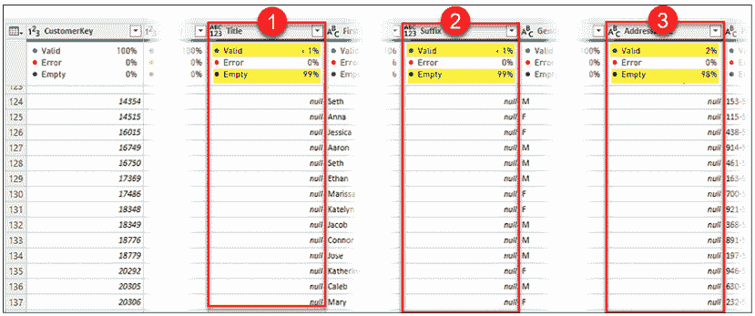

图 3.28：使用列质量识别有效数据不足 10% 的列

我们可以按照以下步骤删除这些列：

- 1. 单击**开始**选项卡。
- 2. 单击**选择列**按钮。
- 3. 取消选中上述列。
- 4. 单击**确定**。

下图显示了上述步骤：

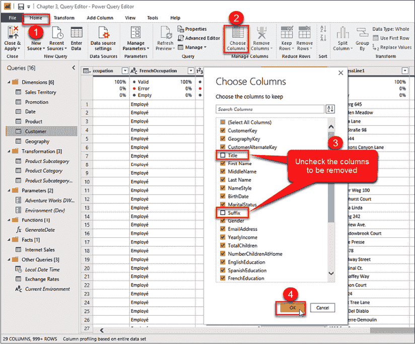

图 3.29：删除列

### 列分布

**列分布**是另一个功能，它提供有关数据分布以及非重复值和唯一值的更多信息。**列分布**信息帮助数据建模人员了解列的基数。**列基数**是数据建模中的一个重要主题，尤其是在内存管理和数据压缩方面。

> **注意**
>
> 一般的经验法则是我们希望获得较低的基数。当 xVelocity 引擎将数据加载到数据模型中时，它可以更好地压缩低基数数据。因此，基数较低的列具有较少（或没有）唯一值。

通过使用**列分布**功能，我们可以决定是否将某一列加载到模型中。删除不必要的列可能有助于我们优化文件大小和调整性能。

要启用**列分布**功能，请从**视图**选项卡中单击相应的功能，如下图所示：

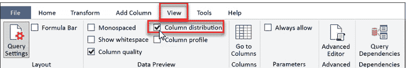

图 3.30：从 Power Query 编辑器中启用列分布功能

启用此功能后，会在**列质量**框下方添加一个新框，用于可视化列分布。如果将鼠标悬停在**分布框**上，会显示一个飞出菜单，显示有关列分布的更多信息，如下图所示：

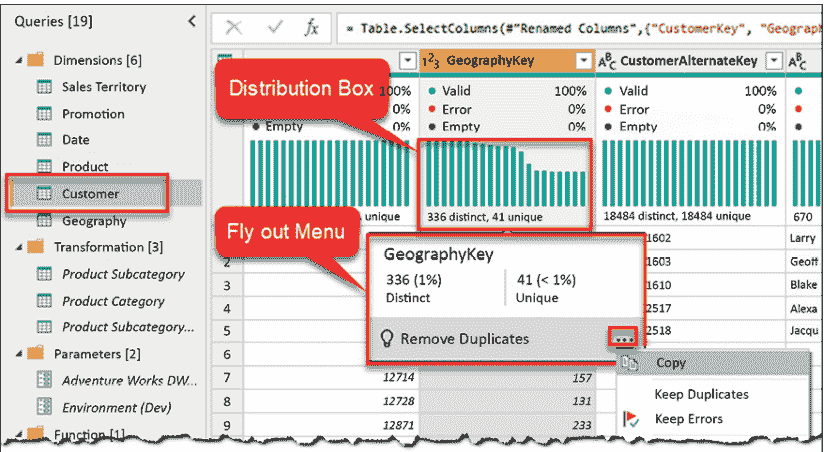

图 3.31：分布框飞出菜单

我们可以从飞出菜单中复制分布数据，并执行其他适当的操作，如上图所示。

让我们通过一个实际场景来看看**列分布**功能的应用。

查看 `Chapter 3, Query Editor.pbix` 文件中的 **Customer** 表。**Customer** 表又宽又高。为了优化文件大小和内存消耗，我们希望提名一些列进行删除，并与业务部门讨论：

- 1. 从**查询**中选择 **Customer** 表。
- 2. 将**列分析**设置为基于整个数据集进行计算。
- 3. 快速浏览各列的**列分布**框，以识别高基数列。

这些是高基数列：

- CustomerKey
- CustomerAlternateKey
- EmailAddress
- Phone

这些列在下面的图片中突出显示：

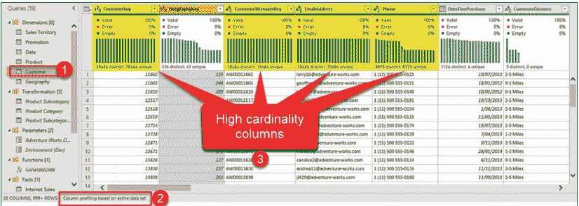

图 3.32：识别 Customer 表中的高基数列

**CustomerKey** 列不能作为删除候选，因为它参与数据模型中 **Internet Sales** 表和 **Customer** 表之间的关系。我们可以删除 **CustomerAlternateKey** 列。这是一个多余的列，基数非常高（100% 唯一值），并且从数据分析的角度来看，它也没有增加任何价值。另外两个列是绝佳的候选对象，可以与业务部门讨论是否可以从 **Customer** 表中删除它们。

如果我们删除所有三列，可以将文件大小从 2,485 **千字节（KB）** 减少到 1,975 KB。这在存储方面是显著的节省，尤其是在较大的数据模型中。

### 列配置文件

到目前为止，我们已经了解了**列质量**和**列分布**功能。我们还可以启用**列配置文件**功能，以查看所选列值的更多信息。要启用此功能，请勾选**视图**选项卡下的**列配置文件**框，如下图所示：

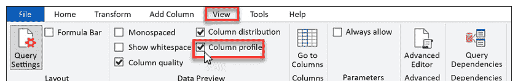

图 3.33：从 Power Query 编辑器启用列配置文件

如上图所示，通过启用**列配置文件**功能，我们可以查看**列统计信息**和**值分布**。我们可以将鼠标悬停在值上，以在飞出菜单中查看该值的计数及其百分比。我们还可以通过单击飞出菜单右下角的省略号按钮，对所选值执行某些操作，如下图所示：


此外，我们可以将参数的值加载到数据模型中，以便在需要时从度量值、计算列、计算表和报表元素中引用它们。

我们可以在 **Power Query 编辑器** 中轻松定义查询参数，如下所示：

+   1. 单击 **管理参数**。
+   2. 单击 **新建**。
+   3. 输入名称。
+   4. 输入有助于用户理解参数用途的信息性描述。
+   5. 勾选 **必需** 复选框可使参数成为必填项。
+   6. 从下拉列表中选择类型。
+   7. 从 **建议值** 下拉列表中选择一个值。
+   8. 根据上一步中选择的建议值，您可能需要输入一些值（这在 *图 3.35* 中显示）。如果您从 **建议值** 下拉列表中选择了 **查询**，则需要在本步骤中选择一个查询。
+   9. 再次根据所选的建议值，我们可能/可能不会看到默认值。如果我们选择了 **值列表**，则需要选择一个默认值。
+   10. 为 **当前值** 选择或输入一个值。
+   11. 单击 **确定**。

前述步骤在以下图像中进行了说明：

图 3.35：定义新的查询参数

## 注意

最好避免通过参数化来硬编码数据源。一些组织将它们的数据源名称和连接字符串视为敏感数据。它们只允许在组织内部或与第三方工具共享 PBIT 文件，因为 PBIT 文件做

+   3. 将参数名称输入为 `Server Name`。
+   4. 输入描述。
+   5. 勾选 **必需** 字段
+   6. 从下拉列表中将 **类型** 选择为 **文本**。
+   7. 从 **建议值** 下拉列表中选择 **值列表**。
+   8. 在列表中输入服务器名称。
+   9. 将 **devsqlsrv01\edw** 选择为 **默认值**。
+   10. 再次将 **devsqlsrv01\edw** 选择为 **当前值**。
+   11. 单击 **确定**。

以下图像突出显示了前述步骤：

+   4. 从 **服务器参数** 下拉列表中选择 **Server Name** 参数。
+   5. 再次从 **数据库** 下拉列表中选择 **参数**。
+   6. 从 **数据库参数** 下拉列表中选择 **Database Name** 参数。
+   7. 单击 **确定**。

前述步骤在以下图像中突出显示：

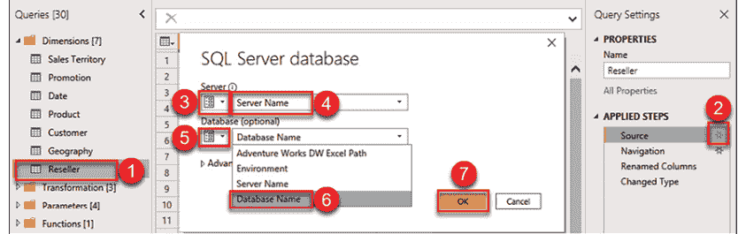

图 3.38：参数化数据源

我们需要经历类似的步骤来参数化其他查询。完成参数化后，每当我们想要切换数据源时，只需更改参数的值即可。为此，从 **Power Query 编辑器** 操作如下：

+   1. 单击 **管理参数** 下拉按钮。
+   2. 单击 **编辑参数**。
+   3. 选择 UAT **Server Name**。
+   4. 选择 UAT **Database Name**。
+   5. 单击 **确定**。

以下图像突出显示了前述步骤：

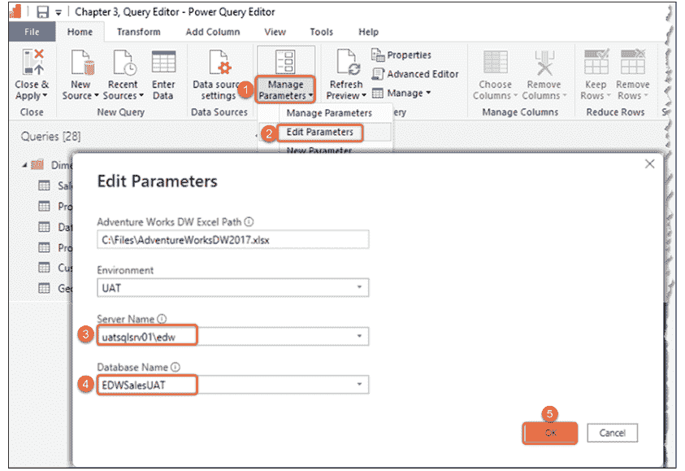

# 图 3.39：从 Power Query 编辑器更改查询参数值

单击“关闭并应用”按钮后，数据将从所选服务器和数据库加载。

我们也可以从主 Power BI Desktop 窗口按如下方式更改参数值：

+   1. 单击 Transform data 下拉按钮。
+   2. 单击 Edit parameters。
+   3. 选择 UAT Server Name。
+   4. 选择 UAT Database Name。
+   5. 单击 OK。

以下图像显示了前述步骤：

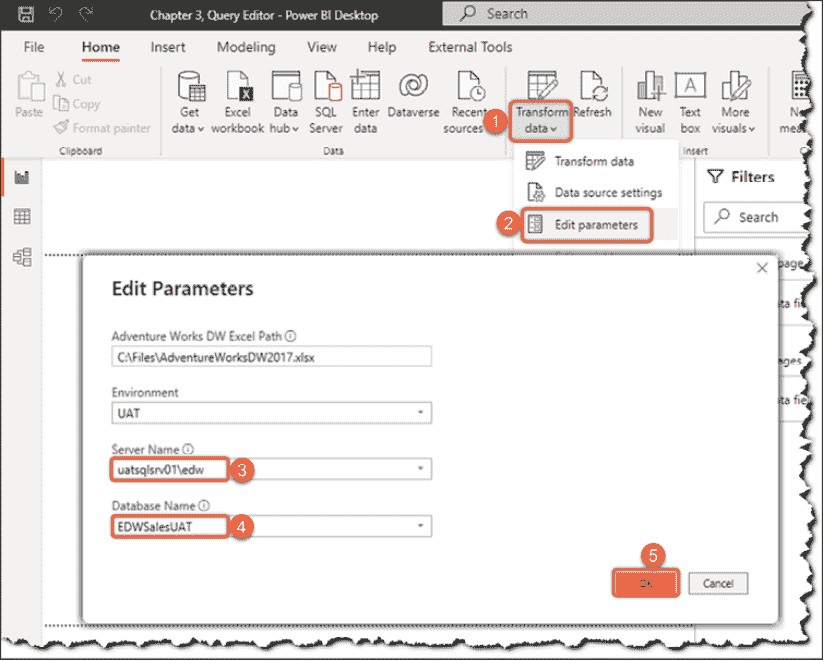

图 3.40：从主 Power BI Desktop 窗口更改查询参数值

## 理解自定义函数

在许多情况下，我们需要重复的转换逻辑。在这种情况下，创建一个 **自定义函数** 来处理所有所需的计算逻辑是有意义的。定义自定义函数后，我们可以多次调用它。如 *Introducing the Power Query M formula language in Power BI* 部分中所述，在 *Function value* 下，我们通过将参数（如果有）及其数据类型放在括号中，以及输出数据类型和转到符号 =>，后跟函数定义的定义来创建自定义函数。

以下示例显示了一个简单的自定义函数形式，它接收一个日期输入并为其增加一天：

```
SimpleFunction = (DateValue as date) as date =>
Date.AddDays(DateValue, 1)
```

我们可以按如下方式调用前述函数：

```
SimpleFunction(#date(2020,1,1))
```

调用函数的结果是 2/01/2020。

我们可以将自定义函数定义为内联自定义函数，并在高级编辑器中在单个查询中调用它。以下图像显示了我们如何使用前述代码将 SimpleFunction 定义为内联自定义函数并在同一查询中调用该函数：

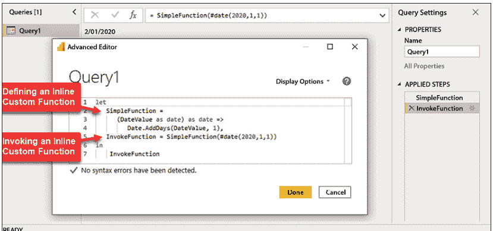

图 3.41：定义和调用内联自定义函数

在某些情况下，自定义函数可以帮助自动化手动且耗时的开发任务。以下真实场景显示了我们如何使用自定义函数节省开发时间。

我们被要求在 100 个表之上构建一个数据模型，其特征如下：

+   - 每个表有 20 到 150 列。
+   - 列名采用驼峰式大小写且没有空格，这对用户不友好。

我们在 Power Query 编辑器中连接到数据源后有两个选择：

+   - 手动重命名所有列。
+   - 找到一种方法一次重命名每个表中的所有列。

虽然我们对每个表重复第二个选项，但我们仍然可以通过一步重命名每个表的列来节省大量开发时间。我们创建一个自定义函数来重命名所有列，并在每个表中调用该函数。

让我们看一下一个表中的原始列名。以下图像显示了 **Product** 表的原始列名，它们不友好。请注意，状态栏显示了表中的列数。在这种情况下，**Product** 表有 37 列。因此，如果我们想手动重命名每一列以使其更易读，将会非常耗时：

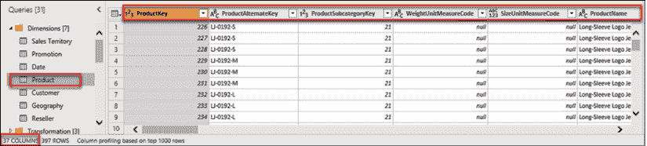

图 3.42：Product 表中的原始列名

在这种情况下，当字符大小写从小写过渡到大写时拆分列名就足够了。

按照以下步骤创建自定义函数：

+   1. 在 **Power Query 编辑器** 中，通过单击 **新建源** 下拉按钮并选择 **空白查询** 创建一个空白查询，如以下图像所示：

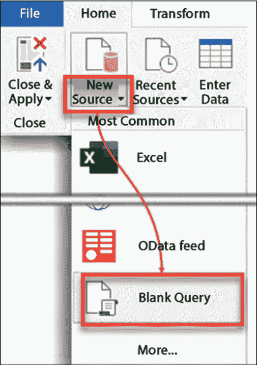

图 3.43：从 Power Query 编辑器创建空白查询

+   2. 打开 **高级编辑器**。
+   3. 复制并粘贴在 *步骤 4* 中显示的表达式到 **高级编辑器** 中，然后单击 **确定**。
+   4. 将查询重命名为 `fnRenameColumns`，如下面的代码片段所示：

```
```powerquery
let
    fnRename = (ColumnName as text) as text =>
        let
            SplitColumnName =
Splitter.SplitTextByCharacterTransition({"a".."z", "A".."Z"})(ColumnName)
```
```

```
in
    Text.Combine(SplitColumnName, " ")

in
    fnRename
```

以下图像显示了在 **Power Query 编辑器** 中创建的函数的外观：

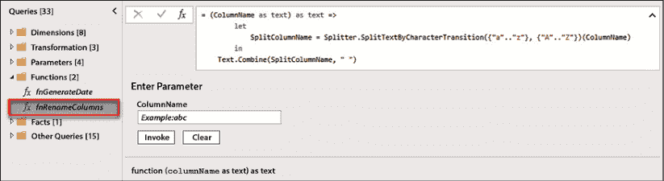

图 3.44：创建自定义函数

前述函数接受文本值并按如下方式工作：

+   - 每当从小写到大写发生大小写转换时，它都会将文本值拆分为文本列表。
+   - 它将拆分的文本组合起来，并在拆分部分之间加上空格。

要了解前述自定义函数的工作原理，我们需要在 Microsoft Docs 网站上阅读 `Splitter.SplitTextByCharacterTransition()` 函数的文档：https://docs.microsoft.com/en-us/powerquery-m/splitter-splittextbycharactertransition?WT.mc_id=DP-MVP-5003466

请注意，`Splitter.SplitTextByCharacterTransition()` 函数返回一个函数，因此前述表达式中的 `Splitter.SplitTextByCharacterTransition({"a".."z"}, {"A".."Z"})(ColumnName)` 部分将 `SplitTextByCharacterTransition` 函数应用于函数的输入参数，即 `ColumnName`，从而生成一个文本列表。


+   5. 提交此步骤后，**Product** 表中的所有列都会立即重命名。

下图显示了结果：

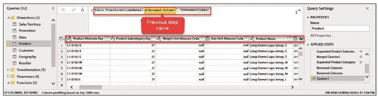

图 3.47：一次性重命名所有列

+   6. 最后一步是将新步骤重命名为更有意义的名称。为此，请右键单击该步骤，在上下文菜单中单击**重命名**，然后输入新名称，如下图所示：

## 递归函数

递归函数是指在函数内部调用函数自身。**阶乘**是一种数学计算，用于将从任意选定数字递减到 1 的所有正整数相乘。在数学中，感叹号表示阶乘计算（例如 $n!$）。下面的公式展示了**阶乘**的数学计算：

$n! = n * (n - 1)!$

正如前面的计算所示，**阶乘**计算是一种递归计算。在**阶乘**计算中，我们可以选择一个正整数（大于 0 的整数），但 0 是一个例外；如果选择 0，则结果为 1。以下示例有助于更清楚地理解**阶乘**计算：

```
10! = 10 * 9 * 8 * 7 * 6 * 5 * 4 * 3 * 2 * 1 = 3,628,800
5! = 5 * 4 * 3 * 2 * 1 = 120
1! = 1
0! = 1
```

我们需要使用 @ 运算符来引用函数自身。例如，以下函数计算数值输入的阶乘：

```
let
    Factorial =
        (ValidNumber as number) as number =>
            if ValidNumber < 0
                then error "Negative numbers are not allowed to calculate Factorial. Please select a positive number."
                else
                    if ValidNumber = 0
                        then 1
                        else ValidNumber * @Factorial(ValidNumber - 1)
in
    Factorial
```

如果输入值为 0，我们返回 1；否则，我们以递归方式计算**阶乘**。

你注意到代码中的 `error` 部分了吗？我们可以使用 `error` 关键字引发自定义错误消息。因此，在前面的代码中，我们会检查输入值是否有效；如果无效，就会引发自定义错误消息。下图显示了使用无效数字调用**阶乘**函数时的结果：

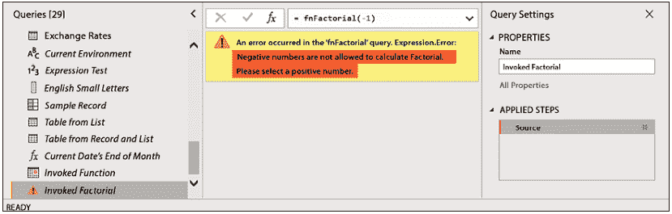

图 3.49：使用无效值调用阶乘函数时引发错误

有时，即使输入无效，我们也不希望引发任何错误消息，而是希望显示一个常量值。以下代码展示了 `Factorial` 函数的另一个版本：它检查输入值是否为正数；如果是，则计算阶乘，否则返回 -1：

```
let
    Factorial =
        (ValidNumber as number) as number =>
            if Number.Sign(ValidNumber) = 1
            then
                if ValidNumber = 0
                then 1
                else ValidNumber * @Factorial(ValidNumber - 1)
            else -1
in
    Factorial
```

下图显示了调用阶乘函数计算 10! 的结果：

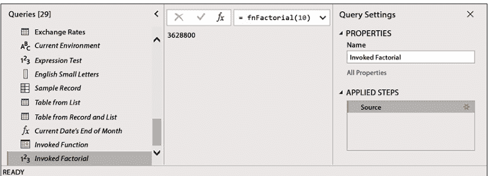

图 3.50：调用阶乘函数计算 10! 的结果

## 总结

本章介绍了 Power Query M 公式语言的不同方面，并探讨了如何使用 Power Query 编辑器。我们还研究了实际场景及其挑战，这些因素会直接影响我们的工作效率，并学习了如何更高效地管理数据准备步骤。

下一章将讨论从各种数据源获取数据、连接模式，以及它们如何影响数据建模。

## 加入我们的 Discord！

加入 Packt Discord 服务器上的大数据与分析社区！

与其他 558 名成员一起交流，享受免费的语音和文字聊天。

https://packt.link/ips2H

## 从各种源获取数据

在前面的章节中，我们讨论了数据建模的一些方面，包括 Power BI 中的各种层、数据如何在不同层之间流动、数据分析表达式（DAX）中的虚拟表，以及它们与数据建模之间的关系。我们还讨论了如何利用查询参数，以及如何在 Power Query 编辑器中使用 Power Query 公式语言创建自定义函数。

本章讨论如何从各种源获取数据，并介绍从某些源获取数据时已知的挑战和常见陷阱。我们还将讨论数据源认证，以及不同数据源的各种连接模式。

在本章中，你将了解以下主题：

- 从常见数据源获取数据
- 了解数据源认证
- 使用连接模式
- 使用存储模式
- 了解数据集存储模式

### 从常见数据源获取数据

借助 Power BI，我们可以连接到许多不同的数据源。本节将介绍一些可以在 Power BI 中使用的常见数据源。我们还将探讨连接到这些数据源时常见的陷阱。不过在开始之前，让我们先花一点时间讨论许多 Power BI 开发人员和用户对获取数据这一概念存在的一个常见误解，那就是获取

### 右键单击 Parameter1，然后单击“转换数据”

处理存储在表中的数据通常比处理工作表更加直接。

+   13. 单击 Sales_Data 表。
+   14. 单击“确定”。

前面的步骤在下图中有所突出显示：

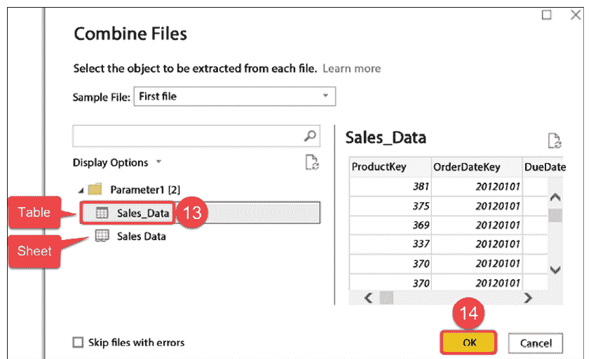

图 4.6：浏览要合并的 Excel 文件

前面的步骤会在 Power Query 编辑器中创建四个新查询，如下图所示：

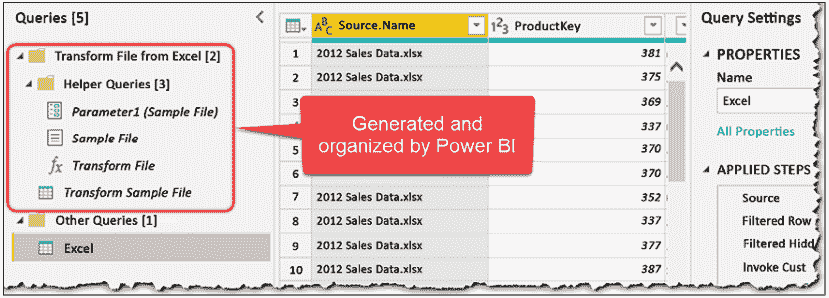

图 4.7：为合并文件而自动创建的查询和文件夹

让我们来看看 Power Query 编辑器自动生成的四个新查询：

- **Parameter1**：一个 **Binary** 查询参数，用于 **Transform File** 自定义函数和 **Transform Sample File** 查询。
- **Sample File**：这是我们的原始查询，只增加了一个导航到第一个 Excel 工作簿的步骤。
- **Transform File**：一个接受 **Parameter1** 作为输入参数的自定义函数。然后，根据我们在*步骤 13*中的选择，它会浏览 Excel 文件，从工作表或表中读取数据（在本例中为表）。
- **Transform Sample File**：一个使用 **Parameter1** 打开 Excel 文件的示例查询。该示例查询被禁用，不会加载到数据模型中。

在某些情况下，我们需要保留某些文件的元数据，例如**创建日期**（你可以在*图 4.8*中看到）。**Attribute** 列是一个由记录组成的结构化列，用于保存更多元数据。这里留给你自行进一步研究。不过，在此场景中，我们希望保留**创建日期**列，以供将来参考。现在需要按如下方式修改自动创建的步骤：

+   1. 单击 **Removed Other Columns1** 步骤右侧的齿轮图标。
+   2. 勾选 **Date created** 列。

## CSV/文本/TSV

虽然 Power BI 为 CSV 和 TXT 文件提供了专用连接器，但没有专门的连接器支持制表符分隔值（TSV）文件。本节将通过一个示例场景介绍这三种文件类型。

在本章前面的部分中，我们已经设法导入存储在文件夹中的销售数据。现在，业务部门收到了一些以各种格式存储的数据转储文件。我们拥有 CSV 格式的 Product 数据、TSV 格式的 Product Subcategory 数据，以及 .txt 格式的 Product Category 数据。我们需要将这些文件中的数据导入 Power BI。我们使用 Chapter 4, Get Data From Various Sources.pbix 示例文件：

https://github.com/PacktPublishing/Expert-Data-Modeling-with-Power-BI-Second-Edition/blob/ea3530461d68ff6b08af69d1acdbc4c26204a63c/Samples/Chapter%2004/Chapter%204,%20Get%20Data%20From%20Various%20Sources.pbix

下图显示了要导入 Power BI 的文件：

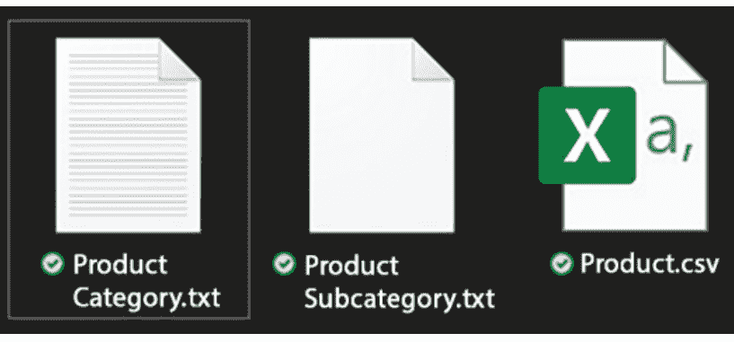

图 4.10：要导入 Power BI 的 CSV、TXT 和 TSV 文件

我们首先从 Product Category 文件获取数据，步骤如下：

+   1. 在 Power Query 编辑器中，单击“新建源”下拉按钮。


2. 点击**文本/CSV**。
3. 导航到包含示例文件的文件夹，然后选择**Product Category.txt**文件。
4. 点击**打开**。
5. Power BI 正确检测到了**文件原始格式**和**分隔符**，因此点击**确定**。

下图展示了上述步骤：


图4.11：从Txt文件获取数据

我们已成功从**Power Query 编辑器**连接到**Product Category.txt**文件。

下一步是获取存储在TSV文件中的**Product Subcategory**数据。如前所述，目前Power BI中没有专门用于TSV文件的连接器。但这并不意味着我们无法从TSV文件获取数据。顾名思义，TSV文件用于以文本格式存储制表符分隔的数据。因此，我们必须使用文本/CSV连接器来获取TSV文件。为此，请按以下步骤操作：

1. 再次点击“新源”下拉按钮。
2. 点击**文本/CSV**。
3. 导航到包含示例文件的文件夹，并从文件类型下拉列表中选择“所有文件(*.*)”。
4. 出现**Product Subcategory.tsv**文件；选择该文件。
5. 点击**打开**。
6. Power BI 正确检测到了**文件原始格式**和**分隔符**，因此点击**确定**。

上述步骤在下图中突出显示：


图4.12：从TSV文件获取数据

到目前为止，我们从TXT和TSV文件格式的基于文本的数据源中获取了数据，一切都进行得很顺利。但情况并非总是如此。实际上，在处理未经整理的文件型数据源时，我们可能会遇到许多问题。让我们来看一下在处理基于文本的数据时可能面临的最常见挑战之一。现在我们已有了**Product Category**和**Product Subcategory**数据，是时候继续获取以CSV格式存储的**Product**数据了。要从CSV文件获取数据，我们使用之前从*.txt获取数据时所用的同一个文本/CSV连接器，因此不必重复这些步骤。

*图4.13*中的**ProductKey**列的质量条显示该列存在一些错误。然而，**Product**表只有607行，如状态栏所示。请注意，示例数据中出现了错误。有时候，错误可能直到我们将数据导入数据模型时才显现。在我们的案例中，我们可以滚动数据预览，找到第204行中的错误单元格。在发生错误之前的最后一行，**ProductKey**值为226。

我们点击错误单元格以查看错误消息。

更仔细地查看数据会发现其他一些问题，如下所示：

- **ProductAlternateKey**列中的日期值不正确。
- **ProductSubcategoryKey**列的数据类型不正确。
- **ProductSubcategoryKey**列中的日期值不正确。这些值必须是数字类型。

虽然在某些情况下我们可以移除错误，但在我们的案例中，数据显示在错误的列中。下图说明了这些问题：

图4.13：从CSV获取数据时产生的错误

让我们更详细地查看数据。虽然我们只有607行数据，但在记事本++等文本编辑器中打开CSV文件是合理的。

> 注意
>
> 你可以从此处免费下载记事本++：https://notepad-plus-plus.org/downloads/。

在记事本++中，启用“显示所有字符”，然后搜索文件中的ProductKey值为226的位置。这样，发生了什么就更加明显了。文本中出现了回车符(CR)和换行符(LF)。

当我们进一步调查时，发现**EnglishProductDescription**列包含(CR)和(LF)字符。当用户在源系统中输入产品描述时按下键盘上的回车键，就可能发生此问题。然后，数据从源系统导出到CSV。这个问题也可能出现在任何其他文本类型的列中。如下图中所示的数据中的其他一些问题，在查看数据时并不明显。


这些问题在**Power Query 编辑器**中也没有产生任何错误，因此可能很难发现。然而，当我们稍后对数据进行核对时，它们会造成一些问题：


图4.14：在记事本++中打开的Product.csv文件揭示了一些问题

虽然我们已经找到了罪魁祸首，但同样的问题也可能发生在数据中其他不太明显的地方。处理这个问题最简单的方法是在源中修复它，但在我们的案例中，我们只能访问导出为CSV格式的数据，而无法访问源系统。因此，我们必须在Power Query中修复此问题。我们可能会认为可以用空白替换**(CR)/(LF)**字符。但现实是，**(CR)/(LF)**字符代表新的一行数据。因此，我们不能简单地用空白替换它们，然后期望问题得到解决。

幸运的是，在我们的案例中，这个问题修复起来并不复杂。查看错误的行，我们可以看到**(CR)/(LF)**字符之前总是有一个空格字符。**(LF)**字符也是如此。为了修复此问题，我们首先需要获取文本，并在将其转换为表格之前修复问题。虽然我们可以这样修复问题，但如果将来在其他CSV文件中再次发生这种情况该怎么办？在*第3章“Power Query 编辑器中的数据准备”*中，我们学习了如何创建自定义函数。要解决当前场景中面临的问题，我们需要一个自定义函数，它执行以下操作：

1. 接受文件路径作为文本值。
2. 将文件作为文本打开。
3. 将所有出现的` #(cr,lf)`（读作空格、回车、换行）替换为空字符串("")。
4. 在上一步的文本结果中，将所有出现的` #(lf)`（读作空格、换行）替换为空字符串("")。
5. 将文本转换为二进制。
6. 将上一步的结果作为CSV打开。
7. 将第一行提升为标题。
8. 更改列类型。

通过以下表达式，我们可以创建一个满足所需条件的自定义函数：

```
// fnTextCleaner
(FilePath as text) as table =>
let
    Source = File.Contents(FilePath),
    GetText = Text.FromBinary(Source),
    ReplaceCarriageReturn = Text.Replace(GetText, " #(cr,lf)", ""),
    ReplaceLineBreaks = Text.Replace(ReplaceCarriageReturn, " #(lf)", ""),
    TextToBinary = Text.ToBinary(ReplaceLineBreaks),
    #"Imported CSV" = Csv.Document(TextToBinary, [Delimiter=",", Columns=25, Encoding=1252, QuoteStyle=QuoteStyle.None]),
    #"Promoted Headers" = Table.PromoteHeaders(#"Imported CSV", [PromoteAllScalars=true]),
    #"Changed Type" = Table.TransformColumnTypes(#"Promoted Headers", {{"ProductKey", Int64.Type}, {"ProductAlternateKey", type text}, {"ProductSubcategoryKey", type number}, {"WeightUnitMeasureCode", type text}, {"SizeUnitMeasureCode", type text}, {"EnglishProductName", type text}, {"StandardCost", type text}, {"FinishedGoodsFlag", type logical}, {"Color", type text}, {"SafetyStockLevel", Int64.Type}, {"ReorderPoint", Int64.Type}, {"ListPrice", type text}, {"Size", type text}, {"SizeRange", type text}, {"Weight", type text}, {"DaysToManufacture", Int64.Type}, {"ProductLine", type
```

图4.15：调用fnTextCleaner函数修复Product.csv文件中的文本问题

如上图所示，我们现在得到**606**行，这是正确的。

## Excel

Excel是Power BI中最常用的数据源之一。Power BI有一个专门的Excel连接器，但取决于Excel文件的存储位置，我们可能需要使用**Web**连接器，这并不像看起来那么简单。无论使用哪种方法连接到Excel文件，处理Excel数据源并不总是那么简单。本节解释了连接到Excel文件的两种最常见场景：存储在本地驱动器上的Excel文件和存储在SharePoint Online中的Excel文件。

### 存储在本地驱动器中的Excel文件

实际上，在很多情况下，我们会收到一个充满公式的Excel文件，这些公式引用了其他工作表甚至其他工作簿中的表、列或单元格。在这些情况下，我们可能会遇到一些问题，并得到由公式生成的错误。

在其他场景中，我们会收到充满多个维度数据透视表的Excel文件。Power BI遵循由表组成的关系数据建模，而表中包含列，因此处理多维数据透视表并不总是那么直接。

Excel源的另一个常见问题是合并单元格，这会导致Power BI中出现缺失数据。您可能还会想到其他复杂的场景，使得处理Excel数据更具挑战性。本节将介绍最常见的场景之一：包含数据透视表的Excel文件。`Yearly Product Category Sales.xlsx`文件是我们在该场景中使用的示例Excel文件。下图显示了该示例文件的内容：


Figure 4.16: Excel 中存储的年度产品类别销售数据

目标是将前述数据透视表加载到 Power BI 中，如下所示：

- 1. 在 Power Query 编辑器中，单击“新建源”下拉按钮。
- 2. 单击 Excel。
- 3. 导航到包含 Excel 文件的文件夹并选择 Excel 文件。
- 4. 单击“打开”。
- 5. 选择 Yearly Product Category Sales.xls 工作表。
- 6. 单击“确定”。

前述步骤在以下图像中突出显示：


Figure 4.18: 转换数据透视表

按照以下步骤逐一修复前述问题：

- 7. 删除“更改类型”步骤。
- 8. 单击 Column8 列。
- 9. 从“开始”选项卡单击“删除列”按钮，如以下图像所示：


Figure 4.19: 删除多余的步骤和列

我们通过以下步骤删除“总计”行：

- 10. 从“开始”选项卡单击“删除行”按钮并单击“删除底部行”。
- 11. 在“行数”文本框中输入 1。
- 12. 单击“确定”。


## Figure 4.23: 删除不必要的步骤并展开列

最后的步骤如下：

- 19. 将 Attribute 列重命名为 Year，并将 Value 重命名为 Sales。
- 20. 通过选择所有列来更改所有列类型。
- 21. 从“转换”选项卡单击“检测数据类型”按钮，如以下图像所示：


## Figure 4.24: 重命名列并更改列的类型

Figure 4.25: 在 Excel 桌面应用程序中打开来自 SharePoint Online 的 Excel 文件

这将在 Excel 桌面应用程序中打开 Excel 文件。在 Excel 中，请按照以下步骤操作：

- 4. 单击“文件”菜单
- 5. 单击“信息”
- 6. 单击“复制路径”按钮

以下图像显示了前述步骤：

Figure 4.26: 从 Excel 桌面应用程序复制 Excel 路径

到目前为止，我们已经获得了 Excel 文件路径。下一步是在 Power BI Desktop 中从复制的路径获取数据。

打开 Power BI Desktop 并按照以下步骤操作：

- 7. 单击“获取数据”
- 8. 单击“Web”：


Figure 4.27: 在 Power BI Desktop 中从 SharePoint Online 获取存储在其中的 Excel 数据

- 9. 将我们从 Excel 复制的路径粘贴到 URL 文本框中
- 10. 从复制的路径末尾删除 ?web=1 部分
- 11. 单击“确定”

以下图像显示了前述步骤：


Figure 4.28: 修改从 Excel 复制的路径以在 Power BI Desktop 中获取数据

如果我们遗漏步骤 10，将会收到以下错误，如以下图像所示：

Details: “The input URL is invalid. Please provide a URL to the file path on SharePoint up to the file name only (with no query or fragment part).”


Figure 4.29: 如果忘记从文件路径中取出查询部分，将会引发错误

- 12. 从访问 Web 内容页面单击“组织帐户”
- 13. 单击“登录”并输入您的凭据
- 14. 单击“连接”

以下图像显示了前述步骤：

## Method 1: Getting the excel file path directly from SharePoint

在 SharePoint Online 中，我们可以直接从文件详细信息获取文件路径，因此此方法适用于 CSV、Excel 等所有类型的文件。以下步骤说明如何在 SharePoint Online 中获取文件路径：

- 1. 选择 Excel 文件
- 2. 单击省略号按钮
- 3. 单击“详细信息”
- 4. 在“详细信息”窗格中，向下滚动以找到“路径”部分
- 5. 单击“复制直接链接”按钮

以下图像显示了前述步骤：


Figure 4.32: 从 SharePoint Online 中的文件详细信息复制直接文件链接

在 Power BI Desktop 中，只需单击“获取数据”，然后选择“Web”，并将链接粘贴到 URL 文本框中，如以下图像所示：


Figure 4.33: 使用直接链接从 SharePoint Online 中托管的 Excel 获取数据

以下列表显示了此方法相对于第一种方法的优势：

- 获取直接链接所需的点击次数更少
- 直接链接没有查询部分，因此我们无需修改链接
- 整个过程更容易记住

下一节将介绍如何连接到 Power BI 数据集。

## Power BI datasets

考虑到团队协作和协作需求不断增加，使用 Power BI 数据集变得越来越流行。当我们在 Power BI Desktop 中创建数据模型并将其发布到 Power BI 服务工作区时，Power Query 中的底层转换管道和数据模型会变成一个数据集。然后，我们使数据集在整个组织中可用。这是在大型 Power BI 项目中协作的高效方法。数据建模人员创建模型并将其发布到服务，而报表编写人员则在可用的共享数据集之上创建精简报表。

Note
共享 Power BI 数据集在 Power BI 免费许可计划中不可用。原因是访问工作区需要 Pro 许可证；


Figure 4.37: 已连接 Power BI 数据集的底层数据模型

我们可以在模型之上创建新的布局，如以下图像所示：

## Figure 4.38: 在数据模型中创建新的布局

请注意，图标用于 Connect Live 中的表。

还有一点需要注意：我们只能查看和访问具有管理员、成员或参与者权限的工作区中的数据集。

连接数据集的另一种方法是切换连接为 DirectQuery 模式。这已通过目前处于公开预览中的 DirectQuery for PBI datasets and AS 功能成为可能。按照以下步骤启用它：

- 1. 单击“文件”
- 2. 单击“选项和设置”
- 3. 单击“选项”
- 4. 在“全局”部分，单击“预览功能”
- 5. 勾选 DirectQuery for PBI datasets and AS 功能
- 6. 单击“确定”

以下图像显示了前述步骤：


Figure 4.39: 启用 DirectQuery for PBI datasets and AS 预览功能

现在我们已启用 DirectQuery for PBI datasets and AS 预览功能，我们有各种选项可以在 DirectQuery 模式下连接到数据集。我们必须先以 Connect Live 模式连接到数据集，然后按如下方式将 Connect Live 切换为 DirectQuery：

- 1. 从功能区上的“建模”选项卡单击“对此模型进行更改”按钮。
- 2. 从状态栏单击“对此模型进行更改”链接。
- 3. 从“模型视图”中，从功能区上的“开始”选项卡单击“对此模型进行更改”按钮。
- 4. 执行前述步骤后，会出现警告消息；单击“添加本地模型”按钮。


## Figure 4.41: 选择要包含在 DirectQuery 模式中的表

切换连接为 DirectQuery 后，我们可以修改数据模型。我们还可以从各种来源获取数据以创建复合模式。我们将在第 14 章 DirectQuery Connections to Power BI Datasets and Analysis Services in Composite Models 中更详细地讨论这个问题。

切换到 DirectQuery 后，模型如下图所示：

connect to an existing dataflow:

- 1. 单击“获取数据”下拉菜单。
- 2. 单击“Power BI 数据流”。
- 3. 您在“导航器”窗口中看到的所有数据流列表。展开所需的工作区。
- 4. 展开数据流模型。
- 5. 选择一个表。
- 6. 单击“加载”。

前述步骤在以下图像中突出显示：


Figure 4.43: 从 Power BI 数据流获取数据

此时，如果满足要求，Power BI 会提示我们从“导入”或“DirectQuery”模式中选择存储模式，如以下图像所示：


## HUKUM NUN MATI DAN TANWIN

| No | Nama Hukum | Huruf | Cara Membaca | Contoh |
|---|---|---|---|---|
| 1 | Izhar Halqi (إظهار حلقى) | ء ه ع ح غ خ | Jelas tanpa dengung | مِنْ أَنْعَمْتَ عَلَيْهِمْ |
| 2 | Idgham Bigunnah (إدغام بغنة) | ي ن م و | Melebur dengan dengung | مَنْ يَعْمَلْ |
| 3 | Idgham Bilagunnah (إدغام بلاغنة) | ل ر | Melebur tanpa dengung | مِنْ لَدُنْ |
| 4 | Ikhfa Haqiqi (إخفاء حقيقى) | ت ث ج د ذ ز س ش ص ض ط ظ ف ق ك | Samar dengan dengung | مِنْ قَبْلُ |
| 5 | Iqlab (إقلاب) | ب | Berubah menjadi mim dengan dengung | مِنْ بَعْدِ |
| 6 | Gunnah (غنة) | ن م | Dengung pada nun dan mim bertasydid | إِنَّ |


Figure 4.45: Turning on the Enhanced compute engine on a Power BI dataflow

- 3. Refresh the dataflow after turning the Enhanced compute engine settings on

Now that we meet the requirements, we can connect to a dataflow from Power BI Desktop in DirectQuery mode.

## Power BI Datamarts

The term Datamart is related to data warehousing where users have access to relevant and business-centric data, while a data warehouse is usually enterprise-wide, covering a broad range of historical and current data.

Microsoft introduced Datamart capability for Power BI Premium licenses in May 2022, enabling organizations to leverage governed and secure self-service data transformation without seeing the IT team as a bottleneck in the data migration processes. Organizations traditionally have an IT team taking care of the data migration and transformation from the source systems into central storage.

This process is usually complex, cumbersome, and time-consuming, leading the business teams to see the IT team as a bottleneck. In response, business users started building their own data stores using local SQL Server instances, Excel files, SharePoint site, or Microsoft Access files to cover


Figure 4.47: Connect Live to a Power BI dataset linked to a datamart

## SQL Server

SQL Server is one of the most common data sources for Power BI. When connecting to a SQL Server database, we have two options: importing the data into the data model or connecting to the database in DirectQuery mode. This chapter discusses the connection modes in later sections. Follow these steps to get data from a SQL Server data source:

- 1. Click the SQL Server button from the Home tab.
- 2. Enter the Server name.
- 3. We may want to enter the Database name (optional) depending on our scenario.
- 4. We can either select Import or DirectQuery.
- 5. Again, depending on our scenario, we may want to enter Transact-SQL (T-SQL) statements. To do so, click to expand the Advanced options.
- 6. Leave the Include relationship columns option ticked (untick this option to stop Power BI from detecting related tables when selecting

a table from the Navigator page and clicking the Select Related Tables option).

- 7. Leave the Navigate using full hierarchy option unticked (tick this option if you would like to see the navigation based on database schemas).

- 8. If you have High Availability (HA) settings on the SQL Server instance, then tick the Enable SQL Server Failover support item; otherwise, leave it unticked.

- 9. Click OK.

The preceding steps are highlighted in the following image:


Figure 4.48: Getting data from SQL Server

- 10. Tick a desired table from the list. This option is only available if we do not enter T-SQL statements.

- 11. Click the **Select Related Tables** button.

- 12. Depending on what you need to do next, you can either click the **Load** button to load the data into the data model or click the **Transform Data** button, which navigates you to the **Power Query Editor**.

The preceding steps are highlighted in the following image:


Figure 4.49: Selecting a table and related tables from the Navigator window

Note
As shown in step 5 in Figure 4.48, typing T-SQL statements disables query folding in Power Query, which potentially causes some performance degradation during the data refresh. However, there is a technique with which we can enforce query folding when using T-SQL

build a single source of truth within an enterprise-grade semantic layer in Power BI. We cover composite models with live connection in *Chapter 14, DirectQuery Connections to Power BI Datasets and Analysis Services in Composite Models.*

## SSAS multidimensional/tabular

To connect to an instance of SSAS, follow these steps:

- 1. Click the **Get data** dropdown.
- 2. Click **Analysis Services**.
- 3. Enter the **Server** name.
- 4. Enter the **Database** name (optional).
- 5. Select the connection mode; if you select **Import**, you could write **Multi-dimensional Expressions (MDX)** or **DAX** expressions to get a result set.
- 6. Click **OK**.

The preceding steps are highlighted in the following image:


Figure 4.50: Connecting to SSAS

- 7. Select the model.
- 8. Click **OK**.

The preceding steps are highlighted in the following image:


Figure 4.51: Connecting to the model

## AAS

Connecting to an instance of AAS is similar to connecting to an instance of SSAS. The only difference is that this time, we use its dedicated connector. We can find the **Azure Analysis Services database** connector under the **Azure** folder from the **Get Data** window, as shown in the following image, so we will not go through the steps again:


Figure 4.52: Connecting to an AAS tabular model

An extra option available on the **Azure portal** for AAS databases is downloading the PBIX file directly from the Azure portal. The downloaded PBIX file contains the connection to the desired model in AAS. The following steps explain how to do this:

- 1. After logging in to the Azure portal, navigate to your instance of AAS, then click **Overview**.
- 2. Find the model you want to connect to and click the ellipsis button on the right.
- 3. Click **Open in Power BI Desktop**.

The following image shows the preceding steps:

- 3. Enter your PWA Uniform Resource Locator (URL). It must look like this: https://Your_Tenant.sharepoint.com/sites/pwa/_api/.
- 4. Click OK.
- 5. Click Organizational account.
- 6. Click the Sign in button, then pass your credentials.
- 7. Click Connect.

The following image shows the preceding steps:


Figure 4.54: Connecting to OData feed

- 8. Select the desired tables; in our sample, we selected the Projects table.
- 9. Click either Load or Transform Data; we selected the Transform Data option.

The preceding steps are highlighted in the following image:

## Figure 4.55: Selecting tables from the Navigator page

As shown in the following image, the Projects table has 131 columns:

## Figure 4.56: The Projects table from the PWA data source in Power Query

We usually do not require the loading of all columns into the data model. Therefore, having a good understanding of the underlying database structure is essential. If we do not know much about the underlying data

source, it is wise to involve **subject-matter experts (SMEs)**. They can help identify the more relevant columns in the business.

## Dataverse

Microsoft Dataverse, formerly named **Common Data Services (CDS)**, is a data service and application platform supporting multiple connected applications and processes under the Microsoft Power Platform umbrella. Dataverse provides a cloud-based central repository for Power Platform solutions such as **PowerApps, Power Automate, Power Virtual Agent, and Power Pages**. We can also integrate **Dynamic 365 (D365)** solutions such as **Business Central (BC)** with Dataverse.

Follow these steps to connect to Dataverse:

- 1. Click the **Dataverse** button from **Home**
- 2. Click **Sign in**
- 3. Pass your credentials and click **Connect**
- 4. Expand the desired environment
- 5. Select the desired table
- 6. Depending on what you want to do next, click **Load** or **Transform Data**
- 7. Select the connection type (**Import** or **DirectQuery**)
- 8. Click **OK**

The following image shows the preceding steps:


## Figure 4.57: Connecting to Dataverse

要了解更多关于 Dataverse 的信息，请访问 Microsoft 文档中的以下页面：

https://docs.microsoft.com/en-nz/power-apps/maker/data-platform/data-platform-intro?WT.mc_id=DP-MVP-5003466

## Understanding data source certification

虽然数据源认证更偏向于 Power BI 治理，但了解它是什么以及它如何影响数据建模者至关重要。数据源认证更多地关乎数据的质量以及我们能够在不同数据源中可用的数据上建立的信任程度。通过数据源认证，我们将数据源分为三个或更多类别。不同的组织使用不同的术语来指代其数据质量。本节使用 Bronze、Silver 和 Gold/Platinum 类别，表示数据源中包含的数据质量。您可以在您的数据源认证中使用不同的术语。

## Gold/Platinum

**Gold** 或 **Platinum** 数据源在数据和业务两个方面都经过完全整理。数据质量问题极少。数据已处于最佳状态，可在 Power BI 等分析和报表工具中进行分析和可视化。典型的 Gold 数据源可以是托管在 SSAS 中的语义模型，无论是多维模型还是表格模型，**SAP Business Warehouse (SAP BW)**、数据仓库等等。当我们处理 Gold/Platinum 数据源时，我们更有信心数据是正确的。我们期望从开发角度来看几乎为零的数据准备和数据建模工作。

## Working with connection modes

当我们连接到数据源时，查询连接模式属于以下三种不同类别之一：

- Data Import
- DirectQuery
- Connect Live

在 **Power Query Editor** 中连接到一个或多个数据源的每个查询都有上述连接模式之一，除了 Connect Live。当连接模式为 Connect Live 时，Power BI 模型目前不能同时连接到多个 SSAS 或 AAS 实例，或 Power BI 数据集。如前所述，在 2020 年 12 月，Microsoft 发布了复合模型新版本的预览版，在该版本中，我们可以使用 DirectQuery 模式连接到多个 Power BI 数据集或 AAS/SSAS Tabular 2022 模型。我们将在 *Chapter 14, DirectQuery Connections to Power BI Datasets and Analysis Services in Composite Models.* 中更详细地讨论复合模型。

本节介绍连接模式、其应用和局限性。

## Data Import

这是 Power BI Desktop 中最常见的连接模式。许多连接，例如基于文件的连接，只有此选项。正如其名称所示，**Data Import** 模式将数据从源导入到 Power BI 数据模型中。数据已在 Power Query 层中准备和转换；然后将其导入到数据模型中。我们可以在 Power BI Desktop 中手动刷新数据，或在发布到 Power BI 服务后自动刷新。

## Applications

**Data Import** 模式的主要应用是将来自不同来源的数据整合到单一事实来源中。此外，它还为我们提供了数据建模能力，以便在 Power BI 中创建语义模型。我们可以全天频繁刷新数据。所有这些优点都伴随着一些限制，如下所述。

## Limitations

Power BI 数据集在 **Data Import** 模式下具有基于许可层级的有限存储大小和自动数据刷新。

每个数据集的存储限制如下：

- 1 GB per dataset under the **free** and **Pro** licensing plans
- 100 GB for datasets published to workspaces backed with a **PPU** capacity
- 400 GB for datasets published to workspaces backed with a **Premium** capacity

根据我们的许可层级，我们目前可以从 Power BI 服务安排数据刷新，限制如下：

Dual: The tables in this mode can get data from the cache or the source system. For instance, depending on the level of detail into which the user drills down in an aggregation setup, the query results may come from the cached data or directly from the source. We discuss aggregations in Chapter 9, Star Schema and Data Modeling Common Best Practices.

Note

All DirectQuery limitations described in the Working with connection modes section also apply to the tables in the Dual storage model setting.

我们可以通过 Power BI Desktop 左侧窗格中的模型视图查看或更改存储模式属性，如下所示：

- 1. Click the Model view.
- 2. Select a table from the Fields pane.
- 3. Expand Advanced from the Properties pane.
- 4. Select a Storage mode from the drop-down list.

前面的步骤在以下图像中突出显示：


Figure 4.58: Changing the table’s Storage mode property

> Note
> 
> We cannot change a table’s storage mode from **Import** mode to either **DirectQuery** or **Dual** mode because of the features that are not available in DirectQuery mode.

本节讨论了表的存储模式。在下一节中，我们将了解数据集存储模式。

## Understanding dataset storage modes

如您可能已经猜到的，数据集存储模式是指数据集中的数据是否缓存在内存中。考虑到这一点，从数据集的角度来看，有三种不同的模式，如下所述：

- **Import**: When the whole data is cached in memory. In this mode, all tables are in the **Import** storage mode setting.
- **DirectQuery**: When the data is not cached in memory. In this mode, all tables are in the **DirectQuery** storage mode setting.
- **Composite (Mixed)**: When a portion of data is cached in memory, while the rest is not. In this mode, some tables are in the **Import** storage mode setting; other tables are in **DirectQuery** storage mode or the **Dual** storage mode setting.

要在 Power BI Desktop 中查看和编辑数据集存储模式，请查看状态栏右侧，如以下图像所示：

## Join us on Discord!

Join The Big Data and Analytics Community on the Packt Discord Server!

Hang out with 558 other members and enjoy free voice and text chat.

https://packt.link/ips2H


## Common Data Preparation Steps

在上一章中，我们讨论了一些在 Power BI 中经常使用的数据源。我们还介绍了数据源认证以及各种连接模式、存储模式和数据集模式之间的差异。本章介绍常见的数据准备步骤，例如表、文本、`Date`、`DateTime` 和 `DateTimeZone` 操作。

我们通过提供真实世界的场景来查看每一种，这些场景可以帮助应对日常数据准备挑战。在 Power Query Editor 中，数据准备活动分为三个单独的选项卡，如以下屏幕截图所示：

- 1. **Home**: Contains more generic actions, such as creating a new query, creating or managing query parameters, and performing common data preparation steps such as split column, Group By, and more.
- 2. **Transform**: Contains more transformation functionalities that can be performed through the UI.
- 3. **Add Column**: Contains data preparation steps related to adding a new column through the UI.


Figure 5.1: Data preparation functionalities available via Power Query Editor UI

接下来的几个部分描述了在前一图像中显示的选项卡下可用的一些功能，以及在数据准备阶段常用的但不通过 UI 可用的功能。

本章从 *Chapter 5, Common Data Preparation Steps, Raw.pbix* 示例文件开始。继续前进，我们将继续开发此文件。要使用示例文件，请在 Power BI Desktop 中打开它，然后更改以下查询参数的值以指向您本地的示例源文件副本：

- Adventure Works DW Excel path to point to `AdventureWorksDW2017.xlsx`
- Internet Sales in Time Excel path to point to `Internet Sales in Time Level.xlsx`

确保您应用了功能区下方出现的黄色警告消息中的更改。

您可以通过以下链接从 GitHub 找到源代码和示例文件：

https://github.com/PacktPublishing/Expert-Data-Modeling-with-Power-BI-Second-Edition/tree/main/Samples/Chapter%2005

在 Power BI 中，我们可以从各种来源以不同格式获取数据。无论数据源的格式如何，数据质量都很重要。在某些情况下，我们必须处理已经转换过的数据，但在现实中，有更多的情况需要我们转换数据并为其在数据模型中进行分析做好准备。一个典型的例子是当数据源是 Excel 或 CSV 中的数据透视表时。因此，我们必须在将其加载到数据模型之前准备数据。本章更详细地介绍了 Power Query 中最常用的数据转换和数据操作功能，包括以下内容：

- Data type conversion
- Splitting a column by delimiter


- 合并列
- 添加自定义列
- 从示例中添加列
- 复制列
- 筛选行
- 使用分组依据
- 追加查询
- 合并查询
- 复制和引用查询
- 替换值
- 从文本中提取数字
- 处理日期、日期时间及日期时间/时区
- 透视表

虽然取消透视表也是常见的转换，但本章不涉及，因为我们在 *第 4 章，从各种来源获取数据* 的 *Excel* 部分中已经讨论过它。

让我们更详细地查看它们。

## 数据类型转换

数据类型转换是 Power Query 中最常见的步骤之一，但如果管理不当，它也是最重要且可能变得棘手的一步。Power BI 的一个很酷的功能是，如果启用，可以自动检测数据类型。虽然在许多情况下这是一个方便的功能，但它可能是以后出现一些问题的根源。需要特别注意的关键点是 Power BI 如何自动检测数据类型。Power BI 根据前几百行自动检测列数据类型；问题可能就出在这里，因为数据类型不是基于整个数据集检测的。相反，数据类型是基于加载用于预览的部分检测的。在大多数情况下，我们处理的是表值中的数据类型转换。我们要么使用 Power Query 编辑器 UI，要么手动编写表达式；在这里，我们使用以下函数：

```
Table.TransformColumnTypes(Table as table,
TypeTransformations as list, optional Culture as nullable text)
```

在 Table.TransformColumnTypes() 函数中，我们有以下内容：

- `Table` 通常是上一步的结果。
- `TypeTransformations` 接受列名及其对应数据类型的列表。
- `Culture` 是可选的，可为空的文本，例如 `en-NZ` 指定文化。

我们已经在第 3 章《Power Query 编辑器中的数据准备》中的《Power BI 中 Power Query (M) 公式语言简介》部分、《类型》小节中讨论了 Power Query 中可用的类型。下表显示了类型、其表示以及我们可用于指定数据类型的语法：

| 类型种类 | 类型表示 | 指定类型语法 1 | 指定类型语法 2 |
|---|---|---|---|
| binary | Binary | type binary | Binary.Type |
| date | Date | type date | Date.Type |
| datetime | Date/Time | type datetime | DateTime.Type |
| datetimezone | Date/Time/Zone | type datetimezone | DateTimeZone.Type |
| duration | Duration | type duration | Duration.Type |
| list | List | type list | List.Type |
| logical | Logical | type logical | Logical.Type |
| null | Null | type null | Null.Type |
| number | 整数 | - | Int64.Type |
| number | 小数 | type number | Int64.Type |
| number | 定点小数 | - | Currency.Type |
| number | 百分比 | - | Percentage.Type |
| record | Record | type record | Record.Type |
| text | Text | type text | Text.Type |
| time | Time | type time | Time.Type |
| type | Type | type type | Type.Type |
| function | Function | type function | Function.Type |
| table | Table | type table | Table.Type |
| any | Any | type any | Any.Type |
| none | None | type none | None.Type |

表 5.1：Power Query 类型、其表示及其语法

让我们通过一个场景更详细地了解这一点。

假设我们收到了别人制作的《第 5 章，常见数据准备步骤，Raw.pbix》文件，我们必须开发一份报表。请记住以下几点：

- 我们已经知道之前的开发人员已连接到源 Excel 文件。
- 我们已将数据加载到数据模型中，而未在 Power Query 中做任何更改。
- 我们在数据模型中创建了一些关系。
- 开发人员指出，地理表中的 PostalCode 列包含许多空白值，这些值与源 Excel 文件不匹配。
- 开发人员还注意到，使用日期表中的 Date 列和表视觉对象上的 Internet Sales 度量时，结果很奇怪。

我们想调查并修复这些问题。让我们打开《第 5 章，常见数据准备步骤，Raw.pbix》文件，并按以下步骤操作：

- 1. 打开 Power Query 编辑器并从查询窗格中选择地理表。
- 2. 当我们创建示例文件时，我们没有更改数据类型。最后一步是自动创建的，并且数据类型是自动检测的。
- 3. 向右滚动数据视图。在这里，我们可以看到 PostalCode 列的列质量栏变红，这意味着示例数据（前 1,000 行）中存在错误。
- 4. 在数据视图中向下滚动一点以找到错误的单元格。单击产生错误的单元格以查看错误消息。
- 5. 如以下屏幕截图所示，错误是由不正确的数据类型转换引起的：


图 5.2：Power BI 错误的数据类型检测导致错误

修复问题很简单。在这里，我们必须将 PostalCode 列的数据类型设置为文本，这是正确的数据类型。

- 6. 单击列类型指示器按钮。
- 7. 单击文本。
- 8. 单击更改列类型消息上的替换当前按钮：


图 5.3：更改列数据类型

如步骤 8 所示，我们在已应用步骤中没有获得新步骤，但问题已解决。在以下屏幕截图中，列分布不再显示任何问题迹象：


图 5.4：数据类型转换问题已解决

在前面的示例中，我们快速找到了并修复了问题。但在许多情况下，即使我们不使用自动数据类型检测功能，数据转换问题及其修复也并非如此简单。让我们应用更改，将文件另存为新文件，并命名为《第 5 章，常见数据准备步骤，Fixed PostCode.pbix》。

现在，单击 Power BI Desktop 上的数据视图，导航到地理表，并查看 PostalCode 列的数据以确保我们迄今为止所做的更改已修复该问题。以下图像显示了结果：


图 5.5：确认空白邮政编码问题已解决

如前面的图像所示，PostalCode 列不再包含空白值。

现在我们解决了第一个问题，让我们关注下一个问题，即在表视觉对象上使用日期表中的 Date 列和 Internet Sales 度量时结果不正确。

为了重现问题，我们在报表画布上放置一个表视觉对象，选择日期表中的 Date 列和 Internet Sales 度量，问题很快就会出现。如以下图像所示，结果看起来不正确：


图 5.8：Internet Sales 表中的 OrderDateTime 列没有空白值

因此，下一步要确保的是，日期表中的 Date 列和 Internet Sales 表中的 OrderDateTime 列的数据类型匹配。我们可以在 Power BI Desktop 中的多个位置检查列的数据类型。这里有一个：

- 1. 单击报表选项卡。
- 2. 从字段窗格中选择列。
- 3. 在功能区的列工具选项卡上查看数据类型。

以下图像显示了前面的步骤：

图 5.9：在 Power BI Desktop 中检查列的数据类型

查看 Internet Sales 中的 OrderDateTime 列和日期表中的 Date 列的数据类型可知，Date 列的数据类型为日期，而 OrderDateTime 列的数据类型为日期/时间。从数据建模角度来看，这些数据类型是兼容的。尽管如此，OrderDateTime 列中的数据具有时间元素。因此，OrderDateTime 列中唯一匹配的值是那些时间元素为 12:00:00 AM 的值。为了确保这一点，我们可以做一个快速测试。

我们可以在报表画布上放置一个表，同时并排显示日期表中的 Date 列和 Internet Sales 表中的 OrderDateTime 列。

以下屏幕截图显示了结果：


图 5.10：日期与订单日期时间不匹配

如你所见，这两列之间只有一个匹配项。既然我们已经发现了问题，唯一需要做的就是把 `OrderDateTime` 列的数据类型从日期时间改为日期：

1. 打开 Power Query 编辑器，从“查询”窗格中选择“Internet Sales”表。
2. 右键单击 `OrderDateTime` 列。
3. 在“更改类型”子菜单下的上下文菜单中单击“日期”。
4. 单击“替换当前”按钮。
5. 单击“关闭并应用”以将更改应用到数据模型：


图 5.11：将列的数据类型从日期时间改为日期

现在，让我们切换到报表视图查看结果。如下面的截图所示，问题已得到解决：

| 日期 | Internet Sales |
|---|---|
| 29/12/2010 | $14,477.34 |
| 30/12/2010 | $13,931.52 |
| 31/12/2010 | $15,012.18 |
| 1/01/2011 | $7,156.54 |
| 2/01/2011 | $15,012.18 |
| 3/01/2011 | $14,313.08 |
| 4/01/2011 | $7,855.64 |
| 5/01/2011 | $7,855.64 |
| 6/01/2011 | $20,909.78 |
| 总计 | $29,358,677.22 |

图 5.12：将 `OrderDateTime` 列的数据类型从日期时间改为日期后得到的正确结果

正如上面的示例清晰所示，选择不正确的数据类型会显著影响我们的数据模型。因此，关键点是两个表中用于关系的键列必须包含相同的数据类型。将文件另存为新文件，并将其命名为 `Chapter 5, Common Data Preparation Steps, Fixed OrderDateTime Data Type.pbix`。

前面的场景强调了在 Power Query 中注意数据类型转换的重要性。在接下来的几节中，我们将介绍其他一些常见的数据准备步骤。

## 按分隔符拆分列

Power Query 中最常见的转换步骤之一是**按分隔符拆分列**。这种转换有很多用例。以下是一些用例：

- 从**全名**列中拆分出**名字**、**中间名**和**姓氏**
- 将 DateTimeZone 值中的日期、时间和时区元素拆分为单独的列
- 将逗号分隔的值拆分为多个单独的列

让我们继续一个场景。在上一节的场景中，我们将 `OrderDateTime` 列的类型转换为**日期**。在本场景中，业务需要在**日期**和**时间**两个层面分析 **Internet Sales** 数据。我们可以使用多种技术来满足这一新需求，例如：

- 创建新的**时间**表，这可以使用 DAX（我们在*第 2 章“数据分析表达式和数据建模”*中的*“使用 DAX 创建时间维度”*一节中讨论过）或在 Power Query 编辑器中完成
- 将 `OrderDateTime` 列拆分为两列——一个**日期**列和一个**时间**列
- 在**时间**表和 **Internet Sales** 表之间创建关系

在本场景中，我们只会查看第二种选项：按分隔符拆分 `OrderDateTime` 列。在上一场景中，我们将 `OrderDateTime` 列转换为了**日期**。因此，对于本场景，我们选择包含在将 `OrderDateTime` 列的数据类型更改为**日期**之前的转换步骤的 `Chapter 5, Common Data Preparation Steps, Fixed PostCode.pbix` 示例文件。从此处下载示例文件：

https://github.com/PacktPublishing/Expert-Data-Modeling-with-Power-BI-Second-Edition/blob/9d6388ffe6e83586a02de81ff959e04c31dbf1da/Samples/Chapter%2005/Chapter%205,%20Common%20Data%20Preparation%20Steps,%20Split%20Column%20By%20Delimiter.pbix

下载完成后，执行以下步骤：

1. 在 **Power Query 编辑器**中，从左侧窗格中选择 **Internet Sales** 表。
2. 选择 `OrderDateTime` 列。
3. 从 **转换** 选项卡中单击 **拆分列** 下拉按钮。这里有几个拆分选项。
4. 单击 **按分隔符**。
5. 从 **选择或输入分隔符** 下拉列表中选择 **空格**。
6. 勾选 **最左边的分隔符** 选项。
7. **引号字符** 不会考虑出现在引号字符内的分隔符。默认是 *引号（双引号）*。保持默认设置即可。
8. 单击 **确定**。


图 5.13：按分隔符拆分列

到目前为止，我们已添加了一个名为 **按分隔符拆分列** 的新转换步骤，将 `OrderDateTime` 列拆分为两列（默认命名为）`OrderDateTime.1` 和 `OrderDateTime.2`。下面的截图展示了结果：


图 5.14：拆分列会创建两个名为 OrderDateTime.1 和 OrderDateTime.2 的新列

新列的名称对用户不够友好，因此我们应该对它们进行重命名。

注意

**良好做法**

尽可能避免创建过多的转换步骤。转换步骤越多，意味着数据处理时间越长，并且会给 Power Query 引擎带来额外负担。

考虑到上面的说明，我们不会作为新步骤来重命名这两个新列。相反，我们会修改“按分隔符拆分列”步骤的 Power Query 表达式。有两种方法可以做到这一点。

第一种方法是从高级编辑器中更改表达式，如下面的图片所示：

1. 从功能区上的 **开始** 选项卡单击 **高级编辑器**。
2. 找到 `#"Split Column by Delimiter"` 步骤。
3. 更改列名。
4. 单击 **完成**：


图 5.15：从高级编辑器中更改拆分列的默认列名

第二种方法是从公式栏中更改表达式，如下面的截图所示：

1. 从 **已应用步骤** 中单击“按分隔符拆分列”步骤。
2. 单击公式栏上的向下箭头将其展开。
3. 更改列的名称。
4. 单击 **提交（✓）** 按钮：


图 5.16：从公式栏中更改拆分列的默认列名

最后我们需要做的是将 `OrderDate` 列的数据类型更改为**日期**，并将 `OrderTime` 列更改为**时间**。现在我们可以应用更改并将文件另存为新文件：`Chapter 5, Common Data Preparation Steps, Split Column By Delimiter.pbix`。

## 合并列

**添加列**类别下的一个典型转换是**合并列**。在许多用例中，我们需要合并不同的列，例如合并**名字**、**中间名**和**姓氏**以创建**全名**列，或合并多部分地址（如 **AddressLine1** 或 **AddressLine2**）以获得包含完整地址的**地址**列。另一个常见用例是合并多个列以创建唯一的 ID 列。让我们继续使用 `Chapter 5, Common Data Preparation Steps, Split Column By Delimiter.pbix` 示例文件中的示例。你可以从此处下载该文件：

https://github.com/PacktPublishing/Expert-Data-Modeling-with-Power-BI-Second-Edition/blob/9d6388ffe6e83586a02de81ff959e04c31dbf1da/Samples/Chapter%205/Chapter%205,%20Common%20Data%20Preparation%20Steps,%20Split%20Column%20By%20Delimiter.pbix

打开文件后，前往 Power Query 编辑器，按照以下步骤操作：

1. 从 **Power Query 编辑器** 的 **查询** 窗格中选择 **Customer** 表。
2. 选择 **First Name**、**Middle Name** 和 **Last Name** 列。
3. 右键单击其中一个选中的列，并单击 **合并列**。或者，我们可以从 **转换** 选项卡中单击 **合并列** 按钮（在下图中以黄色显示）。
4. 从 **分隔符** 下拉列表中选择 **空格**。
5. 在 **新列名** 文本框中输入 **全名**。
6. 单击 **确定**。


## 图 5.17：合并列弹出窗口

将三列合并为一列后，输出如下：


## 图 5.18：三个选中的列合并为一个名为 Full Name 的列

我们成功地将 First Name、Middle Name 和 Last Name 列合并为 Full Name 列。将文件另存为新文件，命名为 Chapter 5, Common Data Preparation Steps, Merged Columns.pbix。

要获取 **YearlyIncome** 的平均值，Power Query 表达式如下：

```powerquery
List.Average(#"Merged Columns"[YearlyIncome])
```

在前面的表达式中，`#"Merged Columns"` 是前一步骤的名称。引用列的结果会提供一个值列表，因此使用 `List.Average(as list, optional precision as nullable number)` 函数，我们可以获得列表中值的平均值。在我们的示例中，这就是 **YearlyIncome** 列。

让我们按照以下步骤添加一个新的自定义列：

- 1. 从**查询**窗格中选择 **Customer** 表。
- 2. 单击功能区**添加列**选项卡中的**自定义列**按钮。
- 3. 为新列输入名称。
- 4. 输入下面代码行中显示的表达式：

  ```powerquery
  if [YearlyIncome] <= List.Average(#"Merged Columns"[YearlyIncome]) then true else false
  ```

- 5. 单击**确定**：


图 5.19：添加新的自定义列

在上面的截图中，我们在 Power Query 编辑器界面中指定 `Table.AddColumn()` 函数的操作数，因此：

- - 数字3是 `NewColumnName` 操作数
- - 数字4是 `ColumnGenerator` 操作数

上述步骤会生成一个新的自定义列，其值为 `TRUE` 或 `FALSE`，表示客户的年收入是否低于所有客户年收入的平均值。下面的截图显示了上述步骤的结果：


## 图 5.20：添加新自定义列的结果

如您所见，新列的数据类型是 any，而我们期望输出是逻辑类型。因此，这里有两种选择。大多数开发人员会添加一个“更改类型”的步骤来将新列转换为逻辑类型，这不是好的做法。如果我们需要添加更多自定义列怎么办？我们会在每个新自定义列之后都添加“更改类型”步骤吗？不，我们不需要在添加新自定义列后添加任何额外步骤。第二种选择是使用 `Table.AddColumn()` 函数的 `ColumnType` 可选操作数。以下表达式展示了 `Table.AddColumn()` 函数中的 `ColumnType` 可选操作数：

```
Table.AddColumn(#"Merged Columns", "Is Yearly Income Below Average", each if [YearlyIncome] <= List.Average(#"Merged Columns"[YearlyIncome]) then true else false, type logical)
```

现在，无需添加任何新步骤，输出如下：


图 5.21：指定新自定义列的数据类型

之后，我们可以在数据模型和数据可视化中使用此列来分析客户年收入相关的数据。将文件另存为 Chapter 5, Common Data Preparation Steps, Added Custom Columns.pbix。

## 从示例添加列

从示例添加列是 Power Query 的一项出色功能。它不仅有助于加快开发过程，还能帮助开发人员学习 Power Query。其思想是，我们可以通过输入示例列中的预期值来从示例数据创建新列。然后，Power Query 会猜测我们想要的变换类型，并生成实现我们手动输入的结果所需的表达式。我们可以从选定的列或所有列创建新列。让我们通过示例快速了解此功能。

使用上一节中的 Chapter 5, Common Data Preparation Steps, Added Custom Columns.pbix 示例文件，我们要从 Customer 表的 EmailAddress 列中提取客户的用户名，其中电子邮件结构为 UserName@adventure-works.com。

您可以从这里下载示例文件：

https://github.com/PacktPublishing/Expert-Data-Modeling-with-Power-BI-Second-Edition/blob/9d6388ffe6e83586a02de81ff959e04c31dbf1da/Samples/Chapt

er%2005/Chapter%205,%20Common%20Data%20Preparation%20Steps,%20Added%20Custom%20Columns.pbix

以下步骤展示了如何通过从 Power Query 编辑器中从示例添加列来实现这一点：

- 1. 从“查询”窗格中选择“Customer”表。
- 2. 选择“EmailAddress”列。
- 3. 单击功能区“添加列”选项卡中的“从示例中的列”下拉按钮。
- 4. 单击“从所选内容”选项：


图 5.22：从示例添加列

- 5. 双击单元格并输入值，输入一些预期结果，如下所示：


图 5.26：将 OrderDateTime 转换为日期

7. 单击“OrderDateTime - Copy”列。

8. 单击“日期和时间列”部分中的“时间”下拉按钮。

9. 单击“仅时间”选项：


图 5.27：将 OrderDateTime – Copy 转换为时间

10. 将“OrderDateTime”列重命名为“Order Date”，并将“OrderDateTime – Copy”列重命名为“Order Time”：


...以及源 Excel 文件，请从这里下载：

https://github.com/PacktPublishing/Expert-Data-Modeling-with-Power-BI-Second-Edition/blob/9d6388ffe6e83586a02de81ff959e04c31dbf1da/Samples/Chapter%2005/Approved%20Subcategories%20List.xlsx

打开文件后，在 Power Query 编辑器中，将 **Approved Subcategories List** 路径参数的值改为指向您本地计算机上的 `Approved Subcategories List.xlsx` Excel 文件。

下图显示了 Power Query 编辑器中 **Approved Subcategories** 查询的内容：


图 5.30：Approved Subcategories

根据另一个表中某列的值来筛选列很简单。我们只需要知道如何引用另一个表中的列。要引用另一个表中的列，我们需要使用查询名称后跟方括号中的列名，如下面的表达式所示：

```
#"Query_Name"[Column_Name]
```

上述结构的结果是一个 **list** 值。在我们的场景中，**Approved Subcategories** 表中的 **Approved Product Subcategories** 列用于筛选 **Product** 表中的 **Product Subcategory** 列。因此，我们使用 `List.Contains(list, values)` 函数来获取匹配的值，其结构如下：

```powerquery
List.Contains(#"Referenced_Table"[Referenced_Column], [Column_to_be_Filtered])
```

因此，在我们的场景中，`List.Contains()` 函数看起来像下面的表达式：

```powerquery
List.Contains(#"Approved Subcategories"[Approved Product Subcategories], [Product Subcategory])
```

我们使用 Power Query 编辑器界面，用一个虚拟值筛选 **Product** 表中的 **Product Subcategory** 列。然后，在代码中用 `List.Contains()` 函数替换该值。按照以下步骤完成此操作：

- 1. 从“查询”窗格中选择 **Product** 表。
- 2. 使用任意值筛选 **Product Subcategory** 列；我们在筛选中使用了 **Bike Racks**。
- 3. 单击“确定”：


## 图 5.31：按 Product Subcategory 列的值筛选 Product 表的行

以下是 UI 生成的 Power Query 表达式：

```
= Table.SelectRows(#"Removed Other Columns", each ([Product Subcategory] = "Bike Racks"))
```

如下面的截图所示，生成的表达式如下：


## 图 5.32：由 Power Query 编辑器 UI 生成的 Power Query 表达式

Table.SelectRows(table, condition) 函数接受一个表，即前一步骤中名为 #"Removed Other Columns" 的表，以及一个条件 each ([Product Subcategory] = "Bike Racks")。那么，以下是用自然语言阅读上述代码的方式。

从 #"Removed Other Columns" 步骤中选择行，其中 Product Subcategory 列中的每个值都是“Bike Racks”。我们希望修改上述代码，从 #"Removed Other Columns" 步骤中选择行的条件是：Product Subcategory 列中的每个值都包含在 Approved Subcategories 表的 Approved Product Subcategories 列中。

现在，让我们继续。我们想要将 Table.SelectRows(table, condition) 函数的条件参数从 ([Product


`[Product Subcategory] = "Bike Racks")` to `List.Contains(#"Approved Subcategories"[Approved Product Subcategories], [Product Subcategory])`, as shown here:


Figure 5.33: Changing the condition of the Table.SelectRows function

The Product table is now being filtered by the values of the Approved Product Subcategories column from the Approved Subcategories table.

Let us save the file as a new file: `Chapter 5, Common Data Preparation Steps, Dynamic Filtering, Applied Filter.pbix`.

## Working with Group By

One of the most valuable and advanced techniques in data modeling is creating summary tables. In many scenarios, using this method is very beneficial. We can use this method to manage our Power BI file’s size and improve performance and memory consumption. Summarization is a known technique in data warehousing where we change the granularity of a fact table to a higher grain. But in Power Query, there are other cases where we can use the Group By functionality to cleanse the data. From a data modeling point of view, we summarize a table by grouping it into descriptive columns and aggregating the numeric values.

Let us go through a scenario and see how the Group By functionality works.

In this section, we use the `Chapter 5, Common Data Preparation Steps, Fixed OrderDateTime Data Type.pbix` sample file that we created before. You can download the file from here:

https://github.com/PacktPublishing/Expert-Data-Modeling-with-Power-BI-Second-Edition/blob/9d6388ffe6e83586a02de81ff959e04c31dbf1da/Samples/Chapter%205/Chapter%205,%20Common%20Data%20Preparation%20Steps,%20Fixed%20OrderDateTime%20Data%20Type.pbix

We want to summarize the **Internet Sales** table into a new **Internet Sales Summary** table with the following conditions:

- Group by **ProductKey**
- Group by **OrderDateTime**
- Sum of **SalesAmount**
- Count of **Internet Sales**
- Average of **OrderQuantity**
- Sum of **TaxAmt**
- Average of **TotalProductCost**

After opening the sample file, open Power Query Editor and follow these steps:

1. Right-click on the **Internet Sales** table.
2. Click **Reference**:

Figure 5.34: Referencing the Internet Sales table

3. Rename the new query to **Internet Sales Summary**.
4. Select the **ProductKey** and **OrderDateTime** columns participating in the Group By action.
5. Click the **Group By** button from the **Transform** tab of the ribbon.
6. Type in `Sales` for **New column name**, select the **Sum** operation, and select the **SalesAmount** column.
7. Click the **Add aggregation** button.
8. Repeat *steps 4 to 7* to add the other aggregations.
9. Click **OK**.

Usually, the summary table has much fewer rows than the original table. In some cases, due to business requirements, we must unload the original table from the data model and only use the summary table.

In our sample, the granularity of the **Internet Sales Summary** table is **Product** and **Date**, containing **23,797** rows, while the **Internet Sales** table has **60,398** rows. The following image shows the number of rows in both tables from the **Data** view:


Figure 5.37: The Internet Sales Summary table content

So if we create the relationships between the **Product** table and the **Date** table, we can analyze the **Sales** data by **Product** and **Date** over a much smaller table, which translates to better performance.

## Appending queries

There are some scenarios where we get the data with the same structure from different sources, and we want to consolidate it into a single table. In those cases, we need to append the queries. We have two options to append the queries:

- Append the queries to the first query
- Append the queries as a new query

The latter is prevalent when we follow ETL best practices. We unload all the queries, append them as a new query, and load the new query into the data model. Therefore, the unloaded queries work as ETL pipelines. However, it does not mean that the first option is not applicable.

Suppose we have a simple business requirement that can be achieved by appending two or more queries to the first query. In that case, use the first option instead. The critical point to note when we append queries is that the `Table.Combine(tables as list, optional columns as any)` function accepts a list of tables. If the column names in the tables are the same, it appends the data with the same column name, regardless of the columns’ data types. Therefore, if we have two tables and both tables have a **Column1** column, then the data of those two columns, regardless of their data types, gets appended with the same column name.

If the data types do not match, the appended column data type is **any**. Remember, Power Query is case-sensitive. Therefore, if we have the **column1** column in **Table1** and the **Column1** column in **Table2**, the column names are different when we append the two tables. So, after appending, we have a table with both **column1** and **Column1** columns. Let us look at an example.

For this example, we use the `Chapter 5, Common Data Preparation Steps, Append Queries.pbix` sample file, which contains sales data for different years in different file formats. You can download the sample file and its source data from here:

https://github.com/PacktPublishing/Expert-Data-Modeling-with-Power-BI-Second-Edition/blob/9d6388ffe6e83586a02de81ff959e04c31dbf1da/Samples/Chapter%205/Chapter%205,%20Common%20Data%20Preparation%20Steps,%20Append%20Queries.pbix

We can always find the data sources used in Power BI Desktop by following these steps:

1. Click the **Transform data** dropdown.
2. Click **Data source settings**.

As shown in the following image, we have three separate queries for each year’s sales data, which can be changed by selecting each file and clicking the **Change Source...** button:


Figure 5.38: Sales data spread across three separate queries coming from different data sources

Change the source files to the downloaded source files on your local drive. After closing the **Data source settings** dialog box, a warning appears, as illustrated in the following image. Click **Apply changes**:


Figure 5.39: Applying changes after changing the source files in Power BI Desktop

In this scenario, we want to consolidate the queries into a single Sales query. To do so, follow these steps in Power Query Editor:

1. Select the 2012 Sales Data query from the Queries pane.
2. Click the **Append Queries** drop-down button from the **Home** tab of the ribbon.
3. Click **Append Queries as New**.
4. Click **Three or more tables**.
5. Select **2013 Sales Data** and **2014 Sales Data** from the **Available tables** list.
6. Click the **Add >>** button.
7. Click **OK**:


Figure 5.40: Appending queries as a new query

The preceding steps create a new query named **Append1**.

8. Rename the query to **Sales**.
9. Unload all the queries that we appended by right-clicking on **2012 Sales Data**.
10. Untick the **Enable load** option as shown in the following image:


Figure 5.41: Renaming the Append1 query and unloading the original queries

Repeat the preceding process to disable loading for the **2013 Sales Data** and **2014 Sales Data**.

The results of the preceding steps raise an issue with the data. The following screenshot highlights this issue:

## Merge

Select a table and matching columns to create a merged table.

**Product**

| ProductKey | ProductAlternateKey | ProductSubcategoryKey | WeightUnitMeasureCode | SizeUnitMeasureCode |
|---|---|---|---|---|
| 1 | AR-5381 | null | null | null |
| 2 | BA-8327 | null | null | null |
| 12 | CR-9981 | null | null | null |
| 14 | DC-8732 | null | null | null |

**Product Subcategory**

| ProductSubcategoryKey | Product Subcategory | ProductCategoryKey |
|---|---|---|
| 1 | Mountain Bikes | 1 |
| 2 | Road Bikes | 1 |
| 3 | Touring Bikes | 1 |
| 4 | Handlebars | 2 |
| 5 | Bottom Brackets | 2 |

**Join Kind**

Left Outer (all from first, matching from second)

Use fuzzy matching to perform the merge

Fuzzy matching options

OK

Cancel

Figure 5.43: Merging queries via the UI uses different Power Query functions, depending on the matching type

If we do not tick the Use fuzzy matching to perform the merge box, Power Query generates the following function:

```
Table.NestedJoin(
    FirstTable as table
  , KeyColumnofFirstTable as any
  , SecondTable as any
  , KeyColumnofSecondTable as any
  , NewColumnName as text
  , optional JoinKind as nullable JoinKind.Type
)
```

Otherwise, Power Query generates the following:


``` 
Table.FuzzyNestedJoin(
    FirstTable as table
  , KeyColumnofFirstTable as any
  , SecondTable as table
  , KeyColumnofSecondTable as any
  , NewColumnName as text
  , optional JoinKind as nullable JoinKind.Type
  , optional JoinOptions as nullable record
)
```

在前面的两个函数中，联接类型是可选的；如果未指定，则默认为**左外部**。我们可以使用数字枚举来指定联接类型，也可以明确指定联接类型。下表展示了各种联接类型及其对应的枚举值：

| 联接类型 | 枚举值 |
|---|---|
| JoinKind.Inner | 0 |
| JoinKind.LeftOuter | 1 |
| JoinKind.RightOuter | 2 |
| JoinKind.FullOuter | 3 |
| JoinKind.LeftAnti | 4 |
| JoinKind.RightAnti | 5 |

表 5.2：合并查询中的 Power Query 联接类型

`Table.NestedJoin()` 函数与 `Table.FuzzyNestedJoin()` 函数之间的区别在于，`Table.NestedJoin()` 函数使用键列值的相等性，而 `Table.FuzzyNestedJoin()` 函数使用键列中的文本相似度。

### 注意

合并两个查询的重要说明

合并查询支持合并表中的复合键；因此，在选择第一个表和第二个表的键列时，我们可以选择多个列。

共有六种不同的联接类型。因此，我们必须了解各种联接类型之间的区别，以及哪些联接类型适合当前需求。

在本节中，我们将重点介绍各种联接类型及其区别：

- **Inner**：根据参与联接操作的两个表中键列的匹配值联接两个查询。
- **LeftOuter**：根据第一个表中键列的所有值联接两个查询，并匹配第二个表中键列的值。
- **RightOuter**：根据第二个表中键列的所有值联接两个查询，并匹配第一个表中键列的值。
- **FullOuter**：根据参与联接操作的两个表中键列的所有值联接两个查询。
- **LeftAnti**：根据第一个表中键列的所有值联接两个查询，这些值在第二个表的键列中没有任何匹配值。
- **RightAnti**：根据第二个表中键列的所有值联接两个查询，这些值在第一个表的键列中没有任何匹配值。

让我们使用不同联接的图形表示来理解这些联接：

## 联接类型


图 5.44：不同的联接类型

### 注意

有关示例场景，请参阅第 1 章《Power BI 中的数据建模简介》中的“雪花模型”部分，该场景介绍了如何将产品子类别表和产品类别表反规范化到产品表中。

## 复制和引用查询

复制查询和引用查询在某些方面非常相似。当我们需要保留在原始查询中已经执行的所有转换步骤，同时又希望修改这些步骤或添加更多转换步骤时，就会复制查询。在这种情况下，我们必须改变原始查询的性质，将其转换为从业务角度来看具有不同含义的查询。但是，当我们引用查询时，我们引用的是该查询的最终结果。因此，新查询（引用查询）不会继承转换步骤。引用查询是拆分转换活动的常用方法。这是大多数**提取、转换和加载（ETL）**专家以及数据仓库专业人员首选的数据准备方式。从这个意义上说，我们可以执行以下操作：

- 我们创建连接到源系统的基础查询，这些查询对应 ETL 流程中的**提取**部分。
- 我们引用基础查询，并执行 ETL 流程中的**转换**步骤。
- 最后，我们引用转换查询来准备星型架构。这是 ETL 流程中的**加载**部分。

在上述方法中，前两个步骤中的所有查询都是转换步骤，因此我们会取消加载这些查询；我们只为**加载**部分（最后一个步骤）中的查询启用数据加载。复制和引用查询非常简单：在**查询**窗格中右键单击所需的查询，然后单击**复制**或**引用**，如下图所示：


图 5.45：引用或复制查询

2. 在**转换**选项卡中单击**替换值**。
3. 根据所选列的数据类型，我们可以在**高级选项**下看到更多可用选项，例如**使用特殊字符替换**。
4. 在**要查找的值**文本框中输入 `;`。
5. 在**替换为**文本框中输入 `,`。
6. 单击“确定”：


图 5.46：“替换值”弹出窗口

然而，在大多数实际场景中，我们会遇到更具挑战性的情况。让我们继续了解一个具体场景。

业务部门希望在表格可视化中显示产品描述。其中有一些描述较长。业务部门希望在描述长度超过 30 个字符时，截断产品表中“描述”列的多余文本，并在描述末尾显示“...”。这三个点表示“描述”列中的文本值已被截断。我们使用第 5 章《常见数据

6. 在生成的表达式中，将 `TO BE REPLACED` 字符串替换为以下表达式：

   ```
   each if Text.Length([Description]) > 30 then
   [Description] else ""
   ```

7. 将 `REPLACING WITH` 替换为以下表达式：

   ```
   each Text.Start([Description], 30) & "..."
   ```

8. 单击“提交”（✔）按钮。

完整表达式应如下所示：

```
= Table.ReplaceValue(#"Renamed Columns", each if Text.Length([Description]) > 30 then [Description] else "",each Text.Start([Description], 30) & "...",Replacer.ReplaceValue,{"Description"})
```

前面的代码块将返回以下输出：


图 5.48：截断“描述”列中长度超过 30 个字符的值

应用更改，并将文件另存为新文件：Chapter 5, Common Data Preparation Steps, Replaced Values.pbix。

替换值是一种广泛使用的转换步骤，具有许多应用场景，例如根据另一列、前一个步骤中的值，甚至另一个查询中的值来替换值。因此，如何高效地替换值取决于开发人员的创造力以及具体问题的性质。

## 从文本中提取数字

另一种常见的数据准备步骤是从文本值中提取数字。例如，我们可能需要从地址中提取门牌号或邮政编码。其他示例包括从销售订单号中提取数字部分，或清理包含拼写错误的全名，例如某些姓名中混入了数字。我们将继续使用上一节中的示例文件 Chapter 5, Common Data Preparation Steps, Replaced Values.pbix。在本场景中，我们希望向 Customer 表添加两个新列，如下所示：

- 从 **AddressLine1** 中提取**门牌号**作为新列。
- 将地址的其余部分，即**街道名称**，提取为新列。

如下图所示，AddressLine1 列中的门牌号出现在地址的不同位置；因此，按照从数字过渡到非数字的方式进行拆分并不可行：


图 5.49：门牌号出现在 AddressLine1 的不同位置

为了实现目标，我们需要从文本中提取数字。为此，我们使用 `Text.Select(Text as nullable text, SelectChars as any)` 函数。在 Power Query 编辑器中按照以下步骤操作：

1. 选择 Customer 查询。
2. 在功能区的“添加列”选项卡中单击“自定义列”按钮。
3. 在“新列名”中输入 `Flat Number`。
4. 输入以下表达式：

   ```
   Text.Select([AddressLine1], {"0".."9"})
   ```

5. 单击“确定”。

以下屏幕截图展示了上述步骤：


图 5.50：从地址中提取门牌号作为新列


现在，我们使用相同的函数但使用不同的字符列表来从 **AddressLine1** 中提取街道名称，如下所示：

+   1. 再次单击 **Custom Column** 按钮以添加新列。
+   2. 输入 **Street Name** 作为 **New column name**。
+   3. 输入以下表达式：
+   
+   ```m
+   Text.Select([AddressLine1], {"a".."z", "A".."Z", " ", "."})
+   ```
+   
+   4. 单击 **OK**。

前述表达式保留所有小写和大写字母、空格字符和点字符，同时删除其他字符。以下屏幕截图显示了结果：


*Figure 5.51: The Flat Number and Street Name columns added to the Customer table*

应用更改并将文件另存为 `Chapter 5, Common Data Preparation Steps, Extracting Numbers From Text.pbix`。

正如前面的图像所示，我们将最后两个步骤重命名为更具意义的步骤名称。你可能已经注意到，这两列的数据类型都是文本。正如我们在 *Adding a custom column* 部分讨论的那样，最好在 `Table.AddColumn()` 函数中指定新列的数据。

## Dealing with Date, DateTime, and DateTimeZone

在 Power Query 中生成日期、日期时间 和 日期时间区域 值非常简单。我们只需使用以下三个函数之一：

+   1. 要生成日期值，我们可以使用以下命令：

```
#date(year as number, month as number, day as number)
```

+   2. 要生成日期时间值，我们可以使用以下命令：

```
#datetime(year as number, month as number, day as number, hour as number, minute as number, second as number)
```

+   3. 要生成日期时间区域值，我们可以使用以下命令：

```
#datetimezone(year as number, month as number, day as number, hour as number, minute as number, second as number, offsetHours as number, offsetMinutes as number)
```

以下代码生成 Date、DateTime 和 DateTimeZone 值的记录：

```
let
    Source = [
        Date = #date(2020, 8, 9)
        , DateTime = #datetime(2020, 8, 9, 17, 0, 0)
        , DateTimeZone = #datetimezone(2020, 8, 9, 17, 0, 0, 12, 0)
    ]
in
    Source
```

前述代码的结果在以下图像中说明：


Figure 5.52: Generating Date, DateTime, and DateTimeZone values

一个常见的用例是当我们拥有 Smart Date Keys 并希望生成相应的日期或反之亦然时。

Note

> Smart Date Key 是日期值的整数表示。在数据仓库中，使用 Smart Date Key 非常常见，以节省存储和内存。因此，整数值 20200809 代表日期值 2020/08/09。因此，如果我们的源数据来自数据仓库，我们很可能在表中拥有 Smart Date Keys。

让我们继续一个场景。我们在 Internet Sales 表中有日期值。我们希望将 OrderDate 列的 Smart Date Key 作为新的 OrderDateKey 列获取。

我们使用 Chapter 5, Common Data Preparation Steps.pbix 示例文件，可以从这里下载：

https://github.com/PacktPublishing/Expert-Data-Modeling-with-Power-BI-Second-Edition/blob/9d6388ffe6e83586a02de81ff959e04c31dbf1da/Samples/Chapter%205/Chapter%205,%20Common%20Data%20Preparation%20Steps.pbix

在 Power Query Editor 中执行以下步骤：

+   1. 在 **Internet Sales** 表中添加新列。
+   2. 将其命名为 **OrderDateKey**。
+   3. 使用以下表达式作为我们的 **Custom Column Formula**：
+   4. 单击 **OK**。
+   5. 从表达式栏中将 `Int64.Type` 添加为 `Table.AddColumn()` 函数的可选操作数。

```
Int64.From(Date.ToText([OrderDate], "yyyyMMdd"))
```

以下屏幕截图显示了前述步骤：


Figure 5.55: Adding a new custom column to show OrderDateTime values in local time from UTC values

启用 **Internet Sales Date Time** 查询加载，应用更改并保存文件。

## Pivoting tables

对于具有 Excel 背景的 Power BI 开发人员来说，使用透视表是自然而然的。透视表是许多数据分析工具中引人注目且常见的功能，包括 Power BI 中的 Power Query。透视功能接受一个表，将所选其他列的值旋转为列标题，对所有其他列的唯一值进行分组，并按其他列计算所选列值的聚合。换句话说，透视函数聚合了代表列标题的列与表中所有其他列的交集。当我们在 Power Query 中透视表时，我们使用以下函数：

```
```m
Table.Pivot(table as table, pivotValues as list, attributeColumn as text, valueColumn as text, optional aggregationFunction as nullable function)
```
```

在前述函数中：

+   - `table` 是函数的输入。
+   - `pivotValues` 是作为列标题旋转的列的值列表。
+   - `attributeColumn` 是函数对其聚合值的列。
+   - `aggregationFunction` 是可用的聚合函数之一，包括 Count (all)、Count (not blank)、Minimum、Maximum、Median、Sum、Average 和 Don't aggregate。

让我们通过一个示例来看一下。我们使用 `Chapter 5, Common Data Preparation Steps, Pivot.pbix` 示例文件，可以从这里下载：

https://github.com/PacktPublishing/Expert-Data-Modeling-with-Power-BI-Second-Edition/blob/9d6388ffe6e83586a02de81ff959e04c31dbf1da/Samples/Chapter%2005/Chapter%205,%20Common%20Data%20Preparation%20Steps,%20Pivot.pbix

我们使用 Power BI 中的 **Enter Data** 功能手动输入了一些数据用于此练习，如下图所示：


Figure 5.56: Sample data manually added in Power BI

正如前面的图像所示，我们按日期有某些国家销售额。假设我们想要透视国家并按日期获取销售额。让

# Figure 5.59: The results of pivoting Date by Sales values

正如以下图像所示，我们在结果中遇到错误：

# Figure 5.60: The results of pivoting Date by Sales values resulted in errors

让我们看看我们得到错误的原因。如果我们查看透视前的数据，我们会发现如果不聚合数据，日期和国家对销售额的交集包含重复项。以下图像说明了该问题：


Figure 5.61: The results of pivoting Date by Sales values resulted in errors

如前所述，透视函数聚合了代表列标题的列与表中所有其他列的交集。因此，我们只需添加一列来代表每一行的唯一值，从而强制透视列与其他所有列的交集始终具有唯一值。因此，添加索引列必须解决该问题。按照以下步骤在透视表之前添加索引列：

+   1. 选择透视列的前一个步骤。
+   2. 从 Add Column 选项卡中单击 Index Column 下拉菜单。
+   3. 选择 From 1。
+   4. 当 Insert Step 对话框出现时，单击 Insert。

以下图像显示了前述步骤：

custom column，并过滤行。我们还学习了如何在查询中使用 Group By 功能创建汇总表。我们还学习了如何追加查询和合并查询；我们处理了与 `Date`、`DateTime` 和 `DateTimeZone` 相关的场景。最后，我们在透视表时解决了某些挑战。

这些技能为我们提供了坚实的基础，以便进入下一章。在下一章中，我们学习如何在 Power Query Editor 中准备星型模式。

## Join us on Discord!

加入 Packt Discord 服务器上的 The Big Data and Analytics Community！

与 558 名其他成员一起聊天，享受免费的语音和文字聊天。

https://packt.link/ips2H


