## Power Query 编辑器中的星型模式准备

在上一章中，我们学习了一些常见的数据准备步骤，包括数据类型转换、拆分列、合并列、添加自定义列以及筛选行。我们还学习了如何使用“分组依据”功能创建汇总表、追加数据、合并查询以及透视表。

本章使用了过去几章中讨论的许多主题，并帮助您学习如何在 Power Query 编辑器中准备星型模式。Power BI 中的数据建模始于星型模式的准备。在本章中，我们使用 `Chapter 6, Sales Data.xlsx` 文件，其中包含扁平化数据。您可以从此处下载该文件：

[https://github.com/PacktPublishing/Expert-Data-Modeling-with-Power-BI-Second-Edition/blob/28e2af1762336ab5236a3b3961c41e9020de8200/Samples/Chapter%2006/Chapter%206,%20Sales%20Data.xlsx](https://github.com/PacktPublishing/Expert-Data-Modeling-with-Power-BI-Second-Edition/blob/28e2af1762336ab5236a3b3961c41e9020de8200/Samples/Chapter%2006/Chapter%206,%20Sales%20Data.xlsx)

一个常见的日常场景是，我们获得了一组从源系统导出的文件数据，并且需要构建报表来回答业务问题。因此，具备在扁平化设计之上构建星型模式所需技能就显得非常实用。

在本章中，我们涵盖以下主题：

- 识别维度与事实
- 创建维度表
- 创建事实表

图 6.1：Power Query 编辑器已连接到 Chapter 6, Sales Data.xlsx 示例数据

我们必须通过查看示例数据本身以及使用 Power Query 编辑器来研究数据，以了解以下内容：

- 数据源中的表数量
- 现有表之间的关联
- 日期和时间的最低所需粒度

上述几点是我们必须在初始发现研讨会上向业务提出的最直接的初始要点。这些简单问题有助于我们了解工作的规模和复杂性。在接下来的几个部分中，我们将更详细地研究上述要点。

### 数据源中的表数量

我们的示例文件包含两个工作表，转换为两个**基础表**：**Sales** 和 **Customer**。我们从基础表中提取维度与事实；因此，它们将不会以原始形状加载到模型中。从建模角度来看，两个表之间必须存在关联，因此我们需要向业务提出此问题，研究数据并查看是否能找到关联。源系统中表的名称（在本例中为 Excel 文件）在以下图像中突出显示：

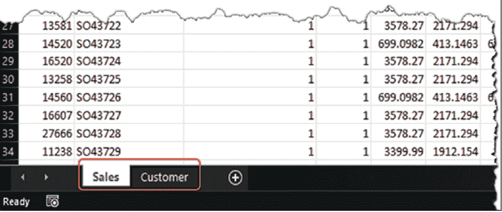

- 产品数据之间的关联，例如 **Product Category**、**Product Subcategory** 和 **Product**
- 销售订单数据之间的关联，例如 **Sales Order** 和 **Sales Order Line**
- `Date` 与 `Time` 之间的关联，例如 **Order Date**、**Due Date** 和 **Ship Date**

### 查找日期和时间的最低所需粒度

在大多数现实世界案例中，如果不是全部，业务都必须在多个维度上分析数据，例如 **Product**、**Customer**、**Date** 或 **Time**，或同时 **Date** 和 **Time**。我们必须找到支持业务需求所需的最低详细粒度。你经常会遇到以下要求：

> *作为销售经理，我希望按分支、位置、日期和时间分析销售数据。*

在上述用户故事中，事实是业务希望分析的事件。因此，销售是一个事实。另一方面，维度是事实被分析所依据的一切。因此，在前述用户故事中，**分支**、**位置**、**日期**和**时间**是维度。我们还拥有一个 **Person** 维度来覆盖*销售经理*。在我们识别事实和维度时，识别数据的粒度也是一个至关重要的任务。数据的粒度，也称为颗粒度，乍一看并不明显。例如，在前述用户故事中，销售数据对于以下维度必须在什么详细程度上进行分析？

- **Location:** `Continent, Country, City, County, Area, Postcode, and Street number`
- **Date:** `Year, Quarter, Month, Week, and Day`
- **Time:** `Hour, Minute, and Second`

在现实世界场景中，尤其是在大型项目中，我们必须向业务提出相关问题以识别粒度。在小型项目中，我们可以通过仔细研究数据来识别粒度。让我们来看一下我们的场景。

在我们的示例中，业务需要在日期和时间上分析数据。但我们必须更详细地说明业务需要分析数据的日期和时间的层级。通过研究数据，我们发现 Sales 和 Customer 表中都有包含 Date 或 DateTime 数据类型的列。Sales 表中有三列包含 DateTime 数据类型。Power Query 编辑器会自动检测列的数据类型。更精确地研究数据表明，两个 DateTime 列中的值的时间元素始终为 12:00:00 AM。因此，很可能 DueDate 和 ShipDate 列的数据类型是 Date，而不是 DateTime。这意味着唯一具有 DateTime 数据类型的列是 OrderDate 列。以下图像显示 OrderDate 列中的数据以秒为单位存储：

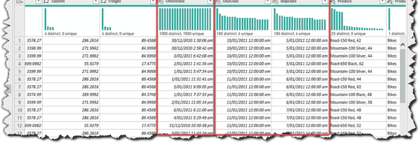

图 6.3：Sales 表中具有 Date 和 DateTime 数据类型的列

因此，OrderDate 列的粒度可以达到秒。我们保存这个问题并稍后与业务确认。

让我们也看看 Customer 表。Customer 表中也有两列具有 Date 数据类型，BirthDate 和 DateFirstPurchase，如以下图像所示：

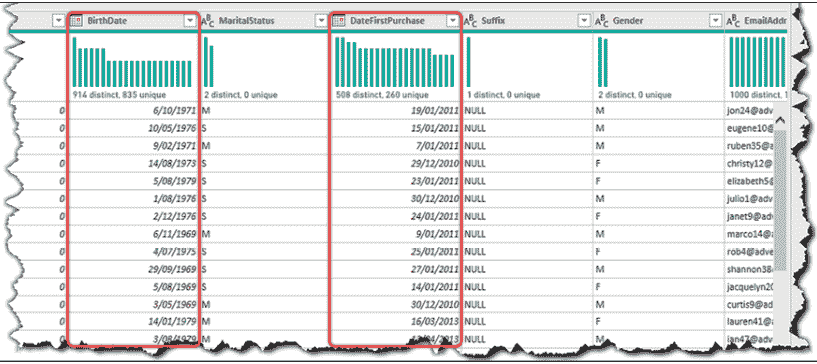

图 6.4：Customer 表中的 Date 列

作为我们在发现研讨会中的下一步，我们必须与业务澄清以下几点：

- 他们是否需要分析客户的出生日期？
- 他们是否需要在不同的日期层级（`Year`、`Quarter`、`Month` 等）拥有 **BirthDate** 数据？
- 他们是否需要分析 **DateFirstPurchase** 数据？
- 他们是否需要在各种日期层级显示 **DateFirstPurchase** 数据？
- 对于 **Sales** 表中的 **OrderDate**，所需的 `Date` 和 `Time` 层级是什么？
- 对于 **Sales** 表中的 **DueDate** 和 **ShipDate** 列，`Date` 层级是什么？

在我们假设的发现研讨会中，业务澄清他们不希望分析客户的出生日期或首次购买日期。我们还发现他们需要按 `Date` 的 `Day` 级别以及 `Time` 的 `Minutes` 级别分析 **Sales** 表中的 **OrderDate**。他们还确认 **Sales** 表中的 **DueDate** 和 **ShipDate** 处于 `Day` 级别。

根据上述发现，很明显我们需要创建一个 `Date` 维度表和一个 `Time` 维度表。

下一步是识别维度、其粒度以及事实。

### 定义维度与事实

为了识别维度与事实，我们必须与业务进行需求收集研讨会。我们需要通过提问 WWWWWH 问题来了解业务流程；即 *What*、*When*、*Where*、*Who*、*Why* 和 *How*。这是一种流行技术，也称为 5W-1H。对这些问题的回答有助于我们了解业务流程，从而有助于识别维度与事实。让我们看一些例子：

- 对 *What* 问题的回答可以是产品、项目、服务等。
- 对 *When* 问题的回答可以是日期、时间或两者，以及在什么层级，月份、日期、小时、分钟等。
- 对 *Where* 问题的回答可以是实体位置，如商店或仓库、地理位置等。

在需求收集研讨会中，我们尝试确定什么描述了业务以及业务如何衡量自身。在我们的场景中，我们想象我们已经进行了几次发现研讨会，并发现业务需要以下销售数据：

- 销售金额
- 数量
- 成本（税、运费等）

销售数据必须按以下内容进行分析：


## 确定潜在事实

要识别事实，我们查看来自发现研讨会的发现结果。凭借我们对业务的现有了解，我们对事实有了一个大致概念。让我们在 Power Query 编辑器中查看数据，并找到数据类型为 Number 的列。尽管如此，并非所有数据类型为 Number 的列都包含事实。事实必须与之前步骤中确定的业务流程相符。考虑到这一点，在我们的练习中，以下列表显示了潜在的事实：

| Potential Fact | Derived From | Fact Columns |
|---|---|---|
| Sales | Sales | OrderQuantity, ExtendedAmount, TotalProductCost, SalesAmount, TaxAmt, Freight |

Figure 6.6: Potential facts derived from existing tables

> Note
>
> 在实际场景中，我们会与主题专家（SMEs）进行发现研讨会以识别维度和事实。但业务提供一组源文件并要求我们创建分析报告的情况也很常见。

现在我们已经识别出潜在的维度和事实，是时候开始准备星型模式了。第一步是将 Sales 和 Customer 表卸载，因为它们当前的扁平形状不适合星型模式。我们在第 1 章《Power BI 中的数据建模简介》的“理解非规范化”部分中解释了如何卸载表。

下一步是更改列的数据类型。如果在“已应用步骤”中自动添加了“更改类型”步骤，我们会检查检测到的数据类型以确保数据类型正确。这在以下图像中显示：

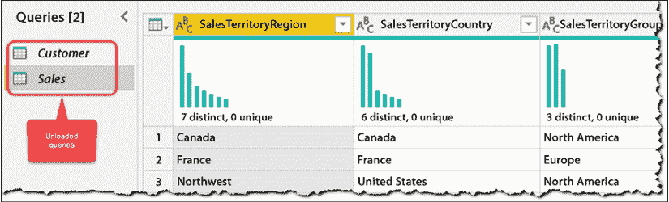

Figure 6.7: Both the Sales and Customer tables unloaded

Power Query 会自动检测列标题，并在 **Type Detection** 设置不是 **Never detect column types and headers for unstructured sources** 时为每个表生成一个 **Changed Type** 步骤。**Type Detection** 设置可从 Power Query 编辑器（或 Power BI Desktop）中配置，路径为 **Options and settings | Options**，在 **Type Detection** 下。

Power Query 的自动检测数据类型行为可在 **Global** 和 **Current File** 两个级别进行配置。通过更改 **Global** 部分下的设置，更改将应用于 Power BI Desktop 的当前文件以及在 Power BI Desktop 中打开的未来文件。但更改 **Current File** 部分下的设置仅适用于当前文件。

以下步骤展示如何在 **Global** 级别更改此设置：

- 1. 点击 **File** 菜单。
- 2. 点击 **Options and settings**。
- 3. 点击 **Options**。
- 4. 点击 **Data Load**。
- 5. 在 **Type Detection** 下，您可以选择以下其中一项：

  - **Always detect column types and headers for unstructured sources**
  - **Detect column types and headers for unstructured sources according to each file’s settings**

## Geography

已识别的业务需求显示，我们必须有一个保存地理数据的维度。查看数据时，我们可以在 Sales 表中看到与地理相关的列。我们可以从 Sales 表派生出一个单独的 Geography 维度。然而，这可能无法覆盖所有业务需求。

如下图所示，Customer 表中也有一些与地理相关的列。我们必须在数据中寻找共同点，并考虑将两个表中的数据合并到单个 Geography 维度的可能性。使用 Column Distribution 显示 CustomerKey 列是 Customer 表的主键：

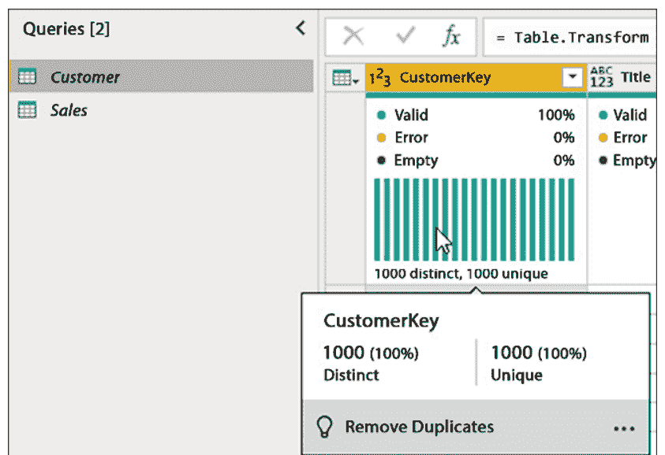

Figure 6.10: Column Distribution shows that CustomerKey is the primary key of the Customer table

启用和使用 Column Distribution 已在第 3 章《Power Query 编辑器中的数据准备》中进行了解释。

查看 Customer 表中的 **SalesContinent**、**SalesCountry** 和 **SalesRegion** 列以及 Sales 表中的 **SalesTerritoryGroup**、**SalesTerritoryCountry** 和 **SalesTerritoryRegion** 的 **Column Distribution** 显示，Customer 表中每个列的唯一值数量与 Sales 表中对应列的唯一值数量相匹配，如下图所示：

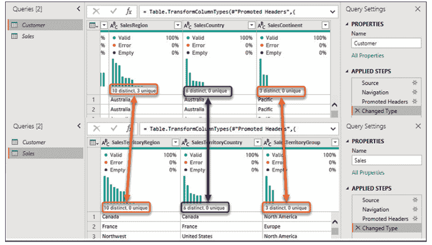

Figure 6.11: Comparing Column Distribution for geography-related columns from the Customer table and the Sales table

为确保 Customer 表中的 **SalesContinent**、**SalesCountry** 和 **SalesRegion** 列与 Sales 表中的 **SalesTerritoryGroup**、**SalesTerritoryCountry** 和 **SalesTerritoryRegion** 列的值匹配，我们进行以下测试流程：

- 1. 引用 **Customer** 表。
- 2. 将表重命名为 **CustomerGeoTest**。
- 3. 卸载该表。
- 4. 通过选择 **Remove Other Columns** 保留 **SalesContinent**、**SalesCountry** 和 **SalesRegion** 列。

我们必须对 Sales 表中的以下列进行相同的流程以删除重复项：

  - SalesTerritoryGroup
  - SalesTerritoryCountry
  - SalesTerritoryRegion

下图显示了后者的结果与从 Customer 表中删除 **SalesContinent**、**SalesCountry** 和 **SalesRegion** 列的重复项的结果并排显示：

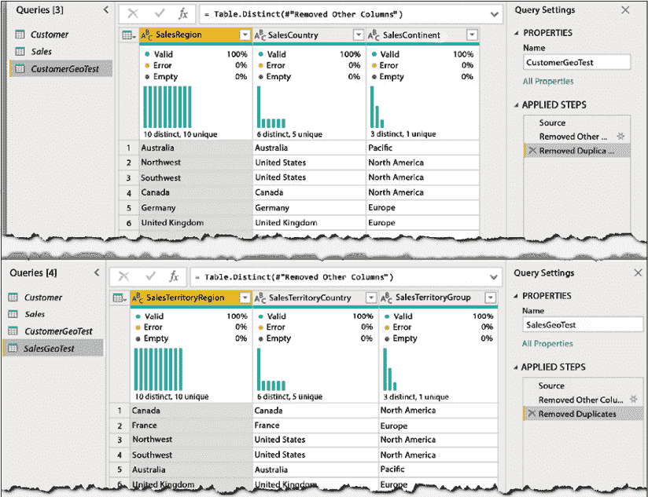

Figure 6.14: Comparing the results of the CustomerGeoTest table and the SalesGeoTest table

如前面的屏幕截图所示，两者之间的唯一区别是列的排序顺序，这并不重要。基于前面的练习，我们不需要创建 **Geography** 维度，因为 Sales 表中的 SalesTerritoryGroup、SalesTerritoryCountry 和 SalesTerritoryRegion 列与 Customer 表中的 SalesContinent、SalesCountry 和 SalesRegion 列相比是冗余的，而 Customer 表中的地理相关列提供了更高级别的细节。

## Sales order

在 Sales 表中，SalesOrderNumber 和 SalesOrderLineNumber 列包含销售订单的描述性数据。我们是否需要为此创建维度？让我们查看数据：

- 1. 将列分析更改为基于整个数据集。
- 2. 查看这两个列的 Column Distribution 显示 SalesOrderNumber 有 27,659 个唯一值，而 SalesOrderLineNumber 只有 8 个唯一值：

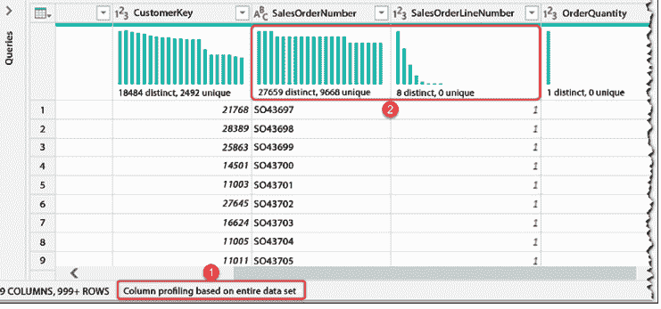

Figure 6.15: Looking at the Column Distribution data shows that there are a lot of distinct values in SalesOrderNumber

SalesOrderNumber 列包含大量唯一值，这降低了创建新的 Sales Order 维度是一个好主意的可能性。因此，我们需要找到更多证据以避免创建 Sales Order 维度。如果我们合并这两个列，我们就能更好地了解如果决定创建它，新维度中将有多少行。

- 3. 选择 **SalesOrderNumber** 和 **SalesOrderLineNumber** 两列。
- 4. 从 **Transformation** 选项卡点击 **Merge Columns**。
- 5. 在 **Merge Columns** 窗口中，保持默认设置并点击 **OK**。

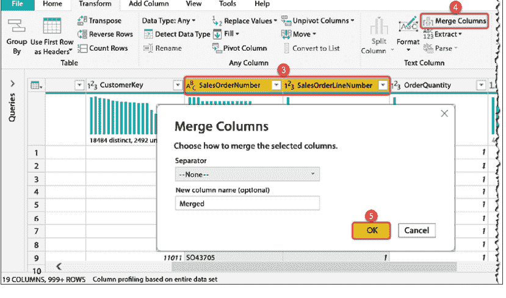

*Figure 6.16: Merging the SalesOrderNumber and SalesOrderLineNumber columns*

新的 **Merged** 列包含 **60,398 distinct** 和 **60,398 unique values**，这意味着 **SalesOrderNumber** 和 **SalesOrderLineNumber** 的组合是 **Sales table** 的 **primary key**，如下图所示。因此，即使我们创建单独的维度，我们得到的行数也与事实表相同。此外，我们无法想象与任何其他维度的任何关联。因此，将这两个列保留在 **Sales** 表中是最好的。这些维度由于其数据特征而无法移出事实表。它们也没有任何其他属性或与其它维度的有意义的链接。这类维度称为 **degenerate dimensions**。


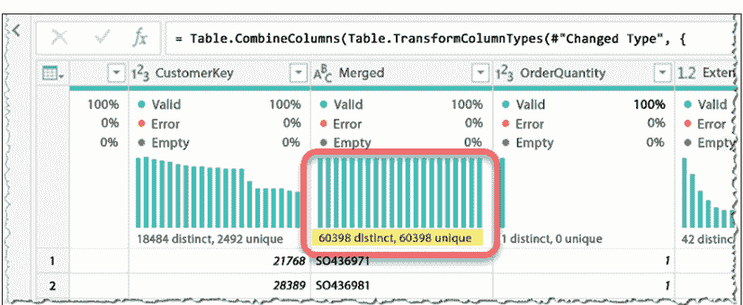

图 6.17：合并后的列结果

现在，我们必须从“应用的步骤”中移除“合并的列”步骤。

## 产品

“产品”维度是最明显的维度，包含三个描述性列。我们通过引用“销售”表来从“销售”表中派生“产品”维度。然后，我们移除其他列，只保留“产品”、“产品子类别”和“产品类别”列。下一步，我们必须从“产品”表中移除重复项。此外，我们需要生成一个“产品键”列作为“产品”表的主键，稍后将在数据模型中使用该键。接下来，我们将“销售”表与“产品”表合并，以便在“销售”表中获得“产品键”。我们还重命名这些列，使其更易于用户理解：将“产品子类别”重命名为“产品子类别”，将“产品类别”重命名为“产品类别”。

> **注意**
>
> 接下来，我们会多次引用“销售”表。因此，我们将“销售”表重命名为“销售基础”。

以下步骤展示了如何在 Power Query 编辑器中实现上述过程：

- 1. 将**销售**表重命名为**销售基础**：

  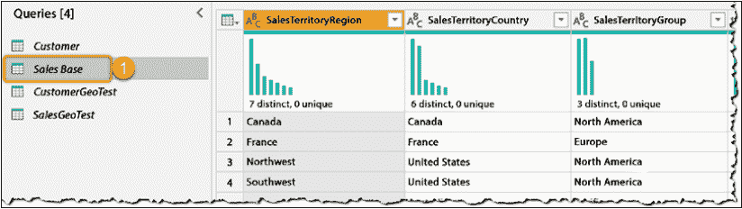

  图 6.18：将“销售”表重命名为“销售基础”

- 2. **引用** **销售基础**表：

  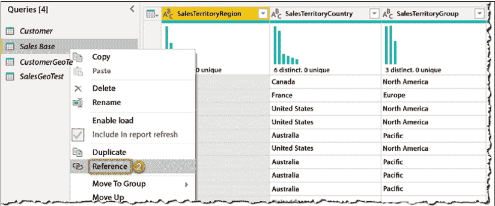

  图 6.19：引用“销售基础”表

- 3. **将**引用表重命名为**产品**。

- 4. 分别选择**产品类别**、**产品子类别**和**产品**列。

  > **注意**
  >
  > Power Query 会根据我们在*步骤 4*中的选择顺序来排列列的顺序。

- 5. 右键单击选中的某一列，然后点击**删除其他列**：

  图 6.20：“删除其他列”选项

- 6. 单击“数据”视图窗格左上角的表按钮。

- 7. 点击**删除重复项**：

  图 6.21：从所有行中删除重复项

Power Query 界面中的“删除重复项”功能在后台使用 `Table.Distinct(table as table)` 函数。当 `isPrimary` 操作数为 true 时，`Table.Distinct()` 函数相当于 `Table.AddKey(table as table, columns as list, isPrimary as logical)` 函数。`Table.AddKey()` 函数将一列或多列定义为表的主键列。但在将数据加载到数据模型后，xVelocity 引擎不支持复合主键。

这样，我们就创建了**产品**维度。

## 货币

**销售基础**表中的**货币**列保存了每笔交易的货币描述。因此，从定义上讲，它是一个维度。让我们在这里提出*为什么*的问题。为什么我们需要为**货币**创建一个单独的表？我们需要更全面地审视这种情况来回答这个问题。**列分布**框在基于整个数据集工作时，显示**货币**列的基数较低，只有 6 个不同的值，如下图所示：

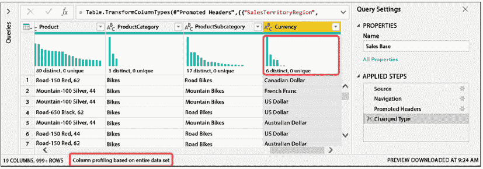

图 6.24：整个数据集上“货币”列的列分布

由于 **xVelocity** 引擎中的 `Columnstore` 索引对于低基数列可以提供更好的数据压缩和性能，在我们的场景中，为**货币**创建新的维度表所带来的性能或存储提升可能微乎其微，甚至没有实际意义。此外，我们确实有其他属性可以提供更多关于货币的描述。最后，**货币**与其他维度没有任何有意义的关联。因此，我们可以将**货币**列作为事实表中的**退化维度**。

让我们继续看看其他潜在的维度。

## 客户

我们可以从数据源中的原始**客户**表派生**客户**表。为此，我们将原始**客户**表重命名为**客户基础**。

让我们查看**销售基础**表，看看每一行如何与**客户基础**表相关联。**销售基础**表有一个**客户键**列。我们将**基于整个数据集进行列分析**设置为更真实地查看**客户键**。**销售基础**表中**客户键**的**列质量框**显示，**销售基础**表中的每一笔销售交易都有一个客户键（**0% 空**）。下图显示了**销售基础**表中**客户键**列的**列质量框**：

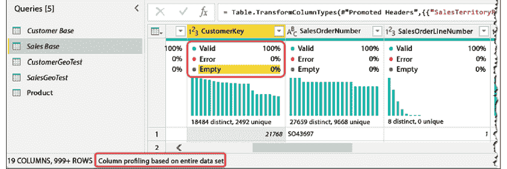

图 6.25：列质量信息显示“CustomerKey”的“空”比例为 0%

因此，**销售基础**表的每一行都可以关联到**客户基础**表中的描述性数据。为了确保我们能够在这两个表之间创建关系，我们必须确保**销售基础**表和**客户基础**表中的**客户键**列的数据类型相匹配。我们还希望**客户基础**表中的**客户键**成为主键，这意味着**不同**和**唯一**值的数量必须相同。下图显示了两张表中**客户键**列的数据类型匹配，并且**客户基础**表中的**客户键**是主键：

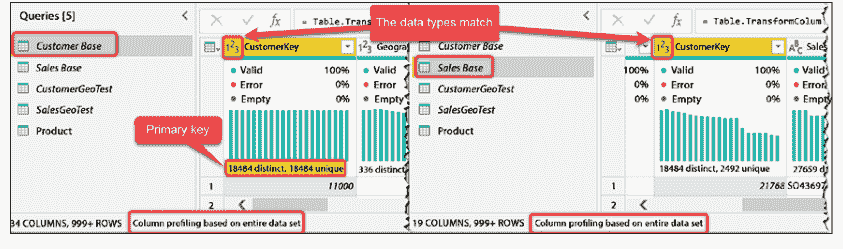

图 6.26：CustomerKey 在两个表中的数据类型匹配，并且它是 Customer Base 表的主键

现在我们已经有了足够的证据表明客户表是一个维度，让我们按照以下步骤创建它：

- 1. 引用**客户基础**表：

  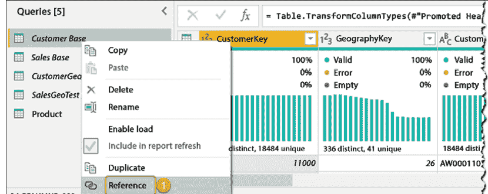

  图 6.27：引用“客户基础”表

- 2. 将引用表重命名为“客户”。

我们需要通过删除其他列来保留以下列，即 CustomerKey、Title、FirstName、MiddleName、LastName、NameStyle、BirthDate、MaritalStatus、Suffix、Gender、EmailAddress、YearlyIncome、TotalChildren、NumberChildrenAtHome、Education、Occupation、HouseOwnerFlag、NumberCarsOwned、AddressLine1、AddressLine2、Phone、DateFirstPurchase 和 CommuteDistance。

- 3. 最简单的方法是单击**主页**选项卡中的**选择列**。
- 4. 保留上述列，并取消选择其余列。
- 5. 单击**确定**：

  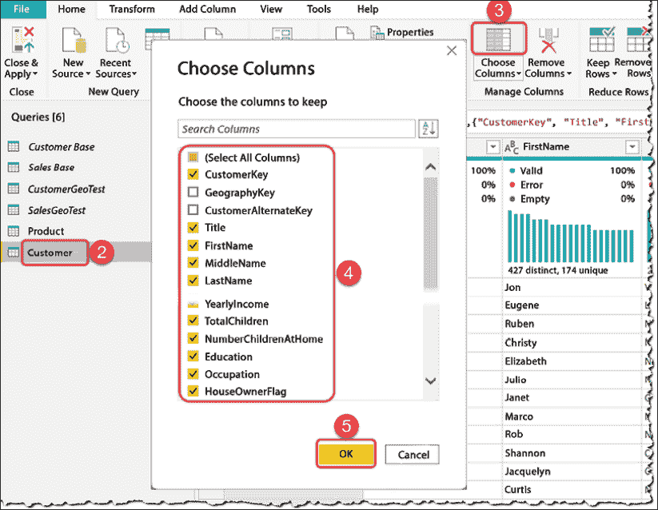

  *图 6.28：删除不必要的列*

这样，我们就创建了**客户**维度。由于**客户**维度已经有一个主键 **CustomerKey**，我们不需要再采取任何其他操作。

在下一节中，我们将通过引用**客户基础**表来创建一个包含地理相关数据的单独维度；因此，我们不需要在**客户**维度中保留任何与地理相关的列。

需要通过双击“删除其他列”步骤并取消选中“CountryRegionName”列来删除其中一个。

下一步是删除重复行，这样可以避免将来该维度中出现任何重复行，即使当前没有重复行。

- 6. 在**销售人口统计**表中选择一列，然后按键盘上的 *Ctrl+A* 选择所有列。

- 7. 单击**主页**选项卡中的**删除行**选项。

- 8. 单击**删除重复项**选项：

  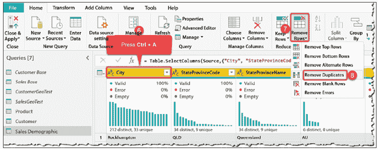

  图 6.30：从“销售人口统计”表中删除重复项

下一步是添加一个**索引列**来为**销售人口统计**维度创建一个**主键**。

- 9. 单击**添加列**选项卡中的**索引列**下拉按钮。

- 10. 单击**从 1 开始**：

  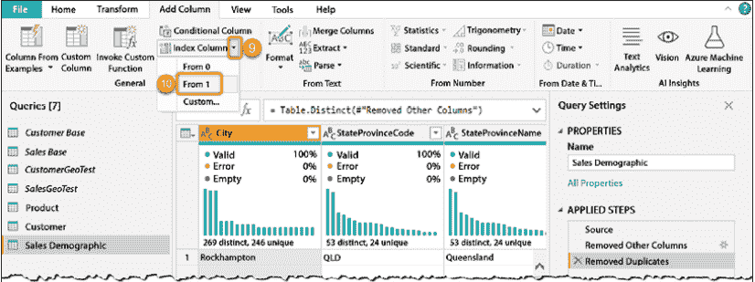

  图 6.31：向“销售人口统计”表添加索引列

- 11. 在公式栏中，将 **Index** 替换为 **SalesDemographicKey**。

- 12. 单击 **提交** 按钮 ✓：

  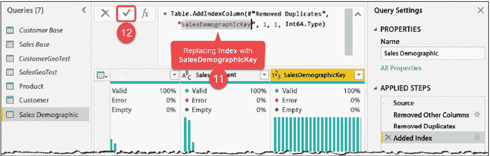

  图 6.32：将 Index 替换为 SalesDemographicKey

到目前为止，我们已经创建了从**销售基础**表和**客户基础**表派生的所有潜在维度。正如本章前面所讨论的，我们还需要创建一个 `Date` 维度和一个 `Time` 维度。我们将在以下部分中完成这项工作。

## 日期

与业务部门的发现会议结果显示，我们需要 `Date` 和 `Time` 维度。我们已经在*第 2 章“数据分析表达式和数据建模”*中讨论过，可以使用 DAX 创建 `Date` 维度。我们还讨论了其优缺点


of using the `CALENDARAUTO()` function in DAX. In this section, we will create a custom function in Power Query Editor to generate a simple `Date` dimension accepting two input parameters: `Start Year` and `End Year`. We invoke the custom function to generate a **Date** table starting from `1st Jan` of `Start Year` and ending on `31st Dec` of `End Year`.

The dates generated in the **Date** column are continuous and do not have any gaps between dates. The following steps show how to use the following expressions to create and invoke the custom function:

+   1. The custom function can be created by copying the following Power Query expression:

```
```powerquery
// fnGenerateDate
(#"Start Year" as number, #"End Year" as number) as table =>
    let
        GenerateDates = List.Dates(#date(#"Start Year", 1, 1), Duration.Days(Duration.From(#date(#"End Year", 12, 31) - #date(#"Start Year" - 1, 12, 31))), #duration(1, 0, 0, 0)),
        #"Converted to Table" = Table.TransformColumnTypes(Table.FromList(GenerateDates, Splitter.SplitByNothing(), {"Date"}), {{"Date", Date.Type}}),
        #"Added Custom" = Table.AddColumn(#"Converted to Table", "DateKey", each Int64.From(Text.Combine({Date.ToText([Date], "yyyy"), Date.ToText([Date], "MM"), Date.ToText([Date], "dd")})), Int64.Type),
        #"Year Column Added" = Table.AddColumn(#"Added Custom", "Year", each Date.Year([Date]), Int64.Type),
        #"Quarter Column Added" = Table.AddColumn(#"Year Column Added", "Quarter", each "Qtr " & Text.From(Date.QuarterOfYear([Date])), Text.Type),
        #"MonthOrder Column Added" = Table.AddColumn(#"Quarter Column Added", "MonthOrder", each Date.ToText([Date], "MM"), Text.Type),
        #"Short Month Column Added" = Table.AddColumn(#"MonthOrder Column Added", "Month Short", each Date.ToText([Date], "MMM"), Text.Type),
        #"Month Column Added" = Table.AddColumn(#"Short Month Column Added", "Month", each
```

```
Date.MonthName([Date]), Text.Type
    in
        #"Month Column Added"
```

The preceding code is also available in this book’s GitHub repository, in the Chapter 6, Generate Date Dimension.m file, via the following URL: https://github.com/PacktPublishing/Expert-Data-Modeling-with-Power-BI-Second-Edition/blob/0b26cc981f0448edfa108cf9f587cef439fb454b/Source%20Code/Chapter%2006/Chapter%206,%20Generate%20Date%20Dimension.m

+   2. In Power Query Editor, click the New Source drop-down button.
+   3. Click Blank Query.
+   4. Rename the new query from Query1 to fnGenerateDate.
+   5. Click the Advanced Editor button from the Home tab.
+   6. Delete the existing code and paste the expressions we copied in the first step.
+   7. Click Done:

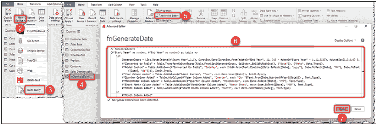

Figure 6.33: Creating the fnGenerateDate custom function in Power Query Editor

The preceding process creates the fnGenerateDate custom function in Power Query Editor. The next step is to invoke the function by entering the Start Year and End Year parameters. In real-world scenarios, we confirm the date range of the Date dimension with the

business to ensure the `Date` dimension supports all current and future requirements.

Sometimes, we need to find the minimum and maximum dates of all the columns contributing to our data analysis with `Date` or `DateTime` data types. There are various ways to overcome those cases, such as the following:

+   - We can get the minimum and maximum dates by eyeballing the data if the dataset is small.
+   - We can sort each of the **OrderDate**, **DueDate**, and **ShipDate** values in ascending order to get the minimum dates, and then we can sort those columns in descending order to get the maximum dates.
+   - We can use the `List.Min()` function for each column to get the minimum dates. Then, using the `List.Max()` function for each column gives us the maximum dates.
+   - We can find the minimum and maximum dates using DAX.
+   - We can use the **Column profile** feature in Power Query Editor.

Now that we have the `fnGenerateDate` custom function handy, we pass the `Start Date` and `End Date` parameters and invoke it. Our sample’s start and end years are `2010` and `2014`, respectively. We invoke the `fnGenerateDate` function as follows:

+   8. Select the **fnGenerateDate** custom function from the **Queries** pane.
+   9. Type in `2010` for the **Start Year** parameter and `2014` for the **End Year** parameter.
+   10. Click **Invoke**:

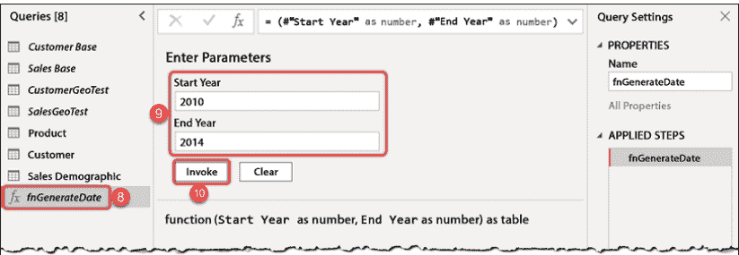

# Figure 6.34: Invoking the fnGenerateDate function

Invoking the fnGenerateDate function creates a new table named Invoked Function. Rename it Date, as shown in the following image:

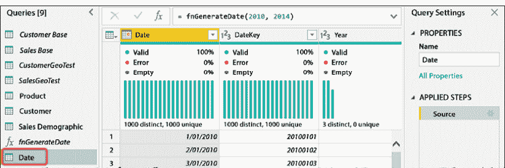

# Figure 6.35: Renaming the invoked custom function Date

As a Date dimension is commonly used in Power BI, it is handy to have a custom function to reuse on other solutions if required.

So far, we have created the Date dimension. Next, we will create the Time dimension.

## Time

The outcomes of the discovery sessions with the business showed that we need to have a Time dimension. In the previous section, we created a custom function to generate a Date dimension. In Chapter 2, Data Analysis eXpressions and Data Modeling, we discussed that we could use DAX to

create the `Time` dimension. This section discusses creating the `Time` dimension in Power Query.

Creating the **Time** dimension provides the flexibility to analyze the data over time elements, such as hour, minute, and second, or time buckets such as 5 min, 15 min, 30 min, and so on.

The following Power Query expressions create a `Time` dimension with 5 min, 15 min, 30 min, 45 min, and 60 min time buckets:

```
```powerquery
let
    Source = Table.FromList({1..86400}, Splitter.SplitByNothing()),
        #"Renamed Columns" = Table.RenameColumns(Source, {{"Column1", "ID"}}),
        #"Time Column Added" = Table.AddColumn(#"Renamed Columns", "Time", each Time.From(#datetime(1970,1,1,0,0,0) + #duration(0,0,0,[ID]))),
        #"Hour Added" = Table.AddColumn(#"Time Column Added", "Hour", each Time.Hour([Time])),
        #"Minute Added" = Table.AddColumn(#"Hour Added", "Minute", each Time.Minute([Time])),
        #"5 Min Band Added" = Table.AddColumn(#"Minute Added", "5 Min Band", each Time.From(#datetime(1970,1,1,0,0,0) + #duration(0, 0, Number.RoundDown(Time.Minute([Time]) / 5) * 5, 0)) + #duration(0, 0, 5, 0)),
        #"15 Min Band Added" = Table.AddColumn(#"5 Min Band Added", "15 Min Band", each Time.From(#datetime(1970,1,1,0,0,0) + #duration(0, 0, Number.RoundDown(Time.Minute([Time]) / 15) * 15, 0)) + #duration(0, 0, 15, 0)),
        #"30 Min Band Added" = Table.AddColumn(#"15 Min Band Added", "30 Min Band", each Time.From(#datetime(1970,1,1,0,0,0) + #duration(0, 0, Number.RoundDown(Time.Minute([Time]) / 30) * 30, 0)) + #duration(0, 0, 30, 0)),
        #"45 Min Band Added" = Table.AddColumn(#"30 Min Band Added", "45 Min Band", each Time.From(#datetime(1970,1,1,0,0,0) + #duration(0, 0, Number.RoundDown(Time.Minute([Time]) / 45) * 45, 0)) + #duration(0, 0, 45, 0)),
        #"60 Min Band Added" = Table.AddColumn(#"45 Min Band Added", "60 Min Band", each Time.From(#datetime(1970,1,1,0,0,0) + #duration(0, 0, Number.RoundDown(Time.Minute([Time]) / 60) * 60, 0)) +
```

```
#duration(0, 0, 60, 0)),
    #"Removed Other Columns" = Table.SelectColumns(#"60 Min Band Added",{"Time", "Hour", "Minute", "5 Min Band", "15 Min Band", "30 Min Band", "45 Min Band", "60 Min Band"}),
    #"Changed Type" = Table.TransformColumnTypes(#"Removed Other Columns",{{"Time", type time}, {"Hour", Int64.Type}, {"Minute", Int64.Type}, {"5 Min Band", type time}, {"15 Min Band", type time}, {"30 Min Band", type time}, {"45 Min Band", type time}, {"60 Min Band", type time}})
in
#"Changed Type"
```

The preceding code is also available in this book’s GitHub repository, in the Chapter 6, Generate Time Dimension.m file, via the following URL: https://github.com/PacktPublishing/Expert-Data-Modeling-with-Power-BI-Second-Edition/blob/0b26cc981f0448edfa108cf9f587cef439fb454b/Source%20Code/Chapter%2006/Chapter%206,%20Generate%20Time%20Dimension.m

With the preceding code handy, we only need to create a new Blank Query, rename it to Time, and copy and paste the preceding expressions into Advanced Editor, as shown in the following image:

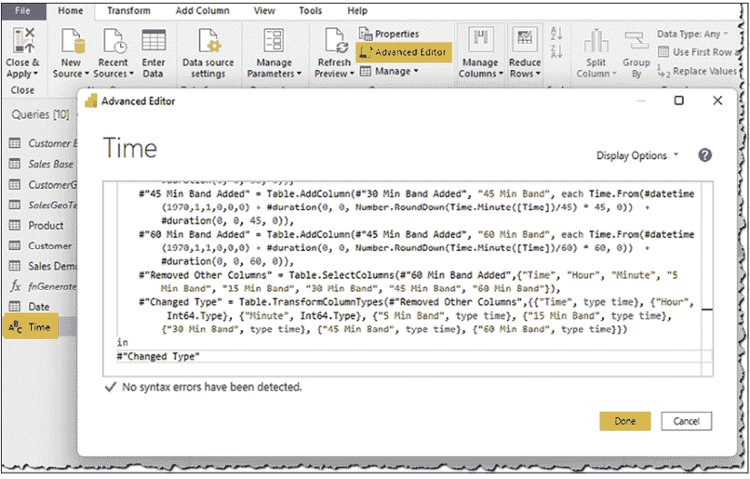

Figure 6.36: Creating the Time dimension in Power Query Editor


我们对 Power Query 和 DAX 的了解也是需要考虑的一个重要因素。我们中有些人对其中一种语言比另一种更熟悉。

## 创建事实表

现在我们已经创建了所有维度，是时候创建一个事实表了，该表包含数值以及维度主键作为外键。**Sales Base** 和 **Customer Base** 数据显示 **Sales Base** 表包含许多数值。因此，可以从 **Sales Base** 表派生出一个事实表，我们将其命名为 **Sales**，步骤如下：

- 1. **引用** **Sales Base** 表，然后将新表重命名为 **Sales**。

我们希望从 **Product** 表中获取 **ProductKey**。为此，我们可以将 **Sales** 表与 **Product** 表合并。

- 2. 点击 **Merge Queries**。
- 3. 分别选择 **ProductCategory**、**ProductSubcategory** 和 **Product** 列。
- 4. 从下拉列表中选择 **Product** 表。
- 5. 再次选择 **ProductCategory**、**ProductSubcategory** 和 **Product** 列。
- 6. 从 **Join Kind** 下拉列表中选择 **Left outer (all from first, matching from second)**。
- 7. 点击 **OK**：

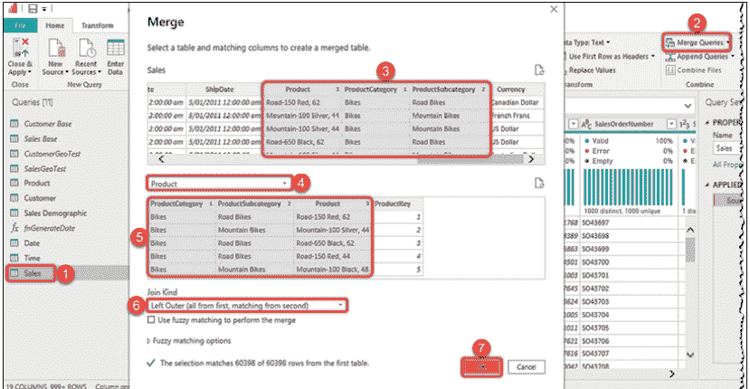

图 6.37：合并 Sales 表与 Product 表

- 8. 前面的步骤创建了一个名为 Product.1 的新结构化列，并在 Applied Steps 中创建了一个新的转换步骤。此步骤的默认名称为 Merged Queries。将其重命名为 Merged Sales with Product。
- 9. 展开 Product.1 列。
- 10. 勾选 ProductKey 列（保持其余未勾选）。
- 11. 取消勾选 Use original column name as prefix 选项。
- 12. 点击 OK：

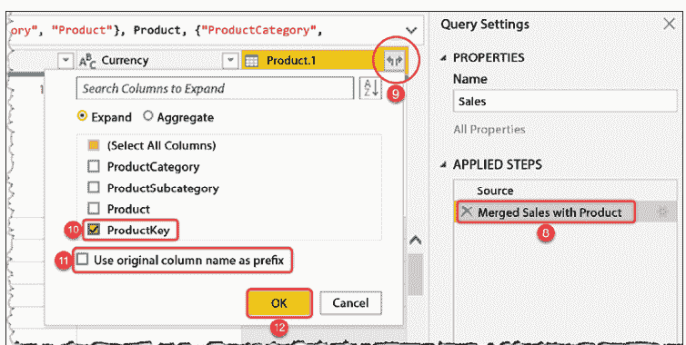

图 6.38：展开 Product.1 结构化列

现在，我们需要从 **Sales Demographic** 表中获取 **SalesDemographicKey**。**Sales Demographic** 表中每行唯一标识符的列是 **SalesCountry**、**City**、**StateProvinceName** 和 **PostalCode**。然而，**Sales** 表不包含所有这些列。此外，**Sales Demographic** 维度是从 **Customer Base** 表派生的。因此，我们必须通过 **CustomerKey** 列将 **Sales** 表与 **Customer Base** 表合并，然后再次与 **Sales Demographic** 表合并以获取 **SalesDemographicKey**。

- 13. 在 **Applied Steps** 中，将 **Expanded Product.1** 重命名为 **Expanded Product**。
- 14. 再次点击 **Merge Queries**。
- 15. 在 **Sales** 部分下选择 **CustomerKey** 列。
- 16. 从下拉列表中选择 **Customer Base**。
- 17. 选择 **CustomerKey**。
- 18. 选择 **Left Outer** 作为 **Join Kind**。
- 19. 点击 **OK**：

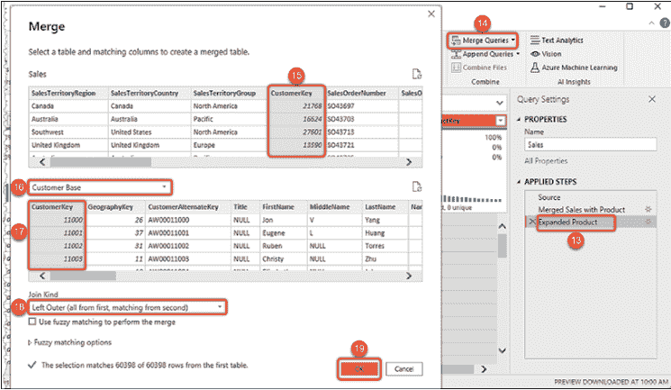

图 6.39：合并 Sales 表与 Customer Base

这会创建一个名为 **Customer Base** 的新结构化列。它还在 **Applied Steps** 中创建了一个名为 **Merged Queries** 的新转换步骤。

- 20. 将此步骤重命名为 **Merged Sales with Customer Base**。
- 21. 展开 **Customer Base** 结构化列。
- 22. 保持 **SalesCountry**、**City**、**StateProvinceName** 和 **PostalCode** 列被勾选，并取消勾选其余列。
- 23. 取消勾选 **Use original column name as prefix** 选项。
- 24. 点击 **OK**：

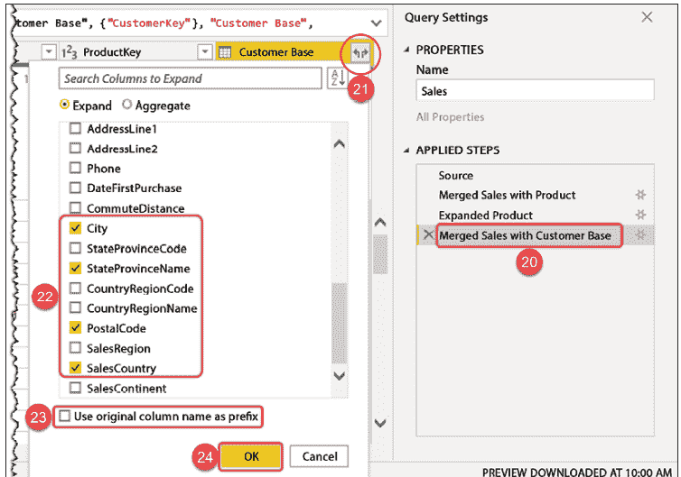

图 6.40：展开 Customer Base 结构化列

现在，我们必须将结果与 **Sales Demographic** 表合并并获取 **SalesDemographicKey**。

- 25. 再次点击 **Merge Queries** 后，选择 **SalesCountry**、**City**、**StateProvinceName** 和 **PostalCode** 列。
- 26. 从下拉菜单中选择 **Sales Demographic** 表。
- 33. 取消勾选 Use original column name as prefix 选项。
- 34. 点击 OK：

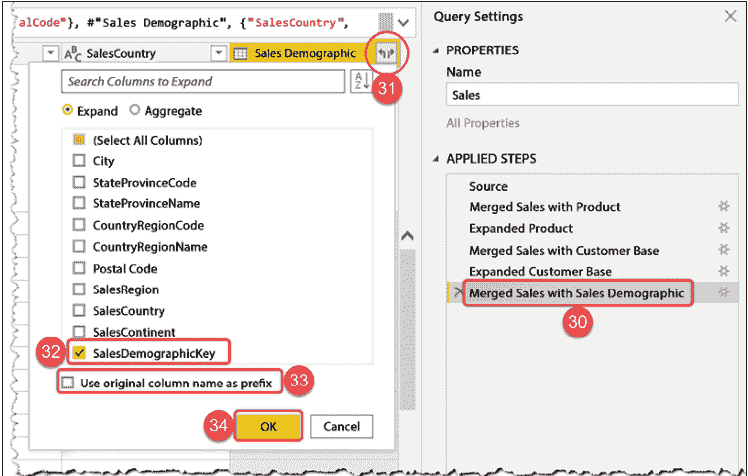

图 6.42：合并 Sales 与 Sales Demographic

到目前为止，我们已将 SalesDemographicKey 添加到 Sales 表。让我们查看 Sales 表中数据类型为 Date 或 DateTime 的列。Sales 表有三列为 DateTime 数据类型。仔细查看数据可知，OrderDate 是唯一一个为 DateTime 数据类型的列，而另外两个代表 Date 值（所有值的 Time 部分均为 12:00:00 AM）。因此，最好将这些列的数据类型转换为 Date。OrderDate 列同时代表 Date 和 Time。剩下的部分是将 Date 和 Time 值拆分为单独的列：Order Date 和 Order Time。这些列将在数据模型关系中使用。按以下步骤操作：

- 35. 选择 OrderDate 列。
- 36. 点击功能区 Home 选项卡上的 Split Column 按钮。
- 37. 点击 By Delimiter。
- 38. 选择 Space 作为分隔符。

如果 **Type Detection** 设置为检测数据类型，Power Query Editor 会自动添加一个 **Changed Type** 步骤。保留此步骤。现在，我们需要将 **DueDate** 和 **ShipDate** 列的数据类型从 `DateTime` 更改为 `Date`。

- 43. 从 **Applied Step** 窗格中点击 **Changed Type** 步骤。
- 44. 同时选择 **DueDate** 和 **ShipDate**。
- 45. 点击 **Home** 选项卡上的 **Data Type** 下拉按钮。
- 46. 选择 **Date**：

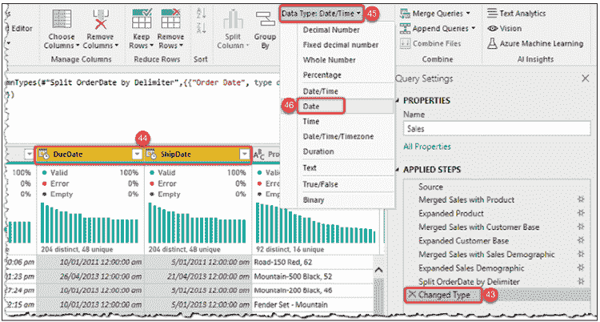

图 6.45：更改 DueDate 和 ShipDate 数据类型

到目前为止，我们已将所有维度中的键列添加到事实表中，这些键将在数据模型层中用于在维度与事实表之间创建关系。拼图中的唯一剩余部分是通过删除所有不必要的列来清理 **Sales** 表。

- 47. 点击 **Home** 选项卡上的 **Choose Column** 按钮。
- 48. 保持以下列被勾选并取消勾选其余列；即 **CustomerKey**、**SalesOrderNumber**、**SalesOrderLineNumber**、**OrderQuantity**、**ExtendedAmount**、**TotalProductCost**、**SalesAmount**、**TaxAmt**、**Freight**、**Order Date**、**Order Time**、**DueDate**、**ShipDate**、**Currency** 和 **ProductKey**。
- 49. 点击 OK：

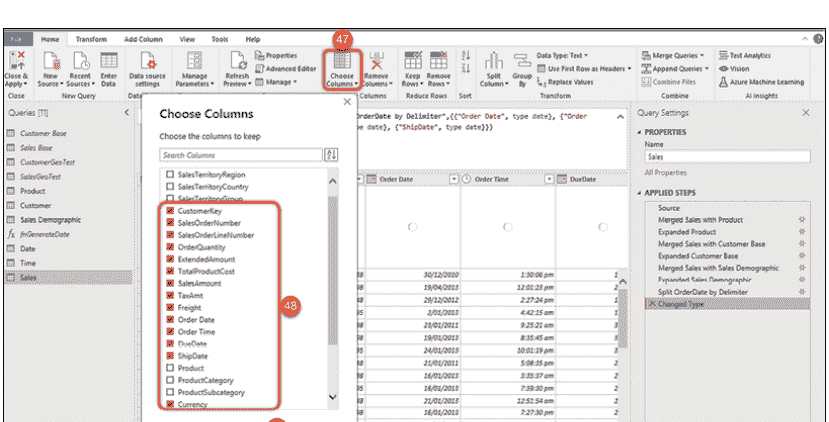

## 图 6.46：从事实表中删除不必要的列

前述转换步骤的结果显示，Sales 事实表包含以下内容：

- OrderQuantity、ExtendedAmount、TotalProductCost、SalesAmount、TaxAmt 和 Freight 列，它们是事实。
- CustomerKey、Order Date、Order Time、DueDate、ShipDate、ProductKey 和 SalesDemographicKey 是外键，将在数据建模层中使用以在 Sales 表与其维度之间创建关系。
- SalesOrderNumber、SalesOrderLineNumber 和 Currency 是退化维度。

我们现在已成功准备了支持星型架构的数据。我们现在应用更改将数据加载到数据模型中。

## 总结

在本章中，我们以星型架构准备了数据，该架构在扁平数据结构之上针对数据分析和报告进行了优化。我们确定了潜在的维度并讨论了创建或不创建单独维度表的理由。然后我们逐步完成了创建合理维度表的转换步骤。最后，我们将所有维度键列添加到事实表中并删除了所有不必要的列，这为我们提供了一个整洁的事实表，仅包含所有必要的列。

下一章将介绍一个令人兴奋且相当重要的主题：*数据准备常见最佳实践*。遵循这些最佳实践，我们可以避免大量返工和维护成本。

## 加入我们 Discord！

加入 Packt Discord 服务器上的 The Big Data and Analytics Community！

与 558 名其他成员一起聊天，享受免费的语音和文字聊天。

https://packt.link/ips2H


## 考虑加载部分数据

对于所有类型的数据源，一个通用的经验法则是仅在数据准备期间保留相关列。在处理基于 API 的数据源时，我们需要更加注意这一点，因为可用资源通常非常有限。例如，当连接到存储在 SharePoint Online 文件夹中的数据源时，我们在达到每秒 25 次请求的限制时就会被限流。另一个我们需要更加谨慎的常见数据源是 **Open Data Protocol (OData)**。微软发明了 OData，这是一种创建和消费 REST API 的常用方法。许多 **Enterprise Resource Planning (ERP)** 系统可通过 OData 访问。将数据通过 OData 连接加载到 Power BI 时，必须特别注意加载的数据量。在许多情况下，底层数据模型具有宽表，包含许多列，其中包含不一定需要的元数据。

当开发人员最初尝试从超过 200 列的宽表中加载所有数据时，Power BI 报表导致生产系统瘫痪。因此，明智的做法是仅将相关列加载到数据模型中。在某些情况下，我们可能还需要过滤数据以加载对业务最重要的部分。许多基于 API 的数据源（如 OData）提供查询功能，可显式调用所需的列。

此时，我们可能还需要让熟悉底层数据模型的业务中的 **Subject Matter Experts (SMEs)** 参与进来。业务设定了分析数据相关性的规则。如果无法获得这样有知识的 SME，对于我们 Power BI 开发人员来说，了解我们连接的数据模型有多大，涉及多少表，以及它们有多少列和行是很重要的。为此，我们可以创建一个自定义函数来获取表、它们有多少列和行等。以下自定义函数接受一个 OData URL，并检索表名、它们的列数、行数、十进制数据列数、十进制列列表、文本列数以及文本列列表：

//fnODataFeedAnalysis
(ODataFeed as text) as table =>
let
    Source = OData.Feed(ODataFeed),
    FilterTables = Table.SelectRows(Source, each Type.Is(Value.Type([Data]), Table.Type) = true),
    #"TableColumnCount Added" = Table.AddColumn(FilterTables, "Table Column Count", each Table.ColumnCount([Data]), Int64.Type),
    #"TableCountRows Added" = Table.AddColumn(#"TableColumnCount Added", "Table Row Count", each Table.RowCount([Data]), Int64.Type),
    #"NumberOfDecimalColumns Added" = Table.AddColumn(#"TableCountRows Added", "Number of Decimal Columns", each List.Count(Table.ColumnsOfType([Data], {Decimal.Type})), Int64.Type),
    #"ListOfDecimalColumns Added" = Table.AddColumn(#"NumberOfDecimalColumns Added", "List of Decimal Columns", each if [Number of Decimal Columns] = 0 then null else Table.ColumnsOfType([Data], {Decimal.Type})),
    #"NumberOfTextColumns Added" = Table.AddColumn(#"ListOfDecimalColumns Added", "Number of Text Columns", each List.Count(Table.ColumnsOfType([Data], {Text.Type})), Int64.Type),
    #"ListOfTextColumns Added" = Table.AddColumn(#"NumberOfTextColumns Added", "List of Text Columns", each if [Number of Text Columns] = 0 then null else Table.ColumnsOfType([Data], {Text.Type})),
    #"Sorted Rows" = Table.Sort(#"ListOfTextColumns Added", {{"Table Column Count", Order.Descending}, {"Table Row Count", Order.Descending}}),
    #"Removed Other Columns" = Table.SelectColumns(#"Sorted Rows", {"Name", "Table Column Count", "Table Row Count", "Number of Decimal Columns", "List of Decimal Columns", "Number of Text Columns", "List of Text Columns"})
in
    #"Removed Other Columns"

要调用前述自定义函数，我们需要将 OData URL 传递给前述函数，它会给出如下结果集：

当前版本的函数可在大多数 OData feed 上无需任何更改即可工作。

通过对前述函数进行一些小的更改，我们可以使其适用于许多其他数据源。例如，我们可以通过更改输入参数和源行，将连接从 OData 更改为 SQL Server。

在找到可能存在问题的表后，我们执行以下操作：

- 消除所有不必要的列。
- 过滤数据以减少行数。
- 我们可以考虑通过聚合数值来更改某些表的粒度。
- 另一个关键点是正确处理数据类型。我们在 *Follow data type conversion best practices* 部分讨论它。

## 欣赏 Power Query 中的大小写敏感性

如前所述，Power Query 是区分大小写的。大小写敏感性不仅仅是关于 Power Query 语法；Power Query 中相反大小写的字符串数据类型不相等。因此，在处理字符串数据时，必须注意字符大小写。当我们合并来自不同源的数据时，我们通常将 GUID 作为键列（主键或外键）。如果我们比较大小写不同的 GUID 值，我们会得到错误的结果。例如，在 Power Query 中，以下值不相等：

- C54FF8C6-4E51-E711-80D4-00155D38270C

重点是：当 Power Query 引擎可以完全折叠查询时，它会将生成的原生查询传递给源系统并取回结果。相反，当查询部分折叠时，Power Query 引擎会将折叠的查询部分发送回源系统，取回结果，然后在本地机器上开始应用未折叠的转换步骤。如果查询根本未折叠，Power Query 引擎本身必须处理所有转换步骤。

## DirectQuery 和 Dual 存储模式以及查询折叠

编程中查询折叠的概念称为服务器端/客户端数据处理。完全折叠的查询在服务器上处理，当查询部分或完全在客户端处理时，这要高效得多。

因此，DirectQuery 或 Dual 存储模式中的查询必须完全折叠；换句话说，它们必须可翻译为数据源系统支持的原生查询。因此，当我们在 DirectQuery 或 Dual 存储模式中使用不可折叠的 Power Query 函数时，我们会收到以下警告，如图 7.2 所示：

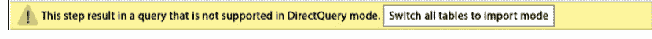

图 7.2：DirectQuery 存储模式中将所有表切换为导入模式警告

## 数据源和查询折叠

大多数具有原生查询语言的数据源支持查询折叠，包括以下内容：

- Power BI 支持的关系型数据库
- OData feeds

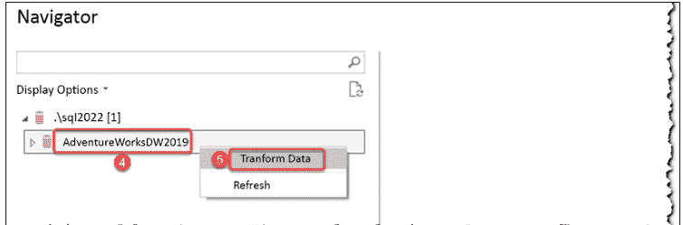

图 7.8：在数据库级别转换数据

- 单击 fx 按钮创建新的转换步骤
- 将新步骤重命名为 SQL Folding
- 输入 Value.NativeQuery() 函数
- 保持之前的步骤名称不变
- 以字符串形式在引号中输入 SELECT 语句
- 将 null 传递给第三个操作数
- 将 [EnableFolding = true] 传递给第四个操作数
- 提交更改

以下屏幕截图显示了上述步骤：

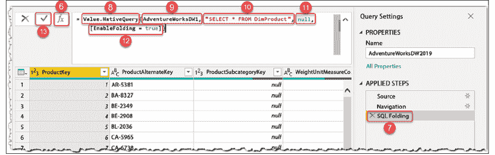

图 7.9：使用 Value.NativeQuery() 函数启用折叠

通过上述步骤，我们成功为原生查询启用了折叠。现在我们可以添加更多支持查询折叠的转换步骤，例如重命名列。以下屏幕截图显示了


将 EnglishProductName 列重命名为 Product Name 后，原生查询现已启用：

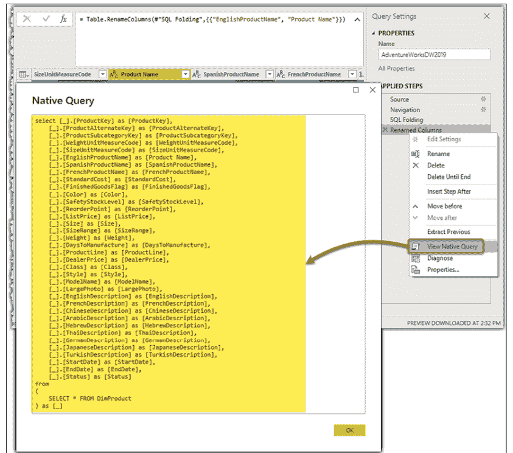

图 7.10：原生查询上已启用查询折叠

下一节介绍另一个最佳实践：将数据准备步骤推送到源系统。

## 尽可能将数据准备推送到源系统

建议在可能的情况下，始终将所有转换步骤推送到源。例如，当我们连接到 SQL Server 数据源时，最好在 SQL Server 端完成所有转换步骤，如图 7.11 所示：

图 7.11：查看原生查询已禁用

然而，这并不意味着查询没有被折叠。我们可以使用 Power Query 诊断工具来查看查询是否被折叠回服务器。在这种情况下，我们需要诊断一个步骤。我们可以右键单击“应用的步骤”窗格中的“保留前几行”步骤，然后点击“诊断”，如下面的屏幕截图所示：

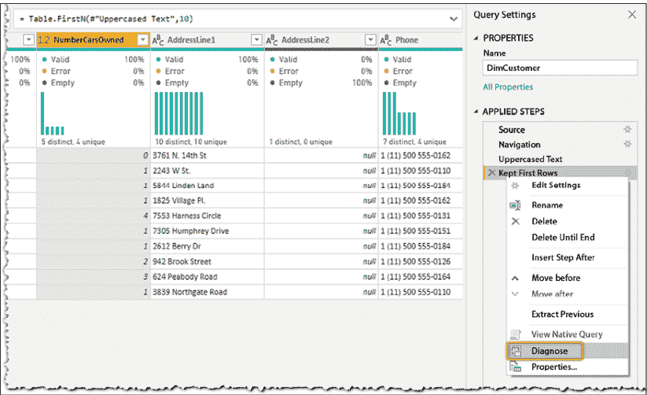

图 7.12：Power Query 编辑器中的诊断步骤

这会在“查询”窗格中创建一个“诊断”文件夹，其中包含几个诊断查询。如图 7.13 所示，其中有一个“详细”和一个“聚合”查询，在我们的示例中名为 DimCustomer_Kept First Rows_Aggregated。对于我们的示例，“聚合”查询提供了足够的信息。点击 DimCustomer_Kept First Rows_Aggregated 查询，我们可以看到诊断数据：

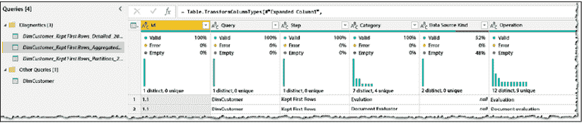

图 7.13：聚合诊断查询

诊断查询提供了大量信息。但我们只对 Data Source Query 列的值感兴趣，这些值显示了 Power Query 发送回 SQL Server 的实际 T-SQL。Data Source Query 列中的最后一条 T-SQL 查询正是我们想要的查询。如下面的屏幕截图所示，查询以 select top 10 开头，这意味着“保留前几行”步骤也被折叠回 SQL Server。

从数据建模的角度来看，这对于确保在 Power Query 层中构建高效且高性能的数据准备非常重要：

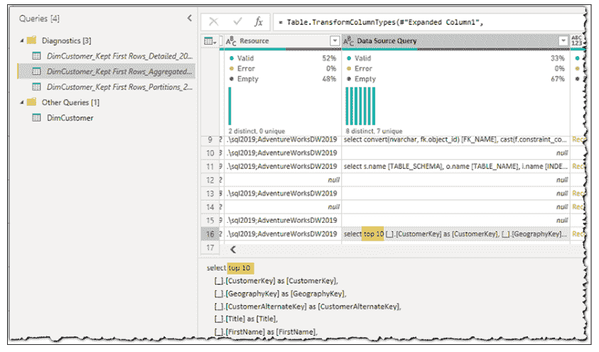

图 7.14：在“查看原生查询”禁用时查询仍被折叠

## 在 Power Query 编辑器中组织查询

在软件开发领域，一个良好开发模型的要素之一就是保持代码和对象的有序组织，Power BI 开发也不例外。虽然这一最佳实践与数据建模没有直接关系，但将查询组织得井井有条依然是个好做法，如图 7.16 所示：

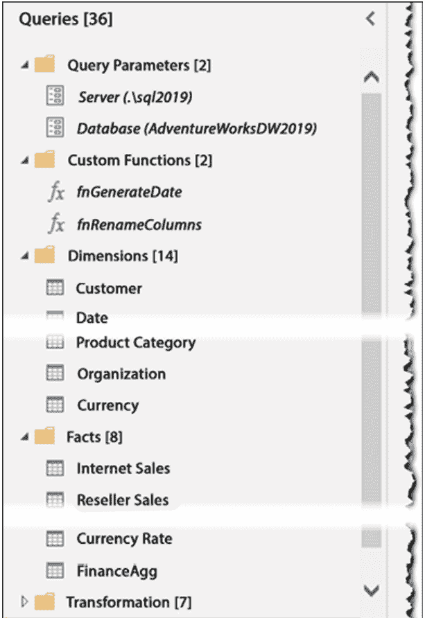

图 7.16：Power Query 编辑器中组织有序的查询

当支持专员看到像上面这样的组织有序的 Power Query 编辑器实例时，他们可以快速理解各个查询之间的关联。

## 遵循数据类型转换最佳实践

图 7.18：Power Query 中的数值

现在，我们添加一个新列，用于显示每个值的数据类型。为此，我们可以使用 Value.Type([Value]) 函数，该函数返回 Value 列中每个值的类型。结果如下面的屏幕截图所示：

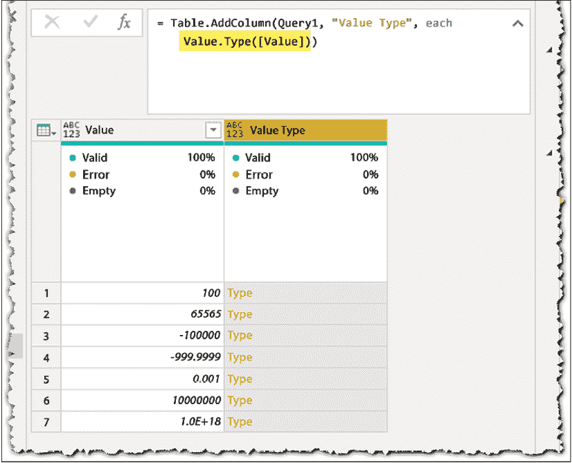

图 7.19：获取列的值类型

要查看实际类型，我们必须点击“值类型”列中的每个单元格（不是值），如下面的屏幕截图所示：

图 7.20：点击单元格以查看其类型

虽然逐个点击单元格来查看值类型并不理想，但目前 Power Query 中没有将 Type 转换为 Text 的函数。因此，要在表中将类型显示为文本，我们必须使用一个简单的小技巧。Power Query 中有一个函数可以返回表的元数据。

该函数是 Table.Schema(table as table)。该函数返回一个表，其中包含有关该函数所用表的信息，包括列 Name、TypeName、Kind 等。我们想要展示 Value Type 列的 TypeName。因此，我们只需要使用 Table.FromValue(value as any) 函数将每个值转换为表。然后，我们从 Table.Schema() 函数的输出中获取 TypeName 列的值。

为此，我们添加一个新列，从 TypeName 获取文本值。我们将新列命名为 Datatypes，表达式如下：

```
Table.Schema(
    Table.FromValue([Value])
)[TypeName]{0}
```

下面的屏幕截图显示了结果：

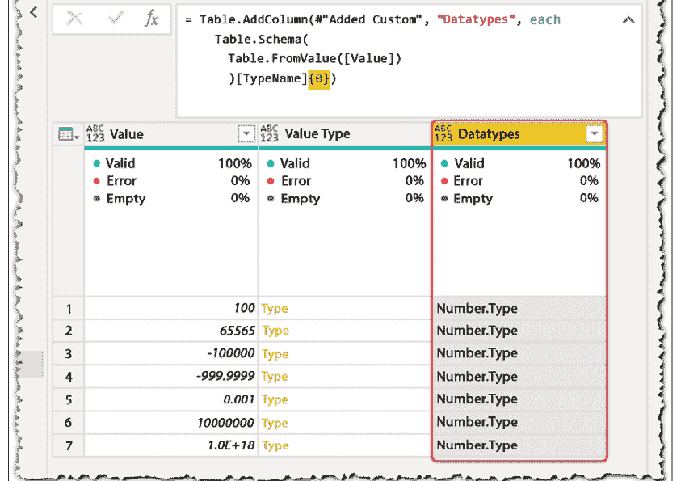

图 7.21：Power Query 只有一种数值类型，即 Number.Type

如结果所示，所有数值都是 Number.Type 类型，而我们在 Power Query 编辑器中使用不同的类型外观（facet）来呈现它们，并不会影响 Power Query 混合引擎处理这些类型的方式。关键点来了：将数据加载到数据模型之后会发生什么？Power BI 使用 xVelocity 内存数据处理引擎来处理数据。xVelocity 引擎使用列存储索引技术，该技术根据列的基数压缩数据，这引出了另一个关键点：尽管 Power Query 引擎将所有数值视为 `number` 类型，但在将值加载到 Power BI 模型后，它们会根据列基数的不同而采用不同的压缩方式。因此，为每一列设置正确的类型**外观**非常重要。

数值是 Power BI 中最常用的数据类型之一。下面再举一个例子，展示四种**数字** **类型外观**之间的差异。在 Power Query 编辑器中新建一个空白查询，然后运行以下表达式：

```
// Decimal Numbers with 6 Decimal
let
    Source = List.Generate(() => 0.000001, each _ <= 10, each _ + 0.00001 ),
    #"Converted to Table" = Table.FromList(Source, Splitter.SplitByNothing(), null, null, ExtraValues.Error),
    #"Renamed Columns" = Table.RenameColumns(#"Converted to Table", {{"Column1", "Source"}}),
    #"Duplicated Source Column as Decimal" = Table.DuplicateColumn(#"Renamed Columns", "Source", "Decimal", Decimal.Type),
    #"Duplicated Source Column as Fixed Decimal" = Table.DuplicateColumn(#"Duplicated Source Column as Decimal", "Source", "Fixed Decimal", Currency.Type),
    #"Duplicated Source Column as Percentage" = Table.DuplicateColumn(#"Duplicated Source Column as Fixed Decimal", "Source", "Percentage", Percentage.Type)
in
    #"Duplicated Source Column as Percentage"
```

上述表达式创建了 1000 万行介于 0 到 10 之间的小数值。生成的表有四列，包含相同的数据，但具有不同的**类型外观**。第一列 **Source** 包含 `any` 类型的值，该类型会转换为 `text` 类型。

其余三列是从 **Source** 列复制而来，具有不同的**数字类型外观**，如下所示：

- Decimal
- Fixed decimal

1. 点击**高级**选项卡。
2. 点击**查看指标**按钮。
3. 在 **VertiPaq Analyzer** 部分点击**列**。
4. 查看 **Cardinality**、**Col Size** 和 **% Table** 列。

下面的屏幕截图显示了上述步骤：

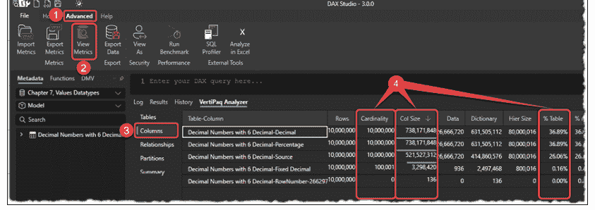

图 7.24：DAX Studio 中的 VertiPaq Analyzer 指标

结果显示，**Decimal** 列和 **Percentage** 占据了表容量中最大的一部分。它们的基数也远高于 **Fixed Decimal** 列。因此，这里非常清楚地说明了为什么我们应该在可能的情况下始终对数值使用 `Fixed Decimal` 数据类型（**类型外观**）。

> 注意
>
> 默认情况下，`Fixed Decimal` 值会转换为 DAX 中的 `Currency` 数据类型。因此，如果 `Currency` 不适合该列的格式，我们必须更改其格式。
>
> 顾名思义，`Fixed Decimal` 固定保留四位小数。因此，如果原始值在转换为 `Fixed Decimal` 后还有更多小数位，则第四位小数之后的数字将丢失。

这就是为什么 DAX Studio 的 VertiPaq Analyzer 中的 `Cardinality` 列显示 `Fixed Decimal` 列的基数要低得多（该列


values only keep up to four decimal points, no more).

因此，信息始终是使用对业务有意义且在数据模型中高效的数据类型。使用 DAX Studio 中的 VertiPaq Analyzer 有助于理解数据模型的各个方面，包括列数据类型。

作为数据建模人员，必须了解 Power Query 类型和方面如何转换为 DAX 数据类型。Power Query 和 DAX 是两种具有各自数据类型的不同表达式语言。

下表显示了 Power Query 类型与 DAX 数据类型之间的映射：

| Power Query Type Kind | Type Representation (Facet) | Mapping Datatype in DAX | xVelocity Internal Datatype |
|---|---|---|---|
| date | Date | Date/time | DateTime |
| datetime | Date/Time | Date/time | DateTime |
| datetimezone | Date/Time/Zone | Date/time | DateTime |
| duration | Duration | Decimal number | Double |
| logical | Logical | True/false | Boolean |
| number | Whole Number | Whole number | Int64 |
|  | Decimal Number | Decimal number | Double |
|  | Fixed Decimal Number | Fixed decimal number | Decimal |
|  | Percentage | Decimal number | Double |
| text | Text | Text | String |
| time | Time | Time | DateTime |
| any | Any | Text | String |

图 7.25：Power Query 到 DAX 数据类型映射

正如我们所见，数据类型转换会影响数据模型的压缩率和性能。但这还不是全部。具有未转换为更合适数据类型的任何数据类型的列可能会导致其他影响，这就引出了下一节，避免使用 any 数据类型的列。

## Avoid having columns with any data type

正如我们在第 3 章《Power Query Editor 中的数据准备》中解释的那样，Power Query 中的所有数据类型都与 any 数据类型兼容。但是，数据模型层中的 xVelocity 引擎不支持 `any` 数据类型。当数据加载到数据模型中时，`any` 数据类型会转换为 `text`，这可能正确也可能不正确。因此，如果列包含整数值，但其数据类型为 `any`，则在将数据加载到数据模型时它会变成 `text`，我们都知道 `text` 比 `number` 消耗更多内存。这并不是唯一的缺点。刷新包含 `true/false` 值的类型为 `any` 的列可能会导致意外行为。这种意外行为已在 Power BI 社区中报告，微软在其官方 Learn 网站的专门子部分中对其进行了说明，解释如下：

> 当你在 Power BI Desktop 中创建一个包含 ANY 数据类型列的报表，并且该列包含 TRUE 或 FALSE 值时，该列的值在刷新后在 Power BI Desktop 和 Power BI 服务之间可能不同。在 Power BI Desktop 中，底层引擎将布尔值转换为字符串，保留 TRUE 或 FALSE 值。在 Power BI 服务中，底层引擎将值转换为对象，然后将值转换为 -1 或 0。
> 
> 在 Power BI Desktop 中使用此类列创建的可视化效果在刷新事件之前可能按设计运行或显示，但在刷新事件之后可能会发生变化（由于 TRUE/FALSE 被转换为 -1/0）。

你可以在 Microsoft Learn 网站上的以下位置找到该文章：

https://learn.microsoft.com/en-gb/power-bi/connect-data/refresh-troubleshooting-refresh-scenarios?WT.mc_id=DP-MVP-5003466

这是避免使用 any 数据类型列的又一证据。

## Include the data type conversion in the step when possible

一些 Power BI 开发人员和数据建模人员忽略的一个关键点是，一些最常用的 Power Query 函数具有可选的操作数来强制函数的输出类型。如果我们忽略这一点，我们就需要至少添加一个额外步骤来进行数据类型转换；转换步骤越多，数据刷新越慢。以下函数具有可选的 `columnType` 操作数，我们可以使用它来强制输出数据类型，从而可能避免为类型转换添加额外步骤：

- `Table.AddColumn(table as table, newColumnName as text, columnGenerator as function, optional columnType as nullable type)`
- `Table.DuplicateColumn(table as table, columnName as text, newColumnName as text, optional columnType as nullable type)`
- `Table.AddIndexColumn(table as table, newColumnName as text, optional initialValue as nullable number, optional increment as nullable number, optional columnType as nullable type)`

例如，我在四个步骤中添加了四个新列，如以下屏幕截图所示。然后，我添加了另一个步骤以在单个步骤中更改新列的类型：

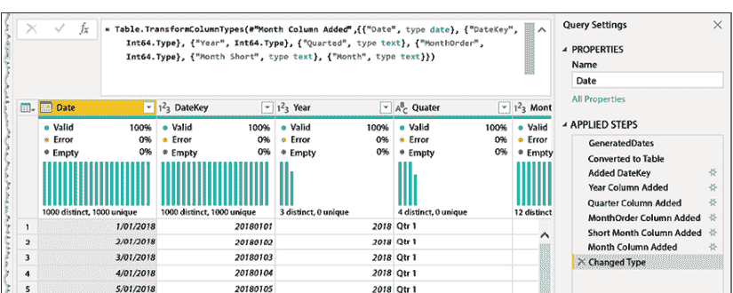

图 7.26：在不为每个转换步骤添加列数据类型的情況下添加新列

DateKey Added 表达式如下所示：

```
Table.AddColumn(#"Converted to Table", "DateKey", each Int64.From(Text.Combine({Date.ToText([Date], "yyyy"), Date.ToText([Date], "MM"), Date.ToText([Date], "dd")})))
```

以下屏幕截图显示 DateKey Added 表达式的输出类型为 any：

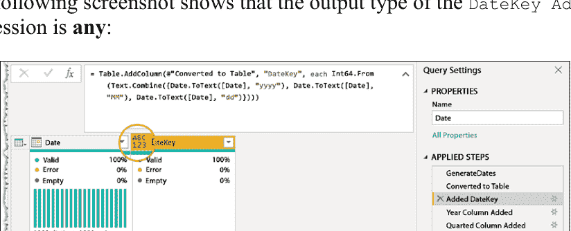

图 7.27：DateKey 列的类型为 any

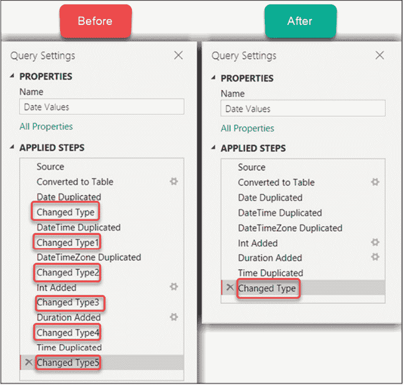

图 7.28：将数据类型转换步骤合并为一个数据类型转换步骤

正如前面的屏幕截图所示，我们可以通过仅保留一个 **Changed Type** 作为最后一个转换步骤来省略过多的 **Changed Type** 步骤。

## Optimize query size

本节讨论其他数据准备最佳实践，以改进我们的模型。优化查询大小可以减少数据刷新时间。优化大小的模型在将数据导入数据模型后性能更好。在以下小节中，我们将介绍一些有助于优化查询的技术。

### Remove unnecessary columns and rows

在实际场景中，我们可能会处理包含数亿行和数百列的大型表。一些 Power BI 开发人员从所有数据源导入所有列和行，导致报表性能不佳。如前所述，Power BI 使用 **xVelocity** 引擎，该引擎基于列基数使用内存中数据处理进行数据分析。因此，列越少，直接转化为内存消耗越少，从而数据模型性能越好。在许多实际场景中，我们需要业务批准才能从表中删除不需要的列。

同样，行数直接影响数据刷新和数据模型性能。Power BI 开发人员/建模人员通常忽略的另一个方面是忘记 **Power BI Desktop Report (PBIX)** 文件大小限制。Power BI 服务上也有一些资源限制。这些限制因我们持有的许可计划而异。因此，在不考虑大小限制的情况下，通过将数据源中的所有数据导入 Power BI 模型来创建报表是一个坏主意，会导致超出大小限制的错误。我们在 *第 1 章，Power BI 中的数据建模简介* 中讨论了不同的 Power BI 许可模式。下表显示了适用于我们持有的许可层级的 PBIX 文件大小限制：

| Power BI License | Power BI Report (PBIX) File Size Limit |
|---|---|
| Free | Up to 1 GB |
| Pro | Up to 1 GB |
| Report Server | Up to 2 GB |
| P1/A4 | Up to 3 GB |
| P2/A5 | Up to 6 GB |
| P3/A6, P4/A7, and P5/A8 | Up to 10 GB |

图 7.29：Power BI 许可上的 PBIX 文件大小限制

虽然 Power BI Premium Capacity 可以在 Power BI 服务中支持高达 400 GB 的模型大小，但前表中 PBIX 大小限制保持不变。

在许多情况下，我们可能不需要将完整的数据历史导入 Power BI 数据模型。因此，请务必在信息收集研讨会上查明所需的数据量并过滤掉不必要的数据。

### Summarization (Group by)

在许多情况下，我们需要创建报表来显示汇总数据。那么为什么我们需要以最低粒度将所有数据导入数据模型呢？一个很好的理由是构建支持尽可能多业务需求的面向未来的解决方案。我们应努力在 Power BI 中创建服务于多个业务流程的集中式数据模型。但创建集中式数据模型并不总是那么简单。其中一个原因就是 **PBIX 文件** 限制和 Power BI 服务中的资源限制。我们讨论了删除不必要的列和过滤行作为优化模型大小的有效技术。

汇总表是实现模型大小优化、从而获得更高性能数据模型的另一种有效方法。通过汇总数据，我们将数据的粒度更改为更高级别。因此，汇总级别是在与业务进行信息收集研讨会时需要确定的另一个因素。

在 Power Query 中，我们使用 `Group by` 功能来汇总表。你可以在 *第 5 章，常见数据准备步骤* 的 *常见表操作* 部分研究 `Group by` 功能。我们在讨论 *第 10 章，高级数据建模技术* 中的聚合时将详细重温此技术。但将其作为数据准备最佳实践提及是值得的。


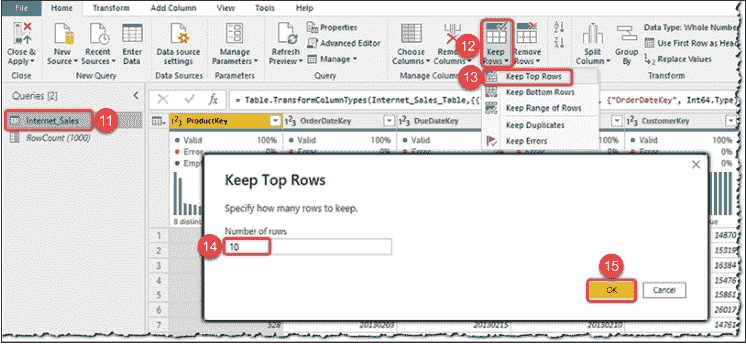

Figure 7.31: Keeping the top N rows

+   16. 将表达式框中 **Kept First Rows** 步骤的表达式替换为以下表达式并提交更改：

```
if Value.Is(RowCount, Number.Type)
    then Table.FirstN(#"Changed Type", RowCount)
    else #"Changed Type"
```

我们现在可以将数据加载到数据模型中。开发完成后，我们将参数的值更改为 **All** 以将源中的整个数据加载到数据模型中。

以下屏幕截图显示了结果。

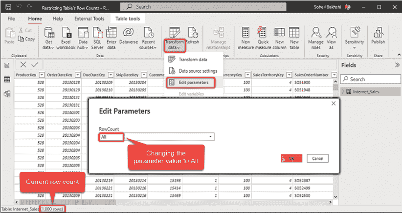

Figure 7.32: The results of restricting the row count of a table

在 Power Query 实现中使用查询参数可以提高可用性，并有助于构建更整洁、更易于维护的 Power BI 模型。

## Define key columns in queries

关系数据库最重要的方面之一是定义键列。键列是用于在两个表之间定义关系的列。表中键列保证每行数据的唯一性。保证表中每行唯一性的键列是主键。出现在另一表中的表的主键称为外键。在许多情况下，单个列无法保证行的唯一性，但所谓的复合键通过将多个列视为键列来实现。数据模型层中的 xVelocity 引擎，如我们在第 8 章《Data Modeling Components》中更详细讨论的那样，不支持复合键，但 Power Query 引擎支持。通过在 Power Query 编辑器中定义键列，我们在刷新数据时获得一些性能提升，尤其是在合并两个表时。我们在第 5 章《Common Data Preparation Steps》中讨论了合并表。

Power Query 引擎使用参与连接的列在合并的表中查找匹配项。在连接的一侧定义主键，在另一侧定义外键列，有助于 Power Query 引擎不必在内部尝试检测主键和外键；因此，在数据刷新期间的连接性能会好得多。Power Query 中定义键列的函数是 Table.AddKey(table as table, columns as list, isPrimary as logical)。Power BI Dataflows 中的 Power Query UI 在功能区上有一个 Mark as key 按钮来定义键列，如以下屏幕截图所示：

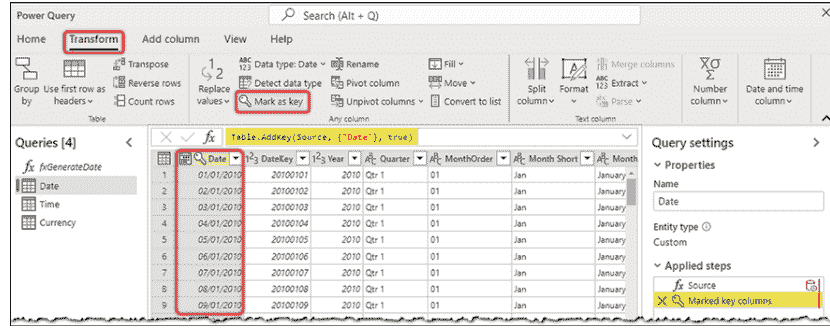

Figure 7.33: Mark as key in Power Query, in Power BI Dataflows

然而，当前版本的 Power BI Desktop（2022 年 9 月）中的 Power Query 编辑器在 UI 上仍然没有 Mark as key 按钮；因此，我们必须输入该函数。以下屏幕截图显示了在 Power BI Desktop 的 Power Query 编辑器中定义表中复合主键的场景：

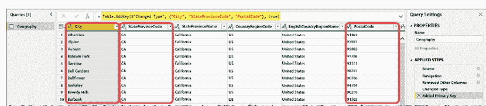

Figure 7.34: Defining composite key columns in the Power Query Editor

在 Power Query 编辑器中定义的键列在数据模型层中无法被识别为键。

## Use naming conventions

为 Power BI 开发人员和数据建模人员制定命名约定至关重要。它有助于解决方案的一致性，并使代码更易于阅读和理解，便于支持专家理解。它还为组织中与我们的 Power BI 解决方案交互的每个人提供共同基础。

## Data Modeling

到目前为止你所学的一切都在本节中汇聚，我们将在 Power BI 中构建一个设计良好的数据模型。虽然在前几章中你准备了数据模型的基础构建块，但现在是时候通过真实的实践场景来实际构建模型了。

本节首先从 Power BI 的角度介绍数据建模组件。然后讨论粒度概念。本节还解释了配置表，并指导你完成需要利用它们的某些场景。本节以数据建模最佳实践结束。

本节包含以下章节：

+   - *Chapter 8, Data Modeling Components*
+   - *Chapter 9, Star Schema and Data Modeling Common Best Practices*

## Data Modeling Components

在上一章中，我们学习了一些关键的数据准备最佳实践，例如加载部分数据、删除不必要的列以及汇总以优化我们的数据模型大小。我们还学习了查询折叠以及它如何影响 Power BI 中的数据建模。我们还查看了数据类型转换，并讨论了选择某些数据类型的重要性，以便在将数据导入数据模型时使数据模型更优化；这就引出了本章。我们所有的数据准备工作都通过拥有一个更干净、更易于维护且性能良好的数据模型而得到回报。本章更深入地研究 Power BI 中的数据建模，涵盖以下主题：

+   - Data modeling in Power BI Desktop
+   - Understanding tables
+   - Understanding fields
+   - Using relationships

我们在本章中使用 `Chapter 8, Data Modeling and Star Schema.pbix` 示例文件。它是我们在 *Chapter 6, Star Schema Preparation in Power Query Editor* 中工作后得到的示例文件的副本。

### Data modeling in Power BI Desktop

Power BI Desktop 中数据建模的核心前提是 Power BI Desktop 主窗口中的 **Model** 选项卡。我们还可以从 **Model** 选项卡创建和编辑基于计算的对象，例如创建新的计算表、度量或计算列。

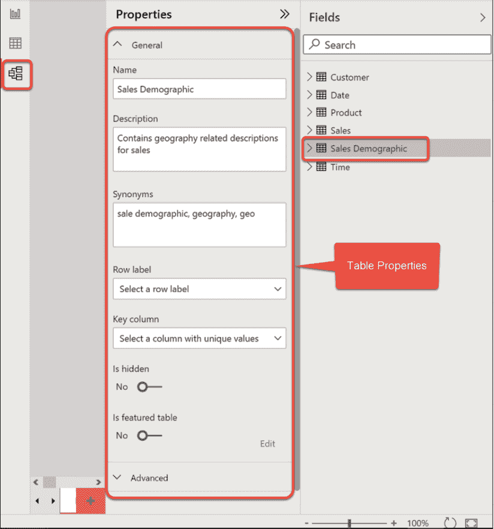

Figure 8.2: Table properties pane in the Model view

**Properties** 窗格中目前可用的以下设置。**General** 包括以下通用表属性：

+   - **Name**: 表的名称。我们可以在此处重命名表。
+   - **Description**: 我们可以在此处编写有关表的一些描述。这些描述会显示在 **Data** 视图中，以及在 **Report** 视图中，如下图所示：


Figure 8.3: The table description shows up in the Report view when hovering over a table

我们也可以将描述用于文档目的。

+   - **Synonyms:** 添加同义词有助于 Power BI 的 **Q&A** 功能。用户通常使用各种术语来指代同一事物。例如，我们模型中有一个名为 **Sales Demographic** 的表。然而，用户可能将其称为 **geography** 或 **geo**。因此，我们可以将这些短语添加到 Synonyms 框中，以帮助 Q&A 在用户使用这些短语中的任何一个时识别 Sales Demographic 表。
+   - **Row label:** 此设置以两种方式影响数据模型，如下所示：
+     1. **Q&A:** 这有助于 Q&A 创建更有用的可视化。**Row label** 定义哪个列最能描述一行数据。例如，在 **Product** 表中，行标签通常是 **Product**（或 **Product Name**）列。因此，当用户询问 **Sales by product** 时，Q&A 将 **Product** 视为列而不是表。以下图像显示了从 Q&A 询问 **Sale by product as clustered column chart** 问题的结果：


Figure 8.4: Row label from the table properties helps Q&A provide better results

b. Featured table: 当我们在 Power BI Desktop 中将表设置为特色表时，在 Excel 中选为 Row label 的列将用于快速识别行。更多内容请参见 Is featured table  bullet point。

+   - Key column: 为每一行提供唯一标识符。Key column 然后将在 Excel 中用于将单元格的值链接到表中的对应行。

+   - Is hidden: 通过将此设置切换为 Yes 或 No，我们可以隐藏或取消隐藏表。

+   - Is featured table: 通过此设置，我们可以将表设为 Featured Table，从而使表的数据可通过 Excel 访问。在将数据模型发布到 Power BI 服务后，只有指定的用户可以访问这些特色表。在撰写本书时，特色表功能处于公开预览中，因此它在您当前使用的 Power BI Desktop 版本中可能看起来略有不同。与此同时，让我们来看一下 Is featured table 设置。我们将在下一节更详细地介绍 Featured Table 概念。要配置此设置，我们必须将其切换为 Yes。要关闭此功能，如果它已打开，我们必须将其切换为 No。要编辑 Is


**featured table** 设置中，我们可以点击 **Edit** 超链接，它会打开 **Setup this featured table** 窗口。

在下面的图片中，我们通过在 **Description** 文本框中输入简短描述，将 **Product** 列选为 **Row label**，并将 **ProductKey** 列选为 **Key column**，从而将 **Product** 表设置为 Featured Table：


图 8.5：从 Model 视图设置 Featured Table

- **Advanced：** 表目前只有一个高级设置。
- **Storage mode：** 这显示了表的存储模式。我们在 *Chapter 4, Getting Data from Various Sources* 的 *Storage modes* 部分讨论了可用的存储模式。

## Featured tables

Featured tables 的概念源于可重用性思维，我们以安全的方式在整个组织中复用已准备好且已打磨的数据。然后 Power BI 管理员可以精细控制 featured table 的配置或监控，谁可以发布或更新 featured tables，或组织内谁可以访问 featured tables。在上一节中，我们解释了如何将表设置为 featured table。从 Model 视图将表设置为 featured table 后，数据（包括表持有的度量）将在将模型发布到 Power BI Service 中的现代工作区后，在 Excel 的 Data Types Gallery 中可用。

下面的图片显示了当用户在新的 Excel 文件中输入产品名称，然后从 Excel 的 Data 选项卡中的 Data Types Gallery 中选择该 Product 时的情形：


图 8.6：从 Product 表在 Excel 中获取 Product 数据

将表设置为 featured table 有很多好处。在 Excel 中访问和使用 featured tables 超出了本书的范围。您可以通过以下链接了解有关在 Excel 中使用 featured tables 的更多信息：

https://docs.microsoft.com/en-us/power-bi/collaborate-share/service-excel-featured-tables?WT.mc_id=5003466

## Calculated tables

在 Power BI Desktop 中，我们可以使用 DAX 表达式创建新表。Calculated tables 是使用 DAX 中的表函数或构造函数生成的结果物理表。与我们在 Chapter 2, Data Analysis eXpressions and Data Modeling 中 *Understanding virtual tables* 部分讨论的 Virtual Tables 不同，calculated tables 更容易使用，因为它们在 Power BI Desktop 的 Model 视图中可见。

下表显示了在 DAX 中最常用的可用于创建 calculated table 的表函数：

| ADDCOLUMNS() | CALENDARAUTO() | FILTERS() | SELECTCOLUMNS() | VALUES() |
| ADDMISSINGITEMS() | CALCULATETABLE() | GENERATESERIES() | SUMMARIZE() | Table Constructor {} |
| ALL() | CROSSJOIN() | INTERSECT() | SUMMARIZECOLUMNS() | |
| ALLSELECTED() | DISTINCT() | NATURALLLEFT OUTER JOIN() | TREATAS() | |
| CALENDAR() | EXCEPT() | RELATEDTABLE() | UNION() | |

图 8.7：DAX 中最常用的表函数

我们可以在许多场景中创建 calculated tables，尤其是在业务需要在未来复用 calculated table 中包含的数据时。calculated tables 在许多场景中都很有用，例如基于现有度量创建汇总表或创建日期或时间表（当它们不存在于数据源中时）。calculated tables 中的数据已在数据模型中可用，因此刷新 calculated tables 不需要花费太多时间。

当我们右键单击 calculated table 时，上下文菜单中不可用数据刷新。数据会在刷新底层源表时自动填充。但是，与其他物理表一样，calculated tables 会占用一定的存储空间。因此，在 Power BI Desktop 中创建 calculated tables 后，数据模型的大小会增加。相应地，将模型发布到 Power BI Service 时，数据集的大小也会增加。


图 8.10：示例 Sales 数据模型

使用前述数据模型，我们可以分析针对多种不同业务实体的销售情况，例如按产品、按客户、按销售人口统计、按日期和按时间的销售。现在，业务有一个新需求：在年-月级别获取销售额大于 $100,000 的所有客户购买的产品数量。我们可以在数据可视化层展示这些需求。但业务希望将数据作为汇总表，以便在更高级别分析数据，然后在不同的数据可视化中复用数据。

在此场景中需要注意的重要点如下：

- 业务只关心已售出的产品。因此，对于 Product 表中的每个产品，Sales 表中必须有 Sales Amount。
- 从已售出的产品中，业务只对年收入大于 $100,000 的客户购买的产品感兴趣。
- 结果必须在年-月级别。
- 业务需要结果作为汇总数据，以便以更高的粒度分析数据。

我们可以使用以下 DAX 表达式来满足该需求：

```
Sales for Customers with Yearly Income Greater Than $100,000 =
SUMMARIZECOLUMNS(
    'Product'[ProductKey]
  , 'Date'[Year-Month]
  , 'Customer'[CustomerKey]
  , DISTINCT('Product'[ProductKey])
  , FILTER(
        ALLNOBLANKROW('Customer'[CustomerKey],
'Customer'[YearlyIncome])
      , 'Customer'[YearlyIncome] >= 100000
      )
  , DISTINCT('Date'[Year-Month])
  , "Sales"
  , [Sales Amount]
)
```

下面的图片显示了结果：


图 8.11：显示销售额大于 $100,000 的客户购买的产品的 calculated table

如前图所示，calculated table 有四列：ProductKey、Year-month、CustomerKey 和 Sales。

当我们从数据模型中的其他表派生 calculated table 时，如果我们对创建 calculated table 所使用的函数不够小心，可能会出现循环依赖错误。在这种情况下，除非我们更改 DAX 表达式中的函数选择，否则我们无法在 calculated table 与其派生的表之间创建任何关系。

# Note

建议不要对任何数据转换活动使用 calculated tables。我们在可能的情况下始终将数据转换逻辑移至源系统。否则，我们在 Power Query 层处理转换。

现在，我们可以在下面的图片所示之间创建新 calculated table、Product 表和 Customer 表之间的关系：


图 8.12：在 calculated table 与维度表之间创建关系

业务现在可以根据 **Product** 和 **Customer** 表的属性分析销售数据，但仅限于年收入大于 $100,000 的客户。如果您希望针对特定客户群体并了解他们在哪些产品上花费金钱，这项练习可以成为令人兴奋的分析。

到目前为止，我们已经了解了表。表由字段组成。下一节更详细地解释字段。

## Understanding fields

Power BI 中的字段包括列和度量。我们在谈论字段时通常同时指列和度量。例如，当我们谈论字段的数据类型时，我们指的是列和度量的数据类型。**Fields** 术语在 Power BI Desktop 的不同视图中使用，因此在 **Report** 视图、**Data** 视图和 **Model** 视图中都有 **Fields** 面板。

### Data types

当我们将数据导入模型时，模型会将该数据在列中转换为 `Tabular Model` 数据类型之一。当我们随后在计算中使用模型数据时，数据在计算期间会转换为 DAX 数据类型。模型数据类型与 Power Query 数据类型不同。例如，在 Power Query 中，我们有 `DateTimeZone`。但是，`DateTimeZone` 数据类型在数据模型中不存在，因此在加载到模型时会被转换为 `DateTime`。下表显示了模型以及 DAX 支持的不同数据类型：

| Data type in model | Data type in DAX | Description |
|---|---|---|
| Whole Number | Int64 | 介于 −9,223,372,036,854,775,808 (−2^63) 和 9,223,372,036,854,775,807 (2^63−1) 之间的整数。 |


| 数据类型 | 模型类型 | 描述 |
|---|---|---|
| 小数 | Double | 介于 -1.79E+308 和 -2.23E-308 之间的负值，以及介于 2.23E-308 和 1.79E+308 之间的正值。小数点后的位数限制为 17 位。 |
| 真/假 | Boolean | 一个真值或假值。 |
| 文本 | String | 文本格式的 Unicode 字符数据字符串。 |
| 日期 | DateTime | 以可接受的日期格式显示 DateTime 值的日期部分。DAX 中的默认起始日期是 1899 年 12 月 30 日；但计算中采用的官方起始日期是 1900 年 3 月 1 日。 |
| 时间 | DateTime | 显示 DateTime 值的时间部分。如果源中未指定日期部分，则默认将 1899 年 12 月 1 日视为日期部分。 |
| 日期/时间 | DateTime | 以可接受的日期/时间格式显示完整的 DateTime 值。 |
| 固定小数 | Decimal | 货币数据类型，允许的值介于 -922,337,203,685,477.5808 和 922,337,203,685,477.5807 之间，小数点后固定保留四位数字。 |
| 不适用 | Blank | 空白是 DAX 中的一种数据类型，类似于 SQL 中的 null。我们可以使用 DAX 中的 BLANK() 函数创建空白。要测试空白，可以使用 ISBLANK() 函数。 |

图 8.13：DAX 中的数据类型

在 Power BI Desktop 中，模型数据类型可以在**数据**视图或**报表**视图的**列工具**选项卡下看到。下图显示了数据视图中“列工具”选项卡中的数据类型：


## 图 8.14：Power BI Desktop 中的数据类型

## 注意

虽然“数据类型”下拉菜单中提供了二进制数据类型，但 Power BI 在数据模型中不支持该类型。因此，如果我们尝试将列的数据类型转换为二进制，就会收到错误消息。

Power BI Desktop 默认会消除二进制列。因此，我们应该将它们从 Power Query 编辑器中移除。

Power Query 支持二进制类型；因此，最好将二进制值转换为受支持的表格模型数据类型之一。

我们只能为列隐式定义数据类型。度量值的数据类型由我们在 DAX 表达式中使用的函数自动确定。

当我们在 DAX 中使用表函数时，结果是表数据类型。我们使用此数据类型来创建虚拟表或计算表。

| DateTime | d | 不带前导零的月中的天数 | FORMAT(CONVERT("2020/12/31 3:45:55", DATETIME), "dddd,mmm d yyyy h:mm:ss am/pm") 返回 Thursday, Dec 31 2020 3:45:55 am |
|---|---|---|---|
| DateTime | dd | 带前导零的月中的天数 |  |
| DateTime | w | 不带前导零的月份中的周数 |  |
| DateTime | ww | 带前导零的月份中的周数 |  |
| DateTime | m | 不带前导零的年份中的月份数 |  |
| DateTime | mm | 带前导零的年份中的月份数 |  |
| DateTime | mmm | 月份名称的缩写 |  |
| DateTime | mmmm | 完整的月份名称 |  |
| DateTime | yy | 年份号的后两位数字 |  |
| DateTime | yyyy | 四位年份号 |  |
| DateTime | h | 不带前导零的日中的小时数（不附加 am/pm 时为 24 小时制，附加 am/pm 时为 12 小时制） |  |
| DateTime | hh | 带前导零的日中的小时数（不附加 am/pm 时为 24 小时制，附加 am/pm 时为 12 小时制） |  |
| DateTime | n | 不带前导零的小时中的分钟数 |  |
| DateTime | nn | 小时中的分钟数 |  |
| DateTime |  | 带前导零 |  |
| DateTime | m | 如果位于 h 或 hh 之后，则为不带前导零的小时中的分钟数 |  |
| DateTime | mm | 如果位于 h 或 hh 之后，则为带前导零的小时中的分钟数 |  |
| DateTime | s | 不带前导零的小时中的秒数 |  |
| DateTime | ss | 不带前导零的小时中的秒数 |  |
| DateTime | am/pm | 强制输出以 12 小时制显示时间 |  |

| 类别 | 格式 | 描述 | 示例 |
|---|---|---|---|
| 数字 | 0 | 显示一个数字或零。如果数字的位数少于格式字符串中零的个数，则会在前面或后面补零。如果数字的位数较多，则将数字四舍五入到格式字符串中零的个数。 | FORMAT(0, "0,0") 返回 00<br>FORMAT(0.1153, "0.00") 返回 0.12<br>FORMAT(35.1113, "0,00.00") 返回 035.11 |
|  | # | 它的作用与 0 类似，但显示一个数字或不显示任何内容。 | FORMAT(0, "#, #") 返回空<br>FORMAT(0.1153, "#.##") 返回 .12<br>FORMAT(35.1113, "#,##.##") 返回 35.11 |
|  | % | 通过将值乘以 100 以百分比显示，并在格式字符串中出现 % 符号的位置显示 % 符号。 | FORMAT(0.351156, "#,##.##%") 返回 35.116% |
|  | $ | 在格式字符串中出现美元符号的位置显示美元符号。 | FORMAT(-35.1156, "$#,##.##0") 返回 $35.116 |
|  | ; | 格式字符串中的部分分隔符。如果提到分号，则格式字符串中允许使用三个部分。如果格式字符串只有一个部分，则格式设置应用于所有值；否则，第一个部分应用于正值，第二个部分应用于负值，第三个部分应用于零。 | FORMAT(0.015, "$#, .#0;;\Z\e\r\o") 返回 $.02<br>FORMAT(-0.015, "$#,0.#0;($#,0.#0);\Z\e\r\o") 返回 ($0.02)<br>FORMAT(-0.015, "$#,0.0;($#,0.0);\Z\e\r\o") 返回 Zero |
|  | ()+- | 显示文字字符。这通常用于显示正值和负值。 | FORMAT(-0.05, "$#,0.0;($#,0.0)") 返回 ($0.1) |
|  | \ | 反斜杠是格式字符串中的转义字符。因此，它会将下一个字符显示为字面量。要显示反斜杠本身，我们使用 \\（反斜杠，反斜杠）。 | FORMAT(-0.01, "$#,0.0;($#,0.0);\n\i\l") 返回 nil |

图 8.15：自定义格式选项

您可以在此处了解有关支持的自定义格式语法的更多信息：  
https://learn.microsoft.com/en-us/power-bi/create-reports/desktop-custom-format-strings?WT.mc_id=DP-MVP-5003466#supported-custom-format-syntax.

## 列

在 Power BI 中，表由一组列创建。这些列要么是直接来自数据源的物理列，要么是由开发人员或 Power BI Desktop 创建的列。在本节中，我们将更详细地了解 Power BI Desktop 的**模型**视图中的不同类型的列和列属性。

## 计算列

计算列是不包含在数据源中的列。我们可以使用 DAX 表达式在数据模型中创建计算列。

Power BI 使用 xVelocity 引擎，这是 Microsoft 专有的内存数据处理引擎。xVelocity 引擎使用列存储索引技术，该技术根据列中数据的基数高度压缩列数据。当我们刷新表数据时，引擎会压缩所有列的数据并将其加载到内存中。此过程适用于表中已有的物理列。

Power BI 在将计算列所属的表加载到模型后计算计算列。当我们刷新表时，新数据会加载到模型中，因此计算列的值不再有效。因此，引擎必须重新计算所有计算列。此外，引擎会按顺序计算表中的计算列。因此，计算列不像物理列那样得到优化和压缩。

## 分组和分箱列

在 Power BI Desktop 中，我们可以在任何列之上创建分组列。但是，我们只能为具有数值数据类型的列创建分箱列。分组和分箱是手动对列值进行分组的两种方法。当我们需要对数据进行分组时，分组和分箱就派上了用场。

分组和分箱功能目前在模型视图中不可用，因此要创建新的分组或分箱列，我们需要切换到报表视图或数据视图。然后，我们必须右键单击所需列，然后从上下文菜单中选择“新建组”选项。例如，如果我们查看示例文件中的 Product 表，可以在 ProductCategory 列下看到类别为 Accessories、Bikes 和 Clothing。现在，业务只需要分析两类产品的销售额：Bikes 和 Other。有很多方法可以回答这个查询，例如在 Power Query 编辑器中创建新列。但是，我们希望按照以下步骤来了解分组功能：

- 1. 单击“数据”视图选项卡。
- 2. 右键单击 ProductCategory 列。
- 3. 单击“新建组”。
- 4. 在“名称”中输入 Bike Category。
- 5. 在“未分组的值”列表中单击 Bikes。
- 6. 单击“组”按钮。
- 7. 勾选“包含其他组”选项。


- 8. 单击**确定**。

下图说明了上述步骤：


图8.16：创建新的数据组

上述步骤将创建一个新的**数据组**列，如下图所示：


图8.17：已创建新的数据组

我们可以像使用任何其他列一样，在数据可视化中使用这个新的数据组。

与使用分组创建数据组类似，我们可以对数值列使用分箱选项。

在我们的示例中，一个很好的数据分箱示例是：当SalesAmount的箱（组）大小为$1,000时，业务需要对Sales表中的SalesAmount值进行分组。

以下步骤说明了如何对SalesAmount的值进行分箱：

- 1. 右键单击Sales表中的SalesAmount列。
- 2. 在“名称”中输入“销售金额分箱”。
- 3. 通过**分组类型**下拉列表将类型设置为**箱**。
- 4. 确保箱类型设置为“箱大小”。
- 5. 在“箱大小”中输入1000。
- 6. 单击确定。


图8.18：通过对数据进行分箱来创建数据组

上述步骤将创建一个不包含汇总的新的数值数据组列。

下图显示了一个简单的可视化效果，详细说明了分组和分箱如何帮助我们创建故事性可视化效果：

## 列属性

列属性位于**模型**视图中。我们可以在**模型**视图中单击某一列，通过**属性**窗格查看和更改列属性。

根据所选列的数据类型，我们在“属性”窗格中看到的属性会略有不同。例如，下图显示了**Date**表中**Date**列的列属性：

我们还可以按照`Parent Folder\Child Folder`模式创建嵌套文件夹。下图展示了创建嵌套显示文件夹的示例：


图8.23：创建嵌套显示文件夹

以下是字段的一个属性：

是否隐藏：我们可以通过将此属性切换为“是”或“否”来隐藏字段。

格式设置：这包括与列格式设置相关的属性。格式设置部分会根据所选列的数据类型而变化，如下所示：

图8.24：通过设置ProductKey列的汇总方式属性对其进行计数

> **是否可为空：** 我们可以为不应包含任何空值的列设置此属性，例如我们的主键。但请记住，如果将此属性切换为**否**，那么将来该列中出现空值时，在刷新数据时会收到错误消息。

## 层次结构

层次结构是我们模型中的抽象对象，从层级视角展示不同列之间的相互关系。我们可以从**报表**视图、**数据**视图或**模型**视图中在数据模型中创建层次结构。若要从**模型**视图在**Date**表中创建**日历层次结构**，请执行以下步骤：

- 1. 右键单击**Year**列。
- 2. 从上下文菜单中选择**创建层次结构**选项。
- 3. 在**属性**窗格中，将层次结构的**名称**值更改为**日历层次结构**。
- 4. 从**层次结构**部分的下拉列表中选择**Month**和**Date**列。
- 5. 单击**应用层级更改**按钮。

下图展示了上述步骤：

## 隐式度量

隐式度量是我们在视觉对象中使用列时创建的抽象度量。当列的数据类型为数值类型时，Power BI会自动检测这些隐式度量。我们可以通过“字段”窗格中的Σ图标快速识别这些隐式度量。如果我们设置了数值列的“汇总方式”属性（隐式度量），就可以在视觉对象中使用该列。该视觉对象默认使用“汇总方式”属性中所选的聚合方式。这意味着，如果我们在视觉对象中使用某列时将其“汇总方式”属性设置为“计数”，该视觉对象会自动使用该列的计数作为度量。换句话说，隐式度量并不是我们使用DAX表达式创建的度量。当我们直接在视觉对象中使用它们时，它们就会生成。下图显示了Year列被检测为隐式度量的情况。因此，当我们在表视觉对象中使用它时，表会自动计算Year的求和值，这是不正确的：


图8.26：来自Date表的Year列被检测为隐式度量

虽然使用隐式度量非常容易，但我们不建议使用此功能。避免使用隐式度量的原因有很多，包括：

- 在许多情况下，被检测为隐式度量的列不包含可累加值；因此，对这些值求和是不正确的，例如我们之前看到的**Year**示例。
- 隐式度量不可重用。它们是在可视化层创建的，只能用于这些视觉对象。
- 我们无法控制视觉对象创建的基础表达式。
- 它们令人困惑，且维护成本高。
- 它们与某些高级数据建模技术不兼容，例如**计算组**。

有两种方法可以禁用隐式度量。第一种方法是将列的**汇总方式**属性设置为**无**。我们可以通过**模型**视图执行以下步骤来快速完成此设置：

- 1. 单击**字段**窗格或**模型**视图中的表。
- 2. 在键盘上按 *Ctrl+A*。
- 3. 右键单击一个表。
- 4. 从上下文菜单中选择**选择列**选项。
- 5. 展开**属性**窗格的**高级**部分。
- 6. 在**汇总方式**属性的下拉列表中选择**无**。

下图说明了上述步骤：


图8.27：将模型中所有列的“汇总方式”属性设置为“无”

第二种方法是使用**Tabular Editor**在整个模型中禁用隐式度量。此方法可防止模型检测隐式度量；因此，如果将来我们向数据模型添加更多表，模型将不会再检测到任何隐式度量。**Tabular Editor**是一款社区广泛使用的外部工具。在撰写本书时，此设置在Power BI Desktop中尚不可用。以下步骤说明了如何在Tabular Editor中禁用隐式度量：

- 1. 单击Power BI Desktop功能区中的**外部工具**选项卡。
- 2. 如果你安装了最新版本的**Tabular Editor**，它将出现在**外部工具**中。单击**Tabular Editor**。
- 3. 在**Tabular Editor**中，单击**模型**。
- 4. 将**阻止隐式度量**选项的值设置为**True**。
- 5. 保存对模型所做的更改：

## 文本度量

文本度量是返回文本值而非数字的度量。文本度量的概念有助于解决许多数据可视化场景。一个常见场景是：业务需要在柱形图中按产品可视化销售金额。如果某个特定数据点的销售金额低于产品平均销售额，则图表中柱形的颜色必须变为红色。

要解决此挑战，我们需要创建一个如下所示的文本度量：

```
Sales by Product Column Chart Colour =
    var avgSales = AVERAGEX(
                    ALL('Product'[Product])
                    , [Sales Amount]
                )
    return
        IF([Sales Amount] < avgSales, "Red")
```

现在，我们必须在报表页上放置一个柱形图，然后执行以下步骤：

- 1. 将**Product**表中的**Product**列放到**轴**上。
- 2. 将**Sales Amount**度量放到**值**上。
- 3. 单击**可视化**窗格中的**格式**选项卡。
- 4. **展开**“列”部分。
- 5. **展开**“颜色”下拉列表。
- 6. 单击**fx**按钮。
- 7. 从**格式化依据**下拉列表中选择**字段值**。
- 8. 选择**Sales by Product Column Chart Color**度量。
- 9. 单击**确定**。

下图说明了上述步骤：


Figure 8.29: 使用文本度量动态设置柱状图中的颜色

以下图像显示了结果：


Figure 8.30: 使用文本度量的条件格式化的柱状图

## 使用关系

在建模关系型数据时，关系描述了两个表之间的连接。例如，我们的示例显示了 **Customer** 表与 **Sales** 表之间的关系。一个客户可以在 **Sales** 表中拥有多个销售交易。要在 **Customer** 和 **Sales** 表之间创建关系，我们必须将 **Customer** 表中的 **CustomerKey** 链接到 **Sales** 表中的 **CustomerKey**。这种关联使 Power BI 能够理解 **Customer** 表中的每一行数据在 **Sales** 表中可以有一个或多个相关行。

要在 Power BI Desktop 中在表之间创建关系，我们可以使用 **Model** 视图将一个表中的列拖动并放置到另一个表的相关列上，或者点击功能区中的 **Manage relationships** 按钮。**Manage relationships** 按钮在功能区的多个位置出现。

以下图像显示了 **Manage relationship** 窗口：


Figure 8.31: Power BI Desktop 中的管理关系窗口

当我们在两个表之间创建关系时，我们可以在 **Model** 视图中看到该关系，因此两个表通过实线或虚线连接。实线表示活动关系，而虚线表示非活动关系。以下图像显示了 **Date** 和 **Sales** 表之间的关系：


Figure 8.32: 活动和非活动关系

根据关系基数，关系线在开始或结束时会出现星号 (*) 以显示关系的“多”侧，或数字一 (1) 表示关系的“一”侧。每个关系上还有一个箭头，表示筛选传播的方向。

在以下章节中，我们将更详细地讨论关系基数和筛选传播。

## 主键/外键

在关系型数据建模中，表可能有一个列（或一组列）来保证该表中每一行数据的唯一性。如果表中的每一行不是唯一的，那么我们就有重复的行，必须在源系统或 Power Query 编辑器中将其删除。保证表中每一行唯一性的列是该表的主键。表的主键不能包含空白值。当一个表的主键出现在第二个表中时，根据定义，它被称为外键，但前提是两个列的数据类型相同。Power BI Desktop 目前不强制执行相同的数据类型要求。因此，在创建两个表之间的关系时，我们必须格外小心。

## 处理复合键

正如我们之前提到的，组合列可能会保证每一行的唯一性。因此，此类表中的主键将是复合键，包含使行唯一的所有列。在许多关系型数据库系统中，包括 SQL Server，我们可以通过连接构成复合键的所有列在两个表之间创建多个关系。这在 Power BI Desktop 以及所有使用 Tabular 模型引擎的其他 Microsoft 产品中是不合法的。

为了解决这个问题，我们需要将所有列连接起来并创建一个新的列来保证每一行的唯一性。我们可以使用 Power Query 编辑器创建此新列，也可以使用 DAX 创建计算列，但 Power Query 方法是首选的。在第 6 章《Star Schema Preparation in Power Query Editor》中，我们在“Creating dimensions”和“Creating facts”部分学习了如何做到这一点。为了提醒您我们做了什么以及它与处理复合键的相关性，我们将在这里快速重复该过程：

1. 我们在保留从 **Sales Base** 查询派生的描述产品的值的同时创建了 **Product** 维度。
2. 我们删除了重复的行。
3. 我们确定了使 **Product** 表中每一行唯一的键列：**ProductCategory**、**ProductSubcategory** 和 **Product**。
4. 我们添加了一个从 1 开始的 **Index Column**。这就是我们处理复合键的地方。如果我们没有添加索引列，我们就必须稍后想办法处理复合键。为了再次提醒您，此场景中的复合键是 **ProductCategory**、**ProductSubcategory** 和 **Product** 列的组合；新的 **ProductKey** 列是 **Product** 表的主键。
5. 当我们稍后创建事实表时，我们使用了来自 **Product** 表的 **ProductCategory**、**ProductSubcategory** 和 **Product** 列将 **Product** 表合并到 **Sales** 表中。然后，我们通过导入来自 **Product** 表的 **ProductKey** 列来扩展来自 **Sales** 表的 **Product structured** 列。**Sales** 表中的 **ProductKey** 现在是外键。

因此，在数据准备层采取适当步骤的价值再次至关重要。由于我们已经准备好数据以支持数据模型中的适当星型模式，因此我们无需处理复合键。

正如我们之前提到的，这是 Power Query 方法，但这里是如何在 **Model** 视图中处理复合键的一个示例。复合键的一个很好的例子是 `Chapter 8, Adventure Works DW (with Exchange Rates).pbix` 示例文件。此文件可通过以下链接在 GitHub 上访问：

[https://github.com/PacktPublishing/Expert-Data-Modeling-with-Power-BI-Second-Edition/blob/2819fe0d48d8378aeb8064247fcbbcc90493cfea/Samples/Chapter%2008/Chapter%2008%2C%20Adventure%20Works%20DW%20(with%20%20Exchange%20Rates).pbix](https://github.com/PacktPublishing/Expert-Data-Modeling-with-Power-BI-Second-Edition/blob/2819fe0d48d8378aeb8064247fcbbcc90493cfea/Samples/Chapter%2008/Chapter%2008%2C%20Adventure%20Works%20DW%20(with%20%20Exchange%20Rates).pbix)

这里有一个场景：**Internet Sales** 表包含不同货币的销售额。业务希望将互联网销售额转换为美元。

在示例文件中，有一个 **Exchange Rates** 表，它与任何其他表都没有关系。

以下图像显示了示例文件底层数据模型中 **Internet Sales** 的布局：


Figure 8.33: Model 视图中的 Internet Sales 布局

我们在 *第 2 章，Data Analysis eXpressions and Data Modeling* 的 *Understanding relationships in virtual tables* 部分解决了相同的问题。我们希望通过在 **Exchange Rates** 表和 **Internet Sales** 表之间创建关系来解决问题。

如果我们查看 **Exchange Rates** 表中的数据，我们可以看到 **CurrencyKey** 不是该表的主键，因为它包含许多重复值。以下图像显示 **Exchange Rates** 表有 **14,264 rows**，而 **CurrencyKey** 列只有 **14 distinct values**：


Figure 8.34: CurrencyKey 列不是 Exchange Rates 表的主键

**Date** 列也不是 **Exchange Rates** 表中的主键。但将两个列组合在一起会在数据中产生更高的基数。将 **CurrencyKey** 和 **Date** 连接起来可为 **Exchange Rates** 表创建主键。因此，我们可以使用以下 DAX 表达式在 **Exchange Rates** 表中创建一个名为 **ExchKey** 的新计算列：

```DAX
ExchKey = VALUE('Exchange Rates'[CurrencyKey]) &
FORMAT('Exchange Rates'[Date], "yyyymmdd")
```


Figure 8.35: 为 Exchange Rates 表添加主键

我们还必须在 **Internet Sales** 表中创建对应的外键列。我们可以使用以下 DAX 表达式来实现：

```
```DAX
ExchKey = VALUE('Internet Sales'[CurrencyKey] & 'Internet Sales'[OrderDateKey])
```
```

现在，我们将使用两张表中的 **ExchKey** 列，在 **Exchange Rates** 表和 **Internet Sales** 表之间创建关系。创建该关系后，我们就可以使用比 *Chapter 2, Data Analysis Expressions and Data Modeling* 中使用的表达式简单得多的 DAX 表达式来创建新的度量值。我们可以使用以下 DAX 表达式创建新的度量值：

```
```DAX
Internet Sales in USD =
    SUMX(
        RELATEDTABLE('Exchange Rates')
            , [Internet Sales] * 'Exchange Rates'[AverageRate]
    )
```
```

如果我们将 **Internet Sales** 和 **Internet Sales in USD** 度量值并排放在矩阵视觉对象中使用，结果如下所示：

| Product Category | Internet Sales | Internet Sales in USD |
|---|---:|---:|
| **Accessories** | **700,759.96** | **$640,920.1111** |
| Bike Racks | 39,360.00 | $35,934.55 |
| Bike Stands | 39,591.00 | $35,628.6896 |
| Bottles and Cages | 56,798.19 | $52,340.3834 |
| Cleaners | 7,218.60 | $6,352.5092 |
| Fenders | 46,619.58 | $41,974.101 |
| Helmets | 225,335.60 | $209,433.4812 |
| Hydration Packs | 40,307.67 | $35,307.8438 |
| Tires and Tubes | 245,529.32 | $223,948.5534 |
| **Bikes** | **28,318,144.65** | **$25,107,749.7623** |
| Mountain Bikes | 9,952,759.56 | $8,954,853.1688 |
| Road Bikes | 14,520,584.04 | $12,599,394.0018 |
| Touring Bikes | 3,844,801.05 | $3,553,502.5943 |
| **Clothing** | **339,772.61** | **$306,157.5785** |
| Caps | 19,688.10 | $18,674.1168 |
| Gloves | 35,020.70 | $31,022.1741 |
| Jerseys | 172,950.68 | $157,333.8088 |
| Shorts | 71,319.81 | $62,692.697 |
| Socks | 5,106.32 | $4,665.6082 |
| Vests | 35,687.00 | $31,769.1769 |
| **Total** | **29,358,677.22** | **$26,054,827.4537** |

Figure 8.36: Internet Sales in USD 度量值的新版本

前述场景展示了数据建模如何简化我们的 DAX 表达式。同样作为提醒，这里是在未创建 **Exchange Rates** 表与 **Internet Sales** 表之间关系的情况下，在 *Chapter 2, Data Analysis eXpressions and Data Modeling* 中创建的相同度量值：

```
Internet Sales USD =
SUMX(
    NATURALINNERJOIN (
        SELECTCOLUMNS(
```

```
'Internet Sales'
, "CurrencyKeyJoin", 'Internet Sales'[CurrencyKey] * 1
, "DateJoin", 'Internet Sales'[OrderDate] + 0
, "ProductKey", 'Internet Sales'[ProductKey]
, "SalesOrderLineNumber", 'Internet Sales'[SalesOrderLineNumber]
, "SalesOrderNumber", 'Internet Sales'[SalesOrderNumber]
, "SalesAmount", 'Internet Sales'[SalesAmount]
)
, SELECTCOLUMNS (
'Exchange Rates'
, "CurrencyKeyJoin", 'Exchange Rates'[CurrencyKey] * 1
, "DateJoin", 'Exchange Rates'[Date] + 0
, "AverageRate", 'Exchange Rates'[AverageRate]
)
)
, [AverageRate] * [SalesAmount]
)
```

## Relationship cardinalities

在 Power BI 中，我们可以通过将第一个表的列链接到第二个表的列来在两个表之间创建关系。关系型数据建模中有三种关系基数：**one to one**、**one to many** 和 **many to many**。本节将从 Power BI 中的数据建模角度简要介绍每一种。

### One-to-one relationships

一对一关系是指使用两个表的主键在两个表之间创建关系。第一个表中的每一行都与第二个表中的零行或一行相关。因此，在 Power BI 中 **one to one** 关系的筛选方向始终是双向的。当我们有 **one to one** 关系时，除非业务案例要求否则，我们可以 potentially 将两个表合并为一个表。我们通常建议在可能的情况下避免 **one to one** 关系。

### One to many relationships

**one to many** 关系是最常见的基数，表示第一个表的每一行都与第二个表的多行相关。Power BI Desktop 使用 1 - * 来表示 **one to many** 关系。

### Many to many relationships

**many to many** 关系是指第一个表的行与第二个表中的多行数据相关，且第二个表中的一行数据与第一个表的多行相关。虽然在正确的星型模式中，维度表与事实表之间的所有关系都是 **one to many**，但 **many to many** 关系在 Power BI 中仍然是一种合法的基数关系。对于 **many to many** 关系，参与关系的表不再需要主表。当我们在两个表之间定义 **many to many** 关系时，默认行为将筛选设置为双向。但根据具体场景，我们可以强制筛选方向为单向。Power BI 使用 * - * 来表示 **many to many** 关系。

一个很好的 **many to many** 关系示例可以在我们的示例文件 (`Chapter 8, Data Modelling and Star Schema.pbix`) 中找到。这表明业务需要在 **Customers with Yearly Income Greater Than $100,000** 汇总表上的销售数据之上创建分析报告，并在更高粒度级别（如 **Quarter** 或 **Year**）上进行分析。

为了让业务实现这一需求，我们需要使用两张表中的 **Year-Month** 列，在 **Sales for Customers with Yearly Income Greater Than $100,000** 表与 **Date** 表之间创建关系。我们将 **Cross filter direction** 设置为 **Single**，因此 **Date** 表筛选 **Sales for Customers with Yearly Income Greater Than $100,000** 表。以下图像显示了创建前述关系后 **Edit relationships** 窗口：

# Figure 8.37: 创建多对多关系

正如前面的图像所示，Edit relationships 窗口底部会出现一条警告消息，解释参与多对多关系的列不包含唯一值。因此，除非我们确信所做操作是正确的，否则在使用多对多关系时必须谨慎。

以下图像显示了创建关系后我们如何可视化数据：


# Figure 8.38: 可视化参与多对多关系的表的数据

必须注意数据的粒度。正如前面的图像所示，我们可以在 Year 和 Month 级别可视化数据，但如果我们想再深入一层，数据仍然代表 Year-Month 级别。因此，至关重要的是将可视化以正确的级别提供给消费者，以免他们因在错误粒度级别看到数据而感到困惑。

Note
我们建议不要在关系中使用多对多基数，因为它会显著提高模型复杂性，尤其是在参与关系的两个表也与其他表相关联时。如果我们将关系的交叉筛选方向设置为 Both，这种情况会更糟。因此，我们可能需要编写更复杂的 DAX 表达式，这意味着我们最终会面临较差的模型性能。相反，最好使用桥接表来处理多对多关系。第 9 章 Star Schema and Data Modeling Common Best Practices 将对此进行更详细的介绍。

## Filter propagation behavior

筛选传播行为是在 Power BI Desktop 中构建数据模型时需要理解的最重要概念之一。当我们在两个表之间创建关系时，我们也在通过另一个表的数据筛选一个表的数据。我们可以在 Model 视图中看到每个关系的筛选传播方向。以下图像显示了 Product 表与 Sales 表之间的关系以及筛选数据的方向：


Figure 8.39: 通过关系筛选数据的方向

前述图像中显示的关系表示以下内容：

+   - Product 表中的每一行数据（关系的 1 端）与 Sales 表中的多行数据（* 端）相关。
+   - 如果我们筛选 Product 表中的一行数据，筛选会通过关系从 Product 表传播到 Sales 表。

以下图像显示了筛选如何通过两个表之间的关系从 Product 表传播到 Sales 表：


图8.40：通过关系进行筛选传播

如前面的图片所示，当我们单击Product表中的一行并选择ProductKey等于57的记录时，我们就在通过该关系筛选Product表和Sales表。因此，Sales表只显示ProductKey等于57的数据行。虽然我们放在ProductKey上的筛选会从Product表传播到Sales表，但不会超出Sales表。这是因为Sales表与任何其他表都没有关系，即不存在从Sales表到其他表的筛选方向。下图展示了筛选在我们后面这个示例中的流向：


图8.41：筛选传播

如前面的图片所示，虽然Product表和Date表可以筛选Sales表的数据，但筛选不会反向流动。因此，Sales表永远无法通过前面模型中定义的关系来筛选Date表。

## 双向关系

现在我们理解了筛选传播，就可以理解双向关系的含义以及它如何影响我们的数据模型。当我们把关系的“交叉筛选方向”设置为“两个”时，该关系就是双向的。将筛选方向设置为两个方向是一个很棒的功能，因为它可以帮助解决一些数据可视化难题。一个很好的例子是当我们在报表页面上使用两个切片器时，一个显示ProductCategory列数据，另一个显示Full Name数据。最终用户希望当从切片器中选择一个值时，每个切片器只显示相关数据。下图显示了上述场景：


图8.42：Customer Name切片器筛选Sales数据，但不筛选Product Category数据

如前面的图片所示，当用户从Customer Name切片器中选择一个值时，筛选会通过它们之间的关系从Customer表传播到Sales表。因此，表视觉对象中会显示相关数据。所以，我们可以看到Aaron Campbell在这里购买了一些配件和自行车。然而，Product Category切片器仍然显示数据模型中的所有产品类别。

下图显示了Product、Customer和Sales表之间的关系：


图8.43：Product、Customer和Sales表之间的关系

最终用户希望在**Product Category**切片器中只看到**Accessories**和**Bikes**。解决此问题的一种方法是将**Sales**表和**Product**表之间的关系设置为双向，即将该关系的**交叉筛选方向**设置为**两个**（Both）。

按照以下步骤将**交叉筛选方向**更改为**两个**（Both）：

- 1. 切换到**模型**视图。
- 2. 双击**Product**表和**Sales**表之间的关系。
- 3. 将**交叉筛选方向**设置为**两个**（Both）。
- 4. 点击**确定**。

下图显示了上述步骤：

图8.44：将关系设为双向

下图显示了模型视图中关系的变化：

图8.45：双向关系的可视化表示

现在，当我们回到**报表**视图时，我们会看到将**Date**表和**Sales**表之间的关系设置为双向解决了这个问题。下图显示了将关系设置为双向后的结果：


图8.46：Customer Name切片器筛选Sales数据和Product Category数据

现在，如果用户从**Product Category**切片器中选择一个值，筛选将通过当前关系从**Product**表传播到**Sales**表。但是，它不会通过当前关系从**Sales**表传播到**Customer**表，因为**Sales**表和**Customer**表之间的关系不是双向的。因此，我们还应该将后一个关系设置为双向。

前面的场景提出了一个重要观点：我们可能会将模型中的所有关系都设置为双向。使用双向关系可能会带来严重问题，尤其是在具有更复杂关系的较大数据模型中。双向关系会对模型性能产生不利影响，还会显著提高DAX表达式的复杂性。我们建议尽可能避免使用双向关系。有更高级的技术可以在不使用双向关系的情况下更好地解决我们已介绍的类似场景，我们将在*第9章“星型架构和数据建模常见最佳实践”*中介绍这些技术。

## 总结

在本章中，我们学习了Power BI Desktop中的数据建模组件。我们了解了表和字段属性；我们了解了特色表，如何使数据模型中的表在整个组织中可访问，以及如何通过使用DAX创建计算表来构建汇总表。然后，我们深入研究了数据建模中的核心概念之一——关系。我们学习了不同的关系基数、筛选传播，并理解了双向关系的概念。

在下一章*星型架构和数据建模常见最佳实践*中，我们将更详细地探讨本章中学习到的许多概念。

## 加入我们的Discord！

加入Packt Discord服务器上的大数据与分析社区！

与其他558名成员一起享受免费的语音和文本聊天。

https://packt.link/ips2H


