## 星型架构和数据建模常见最佳实践

在上一章中，我们学习了Power BI Desktop中的数据建模组件，包括表和字段属性。我们还了解了特色表以及它们如何使数据集表在整个组织中可访问。然后我们学习了如何使用DAX构建汇总表。我们还更详细地研究了关系；我们学习了不同的关系基数、筛选传播和双向关系。在本章中，我们将介绍一些星型架构和数据建模最佳实践，包括以下内容：

- 处理多对多关系
- 避免双向关系
- 处理非活动关系
- 使用配置表
- 尽可能避免使用计算列
- 组织模型
- 通过禁用自动日期/时间来减小模型大小

在本章中，我们使用`Chapter 9, Star Schema and Data Modeling Common Best Practices.pbix`示例文件来演示相关场景，该文件可在此处找到：https://github.com/PacktPublishing/Expert-Data-Modeling-with-Power-BI-Second-Edition/blob/28e2af1762336ab5236a3b3961c41e9020de8200/Samples/Chapter%2009/Chapter%209,%20Star%20Schema%20and%20Data%20Modeling%20Common%20Best%20Practices.pbix.

## 处理多对多关系

在上一章*第8章“数据建模组件”*中，我们讨论了不同的关系基数。我们通过一些场景来理解一对一、一对多和多对多关系。我们展示了使用非键列在两个表之间创建多对多关系的示例。

虽然创建多对多关系可能适用于较小且不太复杂的数据模型，但在更复杂的模型中可能会导致严重的问题和歧义。在某些情况下，我们可能会在总计中得到错误的结果；可能会发现某些值缺失，或者在大模型中性能不佳；而在其他情况下，我们可能会发现多对多基数非常有用。

这里要传达的信息是，根据业务情况，我们可能会也可能不会使用多对多基数；这取决于哪种方式最适合我们的模型以满足业务需求。

例如，在*第8章“数据建模组件”*中的*多对多关系*部分，多对多基数在我们的场景中运行得非常好。提醒一下，该场景是业务需要根据汇总表为*年收入超过100,000美元的客户*创建分析性销售报告。我们创建了一个按**Customer、Product和Year-Month**粒度计算的计算表。为了使业务能够实现该要求，我们需要在**Sales for Customers with Yearly Income Greater Than $100,000**计算表和**Date**表之间使用两侧的**Year-Month**列创建关系。下图显示了通过**Year-Month**列在**Sales for Customers with Yearly Income Greater Than $100,000**表和**Date**表之间的多对多基数关系：


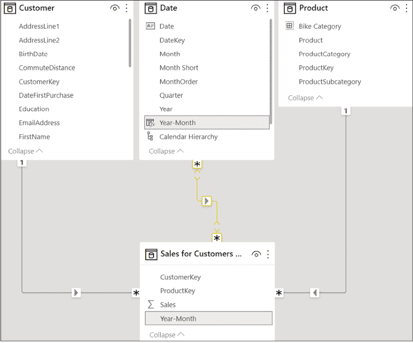

Figure 9.1: A many-to-many cardinality relationship

在前面的模型中，**Year-Month** 列在参与该关系的任何表中都不是键列，这意味着 **Year-Month** 列在两侧都有重复值。如你所注意到的，**Sales for Customers with Yearly Income Greater Than $100,000** 表与 **Date** 表之间的关系在关系的两端都有星号 (*)，表示该关系的基数是多对多。关系两端也都有断链符号，表示关系的 **求值类型为受限**。关系求值与关系的基数以及构成该关系的两个表的数据源相关；因此，它是不可配置的。关系要么是 **常规关系**，要么是 **受限关系**。

*常规* 关系是指两个相关表满足以下条件：

- 使用相同的存储模式：要么为 DirectQuery，要么为导入。
- 两个表之间的关系基数为一对多，Power BI 可以据此确定关系的“一方”存在。

如果两个表之间的关系不满足上述任何条件，则关系求值类型为 *受限*。受限关系也称为 **弱关系**。换句话说，*弱* 关系和 *受限* 关系是同一回事。

当我们使用非键列在两个表之间创建关系时，我们创建的是多对多 **基数** 关系。我们坚持对这种关系使用 *基数* 这一术语，以避免将其与 **经典** 的多对多关系混淆。在关系数据建模中，多对多关系是通过 **桥接表** 在两个表之间建立的概念关系。在关系数据建模中，我们无法在两个表之间创建物理多对多关系。相反，我们在关系的一侧的主键与关系“多”侧对应的外键列之间创建关系。因此，从关系数据建模的角度来看，唯一合法的关系是 *一对一* 和 *一对多* 关系。因此，不存在多对多关系类型。

尽管如此，许多业务场景需要多对多关系。考虑银行业：一个客户可以拥有多个账户，而一个账户在为联名账户时可以关联多个客户；或在教育系统中，一个学生可以有多名教师，而一名教师可以有多名学生。

本章使用的示例文件为 `Chapter 9, Star Schema and Data Modelling Common Best Practices.pbix`。

以下是场景：业务希望基于 **Quantity Sold** 分析其在线客户在 **Sales Reasons** 方面的购买行为。以下图表显示了数据模型。让我们看一下：

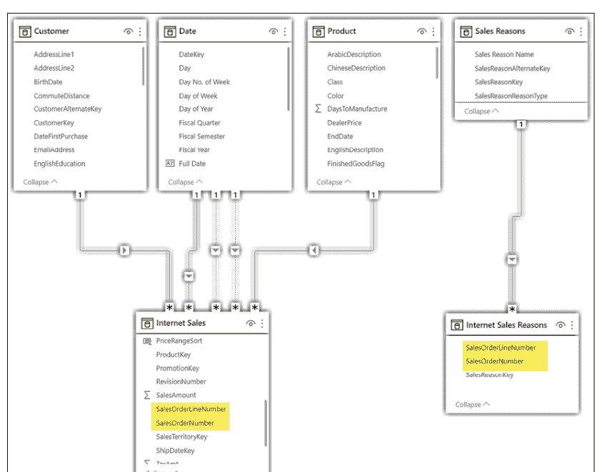

## Figure 9.2: Analyzing Internet Sales by Sales Reasons

如前图所示，Sales Reasons 表包含描述性数据，而 Internet Sales Reasons 表与 Sales Reasons 表之间存在一对多关系。Internet Sales Reasons 表包含三列，SalesOrderLineNumber、SalesOrderNumber 和 SalesReasonKey，且不包含任何销售交易。另一方面，Customer 表与 Internet Sales 表之间存在一对多关系。Internet Sales 表保存所有销售交易，其中每一行数据对于 SalesOrderLineNumber 和 SalesOrderNumber 列的组合都是唯一的。但目前 Customer 表与 Sales Reasons 表之间没有关系。每个客户在线购买产品可能有多个原因，而每个销售原因又关联到许多客户。因此，从概念上讲，Customer 表与 Sales Reason 表之间存在多对多关系。现在是时候回顾关系数据建模中的经典多对多关系类型了。

如前所述，在关系数据建模中，与 Power BI 不同，我们只能使用桥接表来实现多对多关系。下一节将解释如何使用桥接表实现多对多关系。

## Many-to-many relationships using a bridge table

在关系数据建模中，我们将参与多对多关系的两个表的主键放入一个中间表，称为 *桥接* 表。桥接表通常在事务源系统中可用。例如，在销售系统中，客户与产品之间始终存在多对多关系。一个客户可以购买多种产品，而一种产品可以出现在许多客户的购物车中。在销售系统中，出纳员扫描产品的条形码和客户的忠诚度卡，以便系统知道哪个客户购买了哪个产品。

使用星型模式方法，我们在设计数据仓库时会将列分散到 **维度** 和 **事实** 中。因此，在销售数据模型（在销售数据仓库中），围绕事实表的 **维度** 通过 **事实** 表存在多对多关系。因此，在采用星型模式方法设计的销售数据模型中，**Customer** 和 **Product** 表包含 *描述性* 值。因此，它们是 **维度**。另一方面，**Sales** 表保存 **Customer** 和 **Product** 表的外键。它还保存与销售交易相关的 **数值**，如销售额、税额、订购数量等。**Sales** 表在星型模式方法中是一个 *事实* 表。

下图显示了 **Customer**、**Product** 和 **Internet Sales** 表之间的关系：

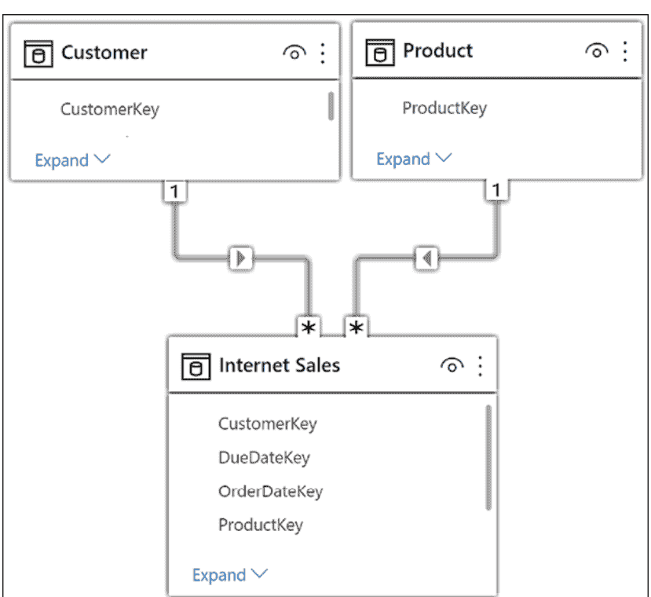

Figure 9.3: Relationships between Customer, Product, and Internet Sales

在前面的数据模型中，我们有以下关系：

- Customer 与 Internet Sales 之间的一对多关系
- Product 与 Internet Sales 之间的一对多关系
- Customer 与 Product 之间通过 Internet Sales 表的多对多关系

前两种关系是显而易见的，因为我们可以在数据模型中直观地看到它们。然而，后者是一种由 Internet Sales 表处理的某种概念关系。从星型模式的角度来看，我们不称 Internet Sales 表为桥接表，但原则保持不变。在使用星型模式方法进行数据建模时，桥接表是为管理多对多关系而创建的。多对多关系通常发生在两个或多个维度之间。然而，在某些情况下，两个事实表会促成多对多关系。

> Note
> 
> 在星型模式中，仅包含维度的外键而没有任何其他可加列的事实表称为 **无事实事实表**。

我们的场景已经有一个合适的桥接表，即 **Internet Sales Reasons** 表，满足 **Customer** 表与 **Sales Reasons** 表之间的多对多关系。因此，我们只需要创建 **Internet Sales** 表与 **Internet Sales Reasons** 表（桥接）之间的关系。由于 **xVelocity** 引擎不支持使用复合键创建物理关系，我们必须在 **Internet Sales** 和 **Internet Sales Reasons** 表中各添加一列。新列将 **SalesOrderLineNumber** 和 **SalesOrderNumber** 列连接起来。我们可以在 Power Query 或 DAX 中创建新列。为简单起见，我们使用以下 DAX 表达式创建计算列。

在 **Internet Sales** 表中，使用以下 DAX 表达式创建新的计算列：

```
SalesReasonsID = 'Internet Sales'[SalesOrderNumber] & 'Internet Sales'[SalesOrderLineNumber]
```

在 **Internet Sales Reason** 表中，使用以下 DAX 表达式：

```
SalesReasonsID = 'Internet Sales Reasons'[SalesOrderNumber] & 'Internet Sales Reasons'[SalesOrderLineNumber]
```

在两个表中创建 **SalesReasonsID** 列后，我们在两个表之间创建关系。以下图像显示了 **Create**


**relationship** 窗口，我们在 **Internet Sales** 和 **Internet Sales Reasons** 表之间创建一对多关系：

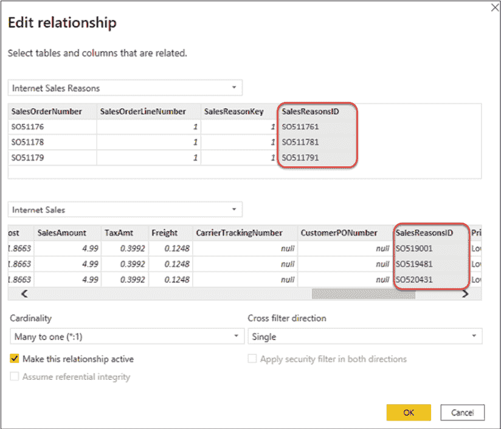

图 9.4：在 Internet Sales 和 Internet Sales Reasons 表之间创建关系

下图显示了创建上述关系后我们的数据模型：

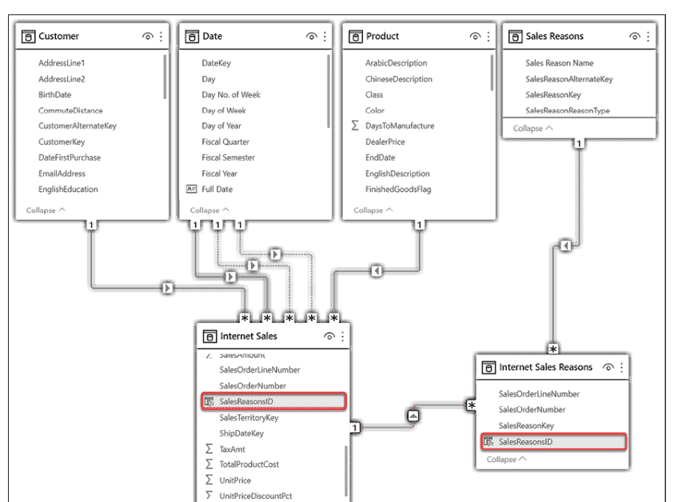

图 9.5：在两个表之间创建新关系后的数据模型

从数据建模的角度来看，现在 Internet Sales 表与 Sales Reasons 表之间通过桥接表（Internet Sales Reasons）存在多对多关系。因此，Customer、Date 和 Product 维度也与 Sales Reason 表存在多对多关系。

为了可视化数据，我们需要创建两个新的度量值 Quantity Sold 和 Internet Sales Reasons，其 DAX 表达式如下：

```
Quantity Sold = SUM('Internet Sales'[OrderQuantity])
Sales Reasons Count = COUNTROWS('Internet Sales Reasons')
```

让我们可视化数据并看看它是如何工作的：

- 1. 在报表画布上放置一个 Matrix 可视化对象。
- 2. 将 **Customer** 表中的 **Full Name** 列放在 **Rows** 上。
- 3. 将 **Product** 表中的 **Product Name** 放在 **Full Name** 下的 **Rows** 上。
- 4. 将 **Quantity Sold** 度量值放在 **Values** 上。

到目前为止，我们创建的可视化对象显示了每个客户购买的产品数量。下图显示了上述步骤：

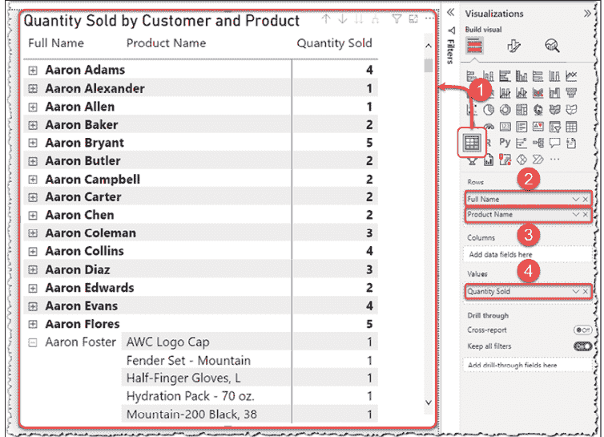

图 9.6：在矩阵中按客户 Full Name 和 Product Name 可视化 Quantity Sold

- 5. 在报表画布上放置另一个 **Matrix** 可视化对象。
- 6. 将 **Product** 表中的 **Product Name** 列放在 **Rows** 上。
- 7. 将 **Sales Reasons** 表中的 **Sales Reason Name** 列放在 **Columns** 上。
- 8. 将 **Sales Reasons Count** 度量值放在 **Values** 上。

下图显示了上述步骤：

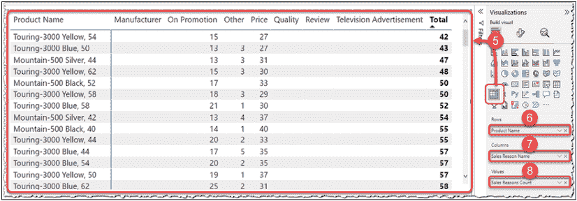

## 图 9.7：在矩阵中按 Product Name 和 Sales Reason 可视化 Sales Reasons Count

报表页面上的前两个可视化对象揭示了客户购买的产品与购买销售原因之间的相关性。下图显示了 Aaron Collins 购买与其销售原因之间的相关性：

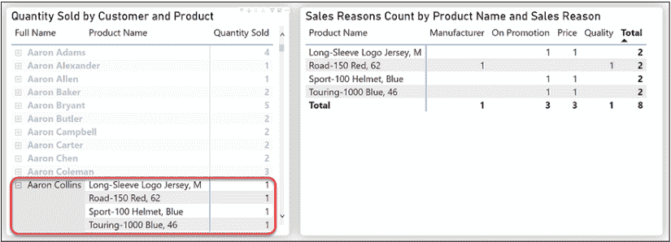

## 图 9.8：分析客户购买和销售原因

如前图所示，Aaron Collins 总共购买了 4 件商品，他每次购买都有 2 个原因。例如，他购买 Road-150 Red, 62 是因为制造商和产品的质量。

另一方面，点击第二个矩阵中的 Road-150 Red, 62 会显示所有客户都因相同原因花费了钱：制造商和质量。下图显示了结果：

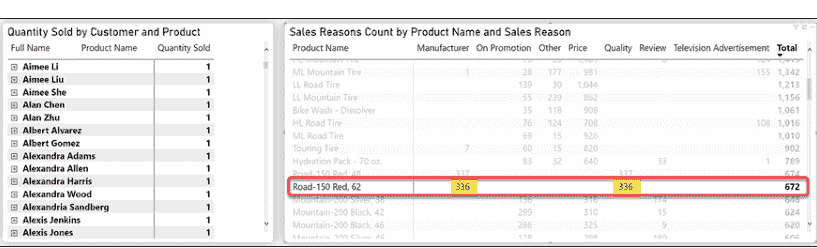

图 9.9：分析特定产品的客户购买和销售原因

正如您所看到的，前述分析之所以成为可能，完全是因为正确处理了 Internet Sales 和 Sales Reasons 表之间通过 Internet Sales Reasons 桥接表建立的多对多关系。

## 隐藏桥接表

在数据模型中实现多对多关系后，将桥接表从数据模型中隐藏是一个好主意。我们在数据模型中仅保留桥接表，因为它承载了参与多对多关系的两个表的键列。隐藏桥接表还可以避免其他报表创建者连接到我们的数据集以构建报表时产生混淆。要隐藏表，我们只需切换到 Model 视图并点击表右上角的隐藏/取消隐藏（👁️）按钮。下图显示了隐藏 Internet Sales Reasons 表后的数据模型：

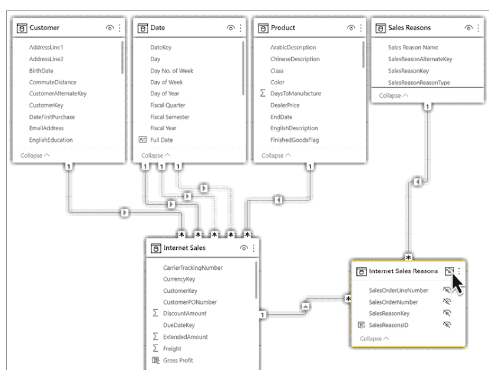

图 9.10：从 Model 视图隐藏桥接表

## 避免双向关系

在数据建模中，最容易被误解且某种程度上被误用的 Power BI 功能之一是将 Cross filter direction 设置为 Both。这通常被称为双向关系。如果我们知道自己在做什么并且意识到其对数据模型的影响，将关系设置为双向并没有什么问题。我们见过一些 Power BI 开发人员在模型中存在许多双向关系，从而导致许多问题，例如 DAX 计算中出现意外结果或由于歧义而无法创建新关系。

过度使用双向关系会增加模型模糊的风险的原因是筛选器传播。在第 8 章《数据建模组件》中，我们介绍了筛选器传播和双向关系的概念。我们查看了一个开发人员需要在报表页面上放置两个切片器的场景，一个用于产品类别，另一个用于筛选客户。这是一个常见的场景，开发人员会设置双向关系，这是不好的。在许多情况下，如果不是全部，我们都可以避免双向关系。根据场景的不同，我们可能会使用不同的技术。

让我们再次查看我们在 *第 8 章《数据建模组件》* 中 *双向关系* 部分使用的场景。我们在不使 **Product** 和 **Sales** 表之间建立双向关系的情况下解决在报表页面上放置两个切片器的场景。本章的示例文件中我们有一个类似的数据模型，其中包含 **Customer**、**Product** 和 **Internet Sales** 表，但这次，我们不会在 **Product** 和 **Internet Sales** 表之间建立双向关系。下图显示了数据模型：

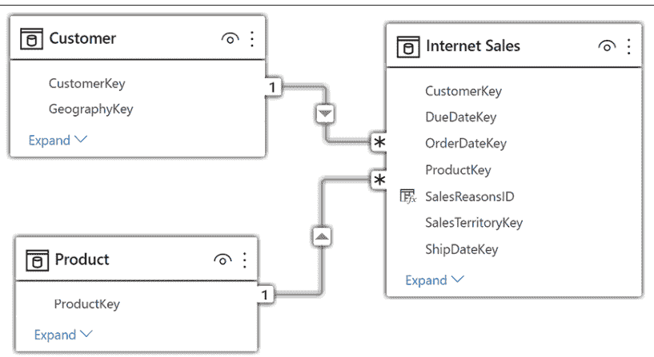

图 9.11：Internet Sales 数据模型

下图显示了报表需求：

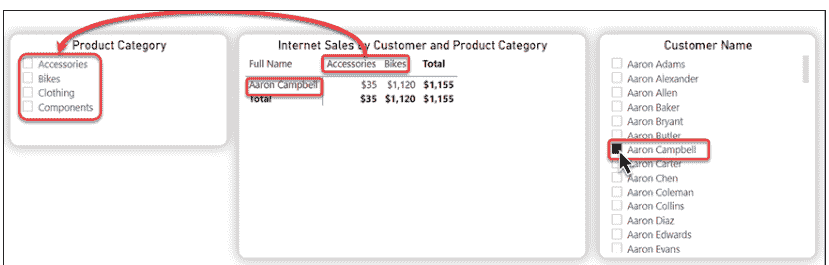

图 9.12：Customer Name 切片器筛选 Sales 数据但不筛选 Product Category 数据

如前图所示，Customer Name 切片器会筛选 Internet Sales。但筛选不会传播到 Product Category 表，因为 Product Category 表与 Internet Sales 表之间的一对多关系的 Cross filter direction 设置为单向；因此，筛选器从 Product Category 表流向 Internet Sales 表，但不会反向流动。同样，该场景还要求 Product Category 切片器筛选 Customer Name 切片器。

让我们在不建立双向关系的情况下解决问题。解决该场景的方法是使用 DAX 中的 CROSSFILTER() 函数以编程方式定义双向关系。以下度量值是 Internet Sales 度量值的修改版本，其中我们以编程方式使 Product、Internet Sales 和 Customer 表之间的关系在度量值运行期间变为双向：

```
Internet Sales Bidirectional =
    CALCULATE(
        [Internet Sales]
        , CROSSFILTER(Customer[CustomerKey], 'Internet Sales'[CustomerKey], Both)
        , CROSSFILTER('Product'[ProductKey], 'Internet Sales'[ProductKey], Both)
    )
```

现在我们将新的度量值添加到两个切片器的可视化筛选器中，并将筛选器的值设置为非空白。下图显示了上述过程：

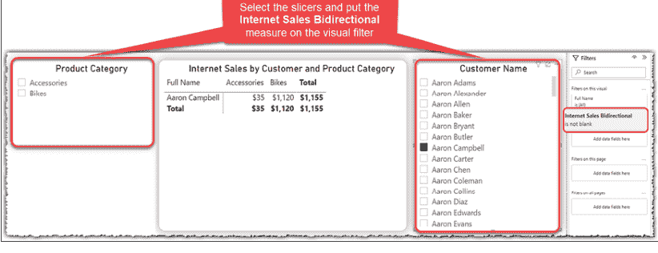

图 9.13：在切片器的可视化筛选器中使用度量值

如前图所示，**Customer Name** 切片器成功筛选了 **Product Category** 切片器，反之亦然。以下步骤显示了它在 **Customer Name** 切片器上的工作原理；**Product Category** 切片器也是如此：

- 1. 切片器从 **Full Name** 列获取所有客户的列表。
- 2. 可视化筛选器启动并应用筛选器。筛选器中使用的 **Internet Sales Bidirectional** 度量值强制切片器可视化对象运行度量值并省略空白值。
- 3. **Internet Sales Bidirectional** 度量值在度量值运行期间强制 **Product** 表、**Internet Sales** 表和 **Customer** 表之间的关系变为双向。

如果我们没有在切片器上选择任何内容，两个切片器都会显示在 **Internet Sales** 表中至少有一行的值。

关键信息是尽可能避免双向关系。在某些情况下，省略双向关系会使 DAX 表达式过于复杂，从而影响性能。我们作为数据建模者，应该决定哪种方法最适合我们的场景。


## 处理非活动关系

在实际场景中，数据模型可能会变得非常繁忙，尤其是在我们创建数据模型以支持企业 BI 时；在数据模型中存在非活动关系的情况很常见。在许多情况下，关系处于非活动状态有两个原因，如下所示：

- 具有非活动关系的表可通过多条筛选路径到达。
- 两张表之间存在多条直接关系。

在上述两种情况下，xVelocity 引擎不允许我们激活非活动关系，以避免模型中出现歧义。

## 通过多条筛选路径可达

两张表之间的多条筛选路径意味着这两张表相关，并且可以通过其他相关表到达。因此，筛选会通过多跳（关系）从一张表传播到另一张表。以下图表显示了一个具有非活动关系的数据模型：

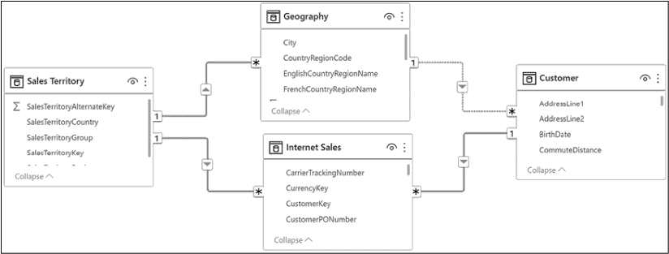

图 9.14：检测到因多条路径导致的非活动关系

如前图所示，**Sales Territory** 表与 **Internet Sales** 表之间已存在关系。Power BI 引发错误

消息，指出如果我们尝试激活非活动关系，激活 **Geography** 表与 **Customer** 表之间的关系将导致 **Sales Territory** 与 **Internet Sales** 之间的歧义。以下图表说明了 **Internet Sales** 表将如何通过多条筛选路径到达：

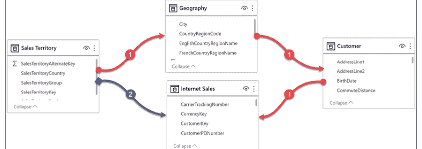

图 9.15：Internet Sales 通过多条路径的可达性

查看前图可知 **Internet Sales** 表可通过两条路径到达。以下步骤显示了我们在 **Sales Territory** 表上放置筛选时发生的情况：

- 1. 筛选通过 **Sales Territory** 与 **Geography** 之间的关系传播到 **Geography** 表。
- 2. 筛选随后通过 **Geography** 与 **Customer** 之间的关系传播到 **Customer** 表。
- 3. 筛选再次传播，通过 **Customer** 与 **Internet Sales** 之间的关系到达 **Internet Sales**。

在前一图像中，**Sales Territory** 表与 **Internet Sales** 表通过两条筛选路径相关：

- 1. 标记为 1 的路径：**Sales Territory** 与 **Internet Sales** 之间的间接筛选路径。
- 2. 标记为 2 的路径是通过 **Sales Territory** 与 **Internet Sales** 表之间关系建立的直接筛选路径。

现在可以更清楚地理解为什么 **Geography** 与 **Customer** 之间的关系处于非活动状态。

## 两张表之间的多条直接关系

导致关系处于非活动状态的另一个常见原因是两张表之间存在多条直接关系，这意味着我们可以为不同的分析计算使用每条关系。以下图表显示 **Date** 表通过多个关系与 **Internet Sales** 表相关：

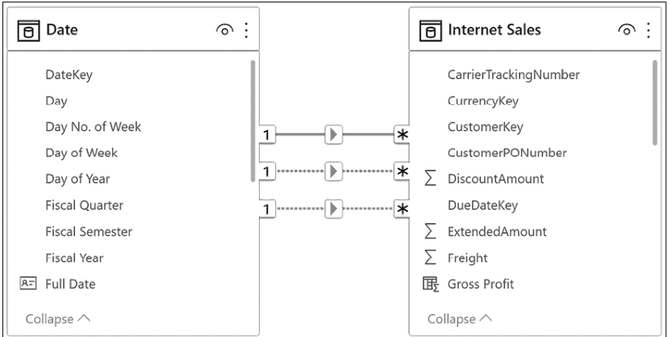

图 9.16：具有多条直接关系的两张表

我们可以查看 **Manage relationships** 窗口来查看这些关系，如下图所示：

## Manage relationships

| Active | From: Table (Column) | To: Table (Column) |
| --- | --- | --- |
| ☐ | Customer (GeographyKey) | Geography (GeographyKey) |
| ☑ | Geography (SalesTerritoryKey) | Sales Territory (SalesTerritoryKey) |
| ☑ | Internet Sales (CustomerKey) | Customer (CustomerKey) |
| ☐ | Internet Sales (DueDateKey) | Date (DateKey) |
| ☑ | Internet Sales (OrderDateKey) | Date (DateKey) |
| ☑ | Internet Sales (ProductKey) | Product (ProductKey) |
| ☑ | Internet Sales (SalesTerritoryKey) | Sales Territory (SalesTerritoryKey) |
| ☐ | Internet Sales (ShipDateKey) | Date (DateKey) |
| ☑ | Internet Sales Reasons (SalesReasonKey) | Sales Reasons (SalesReasonKey) |
| ☑ | Internet Sales Reasons (SalesReasonsID) | Internet Sales (SalesReasonsID) |

图 9.17：Date 表与 Internet Sales 表通过多条关系相关

如前图所示，Internet Sales 表中有三列参与关系，且全部合法。每条关系以不同方式筛选 Internet Sales 表，但我们一次只能在两张表之间保留一条活动关系。目前，通过 Internet Sales 表的 OrderDateKey 列与 Date 表的 DateKey 列建立的关系是活动关系，它将筛选从 Date 表传播到 Internet Sales 表，这意味着当我们使用 Date 表中的 Year 列和 Internet Sales 表中的 Internet Sales 度量值，并按订单日期年对 Internet Sales 进行切片时。但如果业务需要按到期日期分析 Internet Sales 呢？如果业务还需要按发货日期分析 Internet Sales 呢？我们显然无法通过物理上使关系激活和非激活来解决此问题。因此，我们必须通过在 DAX 中使用 USERELATIONSHIP() 函数以编程方式解决挑战。USERELATIONSHIP() 函数在度量值运行期间激活非活动关系。因此，为满足需求，我们创建了两个新的度量值。

以下 DAX 表达式激活 `DueDateKey` 与 `DateKey` 之间的关系：

```
Internet Sales Due =
    CALCULATE([Internet Sales]
        , USERELATIONSHIP('Internet Sales'[DueDateKey],
'Date'[DateKey])
    )
```

以下 DAX 表达式激活 `ShipDateKey` 与 `DateKey` 之间的关系：

```
Internet Sales Shipped =
    CALCULATE([Internet Sales]
        , USERELATIONSHIP('Internet Sales'[ShipDateKey],
'Date'[DateKey])
    )
```

让我们将新的度量值与 **Internet Sales** 度量值和 **Date** 表中的 **Full Date** 列并排放在一个表中，以查看值之间的差异：

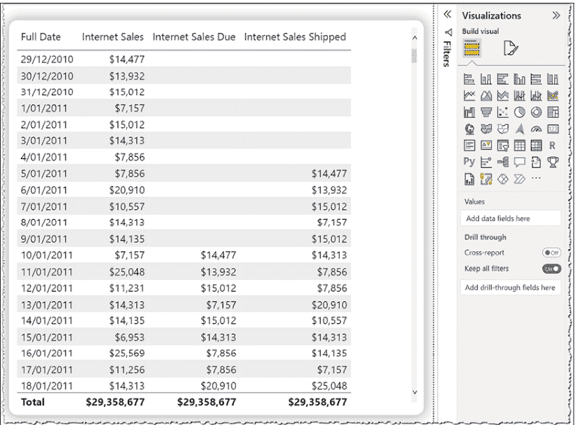

图 9.18：以编程方式激活非活动关系

因此，使用 USERELATIONSHIP() 函数使得 Internet Sales、Internet Sales Due 和 Internet Sales Shipped 度量值能够并排显示在单个视觉对象中成为可能。

## 使用配置表

在许多情况下，企业希望按集群分析部分业务指标。一些很好的例子是按单价范围分析销售、按产品成本范围分析销售、按年龄范围分析客户，或按通勤距离分析客户。在所有这些示例中，企业不需要分析恒定值；相反，更重要的是按值范围分析指标（在前面的示例中为销售）。

其他一些案例与数据可视化相关，例如在值处于特定范围时动态更改值的颜色。一个例子是，如果数据点的销售额小于一段时间内的平均销售额，则将分析销售的所有视觉对象中的值颜色更改为红色。这是一种相对高级的分析，可以在报告中重复使用，以保持可视化的颜色一致。

在前面的示例中，我们需要定义配置表。在后一个示例中，我们看到数据建模如何积极影响我们的数据可视化。

## 分段

如前所述，在某些情况下，企业需要按数据集群分析其业务指标。当我们按不同细分分析业务值时，这种类型的分析通常称为分段。

让我们继续举例。业务需要按 UnitPrice 范围分析 Internet Sales，如以下列表所示：

- **Low**：当 **UnitPrice** 在 $0 到 $50 之间时
- **Medium**：当 **UnitPrice** 在 $51 到 $450 之间时
- **High**：当 **UnitPrice** 在 $451 到 $1,500 之间时
- **Very high**：当 **UnitPrice** 大于 $1,500 时

此时，你可能会考虑向 Internet Sales 表添加一个计算列来满足业务需求，但如果业务将来修改单价范围的定义怎么办？我们需要频繁更改计算列，这不是可行的选择。更好的方法是将单价范围的定义放在一个表中。我们可以将定义存储在可访问的共享 OneDrive for Business 文件夹中的 Excel 文件中。它可以是业务可访问以进行必要更改的 SharePoint 列表。为简单起见，我们使用 Power BI 中的 Enter data 功能手动输入前述定义作为表。


注意：在真实场景中，我们不建议使用 Power BI 的“输入数据”功能手动输入定义值。如果业务方想要更改这些值，我们必须修改 Power BI Desktop 中的报表，然后重新发布到 Power BI Service。

下图显示了在 Power BI 中创建的“单价范围”表：

| 排序 | 价格范围 | 从 | 至 |
|---|---|---|---|
| 4 | 低 | 0 | 50 |
| 3 | 中等 | 51 | 450 |
| 2 | 高 | 451 | 1500 |
| 1 | 非常高 | 1501 | 15000 |

图 9.19：单价范围表

现在我们需要在 Internet Sales 表中添加一个计算列。新计算列会为 Internet Sales 表中的每个 UnitPrice 值查找对应的价格范围值。为此，我们必须将 Internet Sales 表中每一行的 UnitPrice 值与单价范围表中“从”和“至”列的值进行比较。以下 DAX 表达式可以实现这一点：

```
Price Range =
    CALCULATE(
        VALUES('Unit Price Ranges'[Price Range])
    , FILTER('Unit Price Ranges'
        , 'Unit Price Ranges'[From] < 'Internet Sales'[UnitPrice]
            && 'Unit Price Ranges'[To] >= 'Internet Sales'[UnitPrice]
    )
)
```

下图展示了当我们从簇状条形图中选择**高**和**中等**时，**按价格范围的 Internet Sales** 分析结果：

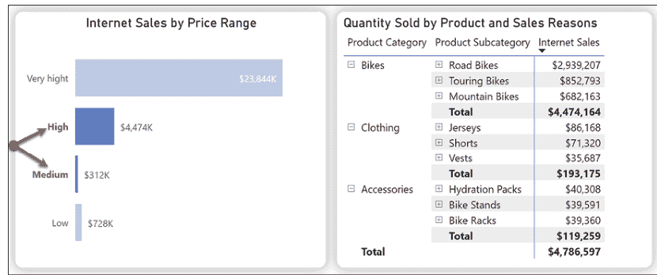

图 9.20：按价格范围分析 Internet Sales

作为一个小提示，请注意条形图中条形的排序方式。它们既不是按**价格范围**名称的字母顺序排序，也不是按**Internet Sales**值排序。在上一章中你已经学习了如何管理列排序，因此这留给你自己去探索其中的实现方式。

## 使用度量值进行动态颜色编码

到目前为止，我们已经讨论了数据建模的许多方面，因为本书的主要目标是学习如何应对各种日常挑战。本节讨论数据可视化的一个重要方面——**颜色编码**，以及数据建模如何简化许多高级数据可视化挑战。颜色编码是提供数据相关信息最引人注目且高效的方式之一。在本节中，我们将在数据建模和数据可视化之间建立一座桥梁。

从 Power BI 的早期版本开始，我们就可以对视觉对象进行颜色编码。然而，很长一段时间里，许多视觉对象并不支持条件格式。幸运的是，现在我们可以在 Power BI Desktop 中为几乎所有默认视觉对象（以及许多自定义视觉对象）设置条件格式。让我们继续一个场景。

某企业决定在各种视觉对象中动态使用预定义的颜色代码，以便根据 `Sales MoM%` 度量值的值来选择视觉对象的颜色。`Sales MoM%` 度量值基于每年销售额与上一年销售额的比较来计算销售额变化百分比。目标是使用**簇状柱形图**来可视化 `Sales MoM%`。每个数据点的颜色应根据配置表计算。下图显示了配置表的结构：

| 索引 | 颜色十六进制 | 范围百分比 | 描述 |
| --- | --- | --- | --- |
| 1 | #264653 | 100% | 卓越 |
| 2 | #287271 | 90% | 优秀 |
| 3 | #2A9D8F | 80% | 非常好 |
| 4 | #8AB17D | 70% | 良好 |
| 5 | #E9C46A | 60% | 不错 |
| 6 | #DA941B | 50% | 一般 |
| 7 | #CB7C15 | 40% | 继续努力 |
| 8 | #EF7A1A | 30% | 低 |
| 9 | #CB4F15 | 20% | 非常低 |
| 10 | #7E2711 | 10% | 严重 |

图 9.21：定义颜色代码的配置表

1. 首先，我们需要将图 9.21 中的数据输入到 Power BI 的一个表中。我们将新表命名为 **ConfigColour**。

下图显示了 Power BI Desktop 中的 **ConfigColour** 表：

| 颜色十六进制 | 索引 | 范围百分比 | 状态 |
|---|---:|---:|---|
| #264653 | 1 | 100% | 卓越 |
| #287271 | 2 | 90% | 优秀 |
| #2A9D8F | 3 | 80% | 非常好 |
| #8AB17D | 4 | 70% | 良好 |
| #E9C46A | 5 | 60% | 不错 |
| #DA941B | 6 | 50% | 一般 |
| #CB7C15 | 7 | 40% | 继续努力 |
| #EF7A1A | 8 | 30% | 低 |
| #CB4F15 | 9 | 20% | 非常低 |
| #7E2711 | 10 | 10% | 严重 |

图 9.22：ConfigColour 表

2. 现在我们需要创建一个 `Sales MoM%` 度量值。以下 DAX 表达式计算上个月的销售额（`Sales LM`）：

```
Sales LM =
    CALCULATE([Internet Sales]
        , DATEADD('Date'[Full Date], -1, MONTH)
    )
```

3. 在计算出 `Sales LM` 之后，我们只需计算 **Internet Sales** 度量值与 `Sales LM` 度量值之间的差异百分比。以下表达式可以实现这一点：

```
Sales MoM% = DIVIDE([Internet Sales] - [Sales LM], [Sales LM])
```

4. 下一步是创建两个文本度量值。第一个度量值从 **颜色十六进制** 列选取相关值，另一个从 **ConfigColour 表**的 **状态** 列选取相关值。这两个文本度量值都基于 `Sales MoM%` 度量值的值，从 **ConfigColour** 表中选取其值。

在实现这些度量值之前，让我们先了解 **ConfigColour** 表中的数据应当如何工作。以下几点对于理解如何使用 **ConfigColour** 表至关重要：

- **ConfigColour** 包含 10 行数据。
- **颜色十六进制** 包含颜色的十六进制代码。
- **范围百分比** 包含 0.1 到 1 之间的小数。
- **状态** 列包含每种颜色的文本描述。
- **索引** 列包含表索引。

以上几点看起来容易理解，但 **范围百分比** 列有些棘手。当我们把 **范围百分比** 列格式化为百分比时，值介于 10% 和 100% 之间。但每个值表示的是一个值域，而不是一个常量。例如，10% 表示从 0% 到 10% 的所有值。同样，20% 表示所有值介于 11% 和 20% 之间。另一点需要注意的是，当我们用百分比格式化 **范围百分比** 值时，每个值都能被 10 整除（例如 10、20、30……）。

新的文本度量值基于 **范围百分比** 列和 **Sales MoM%** 度量值，从 **颜色十六进制** 列或 **状态** 列中选取相关值。因此，我们需要确定 `Sales MoM%` 值所在的区间，然后与 **颜色十六进制** 列中的值进行比较。以下公式确保 `Sales MoM%` 值可被 10 整除，以便我们之后能在 `ColourHex` 列中找到匹配的值：

```
CONVERT([Sales MoM%] * 10, INTEGER)/10
```

下面是上述公式的工作原理：

1. 我们将 `Sales MoM%` 的值乘以 10，得到一个介于 0 和 10 之间的小数值（我们将处理值小于 0 或大于 10 的情况）。
2. 我们将小数值转换为整数，以去掉小数点后的数字。
3. 最后，我们将值除以 10。

当我们将结果格式化为百分比时，该值可被 10 整除。然后我们检查该值是否小于 10%；如果是，则返回 10%。如果大于 100%，则返回 100%。

现在是时候创建文本度量值了。以下 DAX 表达式返回一个十六进制颜色。随后，我们将在视觉对象的条件格式中使用获取到的十六进制颜色：

```
Sales MoM% Colour =
var percentRound = CONVERT([Sales MoM%] * 10, INTEGER)/10
var checkMinValue = IF(percentRound < 0.1, 0.1, percentRound)
var checkMaxValue = IF(checkMinValue > 1, 1, checkMinValue)
return
CALCULATE(
    VALUES(ConfigColour[ColourHex])
  , FILTER( ConfigColour
    , 'ConfigColour'[Range%] = checkMaxValue
  )
)
```

正如你在上述表达式中所见，`checkMinValue` 和 `checkMaxValue` 变量正在调整超出范围的值。以下 DAX 表达式计算出一个描述，其计算方式与前面的度量值类似：

```
Sales MoM% Description =
var percentRound = CONVERT([Sales MoM%] * 10, INTEGER)/10
var checkMinValue = IF(percentRound < 0.1, 0.1, percentRound)
var checkMaxValue = IF(checkMinValue > 1, 1, checkMinValue)
return
CALCULATE(
    VALUES(ConfigColour[Status])
  , FILTER( ConfigColour
    , 'ConfigColour'[Range%] = checkMaxValue
  )
)
```


现在我们已经创建了文本度量，我们就可以用它们来有条件地格式化视觉对象（如果受支持）。以下视觉对象目前支持条件格式：

| 堆积柱形图 | 簇状条形图 | 簇状柱形图 | 100% 堆积条形图 |
|---|---|---|---|
| 100% 堆积柱形图 | 折线和堆积柱形图 | 折线和簇状柱形图 | 丝带图 |
| 漏斗图 | 散点图 | 树形图 | 仪表 |
| 卡片 | KPI | 表格 | 矩阵 |

图 9.23：支持条件格式的 Power BI 默认视觉对象

以下步骤演示如何有条件地格式化簇状柱形图：

- 1. 在新的报表页面上放置一个 **Clustered column chart**。
- 2. 从视觉对象的 **Axis** 下拉菜单中选择来自 **Date** 表的 **Year-Month** 列。
- 3. 从视觉对象的 **Values** 下拉菜单中选择 **Sales MoM%** 度量值。
- 4. 从 **Tooltips** 下拉菜单中选择 **Sales MoM% Description** 度量值。
- 5. 从 **Visualizations** 窗格切换到 **Format** 选项卡。
- 6. 展开 **Columns**。
- 7. 展开 **Colors**。
- 8. 单击 **fx** 按钮。
- 9. 从 **Format by** 下拉菜单中选择 **Field value**。
- 10. 从 **Based on field** 菜单中选择 **Sales MoM% Colour** 度量值。
- 11. 单击 **OK**。

以下图像显示了前述步骤：

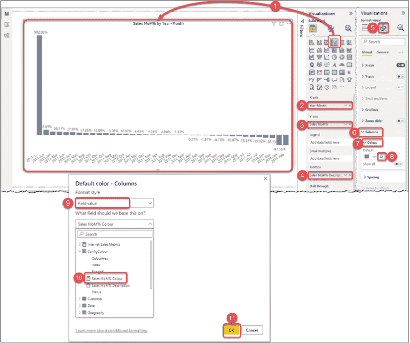

图 9.24：在簇状柱形图上应用动态条件格式

以下图像显示了前述设置后的簇状柱形图：

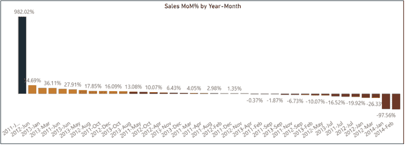

# 图 9.25：有条件格式化的簇状柱形图

通过这种技术，我们可以创建引人注目的数据可视化，从而快速提供有关数据的许多见解。例如，以下图像显示了一个按日期分析销售的报表页面。添加一个矩阵显示按月和日划分的 Internet Sales：

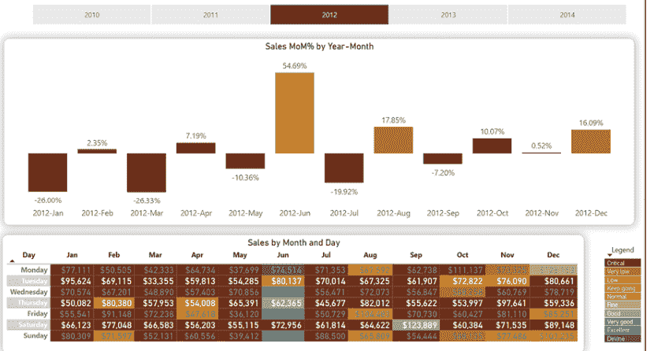

# 图 9.26：颜色编码的销售报表

使用 Sales MoM% Colour 度量值对矩阵进行颜色编码。矩阵的每个单元格显示本月整个月按工作日划分的销售额。然而，单元格的颜色显示当前销售额与上个月同一工作日的比较。例如，如果我们查看 2012-Jun 的销售额，我们很快就会发现，与 2011-Jun 相比，星期一的销售额非常出色。

前述报表页面可能不是高质量数据可视化的完美示例。然而毫无疑问，它提供的见解比没有颜色编码的类似报表页面多得多。在现实场景中，我们可能对负数使用更多颜色来显示我们正在分析的指标的严重程度。我们将把这作为练习留给您，说明如何使用这种技术创建非常专业的报表。

# 尽可能避免使用计算列

创建计算列是 DAX 最基本和最强大的功能之一。计算列顾名思义是基于公式计算的；因此，计算列的值在源系统或 Power Query 层中不可用。计算列的值在数据刷新期间计算，然后存储在内存中。需要注意的是，计算列驻留在内存中，除非我们将整个数据模型从内存中卸载，在 Power BI 中这意味着我们在 Power BI Desktop 中关闭文件或在 Power BI 服务中切换到其他内容。创建后，计算列就像任何其他列一样，因此我们可以在其他计算列、度量值、计算表中使用它们，或用于过滤可视化层。

开发人员常用的做法是使用计算列将复杂方程分解为更小的块。这就是为什么我们建议避免过度使用计算列。一般使用计算列的经验法则是：

- - 如果在筛选器中使用，则创建计算列。
- - 即使需要在筛选器中使用计算列，也应考虑在 Power Query 层或源中创建新列（如果可能）。
- - 如果可以用度量值获得相同的结果，则不要创建计算列。
- - 创建计算列时始终考虑数据基数。基数越高，压缩率越低，内存消耗越高。
- - 尤其是在处理大型模型时，创建计算列时始终要有充分的理由。

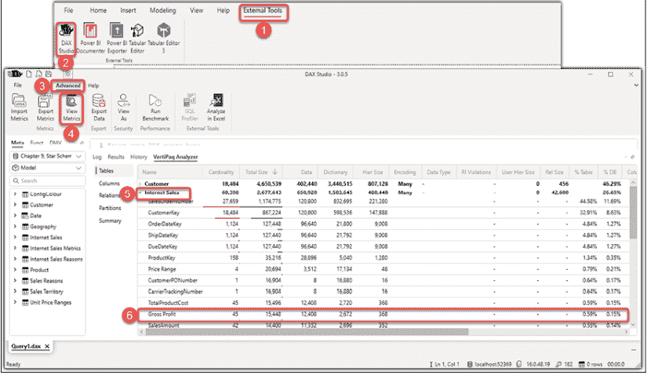

图 9.27：在 DAX Studio 中查看指标

如前图所示，**Gross Profit** 行大小为 15,448 字节（大约 15 KB），基数为 45，占用表大小的 0.31%。**Internet Sales** 表是一个小型表，有 60,398 行。因此，我们可以想象在更大的表中列大小会如何增长。

虽然创建计算列然后对计算列求和的过程是合法的，但它不是首选方法。我们可以用以下 DAX 表达式在度量值中计算 `Total Gross Profit`：

```
Total Gross Profit Measure = SUMX('Internet Sales',
'Internet Sales'[SalesAmount] - 'Internet Sales'[TotalProductCost])
```

两种方法之间的区别在于，`Gross Profit` 计算行的值是在表刷新时计算的。它驻留在内存中，而其度量值对应物在我们将其用于可视化时聚合毛利润。因此，当我们在 **clustered column chart** 中使用来自 **Product** 表的 **Product Category** 列和 `Total Gross Profit Measure` 时，`Total Gross Profit Measure` 的值会针对内存中产品类别的数量进行聚合。以下图像

显示 **Product Category** 的 **clustered column chart** 中的 **Total Gross Profit Measure**：

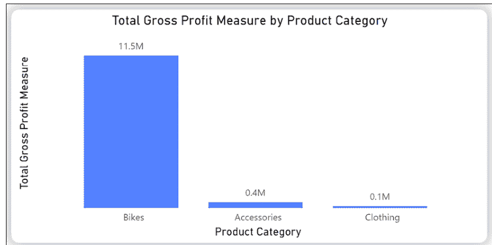

图 9.28：簇状柱形图中按产品类别划分的总毛利润度量值

如前图所示，`Total Gross Profit Measure` 在 `Product Category` 级别聚合，只有三个值，因此计算速度极快，内存消耗极小。

# 组织模型

在现实世界的企业 BI 场景中，Power BI 项目通常涉及多个角色。从 Power BI 开发的角度来看，我们可能有数据建模师、报表编写者、质量保证专家、支持专家等。数据建模师是使数据模型可供所有其他内容创建者（如报表编写者）使用的人。因此，使模型尽可能有序至关重要。本节介绍几种组织数据模型的方法。

# 隐藏不重要的模型对象

保持模型更整洁的一种方法是隐藏数据模型中所有不重要的对象。我们经常在数据模型中拥有一些在其他地方未使用的对象。然而，我们不能从数据模型中删除它们，因为将来可能需要它们。因此，最佳做法是隐藏所有这些对象，除非它们将满足业务需求。以下各节讨论我们的数据模型中隐藏的最佳候选对象。

# 隐藏未使用的字段和表

在数据模型中，我们有一些字段（列或度量值）或表在其他地方未使用的情况很多。未使用的字段是指满足以下条件的度量值或列：

- - 未在任何报表页面的任何视觉对象中使用
- - 未在 **Filters** 窗格中使用
- - 没有度量值、计算列、计算表或计算组引用这些字段
- - 行级安全性中的角色未引用这些字段

如果我们有一些字段落入上述所有类别，则强烈建议在数据模型中隐藏它们。想法是尽可能保持数据模型整洁，以便您可以根据用例隐藏落入上述某些类别的字段。

另一方面，未使用的表是其所有字段均未使用的表。

虽然这种最佳实践建议隐藏未使用的字段和表，但应用起来可能很耗时。如果手动操作，查找模型中任何地方未被引用或在任何视觉对象中未使用的字段可能是一项繁琐的工作。幸运的是，一些第三方工具可以让我们的生活更轻松。例如，我们可以使用 **Power BI Documenter**，它不仅可以找到


unused tables and fields but also hide all unused tables and fields in one click.

The following image shows how our **Fields** pane looks before and after hiding unused tables with Power BI Documenter:

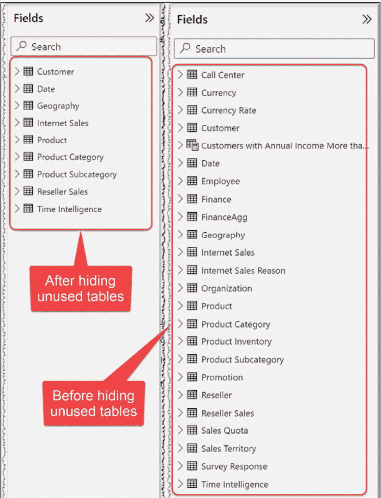

Figure 9.30: Before and after hiding unused tables using Power BI Documenter

To learn more about Power BI Documenter, visit www.datavizioner.com.

## Hiding key columns

The other best practice that helps us keep our data model tidy is to hide all key columns. The key columns are Primary Keys and their corresponding Foreign Keys. While keeping the key columns in the data model is crucial, we do not need them to be visible.

## Hiding implicit measures

The other items we can hide in our data model are the implicit measures. We discussed implicit and explicit measures in Chapter 8, Data Modeling Components, in the Measures section. Best practices suggest creating explicit measures for all implicit measures required by the business and hiding all the implicit measures in the data model. Hiding implicit measures reduces the confusion of which measure to use in the data visualizations for other content creators, who are not necessarily familiar with the data model.

## Hiding columns used in hierarchies when possible

When we create a hierarchy, it is better to hide the base columns from the report view. Having base columns in a table when the same column appears in a hierarchy is somewhat confusing. So, avoiding confusing the other content creators connecting to our data model (dataset) is best.

## Creating measure tables

Creating a measure table is a controversial topic in Power BI. Some experts suggest using this technique to keep the model even more organized, while others discourage using it. I think this technique is a powerful way to organize the data model; however, there are some side effects to be mindful of before deciding whether to use this technique. We will look at some considerations in the next section. For now, let’s see what a measure table is. A measure table is not a data table in our data model. We only create and use them as the home table for our measures. For instance, we can move all the measures from the **Internet Sales** table to a separate table in our sample report. When a table holds the measures only (without any visible columns), Power BI detects the table as a measure table with a specific iconography ( ). The following steps explain how to create a measure table in Power BI:

- 1. Click the **Enter Data** button.
- 2. Leave **Column1** as is with an empty value.
- 3. Name the table **Internet Sales Metrics**.
- 4. Click **Load**:

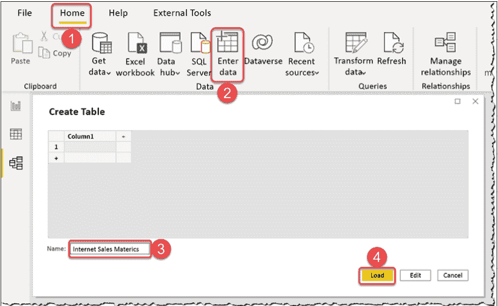

Figure 9.31: Entering data in Power BI Desktop

- 5. Right-click Column1 in the Internet Sales Metrics table.
- 6. Click Hide in report view:

Figure 9.32: Hiding a column

Now we move the measures from the Internet Sales table to the Internet Sales Metrics table. The following steps show how we can do so from the Model view:

- 7. Right-click the Internet Sales table.
- 8. Click Select measures to select all measures within the Internet Sales table.

The following image shows the preceding steps:

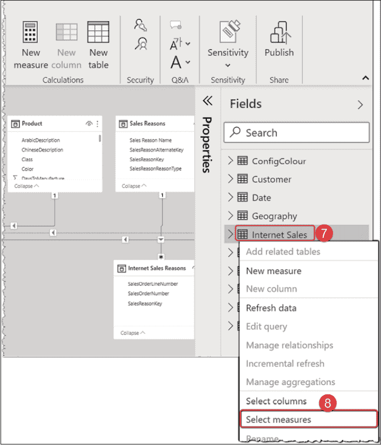

Figure 9.33: Selecting all measures from a table

- 9. Drag the selected measures and drop them on the **Internet Sales Metrics** table, as shown in the following image:

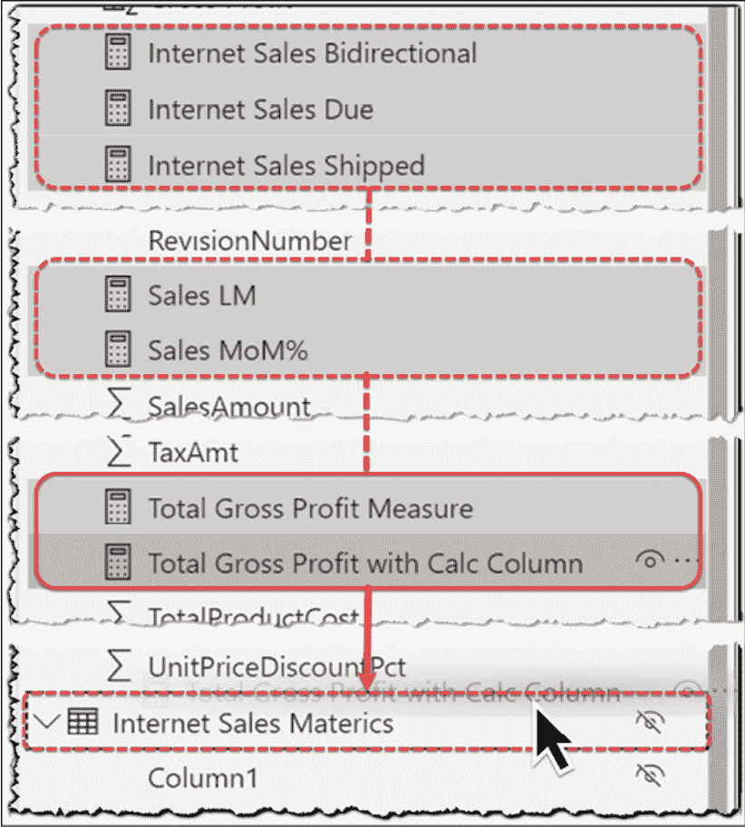

Figure 9.34: Moving multiple measures from one table to another

We now have a measure table keeping all the **Internet Sales** measures. The following image shows the measure table:

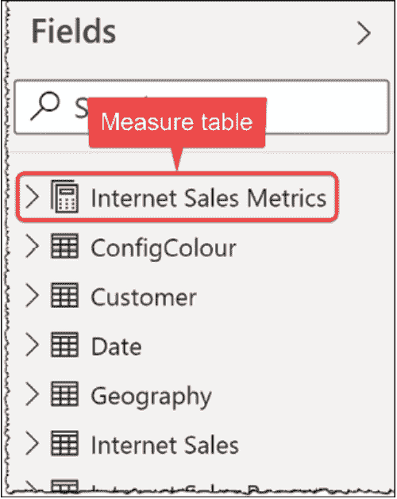

Figure 9.35: The data model after creating the measure table

When Power BI Desktop detects a measure table, it puts it on top of the list of the **Fields** pane. We can create separate measure tables for different business domains to have all relevant measures in the same place. This approach helps to make our model tidier and makes it easier for content creators to understand the model.

While creating measure tables can help keep our data model tidy, some downfalls are associated with this approach. For instance, it does not make too much sense to have a table with an empty column in the model from a data modeling point of view. Having a table in your model that is only used for holding your measures might not sound like a real issue. But one more fundamental problem associated with the measure tables relates to the **featured tables**. As we discussed the concept of featured tables in *Chapter 8, Data Modeling Components*, in the *Featured tables* section, we can configure a table within our Power BI data model as a featured table. After we configure a featured table, the columns and measures are available for Excel users across the organization. Therefore, when we move all the measures from a featured table to a measure table, the measures will no longer be available to Excel users. So the key message here is to think about your use cases and then decide whether the measure tables are suitable for your scenarios.

## Using folders

Another method to keep our data model tidy is to create folders and put all relevant columns and measures into separate folders. Unlike creating measure tables, creating folders does not have any known side effects on the model. Therefore, we can create as many folders as required. We can create or manage new folders via the **Model** view within Power BI Desktop. This section discusses some tips and tricks for using folders more efficiently.

## Creating a folder in multiple tables in one go

A handy way to create folders more efficiently is by creating a folder in multiple tables in a single attempt. This method can be handy in many cases, such as creating a folder in the home tables to keep all the measures or selecting multiple columns and measures from multiple tables and placing them in a folder in various tables. The following steps create a folder to keep all measures in various tables from the **Model** view:

- 1. Select all tables containing measures.
- 2. Right-click selected tables and click **Select measures** from the context menu.

The following image illustrates the preceding steps:

Figure 9.37: Placing all selected measures in a folder within multiple tables

## Placing a measure in various folders

Sometimes, you might want to place a measure in multiple folders. A use case for this method is to make a measure more accessible for the contributors or support specialists. In our sample file, for instance, we want to show `Sales LM` and `Sales MoM%` measures in both the **Measures** folder and in a new **Time Intelligence** folder. The following steps show how to do so:

- 1. Select the `Sales LM` and `Sales MoM%` measures.
- 2. In **Display folder**, add a semicolon after `Measures`, type in the new folder name, and press *Enter*.

The following image shows the preceding steps:

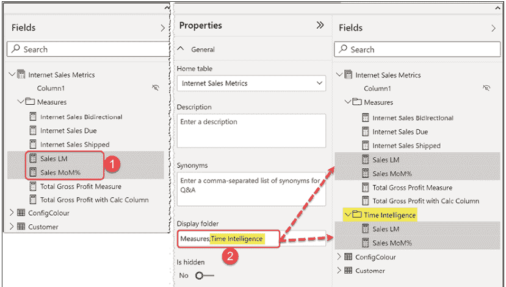

Figure 9.38: Placing measures in multiple folders

To make it clear, the **Display folder** field in the preceding image contains the folder names separated by a semicolon, as follows: `Measures;Time Intelligence`.

## Creating subfolders

Sometimes, we want to create subfolders to make the folders even tidier. For instance, in our sample, we want a subfolder to keep our base measures.

The following steps show how to create a subfolder nested in the root folder:

- 1. Select the desired measure(s).
- 2. Use a backslash (\) character to create a subfolder, then press Enter on the keyboard.

The following image shows the preceding steps:

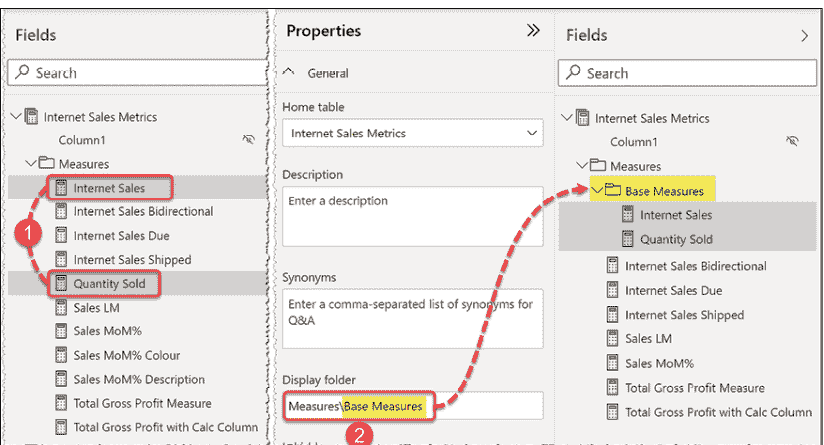

Figure 9.39: Creating subfolders

## Reducing model size by disabling auto date/time

When the data is loaded into the data model, Power BI automatically creates some Date tables to support calendar hierarchies for all columns in the DateTime datatype. This feature is convenient, especially for beginners who do not know how to create a Date table or create and manage hierarchies. However, it can consume too much storage, potentially leading to severe performance issues. As mentioned earlier, the auto date/time feature forces Power BI Desktop to create Date tables for every single


模型中的 DateTime 列。日期表具有以下列：

- Date
- Year
- Quarter
- Month
- Day

最后四列为每个 DateTime 列创建日期层次结构。创建的日期表中的 Date 列从我们表中相关列的最小年份的 1 月 1 日开始。它以该列的最大年份的 12 月 31 日结束。在数据仓库中，将 10/01/1900 用于过去的未知日期，将 31/12/9999 用于未来的未知日期是一种常见做法。想象一下，如果我们只有一个列只有一个上述未知日期值会发生什么。为了避免这种情况，最佳做法是在 Power BI Desktop 中禁用此功能。以下步骤说明如何禁用自动日期/时间功能：

1. 在 Power BI Desktop 中，单击 File 菜单。
2. 单击 Options and settings。
3. 单击 Options。

以下图像显示了前面的步骤：

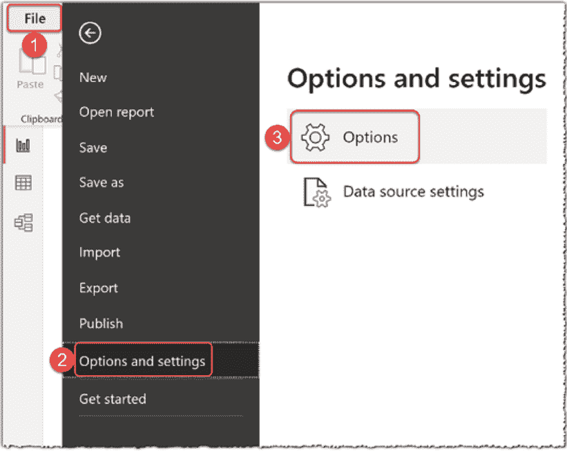

Figure 9.40: Changing Power BI Desktop options

4. 从 **GLOBAL** 部分单击 **Data Load**。
5. 取消选中 **Auto date/time for new files**。这将全局禁用此功能，每当您开始创建新文件时。

以下图像显示了如何按文件为基础禁用 **Auto date/time for new files** 功能：

Figure 9.42: Disabling the Auto date/time feature for the current file

禁用 Auto date/time for new files 功能会删除所有自动创建的日期表，从而减小文件大小。

## Summary

本章教授了使用星型模式和数据建模的一些常见最佳实践。我们学习了如何实现多对多关系。我们还学习了何时以及如何使用双向关系。然后我们查看了已禁用的关系以及我们如何以编程方式启用它们。我们还了解了配置表以及它们如何帮助我们进行数据可视化。随后，我们讨论了为什么以及何时应避免使用计算列。接下来，我们查看了一些组织数据模型的技术。最后，我们学习了如何通过在 Power BI Desktop 中禁用 Auto date/time for new files 功能来减小模型大小。

在下一章 *Advanced Data Modeling Techniques* 中，我们将讨论一些令人兴奋的数据建模技术，这些技术可以在创建复杂模型的同时提高 Power BI 模型性能。稍后再见。

## Join us on Discord!

加入 Packt Discord 服务器上的 The Big Data and Analytics Community！

与 558 名其他成员一起聊天，享受免费的语音和文字聊天。

https://packt.link/ips2H


