## Advanced Data Modeling

本节重点介绍高级数据建模技术，您可能不会每天处理，但了解它们非常重要。

实现父子层次结构、处理层次结构中的不同计算、使用聚合，以及在数据模型中实现更高级的业务需求，都涵盖在本节中。您需要对星型模式和 DAX 有深入的理解，后者我们将介绍一些新函数。

与本书其他部分一样，本节的章节完全是实践性的，具有真实场景。

本节包含以下章节：

- *Chapter 10, Advanced Data Modeling Techniques*
- *Chapter 11, Row-Level and Object-Level Security*
- *Chapter 12, Dealing with More Advanced Data Warehousing Concepts in Power BI*
- *Chapter 13, Introduction to Dataflows*
- *Chapter 14, DirectQuery Connections to Power BI Datasets and Analysis Services in Composite Models*
- *Chapter 15, New Options, Features, and DAX Functions*

## Advanced Data Modeling Techniques

在上一章中，我们查看了一些数据建模最佳实践，例如使用桥接表处理多对多关系、处理非活动关系以及如何以编程方式启用它们。我们还学习了如何使用配置表、组织数据模型以及通过在 Power BI Desktop 中禁用自动日期/时间功能来减小模型大小。

本章讨论高级数据建模技术，可帮助我们更有效地处理更复杂的场景。许多技术需要 Power BI Pro 许可证，有时需要 Premium 许可证。我们在解释每种技术时都会提及所需的许可级别。本章涵盖以下主题：

- Using aggregations
- Partitioning
- Incremental refresh
- Understanding parent-child hierarchies
- Implementing roleplaying dimensions
- Using calculation groups

我们期望您已经对上一章讨论的基本概念有具体的理解。本章重点介绍更高级的主题，除非它们之前未在本書中介绍，否则避免解释基础知识。

data/power-bi-data-sources?WT.mc_id=DP-MVP-5003466.

虽然 **Agg Awareness** 功能负责根据用户与报表交互的情况在聚合表和明细表之间切换计算的复杂性，但并非所有数据源都支持 DirectQuery。因此，我们可能无法使用 **Agg Awareness** 功能。尽管如此，这并不意味着我们不能实现聚合技术。接下来的几个部分讨论了实现聚合表的两种不同方法。

第一种方法为不支持 DirectQuery 的数据源（如 Excel 文件）实现聚合表。因此，我们不仅需要实现聚合表，还必须处理控制机制，以便在用户向下钻取到不同粒度的数据时在聚合表和明细表之间切换。

第二种方法使用支持 DirectQuery 的数据源的 **Manage aggregations** 功能。

### Implementing aggregations for non-DirectQuery data sources

在许多真实场景中，数据源可能不支持 DirectQuery 模式。因此，我们不能在 Power BI Desktop 中使用 **Agg Awareness (Manage aggregations feature)**。但是，我们可以通过以下流程手动实现聚合：

1. 在较低粒度上汇总表。
2. 在新的汇总表与汇总粒度上的维度之间创建关系。
3. 创建所需的度量值（请注意，新的度量值在汇总粒度上工作）。

先决条件并直接跳到 **Internet Sales** 表的汇总。

### Summarizing the Internet Sales table

要在 **Date** 级别汇总 **Internet Sales** 表，我们必须在 Power Query Editor 中使用 **Group by** 功能。我们希望在同时使用 **SUM** 或 **COUNT** 聚合操作的情况下聚合以下列：

- **Order Quantity**: SUM
- **Sales**: SUM
- **Tax**: SUM
- **Freight Costs**: SUM
- **Internet Sales Count**: COUNT

这些需要按以下键列进行分组：

- **OrderDateKey**
- **DueDateKey**
- **ShipDateKey**

以下图像显示了 Power Query Editor 中的 **Group By** 步骤：

Figure 10.1: Summarizing Internet Sales in Power Query Editor with the Group By functionality

现在我们已在日期级别汇总了 Internet Sales 表（新的 Internet Sales Aggregated 表），我们可以关闭并在 Power Query Editor 中应用更改以将数据加载到数据模型中。

### Creating relationships

此时，我们已将数据加载到数据模型中。Internet Sales Aggregated 表仅包含 1,124 行，明显少于 Internet Sales 表（明细表）。以下图像显示了 Internet Sales Aggregated 表在加载到数据模型后的情况：

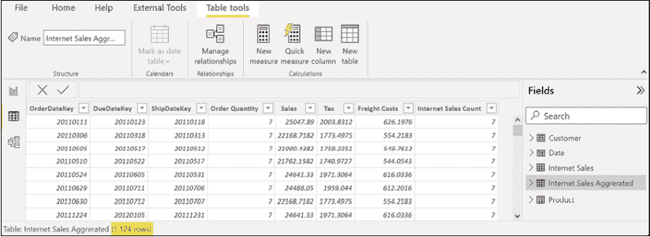

Figure 10.2: The Internet Sales Aggregated table

下一步是创建新表与 **Date** 表之间的关系。以下图像显示了已创建的关系：

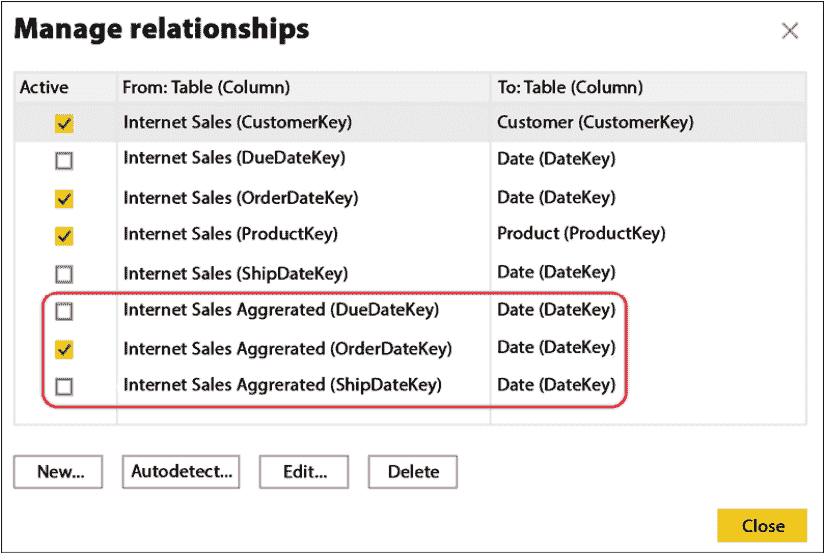

Figure 10.3: Relationships between the Internet Sales Aggregated table and the Date table

下一步是创建新的度量值来计算 **Sales** 金额。


# 在汇总表中创建新的度量值

现在，是时候在 **Internet Sales Aggregated** 表中创建一个新的度量值了。为了让此场景保持简单，我们将创建一个新的度量值来计算 **Internet Sales Aggregated** 表中 **Sales** 列的总和。其 DAX 表达式如下：

```
Sales Agg = SUM('Internet Sales Aggregated'[Sales])
```

**Sales Agg** 度量值计算销售额。请记住，**Internet Sales Aggregated** 表源自 **Internet Sales** 表。因此，**Sales Agg** 度量值使用与 **Internet Sales** 表中的 **Internet Sales** 度量值相同的计算方法。以下是 **Internet Sales** 度量值的 DAX 表达式：

```
Internet Sales = SUM('Internet Sales'[SalesAmount])
```

**Sales Agg** 度量值与 **Internet Sales** 度量值的主要区别如下：

- **Sales Agg** 在较小的表（**Internet Sales Aggregated**）上计算销售额。
- **Internet Sales** 在较大的表（**Internet Sales**）上计算相同内容。
- 由于前述原因，当许多并发用户使用报表时，**Sales Agg** 度量值的性能远优于 **Internet Sales**。
- 用户可以通过 **Customer**、**Product** 和 **Date** 对 **Internet Sales** 值进行筛选，但只能通过 **Date** 对 **Sales Agg** 值进行筛选。

现在我们已经创建了 **Sales Agg** 度量值，我们可以进入设计中的下一步：创建一个新的控制度量值以检测用户选择的粒度级别。

在隐藏 **Internet Sales Aggregated** 表和 **Internet Sales** 表中的 **Internet Sales** 度量值之后：

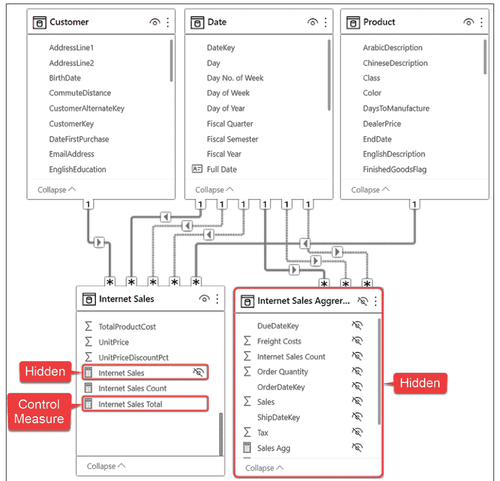

图 10.4：隐藏 Internet Sales Aggregated 表和 Internet Sales 度量值后的数据模型

我们已经整理好了一切，现在是时候在数据可视化层测试解决方案了。我们需要确保 **Internet Sales** 度量值和 **Internet Sales Total** 度量值始终产生相同的值。我们还需要确保当用户从 **Product** 表或 **Customer** 表中选择任何列时，**Internet Sales Total** 度量值使用基础表（**Internet Sales** 表）。在我们的示例中，我们创建了一个报表页面，同时并排显示 **Internet Sales** 和 **Internet Sales Total** 度量值。以下图像显示了该报表页面：

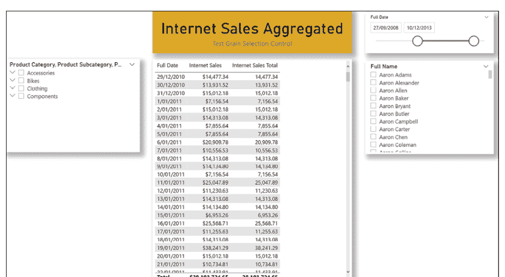

图 10.5：在数据可视化中测试聚合

如前图所示，页面顶部有一个卡片视觉对象，显示在报表页面中间的表格视觉对象中计算所使用的表。我们在卡片视觉对象中使用了以下度量值：

```
Test Grain Selection Control =
    IF(
        OR(ISFILTERED('Product'), ISFILTERED('Customer'))
        , "Internet Sales"
        , "Internet Sales Aggregated"
    )
```

前述表达式检查 Product 或 Customer 表是否被筛选。如果结果为 TRUE，则使用 Internet Sales 表；否则使用 Internet Sales Aggregated 表。

以下图像显示了当用户从报表左侧的切片器中选择一个 Product Category 时的同一报表页面：

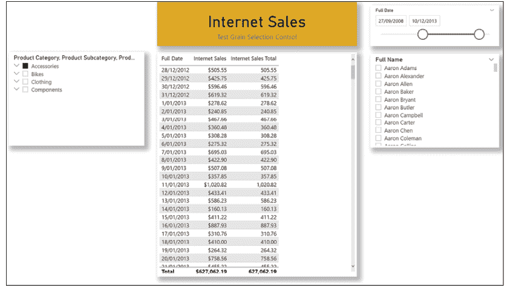

图 10.6：从切片器中选择 Product Category 后的测试视觉对象

如前图所示，聚合工作正常。

到目前为止，我们已在 Power BI Desktop 中实现了聚合的简单用例。但聚合还有许多其他用例。在下一节中，我们将提高场景的复杂性。

## 在 Year 和 Month 级别实现聚合

这次，我们想要创建另一个汇总表，该表根据 OrderDateKey 列按 Year 和 Month 的粒度级别汇总 Internet Sales 表。我们还希望将 Internet Sales 的行数作为聚合列包含在内。实现此场景的步骤与前一场景相同。唯一的区别在于数据准备层汇总 Internet Sales 数据并将数据的粒度从 Date 更改为 Year 和 Month。让我们更仔细地查看数据准备层。为了汇总 Internet Sales 数据在

# 图 10.8：在 Year 和 Month 级别汇总 Internet Sales 表

我们现在可以在 Power Query 编辑器窗口中应用更改，这将添加 **Internet Sales Aggregated Year Month** 作为新表。继续我们的实现，我们必须在 **Internet Sales Aggregated Year Month** 表与 **Date** 表之间创建关系。以下图像显示了创建关系后：

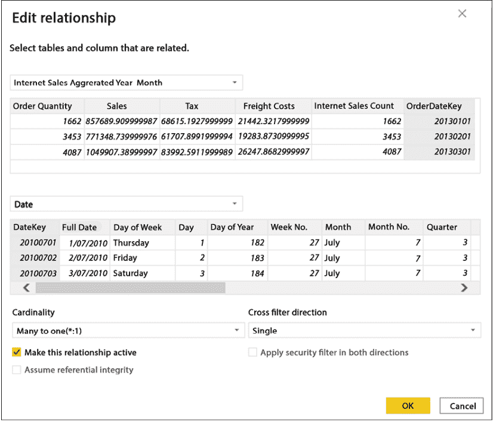

图 10.9：在 Internet Sales Aggregated Year Month 和 Date 之间创建关系

我们将关系的 **Cardinality** 设置为 **Many to one**，**Cross-filter direction** 设置为 **Single**。

当我们创建前述关系时，Power BI 会自动将关系检测为一对一。从概念上讲，这是正确的。**Internet Sales Aggregated Year Month** 表中的每一行都发生在每个月的第一天，仅与 **Date** 表中的一行相关。然而，我们需要将关系的基数从一对一更改为多对一，以避免从 **Internet Sales Aggregated Year Month** 表向 **Date** 表传播筛选。

下一步是在 **Internet Sales Aggregated Year Month** 表中创建新的度量值，使用以下 DAX 表达式：

```
Sales Year Month = SUM('Internet Sales Aggregated Year Month'[Sales])
```

现在，我们需要创建一个新的控制度量值来检测用户选择的详细级别，不仅在 **Product** 和 **Customer** 级别，还在 **Internet Sales** 表中的 `Date` 级别。以下 DAX 表达式满足此需求：

```
Internet Sales Agg =
    IF(
ISFILTERED('Product') ||
ISFILTERED('Customer') ||
ISFILTERED('Date'[Full Date])
    , [Internet Sales]
    , [Sales Year Month]
)
```

让我们创建一个测试度量值来评估前述表达式中的 `IF()` 函数。以下 DAX 表达式评估 **Product** 和 **Customer** 表或 **Date** 表中的 **Full Date** 列是否被筛选，结果为 "Internet Sales"（文本值）；否则输出为 "Internet Sales Aggregated"（文本值）。通过以下测试度量值，我们可以更好地了解 **Internet Sales Agg** 度量值的工作方式：

```
Internet Sales Agg Test =
    IF(
ISFILTERED('Product') ||
ISFILTERED('Customer') ||
ISFILTERED('Date'[Full Date])
    , "Internet Sales"
    , "Internet Sales Aggregated"
)
```

最后一步是在报表页面上测试聚合。以下图像显示了在用户对 **Product** 或 **Customer** 表应用任何筛选之前创建的用于测试聚合结果的报表页面：

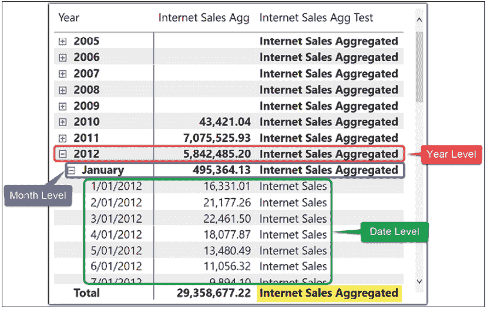

图 10.10：在筛选 Product 或 Customer 表之前测试聚合

请注意，Internet Sales Agg Test 度量值的总计值显示为 Internet Sales Aggregated。如前图所示，如果我们不按 Product 或 Customer 进行筛选，Internet Sales Agg 度量值将计算 Year 和 Month 级别的結果。但在 Date 级别，Internet Sales 度量值计算值。

此技术在许多并发用户使用同一报表时显示出其价值。然而，我们必须注意以下副作用：

- 汇总表会增加内存和存储消耗。
- 汇总表也会增加数据刷新时间。
- 开发时间也会增加，因为我们需要创建汇总表、创建关系并创建度量值。

现在我们已在非 DirectQuery 数据源之上实现了聚合，是时候查看 Agg Awareness 功能了。


## 使用聚合感知

用户定义的聚合或 **Agg Awareness** 是 Power BI 中最具重要性的可扩展性和数据建模功能之一，它解锁了大数据在 Power BI 中的使用。正如我们所知，当查询连接模式为 `Import mode` 时，Power BI 会将数据压缩并缓存到内存中。想象一个场景，我们有一个相当大的数据源，包含数十亿行数据，位于 Azure Synapse 服务器中（以前称为 Azure SQL Data Warehouse），并且我们希望在 Power BI 中创建一个企业级分析解决方案。

如前所述，Power BI 有存储限制，尤其是在我们使用免费版或专业版许可层时。即使我们拥有 Premium 容量，我们仍然受限于 Premium 容量中可用的专用内存。当然，使用 Power BI Premium Gen 2，内存限制将不再那么令人担忧。但如果我们的数据模型设计不够完善，数据处理和内存消耗很快就会成为瓶颈。这时使用聚合就派上用场了。正如我们在前几节中解释的那样，**Agg Awareness（管理聚合）** 功能仅适用于源自支持 DirectQuery 模式的数据源的明细表。

支持 DirectQuery 模式是 Power BI Desktop 中数据建模的关键点。正如在 *第 4 章，从各种来源获取数据* 中 *连接模式* 部分所讨论的那样，当查询处于 **Import** 模式时，我们无法从 Power BI Desktop 将其切换到 DirectQuery 模式或 **Dual** 模式。因此，我们必须在开始实施数据模型之前就考虑在设计时实现聚合；否则，我们最终将不得不从头开始创建数据模型，这并不理想。

我们可以采用以下三种不同的方法来实现聚合。根据数据源的不同，我们决定哪种方法最合适：

- **基于关系的聚合**：在此方法中，托管明细表的数据源采用星型模式，因此事实表和维度表之间存在关系。因此，我们在聚合表与其维度之间创建关系。
- **基于 GroupBy 的聚合：** 在此方法中，数据源是避免大型表之间关系的大数据模型，因此维度属性在事实表中被非规范化。在这种情况下，我们使用 GroupBy 列来实现聚合。
- **混合聚合：** 在此方法中，无论数据源的架构如何，我们都在聚合表中非规范化一些维度属性。聚合表还与其他维度具有关系。因此，我们在一个实现中混合了 GroupBy 和基于关系的聚合。

考虑到这一点，以下步骤解释了在 Power BI Desktop 中实现用户定义聚合的过程：

- 1. 创建聚合表。
- 2. 以 DirectQuery 模式加载所有必要的表。
- 3. 为基于关系和混合聚合在聚合表与其维度之间创建关系。
- 4. 设置聚合表及其相关维度的存储模型。
- 5. 配置 **管理聚合**。
- 6. 测试聚合以确保我们的查询命中聚合。

上述过程可能因我们的数据平台架构而异，但原则保持不变。

让我们继续一个场景。AdventureWorks 组织在 Power BI 中有一个现有的 *销售分析* 解决方案，性能不佳。业务部门抱怨 Power BI 服务上的自动数据刷新不断失败，并出现超时错误。该组织在 SQL Server 中有一个名为 AdventureWorksDW2019 的数据仓库。Power BI 中现有的解决方案包含一个大型事实表 **FactInternetSales**，处于 DirectQuery 模式。我们希望实现一个概念验证，以展示聚合如何提升性能。我们使用 **FactInternetSales** 表并使用以下聚合：

- **FactInternetSales** 行数
- **SalesAmount**
- **OrderQuantity**
- **TaxAmount**
- **Freight**

我们需要在 **EnglishProductName**、**CalendarYear** 和 **EnglishMonthName** 层级上使用上述聚合。我们还需要 **DimCustomer** 表用于客户分析，以演示当查询未命中聚合时的性能。

为了实现概念验证，我们必须考虑能够满足需求的聚合方法。让我们逐步分析：

- 基于关系的聚合：业务需要按年和月级别分析聚合。因此，要采用基于关系的方法实现聚合，我们需要创建包含 **ProductKey** 和 **DateKey** 的聚合表，按年和月级别，并包含场景中提到的所有聚合列。我们还必须创建一个额外的 **Date** 表，包含 **DateKey** 和按年和月级别的其他日期属性。然后我们在聚合表、新的 **Date** 表和 **DimProduct** 表之间创建关系。听起来有点太多了。所以基于关系的聚合不是可行的方案。
- `GroupBy` 聚合：在此方法中，我们必须在聚合表中非规范化 **CalendarYear**、**EnglishMonthName** 和 **EnglishProductName** 属性，这是可以的。我们 `GroupBy` 这些列对聚合列进行分组。但如果用户想按不同的产品属性分析销售呢？在这种情况下，聚合表不会被命中，而是查询在明细表上运行，这可能导致性能不佳。因此，此方法也不可行。
- 混合聚合：在此方法中，我们非规范化 **CalendarYear** 和 **EnglishMonthName** 属性，并在聚合表中使用 **ProductKey** 列。因此，我们按 **CalendarYear** 和 **EnglishMonthName** 属性对聚合列进行 `GroupBy`，并使用 **ProductKey** 列在聚合表和 **DimProduct** 表之间创建关系。这种方法看起来是最优雅的。

现在我们已经选择了实现方法，让我们继续开发解决方案。

要将 AdventureWorksDW2019 SQL Server 数据库用作源，我们必须从 Microsoft 网站下载 SQL Server 备份文件：

https://learn.microsoft.com/en-us/sql/samples/adventureworks-install-configure?view=sql-server-ver15&WT.mc_id=DP-MVP-5003466

下载数据库备份后，我们需要在 SQL Server 实例中还原它。了解如何还原数据库备份：

https://learn.microsoft.com/en-us/sql/samples/adventureworks-install-configure?view=sql-server-ver15&tabs=ssms&WT.mc_id=DP-MVP-5003466#restore-to-sql-server

还原数据库后，我们从 Power BI Desktop 连接到它。

## 创建聚合表

根据我们整体的数据平台架构，我们有几种创建聚合表的选项，如下所示：

- 在 SQL Server 侧创建数据库视图或表。这是最高效的选项，因为我们可以平衡 Power BI 中缓存数据与 SQL Server 之间的查询负载。我们将在本章的 *实现多个聚合* 部分更详细地讨论这一点。
- 在从 Power Query 连接到 SQL Server 实例时使用 T-SQL 语句。此选项也不错，但不如第一个灵活。
- 在 Power Query 编辑器中创建聚合表。虽然这是最不理想的选项，但在某些情况下前两个选项不可行时，可以使用。最好确保查询完全折叠。

### Note

聚合表就像任何其他表一样，可以处于 **DirectQuery** 或 **Import** 模式。根据场景和我们的数据平台架构，我们必须决定使用哪种存储模式。如果我们使用 `DirectQuery` 模式，最好使用 **列存储索引** 优化源数据库中的底层表。了解有关 **列存储索引** 的更多信息：

https://learn.microsoft.com/en-us/sql/relational-databases/indexes/columnstore-indexes-overview?view=sql-server-ver16&WT.mc_id=DP-MVP-5003466

需要注意的是，聚合表中列的数据类型必须与明细表中对应列的数据类型相同；否则，我们将无法稍后配置聚合。

我们将继续使用第一种方法实现。我们使用以下 T-SQL 脚本在 SQL Server 侧创建聚合表作为数据库视图：

```
CREATE VIEW vw_Sales_Agg AS
SELECT dp.ProductKey
    , dd.CalendarYear
    , dd.EnglishMonthName
    , COUNT(1) Sales_Count
    , SUM(fis.SalesAmount)  AS Sales_Sum
```


```sql
, SUM(fis.OrderQuantity) AS OrderQty_Sum
, SUM(fis.TaxAmt)        AS Tax_Sum
, SUM(fis.Freight)       AS Freight_Sum
FROM FactInternetSales fis
LEFT JOIN DimDate dd
    ON dd.DateKey = fis.OrderDateKey
LEFT JOIN DimProduct dp
    ON fis.ProductKey = dp.ProductKey
GROUP BY dp.ProductKey
       , dd.CalendarYear
       , dd.EnglishMonthName
```

我们现在可以在 Power BI Desktop 中使用上述数据库视图。

## 在 DirectQuery 模式下加载表

使用 Power BI Desktop 连接到 SQL Server 实例，并在 DirectQuery 模式下获取以下表：

- DimDate
- DimProduct
- DimCustomer
- FactInternetSales
- VW_Sales_Agg

按照以下步骤操作：

1. 使用 SQL Server 连接来连接到你的 SQL Server 实例：

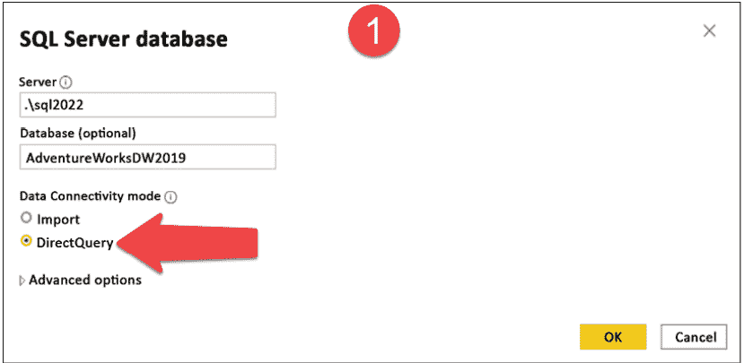

图 10.11：在 DirectQuery 模式下连接到 SQL Server 数据库

2. 在 DirectQuery 模式下连接到以下表：

- DimDate
- DimCustomer
- DimProduct
- FactInternetSales
- vw_Sales_Agg

图 10.12：在 DirectQuery 模式下加载的表

3. 将 vw_Sales_Agg 重命名为 Sales_Agg：

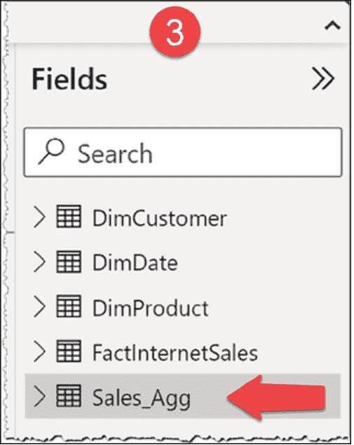

图 10.13：将 vw_Sales_Agg 重命名为 Sales_Agg

## 创建关系

现在我们已经拥有了所有表，我们需要在聚合表和所有必要的维度之间创建关系。在我们的场景中，我们通过 **ProductKey** 列在 **Sales_Agg** 和 **DimProduct** 表之间创建关系，具体如下：

1. 在表之间创建关系。系统会显示一条警告消息，提示所有相关表的存储模式必须切换到 **Dual** 模式。我们可以选择同时切换或稍后切换。

2. 将 **Sales_Agg** 表的存储模式更改为 **Import**。选中 **将受影响的表设置为 dual** 选项，以将 **DimProduct** 设置为 **Dual** 模式。

下图显示了上述步骤：

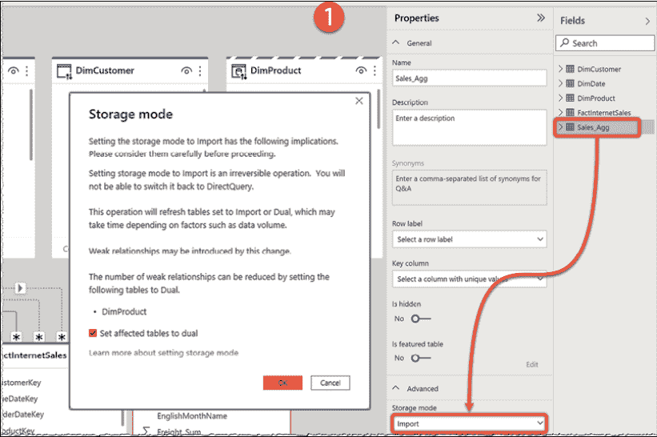

图 10.15：将聚合表的存储模式设置为 Import

我们将聚合表的存储模式更改为 **Import** 模式的原因是，我们希望到达聚合表的查询能够从导入模型并可供 xVelocity 引擎使用的缓存数据中运行，从而在内部解析查询。但为什么 **DimProduct** 必须采用 **Dual** 存储模式呢？下图展示了一个简单的用例。

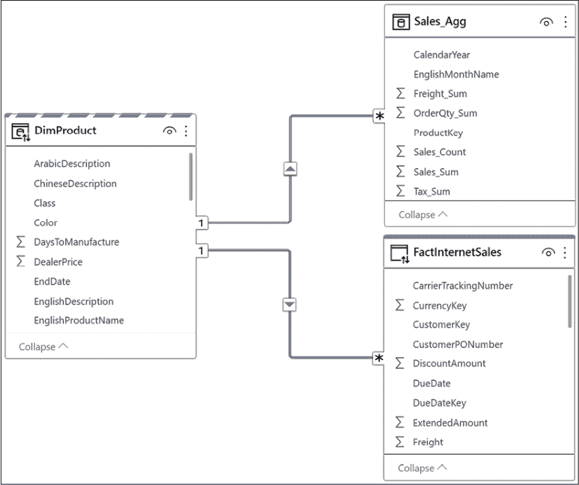

图 10.16：说明 DimProduct 存储模式为 Dual 的原因

如上图所示，**DimProduct** 同时与 **FactInternetSales** 和 **Sales_Agg** 表相关。**FactInternetSales** 表是包含最细粒度数据的明细表。因此，我们将其存储模式设置为 DirectQuery。如前所述，我们将 **Sales_Agg** 的存储模式设置为 **Import**。**DimProduct** 表与 **FactInternetSales** 和 **Sales_Agg** 表存在一对多关系。有趣的是，这两种关系都是常规关系。在第 9 章《星型架构和数据建模常见最佳实践》的“处理多对多关系”部分中，我们讨论了**常规**关系与**有限（弱）**关系之间的区别。

我们了解到，要使关系保持**常规**，两个表必须具有相同的存储模式；因此，**DimProduct** 和 **FactInternetSales** 表必须具有相同的存储模式。我们需要保持 **FactInternetSales** 为 DirectQuery 模式，所以 **DimProduct** 表也必须为 DirectQuery 模式。但 **DimProduct** 表还与 **Sales_Agg** 表存在关系，而 **Sales_Agg** 表的存储处于 **Import** 模式。因此，在上述用例中避免有限关系的唯一方法是将 **DimProduct** 的存储模式设置为 **Dual** 模式。

让我们继续实现聚合。

## 管理聚合

现在我们已经具备所有先决条件，是时候配置聚合表了。请按照以下步骤操作：

1. 右键单击 **Sales_Agg** 表，然后点击 **管理聚合**：

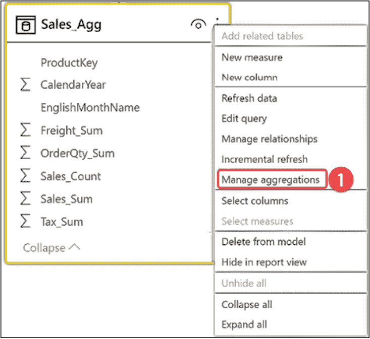

图 10.17：在 Sales_Agg 表上管理聚合

2. 在 **管理聚合** 窗口中，执行以下操作：

   a. 确保在 **聚合表** 中选择了 **Sales_Agg** 表。

   b. 将 **优先级** 保持为 0。

   c. 为 **Sales_Agg** 的列设置 **汇总**。

   d. 点击 **全部应用**：

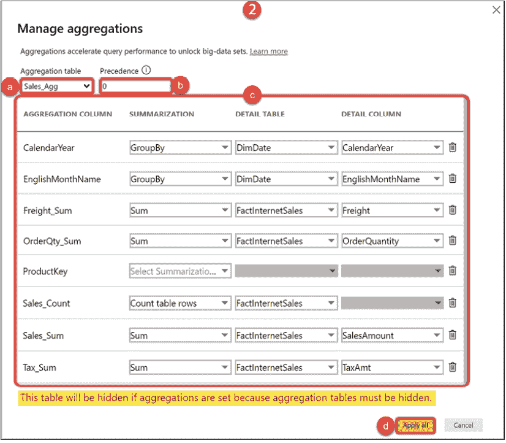

图 10.18：管理聚合

> **注意**
>
> 当使用基于关系的聚合方法管理聚合时，我们不需要为相关列设置 **汇总**。因此，在我们的场景中，我们不会为 **ProductKey** 设置 **汇总**。

应用聚合后，**Sales_Agg** 表将被隐藏。

切换到 **模型** 视图以查看数据模型。下图显示了管理聚合后的数据模型：

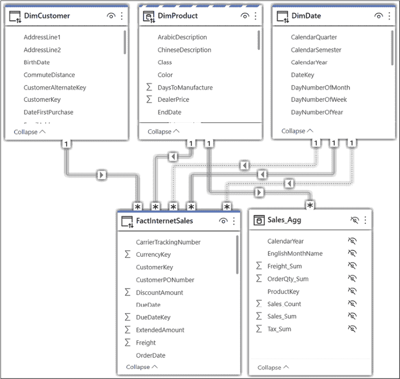

图 10.19：管理聚合后的数据模型

以下是管理聚合后数据模型中的内容：

- **FactInternetSales**、**DimCustomer** 和 **DimProduct** 表处于 **DirectQuery** 模式。请注意表左上角使用的图标。
- **DimProduct** 表处于 **Dual** 模式。

**Sales_Agg** 表已隐藏，并处于 **Import** 模式 ( )。

现在我们已经成功配置了基于 **FactInternetSales** 表的聚合，是时候对其进行测试，以确保当查询位于 **Product**、**Year** 或 **Month** 级别时，计算发生在聚合表上。

将报告保存为 `Chapter 10, User-defined Aggregations (Agg Awareness).pbix`。

## 测试聚合

我们有以下选项来测试聚合：

- Power BI Desktop 中的性能分析器
- DAX Studio
- SQL Server Profiler

接下来的几节将介绍如何使用上述工具来测试聚合。

### 性能分析器

我们都知道，在 Power BI 中可以创建交互式且复杂的报表。报表页上使用的每个视觉对象都会在后台生成一个查询。我们可以使用 Power BI Desktop 中的性能分析器来确定视觉对象的底层查询是否命中聚合表。在明细表（**FactInternetSales**）中创建以下度量值：

```
Internet Sales = SUM(FactInternetSales[SalesAmount])
Internet Sales Due =
    CALCULATE(
        [Internet Sales]
        , USERELATIONSHIP(FactInternetSales[DueDateKey],
DimDate[DateKey]
    )
```

按照以下步骤操作：

1. 在功能区的 **优化** 选项卡中，点击 **性能分析器**。

2. 在 **性能分析器** 窗格中，点击 **开始录制** 按钮。

3. 在报表画布上放置一个 **卡片** 视觉对象，并使用 **Internet Sales** 度量值。

4. 这将在 **性能分析器** 窗格中添加一个 **卡片** 部分。展开 **卡片** 部分。

下图显示了上述步骤：

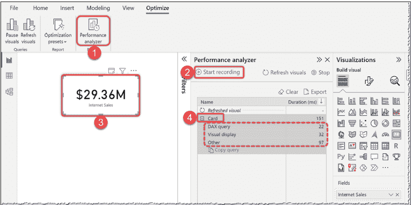

图 10.20：性能分析器对 Internet Sales 卡片视觉对象的结果

如上图所示，结果中不包含 **Direct query** 部分，这表明底层查询命中了聚合表。

让我们再添加一个 **卡片** 视觉对象，使用 **Internet Sales Due** 度量值，然后再次查看性能分析器中的结果。下图显示了结果：

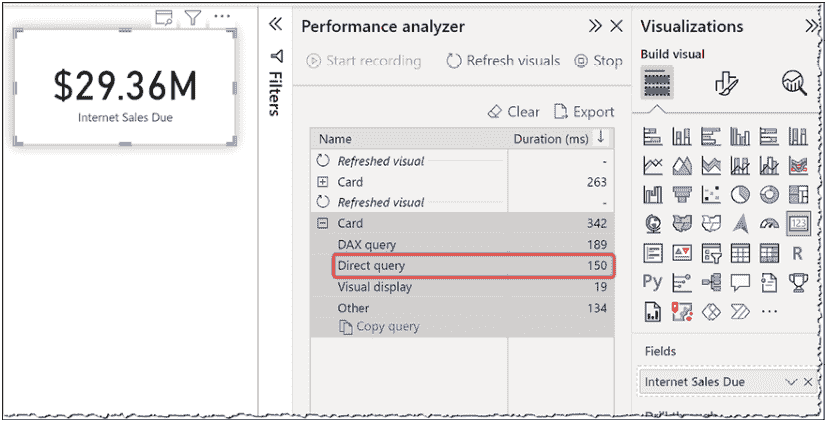

图 10.21：性能分析器对 Internet Sales Due 卡片视觉对象的结果

如您所见，这次结果中包含一个 Direct query 部分，耗时 150 毫秒，这意味着查询没有命中聚合表，而是到达了处于 DirectQuery 模式下的明细表。原因是 Internet Sales Due 度量值使用了 FactInternetSales 和 DimDate 表之间的非活动关系，该关系通过 FactInternetSales 的 DueDateKey 和 DimDate 的 DateKey 建立。因此，底层查询不会命中聚合表。

让我们测试另一个场景：

1. 在报表页面上放置一个表视觉对象
2. 将 DimProduct 中的 EnglishProductName 放到表视觉对象上
3. 将 Internet Sales 度量值放到表上
4. 展开性能分析器窗格中的表部分

下图显示底层查询命中了聚合表，因为性能分析器的结果中不存在 Direct query 部分：


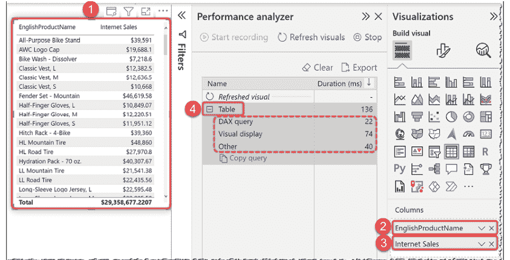

# 图10.22：性能分析器对表视觉对象的分析结果

下一个测试很有趣。我们想看看，如果在矩阵视觉对象上使用CalendarYear和EnglishMonthName列以及Internet Sales度量值，底层查询是否命中聚合表。请按照以下步骤操作：

- 1. 在报表页上放置一个矩阵视觉对象。
- 2. 在“行”下选择CalendarYear。
- 3. 在“值”下选择Internet Sales度量值。
- 4. 在性能分析器中展开“矩阵”部分并观察结果。

下图显示了上述步骤和结果：

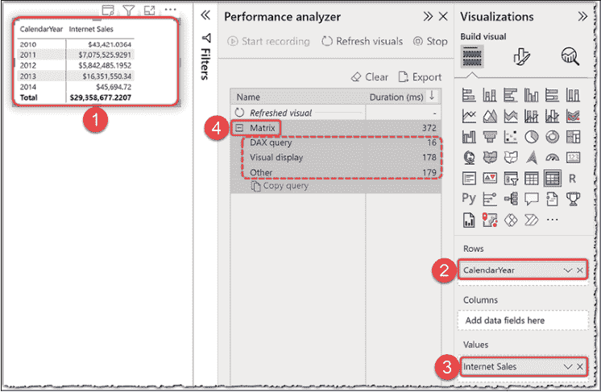

图10.23：性能分析器对矩阵视觉对象的分析结果

因此，**矩阵**查询命中了聚合，这正是我们所期望的。

- 5. 在**列**下选择**EnglishMonthName**。
- 6. 在性能分析器上展开新的**矩阵**部分以查看结果。

下图显示了新的结果：

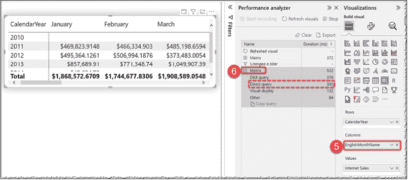

图10.24：性能分析器对矩阵视觉对象的新分析结果

如结果所示，这次查询没有命中聚合表。但为什么？我们在聚合中使用了EnglishMonthName列。为什么底层查询没有命中聚合？原因是EnglishMonthName列按MonthNumberOfYear列排序。因此，我们也需要将MonthNumberOfYear列包含在聚合表中。为此，我们需要修改之前创建的SQL视图，以包含MonthNumberOfYear列。然后刷新DimDate表以获取新添加的列。最后，再次管理聚合，将MonthNumberOfYear列添加到GroupBy。我们将这些步骤留给你来完成。下图显示了做出更改后性能分析器的结果：

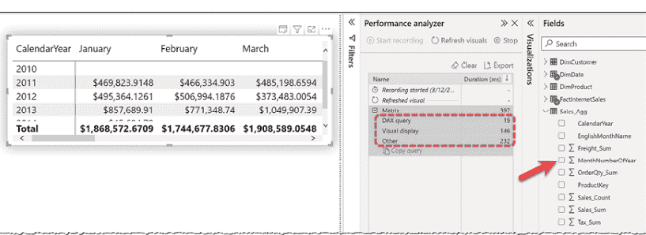

图10.25：修改聚合表后性能分析器的结果

注意

Sales_Agg表是隐藏的，因此要在报表视图中使其可见，我们右键单击该表并勾选“查看隐藏”选项。

在本节中，我们学习了如何使用性能分析器来判断视觉对象的查询是否命中聚合表。虽然性能分析器非常方便，但我们无法在更高级的场景中使用它，例如在数据模型中存在多个聚合时确定命中了哪个聚合表。

在下一节中，我们将学习如何使用DAX Studio。

# DAX Studio

毫无疑问，DAX Studio是许多Power BI和表格模型开发人员使用的最著名的第三方工具之一。它是SQLBI团队开发的免费开源工具。我们可以从其官方网站下载：https://daxstudio.org/downloads/。我们可以在许多场合使用DAX Studio。在本节中，我们将学习如何使用它来判断视觉对象的查询是否命中聚合表。安装DAX Studio后，它出现在Power BI Desktop功能区中的“外部工具”选项卡中。

我们将使用上一节中构建的报表文件。按照以下步骤查看如何使用DAX Studio测试聚合：

- 1. 如果已关闭**性能分析器**，请重新打开并单击**开始记录**。
- 2. 单击功能区中**外部工具**选项卡上的**DAX Studio**。
- 3. 在DAX Studio中，单击**所有查询**按钮。
- 4. 单击底部窗格中的**所有查询**选项卡。
- 5. 将鼠标悬停在Power BI Desktop中的**矩阵**视觉对象上，并单击出现的**分析此视觉对象**按钮。
- 6. 切换到DAX Studio并查看**所有查询**选项卡。如果在查询右侧看到黑色圆点，则查询命中了聚合表。如果圆点是白色的，则是未命中。我们可以将鼠标悬停在圆点上以显示解释结果的工具提示。

下图显示了上述步骤和结果：

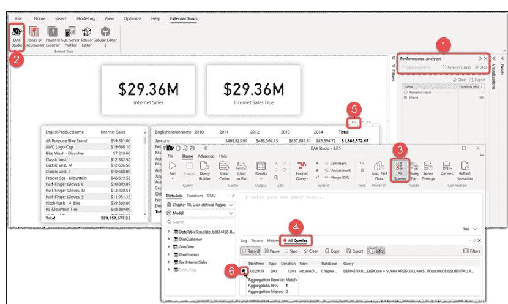

图10.26：使用DAX Studio测试聚合

在下一节中，我们将学习如何使用SQL Server Profiler测试聚合。

# SQL Server Profiler

对于那些有SQL开发或SQL Server管理背景的人来说，SQL Server Profiler并不陌生。我们可以在使用SQL Server实例（包括数据库引擎、SSAS Tabular和SSAS Multidimensional）时使用它进行性能分析和监控。由于Power BI Desktop运行着SSAS Tabular模型的本地实例，我们可以使用连接到Power BI Desktop的SQL Server Profiler来监控数据模型。SQL Server Profiler是SQL Server Management Studio（SSMS）安装包的一部分。

你可以在此处阅读更多关于SQL Server Profiler的内容：

https://learn.microsoft.com/en-us/sql/tools/sql-server-profiler/sql-server-profiler?view=sql-server-ver15&WT.mc_id=DP-MVP-5003466.

我们有以下两个使用SQL Server Profiler的选项：

- - 我们可以将**SQL Server Profiler**注册为外部工具。这样，我们可以在Power BI Desktop中的**外部工具**选项卡中直接打开**SQL Server Profiler**。使用这种方法，**SQL Server Profiler**会自动通过**Power BI诊断端口**连接到我们的Power BI数据模型。在此处阅读更多关于在Power BI Desktop中将**SQL Server Profiler**注册为外部工具的内容：[https://www.biinsight.com/quick-tips-registering-sql-server-profiler-as-an-external-tool/](https://www.biinsight.com/quick-tips-registering-sql-server-profiler-as-an-external-tool/)

- - 我们可以打开**SQL Server Profiler**，并通过Power BI Desktop诊断端口手动连接到我们的Power BI数据模型。为此，我们必须先找到诊断端口号，然后使用端口号连接到数据模型。

在此处了解查找Power BI Desktop诊断端口的各种方法：

[https://www.biinsight.com/four-different-ways-to-find-your-power-bi-desktop-local-port-number/](https://www.biinsight.com/four-different-ways-to-find-your-power-bi-desktop-local-port-number/)

我们将使用第一个选项，因为它比第二个选项更简单。我们必须在SQL Server Profiler中跟踪以下事件。

如果我们使用的是SSMS v17.9（或更高版本），则必须选择以下事件：

- - **查询处理\聚合表重写查询**
- - **查询处理\直接查询开始**
- - **查询处理\Vertipaq SE查询开始**

对于较旧版本的SSMS，我们必须选择以下事件：

- - **查询事件\查询开始**
- - **查询处理\直接查询开始**

# 查询处理\Vertipaq SE查询开始

在本节中，我们将使用第一个选项。请按照以下步骤使用SQL Server Profiler测试聚合：

- 1. 如果已关闭**性能分析器**，请重新打开并单击**开始记录**
- 2. 从**外部工具**选项卡中单击**SQL Server Profiler**
- 3. 单击**停止**按钮以停止当前跟踪
- 4. 单击**属性**按钮以打开**跟踪属性**窗口
- 5. 单击**事件选择**选项卡
- 6. 勾选**显示所有事件**和**显示所有列**选项
- 7. 选择我们在前面的**查询处理**部分中提到的事件，并取消选择所有其他事件
- 8. 单击**运行**
- 9. 转到Power BI Desktop，将鼠标悬停在**矩阵**视觉对象上，并单击**分析此视觉对象**按钮
- 10. 切换回**SQL Server Profiler**并单击**聚合表重写查询**事件

下图显示了上述步骤：

# 图10.27：使用SQL Server Profiler测试聚合

结果在前面的图像中用虚线突出显示，揭示了有关聚合的大量信息，如下所示：

```
{
  "table": "FactInternetSales",
  "matchingResult": "matchFound",
  "mapping": {
    "table": "Sales_Agg"
  },
  "dataRequest": [
    {
      "aggregation": "Sum",
      "table": "FactInternetSales",
      "column": "SalesAmount",
      "mapping": {
        "table": "Sales_Agg",
        "column": "Sales_Sum"
      }
    },
    {
      "table": "DimDate",
      "column": "CalendarYear",
      "mapping": {
        "table": "Sales_Agg",
        "column": "CalendarYear"
      }
    }
  ]
}
```

明细表

查询命中聚合

聚合表

聚合列

GroupBy列

图10.28：使用SQL Server Profiler测试聚合的结果

在下一节中，我们将学习多个聚合的工作原理以及如何实现它们。

# 实现多个聚合

我们在上一节中学习了如何实现用户定义的聚合。在本节中，我们将更进一步，实现多个聚合。多个聚合的实现是指将明细表汇总到不同的聚合表中。换句话说，我们创建多个包含不同粒度数据的聚合表。例如，我们将数据按照年和月级别聚合在一个


在我们之前的场景中有一个聚合表。让我们扩展这个场景，实现另一个聚合表，将数据保持在**年份**级别。我们将新聚合表命名为**Sales_AggYear**。

因此，当我们处于**年份**级别时，期望查询命中**Sales_AggYear**表，而当我们同时处于**年份**和**月份**级别时，查询命中**Sales_Agg**表。要实现这个场景，我们必须完成之前实现聚合的所有步骤，但有一点小小的不同。这一次，我们必须在管理聚合时设置**优先级**选项的值。**优先级**值告诉引擎要考虑其他聚合表。数字越大，优先级越高。所以，当有两个聚合表的优先级值分别为0和10时，引擎会首先考虑优先级较高的聚合表。换句话说，xVelocity引擎会根据其**优先级**值来尝试解决底层聚合查询。我们将使用之前创建的报告文件（*Chapter 10, User-defined Aggregations (Agg Awareness).pbix*）。我们将把**年份**级别的**汇总**留给你，直接跳到聚合实现。下图显示了**管理聚合**窗口中的配置：

管理聚合

聚合可加速查询性能，以解锁大数据集。了解更多

图10.29：设置管理聚合的优先级选项

现在我们将使用SQL Server Profiler测试该解决方案。下图显示了刷新表视觉对象（EnglishProductName by Internet Sales）的结果：

如果设置了聚合，则此表将被隐藏，因为聚合表必须隐藏。

图10.30：测试多个聚合命中Sales_AggYear

如上图所示，视觉对象的查询命中了Sales_AggYear表而不是Sales_Agg，这正是我们所期望的。在另一个测试中，我们将在矩阵视觉对象的行属性中使用CalendarYear和EnglishMonthName，并将Internet Sales度量用于值。下图显示了处于年份级别时的结果：

- 聚合表中的聚合列与明细表中对应列的数据类型必须相同；否则，我们无法完成**管理聚合**。
- 不允许链式聚合。例如，当Table X是Table Y的聚合表时，我们不能在Table X上创建聚合。
- 在配置**管理聚合**窗口时，我们应该为每个聚合列设置**汇总**。使用**对表行数计数**来显示明细表行数的聚合。
- 默认情况下，聚合表是隐藏的。
- 始终在明细表中创建度量，而不是在聚合表中。
- 对于与聚合表具有活动关系的表，我们不需要**分组依据**其聚合列。
- 不支持对非活动关系进行聚合，即使我们使用`USERELATIONSHIP()`函数来激活关系。
- 用户定义的聚合不支持动态M查询参数。
- 出于安全原因，Power BI会忽略来自启用SSO的数据源且具有**导入存储**模式的聚合表。

在本节中，我们讨论了在Power BI中实现聚合的各个方面。下一节将重点介绍在Power BI中处理大量数据时的另一个关键主题：增量刷新和混合表。

## 增量刷新和混合表

增量刷新或增量数据加载是一种众所周知的技术，用于控制数据加载到数据存储的方式，因此我们保留现有数据，只加载更改。让我们更详细地了解它。

从数据移动的技术角度来看，将数据从位置A传输到位置B总是有两种选择：

- **截断并加载**：通过截断位置B并重新加载从A到B的整个数据，将整个数据从位置A传输到位置B。
- **增量加载**：仅在第一次将数据从位置A传输到位置B。下一次，我们只将数据更改从A加载到B。在这种方法中，我们从不截断B。相反，我们只传输A中存在但B中不存在的数据。

> **注意**：增量刷新将更新的数据检测为删除旧数据并插入新数据。

当我们在Power BI中刷新数据时，如果我们没有配置增量刷新，Power BI会使用第一种方法，即截断并加载。毋庸置疑，在Power BI中，上述任何数据刷新方法仅适用于具有**导入存储**模式的表。

一旦我们在Power BI中成功配置了增量刷新策略，根据我们的许可，我们将有以下三个数据范围：

- 历史范围
- 增量范围
- 实时范围

**历史范围**包括过去已处理的所有数据。其存储模式为**导入**。**增量范围**是当前要处理的数据范围。增量范围的存储模式也是**导入**。**实时范围**，正如名字所暗示的，是关于在Power BI中实时捕获源系统的数据更改。实时范围的存储模式是**DirectQuery**。

Power BI中的增量刷新总是在**增量范围**中查找数据更改，而不是在**历史范围**中。因此，历史数据中的更改不会被注意到。如前所述，我们的许可计划决定了支持的数据范围。我们可以在当前所有可用的许可计划中实现和发布排除实时范围的增量刷新策略。实时范围仅适用于Premium许可证。在实现增量刷新并将模型发布到Power BI服务后，在第一次刷新数据集之后，Power BI会为启用增量刷新的表创建一些分区。根据我们在表上的增量刷新配置，其分区属于上述数据范围之一，如下所示：

- 存档分区代表历史范围
- 增量分区代表增量范围
- 实时分区代表实时范围

包含实时分区的表是**混合表**，因为它以**导入**模式存储存档分区和增量分区，同时以**DirectQuery**模式支持实时分区。

配置增量刷新对大型表有益。以下是Power BI中增量刷新的一些好处：

- 数据刷新速度更快，因为我们只传输更改，而不是整个数据
- 数据刷新过程比一直刷新整个数据更少资源密集型
- 与大型表上的非增量刷新相比，数据刷新过程更便宜且更易于维护

> 除了上述好处之外，混合表在大型表上提供实时数据，这非常出色

在处理数十亿行且无法放入Power BI Desktop数据模型的海量数据集时，增量刷新是不可避免的。既然我们了解了增量刷新和混合表，让我们在Power BI中实现它们。

## 在Power BI Desktop中配置增量刷新策略和混合表

我们使用Power BI Desktop来配置增量刷新。一旦我们将模型发布到Power BI服务中，第一次数据刷新会将所有数据从数据源传输到Power BI服务。因此，第一次刷新需要更长时间。任何未来的数据刷新都是增量的。在Power BI Desktop中配置增量刷新很简单。以下步骤说明了该过程：

1. 首先，我们必须在Power Query编辑器中定义两个DateTime参数，RangeStart和RangeEnd，这两个参数用于定义增量刷新策略。

> **注意**
> 
> Power Query区分大小写，因此参数名称必须是RangeStart和RangeEnd。

2. 下一步是使用RangeStart和RangeEnd参数对Int64（整数）或DateTime列进行数据筛选，条件是DateTime列的值介于RangeStart和RangeEnd之间。因此，对于表中具有Smart Date Key列而不是DateTime列的场景，我们必须将RangeStart和RangeEnd参数转换为Int64。Int64或DateTime值必须在RangeStart或RangeEnd上具有等号（=），但不能同时具有。


> Note
> 一个 **Smart Date Key** 是日期值的整数表示。使用智能日期键在数据仓库中保存存储和内存时非常常见。因此，**20200809** 整数值代表 **2020/08/09** 日期值。因此，如果数据源是数据仓库，它很可能在事实表中包含智能日期键而不是日期。对于这些场景，我们可以使用 `Int64.From(DateTime.ToText(RangeStart OR RangeEnd, "yyyyMMdd"))` Power Query 表达式从查询参数的 **DateTime** 值生成智能日期键。

3. 然后我们将数据加载到数据模型中并配置增量刷新。如果我们拥有 Premium 许可证，我们可以配置实时数据处理。在这种情况下，最后一个数据分区设置为 DirectQuery 模式。
4. 我们将模型发布到 Power BI 服务。发布并首次刷新数据集后，Power BI 会创建分区。

考虑到上述条件，让我们通过一个场景来实现增量刷新。在本节中，我们将使用 `Chapter 10, Incremental Refresh.pbix` 示例文件。其数据源是 **AdventureWorksDW2019** SQL Server 数据库。我们希望在以下条件下刷新数据：

- 归档十年的数据
- 增量刷新一个月的数据
- 捕获最近一个月的实时数据

示例文件可在 GitHub 上获取：

https://github.com/PacktPublishing/Expert-Data-Modeling-with-Power-BI-Second-Edition/blob/c946d376871675271055f4b778605691b786cb5c/Samples/Chapter%2010/Chapter%2010%2C%20Incremental%20Refresh.pbix

按照以下步骤实现上述场景：

1. 在 **Power Query Editor** 中，从 SQL Server 获取 **AdventureWorksDW2019** 中的 **FactInternetSales** 表并重命名为 **Internet Sales**：

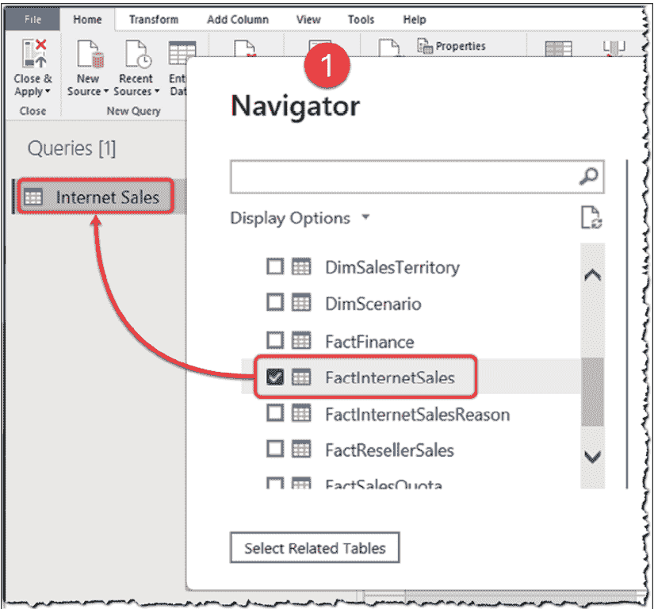

Figure 10.33: Getting data from the source

2. 使用 **Date/Time** 类型定义 **RangeStart** 和 **RangeEnd** 参数。如前所述，**RangeStart** 和 **RangeEnd** 用于配置增量刷新。因此，参数名称必须与前述名称匹配。按如下方式设置参数的 **Current Value**：

- **Current Value** of **RangeStart**: 1/12/2010 12:00:00 AM
- **Current Value** of **RangeEnd**: 31/12/2010 12:00:00 AM

为参数设置一个适用于您场景的 **Current Value** 设置。请记住，这些值仅在开发时有用，因为在下一步定义过滤器后，**Internet Sales** 表将仅包含 **RangeStart** 和 **RangeEnd** 的 **Current Value** 设置之间的值。在我们的场景中，**RangeStart** 的 **Current Value** 是第一个交易的第一个月。**Internet Sales** 中 **OrderDate** 列的第一个交易是 **29/12/2010**。因此，**RangeStart** 的 **Current Value** 为 **1/12/2010**，而 **RangeEnd** 为 **31/12/2010**。

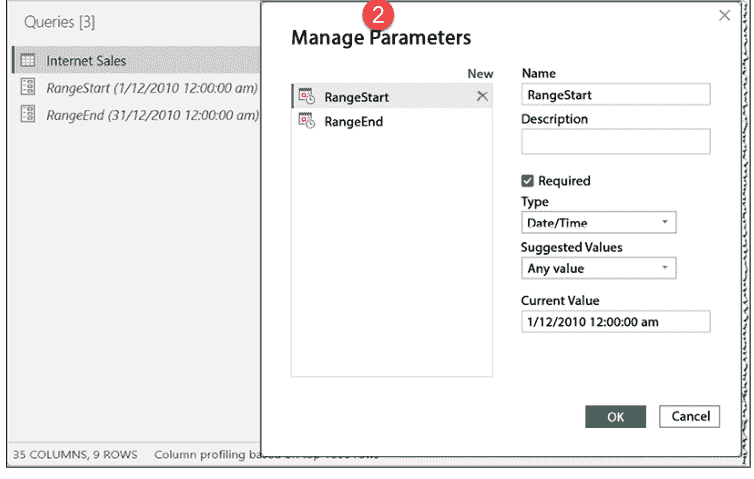

Figure 10.34: Defining the RangeStart and RangeEnd parameters

3. 按以下图像所示过滤 **OrderDate** 列：

Figure 10.35: Filtering the OrderDate column by the RangeStart and RangeEnd parameters

4. 点击 Close & Apply 按钮将数据导入数据模型：

Figure 10.36: Applying changes and loading data into the data model

5. 右键单击 Internet Sales 表并点击 Incremental refresh。Incremental refresh 选项可在 Report view、Data view 或 Model view 的上下文菜单中使用：

Figure 10.37: Selecting Incremental refresh from the context menu

6. 在 Incremental refresh 窗口中执行以下操作：

   a. 启用 Incrementally refresh this table
   b. 将 Archive data starting 设置为 10 Years before refresh date
   c. 将 Incrementally refresh data starting 设置为 1 Months before refresh date
   d. 勾选 Get the latest data in real time with DirectQuery (Premium only)
   e. 由于我们勾选了实时选项，Only refresh complete month 选项将被勾选并禁用
   f. 保持 Detect data changes 选项未勾选
   g. 点击 Apply

以下图像显示了上述步骤：

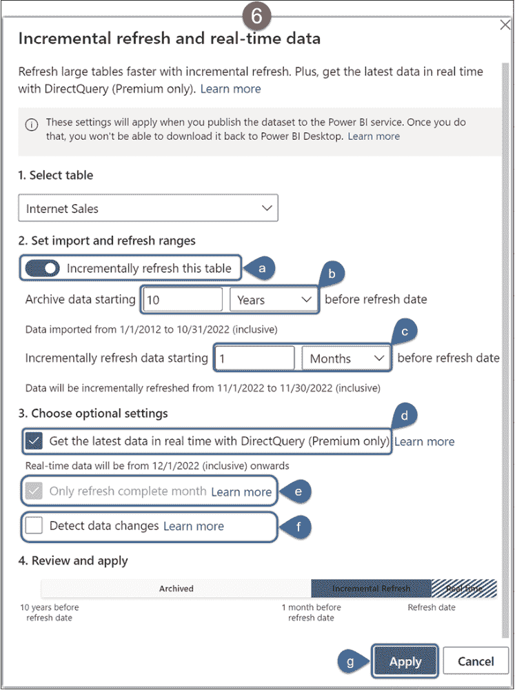

Figure 10.38: Configuring the Incremental refresh and real-time data

> **Note**
> 
> 通过勾选 **Incremental refresh and real-time data** 窗口中的选项 d，**Internet Sales** 表变为 Hybrid Table，这是一个 **Premium** 功能。

**Only refresh complete month** 选项取决于我们在前一图像中项目 **c** 中选择的周期。通过此选项，我们可以强制增量刷新仅针对完整周期。选择前一图像中的项目 **d** 会停用此选项。

在数据集成和数据仓库过程中，我们通常会在表中添加一些额外的审计列以收集有用的元数据，例如 **Last Modified At**、**Last Modified By**、**Activity**、**Is Processed** 等等。如果您有一个指示数据更改的 **Date/Time** 列（例如 **Last Modified At**），**Detect data changes** 选项会很有帮助。我们的源数据中没有审计列；因此，我们将保持其未勾选。

7. 点击 **Publish** 按钮将数据模型发布到 Power BI 服务。由于 **Internet Sales** 表现在是 Hybrid Table，我们只能选择 **Premium Workspaces**。正如以下图像所示，Pro Workspaces 已被停用。点击所需的工作区并点击 **Select**：

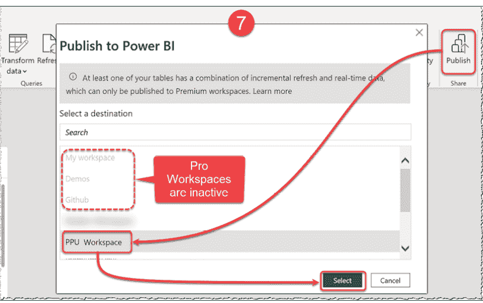

Figure 10.39: Publishing the report to the Power BI service

到目前为止，我们已配置增量刷新并将数据模型发布到 Power BI 服务。此时，Power BI 管理员应接管以完成 Power BI 服务中的 **Schedule refresh** 设置。管理员还必须设置 On-premises Data Gateway、传递凭据等。这些设置超出了本书的范围，因此我们留给您。我们假设 Power BI 管理员已在 Power BI 服务中完成设置并首次刷新数据集。在下一节中，我们将解释如何测试增量刷新。

## Testing the incremental refresh

要可视化具有增量刷新表的已创建数据集分区并正确测试它，我们必须拥有 Premium 或 Embedded 许可证才能连接到 Power BI 服务中的所需工作区。我们必须使用 **SQL Server Management Studio (SSMS)** 或 **Tabular Editor** 等第三方应用程序来查看我们为增量数据刷新创建的分区。我们使用 SSMS 来查看已创建的分区。您可以从此处下载 SSMS：
https://learn.microsoft.com/en-us/sql/ssms/download-sql-server-management-studio-ssms?view=sql-server-ver16&WT.mc_id=DP-MVP-5003466.

> Note
> 
> 如果您没有 Premium 许可证，您可以使用 Power BI 个人试用版来尝试 Power BI **Premium Per User (PPU)**，如果您的 Power BI 管理员未在 Power BI 租户设置中阻止 *Allow users to try Power BI paid features*。阅读更多信息：
> https://learn.microsoft.com/en-us/power-bi/fundamentals/service-self-service-signup-for-power-bi?WT.mc_id=DP-MVP-5003466.

但如果我们拥有 Pro 许可证，我们仍然很幸运。如果您还记得，当我们在 Power Query Editor 中实现增量刷新先决条件时，我们通过 **RangeStart** 和 **RangeEnd** 参数过滤了表的数据。因此，我们期望 Power BI 在我们首次刷新数据集后创建分区，这意味着数据集必须涵盖完整的数据范围，而不仅仅是 Power BI Editor 中由查询参数过滤的数据。因此，如果增量刷新未通过，我们将只看到一小部分数据。我们可以通过在 Power BI Desktop 或 Power BI 服务中创建新报表（或如果已有报表则创建新报表页）并实时连接到数据集，在报表画布上放置一个表格视觉对象来测试它。我们将这部分留给您。

如果您已经拥有 Premium 许可证，请按照以下步骤从 SSMS 连接到 Premium 工作区：

1. 在 Power BI 服务中，导航到包含具有增量刷新表的数据集的所需 Premium 工作区。
2. 点击 Settings。
3. 点击 Premium 选项卡。
4. 复制 Workspace Connection URL。

以下图像显示了上述步骤：

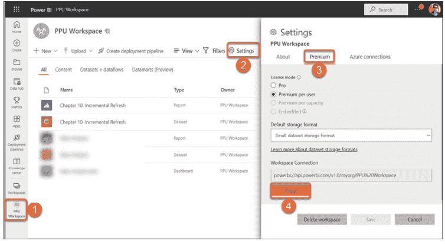

Figure 10.40: Getting Workspace Connection URL from the Power BI service

5. 打开 SSMS 并在 Connect to Server 窗口中执行以下操作：


- a. 将**服务器类型**选择为**Analysis Services**。
- b. 将**工作区连接**链接粘贴到**服务器名称**框中。
- c. 将**身份验证**选择为**Azure Active Directory – Universal with MFA**（如果你的租户启用了 MFA）。
- d. 输入用户名。
- e. 单击**连接**：

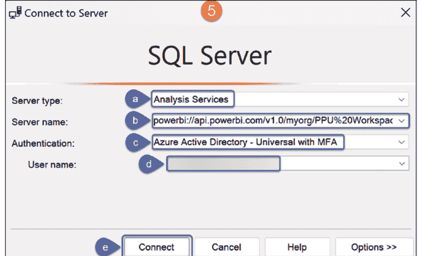

图 10.41：从 SSMS 连接到 Power BI Premium 工作区

- 6. 现在，我们可以在**对象资源管理器**窗格中的**数据库**下看到工作区中包含的所有数据集。展开**数据库**，展开数据集，然后展开**表**。
- 7. 右键单击**Internet Sales**表。
- 8. 单击**分区...**。
- 9. 现在，你可以查看增量刷新过程创建的所有分区，如下图所示：

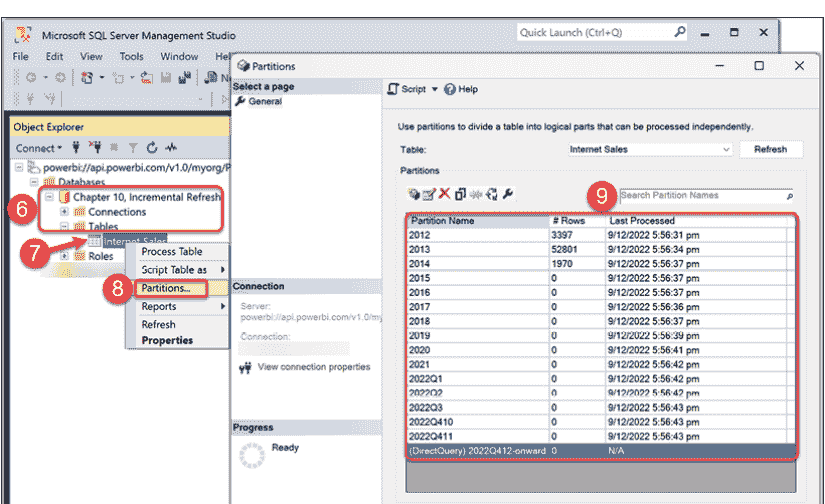

图 10.42：从 SSMS 导航到表的分区

如你所见，你可以直接从 SSMS 查看或修改已创建的分区，并将更改保存回 Power BI 服务。这得益于 XMLA 终结点的读写功能，该功能在 Power BI Premium 和 Embedded 容量中可用。

你可以在此处详细了解通过 XMLA 终结点进行的数据集连接：https://learn.microsoft.com/en-us/power-bi/enterprise/service-premium-connect-tools?WT.mc_id=M365-MVP-5003466。

下图更详细地解释了分区，以及分区与数据范围之间的关系：

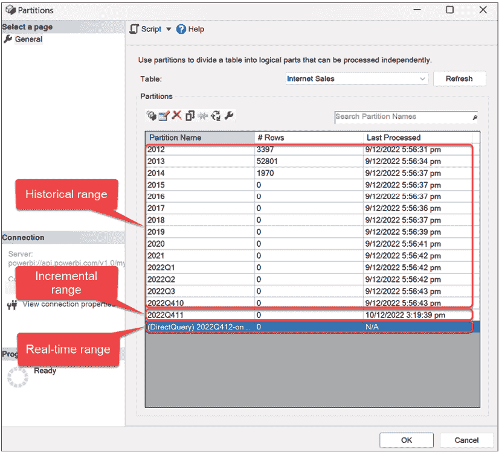

图 10.43：数据集分区和数据范围

如前图所示，Power BI 按年、季度和月级别创建了分区。这是根据增量刷新配置完成的，而具体配置可能因情况而异。根据我们定义的增量策略，这些分区将自动刷新（如果我们在服务中计划了自动数据刷新）。随着时间的推移，其中一些分区会被删除，另一些分区会与其他分区合并。例如，在我们的示例中，当进入 2023 年 1 月时，月级别分区会合并到季度级别，季度级别分区会合并到年级别。

到目前为止，我们已经学习了如何测试增量刷新。下一节将介绍有关增量刷新和混合表的一些重要注意事项。

## 有关增量刷新和混合表的重要注意事项

在实际场景中实施解决方案时，可能会出现许多问题。本节将介绍一些重要注意事项，这些内容有助于应对日常使用增量刷新和混合表时遇到的挑战。

- 增量刷新和实时数据（混合表）最适合使用关系数据库系统，例如 SQL Server 数据库、Azure SQL 数据库、Synapse Analytics 等。
- 虽然增量刷新最适合支持查询折叠的数据源，但它也支持基于文件的数据源，以及其他不支持查询折叠的数据源。在支持查询折叠的数据源上实施增量刷新时，最好确保查询已完全折叠。
- 如前文所述，混合表会将最后一个分区保留为 DirectQuery 模式，以支持实时数据。因此，非折叠数据源无法使用混合表。
- 撰写本书时，混合表功能仍处于公共预览阶段，因此不建议在生产环境中实施该功能。
- 可视化实时数据时，最好启用**自动页面刷新**。你可以在此处详细了解**自动页面刷新**设置：https://learn.microsoft.com/en-us/power-bi/create-reports/desktop-automatic-page-refresh?WT.mc_id=DP-MVP-5003466。
- 在 Power BI Desktop 中实施增量刷新时，不会发生任何变化。所有神奇的操作都发生在报表发布到 Power BI 服务，并且我们首次刷新数据集之后。
- 首次在 Power BI 服务中刷新数据集后，我们将无法再从 Power BI 服务下载数据模型（数据集）。这一限制完全合理。试想一下，我们以增量方式将数十亿行数据加载到一个表中。即使我们能够下载该文件（实际上无法下载），桌面计算机也无法处理如此大量的数据。不过，我们仍然可以将连接的报表下载为精简报表。
- 无法从服务下载包含增量刷新的表的数据集，这一事实也给 Power BI 的开发和后续支持带来了另一个问题。如果将来需要对数据模型进行任何更改，就必须使用 Tabular Editor、ALM Toolkit 或 SSMS 等第三方工具，将更改部署到现有数据集，而不能覆盖现有数据集。否则，如果我们在 Power BI Desktop 中完成所有更改，再将更改发布回服务并覆盖现有数据集，则现有数据集中创建的所有分区及其数据都会丢失。要使用上述任一工具连接到现有数据集，我们必须使用 XMLA 终结点，而 XMLA 终结点仅适用于 Premium 用户，不适用于 Pro 用户。因此，如果你使用 Pro 许可证实施增量刷新，请务必注意这一限制。
- 处理大型数据源时，首次数据刷新可能比较棘手。Power BI 对数据刷新持续时间设置了**时间限制**。对于 Pro 许可证，数据刷新必须在 2 小时内完成；对于 Premium 和 Embedded，时间限制为 5 小时。原因在于，数据刷新过程可能会消耗数据集静态占用内存量的两倍，因为 Power BI 会保留现有数据集的副本，以响应所有现有查询；与此同时，它还会刷新数据集中的数据。

  因此，时间限制可能会成为瓶颈。在这种情况下，最好使用一个虚拟值筛选表，使其不返回任何行。然后，将模型发布到服务，并执行首次数据集刷新，以便在数据集中创建所有分区。最后，使用第三方工具通过 XMLA 终结点连接到数据集，逐个手动刷新分区。这样可以避免发生超时。此方法仅适用于 Premium 数据集。

本节介绍了如何实施和测试增量刷新及混合表。下一节将解释父子层次结构的概念及其实施方式。

## 父子层次结构

父子层次结构的概念通常用于关系数据建模。当表中的两列值表示数据中的层次级别时，就形成了父子层次结构。父级拥有子级，子级也可以拥有自己的子级，从而形成层次结构图。本节将介绍父子层次结构及其在关系数据建模中的实施方式。然后，我们将了解 Power BI 中的父子设计。下图展示了一个典型的父子关系图。图中的每个节点都包含一个 ID 和人员姓名：

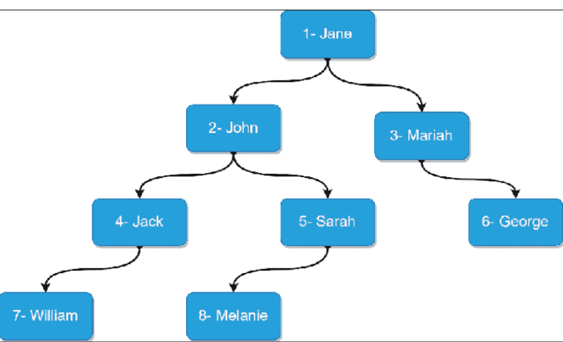

图 10.44：父子关系图

我们可以使用数据表表示前面的关系图，如下图所示：

父级 子级

| ID | 姓名 | 父级 ID |
| --- | --- | --- |
| 1 | Jane | NULL |
| 2 | John | 1 |
| 3 | Mariah | 1 |
| 4 | Jack | 2 |
| 5 | Sarah | 2 |
| 6 | George | 3 |
| 7 | William | 4 |
| 8 | Melanie | 5 |

图 10.45：数据表中的父子关系图表示

ID 列和 ParentID 列之间存在一对多关系。在关系数据建模中，我们会在 ID 列和 ParentID 列之间创建关系，从而将父子表转换为自引用表，如下图所示：

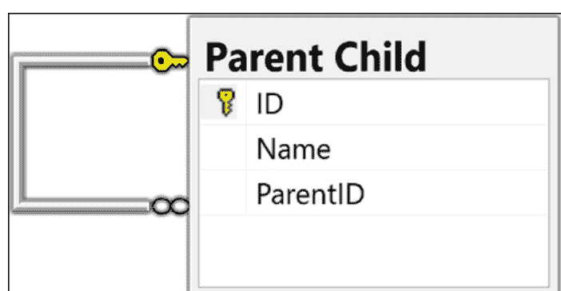

图 10.46：父子表是一个自引用表

虽然 Power BI 中的数据建模是关系型的，但遗憾的是，为了避免数据模型中的歧义，Power BI 不支持自引用表。不过，好消息是，DAX 函数中有一组


```
Path = PATH('Parent Child'[ID], 'Parent Child'[ParentID])
```

前述表达式的输出提供了我们的层次结构的路径，如下图所示：

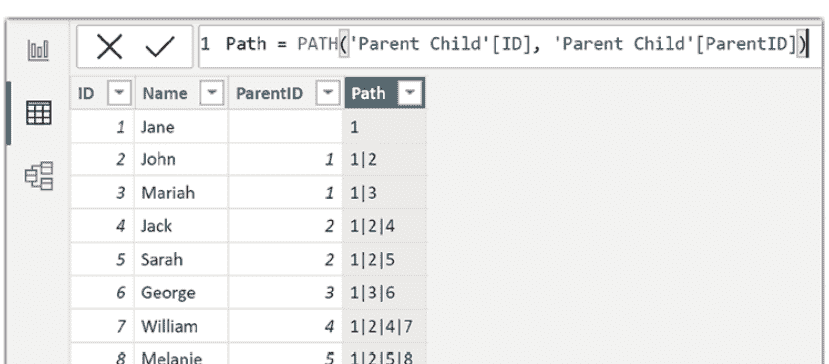

图 10.48：创建包含层次结构路径的新计算列

以下是使用 PATH() 函数时的一些注意事项：

**注意：**

- **ID** 和 **ParentID** 必须具有相同的数据类型，为 `integer` 或 `text`。
- **ParentID** 列的值必须存在于 **ID** 列中。如果父级不存在，`PATH()` 函数将找不到父级。
- 如果 **ParentID** 为 null，则该节点为图的根。
- 每个 **ID**（子级）只能有一个且仅有一个 **ParentID**；否则，`PATH()` 函数将抛出错误。
- 如果 **ID** 为 `BLANK()`，则 `PATH()` 返回 `BLANK()`。

现在我们有了 Path 列的值，我们可以使用 PATHLENGTH(PathColumn) 函数快速识别层次结构的深度。我们需要使用以下 DAX 表达式创建另一个计算列：

```
Path Length = PATHLENGTH('Parent Child'[Path])
```

下图显示了运行前述表达式的输出：

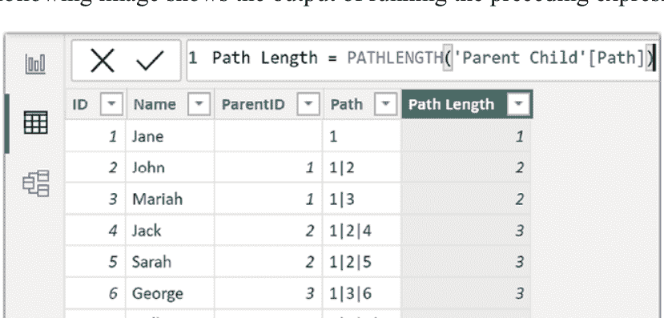

图 10.49：计算路径长度

现在我们计算了 Path Length，我们知道层次结构的深度值为 4。因此，我们需要创建四个新的计算列——每个层次级别一个。

## 创建层次级别

到目前为止，我们已经确定了层次结构的深度。为了实现父子层次结构，在我们的示例中，我们知道层次结构的深度为 4，因此我们需要创建四个计算列。我们可以使用 PATHITEM(Path, Path Length, Datatype) 函数来识别这些层次级别，该函数返回 Path 列中指定 Path Length 的项目。换句话说，PATHITEM() 函数返回的值为

运行前述表达式后得到以下输出：

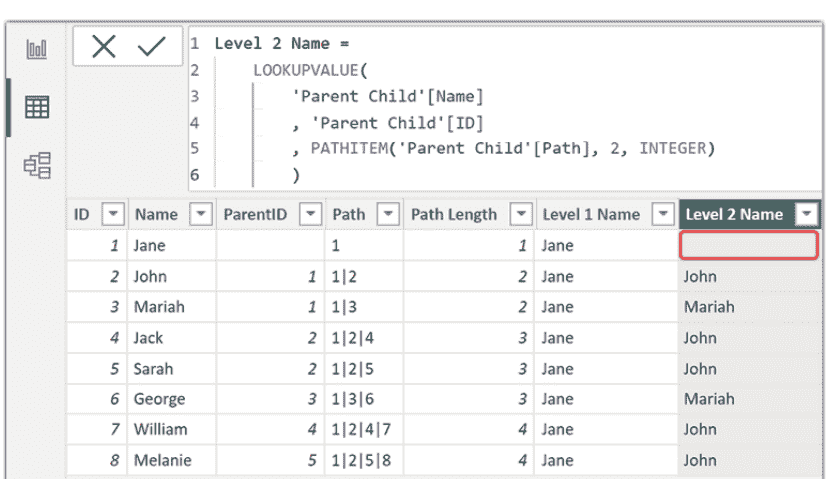

图 10.51：运行 Level 2 Name 表达式的结果

正如你所见，该表达式对第一个值返回空值（为空）。当我们在层次结构中存在空白值时，我们称之为不规则层次结构。不规则层次结构会让可视化层感到困惑，因为我们会在每个层次级别都得到 BLANK()。管理不规则层次结构的一种方法是添加过滤器以避免 BLANK() 值。另一种方法是在 DAX 表达式中管理不规则层次结构。我们只需要检查 Path Length 列的值。如果它大于或等于我们正在查看的指定层次级别，则返回 Name 列的对应值；否则，返回前一级别的 Name 列的值。显然，对于层次结构的第一个级别，我们没有空值。因此，我们无需检查 Path Length。所以，我们必须使用以下表达式创建四个新的计算列。

以下表达式返回层次结构第 1 级的 Name 列的值：

```
Level 1 Name =
    LOOKUPVALUE(
        'Parent Child'[Name]
    , 'Parent Child'[ID]
    , PATHITEM('Parent Child'[Path], 1, INTEGER)
    )
```

以下表达式返回层次结构第 2 级的 Name 列的值：

```
Level 2 Name =
    IF(
        'Parent Child'[Path Length] >=2
        , LOOKUPVALUE(
            'Parent Child'[Name]
            , 'Parent Child'[ID]
            , PATHITEM('Parent Child'[Path], 2, INTEGER)
        ) //End LOOKUPVALUE
        , 'Parent Child'[Level 1 Name]
    ) // End IF
```

以下表达式返回层次结构第 3 级的 Name 列的值：

```
Level 3 Name =
    IF(
        'Parent Child'[Path Length] >=3
        , LOOKUPVALUE(
            'Parent Child'[Name]
            , 'Parent Child'[ID]
            , PATHITEM('Parent Child'[Path], 3, INTEGER)
        ) //End LOOKUPVALUE
        , 'Parent Child'[Level 2 Name]
    ) // End IF
```

以下表达式返回层次结构第 4 级的 Name 列的值：

```
Level 4 Name =
    IF(
        'Parent Child'[Path Length] >=4
        , LOOKUPVALUE(
            'Parent Child'[Name]
            , 'Parent Child'[ID]
            , PATHITEM('Parent Child'[Path], 4, INTEGER)
        ) //End LOOKUPVALUE
        , 'Parent Child'[Level 3 Name]
    ) // End IF
```

下图显示了运行前述表达式的结果：

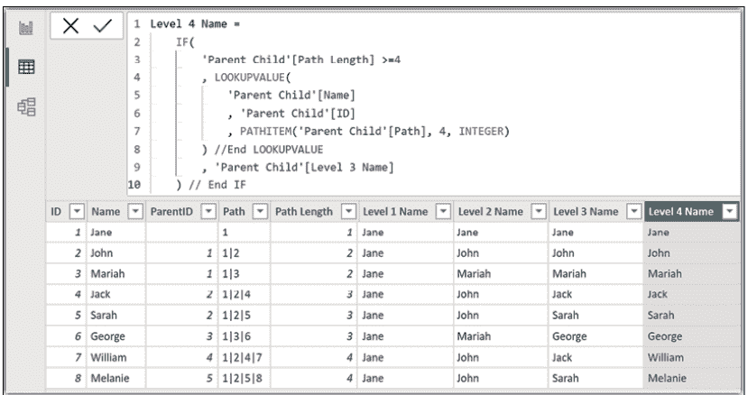

图 10.52：创建四个新的计算列返回层次级别

此时，我们拥有了所有层次级别。现在，我们可以使用这四个级别创建一个层次结构。下图显示了新的层次结构以及在切片器中层次结构的可视化表示：

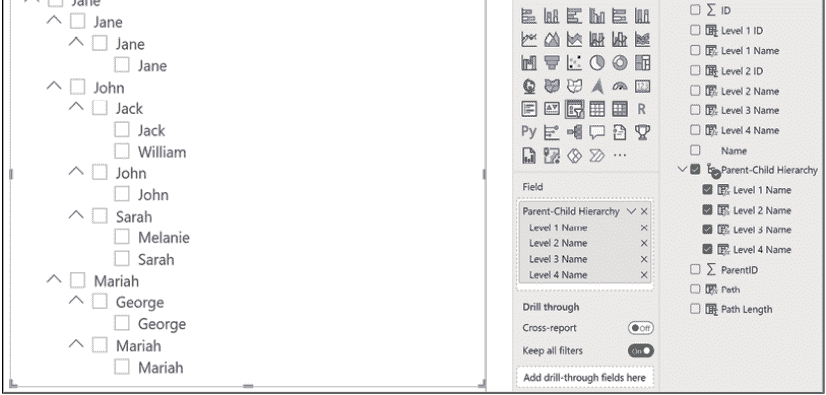

图 10.53：父子层次结构

在本节中，我们讨论了如何实现父子层次结构。我们在本节中使用的示例很简单，但原则保持不变。你可以使用本节中讨论的技术来克服现实世界中的场景，例如员工层次结构、组织结构图等。在下一节中，我们将讨论角色扮演维度并学习如何在 Power BI 中实现它们。

## 实现角色扮演维度

角色扮演维度是我们数据建模中最常见的场景之一。该术语源自 SQL Server Analysis Services 多维中的多维建模。在进入实现部分之前，让我们花点时间了解角色扮演维度是什么。当我们在事实表和维度之间创建多个关系以用于逻辑上不同的角色时，我们使用角色扮演维度的概念。最流行的角色扮演维度是日期和时间维度。例如，我们可能在事实表中拥有多个日期，例如 Order Date、Due Date 和 Ship Date，它们与 **Date** 维度参与不同的关系。每个日期在我们的分析中代表不同的角色。换句话说，我们可以使用 **Date** 维度对数据进行不同目的的分析。例如，我们可以根据 **Order Date** 计算 **Sales Amount**，其结果与以下值不同；即 **Sales Amount** 按 **Due Date** 或 **Sales Amount** 按 **Ship Date**。但有一个小问题：xVelocity 引擎不支持同时存在多个活动关系。然而，我们可以使用 DAX 中的 `USERELATIONSHIP()` 函数以编程方式启用非活动关系，该函数在计算期间激活关系。我们可以在 `CALCULATE()` 函数中使用 `USERELATIONSHIP()` 函数。

现在我们了解了角色扮演维度是什么，让我们使用 **AdventureWorksDW2017.xlsx** 示例文件在一个场景中实现它：

1. 打开 Power BI Desktop，连接到 **AdventureWorksDW2017.xlsx** 文件，并从 **Reseller_Sales** 和 **Dates** 表中获取数据：

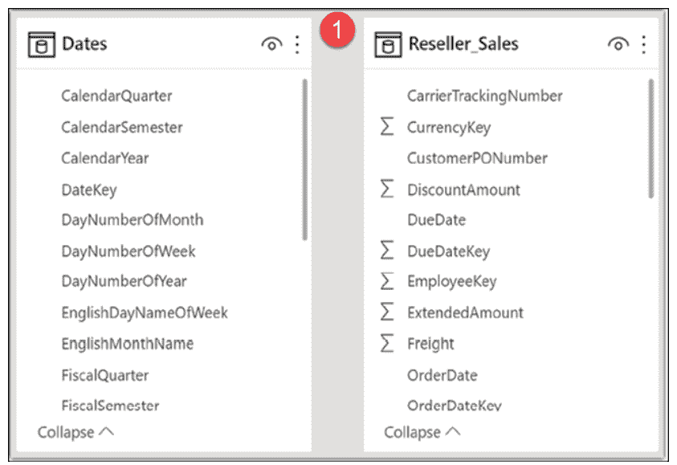

图 10.54：从 Reseller_Sales 和 Dates 表中获取数据

2. 在 Reseller_Sales 和 Dates 表之间创建以下关系。保持第一个关系处于活动状态：

   a. Reseller_Sales(OrderDateKey) => Dates(DateKey)
   b. Reseller_Sales(DueDateKey) => Dates(DateKey)
   c. Reseller_Sales(ShipDateKey) => Dates(DateKey)

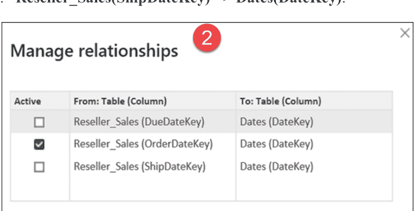

图 10.55：在 Reseller_Sales 和 Dates 之间创建关系

我们现在需要为每个角色创建新的度量值，并适当命名度量值以使其类似于角色。

请记住，两个表之间的活动关系仍然是主要关系。因此，所有基于 Reseller_Sales 和 Dates 表计算值的度量值都使用活动关系。因此，保持对业务最有意义的关系处于活动状态至关重要。在我们的场景中，Order Date 是业务最重要的日期。因此，我们将保持 Reseller_Sales(OrderDateKey) => Dates(DateKey) 关系处于活动状态。

我们可以使用以下 DAX 表达式创建按订单日期的 Reseller Sales 度量值：


Reseller Sales by Order Date =
SUM(Reseller_Sales[SalesAmount])

我们可以使用以下 DAX 表达式创建 **Reseller Sales by Due Date** 度量值：

```
Reseller Sales by Due Date =
    CALCULATE([Reseller Sales by Order Date]
        , USERELATIONSHIP(Dates[DateKey],
Reseller_Sales[DueDateKey])
    )
```

我们可以使用以下 DAX 表达式创建 **Reseller Sales by Ship Date** 度量值：

```
Reseller Sales by Ship Date =
    CALCULATE([Reseller Sales by Order Date]
        , USERELATIONSHIP(Dates[DateKey],
Reseller_Sales[ShipDateKey])
    )
```

如您所见，我们没有在 **Reseller Sales by Order Date** 度量值中使用 `USERELATIONSHIP()` 函数，因为 **Reseller_Sales** 和 **Dates** 表之间的活动关系是 **Reseller_Sales (OrderDateKey) => Dates (DateKey)。**

现在，我们可以在数据可视化中使用上述度量值。下图显示，为支持角色扮演维度而创建的所有度量值并排显示在一个矩阵中：

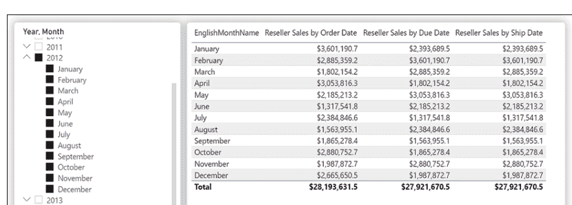

图 10.56：可视化角色扮演维度

如果您有 SQL Server 多维分析（Multidimensional）的背景，您可能会考虑创建多个 **Date** 表。虽然这是实现角色扮演维度的另一种方法，但我们不建议这样做。以下是不建议创建多个 **Date** 表来处理角色扮演维度的一些原因：

- 在我们的模型中拥有多个 **Date** 表可能会让其他内容创建者感到困惑，即使我们只有两个 **Date** 表。
- 这种方法不必要地增加了数据模型的大小和内存消耗。
- 这种方法难以维护。我们见过一些业务有 10 个以上的角色；用 10 个 **Date** 表来处理角色扮演维度听起来并不合理。

在本节中，我们学习了角色扮演维度的概念，并在 Power BI 中实现了它。在下一节中，我们将学习另一个能够解决许多日常开发难题的高级主题：计算组。

## 使用计算组

创建计算组是 Power BI 数据建模人员和开发人员最有用的功能之一。它减少了您必须创建的度量值数量。计算组解决了这样一个问题：在较大且更复杂的数据模型中，我们必须创建许多某种程度上冗余的度量值。创建这些度量值会花费大量开发时间。例如，在 **Sales** 数据模型中，我们可以将 **Sales Amount** 作为基础度量值。在真实场景中，我们通常必须在 **Sales Amount** 度量值之上创建许多时间智能度量值，例如 **Sales Amount YTD**、**Sales Amount QTD**、**Sales Amount MTD**、**Sales Amount LYTD**、**Sales Amount LQTD**、**Sales Amount LMTD** 等等。我们见过在一个度量值之上创建超过 20 个时间智能度量值的模型。在真实场景中，我们的基础度量值远多于需要为每个基础度量值创建全部 20 个时间智能度量值的业务。您可以想象开发所有这些度量值是多么耗时。我们只需要使用计算组创建一次引用度量值。然后，我们就可以将它们与任何基础度量值一起使用。换句话说，这些度量值可以重复使用。计算组过去仅在 SQL Server Analysis Services Tabular 2019、Azure Analysis Service 和 Power BI Premium 中可用。但现在它们已向所有 Power BI 许可计划开放，包括 Power BI Free。然而，在撰写本书时，我们还无法直接在 Power BI Desktop 中实现计算组；我们必须使用 Tabular Editor v.2，这是一个由出色的 Daniel Otykier 构建的知名免费社区工具。

在简要说明之后，在我们进入开发流程之前，让我们更熟悉一些要求和术语。

## 要求

如前所述，在撰写本书时，我们还无法直接在 Power BI Desktop 中创建计算组：

- 我们需要下载并安装 Tabular Editor v.2。您可以从此处下载：
  https://github.com/TabularEditor/TabularEditor/releases/latest.
- 我们必须拥有 Power BI Desktop July 2020 或更高版本。
- 为整个数据模型禁用 **隐式度量值**。我们在 *第 8 章，数据建模组件* 的 *字段* 部分中介绍了这一点。
- 计算组不支持隐式度量值；因此，数据模型中必须至少有一个显式度量值。

## 术语

让我们了解以下与计算组相关的术语：

- `Calculation Group`：计算组实际上就是一个表，就像其他任何包含计算项的表一样。
- `Precedence`：每个计算组都有一个 `precedence` 属性，用于指定存在多个计算组时的求值顺序。优先数较高的计算组将在优先数较低的计算组之前求值。
- `Calculation Item`：我们使用 DAX 表达式在计算组内创建计算项。计算项类似于模板度量值，可以对我们数据模型中的任何显式度量值运行。每个计算组都有两列：`Name`（数据类型为 `Text`）和 `Ordinal`（数据类型为 `Whole Number`）。`Name` 列保存计算项的名称。`Ordinal` 列是一个隐藏列，保存 `Name` 列的排序顺序。换句话说，`Ordinal` 列对 `Name` 列进行排序。我们可以根据需要创建任意数量的计算项。
- `Ordinal`：每个计算项都有一个 `Ordinal` 属性。`Ordinal` 属性决定计算项在报表视觉对象中的显示顺序。当我们设置计算项的 `Ordinal` 属性时，我们就是在输入 `Ordinal` 列的值。如果未设置 `Ordinal` 属性，计算项将在报表中按字母顺序显示。设置 `Ordinal` 属性不会影响计算项的优先级和求值顺序。
- `Sideways Recursion`：术语“侧向递归”指的是计算项引用同一计算组内其他计算项的情况。除非我们创建无限循环（例如，计算项 A 引用计算项 B，反之亦然），否则允许侧向递归。当计算项引用引用第一个计算项的显式度量值时，也可能发生无限循环。最好避免侧向递归。

现在我们已经更加熟悉要求和术语，是时候实现计算组了。

## 实现计算组来处理时间智能

实现计算组最常见的用例之一是处理时间智能度量值。因此，让我们创建一个新的计算组并将其命名为 **Time Intelligence**。然后，我们必须在此计算组内定义一系列时间智能计算项，以满足业务需求。本节和下一节将使用 `Chapter 10, Calculation Groups.pbix` 示例文件，该文件的数据来自 `AdventureWorksDW2017.xlsx` 文件。我们已经加载了 **Internet_Sales** 和 **Dates** 表中的数据。然后，我们通过重命名表和列进行了一些转换步骤。

我们还从数据模型中删除了不必要的列；然后，将数据导入数据模型，并将 **Date 表** 标记为 **Date**。我们还下载并安装了 Tabular Editor v.2。现在，让我们开始：

1. 从 **外部工具** 选项卡中单击 **Tabular Editor**：

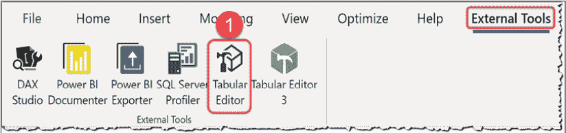

图 10.57：从外部工具选项卡打开 Tabular Editor

2. 在 Tabular Editor 中，右键单击 **Tables** 节点，将鼠标悬停在 **Create New** 上，然后单击 **Calculation Group**。我们也可以使用 *Alt+7* 键盘快捷键：


图10.58：在Tabular Editor中创建新的计算组

- 3. 将新的计算组命名为Time Intelligence。
- 4. 将计算组优先级设置为10。
- 5. 将Name列重命名为Time Calculations。

## 图10.59：创建计算组

- 6. 右键单击“计算项”节点，然后点击“新建计算项”：

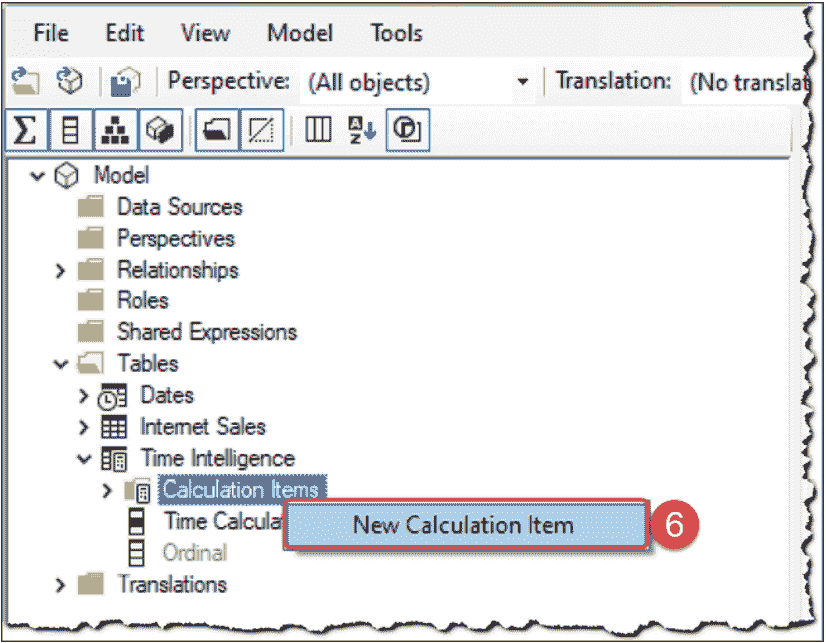

图10.60：在Tabular Editor中创建计算项

- 7. 将新的计算项命名为Current。此计算项将显示所选度量的当前值。
- 8. 在“表达式编辑器”框中输入SELECTEDMEASURE()表达式。
- 9. 将Ordinal属性设置为0。
- 10. 点击“接受更改”按钮（✔）：

图10.61：为计算项添加DAX表达式

- 11. 创建另一个计算项，将其命名为YTD，并使用TOTALYTD(SELECTEDMEASURE(), 'Dates'[Date])表达式，然后将其Ordinal属性设置为1：

图10.62：创建另一个计算项

- 12. 点击保存（💾）按钮，将更改保存回Power BI Desktop中的数据模型：

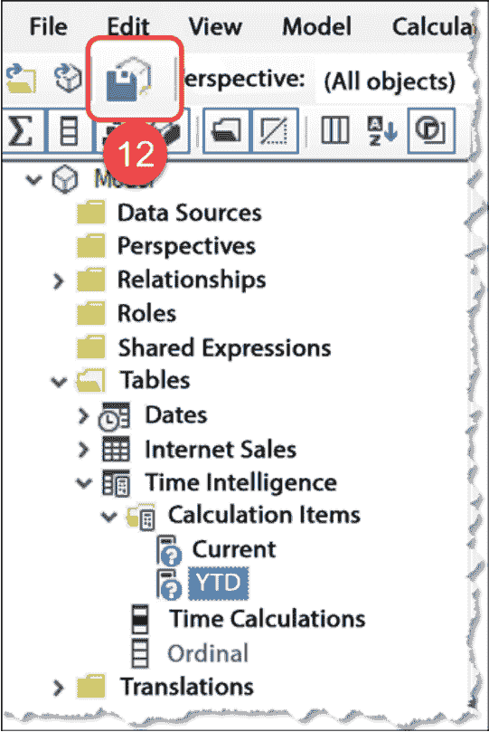

图10.63：将更改从Tabular Editor保存回Power BI Desktop

- 13. 返回Power BI Desktop，点击黄色警告条上的**立即刷新**按钮：

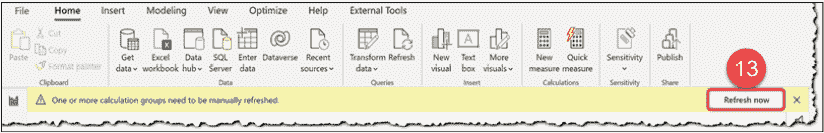

图10.64：将更改应用回Power BI Desktop后刷新计算组

我们可以根据业务需要创建任意数量的计算项。在我们的示例中，添加了七个计算项，如下图所示：

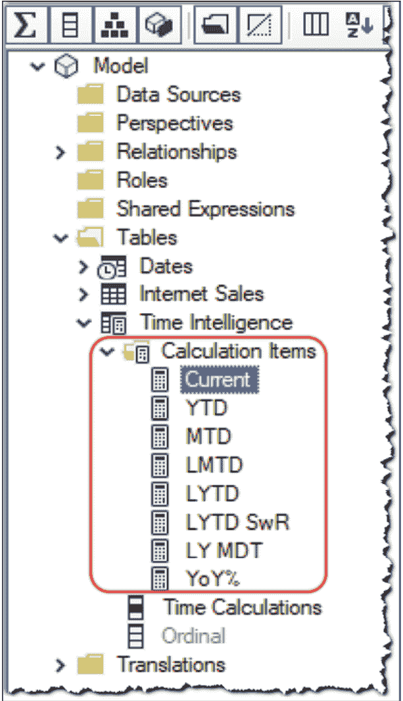

图10.65：示例文件中创建的计算项

让我们看看这些表达式。**Ordinal**用于创建以下计算项：

| 计算项 | DAX表达式 | Ordinal | 描述 |
|---|---|---:|---|
| Current | `SELECTEDMEASURE()` | 0 | 显示所选度量的当前值 |
| YTD | `TOTALYTD(SELECTEDMEASURE(), 'Dates'[Date])` | 1 | 年初至今 |
| MTD | `TOTALMTD(SELECTEDMEASURE(), 'Dates'[Date])` | 2 | 月初至今 |
| LMTD | `TOTALMTD(SELECTEDMEASURE(), DATEADD('Dates'[Date], -1, MONTH))` | 3 | 上月至今 |
| LYTD | `TOTALYTD(SELECTEDMEASURE(), DATEADD('Dates'[Date], -1, YEAR))` | 4 | 去年同期至今 |
| LYTD SwR | `CALCULATE(SELECTEDMEASURE(), DATEADD('Dates'[Date], -1, YEAR), 'Time Intelligence'[Time Calculations] = "YTD")` | 5 | 去年同期至今（侧向递归） |
| LY MTD | `TOTALMTD(SELECTEDMEASURE(), SAMEPERIODLASTYEAR('Dates'[Date]))` | 6 | 去年同月至今 |
| YoY% | `var _current = SELECTEDMEASURE()\nvar _ly = CALCULATE(SELECTEDMEASURE(), DATEADD('Dates'[Date], -1, YEAR))\nreturn DIVIDE(_current - _ly, _ly)` | 7 | 同比变化百分比 |

图10.66：示例文件中用于创建计算项的表达式和Ordinal值

看看前面表达式中的`LYTD SwR`计算项。`LYTD SwR`计算项是使用侧向递归的一个例子。`LYTD SwR`计算项的结果与`LYTD`计算项相同。我们只是想展示侧向递归在实际操作中的样子。再次提醒，尽可能避免侧向递归。它会给代码增加不必要的复杂性。此外，对于不了解侧向递归上下文的报表协作者来说，侧向递归可能会成为问题。既然我们已经完成了实现，现在来测试一下。

## 测试计算组

正如我们之前提到的，计算组只适用于显式度量。因此，我们必须在示例中至少创建一个显式度量，才能使计算组生效。我们在示例文件中创建了以下度量：

用于计算SalesAmount的度量：

```DAX
Total Sales = SUM('Internet Sales'[SalesAmount])
```

用于计算OrderQuantity的度量：

```DAX
Quantity Ordered = SUM('Internet Sales'[OrderQuantity])
```

下面来测试我们创建的计算组，看它是否按预期工作，步骤如下：

- 1. 在Power BI Desktop中，将“矩阵”视觉对象放到报表页上。将Dates表中的Year、Month和Date列放入“行”。
- 2. 将时间智能计算组中的Time Calculations列放入“列”。
- 3. 将Internet Sales表中的Total Sales度量放入“值”：

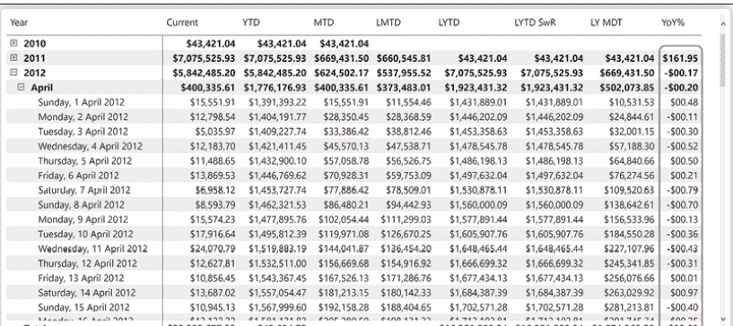

图10.67：在矩阵视觉对象中可视化计算组

如上图高亮所示，**YoY%** 的格式字符串存在问题。在下一节中，我们将通过一个简单的过程来修复此问题。

## 修复格式字符串问题

如上图所示，我们之前在`Time Intelligence`计算组中创建的所有计算项都格式化为货币。但我们没有为任何计算项设置格式字符串。这些计算项会从所选度量中继承格式字符串。虽然从所选度量继承格式字符串是一个方便的特性，但如上图高亮所示，它可能不适用于所有计算项，例如**YoY%**。

**YoY%** 的格式字符串必须是百分比，无论所选度量携带的格式字符串是什么。我们必须为**YoY%**计算项设置格式字符串来修复此问题，这将覆盖所选度量的格式字符串。这里，我们必须再次打开Tabular Editor，将**YoY%**的格式字符串设置为“**0.00%**”。下图显示了上述修复：

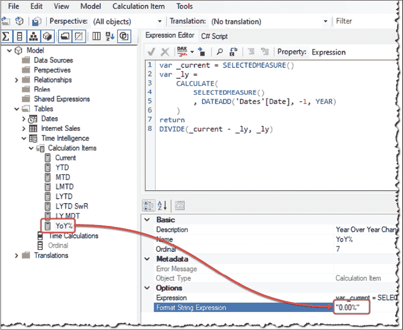

图10.68：在Tabular Editor中修复格式字符串问题

> **注意**
>
> 我们在*第8章“数据建模组件”*中的*字段*部分下的*自定义格式*小节中讨论了格式字符串。

下图显示了将更改保存回Power BI Desktop模型后的**矩阵**视觉对象：

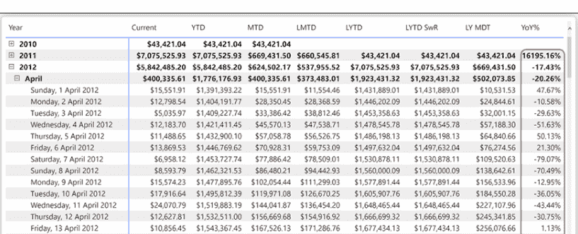

图10.69：修复格式字符串问题后的矩阵视觉对象

如上图所示，格式字符串问题已解决。

## 用于计算组的DAX函数

计算组有许多本章未涵盖的用例。因此，我们将剩下的内容留给你去探索。但是，有必要提及当前可用于计算组的DAX函数。以下列表简要说明了这些函数：

- `SELECTEDMEASURE()`：对计算项之上使用的显式度量的引用。你可以在此处了解有关SELECTEDMEASURE()函数的更多信息：https://learn.microsoft.com/en-us/dax/selectedmeasure-function-dax?WT.mc_id=DP-MVP-5003466。
- `ISSELECTEDMEASURE([Measure1], [Measure2], ...)`：接受数据模型中存在的显式度量列表，然后确定视觉对象中当前选定的度量是否为输入参数列表中提到的度量之一。它可用于有条件地应用计算逻辑。你可以在此处了解有关ISSELECTEDMEASURE([Measure1], [Measure2], ...)函数的更多信息：https://learn.microsoft.com/en-us/dax/isselectedmeasure-function-dax?WT.mc_id=DP-MVP-5003466。
