## 行级和对象级安全性

在上一章中，我们学习了高级数据建模技术，例如实现各种聚合类型、增量刷新、父子层次结构、角色扮演维度和计算组。本章讨论数据建模的一个重要方面：**行级安全性**和**对象级安全性（分别为RLS和OLS）**。我们将涵盖以下主题：

- RLS和OLS在数据建模中的含义
- 术语
- 实现流程
- 常见的RLS和OLS实现方法

我们尝试通过实际场景来涵盖上述主题，但请记住，每个Power BI项目可能有特定的要求，因此在一章中涵盖所有可能性和场景几乎是不可能的。

谈到Power BI安全性，许多人立即会想到它与Power BI管理相关，这在某种程度上是正确的。RLS过滤整个数据模型中的数据，以向相关用户显示相关数据。另一方面，OLS保证只有授权用户才能访问模型对象，例如表和列。因此，RLS和OLS都是直接应用于数据模型的访问控制机制，它们的实现与数据建模者直接相关。尽管如此，最终我们还是将数据模型发布到Power BI Service或Power BI Report Server中，用户根据其角色与数据模型进行交互。因此，安全设置任务因组织而异。在某些组织中，管理员的工作是负责Power BI中的数据集安全相关设置


需要注意的是，RLS 或 OLS 仅在报表级别生效，并且仅当：

- 用户在工作区中拥有**查看者**角色。
- 报表通过**链接**、**直接访问**或**应用**与用户共享。

**注意**

如前所述，RLS 会筛选整个数据模型中的数据，而 OLS 会在报表层面向未经授权的用户隐藏数据模型对象。因此，它们并不是针对 Power BI 数据模型的安全或权限控制配置。

## 术语

在实施 RLS 和 OLS 之前，我们应该了解一些术语。以下各节将介绍这些术语。

## 角色

角色是表示数据模型中表上安全规则特征的名称。最好选择一个能描述底层安全规则的有意义的名称。我们可以在 Power BI Desktop 中定义角色，步骤如下：

- 1. 单击**建模**选项卡。
- 2. 单击**管理角色**按钮。
- 3. 单击**创建**按钮以添加新角色。

上述步骤在以下图片中进行了高亮显示：

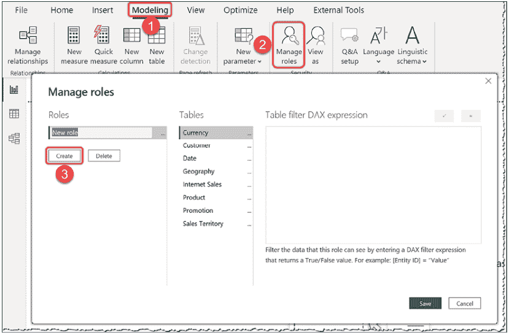

图 11.1：Power BI Desktop 中的角色

## 规则

安全规则是决定角色可以查看哪些数据的 DAX 表达式。定义规则的 DAX 表达式返回 true 或 false。按照以下步骤添加新规则：

- 1. 单击功能区中“建模”选项卡上的“管理角色”按钮。
- 2. 输入返回 true 或 false 的 DAX 表达式。我们还可以单击要应用规则的表的省略号按钮，以选择特定列。
- 3. 单击“验证 DAX 表达式”按钮。

下图展示了一个规则，该规则筛选 Currency 表的数据，仅显示货币为 AUD 的销售额。我们在“AUD Sales Only”角色下定义了这个规则：

图 11.2：定义 RLS 规则

## 增强的行级别安全性编辑器

2023 年 2 月，微软发布了一个新的行级别安全性编辑器，简化了规则创建过程。在撰写本书时，增强的行级别安全性编辑器处于公开预览阶段。在新的编辑器中，我们可以在传统的 DAX 界面和新的下拉版本之间切换。例如，下图显示了新编辑器中的“AUD Sales Only”角色：

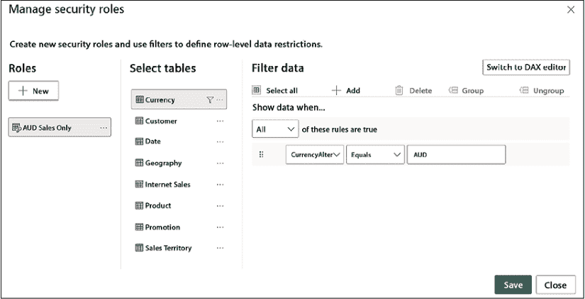

图 11.3：在增强的行级别安全性编辑器中定义 RLS 规则

由于此功能仍处于公开预览阶段，并且可能会发生变化，因此我们在本章中使用 DAX 界面。

## 验证角色

当我们创建角色和规则时，我们需要测试和验证它们。我们可以在 Power BI Desktop 和 Power BI Service 中验证角色。以下步骤展示了在 Power BI Desktop 中的角色验证：

- 1. 单击**建模**选项卡中的**查看身份**按钮。
- 2. 选择一个要验证的角色。
- 3. 单击**确定**。

上述步骤在以下图片中进行了高亮显示：

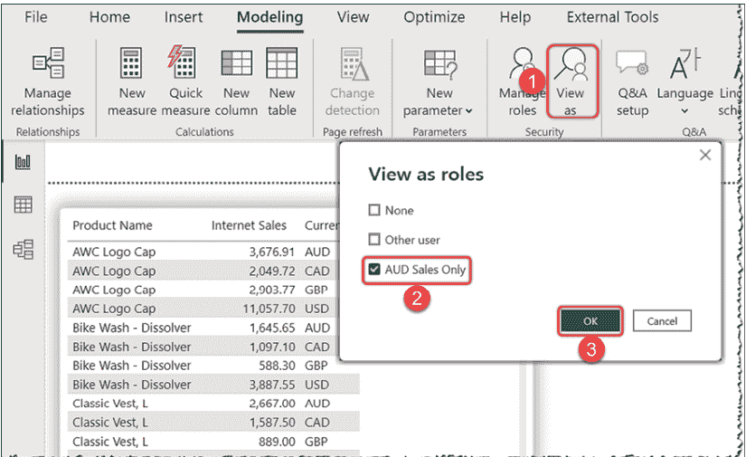

图 11.4：验证角色

下图显示验证结果仅包含 Currency 为 AUD 时的 Internet Sales。我们单击“停止查看”按钮来结束验证：

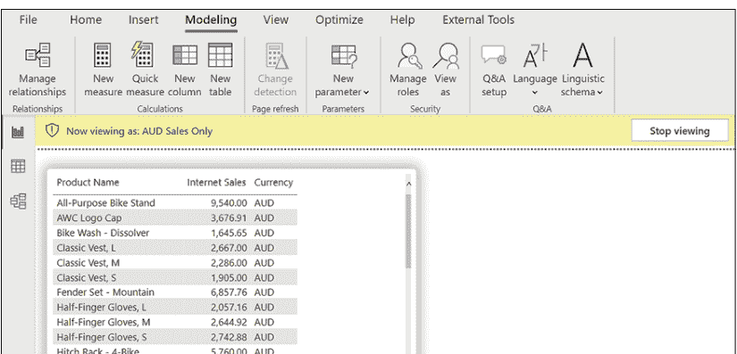

图 11.5：角色验证结果

## 在 Power BI Service 中为角色分配成员

实施安全角色后，我们需要将用户或组分配给角色。成员管理是 Power BI Service 或 Power BI Report Server 中 RLS 安全管理的一部分。以下步骤展示了如何在 Power BI Service 中为角色分配成员，并将报表发布到工作区：

- 1. 导航到目标工作区。
- 2. 将鼠标悬停在数据集上，并单击省略号按钮。
- 3. 单击**安全性**。
- 4. 选择一个角色。
- 5. 键入帐户或组，然后选择它。
- 6. 单击**添加**按钮。
- 7. 单击**保存**按钮。

上述步骤在以下图片中进行了高亮显示：

图 11.6：在 Power BI Service 中为 RLS 角色分配成员

下一节将介绍在 Power BI Report Server 中为角色分配成员。

## 在 Power BI Report Server 中为角色分配成员

以下步骤展示了在将报表发布到服务器后，如何在 Power BI Report Server 中为角色分配成员：

- 1. 打开 Web 浏览器并导航到 Power BI Report Server。
- 2. 在“浏览”选项卡中单击所需报表的省略号按钮。
- 3. 单击“管理”。

上述步骤在以下图片中进行了高亮显示：

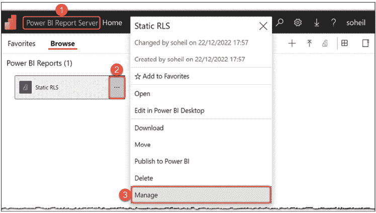

图 11.7：在 Power BI Report Server 中管理报表

- 4. 单击“行级别安全性”。
- 5. 单击“添加成员”按钮。
- 6. 输入用户名或组名。
- 7. 选择要分配给用户的角色。
- 8. 单击“确定”。

上述步骤在以下图片中进行了高亮显示：

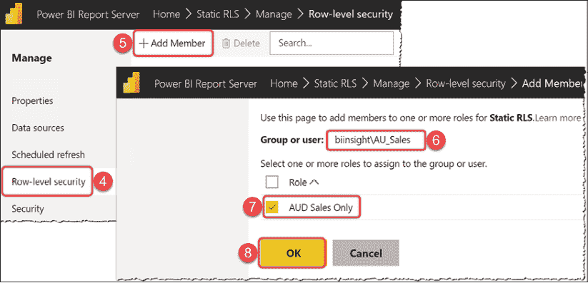

图 11.8：在 Power BI Report Server 中为用户或组分配角色

将用户或组分配到角色后，用户只能看到相关数据。

## RLS 实施流程

在 Power BI 中实施 RLS 始终遵循相同的流程，该流程适用于所有实施方法和所有受支持的存储模式。我们在数据模型中实施 RLS；因此，数据集的存储模式必须是**导入模式**、**DirectQuery 模式**或**复合模式（混合模式）**。以下步骤说明了 RLS 实施流程：

- 1. 创建安全角色。
- 2. 在角色内定义规则。
- 3. 在 Power BI Desktop 中验证角色。
- 4. 将模型发布到 Power BI Service 或 Power BI Report Server。
- 5. 在 Power BI Service 或 Power BI Report Server 中为角色分配成员。
- 6. 在 Power BI Service 中验证角色（在 Power BI Report Server 中无法进行角色验证）。

下图说明了上述流程：

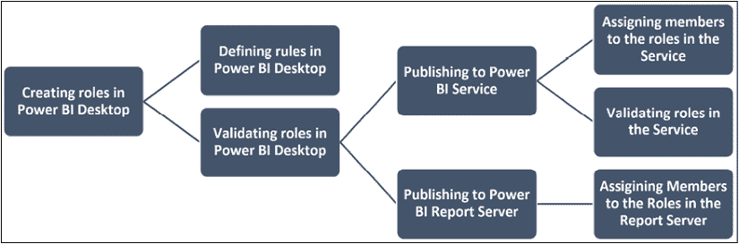

图 11.9：RLS 实施流程

在下一节中，我们将介绍不同的 RLS 实施方法。

## 常见的 RLS 实施方案

在 Power BI Desktop 中实施 RLS 通常有两种不同的方法：静态 RLS 和动态 RLS。在接下来的几个小节中，我们将通过实施实际场景来研究这两种方法。

### 静态 RLS 实施

静态 RLS 方法是指我们定义规则，将筛选器静态应用于数据模型。例如，在*图 11.2*中，我们创建了一个静态 RLS 规则，当货币等于 **AUD** 时，按货币筛选 **Internet Sales** 金额。虽然静态 RLS 实施起来很简单，但根据场景的不同，维护和支持成本可能会变得相当高。此外，静态 RLS 有时足以满足业务需求。

让我们看一个场景；Adventure Works 是一家国际组织，在 **Azure Active Directory（Azure AD）** 或 Microsoft 365 中有多个安全组，根据用户的地理位置对其进行分隔。业务部门希望实施 RLS，以便澳大利亚用户只能看到他们的 **Internet Sales** 金额。相比之下，世界其他地区可以查看*除*澳大利亚以外的所有 **Internet Sales** 金额。在本节中，我们使用 `Chapter 11, Static RLS.pbix` 示例文件。你可以从此处下载示例文件：https://github.com/PacktPublishing/Expert-Data-Modeling-with-Power-BI-Second-Edition/blob/main/Samples/Chapter%2011/Chapter%2011%2C%20Static%20RLS.pbix。

以下步骤展示了上述需求的实施过程。

**创建角色并定义规则**：按照以下步骤创建角色并定义规则：

- 1. 单击功能区上**建模**选项卡中的**管理角色**按钮。
- 2. 单击**创建**。
- 3. 输入 **AUD Sales Only** 作为角色名称。
- 4. 单击 **Currency** 表的省略号按钮。
- 5. 将鼠标悬停在 **添加筛选器...** 上。
- 6. 单击 **[CurrencyAlternateKey]**。

上述步骤在以下图片中进行了高亮显示：

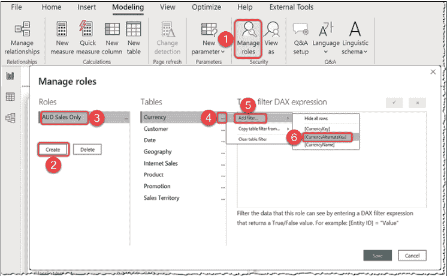


## 图 11.10：在 Power BI Desktop 中创建仅 AUD 销售的 RLS 角色

+   7. 这会自动创建 [CurrencyAlternateKey] = "Value" DAX 表达式。将 Value 字段替换为 AUD。
+   8. 单击验证 DAX 表达式按钮。

以下步骤在以下图像中突出显示：

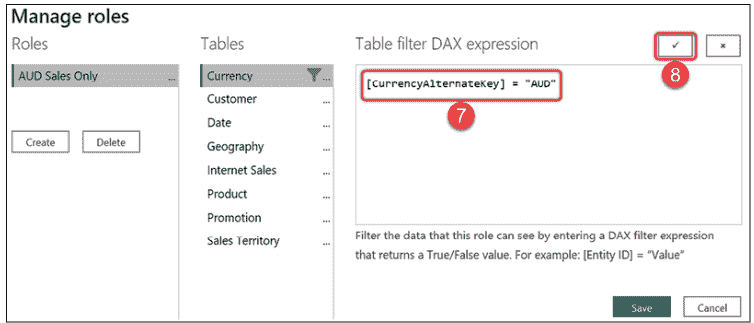

## 图 11.11：定义新的 RLS 规则

+   9. 再次单击创建按钮。
+   10. 输入 Non-AUD Sales 作为角色名称。
+   11. 单击 Currency 表的省略号按钮。
+   12. 将鼠标悬停在添加筛选器.... 上。
+   13. 单击 [CurrencyAlternateKey]。
+   14. 将生成的 DAX 表达式更改为 [CurrencyAlternateKey] <> "AUD"。
+   15. 单击验证 DAX 表达式按钮。
+   16. 单击保存。

以下步骤在以下图像中突出显示：

## 图 11.12：在 Power BI Desktop 中创建 Non-AUD Sales RLS 角色

到目前为止，我们已经创建了角色。现在我们需要验证它们。

### 验证角色：以下步骤解释在 Power BI Desktop 中进行角色验证：

+   1. 从建模选项卡单击以视图方式查看按钮。
+   2. 选择要验证的角色。
+   3. 单击确定。
+   4. Non-AUD Sales 角色的结果在表格视觉对象中可见。
+   5. 验证完成后单击停止查看按钮。

以下图像显示了 Non-AUD Sales 角色的验证：

## 图 11.13：验证 Non-AUD Sales 角色

下一步是在确保角色按预期工作并为角色分配成员后，将模型发布到 Power BI 服务。

### 将报表发布到 Power BI 服务：按照以下步骤将报表发布到 Power BI 服务：

+   1. 从功能区的开始选项卡单击发布按钮。
+   2. 从列表中选择所需的 workspace。
+   3. 单击选择按钮。

以下步骤在以下图像中突出显示：

## 图 11.14：将 Power BI 报表发布到 Power BI 服务

报表成功发布后，我们需要从 Web 浏览器登录到 Power BI 服务以将成员分配给角色。

**分配成员给角色：** 登录到 Power BI 服务后，导航到包含我们之前发布的报表的 workspace。以下步骤说明如何分配成员给角色：

+   1. 单击所需数据集的 **更多选项** 按钮。
+   2. 单击 **安全性**。
+   3. 选择所需的角色。
+   4. 输入用户或组；我在我的环境中定义了两个安全组（**AU Users** 和 **Non-AU Users**），因此我将这两个组分配给相应的角色。
+   5. 单击 **添加**。
+   6. 单击 **保存**。

以下步骤在以下图像中突出显示：

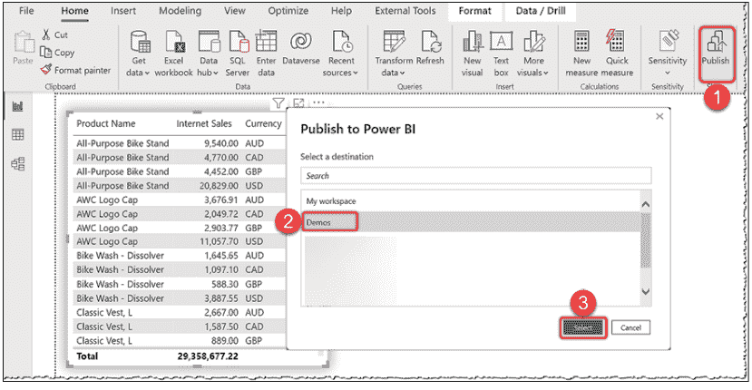

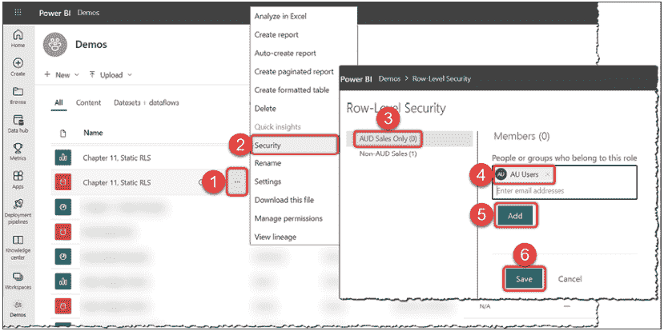

## 图 11.15：分配成员给角色

> 注意
> 
> 我们必须是 workspace 的 **管理员** 或 **成员** 才能分配成员给安全角色或验证角色。

我们现在已成功实施 RLS，以便向澳大利亚用户显示 **澳大利亚元 (AUD)** 销售金额，向世界其他地区显示非 AUD 销售。正如前面提到的，我们也可以在 Power BI 服务中验证角色。要从服务中验证角色，我们无需先分配成员给角色。现在，让我们在 Power BI 服务中验证角色。

### **在 Power BI 服务中验证角色：** 以下步骤将帮助您在 Power BI 服务中验证角色：

+   1. 单击角色的省略号按钮。
+   2. 单击 **以角色身份测试。**

以下步骤在以下图像中突出显示：

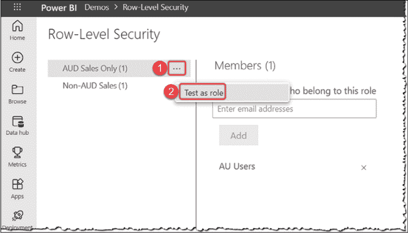

## 图 11.16：在 Power BI 服务中验证 RLS 角色

这将打开一个应用了所选 RLS 角色筛选器的报表。以下图像显示了 **AUD Sales Only** 角色的验证结果：

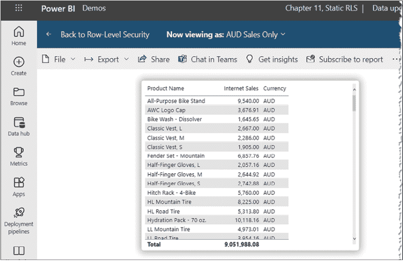

## 图 11.17：AUD Sales Only 角色的验证结果

现在我们已经了解了如何实现静态 RLS 场景，让我们来看一些需要动态 RLS 实现的更复杂场景。

## 动态 RLS 实现

在许多情况下，我们需要实现动态 RLS，因为静态 RLS 不能满足要求。在本节中，我们将研究需要实现动态 RLS 的几个现实场景。

### 限制未经授权用户访问数据

想象一个场景，我们需要为销售数据模型中的销售人员实施 RLS。每个销售人员只能看到自己的销售数据。对于这种场景，实现静态 RLS 是行不通的。原因是我们要么必须为每个销售人员创建一个静态角色并将成员分配给每个角色，要么创建一个基于销售人员用户名的动态角色。这种场景是最简单的动态 RLS 实现之一，也是最常见的之一。在本节中，我们使用随本书提供的 `Chapter 11, Dynamic RLS.pbix` 示例文件。您可以从此处下载示例文件：[https://github.com/PacktPublishing/Expert-Data-Modeling-with-Power- BI-Second-Edition/blob/main/Samples/Chapter%2011/Chapter%2011%2C%20Dynamic%20RLS.pbix](https://github.com/PacktPublishing/Expert-Data-Modeling-with-Power- BI-Second-Edition/blob/main/Samples/Chapter%2011/Chapter%2011%2C%20Dynamic%20RLS.pbix)。

实现前述场景相对容易。我们需要使用以下 DAX 函数之一检索当前用户名并在 RLS 角色中使用它：

-   `USERNAME()`：在 Power BI Desktop 中使用时返回当前用户的登录名，格式为 `DOMAIN_NAME\\USER_NAME`。将模型发布到 Power BI 服务和 Power BI 报表服务器时，`USERNAME()` 函数返回用户的 `用户主体名称 (UPN)`。

> `USERPRINCIPALNAME()`：在连接时返回用户的 UPN。UPN 为电子邮件格式。

仅当我们将模型发布到服务或 Power BI 报表服务器时，实现 Power BI 中的 RLS 才有意义；因此，使用 `USERPRINCIPALNAME()` 函数是首选。

> **注意**
> 
> 如果我们将 Power BI 报表嵌入到专有应用程序中并且必须使用用户登录名，则应使用 `USERNAME()` 函数。

现在，是时候实现解决方案了。创建角色和规则、验证角色、发布到服务以及分配成员给角色的步骤与我们之前学到的完全相同，因此我们将不再重复解释。要为此场景实现动态 RLS，我们需要在 **Employee** 表的 **EmailAddress** 列中找到匹配的值。

以下步骤说明实现方法：

+   1. 创建一个 **Salespersons Access** 角色。
+   2. 在 **Employee** 表的 **EmailAddress** 列上创建规则。
+   3. 使用 `[EmailAddress] = USERPRINCIPALNAME()` DAX 表达式。
+   4. 单击 **保存**。

以下步骤在以下图像中突出显示：

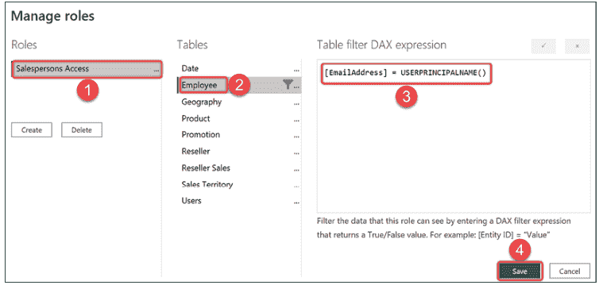

## 图 11.18：实现动态 RLS 以根据 EmailAddress 列筛选数据

### 注意

要在 Power BI Desktop 中验证 RLS 角色，我们不一定需要数据可视化。我们可以切换到数据视图，选择所需表，然后验证角色。

+   5. 切换到数据视图。
+   6. 单击 Employee 表以查看数据视图中的数据。
+   7. 从功能区的开始选项卡单击以视图方式查看按钮。
+   8. 勾选其他用户选项。
+   9. 输入电子邮件帐户以测试角色。
+   10. 选中 Salespersons Access 角色。
+   11. 单击确定。

以下图像显示了角色验证步骤：

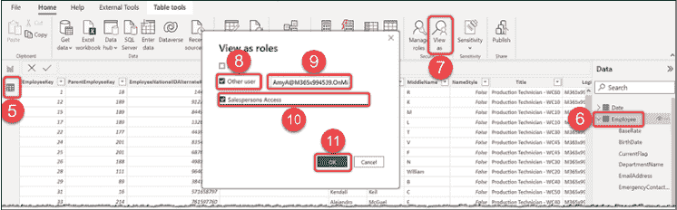

## 图 11.19：在数据视图中验证动态 RLS 角色

以下图像显示了验证 **Salespersons Access** 角色后的结果：

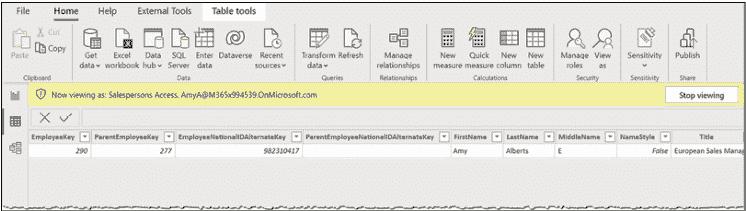

## 图 11.20：在数据视图中进行 RLS 角色验证结果

+   12. 如果您想查看视觉对象中的数据如何变化，请单击 **报表** 视图以查看更改，如以下图像中突出显示的那样：

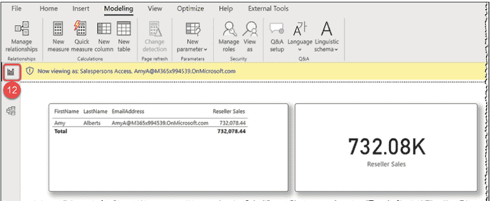

## 图 11.21：在报表视图中验证 RLS 角色


既然我们已经确认 RLS 角色按预期工作，接下来就把它发布到 Power BI 服务中。如果在服务中配置了正确的 RLS 安全设置，用户在报表中只能看到自己的销售数据。下图展示了几个示例：

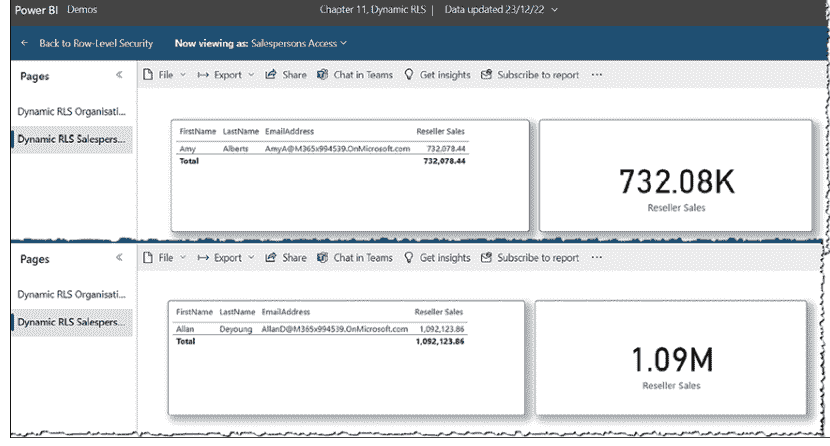

图 11.22：用户打开报表时，动态 RLS 会自动生效

如图 11.22 所示，Allan 打开报表时只能看到他的销售数据，Amy 也只能看到她的销售数据。

现在我们已经了解了动态 RLS 的工作原理，让我们更进一步，探讨一个更复杂的场景。下一节将在一个示例组织结构图上解释动态 RLS。

## 在父子层级中，经理可以访问其团队成员的数据

到目前为止，我们实现了一个简单的动态 RLS 场景，使销售人员能够看到与其相关的销售数据。但现实中还有更多复杂的场景。假设业务开始使用报表后，除了销售经理之外，其他人都很满意。他们的反馈是：他们只能看到自己的数据，看不到任何团队成员的数据。此外，首席执行官（CEO）希望看到所有人的销售数据。业务需要实现以下动态 RLS：

-   每个销售人员都能看到自己的销售数据。
-   销售经理还能看到其团队成员的销售数据。
-   CEO 能看到所有人的销售数据。

要实现上述场景，我们需要基于现有的组织结构图创建一个父子层级。数据模型中的 **Employee** 表包含了实现上述场景所需的数据。**EmployeeKey** 和 **ParentEmployeeKey** 列包含创建父子层级所需的支持数据，**EmailAddress** 列包含支持动态 RLS 的用户的 UPN。

我们在第 10 章“高级数据建模技术”中讨论过父子层级的实现。

我们使用以下 DAX 表达式创建一个计算列，以识别父子层级路径：

```
EmployeePath = PATH(Employee[EmployeeKey], Employee[ParentEmployeeKey])
```

上述代码片段的结果如下图所示：

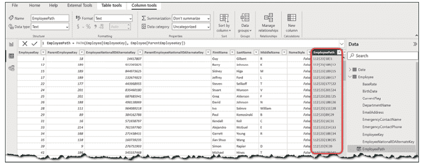

图 11.23：在 **Employee** 表中创建 **EmployeePath** 计算列

下一步是根据 **EmailAddress** 识别 **EmployeeKey** 值。

以下 DAX 表达式可以满足该需求：

```
CALCULATETABLE(
    VALUES(Employee[EmployeeKey])
, FILTER(Employee, Employee[EmailAddress] =
USERPRINCIPALNAME())
, FILTER(Employee, Employee[Status] = "Current")
)
```

> **注意**
>
> 在 **Employee** 表中，**StartDate**、**EndDate** 和 **Status** 列记录了员工的雇佣历史。因此，要获取当前在职员工，我们需要在 **Status** 为 **Current** 时获取 **EmployeeKey** 值。

要测试上述代码，请使用相同的 DAX 表达式创建一个**度量值**，然后验证 RLS 角色。下图显示了在卡片视觉对象中的度量值里使用相同表达式的结果：

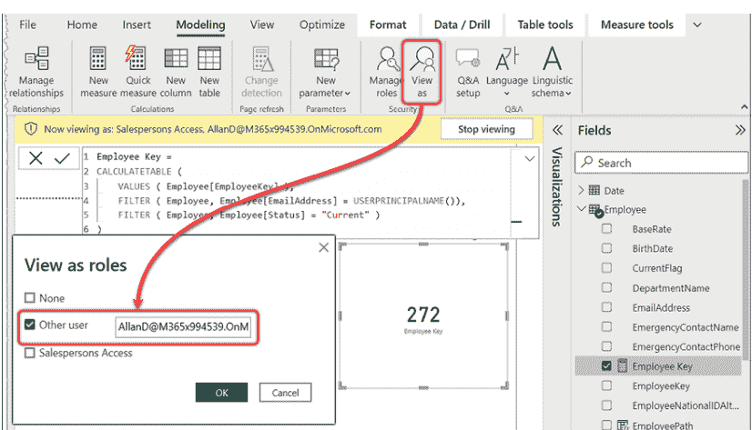

图 11.24：在度量值中验证用于 RLS 的 DAX 表达式

我们创建 **EmployeeKey** 度量值是为了测试实现，测试完成后可以将其删除。现在我们已经检索到了 **EmployeeKey** 值，可以利用这些结果在所有行中查找 **EmployeePath** 计算列中出现该 **EmployeeKey** 值的行。为了理解这个场景，让我们仔细查看数据。下图显示了所有销售人员的销售数据、他们的 **EmployeeKey** 值、姓名、电子邮件地址和 **EmployeePath** 值。请注意，相关值分别用实线、虚线和点线标记：

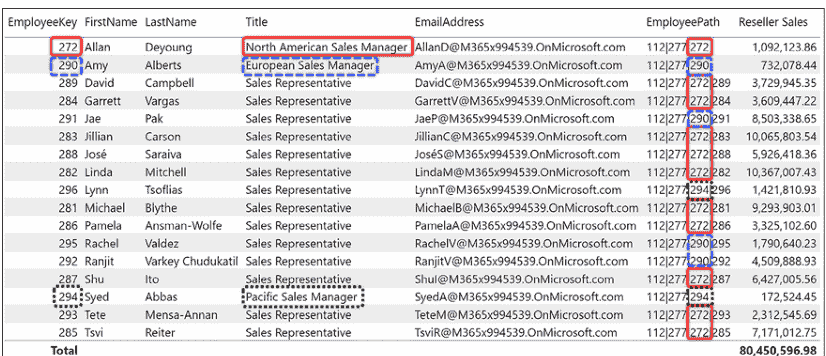

图 11.25：销售人员的销售数据

如上图所示，**Allan**、**Amy** 和 **Syed** 是销售经理。销售经理同时也是销售产品的销售人员。**EmployeePath** 列的值显示，销售经理位于组织结构图的第三层，因为他们的员工键出现在 **EmployeePath** 值的第三位。因此，他们必须看到所有团队成员的销售数据。团队成员的员工键在 **EmployeePath** 中出现在销售经理之后。请注意，员工键为 **277** 的人，位于员工键为 **112** 的人下一层，必须看到所有销售数据。员工键 112 是 CEO。要实现这个场景，我们必须找到每个人的员工键在每行 **EmployeePath** 值中的位置。为此，我们使用 DAX 中的函数在父子路径中查找值：`PATHCONTAINS(<要查找的路径>, <要在路径中查找的值>)`。如果指定值出现在路径中，`PATHCONTAINS()` 函数返回 `True`。我们已经有了 **EmployeePath** 列中的路径值。我们也编写了 DAX 表达式来检索当前用户的员工键，也就是要在路径中查找的值。因此，DAX 表达式如下所示：

```DAX
VAR _key = CALCULATETABLE (
    VALUES ( Employee[EmployeeKey] ),
    FILTER ( Employee, Employee[EmailAddress] = USERPRINCIPALNAME() ),
    FILTER ( Employee, Employee[Status] = "Current" )
)
RETURN
PATHCONTAINS (
    Employee[EmployeePath], _key
)
```

剩下的唯一一步是创建一个 RLS 角色，并使用上述表达式作为规则。下图展示了一个新角色 **Sales Team**，其规则使用了上述 DAX 表达式：

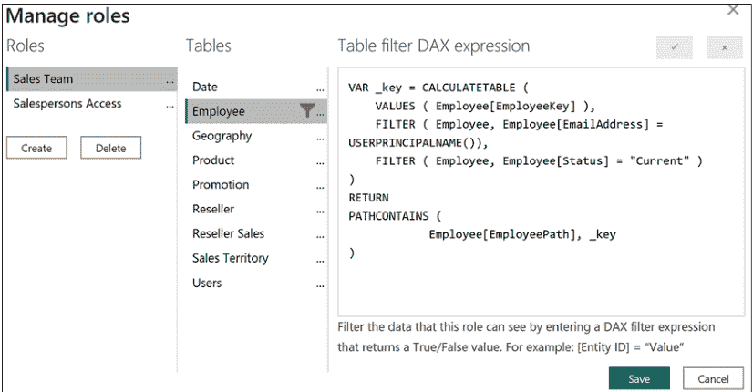

图 11.26：为动态 RLS 创建 Sales Team 角色

现在，我们为其中一位经理验证 **Sales Team** 角色。下图显示了 Allan 使用报表时的验证结果：

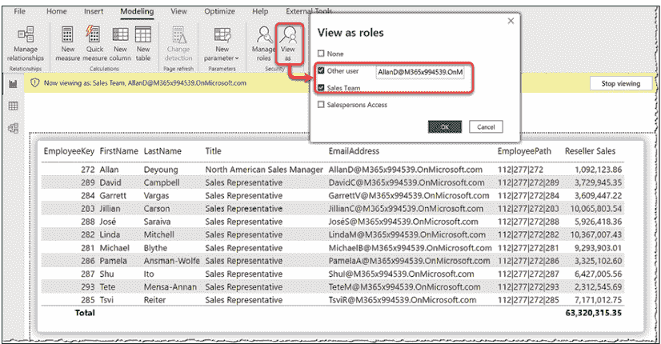

图 11.27：验证动态 RLS，使销售经理能够看到其团队成员的销售数据

现在我们可以将报表发布到服务中。

> **注意**
>
> 如果你是 Power BI 管理员，请将成员分配到新的 **Sales Team** 角色。否则，请让你的 Power BI 管理员执行此操作。

到目前为止，我们已经实现了一个动态 RLS，使销售经理能够看到其团队成员的销售数据。现在，让我们看看 CEO 打开报表后能看到什么。提醒一下，CEO 可以看到所有人的销售数据，如下图所示：

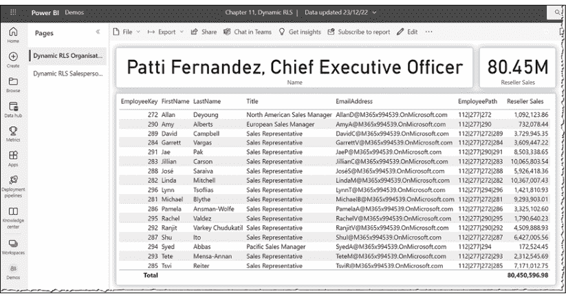

图 11.28：CEO 可以看到所有人的数据

虽然上述场景比第一个场景更复杂，但在现实世界中我们可能面临更多挑战。你可能已经注意到，**Employee** 表包含用户的登录数据（例如 **EmailAddress** 值）来实现之前的场景。在下一节中，我们将学习当 **Employee** 表中不存在电子邮件地址数据时如何实现这些场景。

## 从其他来源获取用户的登录数据

设想一个场景：业务需求与前面概述的相同；但是，源系统中的 **Employee** 表不包含 **EmailAddress** 列。在这种情况下，我们需要从不同的来源获取用户的登录数据。虽然新的数据源提供了用户的登录数据，但它不一定有 **EmployeeKey** 列来将员工与其登录数据关联起来。根据源系统的不同，我们可能得到不同的数据集。在我们的场景中，我们请系统管理员提供组织 AD 用户的数据提取。他们提供了一个**JavaScript 对象表示法（JSON）**文件，其中包含所有用户的 UPN 列表。你可以在此处找到该文件：https://github.com/PacktPublishing/Expert-Data-Modeling-with-Power-BI-Second-Edition/blob/ca01add05cfd360fad97cbf304f66d9c80a8de4/Samples/Chapter%2011/Chapter%2011,%20Adventure%20Works,%20AAD%20UPNs.json。

> **注意**
>
> 在现实世界中，我们应该考虑自动化生成 JSON 文件并使其保持最新的过程。
>
> 从 Azure AD 生成的 JSON 导出包含敏感数据。因此，它必须存储在受限制用户可访问的安全位置。

为方便起见，我们使用上一个场景中使用的同一个 Power BI 文件。我们只需忽略 **Employee** 表中的 **EmailAddress** 列。

以下步骤说明了如何克服这一挑战：

1.  在 Power BI Desktop 中，从提供的 **JSON** 文件获取数据，如下图所示：


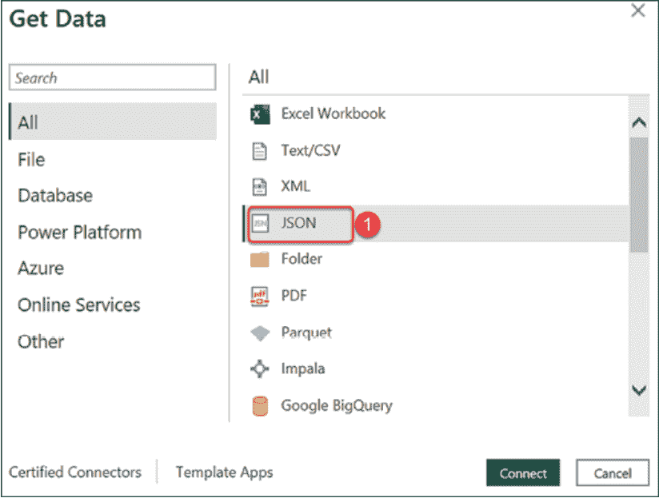

图 11.29：从 JSON 文件获取数据

+   2. 将查询重命名为 **Users**。
+   3. 删除 **@odata.context** 列。
+   4. 将 **value.givenName** 列重命名为 **First Name**，将 **value.surname** 列重命名为 **Last Name**，并将 **value.userPrincipalName** 列重命名为 **Email Address**。结果如下所示：

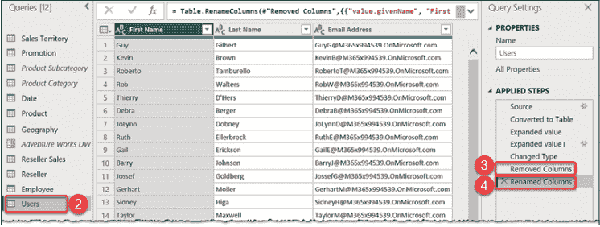

图 11.30：准备 Users 表

正如你所见，**Users** 表中没有 **EmployeeKey** 列。但是，我们可以通过基于 **First Name** 和 **Last Name** 列查找匹配值，从 **Employee** 表中获取 **EmployeeKey** 值。以下步骤说明如何操作。

+   5. **合并** **Users** 表与 **Employee** 表，基于来自 **User** 的 **First Name** 和 **Last Name** 列以及来自 **Employee** 的 **FirstName** 和 **LastName** 列进行合并。将 **Join Kind** 值设置为 **Left Outer (all from first, matching second)**，如下图所示：

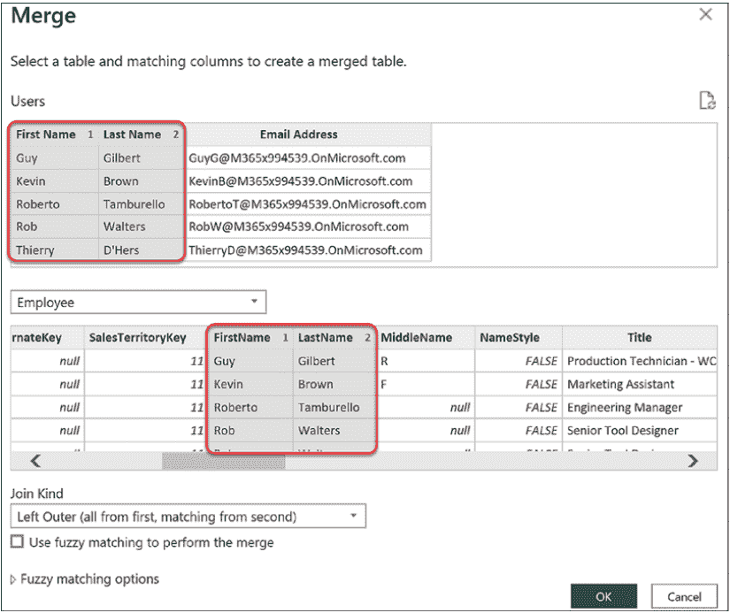

图 11.31：将 Users 表与 Employee 表合并

6. 展开 **Employee** 结构化列以保留 **EmployeeKey** 和 **Status** 列，如下图所示：

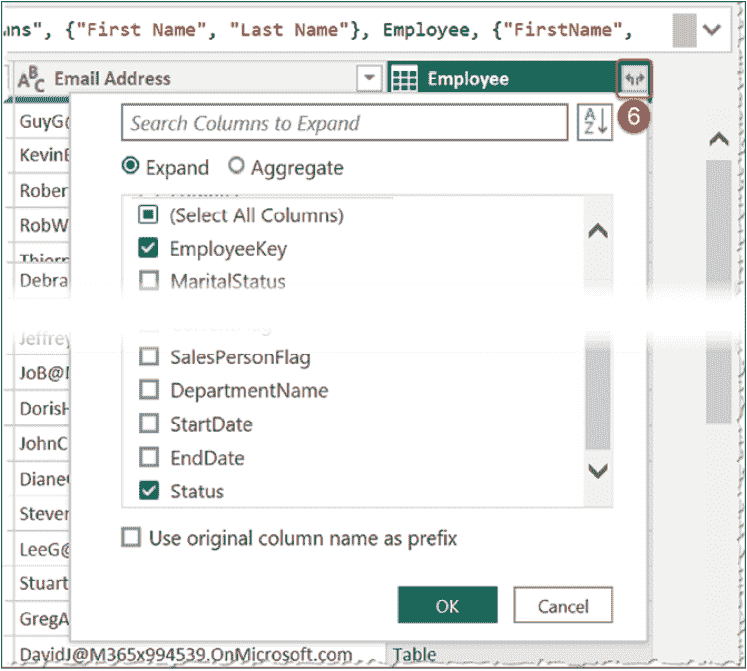

图 11.32：展开 Employee 结构化列

> **注意**
> 
> 请记住，**Employee** 表保留员工的历史记录，这意味着我们可能会重复值。因此，我们需要保留 **Status** 列以确保所有员工的状态都是 **Current**。

7. 过滤 **Status** 列，仅显示状态为 **Current** 的行，如下图所示：

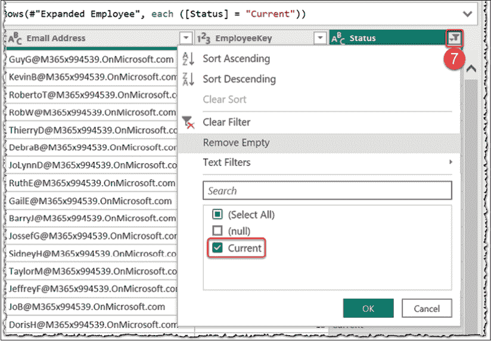

图 11.33：过滤 Employee 表以显示状态为 Current 的行

+   8. 单击 **Close & Apply** 按钮将 Users 表加载到数据模型中，如下图所示：

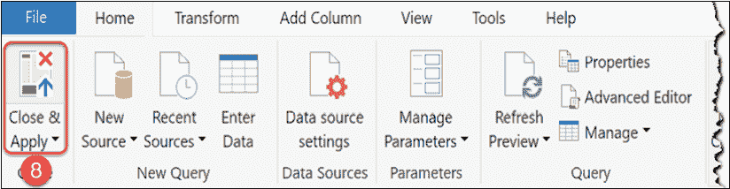

图 11.34：应用更改并将 Users 表加载到数据模型中

+   9. 如果 Power BI Desktop 未自动检测到关系，请在 Users 表与 **Employee** 表之间创建新的关系，如下图所示：

图 11.35：在 Users 和 Employee 表之间创建关系

正如前一图像所示，Users 与 Employee 表之间的关系是一对一关系，这正是我们想要的。现在，创建 Employee 表上的新角色，如以下步骤所述。

+   10. 创建一个新的 RLS 角色 Sales Team AAD，然后使用以下 DAX 表达式为 Employee 表创建新规则，如图 11.36 所示：

```
VAR _key = CALCULATETABLE (
    VALUES ( Users[EmployeeKey] ),
    FILTER ( Users, Users[Email Address] = USERPRINCIPALNAME() )
)
RETURN
PATHCONTAINS (
    Employee[EmployeePath], _key)
```

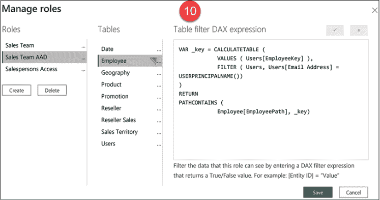

图 11.36：在 Employee 表上创建新的 RLS 角色和规则

> **注意**
> 
> 由于我们已经过滤了 **Users** 表中的所有行，仅显示当前用户，因此我们不需要在 `CALCULATETABLE()` 代码块中添加 `FILTER()` 函数。

+   11. 最后一步是通过从功能区的 **Modeling** 选项卡中单击 **View as** 按钮来验证角色，如下图所示：

图 11.37：验证新的 RLS 角色

到目前为止，我们已经学习了如何实现各种 RLS 场景。我们还了解到，有时我们需要更改数据模型以满足某些安全要求。虽然我们涵盖了一些常见场景，但还有许多场景无法在一章中涵盖，因此我们留给你进一步研究。下一节将解释 Power BI 中 OLS 的实现。

## 介绍 OLS

在前面的章节中，我们学习了如何使用 RLS 控制用户对数据的访问。在本节中，我们来看 Power BI 中的 OLS。使用 OLS，我们可以从模型中隐藏包含敏感数据的表和列，例如隐藏整个表或特定用户的列。更现实的例子可能是从 HR 数据模型中的 Employees 表中隐藏员工的薪水、银行账户或任何其他个人数据。OLS 还保护元数据。与 RLS 类似，OLS 仅在 Power BI 服务中对具有工作区查看者角色的用户以及对数据集具有读取或构建权限的用户生效。因此，敏感对象对他们是隐藏的，即使具有数据集构建权限的用户可以创建新报表或使用“在 Excel 中分析”功能连接到数据集。

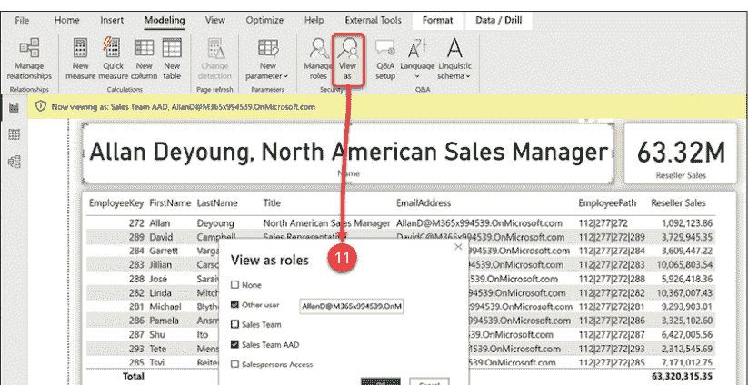

下一节将解释 OLS 的实现流程。

## OLS 实现流程

Power BI 中 OLS 的实现流程与 RLS 非常相似。以下步骤说明 OLS 的实现流程：

+   1. 在 Power BI Desktop 中创建安全角色。
+   2. 在第三方工具（如 Tabular Editor 或 SSMS）中保护对象。
+   3. 保存对 Power BI Desktop 模型的更改。
+   4. 在 Power BI Desktop 中验证角色。
+   5. 将模型发布到 Power BI 服务或 Power BI 报表服务器。
+   6. 在 Power BI 服务或 Power BI 报表服务器中将成员分配给角色。
+   7. 在 Power BI 服务中验证角色（Power BI 报表服务器中不可用角色验证）。

> 注意
> 
> OLS 限制适用于分配给该角色的成员。

下图说明了上述流程：

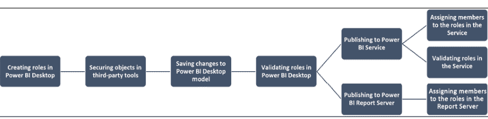

图 11.38：OLS 实现流程

目前在 Power BI Desktop 中无法实现 OLS，因此使用第三方工具是不可避免的。

## OLS 实现

让我们通过一个常见场景来看 OLS 的实现。业务希望仅对营销团队和客户可见客户数据。因此，没有在营销团队工作的人都不能看到 **Customer** 表。业务还决定从营销团队和客户那里保护与 **Internet Sales** 表中的 **OrderQuantity** 列相关的所有度量值。

我们将使用随书提供的 `Chapter 11, OLS.pbix` 示例文件。
示例文件可在此处访问：
https://github.com/PacktPublishing/Expert-Data-Modeling-with-Power-BI-Second-Edition/blob/main/Samples/Chapter%2011/Chapter%2011%2C%20OLS.pbix.

在前述场景中，我们需要有两个安全组可用。一个安全组包含除营销团队成员和客户之外的所有用户，另一个是所有用户。以下步骤说明如何实现该场景：

+   1. 在 Power BI Desktop 中，创建两个角色 **Customer Denied** 和 **OrderQty Denied**，如下图所示：

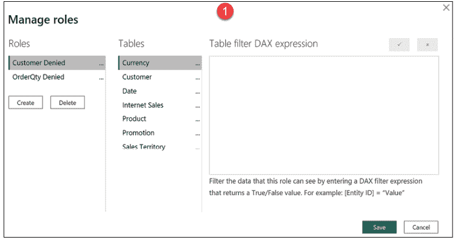

图 11.39：创建两个新的安全角色

我们现在必须切换到 Tabular Editor 以实现场景的其余部分。为此，请按如下操作：

+   2. 在功能区上单击 External Tools 选项卡。

+   3. 单击 Tabular Editor。

下图显示了上述步骤：

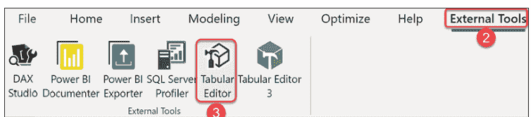

图 11.40：从 External Tools 选项卡打开 Tabular Editor

+   4. 在 Tabular Editor 中，展开 Tables 文件夹。

+   5. 选择 Customer 表。

+   6. 从属性窗格展开 Object Level Security。

+   7. 从 Internet Sales Denied 下拉菜单中选择 None。

上述步骤在以下屏幕截图中说明：

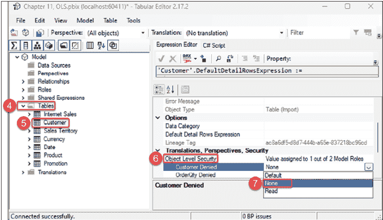

# 图 11.41：在 Tabular Editor 中为表设置 OLS

到目前为止，我们已经为 Customer 表设置了 OLS，因此任何 Customer Denied 角色的成员都无法看到 Customer 表，就好像它不存在一样。在接下来的几个步骤中，我们在 Tabular Editor 中实现需求的第二部分，如下所示：

+   8. 展开 Internet Sales 表。
+   9. 单击 OrderQuantity 列。
+   10. 从属性窗格展开 Object Level Security。
+   11. 从 OrderQty Denied 下拉菜单中选择 None。
+   12. 保存对模型的更改。

上述步骤在以下屏幕截图中突出显示：


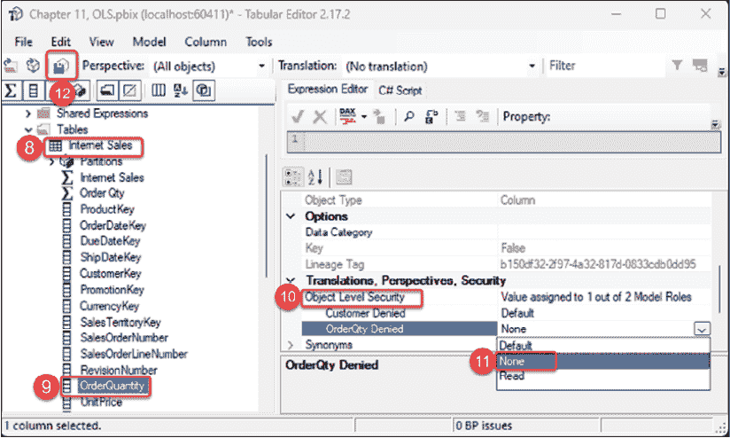

图 11.42：为列设置 OLS

至此，我们已经实现了业务所需的全部 OLS 设置。在下一节中，我们将测试这些角色。

> **注意**
>
> 我们无法在 OLS 中限制度量值。但我们可以保护引用列，从而对未经授权的用户隐藏所有依赖于该列的度量值。

## 验证角色

OLS 的角色验证方式与 RLS 相同。以下步骤演示了如何验证角色：

- 1. 在 Power BI Desktop 中，从**建模**选项卡单击**查看方式**按钮。
- 2. 勾选 **Customer Denied** 角色。
- 3. 单击**确定**。

前述步骤在下面的屏幕截图中以高亮方式显示：

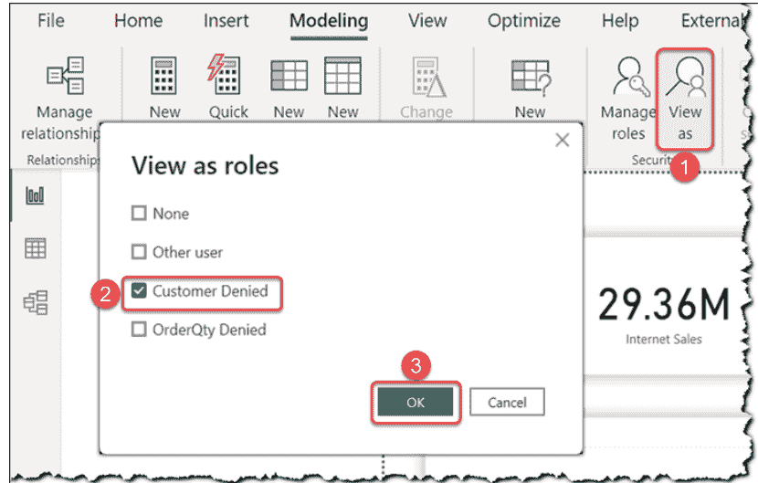

图 11.43：验证 Customer Denied 角色

验证结果如下图所示。请注意，Customer 表已从“字段”窗格中消失，与该表关联的视觉对象也出现了错误：

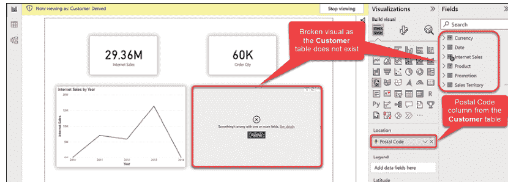

图 11.44：以 Customer Denied 角色查看报表

下图显示了验证 OrderQty Denied 角色的结果：

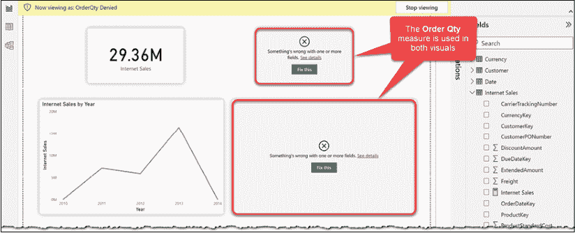

图 11.45：验证 OrderQty Denied 角色

如上图所示，Internet Sales 表中引用 **OrderQuantity** 列的视觉对象出现了错误。此外还发生了以下情况：

- **OrderQuantity** 列已从 **Internet Sales** 表中消失。
- 与 **OrderQuantity** 列关联的 **Order Qty** 度量值也已消失。

## 在 Power BI 服务中分配成员并验证角色

实现 OLS 后，我们将模型发布到 Power BI 服务，为角色分配用户或组，然后验证这些角色。分配成员和验证角色的步骤与 RLS 相同，因此这里不再重复。

在本节中，我们学习了如何在 Power BI 中设置 OLS。在下一节中，我们将了解在同一模型中应用 RLS 和 OLS 的一些场景。

## 在同一模型中实现 RLS 和 OLS

现在我们已经了解了如何实现 RLS 和 OLS，接下来看看一个需要在同一数据模型中同时使用这两种安全类型的场景。虽然实现方式非常相似，但有一个需要注意的问题：我们不能在不同角色中分别定义 RLS 和 OLS，否则会出现错误消息。使用上一节中的示例文件，假设我们希望使用动态 RLS，使客户能够访问自己的数据，但仍需满足之前的要求：拒绝所有人访问 Internet Sales 表中的 **OrderQuantity** 列。因此，我们在 Customer 表的 **EmailAddress** 列上定义一个 RLS 角色，如下图所示：

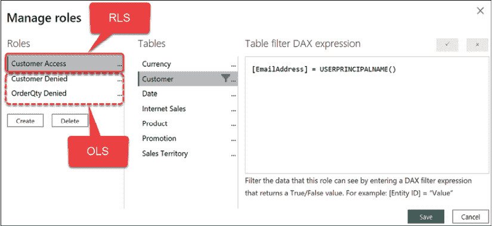

图 11.46：在启用 OLS 的模型中创建 RLS 角色

我们可以分别验证每个角色而不会出现任何问题，但如果为了满足要求而组合 **OrderQty Denied** 和 **Customer Access** 角色，就会得到以下错误消息：

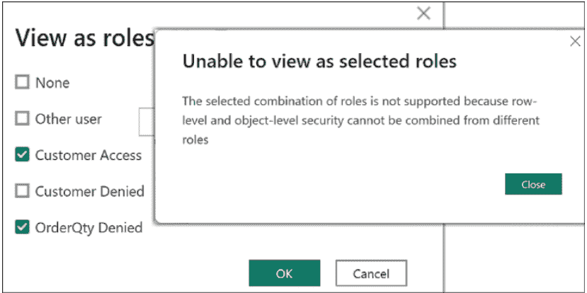

图 11.47：组合 RLS 和 OLS 角色时引发错误消息

要解决此问题，我们必须将 RLS 和 OLS 角色合并为单个角色。在我们的场景中，Customer Denied 角色用于保护客户数据，使营销团队成员和客户之外的所有人都无法访问这些数据。因此，我们保留此角色，并将 Customer Access 和 OrderQty Denied 角色合并到 Customer Access 角色中，使其成员能够访问客户数据，但无法访问任何引用 OrderQuantity 列的度量值。请在 Tabular Editor 中执行以下步骤：

- 1. 展开 Internet Sales 表。
- 2. 选择 OrderQuantity。
- 3. 在“对象级安全性”部分中，为 Customer Access 选择 None。
- 4. 单击“保存”。

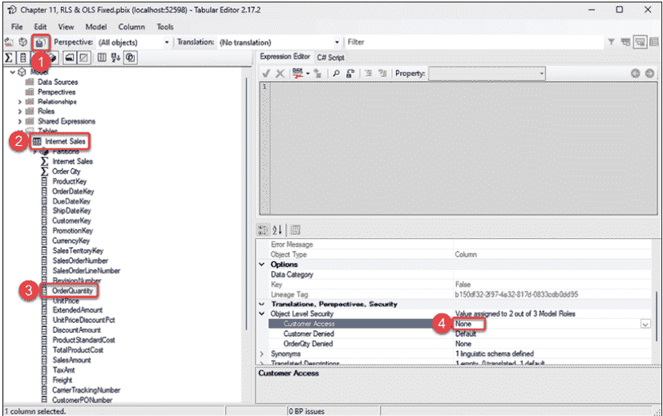

图 11.48：合并 RLS 和 OLS 角色

现在可以删除 OrderQty Denied 角色。下图显示了在 Power BI 服务中为 Megan（客户）验证角色的结果：

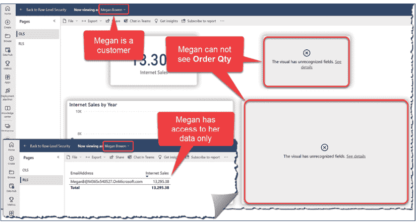

图 11.49：验证客户的角色

下图显示了在 Power BI 服务中为 Allan 验证角色的结果。Allan 既不是营销团队成员，也不是客户：

图 11.50：验证其他用户的角色

当 OLS 生效时，引用受保护对象的视觉对象会出现错误。从用户友好的角度来看，这种情况相当糟糕。但我们有一些方法可以让视觉对象更加易用，同时确保模型安全。一种方法是为需要应用 OLS 的用户和其他用户分别创建完全独立的精简报表，并将它们实时连接到同一个语义模型。另一种方法是为应用 OLS 的用户和其他用户分别创建报表页。这样，我们需要隐藏所有报表页，并使用“页面导航”按钮，同时控制谁可以访问哪些报表页。由于这是数据可视化主题，这些想法留给你自行研究。到目前为止，我们已经实现了多个 RLS 和 OLS 场景。下一节将讨论实现 RLS 和 OLS 时需要考虑的重要事项。

## 使用 RLS 和 OLS 时的注意事项

如你所见，RLS 和 OLS 是与数据模型紧密配合的强大安全机制。与其他实现一样，成功且高效开发的第一步是进行设计。我们已经看到，在许多情况下，为了实现动态 RLS，我们需要修改数据模型。因此，在设计解决方案时关注细节至关重要，例如考虑 RLS 和 OLS 的实现可能如何影响用户体验。本节汇总了一些注意事项，帮助你设计经过周密考虑的安全模型：

- 正如本章开头所述，RLS 和 OLS 的实现需要开发人员与管理员之间进行协作。在实际情况下，成功的实现需要更广泛的专业人员群体共同协作。在现实场景中，我们不会将用户帐户直接添加为安全角色成员，而是使用安全组。但首先，我们需要设计经过周密考虑的安全组结构。此外，Power BI 管理员角色无法在整个 M365 租户中创建或管理安全组。因此，我们还需要让 M365 全局管理员参与其中。我们需要开展需求发现研讨会，以确定安全需求和使用场景。在需求发现研讨会中，我们需要 Power BI 专家、安全专家和**主题专家（SME）**参与。需求发现研讨会的成果必须包括面向 M365 管理员的安全组需求，以及面向 Power BI 开发人员的数据模型需求。
- 目前，我们无法在 Power BI 服务中定义安全角色和规则，因此必须在 Power BI Desktop 或第三方工具中进行定义。
- RLS 和 OLS 仅对 **Workspace Viewers**，以及对语义模型拥有**只读**或**读取和生成**权限的用户生效。
- RLS 和 OLS 仅适用于 **DirectQuery**、**Import** 或 **Mixed** 模式（复合模型）连接。
- 在 OLS 中，保护表时必须谨慎，以免破坏任何关系链。例如，在下面的数据模型中，保护 **Customer** 表会破坏 **Geography** 表与 **Internet Sales** 表之间的关系链。

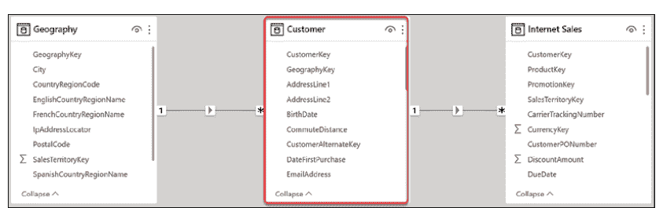

图 11.51：在 OLS 中不允许保护会破坏关系链的表

- 如果存储键列的表未受到保护，则保护参与关系的键列是可行的。例如，在上图中，可以保护 Customer 表中的 CustomerKey 和 GeographyKey 列。
- 计算组不支持 RLS 或 OLS 实现。
- 虽然我们可以在 RLS 中创建多个角色，但将一个用户映射到多个角色可能会导致结果不正确。因此，建议以授予所有所需权限的方式创建角色，而不是创建多个角色。当我们将用户映射到多个角色时，Power BI 会显示多个角色所应用的全部筛选器的并集结果。

## 总结

在本章中，我们学习了如何在 Power BI Desktop 和第三方工具中实现 RLS 和 OLS。现在，我们知道了如何在 Power BI 服务和 Power BI Report Server 中管理角色。我们了解了静态 RLS 和动态 RLS 方法，以及如何在数据模型中实现这些方法，使相关数据可供授权用户使用。我们还学习了 RLS 和 OLS 混合实现的工作方式，以及设计安全模型时需要注意的关键事项。在下一章《Power BI 中应对更高级的数据仓库概念》中，我们将了解缓慢变化维度和退化维度。


## 加入我们的 Discord！

加入 Packt Discord 服务器上的大数据与分析社区！

与 558 名其他成员一起聊天，享受免费的语音和文字聊天。

https://packt.link/ips2H


