## 在 Power BI 中处理更高级的数据仓库概念

在之前的 11 章中，我们学习了数据建模的各个方面，以建模许多不同的场景。本章重点介绍在 Power BI 中实现更高级的数据仓库概念，这些概念在更复杂的现实场景中非常实用。本章涵盖以下领域：

- 处理 **缓慢变化维度 (SCDs)**
- 处理 **退化维度**

### 处理 SCD

术语 **缓慢变化维度**，或简称为 **SCD**，是由伟大的 Ralph Kimball 提出的数据仓库概念。你可以在这里了解更多关于 Ralph Kimball 的信息：
https://www.kimballgroup.com/about-kimball-group/.

SCD 概念处理将特定数据集从一种状态移动到另一种状态。让我们通过一个场景更详细地了解 SCD。

**Adventure Works** 组织有一个 **人力资源 (HR)** 系统，其数据被捕获在组织的数据仓库中。**Stephen Jiang** 是一名 **销售经理**，他的团队有 10 名销售代表。此场景的来源是 `AdventureWorksDW2019` 数据库，你可以从这里下载：https://learn.microsoft.com/en-us/sql/samples/adventureworks-install-configure?view=sql-server-ver16&WT.mc_id=DP-MVP-5003466.

下图显示了我们场景的示例数据：

| Full Name | Title | Manager |
|---|---|---|
| Stephen Jiang | North American Sales Manager | Brian Welcker |
| David Campbell | Sales Representative | Stephen Jiang |
| Garrett Vargas | Sales Representative | Stephen Jiang |
| Jillian Carson | Sales Representative | Stephen Jiang |
| José Saraiva | Sales Representative | Stephen Jiang |
| Linda Mitchell | Sales Representative | Stephen Jiang |
| Michael Blythe | Sales Representative | Stephen Jiang |
| Pamela Ansman-Wolfe | Sales Representative | Stephen Jiang |
| Shu Ito | Sales Representative | Stephen Jiang |
| Tete Mensa-Annan | Sales Representative | Stephen Jiang |
| Tsvi Reiter | Sales Representative | Stephen Jiang |

Figure 12.1: Stephen Jiang is the sales manager of a team of 10 sales representatives

**Brian Welcker**，Stephen 的经理，于 2012 年 4 月辞职。**Stephen** 申请了该职位并获得了 **销售副总裁** 的职位。**Stephen** 的入职日期是 *2012 年 5 月 1 日*。组织还刊登了 **Stephen** 的职位空缺并聘请了 **Roger Hamilton**，他在 *2012 年 5 月 1 日* 接任 **北美销售经理** 职位。以下是发生的情况：

- 我们有一位辞职者，**Brian Welcker**
- 一次晋升，**Stephen Jiang**
- 一位新员工，**Roger Hamilton**

下图显示了这些变化：

| Full Name | Title | Manager |
|---|---|---|
| Stephen Jiang | Vice President of Sales | Ken Sánchez |
| David Campbell | Sales Representative | Roger Hamilton |
| Garrett Vargas | Sales Representative | Roger Hamilton |
| Jae Pak | Sales Representative | Amy Alberts |
| Jillian Carson | Sales Representative | Roger Hamilton |
| José Saraiva | Sales Representative | Roger Hamilton |
| Linda Mitchell | Sales Representative | Roger Hamilton |
| Lynn Tsoflas | Sales Representative | Syed Abbas |
| Michael Blythe | Sales Representative | Roger Hamilton |
| Pamela Ansmann-Wolfe | Sales Representative | Roger Hamilton |
| Rachel Valdez | Sales Representative | Amy Alberts |
| Ranjit Varkey Chudukatil | Sales Representative | Amy Alberts |
| Shu Ito | Sales Representative | Roger Hamilton |
| Tete Mensa-Annan | Sales Representative | Roger Hamilton |
| Tsvi Reiter | Sales Representative | Roger Hamilton |
| Syed Abbas | Pacific Sales Manager | Stephen Jiang |
| Roger Hamilton | North American Sales Manager | Stephen Jiang |
| Stephen Jiang | North American Sales Manager | Stephen Jiang |
| Amy Alberts | European Sales Manager | Stephen Jiang |

Figure 12.2: Stephen’s team after he was promoted to Vice President of Sales

我们将在本章的 SCD 类型 2 (SCD 2) 小节中更详细地重温上述场景。

从数据仓库的角度来看，并且根据业务需求，我们有一些处理此类情况的选项，这就导致了不同类型的 SCD。请记住，源系统中的数据在加载到数据仓库之前会发生变化（在我们的示例中为 HR 系统）。源系统通常是事务性的。我们通过提取、转换和加载 (ETL) 流程将数据从事务系统转换并移动，并将转换后的数据加载到数据仓库中，这就是 SCD 概念发挥作用的地方。SCD 是关于源系统中的变化如何反映在数据仓库中的数据。这些源系统中的变化并不经常发生；因此称为“缓慢变化”。多年来开发了许多 SCD 类型，这意味着涵盖它们超出了本书的范围，但为了参考，我们涵盖了以下三种最常见的类型。

### SCD 类型零 (SCD 0)

对于这种类型的 SCD，我们忽略维度中的所有变化。因此，在我们的场景中，我们忽略源系统（在我们的示例中为 HR 系统）中的所有变化。换句话说，我们不会更改数据仓库中的落地维度。SCD 类型零也称为 **固定维度**，这在我们的场景中毫无意义。

### SCD 类型 1 (SCD 1)

对于 SCD 类型 1，我们用新数据覆盖旧数据。SCD 类型 1 的一个绝佳示例是当业务不需要保留员工的雇佣历史，只需要保留当前员工的数据时。在某些场景中，我们可以在 Power BI 中实现类似 SCD 1 实现的解决方案。让我们继续一个场景。

我们有一家零售公司，每年以 Excel 格式发布产品清单，包括标价和经销商价格。产品清单在财政年度开始时，即每年 7 月 1 日发布。我们必须实现一个 Power BI 解决方案，以保留最新的产品数据来分析销售交易。下图显示了 2013 年的产品清单：

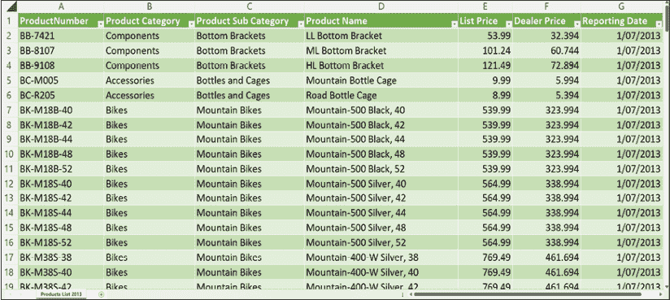

Figure 12.3: Product list 2013

因此，每年我们都会收到与上图类似的 Excel 文件。这些文件存储在 SharePoint Online 站点上。如前所述，SCD 1 总是通过用新数据更新旧数据来保留当前数据。因此，**ETL** 流程从源读取数据，识别目标表中的现有数据，将新行插入目标，更新现有行，并删除已移除的行。以下是我们的场景为何与 SCD 1 相似，但有一个例外：

- 我们不会更新 Excel 文件中的数据，也不会创建 **ETL** 流程来从 Excel 文件读取数据、识别更改并将更改应用到中间文件。
- 我们必须从源 Excel 文件读取数据并保留最新数据，同时过滤掉旧数据并将数据加载到数据模型中。

正如你所见，虽然我们采取了与创建 **ETL** 流程不同的实现方法，但结果与 SCD 1 实现类似，只有一个例外：我们不会删除任何行。要实现该解决方案，我们执行以下流程：

- 使用 **SharePoint** 文件夹连接器在 Power Query 编辑器中获取数据。
- 合并文件。
- 使用 **ProductNumber** 列来识别重复的产品。
- 使用 **Reporting Date** 列来识别最新的日期。
- 保留最新的行。

按照以下步骤从 **SharePoint Online** 文件夹获取数据：

1. 登录 **SharePoint Online** 并导航到保存产品清单 Excel 文件的站点，并从浏览器复制站点 URL。

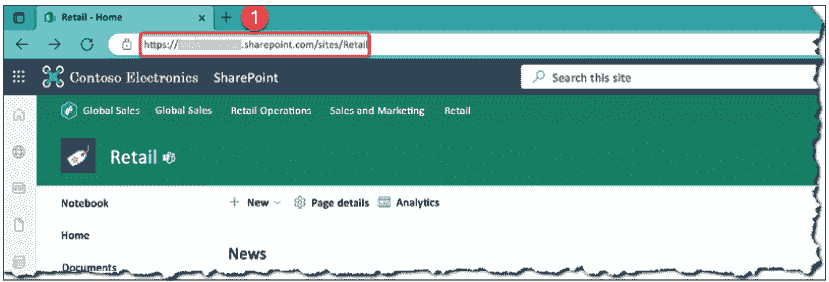

Figure 12.4: Getting the SharePoint Online URL

2. 从 Power BI Desktop 中的 **获取数据** 中，选择 **SharePoint 文件夹** 连接器。

3. 点击 **连接**。


Figure 12.5: 连接到 SharePoint Online 文件夹

- 4. 粘贴步骤 1 中复制的站点 URL。
- 5. 单击 OK。

Figure 12.6: 使用 SharePoint Online 站点 URL 连接到 SharePoint Online 文件夹

- 6. 选择 **Microsoft account** 部分。
- 7. 单击 **Sign in** 按钮并输入您的凭据。
- 8. 单击 **Connect**。

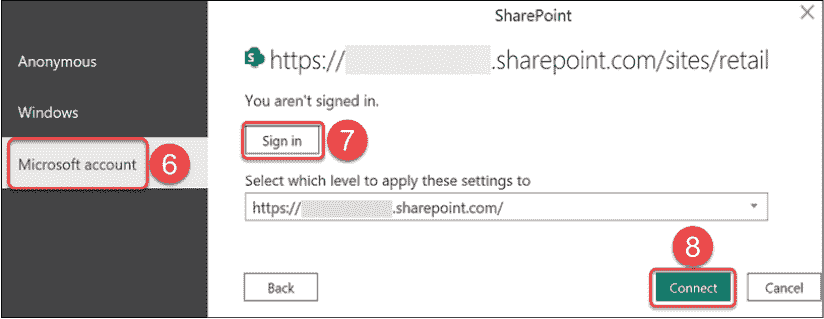

Figure 12.7: 输入 Microsoft 账户凭据以连接到 SharePoint Online 文件夹

- 9. 单击 **Transform Data** 按钮。

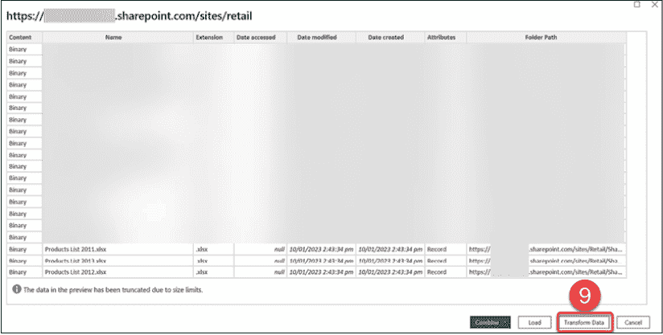

Figure 12.8: 在 Power Query Editor 中转换数据

- 10. 单击 **Folder Path** 列的筛选下拉菜单。
- 11. 找到托管 Excel 文件的 **Products List** 文件夹并选择它。

- 12. 将查询重命名为 Product。
- 13. 单击 OK。

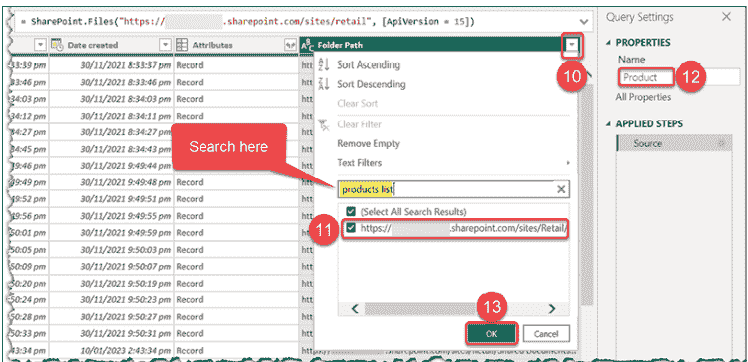

Figure 12.9: 筛选结果以显示 Products List 文件夹

到目前为止，我们已经连接到 SharePoint Online 文件夹。下一步是合并 Excel 文件：

- 14. 从 Content 列中单击 Combine Files 按钮。

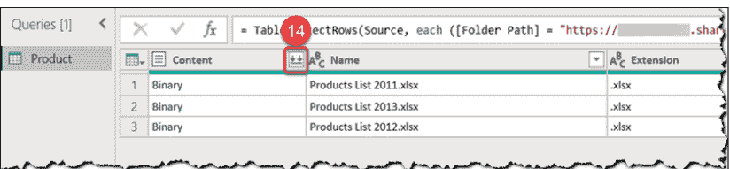

Figure 12.10: 合并 Excel 文件

- 15. 选择 ProductList 表。
- 16. 单击 OK。

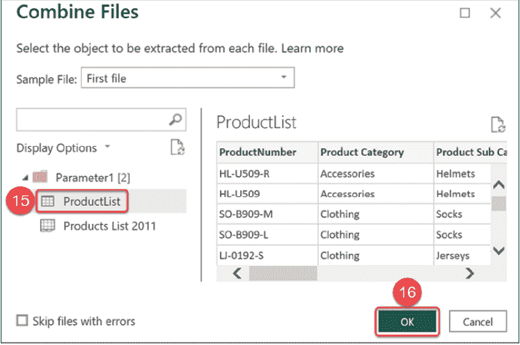

Figure 12.11: 在 Combine Files 窗口中选择要从每个文件中提取的对象

上述过程创建了若干个分组到不同文件夹中的查询，如以下图像所示：

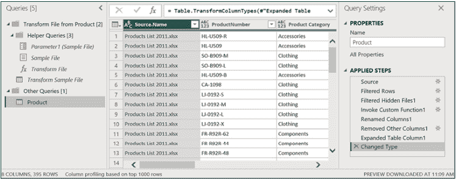

Figure 12.12: 合并 Excel 文件的结果

合并后的数据结果显示了一个不必要的 **Source.Name** 列，可以将其删除：

- 17. 删除 **Source.Name** 列：

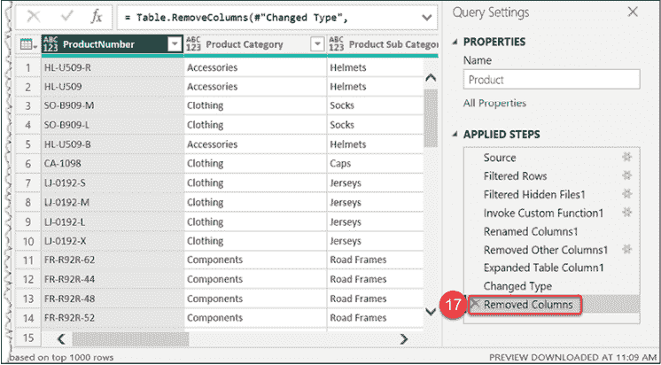

Figure 12.13: 删除 Source.Name 列后的结果

到目前为止，我们已成功合并了 Excel 文件。现在，我们只想保留最新的数据。在接下来的几个步骤中，我们将实现一种机制来识别最新数据并将其加载到数据模型中。但在继续之前，让我们花点时间仔细查看一下数据。以下图像中显示的结果按 **ProductNumber** 排序，并且移除了 **Product Category** 和 **Product Subcategory** 列以更好地了解数据的变化，但这些步骤完全不必要，仅用于演示目的。以下图像显示了结果：

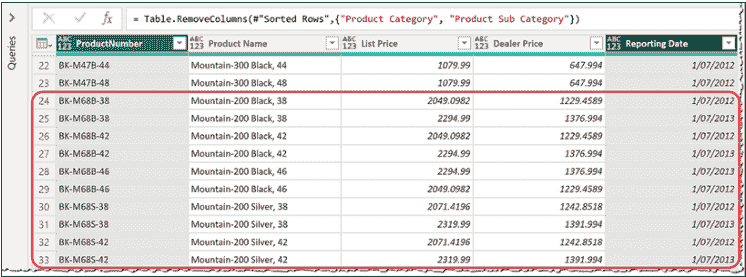

Figure 12.14: 具有不同 Reporting Dates 的重复 ProductNumbers

如前一图像所示，多个产品出现在多个列表中。目标是仅根据 Reporting Date 保留最新的产品数据。因此我们应获取 ProductNumber 和 Reporting Date 的最大值。

为实现此目标，我们在 Power Query Editor 中使用 Group By 功能。使用 UI 中的 Group By 会在 Power Query 中使用 Table.Group() 函数。请按照以下步骤操作：

- 18. 右键单击 ProductNumber 列。
- 19. 从上下文菜单中单击 Group By 列。
- 20. 为新列名称输入 Reporting Date。
- 21. 从 Operation 下拉菜单中选择 Max。
- 22. 从 Column 下拉菜单中选择 Reporting Date。
- 23. 单击 OK。

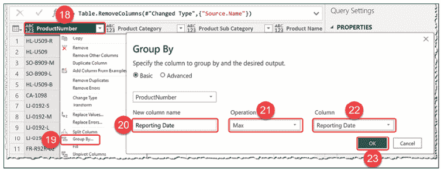

Figure 12.15: 在 Power Query 中按列分组

以下图像显示了结果：

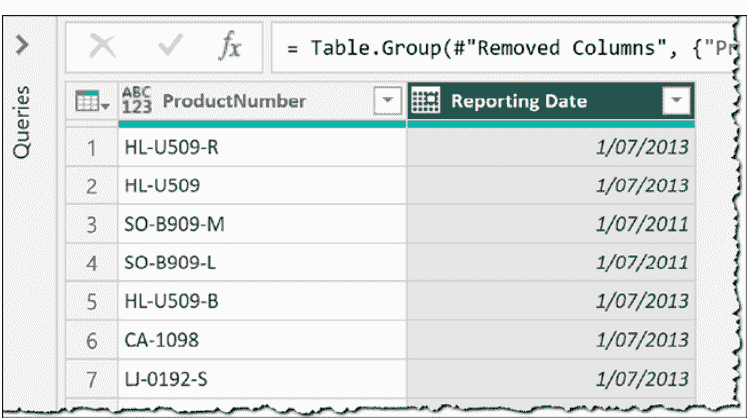

Figure 12.16: 按列分组的结果

现在我们有了所有产品编号及其最新的报告日期。难题的唯一剩余部分是将 Grouped Rows 步骤的结果与上一步的数据连接起来。为此，我们使用 Merge Queries 选项，后台会运行 Table.NestedJoin() 函数。请按照以下步骤操作：

- 24. 选择 Grouped Rows 步骤。
- 25. 从 Home 选项卡中单击 Merge Queries 按钮。
- 26. 从下拉菜单中选择 Product (Current) 表。注意，我们选择的是当前查询（Product）。
- 27. 在顶部表中，按住键盘上的 Ctrl 按钮并依次选择 ProductNumber 和 Reporting Date 列。
- 28. 对底部表执行相同操作。注意选择列的顺序很重要。
- 29. 确保 Join Kind 为 Left Outer（全部来自第一个，匹配来自第二个）。
- 30. 单击 OK。

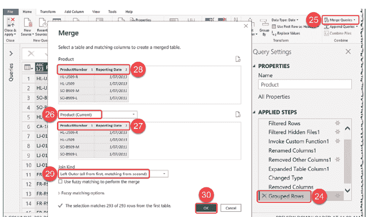

Figure 12.17: 左外连接（合并）Product 查询自身

在前面的操作中，Grouped Rows 是我们将其结果与其自身连接的最后一个转换步骤。我们已在第 5 章《Common Data Preparation Steps》的 Merging queries 部分解释了 Table.NestedJoin() 函数的工作原理。经过步骤 24 到 30 后，Power Query Editor 生成的代码如下：

```
Table.NestedJoin(#"Grouped Rows", {"ProductNumber", "Reporting Date"}, #"Grouped Rows", {"ProductNumber", "Reporting Date"}, "Grouped Rows", JoinKind.LeftOuter)
```

但我们希望将 Grouped Rows 转换步骤的结果与 Removed Columns 步骤的结果连接起来。因此我们将前面的表达式修改如下：

```
Table.NestedJoin(#"Grouped Rows", {"ProductNumber", "Reporting Date"}, #"Removed Columns", {"ProductNumber", "Reporting Date"}, "Grouped Rows", JoinKind.LeftOuter)
```

连接 Grouped Rows 与 Removed Columns 步骤后，我们需要展开 Grouped Rows 列。请按照以下步骤操作：

- 31. 单击 Grouped Rows 列上的 Expand 按钮。
- 32. 取消选择 ProductNumber 和 Reporting Date 列以保留其他列被选中。
- 33. 取消勾选 Use original column name as prefix 选项。
- 34. 单击 OK。

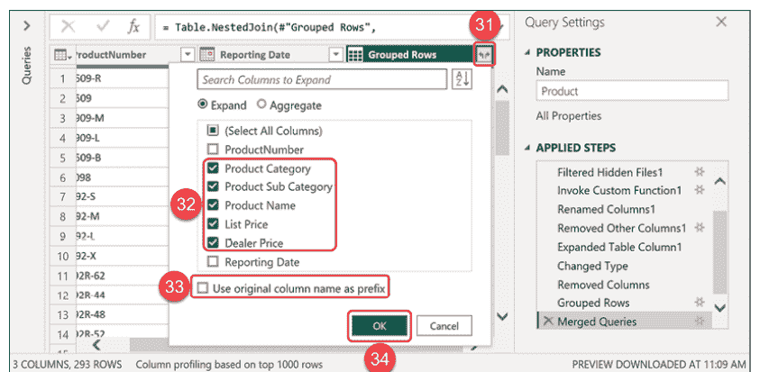

Figure 12.18: 展开 Grouped Rows 列

全部完成！以下图像显示了最终结果：

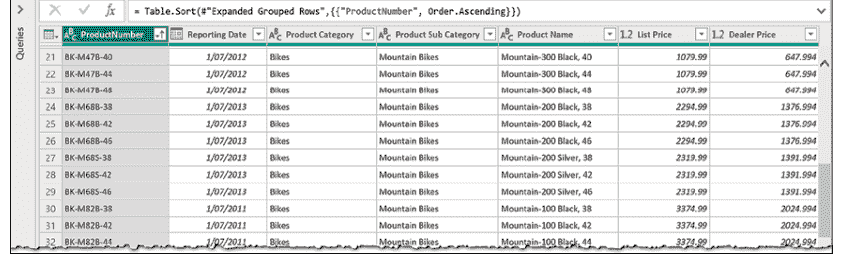

Figure 12.19: 实现 SCD 1 的最终结果

我们可以单击 Close & Apply 按钮将数据加载到数据模型中，发布到 Power BI 服务并安排自动数据刷新。这样，当新的 Excel 文件（新的 Product 列表）上传到 SharePoint Online 时，Power BI 会经过上述转换步骤，以确保我们始终将最新的 Product 数据加载到数据模型中，这与 SCD 1 的行为非常相似。下一节将解释 SCD 类型 2。

## SCD type 2 (SCD 2)

这种类型的 SCD 在业务需要保留员工的历史和当前数据时，我们在数据仓库中保留数据变化的历史。在 SCD 2 场景中，我们必须根据业务需求维护历史数据，这些需求决定了我们如何实现这种类型的 SCD。在许多情况下，每当事务系统中发生更改时，我们都会向数据仓库中插入一行新数据。插入新行会导致数据仓库中出现数据重复，这意味着我们不能使用源表的 primary key 作为维度的 primary key。因此，我们需要引入一组新的列，如下所示：

- 一个新的键列，保证 **Customers** 维度中行的唯一性。这个新键列只是一个表示数据仓库维度中存储的每一行数据的索引。新键是所谓的 **surrogate key**。虽然 surrogate key 保证了该维度中行的唯一性，但我们仍需要维护源系统的 primary key。在数据仓库中，源系统的 primary key 被称为 **business keys** 或 **alternate keys**。换句话说，**surrogate key** 是作为其 primary key 添加到维度的新列。此新列在数据源中不存在，因此与源系统中的 primary key 不同。
- 一个 **Start Date** 和一个 **End Date** 列，表示一行数据处于当前状态的时间范围。
- 另一个显示每行数据状态的列。

SCD 2 是最常见的 SCD 类型。

让我们重新回顾本章 *Dealing with SCDs* 部分开头我们查看过的原始场景，其中 **Brian Welcker** 提交了


随着他的辞职，**Stephen Jiang** 被提升为 **销售副总裁**，而 **Roger Hamilton** 被聘为新的 **北美销售经理**。源系统中的前述活动转化为数据仓库中的以下更改：

- 更新数据仓库中 **DimEmployee** 表中 **Brian Welcker** 的最后一条记录，将 **2012年4月30日** 添加为 **结束日期**，将 **CurrentFlag** 更新为 **0**，并将 **Status** 列的值更改为 **null**。
- 更新数据仓库中 **DimEmployee** 表中 **Stephen Jiang** 的最后一条记录，将 **2012年4月30日** 添加为 **结束日期** 列，将 **CurrentFlag** 更新为 **0**，并将 **Status** 列的值更改为 **null**。
- 为 **Stephen Jiang** 插入一条新记录，反映其新的 **Title**、**BaseRate**、**ParentEmployeeKey**、新角色的 **StartDate**、**CurrentFlag**、**SalesPersonFlag** 和 **Status**。请注意，部分数据自 **Stephen** 的上一条记录以来保持不变，例如他的 **HireDate**、**SalesTerritory** 等。
- 为 **Roger Hamilton** 插入一条新记录。
- 更新所有员工的 **ParentEmployeeKey**，其中 **Stephen** 在他担任 **北美销售经理** 时是他们的经理，将其替换为 **Roger** 的 **EmployeeID**。
- 更新所有员工的 **ParentEmployeeKey**，其中 **Brian** 在他担任 **销售副总裁** 时是他们的经理，将其替换为 **Stephen** 的新 **EmployeeID**。

需要指出的重要一点是，最后两步取决于业务需求。如果业务需要保留所有更改，我们必须为受更改影响的所有员工的最后记录添加 **EndDate**，将其 **CurrentFlag** 更改为 **0** 且 **Status** 为 **null**。然后我们为他们插入新记录，除 **ParentEmployeeKey** 外的数据保持相同。

在我们的场景中，后者并非业务所要求。因此，我们仅通过更新受影响员工的最后记录的 ParentEmployeeKey 值来反映新的更改。我在此未包含 T-SQL 代码，因为数据仓库中的 SCD 实现超出了本书的范围。您可以从此处下载并使用模拟 DimEmployee 表中 SCD 2 的示例代码：https://github.com/PacktPublishing/Expert-Data-Modeling-with-Power-BI-Second-Edition/blob/e570a94df87acaa9391c7bc8ca38b96d1c6e961a/Samples/Chapter%2012/Mimicking%20SCD2.sql。

下图显示了实施 SCD 2 之前的数据：

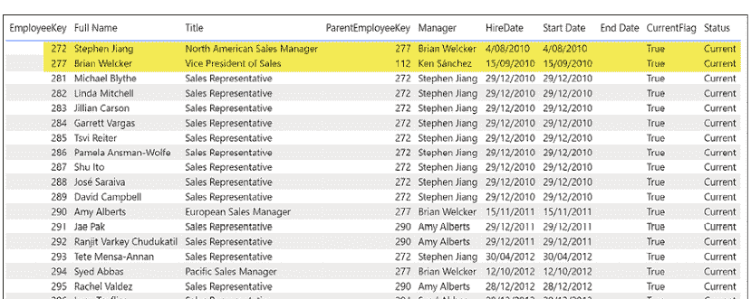

图 12.20：SCD 2 实现前的员工数据

在前一幅图中，EmployeeKey 列是维度的代理键，Start Date 列显示 Stephen Jiang 开始担任北美销售经理的日期，End Date 列留空（null），CurrentFlag 为 True，Status 列显示为 Current。现在，让我们看看实施 SCD 2 并反映所有更改后的数据，如下图所示：

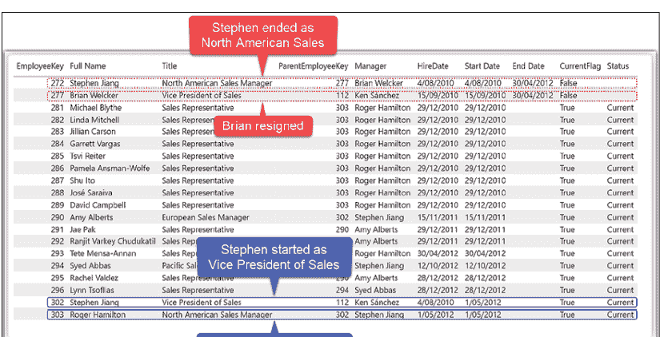

图 12.21：SCD 2 实现后反映所有更改的员工数据

前一幅图显示：

- Stephen Jiang 于 2012 年 5 月 1 日开始担任销售副总裁的新职务，并在 2012 年 4 月 30 日结束其北美销售经理的工作。
- Brian Welcker 于 2012 年 4 月 30 日结束工作。
- Roger Hamilton 于 2012 年 5 月 1 日开始担任北美销售经理的新职务。
- 所有曾经向 Stephen 汇报的员工现在向 Roger 汇报。
- Brian 的所有团队成员现在都属于 Stephen。

让我们看看 SCD 2 在 Power BI 中的数据建模意味着什么。第一个问题是：我们能否在没有数据仓库的情况下直接在 Power BI Desktop 中实现 SCD 2？要回答这个问题，我们必须记住 Power BI 中的数据模型是一个语义层。语义层按定义是对源数据（通常是数据仓库）的视图，针对报告和分析进行了优化。

虽然数据仓库托管了大量历史数据，但语义层不一定包含整个数据历史。语义层通常保留对业务用户进行数据分析有意义的时间范围内的数据，这有助于他们做出更好的决策。因此，语义层不会取代数据仓库，也不是数据仓库的另一个版本。当业务需要保留更改历史时，我们要么需要拥有数据仓库，要么找到在事务系统中维护历史数据的方法，例如 **temporal** 机制。Temporal 机制是某些关系数据库管理系统（如 SQL Server）提供的功能，用于提供在任何时间点表中保存的数据信息，而不仅仅是当前数据。要了解有关 SQL Server 中 **temporal tables** 的更多信息，请查看以下链接：https://learn.microsoft.com/en-us/sql/relational-databases/tables/temporal-tables?view=sql-server-ver15&WT.mc_id=DP-MVP-5003466。

在将数据加载到 Power BI Desktop 中的数据模型后，我们在维度表中拥有当前和历史数据。因此，在处理 SCD 时必须小心。例如，下图显示了按员工划分的经销商销售额：

| EmployeeKey | Full Name | Manager | Sales |
|---:|---|---|---:|
| 290 | Amy Alberts | Stephen Jiang | $732,078.4446 |
| 289 | David Campbell | Roger Hamilton | $3,729,945.3501 |
| 284 | Garrett Vargas | Roger Hamilton | $3,609,447.2163 |
| 291 | Jae Pak | Amy Alberts | $8,503,338.6472 |
| 283 | Jillian Carson | Roger Hamilton | $10,065,803.5429 |
| 288 | José Saraiva | Roger Hamilton | $5,926,418.3574 |
| 282 | Linda Mitchell | Roger Hamilton | $10,367,007.4286 |
| 296 | Lynn Tsoflias | Syed Abbas | $1,421,810.9252 |
| 281 | Michael Blythe | Roger Hamilton | $9,293,903.0055 |
| 286 | Pamela Ansman-Wolfe | Roger Hamilton | $3,325,102.5952 |
| 295 | Rachel Valdez | Amy Alberts | $1,790,640.2311 |
| 292 | Ranjit Varkey Chudukatil | Amy Alberts | $4,509,888.933 |
| 287 | Shu Ito | Roger Hamilton | $6,427,005.5556 |
| 272 | Stephen Jiang | Brian Welcker | $1,092,123.8562 |
| 294 | Syed Abbas | Stephen Jiang | $172,524.4515 |
| 293 | Tete Mensa-Annan | Roger Hamilton | $2,312,545.6905 |
| 285 | Tsvi Reiter | Roger Hamilton | $7,171,012.7514 |
| Total |  |  | $80,450,596.9823 |

图 12.22：未考虑 SCD 的按员工划分的经销商销售额

乍一看，数字似乎是正确的。好吧，它们可能是正确的；也可能是错误的。这取决于业务希望在报告中看到什么。我们在创建前述可视化时未考虑 SCD，这意味着我们考虑了 Stephen 的销售额值（EmployeeKey 272）。但这是业务所需的结果吗？业务是否期望在不考虑他们处于当前角色的时间范围的情况下查看所有员工的销售额？为了更清晰，让我们将 Start Date、End Date 和 Status 列添加到表中。下图显示了结果：

| EmployeeKey | Full Name | Manager | Sales | Start Date | End Date | Status |
|---:|---|---|---:|---|---|---|
| 290 | Amy Alberts | Stephen Jiang | $732,078.4446 | 15/11/2011 |  | Current |
| 289 | David Campbell | Roger Hamilton | $3,729,945.3501 | 29/12/2010 |  | Current |
| 284 | Garrett Vargas | Roger Hamilton | $3,609,447.2163 | 29/12/2010 |  | Current |
| 291 | Jae Pak | Amy Alberts | $8,503,338.6472 | 29/12/2011 |  | Current |
| 283 | Jillian Carson | Roger Hamilton | $10,065,803.5429 | 29/12/2010 |  | Current |
| 288 | José Saraiva | Roger Hamilton | $5,926,418.3574 | 29/12/2010 |  | Current |
| 282 | Linda Mitchell | Roger Hamilton | $10,367,007.4286 | 29/12/2010 |  | Current |
| 296 | Lynn Tsoflias | Syed Abbas | $1,421,810.9252 | 28/12/2012 |  | Current |
| 281 | Michael Blythe | Roger Hamilton | $9,293,903.0055 | 29/12/2010 |  | Current |
| 286 | Pamela Ansman-Wolfe | Roger Hamilton | $3,325,102.5952 | 29/12/2010 |  | Current |
| 295 | Rachel Valdez | Amy Alberts | $1,790,640.2311 | 28/12/2012 |  | Current |
| 292 | Ranjit Varkey Chudukatil | Amy Alberts | $4,509,888.933 | 29/12/2011 |  | Current |
| 287 | Shu Ito | Roger Hamilton | $6,427,005.5556 | 29/12/2010 |  | Current |
| 272 | Stephen Jiang | Brian Welcker | $1,092,123.8562 | 4/08/2010 | 30/04/2012 |  |
| 294 | Syed Abbas | Stephen Jiang | $172,524.4515 | 12/10/2012 |  | Current |
| 293 | Tete Mensa-Annan | Roger Hamilton | $2,312,545.6905 | 30/04/2012 |  | Current |
| 285 | Tsvi Reiter | Roger Hamilton | $7,171,012.7514 | 29/12/2010 |  | Current |
| **Total** |  |  | **$80,450,596.9823** |  |  |  |

图 12.23：未考虑 SCD 的按员工及其状态划分的经销商销售额

如果业务需要仅显示员工状态为 **Current** 时的销售额值呢？在这种情况下，我们必须将 SCD 纳入方程并过滤掉 **Stephen** 的销售额值。根据业务需求，我们可能需要在可视化中将 **Status** 列作为筛选器添加，而在其他情况下，我们可能需要通过向度量中添加 **Start Date**、**End Date** 和 **Status** 列来过滤结果。下图显示了我们使用可视化筛选器排除 **Stephen** 销售额时的结果：

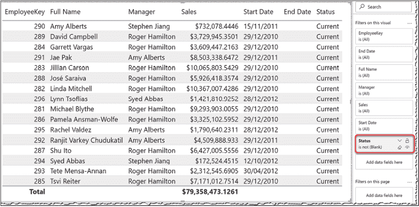


图 12.24：考虑 SCD 时按员工划分的经销商销售额

根据业务需求，处理 SCD 并不总是这么简单。例如，如果业务希望比较**Roger**管理销售团队期间的业绩与**Stephen**管理该团队同期的业绩，那么我们在数据仓库中实施的 SCD 2 就无法满足需求，因为我们已将目前属于**Stephen**的员工更新为**Roger**。对于这类场景，我们需要更改数据仓库中的 SCD 实施方式，使其符合业务需求，并可能在 Power BI 数据模型中创建更复杂的度量值。可以想象，根据业务需求，SCD 场景有很多，因此几乎不可能在单个章节中全部涵盖，我们将留给你进一步探索。

本节介绍了常见的 SCD 类型，以及如何实施类似 SCD 类型 1 的解决方案。我们还了解到，如果没有适当的机制在源系统中维护历史数据，那么从 Power BI 数据建模的角度处理 SCD 类型 2 并无意义。下一节将介绍另一个对 Power BI 数据模型设计人员很有用的数据仓库概念：退化维度。

### 处理退化维度

“退化维度”一词由杰出的*Ralph Kimball*创造。你可以在此了解更多关于*Kimball Group*的信息：
https://www.kimballgroup.com/。

Kimball Group 引用*Webster*对“退化”一词的定义如下：

> 根据 Webster 的说法，“退化”指的是某种事物：1）偏离了标准规范；或 2）在数学上更为简单：

请在此阅读完整文章：[https://www.kimballgroup.com/2003/06/design-tip-46-another-look-at-degenerate-dimensions/](https://www.kimballgroup.com/2003/06/design-tip-46-another-look-at-degenerate-dimensions/)。

从星型架构的角度来看，退化维度是指出现在事实表中、但没有独立维度表的维度键属性。换言之，我们不会为它们创建单独的维度表。但正如我们所知，从星型架构的角度来看，将维度属性放入事实表并非良好实践。因此，根据 Webster 对“退化”一词的定义，退化维度是常规维度规范之外的一种例外。

退化维度具有以下特征：

- 唯一的维度属性是键属性（主键）。
- 我们无法设想该维度还会有其他属性。
- 它与其他维度之间不存在其他有意义的关联。

我们在*第 6 章“在 Power Query 编辑器中准备星型架构”*的*“创建维度表”*部分简要介绍过退化维度。让我们继续使用*第 6 章*中的示例文件，可在此处获取：[https://github.com/PacktPublishing/Expert-Data-Modeling-with-Power-BI-Second-Edition/blob/cb57eb34a28e6bda8b725ca0f5c85200f42c072c/Samples/Chapter%206/Chapter%206%2C%20Star%20Schema%20Preparation%20in%20Power%20Query%20Editor.pbix](https://github.com/PacktPublishing/Expert-Data-Modeling-with-Power-BI-Second-Edition/blob/cb57eb34a28e6bda8b725ca0f5c85200f42c072c/Samples/Chapter%206/Chapter%206%2C%20Star%20Schema%20Preparation%20in%20Power%20Query%20Editor.pbix)。

下图显示了加载到 Power BI 模型后的 **Sales** 表：

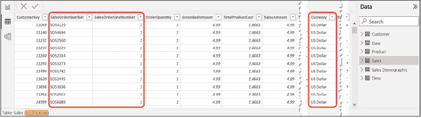

图 12.25：Sales 事实表中的退化维度

如上图所示，**SalesOrderNumber**、**SalesOrderLineNumber** 和 **Currency** 是 **Sales** 事实表中的退化维度。下面让我们详细了解一下。

**Sales** 表有 **60,398** 行。对 **SalesOrderNumber** 和 **SalesOrderLineNumber** 列进行不同值计数后可以发现，这两列的组合也有 **60,398** 行，如下图所示：

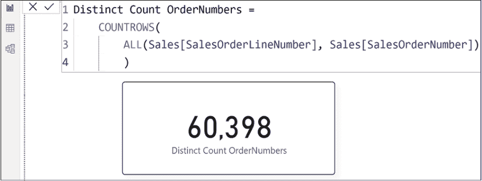

图 12.26：SalesOrderNumber 和 SalesOrderLineNumber 列的不同值计数

因此，这两列的组合确实是一个假设的 **Sales Orders** 维度的主键。假设我们真的创建了 **Sales Orders** 维度，它必须同时包含 **SalesOrderNumber** 和 **SalesOrderLineNumber** 列。由于 xVelocity 引擎不支持复合键，我们必须添加一个 **Index** 列作为该表的主键。这个新创建的维度行数将与 **Sales** 表（事实表）相同。因此，添加新维度并不会提升数据模型的性能。实际上，我们还会带来不必要的成本，例如为 **Sales Orders** 维度添加 **Index** 列所产生的额外开发成本、将该 **Index** 列作为外键添加到 **Sales** 表中的成本，以及创建两个表之间关系的成本。先不考虑这些额外的开发成本，这样做实际上还会降低模型的压缩率和性能。

现在，让我们分析事实表中是否有必要包含 **Currency** 列。查看数据可以发现，**Currency** 列没有其他属性。由于 xVelocity 引擎使用列存储索引技术，因此对低基数数据的压缩效果最佳。因此，**Currency** 列的数据类型为 **Text** 这一事实并不会对数据压缩和数据模型性能造成太大影响。所以，为它创建一个新维度并无意义。

到目前为止，我们已经确信，将退化维度保留在 **Sales** 表中是一种更简单的实现方式，这也符合 Webster 对“退化”一词定义的第二点。从概念上讲，退化维度可能不易理解，也不容易应用到真实场景中，有些开发人员会对此理解有误。他们将维度放进事实表，并称之为退化维度，这可能会对性能产生负面影响。

下一章将介绍 Power BI 中另一个重要的数据建模工具：Dataflows。

### 总结

本章介绍了 SCD 的概念，以及如何实施一些相关场景。我们还进一步了解了退化维度，以及如何在 Power BI 数据模型中处理它们。下一章将介绍 Power BI 中一种纯云端数据转换功能：Dataflows。

## 加入我们的 Discord！

加入 Packt Discord 服务器上的大数据与分析社区！

与另外 558 位成员交流，享受免费的语音和文字聊天。

https://packt.link/ips2H


