## Dataflows 简介

在上一章中，我们学习了一些更高级的数据建模技术，它们与数据仓库的关系更为密切：处理 SCD 和退化维度。本章将简要介绍 Dataflows，这是 Power BI 平台中另一项可用功能，在实际场景中可能十分有用。为了充分发挥 Dataflows 的作用，我们需要关注许多会直接影响设计和实施的技术细节，例如存储机制和许可信息，因此几乎不可能在单个章节中全部涵盖。本章旨在介绍基础知识，并帮助你为后续学习构建稳固的基础模块。本章涵盖以下内容：

- 使用 Dataflows 的场景
- Dataflow 术语
- 创建 Dataflows
- 导出/导入 Dataflows
- Dataflows 中的无代码/低代码体验
- 复合模型简介
- Dataflows 中的查询计划

### Dataflows 简介

2018 年 11 月，Microsoft 发布了 Dataflows 公共预览版。随后在 2019 年 4 月，Dataflows 正式发布。Dataflows 过去仅适用于 **Premium** 许可证，但现在也可在 Power BI Pro 中使用，不过存在一些限制。Dataflows 的用途是利用云端 Power Query 的强大功能，在组织内支持协作式**自助数据准备**和**提取、转换与加载（ETL）**流程。Dataflows 技术也称为 **Power**

**在线查询。** Dataflows 技术可在 Power Platform 中用于 Power BI 或 **Power Apps**。Dataflows 将准备好的数据存储为标准化文件和文件夹格式，称为**通用数据模型（CDM）** 文件夹。如果在 **Power Apps** 中创建，生成的表可以存储在 **Dataverse** 或 **Azure Data Lake Storage Gen2（ADLS Gen 2）** 中。而 Power BI Dataflows 则将生成的表存储在 Power BI 服务托管的 ADLS Gen 2 中。

如前所述，Dataflows 是一个广泛的主题，无法在单一章节中完全涵盖。有关 Dataflows 可用存储选项的更多信息，请查看以下资源：

- **通用数据模型（CDM）：** [https://learn.microsoft.com/en-us/common-data-model/?WT.mc_id=DP-MVP-5003466](https://learn.microsoft.com/en-us/common-data-model/?WT.mc_id=DP-MVP-5003466)
- **Dataverse：** [https://learn.microsoft.com/en-us/power-apps/maker/data-platform/data-platform-intro?WT.mc_id=DP-MVP-5003466](https://learn.microsoft.com/en-us/power-apps/maker/data-platform/data-platform-intro?WT.mc_id=DP-MVP-5003466)
- **Azure Data Lake Gen 2：** [https://learn.microsoft.com/en-us/azure/storage/blobs/data-lake-storage-introduction?WT.mc_id=DP-MVP-5003466](https://learn.microsoft.com/en-us/azure/storage/blobs/data-lake-storage-introduction?WT.mc_id=DP-MVP-5003466)

如果我们已经有了 ADLS Gen 2，我们可以将包含 Dataflows 的工作区与现有的 ADLS Gen2 集成，使准备好的数据可供各种工具和服务使用，例如 **Azure 机器学习（Azure ML）**。此外，使用 Dataflows，我们还可以让组织内的其他用户使用准备好的数据。Dataflows 技术的自助式 ETL 特性使得数据准备流程对**信息技术（IT）**部门的依赖程度降低。Dataflows 使用户能够使用一组可供消费的数据。因此，从长远来看，Dataflows 可以通过提高可重用性来降低开发成本。

Power BI Desktop 中 Power Query 的数据准备与 Dataflows 的主要区别在于，当我们使用 Power BI Desktop 准备数据时，结果仅在发布到 Power BI 服务的数据集内可用。虽然我们仍然可以在**复合模型**场景中从其他数据集访问该数据集的表和數據，但为了将准备好的数据引入我们的数据模型而创建复合模型并不是一个好主意。我们将在下一章讨论复合模型中 DirectQuery 到 Power BI 数据集的内容：复合模型中的 DirectQuery 到 Power BI 数据集和 Analysis Services。现在，我们将了解一些使用 Dataflows 的场景。

## 使用 Dataflows 的场景

拥有一个集中的、基于云的自助式数据准备机制，会让一些开发人员考虑将所有数据准备活动从 Power BI Desktop 迁移到 Dataflows。然而，这似乎不是一个实际的想法。以下是一些使用 Dataflows 更有意义的场景：

- 组织中没有数据仓库。所有 Power BI 报表都直接从源系统获取数据，从而影响源系统的性能。创建 Dataflows 并安排它们自动刷新数据会有所帮助。
- 我们希望在组织内重用经过整理的数据。借助 Dataflows，Power BI 服务中的多个数据集和报表可以受益于现有的、准备好的数据。
- 组织拥有 ADLS Gen 2，我们希望将其他 Azure 服务连接到准备好的数据。
- 我们希望防止业务分析师访问源系统。通过创建 Dataflows，分析师可以访问经过整理的数据，而无需连接到底层不同的数据源。
- 我们需要在规模上准备来自大数据源的数据，并且我们拥有 Power BI Premium 容量；Dataflows 提供了更大的灵活性并且工作效率更高。
- 我们希望在 Power Platform 的各种技术中使用准备好的数据。当我们创建 Dataflows 时，可以使其对其他 Power Platform 产品（如 Power Apps、Power Automate、Power Virtual Agent 和 Dynamics 365）可用。

> 我们需要一个不需要大量 IT 或开发背景的自助式数据准备工具。事实上，Dataflows 的创建者只需要具备 Power Query 的知识。

## Dataflow 术语

如前所述，Dataflows 也称为 **Power Query Online**；因此，它们继承了 Power Query 的许多术语。以下术语适用于 Dataflows，或者是 Power Query 中已有术语的另一个版本：

- **字段**：字段就像 Power Query 中的列。

- **表**：表（又称实体）由一组字段或列组成，类似于 Power Query 中的表。Dataflows 中的表与 Power BI Desktop 中 Power Query 的查询之间存在区别。在 Power BI Desktop 的 Power Query 中，所有表都是查询，这些查询要么结果是表输出，要么将被加载到数据模型中。但在 Dataflows 中，有不同类型的表，如下所示：

- **常规表**：类似于 Power BI Desktop 中 Power Query 的表查询。当前用于常规表的图标是 [网格图标]。

- **链接表**：链接表是引用另一个 Dataflow 中现有表的表。当我们创建链接表时，数据不会加载到新的 Dataflow 中；新的 Dataflow 中只存在指向源 Dataflow 的链接。因此，链接表是只读的。因此，我们无法创建任何进一步的转换步骤。当前用于链接表的图标是 [链接表图标]。

- **计算表**：计算表是引用其他表以执行额外转换步骤的表。在这些表中，数据首先在源表中处理；然后通过引用表中的额外转换步骤进行处理。转换后的数据会再次存储到新表中。当前用于计算表的图标是 [计算表图标]。

> 注意
> 链接表和计算表仅在 Power BI **Premium** 工作区中可用。但这两个表都可以从 Power BI **Pro** 工作区中获取数据来源。
> 
> 保存链接表的工作区必须是现代工作区（而非链接到 Microsoft 365 组的经典工作区）。
> 
> 我们可以链接到多个现代工作区中多个 Dataflow 中的表。

## 创建 Dataflows

要创建 Dataflow，我们必须使用 Web 浏览器登录到 Power BI 服务。以下步骤介绍了如何开始创建新的 Dataflow：

- 1. 选择一个所需的工作区。
- 2. 单击 **新建** 按钮。
- 3. 单击 **Dataflow**。

上述步骤在以下图像中突出显示：

## 图 13.1：在 Power BI 服务中创建 Dataflows

### 注意

Dataflows 在个人工作区（我的工作区）中不可用。

我们有以下选项之一：

- 定义新表
- 从其他 Dataflows 链接表
- 导入模型
- 附加通用数据模型文件夹（预览）

下图显示了上述选项：

## 图 13.3：在 Dataflow 中添加新表

2. 选择任何所需的数据源连接器，如下图所示：

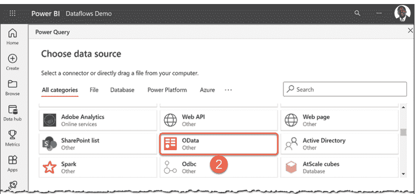

## 图 13.4：选择数据源连接器

- 3. 填写连接设置字段。

- 4. 单击 **下一步**。

上述步骤在以下图像中突出显示：

图 13.5：填写连接设置字段

- 5. 从 **Power Query** 窗体的 **选择数据** 窗格中选择表。根据所选的数据源，您可能会看到不同的窗体。我们使用了此处提供的 **Northwind OData** 示例：https://services.odata.org/V3/Northwind/Northwind.svc。

- 6. 单击 **转换数据**。

上述步骤在以下图像中突出显示：

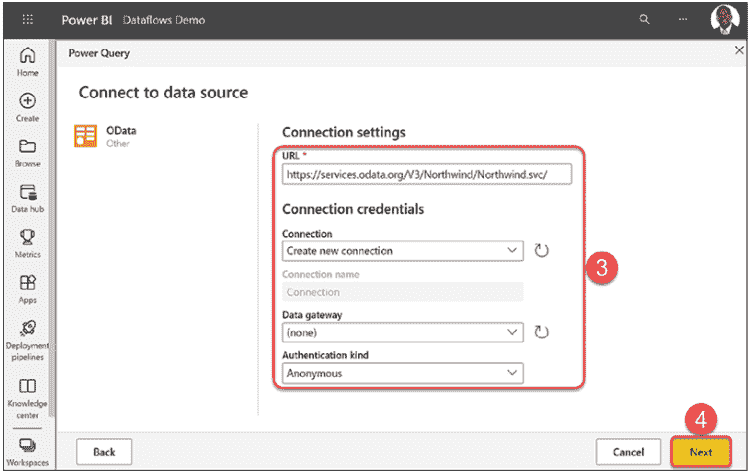

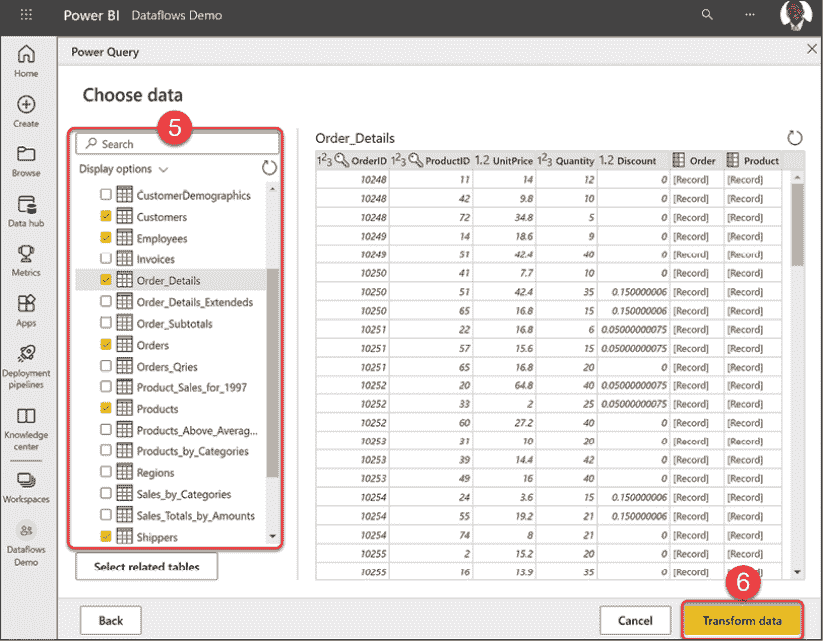

图 13.6：Power Query —— 创建新数据流时选择数据源

如果我们选择本地数据源（on-premises data source），则需要选择一台已启动并正在运行的**本地数据网关**（on-premises Data Gateway）。安装和配置本地数据网关不在本书的讨论范围内，但如果你有兴趣了解更多相关信息，这里有一个很好的资源：[https://learn.microsoft.com/en-us/data-integration/gateway/service-gateway-onprem?WT.mc_id=DP-MVP-5003466](https://learn.microsoft.com/en-us/data-integration/gateway/service-gateway-onprem?WT.mc_id=DP-MVP-5003466)。

我们现在已进入 **Power Query** 表单，这与 Power BI Desktop 中的 **Power Query 编辑器**窗口类似。在 **Power Query** 表单中需要注意的一点是**警告**（warnings）区域。如下图所示，如果从某些列加载数据时出现任何问题，警告消息就会显示在**警告**区域中。我们可以点击**警告**区域以查看更详细的信息：

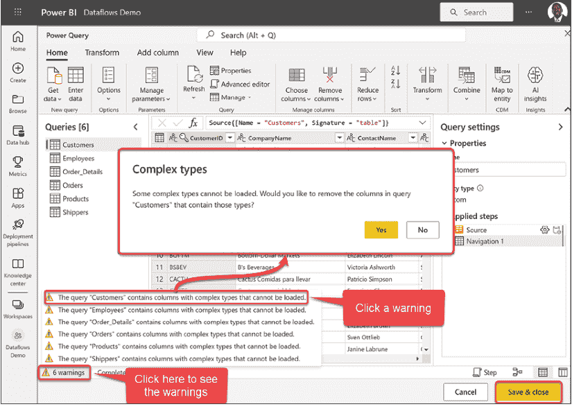

图 13.7：从数据源获取数据后显示的警告消息

如上图所示，我们可以点击警告消息，在必要时采取相应操作。在完成所有必需的转换步骤后，我们可以通过点击**保存并关闭**（Save & close）按钮来保存数据流。

下一步是为我们的数据流命名并保存，如下图所示：

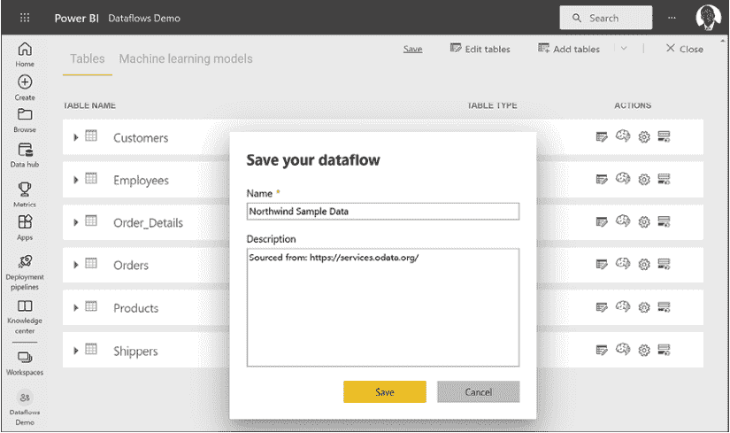

图 13.8：保存数据流

与 Power BI Desktop 中的 Power Query 编辑器不同（它在点击**关闭并应用**（Close & Apply）按钮后会立即从源加载数据），数据流不会自动从源加载数据。相反，我们有两种选择：手动刷新数据或计划数据刷新，如下图所示：

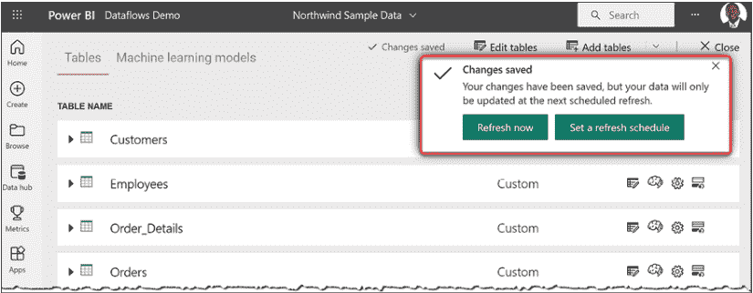

图 13.9：创建新数据流后的数据刷新选项

我们可以通过点击**立即刷新**（Refresh now）按钮来填充表，或者通过设置计划来让表自动刷新。

## 从其他数据流创建链接表

我们可以在一个新数据流中创建链接表（引用其他数据流中的表），也可以向现有数据流中添加链接表。以下步骤展示了如何将链接表添加为新数据流：

1. 导航到所需工作区并开始创建数据流后，点击**添加链接表**（Add linked tables）按钮，如下图所示：

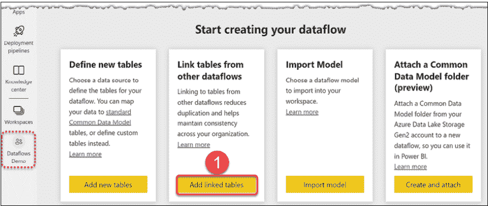

图 13.10：将链接表添加为新数据流

2. 完成连接设置（Connection settings）。

3. 点击**下一步**（Next）。

以上步骤在下面的图像中突出显示：

图 13.11：创建链接表的连接设置

4. 在 Power Query 表单中，展开一个工作区。
5. 选择任意所需的数据流。
6. 点击所需的表。
7. 点击**转换数据**（Transform data）按钮。

以上步骤在下面的图像中突出显示：

图 13.12：从另一个数据流中选择要链接的表

8. 点击**保存并关闭**，如下图所示：

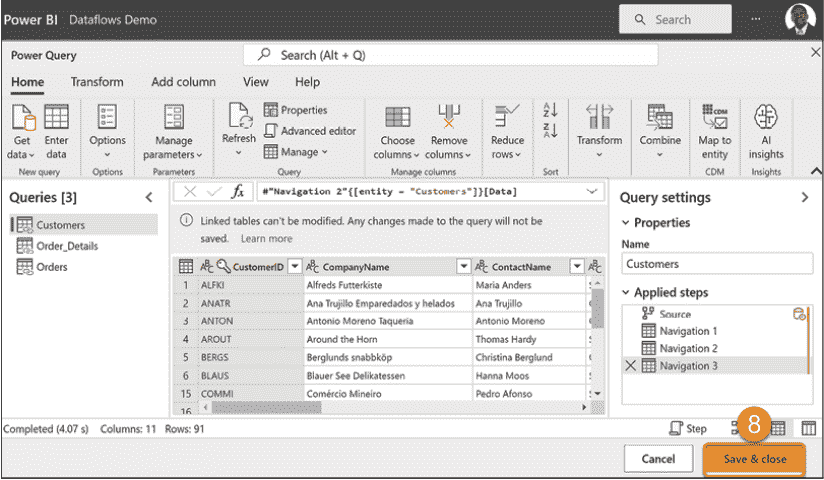

图 13.13：为选定的链接表保存并关闭更改

9. 输入名称，然后点击**保存**（Save）按钮，如下图所示：

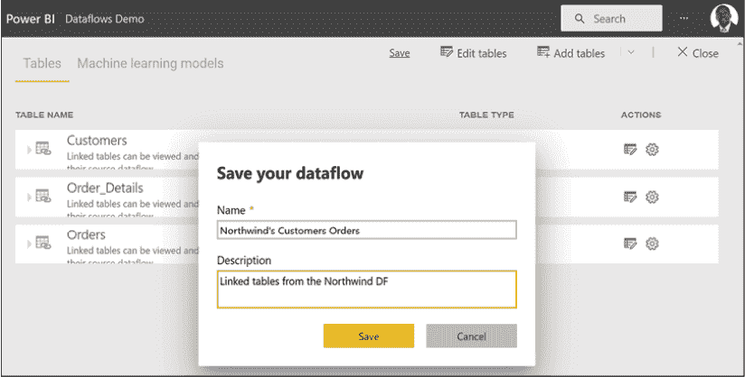

图 13.14：将链接表保存为新数据流

到目前为止，我们已经学习了如何创建一个包含链接表的新数据流。在下一小节中，我们将学习如何创建计算表。

## 创建计算实体

在本节中，我们将学习如何创建计算实体。创建计算实体最常见的方式是在现有数据流中引用另一个实体。以下步骤展示了在导航到所需工作区并打开数据流后，如何创建计算实体：

1. 点击**编辑表**（Edit tables）按钮，如下图所示：

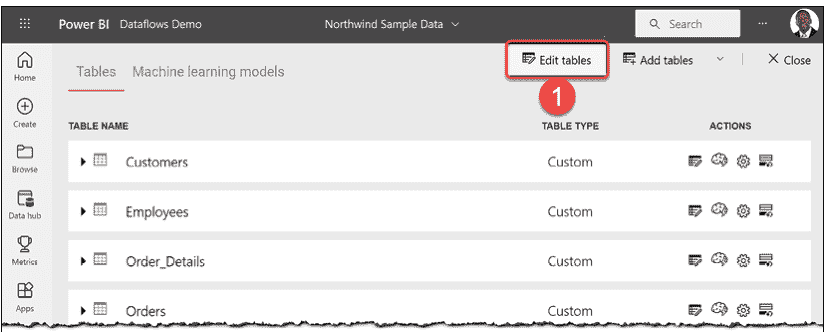

图 13.15：在数据流中编辑实体

2. 在**查询**（Queries）窗格中右键点击所需的表。

3. 点击**引用**（Reference）。

以上步骤在下面的图像中突出显示：

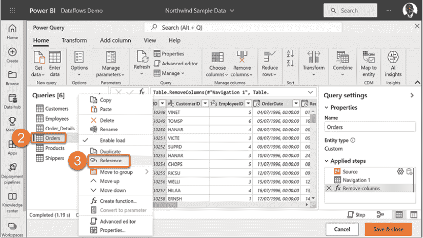

图 13.16：创建计算表

我们创建了一个计算表，如下面的图像所示：

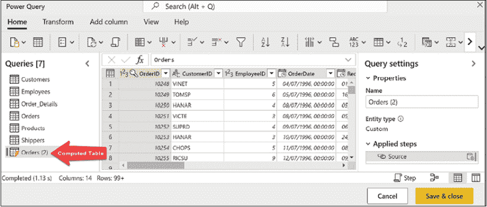

图 13.17：计算表

我们还可以通过引用链接表或添加一些转换步骤，从链接表创建计算表。下面的图像显示，**Date** 表是一个链接表，而 **Date Comp** 表是引用它的计算表：

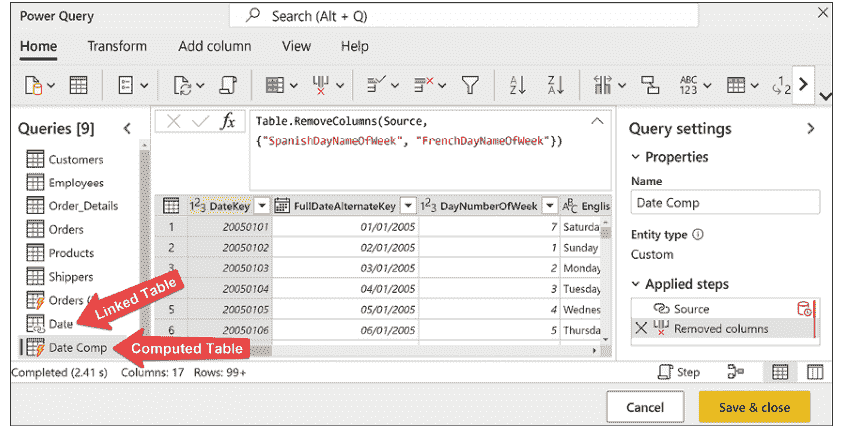

图 13.18：从链接表创建计算表

请记住，链接表是只读的，我们不允许修改它们。如果尝试修改，Power Query Online 引擎会强制我们回滚更改。

## 在数据流中配置增量数据刷新

如前所述，创建数据流的用例之一是防止业务分析师直接访问源数据。如果源表很大，那么我们可以配置增量数据刷新。我们已经在第 10 章“高级数据建模技术”的“增量刷新和混合表”一节中解释了什么是增量刷新以及如何在 Power BI Desktop 中配置它；因此，这里不再赘述。但是，在 Power BI Desktop 和数据流中配置增量刷新之间有一个细微的差别。在 Power BI Desktop 中配置增量刷新时，我们必须首先创建两个查询参数：RangeStart 和 RangeEnd。然后在定义增量刷新策略时使用这些参数。但在数据流中，我们完全不需要定义查询参数。引擎会自动为我们完成。

让我们在我们之前创建的 **Northwind Sample Data** 数据流中的 **Orders** 表上配置增量数据刷新。按照以下步骤操作：

1. 导航到所需的工作区。
2. 打开 Northwind Sample Data 数据流。
3. 在**操作**（ACTIONS）部分下，点击 **Orders** 表的**增量刷新**（🔄）按钮。
4. 打开增量刷新开关。
5. 从**选择要依据其进行筛选的日期时间列**（Choose a DateTime column to filter by）下拉列表中选择 **OrderDate** 列。
6. 在**存储自过去的行**（Store rows from the past）部分中填入 **30 Years**（30年）。
7. 在**刷新自过去的行**（Refresh rows from the past）部分中填入 **1 Month**（1个月）。
8. 点击**保存**（Save）。

下图展示了上述步骤：

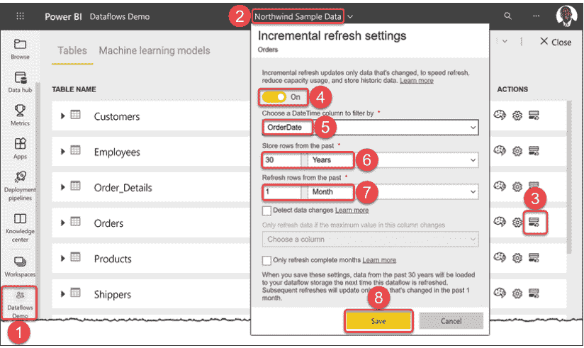

图 13.19：数据流上的增量刷新

保存更改后，编辑数据流以查看更改。下图显示 **RangeStart** 和 **RangeEnd** 参数已创建，并且 **Orders** 表会自动使用这些参数基于 **OrderDate** 列进行筛选。

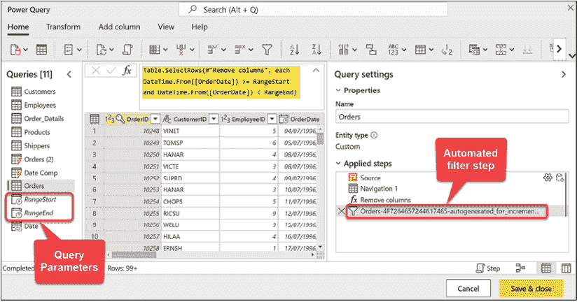

图 13.20：在数据流上配置增量刷新会创建查询参数，并在相应表上添加一个自动筛选步骤

现在我们已经实现了数据流，让我们导出其源代码以备将来使用。

## 导出/导入数据流

在开发任何软件解决方案时，拥有源代码的副本始终是一个好习惯，开发数据流也不例外。我们可以将数据流定义导出为 JSON 格式，并在需要时稍后导入。请注意，导出和导入仅针对于数据流定义，不包含数据。让我们看看它们是如何工作的。

### 导出数据流

导航到所需的工作区，然后按以下步骤操作：

1. 将鼠标悬停在一个数据流上，然后点击**更多选项**省略号按钮。

2. 从菜单中，点击 **Export.json**。

3. 文件准备好后，会显示一条消息。

4. 根据你的浏览器设置，**JavaScript 对象表示法（JSON）** 文件会自动下载到你的本地计算机。

以上步骤在下面的图像中突出显示：

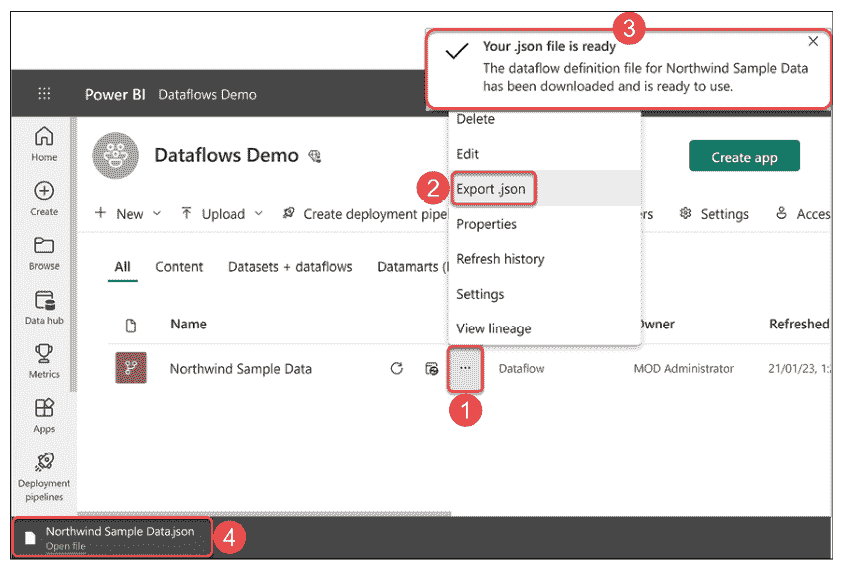

图 13.21：以 JSON 格式导出数据流定义

### 导入数据流

以下步骤展示了在导航到所需工作区后如何导入数据流：

1. 点击**新建**（New）按钮。

2. 点击**数据流**（Dataflow）。

3. 点击**导入模型**（Import model）选项。

4. 选择导出的数据流定义文件（**JSON**）。

5. 单击 **“打开”**。

上述步骤在以下图像中突出显示：

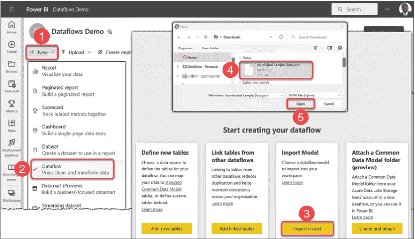

图 13.22：导入数据流

当我们返回工作区时，可以看到导入的数据流。如前所述，导出/导入过程仅适用于数据流定义，不包含数据。因此，我们需要稍后刷新数据。

## 无代码/低代码体验

如本节开头所述，使用数据流的主要目标之一是为用户提供自助式数据准备功能。如果您是经验不足的用户，可能会觉得使用数据流有点繁琐。

但 Power BI 通过提供查询的**关系图视图**，在数据流中实现了无代码/低代码体验，使识别沿袭和开发数据流变得更加容易。**关系图视图**位于 **Power Query** 窗口的右下角，如下图所示：

图 13.23：数据流中的关系图视图

单击关系图视图按钮后，查询的可视化表示将出现在数据视图窗格上方。下图展示了当我们在查询窗格中选择 Orders 表时，在关系图视图中看到的内容：

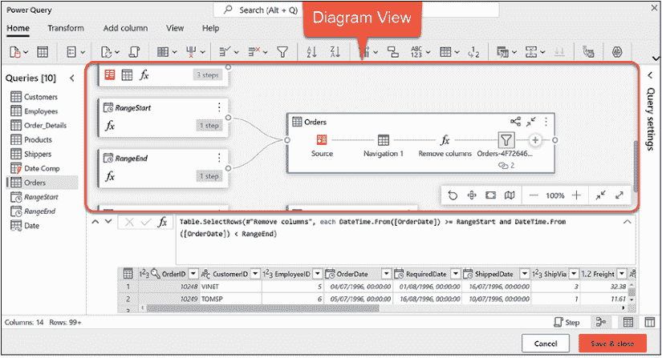

图 13.24：选择 Orders 表时的关系图视图

我们可以通过单击加号按钮（+）来添加新步骤，如下图所示：

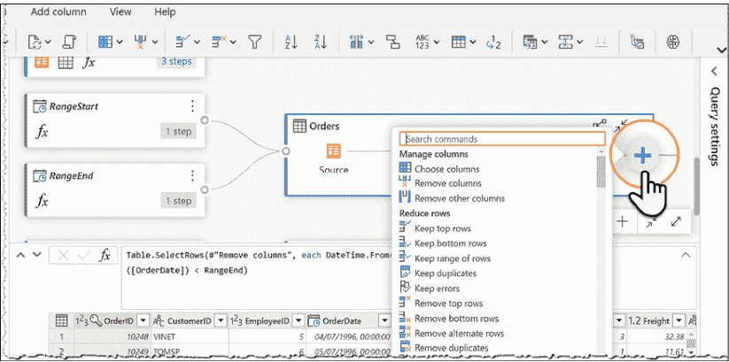

图 13.25：在关系图视图中向 Orders 表添加新的转换步骤

此外，通过单击操作省略号按钮，可以从上下文菜单中使用各种查询级别的操作，如下图所示：

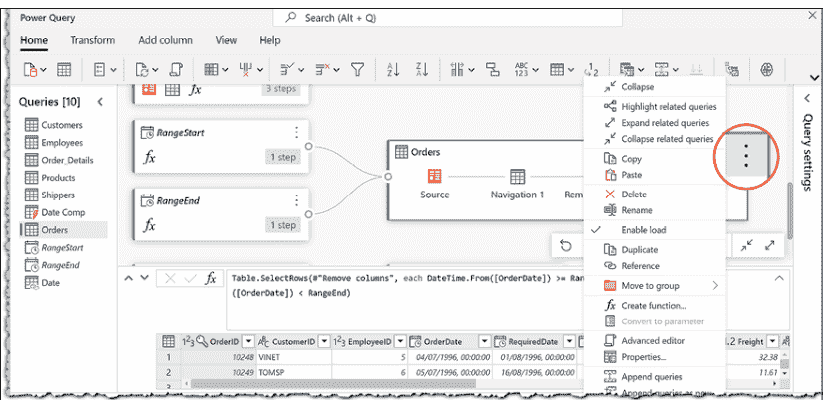

图 13.26：从关系图视图中可用的查询级别操作

在本节中，我们学习了如何创建新的数据流。在介绍 Datamart 功能的公开预览版之后，如果您尝试在高级工作区中创建新的数据流，可能会看到一条消息，建议您创建 Datamart 而不是数据流，如下图所示：

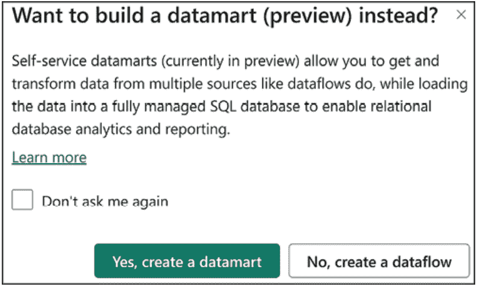

图 13.27：要求创建 Datamart 而不是数据流的消息

虽然 Datamart 和数据流之间存在相似之处，但它们也有一些根本性的差异。因此，我们必须决定哪个选项最能满足我们的需求。我们将在第 15 章“新选项、功能和 DAX 函数”中讨论 Datamart。现在，我们重点讨论数据流。

## 数据流中的查询计划

2021 年 5 月，Microsoft 宣布为数据流提供查询计划，该计划创建可视化指示器，以便更好地了解 Mashup 引擎中发生的情况。此功能仍处于公开预览阶段，目前仅适用于支持查询折叠的数据源。高级用户可以使用查询计划来更好地优化查询并修复问题。我们在第 7 章“数据准备常见最佳实践”中详细讨论了查询折叠，因此这里不再重复基础知识。

我们可以通过右键单击转换步骤并单击“查看查询计划”选项来访问转换步骤的查询计划。下图展示了如何访问 DimProduct 查询中“更改列类型”步骤的查询计划，该查询的数据源是在 Azure SQL 数据库上还原的 AdventureWorksDW2019 数据库：

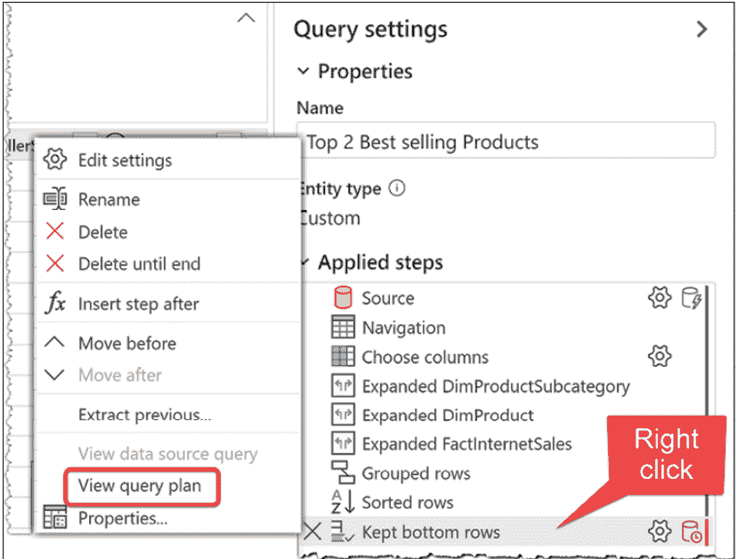

图 13.28：在数据流中获取转换步骤的查询计划

在上述查询中，我使用了 DimProductCategory；我将其与 DimProductSubcategory 合并，然后与 DimProduct 合并，再与 FactInternetSales 合并。我按 EnglishProductCategoryName 列对结果进行了分组，并聚合了 SalesAmount 的总和。然后，我按升序对结果进行排序，最后保留了底部两行。

下图显示了“保留底部行”步骤的查询计划：

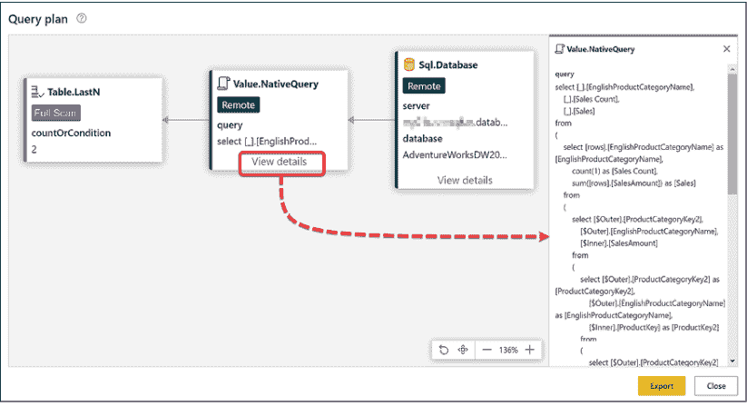

图 13.29：所选步骤的查询计划

在上图所示的查询计划中，标记为 Remote 的两个节点已被折叠，但标记为 Full Scan 的节点未被折叠。我们可以通过单击“查看详细信息”选项来了解有关每个节点的更多信息。

## 总结

在本章中，我们学习了数据流、它们的定义及其术语。我们还学习了何时以及如何创建数据流，以及如何在必要时导出和导入数据流。如本章开头所述，关于数据流的内容远不止本章所讨论的。因此，我建议您通过以下 URL 在 Microsoft 官方网站上阅读更多有关这项出色技术的信息：https://learn.microsoft.com/en-us/power-query/dataflows/overview-dataflows-across-power-platform-dynamics-365?WT.mc_id=DP-MVP-5003466。

在下一章中，我们将讨论另一个高级数据建模功能：复合模型。

## 加入我们的 Discord！

加入 Packt Discord 服务器上的大数据与分析社区！

与其他 558 名成员交流，享受免费的语音和文本聊天。

https://packt.link/ips2H

