## 复合模型中与 Power BI 数据集和 Analysis Services 的 DirectQuery 连接

在上一章中，我们学习了何时以及如何使用数据流。本章聚焦于一个高级数据建模主题，即通过启用和使用与 Power BI 数据集、本地 SQL Server Analysis Services（SSAS）表格模型以及 Azure Analysis Services 的 DirectQuery 连接来扩展复合模型。

在前面的章节中，我们通过许多不同场景学习了数据建模的各个方面。本章简要介绍 Power BI 平台中更多可用的选项，这些选项在实际场景中可能非常有用。本章讨论的每个主题都有大量的技术细节，几乎不可能在一章中全部涵盖。但了解它们是非常有价值的。本章涵盖以下内容：

- 复合模型简介
- 为实时连接启用 DirectQuery
- 新术语

### 复合模型简介

在第 4 章“从各种源获取数据”中，我们讨论了数据集的不同存储模式。以下是对数据集存储模式的快速回顾：

- **导入**：当我们将数据模型保留在 Power BI 中，并且整个数据都缓存在内存中时使用。在此模式下，所有表都处于**导入**存储模式。
- **DirectQuery**：当我们在 Power BI 中创建数据模型，但数据**不**缓存在内存中时使用。在此模式下，所有表都处于 DirectQuery 存储模式。
- **实时连接**：一种特定类型的 DirectQuery，连接到语义模型，而不是关系数据库（数据存储）。当我们使用**实时连接**时，数据模型托管在其他位置；因此，我们无法对数据模型进行任何更改。相反，我们只能从数据模型中获取现成的数据。
- **复合（混合）**：当一部分数据缓存在内存中，而其余数据不缓存时使用。在此模式下，有些表处于**导入**存储模式，有些表处于 **DirectQuery** 存储模式或**双**存储模式。

最后一种是本节的主要主题。以前，复合模型仅支持关系数据库进行 DirectQuery，而不支持语义层，例如 **SSAS 表格模型**、**Azure Analysis Services（AAS）**和 **Power BI 数据集**。2020 年 12 月，Microsoft 推出了新一代复合模型的公开预览版。这一代新的复合模型自 2023 年 4 月起正式可用，不仅支持对 SQL Server 数据库等关系数据库的 DirectQuery 连接，还支持对 SSAS 表格 2022、AAS 实例和 Power BI 数据集的 DirectQuery。

这导致了我们与数据交互方式的巨大变化，尤其是从分析的角度来看。借助复合模型，我们现在可以从单个 Power BI 数据模型连接到多个语义层。我们还可以从其他数据源（如 SQL Server 或 Excel）导入数据，并使用 Power BI 创建企业级的自助式语义层。


## 为实时连接启用 DirectQuery

要能够使用此功能，我们需要在 Power BI 服务和 Power BI Desktop 中启用它。以下小节将说明如何操作。

### 在 Power BI 服务中允许对 Power BI 数据集的 DirectQuery 连接

如果您是 Power BI 管理员，则需要在 Power BI 服务的管理员门户中启用 **Allow DirectQuery connections to Power BI datasets**。如果您不是管理员，则可以请您的 Power BI 管理员为您启用。无论哪种情况，以下步骤都显示了如何在 Power BI 服务中启用此功能：

1. 单击 Power BI 服务右上角的齿轮按钮（⚙）。
2. 单击 **Admin portal**。
3. 在 **Export and sharing settings** 部分下展开 **Allow DirectQuery connections to Power BI datasets** 设置。
4. 您可以根据组织的数据治理策略为 **The entire organization** 或仅为 **Specific security groups** 启用此功能。
5. 单击 **Apply**。

以下图像显示了前面的步骤：

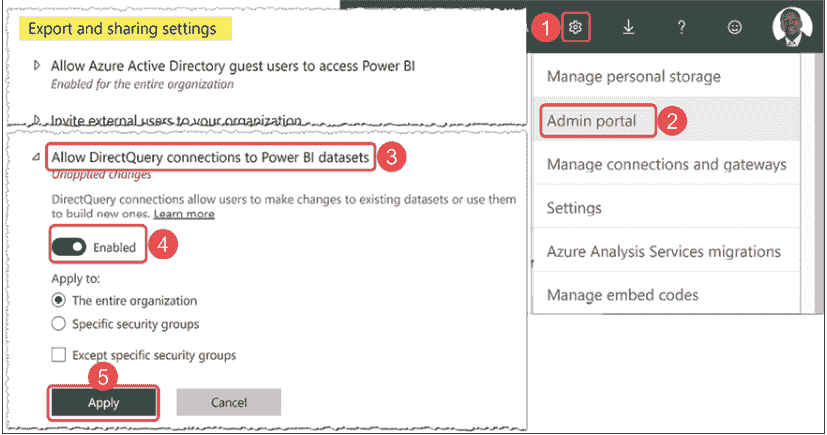

Figure 14.1: Enabling DirectQuery connections to Power BI datasets in the Power BI service

现在我们已启用此功能，是时候学习一些新的术语了。

### 新术语

新一代复合模型带来了新的术语。理解这些术语有助于我们更高效、更少问题地解决更复杂的场景。在接下来的几个小节中，我们将学习这些新术语。

**Chaining**

Chaining 是与新的复合模型一起引入的新术语。当 Power BI 报表或数据集基于托管在 SSAS tabular、AAS 或 Power BI 数据集中的其他语义模型时，我们就创建了一个链；换句话说，chaining 是关于复合模型中使用的语义层之间的依赖关系。因此，当我们在其他数据集之上创建数据集时，新数据集依赖于一系列其他数据集。

**Chain length**

当我们创建链时，其长度指的是当前数据集所依赖的语义层的数量。让我们实现一个场景来更好地理解这些术语。

业务有一个托管在 AAS 数据集中的语义模型，该模型仍在开发中。AAS 开发人员有大量的待办事项和未来的任务要实现。业务对报表有紧急需求。业务需要为 FactInternetSales 表上的 UnitPrice 列定义分段，如下所示：

- **Low**: 当单价小于 $100 时
- **Medium**: 当单价在 $101 到 $1,000 之间时
- **High**: 当单价在 $1,001 到 $3,000 之间时
- **Very high**: 当单价大于 $3,001 时

让我们更详细地查看场景。首先，我们在 AAS 中有一个语义模型，但开发人员因日常任务而太忙，无法响应业务的紧急请求。业务可能有许多紧急的日常请求，但我们的 AAS 开发人员无法停止开发任务来满足业务需求。作为 Power BI 数据建模者，我们可以非常快速地帮助解决这个问题。

以下步骤显示了如何在 Power BI Desktop 中满足前述要求：

1. 从 Power BI Desktop 连接到 AAS 实例时选择 **Connect live**，如下图所示：

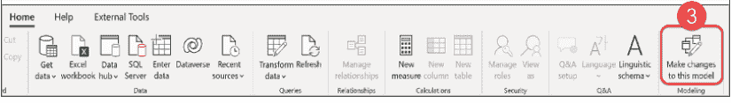

Figure 14.4: Changing the connection mode from Connect Live to DirectQuery on top of an AAS model

4. 单击 **Add a local model**，如下图所示：

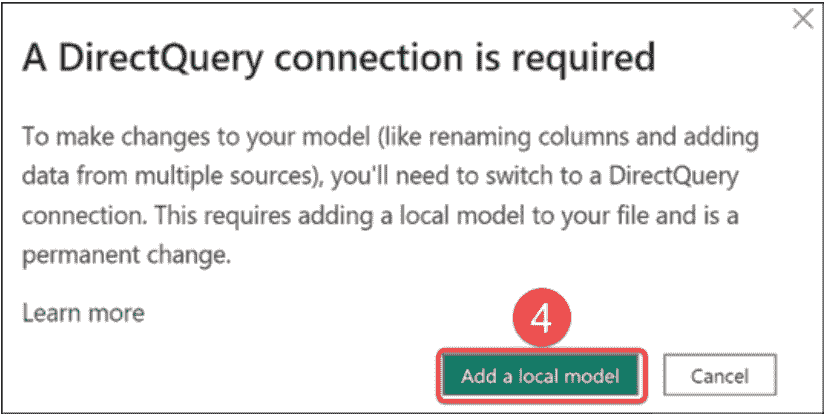

Figure 14.5: Confirming to add a local model

5. 如有必要，勾选 **Include tables added later** 选项并单击 **Submit** 按钮：

**Connect to your data**

Databases

Search

Select the database or specific tables you'd like to connect to. Learn more

asazure://

AdventureWorksDW2019

- DimCurrency
- DimCustomer
- DimDate
- DimProduct
- DimPromotion
- DimSalesTerritory
- FactInternetSales
- FactInternetSalesReason

Include tables added later

Submit

Cancel

Figure 14.6: Submitting the selected tables

6. 如以下图像所示，所有表现在都已转为 DirectQuery 模式。我们可以悬停在表上以查看更多详细信息：

8. 使用以下 DAX 表达式创建另一个计算列以对 **Unit Price Range Band** 列进行排序：

```
UnitPriceRangeBandSort =
    SWITCH(
        TRUE(),
        'FactInternetSales'[UnitPrice] <= 100, 1,
        AND('FactInternetSales'[UnitPrice] >= 101, 'FactInternetSales'[UnitPrice] <= 1000), 2,
        AND('FactInternetSales'[UnitPrice] >= 1001, 'FactInternetSales'[UnitPrice] <= 3000), 3,
        4
    )
```

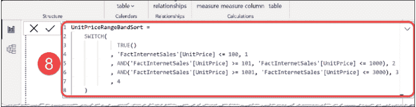

Figure 14.9: Creating a UnitPriceRangeBandSort calculated column

9. 按 **UnitPriceRangeBandSort** 列对 **Unit Price Range Band** 列进行排序，如下图所示：

Figure 14.10: Sorting a column by another column

正如您所见，由于数据集现在处于 DirectQuery 模式，数据视图不可用。因此，要查看我们所做的更改，我们必须使用表格视觉对象。以下图像显示了使用我们构建的新计算列的表格视觉对象：

Figure 14.11: Testing the results in a table visual when the dataset is in DirectQuery

现在我们已满足业务需求，可以按需可视化数据，但难题的最后一部分是将报表发布到服务。以下图像显示了报表发布到 Power BI 服务后的血缘视图：

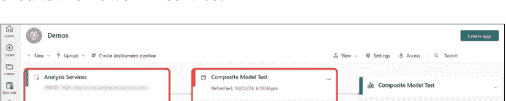

Figure 14.12: Lineage view of a published report in the Power BI service

现在，让我们重新审视新的术语。我们正在对托管在 Analysis Services 中的语义模型运行 DirectQuery，这是第一个链，从 Composite Model Test 数据集开始，这是第二个链。因此，我们场景中的链长度为 2。如果我们在 Composite Model Test 之上再创建另一个数据集，则链长度将为 3。

> Note
> 
> 在撰写本书时，允许的最大链长度为 3；因此，我们无法创建链长度为 4 的复合模型。

到目前为止，我们已学习了使用实时连接的 DirectQuery 的基础知识。下一节重点介绍复合模型中使用 DirectQuery 对实时连接的 RLS。

### 使用 DirectQuery 连接到 Power BI 数据集的复合模型中的 RLS

现在我们对复合模型如何与 DirectQuery 连接到 Power BI 数据集、SSAS tabular 或 AAS 模型有更好的理解，是时候更进一步讨论包含 RLS 的更技术性的场景。我们将为此场景使用 AdventureWorksDW2019 数据库。

业务有一个 Internet Sales 数据集已发布到 Power BI 服务。以下图像显示了 Internet Sales 数据模型：

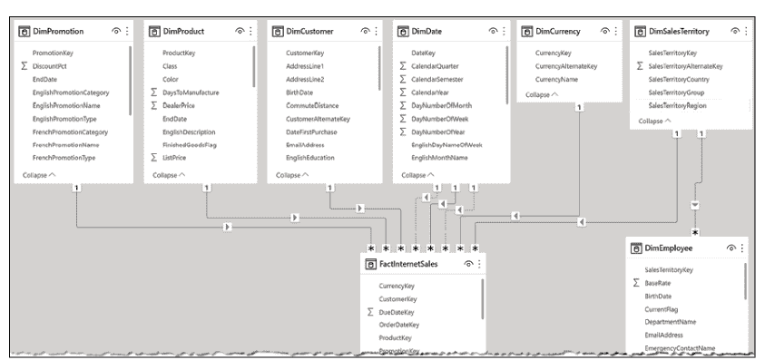

Figure 14.13: Internet Sales data model

请注意 DimSalesTerritory 和 DimEmployee 表之间的多对一关系。开发人员创建了动态 RLS，以便每个销售人员只能看到其相关区域的销售值。为了确保 DimEmployee 表始终显示与报表用户相关的数据，我们必须使用以下 DAX 表达式在 DimEmployee 表上创建规则：

```
[EmailAddress] = USERPRINCIPALNAME ()
```

我们还使用以下表达式在 **DimSalesTerritory** 上创建规则以满足该需求：

```
VAR __SalesReps =
CALCULATETABLE(
    VALUES(DimEmployee[SalesTerritoryKey]),
    TREATAS( {USERPRINCIPALNAME()}, DimEmployee[EmailAddress] )
)
RETURN
DimSalesTerritory[SalesTerritoryKey] in __SalesReps
```

以下图像显示了在德国活跃的销售人员 Rachel Valdez 在报表中可以看到的内容：

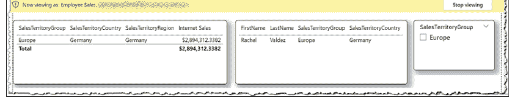

Figure 14.14: Dynamic RLS implemented for salespersons

前述报表的示例文件为 `Chapter 14, Dynamic RLS Internet Sales.pbix`，您可以从此处下载：
https://github.com/PacktPublishing/Expert-Data-Modeling-with-Power- BI-Second-Edition/blob/28e2af1762336ab5236a3b3961c41e9020de8200/Samples/Chapter%2014/Chapter%2014,%20Dynamic%20RLS%20Internet%20Sales.pbix.

业务现在要求在新报表中包含 **Resellers Sales**，因此当销售人员打开报表时，他们只能看到自己的数据。**Resellers Sales** 数据目前保存在组织数据仓库中。我们希望创建一个新的复合模型，使用 DirectQuery 连接到 Power BI 中现有的数据集，并从数据仓库添加 **DimReseller** 和 **FactResellerSales** 表。以下图像显示了在 **DirectQuery** 模式下连接到现有 Power BI 数据集并创建关系后数据模型的一部分：


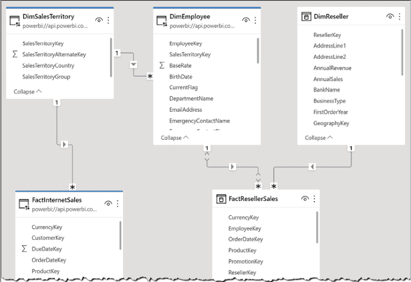

图 14.15：已将 Reseller Sales 数据添加到 Power BI 数据集

因此，新的数据模型包含来自远程数据集的表以及来自数据仓库的两个导入表。Power BI 服务中的远程数据集已实施 RLS，因此我们期望 RLS 会传播到新的数据模型。新的报表文件为 `Chapter 14, Composite Model Internet Sales.pbix`，可从此处下载：

[https://github.com/PacktPublishing/Expert-Data-Modeling-with-Power-BI-Second-Edition/blob/28e2af1762336ab5236a3b3961c41e9020de8200/Samples/Chapter%2014/Chapter%2014,%20Composite%20Model%20Internet%20Sales.pbix](https://github.com/PacktPublishing/Expert-Data-Modeling-with-Power-BI-Second-Edition/blob/28e2af1762336ab5236a3b3961c41e9020de8200/Samples/Chapter%2014/Chapter%2014,%20Composite%20Model%20Internet%20Sales.pbix)

如 *第 11 章、行级和对象级安全* 中所述，RLS 仅在用户对包含的工作区具有 **Viewer** 角色或报表通过链接、直接访问或应用与用户共享时才会生效。因此，我将新报表发布到 Power BI 服务，并在工作区上为期望的安全组设置了 **Viewer** 角色。以下图像显示了发布到 Power BI 服务的新报表的血缘视图：

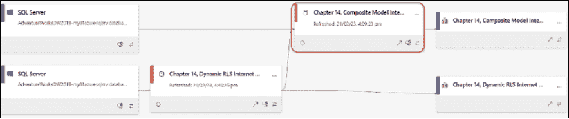

图 14.16：复合模型的血缘视图

如前图所示，复合模型的链长为 2。以下图像显示了当安全组成员用户登录 Power BI 并运行报表时会发生什么：

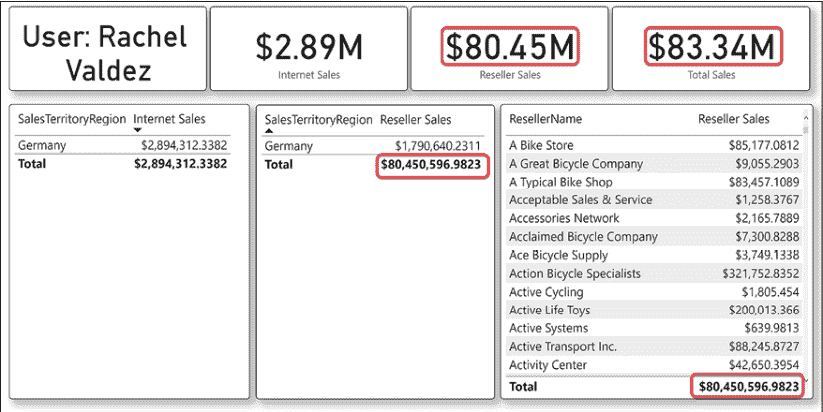

图 14.17：复合模型 Internet Sales 报表

如前图所示，对第一链实施的 RLS 已生效并识别出 Rachel 登录，且在第一链数据集中的 **Internet Sales** 度量上也按预期工作。但在 **Reseller Sales** 上发生了奇怪的事情，进而影响了 **Total Sales**，即 `[Internet Sales] + [Reseller Sales]`。虽然唯一的 **SalesTerritoryRegion** 是 **Germany**，这是正确的，但总数完全错误。事实上，Rachel 看到了所有 **Reseller Sales** 而不是 **Germany** 的销售。原因是 **DimEmployee** 与 **FactResellerSales** 表之间的关系是受限关系，如 *图 14.16* 所示。

事实上，DirectQuery 表与导入表之间的所有关系都是受限关系。我们在 *第 9 章、星型架构和数据建模通用最佳实践* 中 *处理多对多关系* 部分触及了受限关系，在那里我们讨论了两种关系评估类型：常规和受限。简要回顾一下，当两个表具有相同的存储模式且两者之间的关系不是多对多时，两个表之间的关系是常规的。如果违反上述任一条件，表之间的关系就是受限的。

当关系受限时，**表扩展** 不会发生。表扩展发生在 **多对一** 关系 **多** 侧的表或具有 **一对一** 关系的表上。表扩展意味着 **一** 侧表的列可由 **多** 侧表访问。例如，查看 *图 14.16*；你可以想象一个宽的 **FactResellerSales**，它还包含 **DimReseller** 表的所有列。这就像使用 `RELATED()` 函数从 **FactResellerSales** 表访问 **DimReseller** 列一样。

这就是为什么当关系受限时，`RELATED()` 函数不受支持。当关系受限时，从 **一** 侧到 **多** 侧的一对多关系的筛选传播不会按预期工作。因此，当 Rachel 打开报表时，她会看到所有经销商销售，而不仅仅是她自己的。为了修复此问题，我们在 **FactResellerSales** 表上添加了另一个 RLS 规则，使用以下 DAX 表达式对 **SalesTerritoryKey** 列强制执行筛选：

```
VAR __SalesReps =
CALCULATETABLE(
    VALUES(DimEmployee[EmployeeKey]),
    TREATAS( {USERPRINCIPALNAME()}, 
DimEmployee[EmailAddress] )
)
RETURN
FactResellerSales[EmployeeKey] in __SalesReps
```

在具有 Power BI 数据集或 Azure Analysis Services 的 DirectQuery 的复合模型中，远程表不可用于创建 RLS 规则。但我们仍可运行 DAX 表达式来筛选导入表。例如，如下图所示，DimEmployee（远程表）在管理角色窗口中不可用。但我们仍可通过在远程表上运行 DAX 表达式来筛选 FactInternetSales：

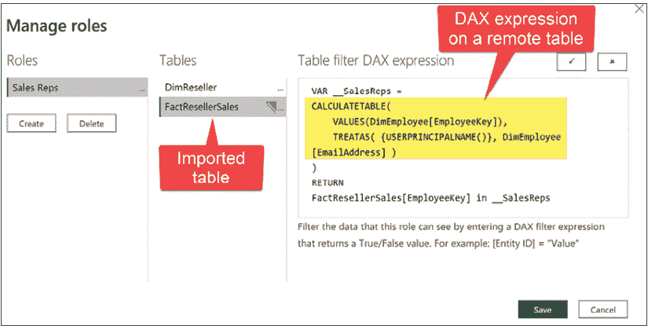

图 14.18：在复合模型中创建新的 RLS 角色

下图显示了在向复合模型添加新的 RLS 角色后 Rachel 的报表结果：

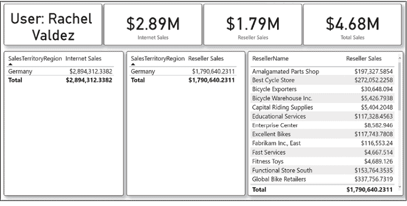

图 14.19：Rachel 运行的带 RLS 的复合模型

当 Pamela 打开同一报表时，她只能看到她自己的数据，这正是我们期望报表的工作方式。下图显示了 Pamela 运行的报表：

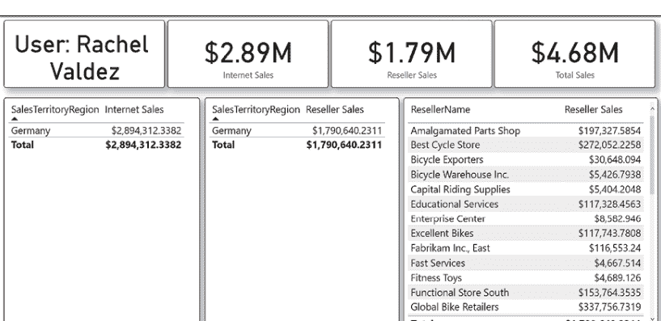

图 14.20：Pamela 运行的带 RLS 的复合模型

正如我们所见，受限关系使得在具有 Power BI 数据集 DirectQuery 的复合模型中 RLS 的工作方式与常规模型略有不同。话虽如此，我们了解到应用于不同数据集链的 RSL 总是向下流，这意味着链 1 数据集中的 RLS 会筛选链 2 数据集中的数据。这会影响我们从权限角度在数据集上实现进一步报表的方式。例如，考虑这样一种情况：我们希望启用贡献者使用具有 DirectQuery for Power BI 数据集的复合模型数据集结构创建报表。我们将在下一节讨论这个问题。

## 为贡献者（报表作者）设置数据集权限

众所周知，对数据集实施的 RLS 仅对通过共享链接访问报表、具有报表只读直接访问权限或在工作区具有 Viewer 角色的用户生效。报表作者应具有对引用数据集的 Build 权限，以便在 Power BI Desktop 中连接到数据集以创建精简报表。精简报表是我们基于现有数据集构建的报表。换句话说，精简报表没有数据模型，只有数据可视化。导航到期望的工作区后，按以下步骤向贡献者授予 **Build** 权限：

- 1. 将鼠标悬停在第一链数据集上并单击 **更多选项** 省略号按钮。
- 2. 单击 **管理权限** 选项。
- 3. 将鼠标悬停在用户帐户或安全组上并单击 **更多选项** 省略号按钮。
- 4. 单击 **添加构建。**

下图显示了上述步骤：

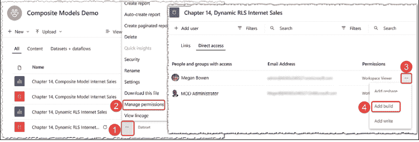

图 14.21：为贡献者授予链式数据集的构建权限

虽然我们在本章中实施的复合模型场景并不过于复杂，但它们是现实世界的场景，可以帮助我们解决更具挑战性的实施。该功能于 2023 年 4 月刚刚普遍可用，其功能将随着时间的推移而改进。因此，我强烈建议关注 Microsoft 官方网站以监控更改、限制和注意事项。以下是 Microsoft 的官方文档：https://learn.microsoft.com/en-us/power-bi/connect-data/desktop-directquery-datasets-azure-analysis-services?WT.mc_id=DP-MVP-5003466。

## 总结

在本章中，我们了解了 Power BI 中复合模型的新术语，以及如何在 Power BI Desktop 和 Power BI 服务上启用对 Power BI 数据集的 DirectQuery 连接，并实施了简单但实用的场景，以为未来的实施和更复杂的场景建立坚实的基础。在下一章中，我们将了解 Power BI 中数据建模的其他新功能和能力。

### 加入我们 Discord！

加入 Packt Discord 服务器上的大数据与分析社区！

与 558 名其他成员一起聊天，享受免费的语音和文字聊天。

[https://packt.link/jps2H](https://packt.link/jps2H)


