在*第 14 章，复合模型中对 Power BI 数据集和分析服务的 DirectQuery 连接*中，我们学习了如何在复合模型中使用对 Power BI 数据集、Azure Analysis Services 和 SQL Server Analysis Services 表格模型的 DirectQuery 连接。我们还讨论了一些设计挑战，尤其是当数据集包含 RLS 时。在本章（本书的最后一章）中，我们将探讨一些新发布的功能、选项和 DAX 函数。本章涵盖以下主题：

- 字段参数
- Datamarts 简介
- 新的 DAX 函数

### 字段参数

微软于 2022 年 5 月为 Power BI Desktop 发布了**字段参数**功能。在撰写本文时，该功能仍处于公开预览阶段。字段参数功能帮助 Power BI 开发人员创建支持更动态报表的数据模型，用户可以在切片器中切换不同字段（度量和列），从而影响其他关联视觉对象。字段参数功能不同于查询参数，可通过功能区中的**建模**选项卡上的**报表**视图访问。

我们已经在*第 2 章，数据分析表达式和数据建模*中的*使用字段参数实现动态度量选择*小节中实现了一个解决方案，用于在两个度量之间动态选择，因此无需再次解释如何使用字段参数。相反，我们使用示例文件来扩展该解决方案，并更详细地讨论后台发生的情况。示例文件可在此处访问：https://github.com/PacktPublishing/Expert-Data-Modeling-with-Power-BI-Second-Edition/blob/cb57eb34a28e6bda8b725ca0f5c85200f42c072c/Samples/Chapter%2002/Chapter%202%2C%20Time%20Intelligence.pbix。

下图显示了当前报表中的内容：

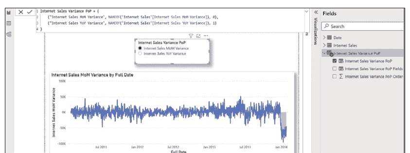

*图 15.1：使用字段参数的动态度量*

如上图所示，使用字段参数功能会创建一个新的计算表。配置字段参数后，无法再通过 UI 修改它，但我们可以修改自动生成的 DAX 表达式。Power BI 使用了一个新的 DAX 函数 NAMEOF()，该函数接受度量名称或列名称，并返回字段的完全限定名称。字段参数生成的计算表与其他计算表一样，因此我们可以修改它并添加列或度量。例如，我们使用以下 DAX 表达式向计算表添加一个新度量，以检索 [Internet Sales] 度量的完全限定名称：

```dax
Internet Sales Field Name = NAMEOF([Internet Sales])
```

下图显示了结果：

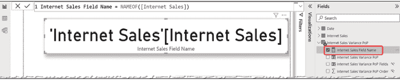

*图 15.2：使用 NAMEOF() 函数*

或者，我们可以修改计算表的 DAX 表达式，如下所示，以添加另一个字段：

```dax
Internet Sales Variance PoP = {
    ("Internet Sales MoM Variance", NAMEOF('Internet Sales'[Internet Sales MoM Variance]), 0),
    ("Internet Sales YoY Variance", NAMEOF('Internet Sales'[Internet Sales YoY Variance]), 1),
    ("Internet Sales LY", NAMEOF([Internet Sales LY]), 2)
}
```

下图显示了结果：

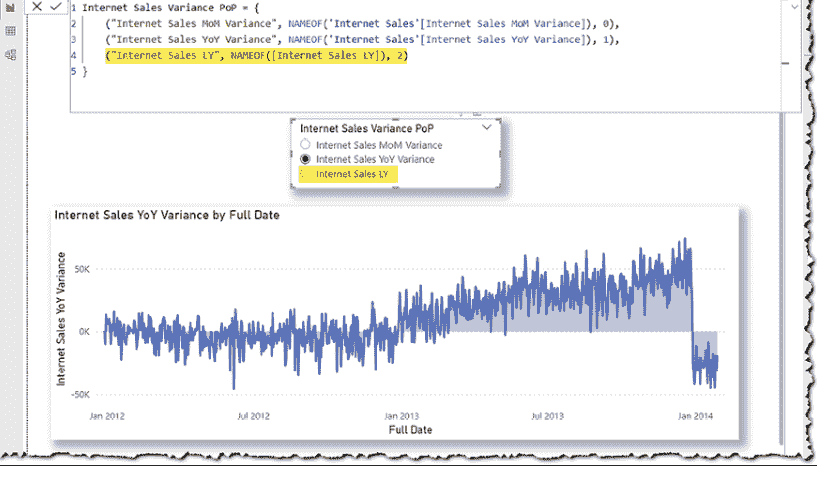

*图 15.3：修改由字段参数创建的计算表*

让我们配置另一个字段参数，使用户能够在 Year、Month 和 Full Date 列之间动态选择另一个面积图的 X 轴。新的字段参数会创建一个名为 Date Fields 的新计算表。

> 注意
> 
> 我们将 CalendarYear 列重命名为 Year，将 EnglishMonthName 重命名为 Month，并将文件另存为 Chapter 15, Field Parameters.pbix。

由于步骤与我们在第 2 章“数据分析表达式和数据建模”中解释的场景类似，我们跳过逐步说明。下图显示了配置：

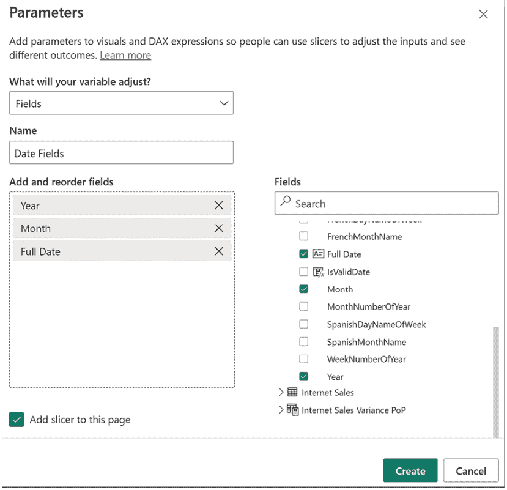

*图 15.4：配置新的字段参数*

现在，我们复制现有的**面积图**，并将其**X 轴**更改为新计算表中的**Date Fields**列。下图显示了用户从第一个切片器中选择`Internet Sales LY`度量，并从第二个切片器中选择**Month**的结果：

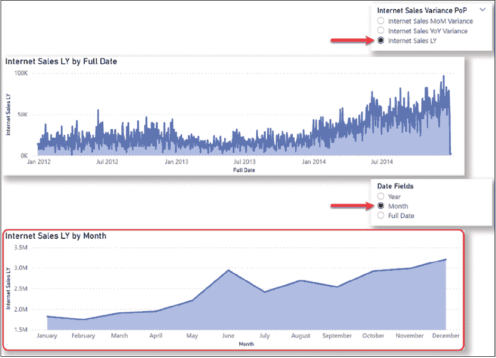

*图 15.5：在新的面积图中使用 Date Fields*

如上图所示，突出显示的**面积图**显示了**按月份的 Internet Sales LY**。但如果业务希望在切片器中拥有日期层次结构，一个显示**Year**和**Month**级别，另一个显示**Full Date**呢？为此，我们只需向**Date Fields**表添加一个新列，将**Year**和**Month**列归类为**Year-Month**，将**Full Date**归类为**Date**。因此，我们修改 DAX 表达式如下：

```dax
Date Fields = {
    ("Year", NAMEOF('Date'[Year]), 0, "Year-Month"),
    ("Month", NAMEOF('Date'[Month]), 1, "Year-Month"),
    ("Full Date", NAMEOF('Date'[Full Date]), 2, "Date")
}
```

上述表达式向 Date Fields 表添加了一个新的 Value4 列。下图显示了结果：

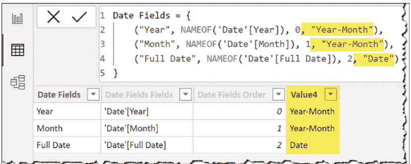

*图 15.6：向 Date Fields 计算表添加新列*

将 Value4 列重命名为 Date Hierarchy，然后将其添加到 Date Fields 切片器中，如下图所示：

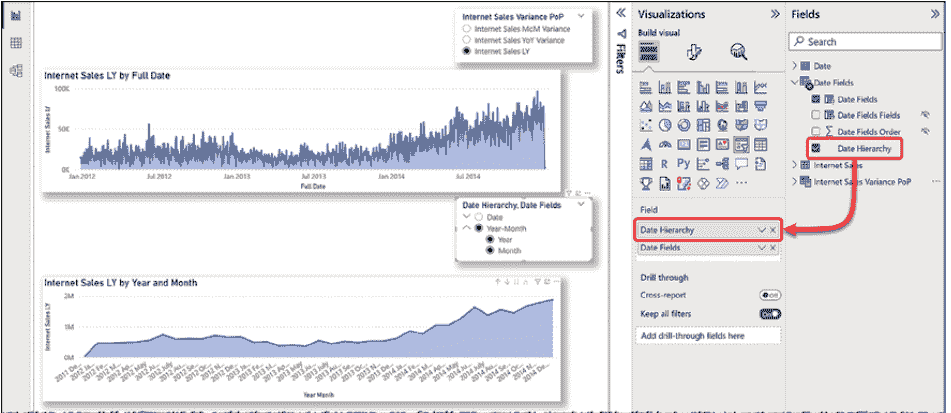

*图 15.7：将 Date Hierarchy 添加到 Date Fields 切片器*

如上图所示，我们现在在切片器中有了一个层次结构，因此当用户选择 Year-Month 级别时，第二个面积图会将 Year 和 Month 显示为一个层次结构，以便用户可以在其级别中向下钻取或向上钻取。借助字段参数，我们可以添加更灵活的数据模型，以支持更动态的数据可视化。在发布数据模型后，我们可以在精简报表中利用字段参数的功能，并在 Power BI Service 中实现字段参数。

> 注意
> 精简报表是指通过实时连接连接到 Power BI Service 中已发布 Power BI 数据集的 Power BI 报表。

最后但同样重要的是，在 Power BI 中使用**在 Excel 中分析**功能时，字段参数在 Excel 中不可见。

下一节将重点介绍 Power BI 中的另一个强大功能：Datamarts。

### Power BI Datamarts 简介

微软于 2022 年 5 月宣布了 **Datamarts** 的公开预览。在撰写本章时，Datamarts 仍处于预览阶段，因此不建议在生产环境中使用。Datamarts 功能为组织在 Power BI 平台上实现其数据分析目标开辟了无限可能。在我们深入研究 Power BI Datamarts 之前，让我们退一步，理解 Datamart 的含义。

### 什么是 Datamart？

在互联网上快速搜索，会得到 IBM、Amazon 和 Oracle 等技术领先公司的多种定义。他们都认为，Datamart 是数据仓库的一个面向主题的子集，专注于特定的业务单元、部门、主题领域或业务功能。Datamart 的数据通常存储在包含数据分析所需的移动时间窗口的数据库中，而不是完整的历史数据。例如，组织将各种业务领域（如销售、库存、营销、财务等）的历史和当前数据存储在企业的数据仓库中。然后，他们为过去 5 年的社交营销创建一个 Datamart。下图显示了基于企业数据仓库的 Datamarts 的简单架构：

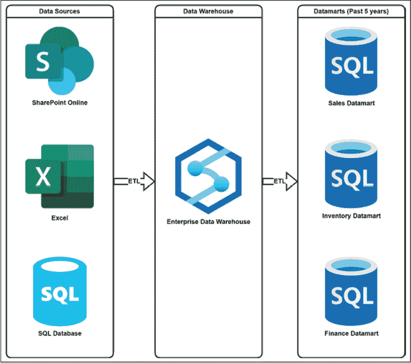

*图 15.8：包含 Datamarts 的简单商业智能架构*

在上图中，第一个 ETL 箭头（左侧箭头）显示了从源系统提取数据、转换并加载到保留完整数据历史的企业数据仓库的过程。然后，我们还有其他一些 ETL 流程，不断将过去 5 年的数据注入 Datamarts。

在现实世界中，**商业智能（BI）**或**信息技术（IT）**部门负责实施和


维护 ETL 流程、企业数据仓库和数据集市，这通常需要相当长的时间才能将解决方案交付给终端用户。这一冗长的流程通常会导致终端用户尝试自行解决问题，通过创建类似数据集市的解决方案来实现，往往以存储在个人空间中的 Excel 文件形式创建。从数据治理的角度来看，这对组织而言是一个巨大的风险，使其面临各种隐私和安全泄露的威胁。

现在我们对数据集市及其挑战有了更好的理解，让我们通过 Power BI 的视角来看待它。

## 什么是 Power BI Datamarts？

如前所述，传统数据仓库和构建数据集市的弱点之一是它们需要大量的知识来创建和维护，使得流程冗长且成本高昂。行业对这一挑战的回应是自助式 BI，但通常缺乏治理。正如我们所知，Power BI 的众多优势之一是能够将自助式 BI 能力和治理打包在一起。借助 Power BI Datamarts 技术，Microsoft 在 Power BI 服务中提供了一种受管控的自助式数据集市功能。Power BI Datamarts 利用后台的 Azure SQL Database 技术提供无代码/低代码数据集市功能。Power BI Datamarts 支持敏感性标签、认可、发现以及行级安全性（RLS），有助于根据业务需求和合规要求保护和管理数据。因此，数据集成、转换、准备、存储、建模和可视化的整个过程都由组织进行治理。回顾一下，Power BI Datamarts 可用于以下任何或全部场景：

- 创建自助式解决方案，具有完全托管的关系数据库功能，由 Azure SQL Database 支持，而无需 Azure 订阅。
- 使用与数据流类似的数据准备层中的图表视图，提供无代码/低代码体验。
- 在云中（Power BI 服务）构建以业务为中心的语义层，具有数据建模功能，例如管理关系、创建度量、定义增量刷新以及创建和管理 RLS。

现在我们对 Power BI 中的数据集市有了良好的理解，让我们看看它们不是什么。

## 澄清 Power BI Datamart 的误解

每当我们开始使用新工具时，我们首先必须了解它是什么以及在什么情况下使用。这一原则同样适用于 Power BI Datamarts。到目前为止，我们已经了解了 Power BI Datamarts 是什么，但了解它们不是什么也很重要。本小节旨在澄清一些误解和错误观念。Power BI Datamart 不是：

- Dataflows 的替代品。正如我们在上一节中所学，Dataflow 是连接各种数据源的自助式 ETL 和数据准备层，转换数据并将结果以 CSV 格式存储在 Azure Data Lake Gen 2（ADLS Gen2）中。Datamart 是包含自助式数据准备（或 ETL）层和数据模型（或语义层）的自助式 BI 解决方案。虽然 Datamart 包含数据准备层，但结果存储在 Azure SQL 数据库中，其需求与 Dataflows 不同。Dataflows 仍将在整个组织中用于自助式数据准备，并使组织用户能够重用结果。因此，Datamarts 并不是 Dataflows 的替代品。
- 数据集的替代品。虽然 Datamarts 包含数据集，但我们不能将它们视为数据集的替代品。如前所述，Datamarts 目前存在许多数据建模限制。我们将在单独的小节中讨论 Datamart 的当前限制，但仅举几例，我们目前无法在 Datamart 中创建计算列或计算表。我们也不能定义聚合或定义对象级安全性。
- 数据仓库的替代品或替代方案。如前所述，数据集市是数据仓库的以业务为中心的子集，不包含数据的完整历史。事实上，数据仓库是最适合用作 Power BI Datamart 源的候选者；因此，它们并非旨在取代数据仓库。

最后，我们接下来要介绍的 Datamart 编辑器并不是 Power BI Desktop 的替代品。虽然我们可以在 Datamart 中实现数据准备和数据模型，但该功能还不够成熟，无法取代在 Power BI Desktop 中开发解决方案的需求。在撰写本书时，存在太多限制，尤其是在数据建模方面，使得 Datamart 功能远落后于 Power BI Desktop。此外，该功能是 Premium 功能，而 Power BI Desktop 是免费的。而且 Power BI Desktop 支持的数据源比 Datamarts 多得多。因此，它们并不会取代 Power BI Desktop。

现在我们知道了 Power BI Datamarts 是什么以及它们不是什么，让我们熟悉一下 Datamart 编辑器，即 Power BI 服务中的开发工具。

## Datamart 编辑器

**Datamart 编辑器**是用于在 Power BI 服务中实现 Power BI Datamarts 的可视化设计工具。Datamart 编辑器提供使用 Power Query 的数据准备以及数据建模功能。然而，它不包含报表功能。因此，报表编写者必须在 Datamart 编辑器之外创建报表。Datamart 编辑器还提供临时查询功能来分析数据，有两种形式：**可视化查询**和**SQL 查询**。虽然 Datamart 编辑器与 Power BI Desktop 相似，但它距离达到 Power BI Desktop 目前的水平还有很长的路要走。以下图像显示了 Datamart 编辑器的当前版本：

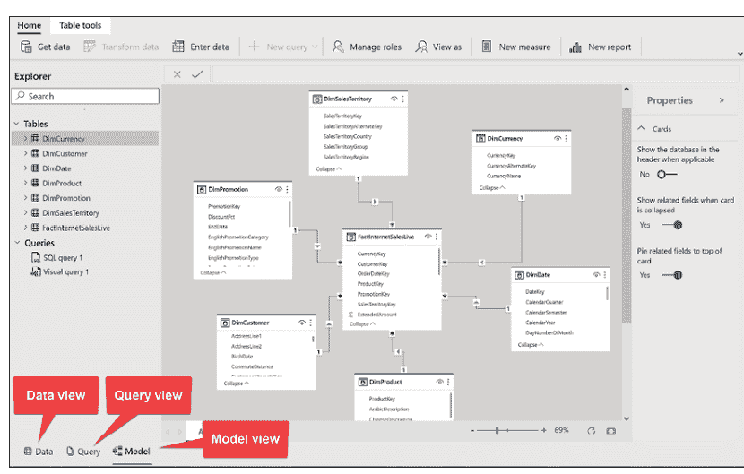

图 15.9：Datamart 编辑器

如前图所示，Datamart 编辑器有三个视图：数据、查询和模型视图。每个视图提供不同的功能。数据视图和模型视图与 Power BI Desktop 中的对应视图相似，但功能较少。但查询视图是新的。它允许我们分析数据。查询视图目前支持两种不同的查询方法。可视化查询使用 Power Query 的可视化图表，为不熟悉 Transact SQL（T-SQL）语言的用户提供无代码体验。另一方面，SQL 查询是为熟悉 T-SQL 的更有经验的开发人员准备的。在接下来的几个小节中，我们将讨论 Datamart 编辑器提供的不同功能。

## 创建一个简单的 Power BI Datamart

Power BI Datamarts 在 Power BI 服务的 Premium 工作区中可用。因此，拥有 Premium 或 Embedded 容量或 Premium Per User（PPU）许可计划的组织可以利用 Datamarts 的强大功能。

业务需要从现有企业数据仓库中获得其互联网销售的完全托管且受管控的副本，保留最近一个日历年的数据。我们将使用 `AdventureWorksDW2019` 示例数据库，该数据库可通过以下 URL 下载：https://learn.microsoft.com/en-us/sql/samples/adventureworks-install-configure?view=sql-server-ver16&WT.mc_id=DP-MVP-5003466。

为了演示目的并能够展示最近两个日历年的数据，我创建了一个名为 **FactInternetSalesLive** 的新表并填充了超过 1000 万行随机数据，但你无需这样做。相反，你可以使用 **FactInternetSales** 表。好了，让我们开始吧。

### 将数据加载到 Datamart

登录你的 Power BI 服务并导航到所需的工作区。请记住，它必须是 Premium 工作区。按照以下步骤操作：

- 1. 点击 **New** 下拉按钮并从菜单中点击 **Datamart (Preview)**。
- 2. 为 Datamart 输入名称并点击 **Create** 按钮。
- 3. 点击 **Get Data** 按钮。点击 SQL Server 数据库或 Azure SQL 数据库，具体取决于你还原 AdventureWorksDW2019 数据库的位置。
- 4. 输入服务器和数据库名称。如果你使用的是本地 SQL 数据库，你必须安装并配置本地数据网关，并在此处选择网关。阅读有关本地数据网关的更多信息，请使用此 URL：https://learn.microsoft.com/en-us/power-bi/connect-data/service-gateway-onprem?WT.mc_id=DP-MVP-5003466。
- 5. 点击 **Next**。

以下图像显示了上述步骤：

Graphical user interface, application


## 图 15.10：从 Azure SQL 数据库创建数据市场

- 1. 选择所需的表；在示例中，我选择 FactInternetSalesLive 表。
- 2. 单击“选择相关表”按钮。
- 3. 单击“转换数据”按钮。

下图展示了上述步骤：

## 图 15.11：创建数据市场时选择表及其相关表

现在，我们可以执行所需的转换步骤，筛选 FactInternetSalesLive 数据，以显示最近两年的数据。如果不添加筛选器，会将全部 1000 万行数据加载到数据市场中，这不是我们想要的结果。

- 1. 选择 FactInternetSalesLive 表。
- 2. 使用以下 Power Query 表达式，将 OrderDateKey 筛选为大于或等于最近两年的 1 月 1 日：
- 3. 单击“保存”按钮。

```
Int64.From(Date.ToText(Date.From(DateTime.LocalNow()), "yyyy0101")) - 20000
```

以下截图展示了上述步骤：

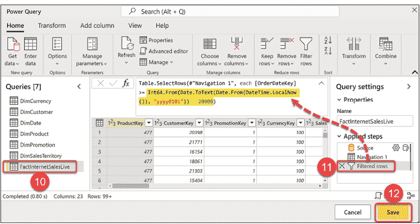

## 图 15.12：筛选结果并保存转换步骤

此时，数据市场开始创建 ETL 规则，并将数据从源导入底层 Azure SQL 数据库。如果你不想等待过程完成，可以单击“转到工作区”按钮；或者等待其完成，它会自动导航到数据市场。

## 加载数据

你可以随时返回此处监视数据加载的进度

若要停止加载数据，请选择“取消”。

- Power Query 处理
- 构建提取、转换和加载（ETL）规则
- 创建关系
- 开始数据加载
- 加载数据
  - FactInternetSalesLive
    已加载 1,580,000 行
  - DimCurrency
    已加载 105 行
  - DimCustomer
    已加载 18,484 行

图 15.13：创建数据市场时加载数据

如前所述，数据流和数据市场之间的区别之一是：数据流将数据加载到 ADLS Gen2，而数据市场将数据加载到 Azure SQL 数据库。到目前为止，我们已经使用 Power Query Online 创建了数据转换层，并将数据加载到 Azure SQL 数据库中。在后台自动发生的另一件事是，在工作区中创建了一个新数据集，这使我们进入下一步——构建数据模型。

## 在数据市场中构建数据模型

数据市场编辑器目前提供有限的数据建模功能，例如创建度量值、创建和管理关系、配置增量数据加载以及创建 RLS。

让我们继续我们的场景。到目前为止，我们已经准备好了数据并将结果加载到数据库中。数据市场编辑器在幕后自动创建一个数据集。该数据集包含基于底层 Azure SQL 数据库的 DirectQuery 存储模式的原始数据模型。因此，我们只能进行 DirectQuery 模式支持的建模活动。

> 注意
> 
> 由于创建的数据集当前处于 DirectQuery 模式，数据准备层仅支持可折叠的 Power Query 转换。

我们在本书中已经学习了所有这些功能，因此不再赘述。

下一步是创建和管理关系。让我们看看它在数据市场中是如何工作的。

## 创建和管理关系

我们可以通过“模型视图”在数据市场编辑器中创建新关系或管理现有关系。若要创建新关系，请将关系“多”侧表中的键列拖放到关系“一”侧表中的键列上。下图显示了“创建关系”窗口，我们可以通过两个表中的 CustomerKey 列在 FactInternetSalesLive 表和 DimCustomer 表之间创建关系：

图 15.13：在数据市场编辑器中创建新关系

如上图所示，我们可以选择**假定引用完整性**。让我们来看看这个选项的含义。

## 关系选项：假定引用完整性

**引用完整性**一词源自关系数据库，用于保证参与关系的两个相关表中的键列（主键和外键）的一致性。例如，如果我们更新表中的主键，我们希望确保相关表中对应的外键能够随着更改保持更新。“创建关系”窗口中的**假定引用完整性**选项也源于相同的概念，即“一对多”关系中“一”侧的列值永远不为 null 或空白，并且“多”侧总能找到与“一”侧每个值匹配的值。仅当参与关系的表的存储模式为 **DirectQuery** 时，此选项才可用。

启用此选项后，我们可以通过生成 **INNER JOIN** 语句而不是 **OUTER JOIN** 语句来对源系统运行更高效的查询，从而提高查询性能。在数据仓库领域，由于引用完整性存在缺点，因此不如事务系统那样受重视。例如，批量加载数据和并行数据加载是数据仓库 ETL 流程的重要特征。在表上设置引用完整性约束可能会降低数据加载性能，在某些情况下还会导致数据加载过程失败。**推断维度**的概念是引用完整性出现问题的另一种场景。推断维度是指维度表的外键出现在事实表中，但在维度表中没有匹配项。这是一种常见场景，即事实表中的数据已经加载，而相关维度尚未完全填充。

因此，除非你确定数据源中数据的完整性，否则不建议在数据市场编辑器中创建关系时使用此选项。如果选中此选项，但底层数据的完整性不符合标准，你将在没有任何错误消息的情况下得到意外或错误的结果。

## 在数据市场编辑器中分析数据市场

如前所述，数据市场编辑器提供了**可视化查询**和 **SQL 查询**功能，可供两组用户使用。**可视化查询**是一种适用于不熟悉 SQL 语言的数据分析师的自助式无代码查询机制。另一方面，SQL 查询功能可供多年来一直喜爱并使用 T-SQL 分析数据的开发人员使用。**可视化查询**和 **SQL 查询**选项均可在数据市场编辑器的“查询”视图中使用。

## 使用可视化查询的无代码体验

想象一下这样的场景：一位有权访问现有数据市场的业务分析师需要进一步分析数据。例如，想象一位不熟悉 T-SQL 的业务分析师想要分析我们之前场景中销售的产品。以下步骤说明了该过程：

- 1. 单击“查询”视图。
- 2. 单击“新建查询”下拉按钮。
- 3. 单击“新建可视化查询”选项。
- 4. 将 DimProduct 表拖放到“可视化查询”画布上。
- 5. 将 FactInternetSalesLive 表拖放到画布上。

下图展示了上述步骤：

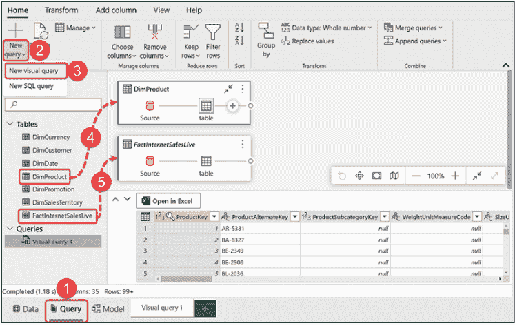

图 15.15：在数据市场编辑器中创建新的可视化查询

- 6. 单击 DimProduct 上的“操作”省略号按钮。
- 7. 单击“将查询合并为新查询”。

- 8. 从“用于合并的右表”下拉列表中选择 **FactInternetSalesLive**。
- 9. 从 **DimProduct** 表中选择 **ProductKey**。
- 10. 从 **FactInternetSalesLive** 表中选择 **ProductKey**。
- 11. 将**联接类型**保留为**左外部**。
- 12. 单击 **OK**。

下图展示了上述步骤：

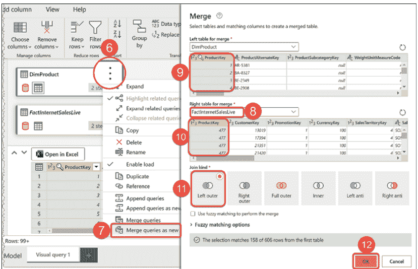

图 15.16：在数据市场编辑器的可视化查询中合并表

- 13. 在数据预览窗格中，向右滚动并单击 **FactInternetSalesLive** 列的展开按钮。
- 14. 选择 **SalesAmount** 列。
- 15. 单击 **OK**。


图15.17：展开FactInternetSalesLive列

16. 从画布中选择新的Merge表，然后点击加号按钮（+）。
17. 从上下文菜单中选择“选择列”。
18. 选择ProductKey、EnglishProductName和SalesAmount列。
19. 点击“确定”。

下图显示了上述步骤：

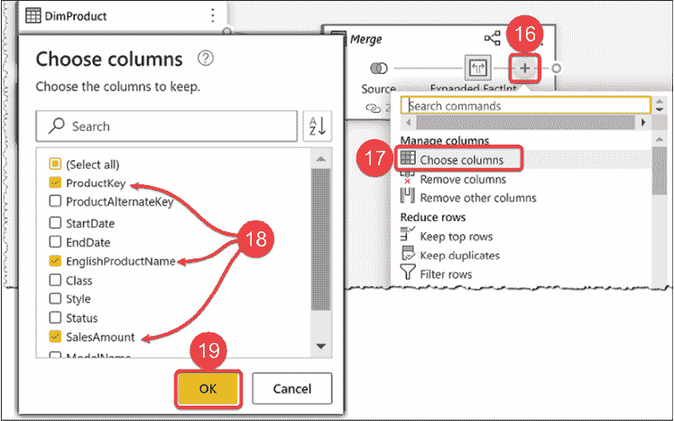

图15.18：在Datamarts的图表视图中选择列

20. 再次点击加号按钮（+），然后点击**分组依据**转换。
21. 点击**高级**选项。
22. 点击**添加分组**按钮。
23. 确保在**分组依据**部分中选择了**ProductKey**和**EnglishProductName**。
24. 在**已售产品计数**中输入第一个聚合的名称，并选择`Count rows`操作。
25. 点击**添加聚合**按钮。
26. 在“新列名称”中输入**Internet Sales**，选择**求和**作为操作，并从**列**下拉菜单中选择**SalesAmount**。
27. 点击**确定**。

下图显示了上述步骤：

图15.19：在Datamarts的图表视图中使用分组依据操作

如你所见，我们无需编写任何代码就创建了一个汇总表。现在我们可以双击“Visual query 1”选项卡，将其重命名为“Products Sold Summary”。下图显示了结果：

图15.20：在Datamarts中重命名可视化查询

点击“在Excel中打开”按钮，可将查询作为Excel文件下载。该Excel文件包含一个Power Query查询，该查询使用上述可视化查询生成的原生查询连接到底层Azure SQL数据库。下图显示了在通过凭据后结果被加载到Excel中的情况：

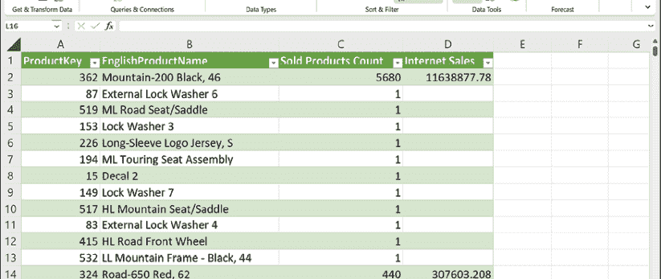

图15.21：传递凭据后结果被加载到Excel中

我们可以从可视化关系图中获取原生查询，这将引出下一小节。

### 获取底层的原生查询

在Datamarts中，我们可以通过右键单击某个步骤，然后从上下文菜单中选择“查看数据源查询”来轻松获取每个转换步骤生成的原生查询。下图显示了上述步骤和生成的原生查询：

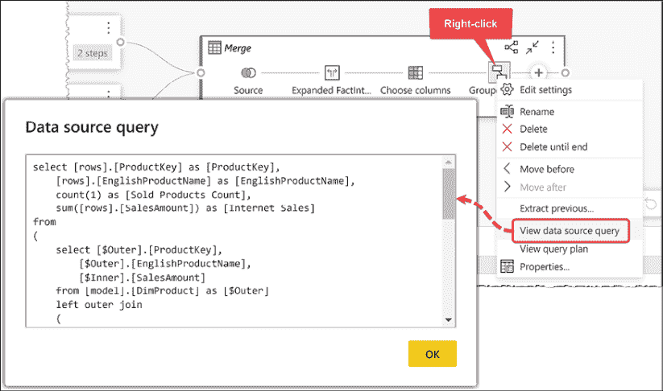

图15.22：从Datamarts的图表视图中获取原生查询

生成的原生查询的一个用途是后续将其复用来创建新表或SQL查询。

如上图所示，我们可以查看查询计划以更详细地调查查询。下一节将解释具体方法。

### 查看查询计划

Power Query Online在2023年公开预览的最酷新功能之一是**查看查询计划**。此功能提供有关查询评估的更多详细信息，可用于查询性能调优，以及从查询折叠的角度查看问题出在哪里。我们可以通过右键单击转换步骤并从上下文菜单中选择**查看查询计划**选项来访问查询计划，如下图所示：

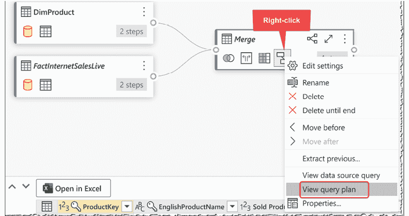

图15.23：从Datamarts的图表视图中查看转换步骤的查询计划

这会打开“查询计划”窗口，我们可以在其中点击“查看详细信息”以了解更多关于所选节点的信息：

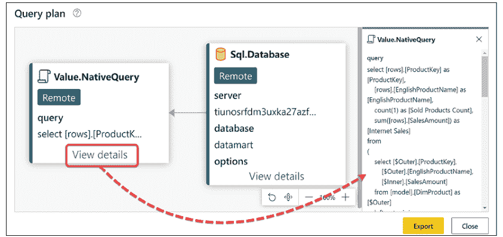

图15.24：查看Datamarts中查询计划节点的详细信息

我们可以点击“导出”按钮以JSON格式导出查询计划。这部分内容留给你自己测试。

## SQL查询体验

如果你是一名经验丰富的SQL开发人员，并且想要分析运行T-SQL语句的Datamart，那么本小节正适合你。请按照以下步骤对承载Datamart数据的底层SQL数据库运行查询：

1. 在Power BI Datamart编辑器中切换到“查询”视图。
2. 点击“新建查询”下拉按钮。
3. 从菜单中选择“新建SQL查询”。这将在“资源管理器”窗格的“查询”部分下创建“SQL查询1”。
4. 输入SQL语句。
5. 点击“运行”按钮。

下图显示了上述步骤：

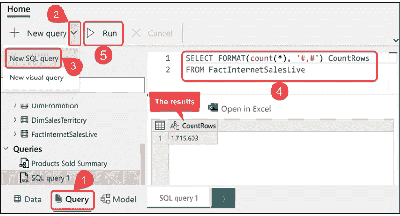

图15.25：用于分析Datamarts的SQL查询体验

## 在SQL客户端工具中分析Datamarts

如前所述，Power BI Datamarts会将准备好的数据加载到Azure SQL数据库中。我们可以使用SQL Server Management Studio（SSMS）或Azure Data Studio等SQL客户端工具连接到底层数据库。以下步骤说明如何使用SSMS连接我们之前创建的Datamart的SQL端点：

1. 在Power BI服务中，将鼠标悬停在所需Datamart上，点击“更多选项”省略号按钮。
2. 点击“设置”。
3. 展开“服务器设置”。
4. 点击“复制”按钮以复制连接字符串。

下图显示了上述步骤：

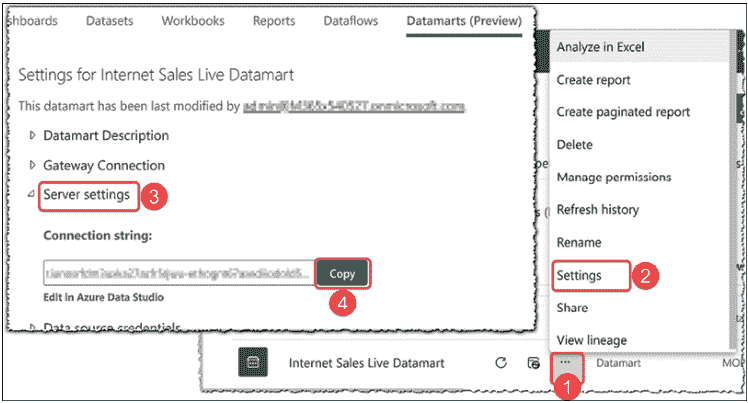

图15.26：复制Datamart的连接字符串

5. 在SSMS中，点击“连接”下拉按钮。
6. 点击“数据库引擎”选项。
7. 将复制的连接字符串粘贴到“服务器名称”文本框中。
8. 从**身份验证**下拉菜单中选择 **Azure Active Directory – 通用 MFA**。
9. 点击**连接**。

下图显示了上述步骤：

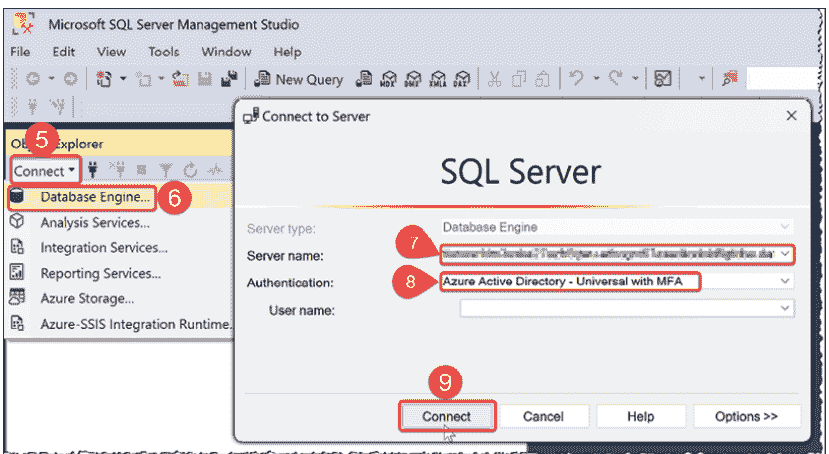

图15.27：从SSMS连接到Datamart的SQL端点

通过凭据后，我们即可连接到Azure SQL数据库，并运行SQL语句。下图显示了结果：

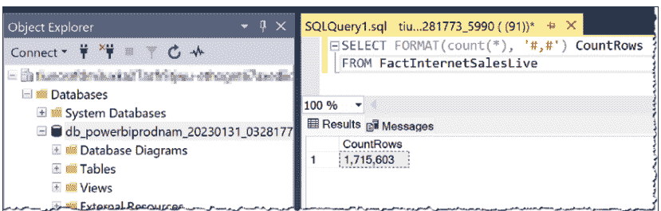

图15.28：在SSMS中针对Datamart的数据库运行SQL语句

## Datamarts中的行级别安全性（RLS）

我们可以在Datamarts中实现RLS来控制用户的访问。在第11章“行级和对象级安全性”中，我们了解到RLS仅对工作区中具有**查看者**角色的用户生效。这一原则在此处同样适用。在Datamarts中，实现的RLS会自动传播到下游对象，包括自动生成的数据集和报表。有趣的是，RLS也适用于Azure SQL数据库。让我们实现一个简单的RLS场景来理解其工作原理。

业务需求是限制用户访问权限，使得北美用户只能访问其所在区域的销售数据。我们在之前创建的现有Datamart上实现该场景。让我们再次查看数据模型，以更好地理解RLS实现。如下图所示，**DimSalesTerritory**表与**FactInternetSalesLive**表之间存在**一对多**关系：

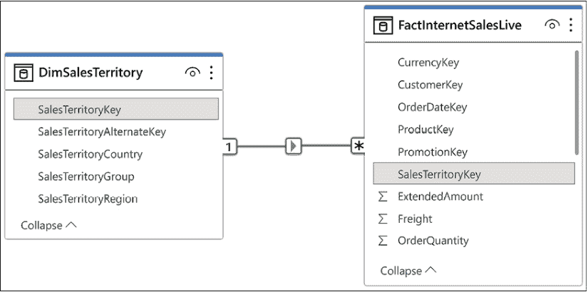

图15.29：DimSalesTerritory与FactInternetSalesLive之间的一对多关系

因此，对**DimSalesTerritory**应用RLS会过滤**FactInternetSalesLive**表。下图显示了**DimSalesTerritory**的数据：

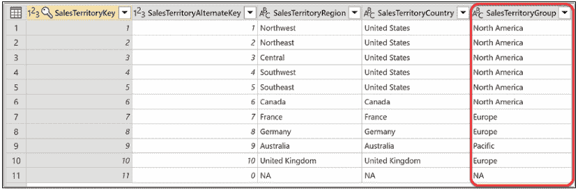

图15.30：DimSalesTerritory的数据

如上图所示，通过对SalesTerritoryGroup列应用RLS即可实现目标。

在Datamarts中实现RLS可以通过Datamart编辑器中的“数据”或“模型”视图完成。请按照以下步骤实现该场景：

1. 从“主页”选项卡点击“管理角色”按钮。
2. 点击“角色”部分下的“新建”按钮。
3. 将新角色命名为“North Americans”。
4. 选择DimSalesTerritory表。
5. 点击“筛选数据”部分下的“添加”按钮。
6. 从下拉菜单中选择SalesTerritoryGroup列，使用“等于”运算符，并在筛选条件中输入“North America”。
7. 点击“保存”。

下图显示了上述步骤：


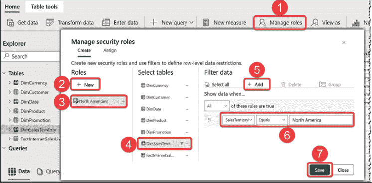

图15.3.1：在Datamarts中实现RLS

到目前为止，我们已经创建了一个新的RLS角色并向其中添加了新规则。下一步是向该角色分配成员。请按照以下步骤操作：

- 8. 在**管理安全角色**中，单击**分配**选项卡。
- 9. 选择**North Americans**角色。
- 10. 键入要应用该角色的帐户名称或安全组并选择它们。我有一个名为**North American Users**的安全组，我选择了它。
- 11. 单击**添加**按钮。
- 12. 单击**保存**按钮以应用更改。
- 13. 单击**关闭**。

下图显示了上述步骤：

## 图15.32：在Datamarts中向RLS角色分配成员

现在我们已经为RLS角色分配了成员，接下来需要测试该角色，看它是否按预期工作。请按照以下步骤操作：

- 1. 单击**以身份查看**按钮。
- 2. 选择**North Americans**角色。
- 3. 单击**确定**。

下图显示了上述步骤及结果：

## 图15.33：在Datamarts中测试RLS角色

如上图所示，**DimSalesTerritory**表只显示**SalesTerritoryGroup**列的值为`North America`的行。此筛选器通过两者之间的关系传播到**FactInternetSalesLive**表，这正是我们想要的结果。

如前所述，在Datamarts中定义RLS会将其应用于底层的Azure SQL数据库。我们使用SSMS连接到底层的Azure SQL数据库。底层的基础SQL表不会暴露给我们；相反，系统为每个表创建了SQL视图。我们可以使用SSMS编写视图脚本，以观察视图的构造。下图显示了**model.DimSalesTerritory**视图的脚本。代码中突出显示的部分就是应用RLS的位置：

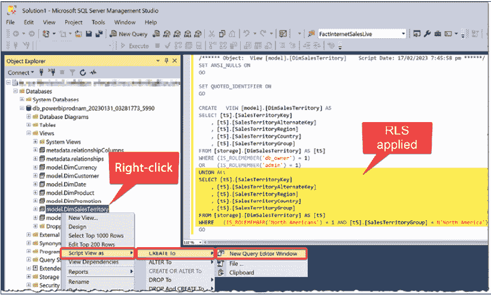

图15.34：编写SQL视图脚本，查看RLS如何在Datamarts的数据库级别应用

在本节中，我们了解了什么是Datamarts，以及如何实现和使用它们。在编写本章时，Datamarts功能仍处于公共预览阶段，尚未全面推出。因此，它与您阅读本书时实际可用的功能可能有所不同。在下一节中，我们将讨论一些新的DAX函数。

# 新的DAX函数

众所周知，Microsoft不断为Power BI添加新的功能、选项和函数。在编写本书时，Microsoft引入了11个新的DAX函数。本节简要介绍我个人认为更有趣且用途广泛的新函数。本节不解释新函数的语法，而是参考Microsoft官方文档网站，并解释其中更棘手的要点。

本节使用`AdventureWorksDW2019` SQL Server数据库作为示例数据源，可从以下URL下载：

https://learn.microsoft.com/en-us/sql/samples/adventureworks-install-configure?view=sql-server-ver16&WT.mc_id=DP-MVP-5003466.

## NETWORKDAYS()

此函数在计算工作日数量时非常有用，它考虑了周末和公共假日。在此函数可用之前，我们也可以计算工作日的数量，但此函数为Power BI开发人员提供了更高层次的便利。根据Microsoft官方文档网站，此函数的语法如下：

```
NETWORKDAYS(<start_date>, <end_date>[, <weekend>, <holidays>])
```

请参阅Microsoft官方文档：https://learn.microsoft.com/en-us/dax/networkdays-dax?WT.mc_id=DP-MVP-5003466。

如您所见，该函数将开始日期和结束日期作为必选参数，而`weekend`和`holidays`是可选参数。**holidays**参数必须是日期格式的公共假日列表。例如，业务部门想要计算`AdventureWorksDW2019`中的工作日，同时将每年的1月1日至5日视为公共假日。为实现此需求，请将**DimDate**表导入Power BI Desktop，并使用以下DAX表达式向表中添加新的计算列：

```
Is Public Holiday =
    AND(
        DimDate[EnglishMonthName] = "January"
        , AND(
            DimDate[DayNumberOfMonth] >= 1
            , DimDate[DayNumberOfMonth] <= 5
        )
    )
```

下图显示了将**Is Public Holiday**计算列的值筛选为**True**后的结果：

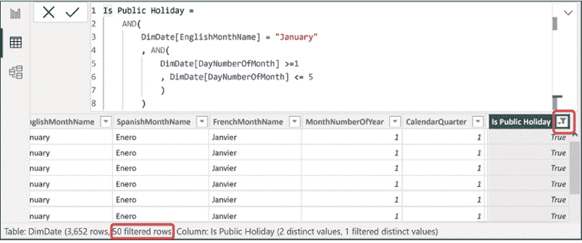

图15.35：将每年的1月1日至5日视为公共假日

现在，我们使用以下DAX表达式创建一个度量值，用于计算当示例数据中的周末为**周六**和**周日**时的工作日数量；因此，weekend参数为1：

```
Working Days =
NETWORKDAYS(
    FIRSTDATE(DimDate[FullDateAlternateKey])
    , LASTDATE(DimDate[FullDateAlternateKey])
    , 1
    , CALCULATETABLE (
        VALUES (DimDate[FullDateAlternateKey])
        , DimDate[Is Public Holiday] = TRUE
```

下图显示了卡片视觉对象中的结果：

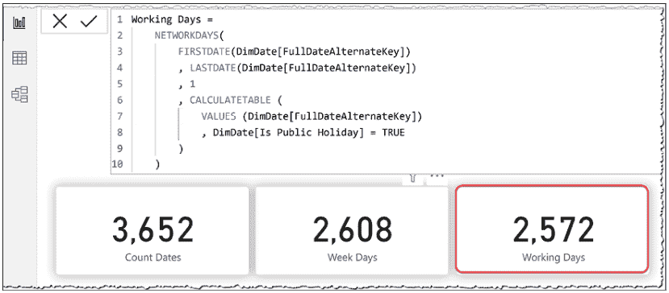

图15.36：使用NETWORKDAYS()函数计算工作日

我们可以创建一个单独的表，其中包含公共假日，以供NETWORKDAYS()函数使用。

您可以从此处下载第15章的NETWORKDAYS.pbix示例：https://github.com/PacktPublishing/Expert-Data-Modeling-with-Power-BI-Second-Edition/blob/28e2af1762336a3b3961c41e9020de8200/Samples/Chapter%2015/Chapter%2015,%20NETWORKDAYS.pbix。

## EVALUATEANDLOG()

EVALUATEANDLOG()函数由DAX大师Jeffrey Wang于2022年8月首次通过其博客文章公开：https://pbidax.wordpress.com/2022/08/16/introduce-the-dax-evaluateandlog-function/。EVALUATEANDLOG()函数对于调试DAX代码非常有用，尤其是在评估虚拟表时。

众所周知，以前在Power BI Desktop中，如果想要查看虚拟表的结果，除了使用DAX Studio等第三方工具之外，没有任何其他选项。使用EVALUATEANDLOG()函数，我们仍然需要第三方工具，但不需要解构DAX代码即可获取代码各部分的结果。毫无疑问，EVALUATEANDLOG()函数对调试各种DAX代码都很有用，而不仅仅是虚拟表。不过，我主要发现它对虚拟表最有帮助。我们可以通过将该函数添加到现有的DAX代码中来使用它。

该函数的语法如下：

```
EVALUATEANDLOG(<Value>, [Label], [MaxRows])
```

Value参数接受返回标量或表的任何DAX表达式。我们可以通过指定Label可选参数来添加标签，并通过指定MaxRows可选参数来设置检索的最大行数。

您可以在Microsoft官方文档网页上阅读更多内容：https://learn.microsoft.com/en-us/dax/evaluateandlog-function-dax?WT.mc_id=DP-MVP-5003466。

每当xVelocity引擎在代码中看到EVALUATEANDLOG()函数时，它都会运行Value参数的DAX表达式，以便在Power BI Desktop视觉对象中显示。同时，它还会以JSON格式将结果发送到事件日志的DAXEvaluationLog事件。然后，我们可以使用SQL Server Profiler或Jeffrey Wang构建的新社区工具DAX Debug Output来捕获结果。在本节中，我们使用后者。DAX Debug Output工具可从此处下载：https://github.com/pbidax/DAXDebugOutput。

现在，让我们评估上一节示例文件（第15章，NETWORKDAYS.pbix）中创建的Working Days度量值。我们只需将之前编写的DAX表达式更改为以下内容：

```
NETWORKDAYS(
EVALUATEANDLOG(FIRSTDATE(DimDate[FullDateAlternateKey]),
```

```
```dax
"StartDate")
    ,
EVALUATEANDLOG(LASTDATE(DimDate[FullDateAlternateKey]),
"EndDate")
    , 1
    , EVALUATEANDLOG(SUMMARIZECOLUMNS(
        DimDate[FullDateAlternateKey]
        , TREATAS({TRUE}, DimDate[Is Public Holiday])
    ), "VirtualTable", 10)
)
```
```

如您所见，我将`EVALUATEANDLOG()`添加到了代码的三个部分以捕获结果。第三个部分捕获虚拟表的前10行。现在，我运行**DAX Debug Output**工具，并连接当前正在运行的Power BI报表文件以捕获`DAXEvaluationLog`事件。

下图显示了DAX Debug Output工具中第一个`EVALUATEANDLOG()`的结果：

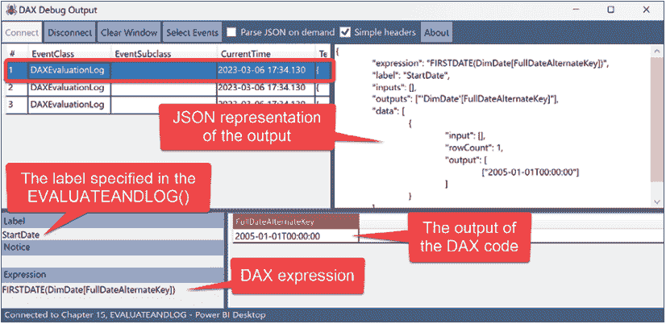

图15.37：DAX Debug Output工具中第一个EVALUATEANDLOG()的结果

下图显示了DAX Debug Output工具中第二个`EVALUATEANDLOG()`的结果：


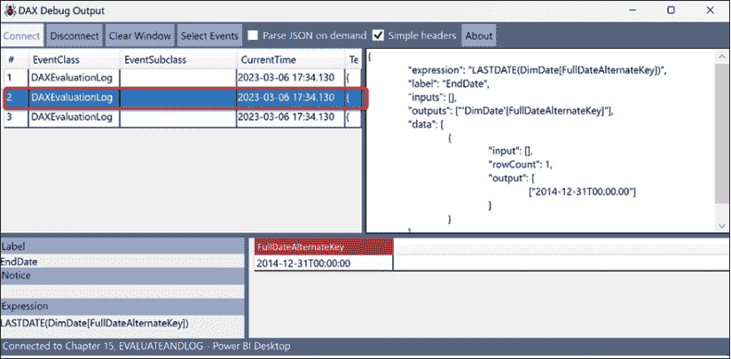

图 15.38：DAX Debug Output 工具中第二个 EVALUATEANDLOG() 的结果

下图显示了 DAX Debug Output 工具中第三个 `EVALUATEANDLOG()` 的结果：

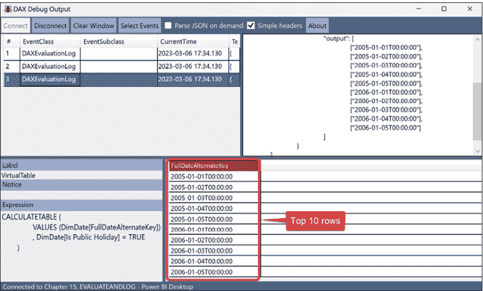

图 15.39：DAX Debug Output 工具中第三个 EVALUATEANDLOG() 的结果

包含 `EVALUATEANDLOG()` 函数的代码在 Power BI Desktop 中运行时，就像不包含 `EVALUATEANDLOG()` 函数一样，如下图所示：

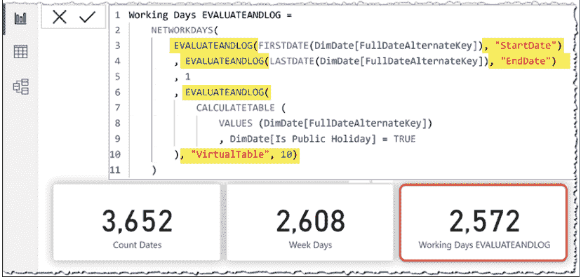

图 15.40：在 Power BI Desktop 中运行包含 `EVALUATEANDLOG()` 的度量值的结果

在调试完成后，从代码中移除 `EVALUATEANDLOG()` 函数至关重要。

正如您所见，在无数的调试和 DAX 性能调优场景中，`EVALUATEANDLOG()` 函数都非常有用。您可以从这里下载 `Chapter 15, EVALUATEANDLOG.pbix` 示例文件：[https://github.com/PacktPublishing/Expert-Data-Modeling-with-Power-BI-Second-Edition/blob/28e2af1762336ab5236a3b3961c41e9020de820/Samples/Chapter%2015/Chapter%2015,%20EVALUATEANDLOG.pbix](https://github.com/PacktPublishing/Expert-Data-Modeling-with-Power-BI-Second-Edition/blob/28e2af1762336ab5236a3b3961c41e9020de820/Samples/Chapter%2015/Chapter%2015,%20EVALUATEANDLOG.pbix).

## 窗口函数

DAX 中的**窗口函数**有助于优雅且高效地解决滚动平均值等复杂计算。使用窗口函数，我们可以将特定表的行划分为逻辑数据窗口，这些窗口由某些列的值分隔。这些数据窗口称为**分区**。要定义分区，我们在 PARTITIONBY() 函数中指定所需的列。在某些计算中，例如数据排名，我们需要按特定顺序对数据进行排序，并使用 ORDERBY() 函数。

PARTITIONBY() 和 ORDERBY() 函数都只能作为可选参数在其他窗口函数中使用。窗口函数作用于当前分区或当前行。当前行由**绝对位置**或**相对位置**确定。

绝对位置是指我们在窗口函数中明确指定位置，例如第一行；而相对位置则是必须根据当前行的位置计算得出的位置，例如当前行之前的第五行。某些窗口函数（如 INDEX() 函数）要求使用绝对位置，某些函数接受相对位置（如 OFFSET()），还有一些函数同时接受绝对位置和相对位置（如 WINDOW() 函数）。

以下窗口函数目前在 Power BI 中可用，但我们可以期待未来 DAX 会添加更多窗口函数：

- PARTITIONBY()
- ORDERBY()
- INDEX()
- OFFSET()
- WINDOW()

虽然这些函数已经发布并可供我们使用，但我们仍在了解此功能的优缺点。Power BI 团队还会不断为现有函数添加新特性和功能，并随着时间的推移引入更多窗口函数。

DAX 中所有窗口函数的一个有趣特性是可选参数可以省略。因此，如果我们不在上述某个窗口函数中指定 `PartitionBy` 参数，该函数仍然可以工作。在这种情况下，只有一个数据分区。相反，当使用 `PARTITIONBY()` 函数定义 `PartitionBy` 参数时，计算会针对每个分区重置。例如，如果我们想要按年份分区计算销售额的滚动平均值，则计算公式会在每年年初重置计算。

## PARTITIONBY()

`PARTITIONBY()` 函数中指定列的值用于在窗口函数中对表行进行分区。其语法如下：

```
PARTITIONBY ( <partitionBy_columnName>[,
partitionBy_columnName [, ...] ] )
```

例如，我们可以想象 `PARTITIONBY(DimDate[Year], DimDate[Month], DimDate[MonthOrder])` 函数会创建分区，如下图所示：

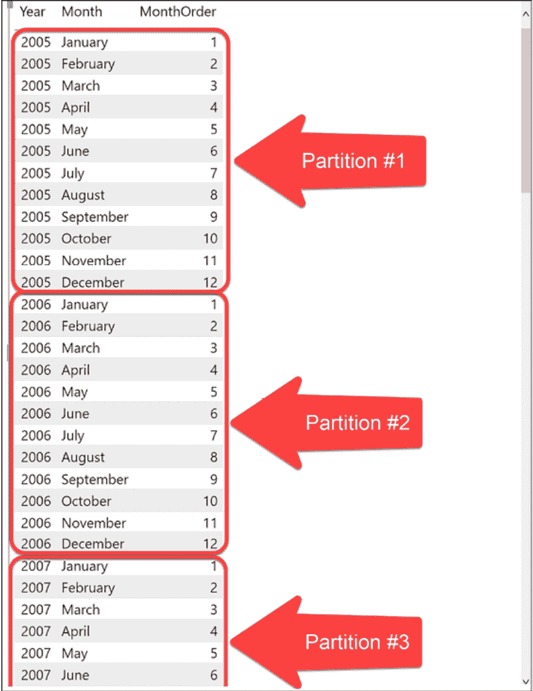

图 15.41：PARTITIONBY() 函数在 Power BI 中的工作方式

如前所述，`PARTITIONBY()` 函数本身并不有用，必须作为其他窗口函数的 `PartitionBy` 参数使用。窗口函数中的 `PartitionBy` 参数是可选的，因此如果省略，数据只有一个分区。如果 `PartitionBy` 参数

在此处阅读有关 DAX 查询的内容：https://learn.microsoft.com/en-us/dax/dax-queries?WT.mc_id=DP-MVP-5003466.

## INDEX()

INDEX() 函数返回已排序数据分区中绝对位置处的行。其语法如下：

```
INDEX(<position>[, <relation>][, <orderBy>][, <blanks>][, <partitionBy>])
```

以下是对上述语法中所用参数的简要说明：

- `position` 参数是唯一必需的参数，可以是基于 1 的绝对位置，也可以是返回标量值的 DAX 表达式。`position` 参数可以为正数或负数。正数（如 1）表示第一行，负数（如 -2）表示倒数第二行。
- `relation` 参数是可选的。指定后，`orderBy` 和 `PartitionBy` 参数的列必须来自 `relation` 表。如果省略，`orderBy` 和 `PartitionBy` 参数中的所有列必须来自同一个表。我们还必须显式定义 `orderBy` 参数。此外，默认值为 `orderby` 和 `PartitionBy` 参数中使用的所有列的 `ALLSELECTED()`。
- 我们使用 `ORDERBY()` 函数来定义可选的 `orderBy` 参数。如果指定了 `relation` 参数，则 `orderBy` 参数中使用的列必须来自 `relation` 表。如果省略 `orderBy` 参数，则必须显式指定 `relation` 参数，并且默认排序顺序是 `relation` 参数中未在 `PartitionBy` 参数中指定的列。
- `blanks` 是一个可选参数，用于定义排序时如何处理空白值。当前唯一接受的值是 `KEEP`，这也是默认值。
- 我们使用 `PARTITIONBY()` 函数来定义可选的 `PartitionBy` 参数。如果指定了 `relation` 参数，则 `PartitionBy` 参数中使用的列必须来自 `relation` 表。如果省略，`relation` 参数充当单个分区。

让我们看看它的实际工作原理。我们想要获取最畅销的产品。以下度量值可以实现这一点：

```
Index, Best Selling Product =
VAR __ProductSale =
    ADDCOLUMNS (
        SUMMARIZE (FactInternetSales
        , DimProduct[Product])
        , "ProductSales", [Sales]
    )
VAR __BestSeller =
    INDEX(1
        , __ProductSale
        , ORDERBY([ProductSales], DESC)
    )
RETURN
    CONCATENATEX(
        __BestSeller
        , 'DimProduct'[Product] & " : " &
        FORMAT([ProductSales], "$#,##.#")
    )
```

在上述代码中，我们首先定义了一个包含产品的销售额的虚拟表（__ProductSale）。然后我们在 INDEX() 函数的 relation 参数中使用它，该参数在 ORDERBY() 函数中按降序（DESC）排列，并且我们要求获取结果的第一行。最后，我们连接了结果列的值。您可能已经注意到，上述计算只有一个数据分区。

下图显示了在 DAX Studio 中运行上述代码的不同部分时，它是如何工作的：

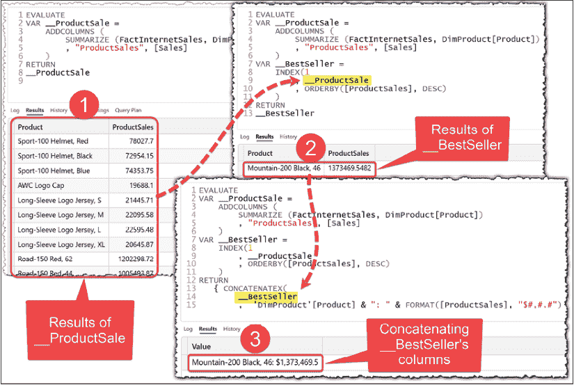

图 15.42：INDEX() 函数在 DAX Studio 中的工作方式

下图显示了在 Power BI 报表中使用 `Index, Best Selling Product` 度量值时的情形：

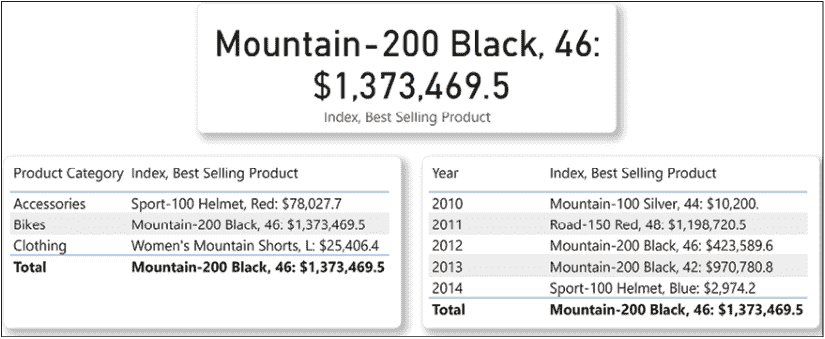

图 15.43：在 Power BI 中使用 Index, Best Selling Product 度量值

在使用 `INDEX()` 函数的这个示例中，我们没有使用 `partition` 参数；因此，`INDEX()` 函数只认为有一个分区。让我们实现一个需要数据分区的示例。


我们想要将当月的销售额与当年最佳销售月份的销售额相比，计算出其百分比差异。换句话说，每年的最大月销售额即为该年的目标销售额。我们将每个月的销售额与年度目标进行比较。以下度量值实现了该目的：

```
Index, % of Best Selling Month =
VAR __YearMonthSales =
    FILTER(
        ADDCOLUMNS(
            ALL(
                DimDate[Year]
                , DimDate[Month]
                , DimDate[MonthOrder]
            )
            , "__Sales", [Sales])
        , [__Sales] > 0)
VAR __BestSellingMonthSales =
    INDEX(
        1
        , __YearMonthSales
        , ORDERBY([__Sales], DESC)
        , PARTITIONBY(DimDate[Year])
    )
VAR __Result =
    DIVIDE(
        [Sales]
        , MAXX(
            __BestSellingMonthSales
            , [__Sales]
        )
    )
RETURN
    IF(HASONEVALUE(DimDate[Year]), __Result, BLANK())
```

上述代码对于经验不足的开发人员来说可能看起来令人望而生畏，因此我将解释其工作原理。在上述代码中：

- 我们定义了 `__YearMonthSales` 表变量以按年份和月份级别计算销售额。
- 我们定义了另一个表变量 `__BestSellingMonthSales`。该表变量将 `__YearMonthSales` 变量作为 `INDEX()` 函数的关系参数。我们按 `[__Sales]` 列降序对 `__YearMonthSales` 变量的结果进行排序。因此，销售额最大值始终显示在第一行。我们按 `__YearMonthSales` 变量的 `DimDate[Year]` 列对数据进行分区。我们选取每个分区的第一行并将其显示为 `__BestSellingMonthSales` 变量的输出。
- 我们定义了另一个变量 `__Result`，它将 `[Sales]` 度量值除以当前行的 `[__Sales]` 的最大值。
- 我们省略了总计，因为在示例中为总计计算百分比没有意义。

我使用了 `EVALUATEANDLOG()` 函数来验证结果。添加 `EVALUATEANDLOG()` 函数后的 DAX 表达式如下：

```
Index, % of Best Selling Month EVALUATEANDLOG =
VAR __YearMonthSales =
    EVALUATEANDLOG(
        FILTER(
            ADDCOLUMNS(
                ALL(
                    DimDate[Year]
                    , DimDate[Month]
                    , DimDate[MonthOrder]
                )
                , "__Sales", [Sales])
                , [__Sales] > 0)
        , "__YearMonthSales")
VAR __BestSellingMonthSales =
    EVALUATEANDLOG(
        INDEX(
            1
            , __YearMonthSales
            , ORDERBY([__Sales], DESC)
            , PARTITIONBY(DimDate[Year])
        )
        , "__BestSellingMonthSales")
VAR __Result =
    EVALUATEANDLOG(
        DIVIDE(
            [Sales]
            , MAXX(
                __BestSellingMonthSales
                , [__Sales]
            )
        )
        , "__Result"
    )
RETURN
    IF(HASONEVALUE(DimDate[Year]), __Result, BLANK())
```

以下图像显示了在表格视觉对象中使用 Index, % of Best Selling Month EVALUATEANDLOG 度量值后，DAX 调试输出工具中的结果：

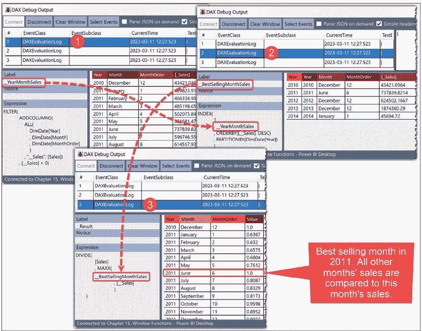

图 15.44：在 DAX 调试输出工具中评估 Index, % of Best Selling Month EVALUATEANDLOG 度量值

前一图像中的数字显示：

1. `__YearMonthSales` 变量的结果。
2. `__BestSellingMonthSales` 变量的结果。
3. `__Result` 变量的结果。

以下图像显示了在 Power BI 中表格视觉对象中并排使用的 `Sales` 和 `Index, % of Best Selling Month` 度量值：

| Year | Month | Sales | Index, % of Best Selling Month |
|------|-------|------:|--------------------------------:|
| 2010 | December | $43,421.0364 | 100.00% |
| 2011 | January | $469,823.9148 | 63.68% |
| 2011 | February | $466,334.903 | 63.20% |
| 2011 | March | $485,198.6594 | 65.76% |
| 2011 | April | $502,073.8458 | 68.05% |
| 2011 | May | $561,681.4758 | 76.13% |
| 2011 | June | $737,839.8214 | 100.00% |
| 2011 | July | $596,746.5568 | 80.88% |
| 2011 | August | $614,557.935 | 83.29% |
| 2011 | September | $603,083.4976 | 81.74% |
| 2011 | October | $708,208.0032 | 95.98% |
| 2011 | November | $660,545.8132 | 89.52% |
| 2011 | December | $669,431.5031 | 90.73% |
| 2012 | January | $495,364.1261 | 79.32% |
| 2012 | February | $506,994.1876 | 81.18% |
| 2012 | March | $373,483.0054 | 59.80% |
| 2012 | April | $400,335.6145 | 64.10% |
| 2012 | May | $358,877.8907 | 57.47% |
| 2012 | June | $555,160.1428 | 88.90% |
| 2012 | July | $444,558.2281 | 71.19% |
| 2012 | August | $523,917.3815 | 83.89% |
| 2012 | September | $486,177.4502 | 77.85% |
| 2012 | October | $535,159.4846 | 85.69% |
| 2012 | November | $537,955.517 | 86.14% |
| 2012 | December | $624,502.1667 | 100.00% |
| 2013 | January | $857,689.91 | 45.76% |
| 2013 | February | $771,348.74 | 41.15% |
| 2013 | March | $1,049,907.39 | 56.01% |
| 2013 | April | $1,046,022.77 | 55.81% |
| **Total** |  | **$29,358,677.2207** |  |

**注意：** 我们使用了 `DimDate[MonthOrder]`，因为在数据模型中 `DimDate[Month]` 列按 `DimDate[MonthOrder]` 排序。

以下图像显示了 Power BI 中的结果：

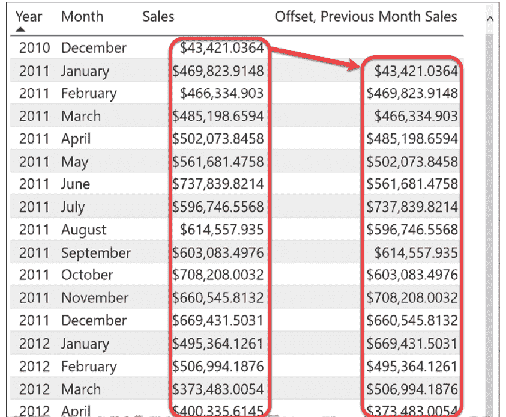

图 15.46：使用 OFFSET() 函数计算前几个月的销售额

这是一个使用 `OFFSET()` 函数可以做什么的简单示例。正如你所知，我们可以使用时间智能或 DAX 函数的其他组合来计算完全相同的等式。

在本小节中，我们查看了使用 `OFFSET()` 函数的简单示例。微软的官方文档可以在这里找到：[https://learn.microsoft.com/en-us/dax/offset-function-dax?WT.mc_id=DP-MVP-5003466](https://learn.microsoft.com/en-us/dax/offset-function-dax?WT.mc_id=DP-MVP-5003466)。

接下来是 `WINDOW()` 函数。

## WINDOW()

`WINDOW()` 函数根据给定的位置范围检索多个计算行。范围是根据强制参数 `from`、`from_type`、`to` 和 `to_type` 计算的。`from` 和 `to` 位置可以是 `ABS`（绝对）或 `REL`（相对），由 `from_type` 和 `to_type` 参数定义。`from` 参数根据 `from_type` 指示从当前行开始的第一行，而 `to` 参数根据 `to_type` 参数指示最后一行。

该函数的语法为：

```
WINDOW ( from[, from_type], to[, to_type][, <relation>][, <orderBy>][, <blanks>][, <partitionBy>])
```

除前四个参数外的所有参数都与前述语法中的 `INDEX()` 参数类似。`WINDOW()` 函数可用于解决在没有 `WINDOW()` 函数的情况下难以克服的一些场景，例如计算移动平均值。例如，以下度量值按 `Product Category` 和 `Product Subcategory` 计算销售额的运行总数：

```
Window, RT Sales by Product Category and Subcategory =
CALCULATE(
    [Sales]
    , WINDOW(
          1, ABS
        , 0, REL
        , ORDERBY(DimProduct[Product Category], ASC,
DimProduct[Product Subcategory], ASC)
    )
)
```

以下图像显示了 **Table** 视觉对象中的结果：

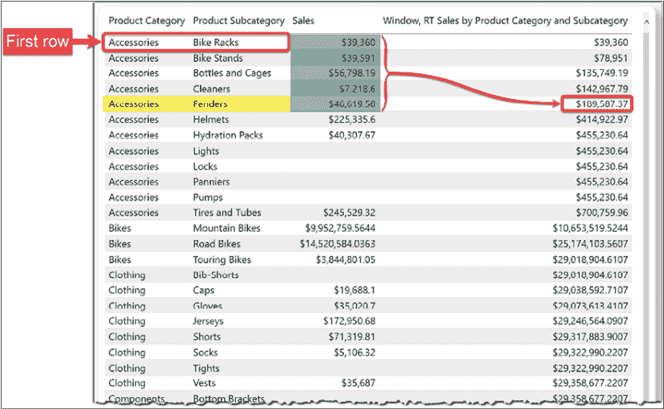

图 15.47：使用 WINDOW() 函数按 Product Category 和 Product Subcategory 计算销售额的运行总数

前述代码根据从第一个绝对行到当前相对行的销售额计算运行总数。我们也知道只有一个分区。因此计算始终从第一行开始到当前位置。例如，如果当前位置是 **Accessories** 和 **Fenders** 行，则计算从第一行开始到当前为止。现在，让我们更进一步。如果我们想按 **Product Category** 和 **Product Subcategory** 计算运行总数，但希望运行总数特定于每个 **Product Category**，那么我们需要像以下 DAX 表达式那样对数据进行分区：

```dax
Window, RT Sales by Product Category and Subcategory Partitioned =
CALCULATE(
    [Sales],
    WINDOW(
```


```text
1, ABS
, 0, REL
, ORDERBY(DimProduct[Product Category], ASC,
DimProduct[Product Subcategory], ASC)
, PARTITIONBY(DimProduct[Product Category])
)
)
```

以下图像显示了结果：

| Product Category | Product Subcategory | Sales | Window, RT Sales by Product Category and Subcategory Partitioned |
|---|---|---:|---:|
| Accessories | Bike Racks | $39,360 | $39,360 |
| Accessories | Bike Stands | $39,591 | $78,951 |
| Accessories | Bottles and Cages | $56,798.19 | $135,749.19 |
| Accessories | Cleaners | $7,218.6 | $142,967.79 |
| Accessories | Fenders | $46,619.58 | $189,587.37 |
| Accessories | Helmets | $225,335.6 | $414,922.97 |
| Accessories | Hydration Packs | $40,307.67 | $455,230.64 |
| Accessories | Lights |  | $455,230.64 |
| Accessories | Locks |  | $455,230.64 |
| Accessories | Panniers |  | $455,230.64 |
| Accessories | Pumps |  | $455,230.64 |
| Accessories | Tires and Tubes | $245,529.32 | $700,759.96 |
| Bikes | Mountain Bikes | $9,952,759.5644 | $9,952,759.5644 |
| Bikes | Road Bikes | $14,520,584.0363 | $24,473,343.6007 |
| Bikes | Touring Bikes | $3,844,801.05 | $28,318,144.6507 |
| Clothing | Caps | $19,688.1 | $19,688.1 |
| Clothing | Gloves | $35,020.7 | $54,708.8 |
| Clothing | Jerseys | $172,950.68 | $227,659.48 |
| Clothing | Shorts | $71,319.81 | $298,979.29 |
| Clothing | Socks | $5,106.32 | $304,085.61 |
| Clothing | Tights |  | $304,085.61 |
| Clothing | Vests | $35,687 | $339,772.61 |
| Total |  | $29,358,677.2207 | $29,358,677.2207 |

图 15.48：使用 WINDOW() 函数按每个产品类别计算按产品类别和产品子类别划分的销售额的运行总计

我们可以使用在分区数据上类似的模式来处理类似时间智能函数的计算。例如，我们可以使用 `PARTITIONBY(DimDate[Year])` 计算年初至今。以下度量满足该需求：

```text
Window, Sales YTD =
CALCULATE(
    [Sales]
    , WINDOW(
        1, ABS
        , 0, REL
        , ORDERBY( DimDate[Year], ASC, DimDate[MonthOrder], ASC,
DimDate[Month])
        , PARTITIONBY(DimDate[Year])
    )
)
```

在前面的代码中，我们必须先在 ORDERBY() 函数中使用 DimDate[MonthOrder]，然后再使用 DimDate[Month]。以下图像显示了结果：

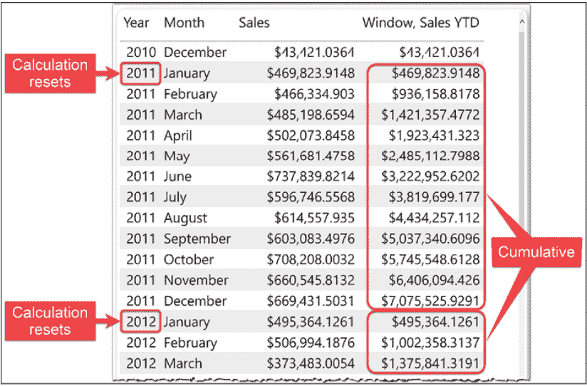

图 15.49：使用 WINDOW() 函数计算销售额 YTD

到目前为止，我们已经了解了当 from_type 参数为 ABS（绝对）和 to_type 参数为 REL（相对）时，WINDOW() 函数在单个数据分区上计算运行总计的工作方式。现在让我们更进一步，计算销售额的三个月移动平均值。由于移动平均值必须在数据上移动窗口计算，因此 from_type 和 to_type 参数都必须是 REL（相对）。运行以下度量：

```text
Window, 3M Moving Avg =
AVERAGEX(
    WINDOW(
        -2, REL
      , 0, REL
      , ORDERBY(DimDate[Year], ASC, DimDate[MonthOrder],
ASC, DimDate[Month])
    )
    , [Sales]
)
```

在前面的代码中，-2 从当前行向后移动，即 0（零）；因此，我们始终计算 3 个月的平均值。以下图像显示了结果：

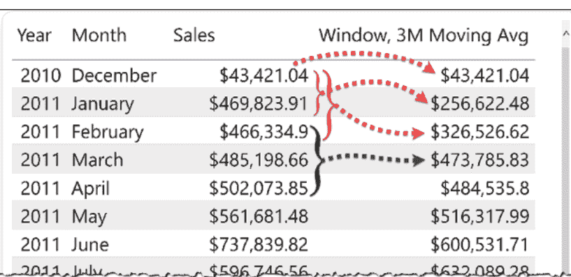

图 15.50：使用 WINDOW() 函数计算 3 个月移动平均值

在前面的图像中，虚线显示了如何计算移动 3 个月平均值。

在本小节中，我们查看了使用 WINDOW() 函数实现的几个场景。您可以从此处下载包含所有窗口函数的第 15 章 Window Functions.pbix 示例文件：<https://github.com/PacktPublishing/Expert-Data-Modeling-with-Power-BI-Second-Edition/blob/28e2af1762336ab5236a3b3961c41e9020de8200/Samples/Chapter%2015/Chapter%2015,%20Window%20Functions.pbix>。

Microsoft 的官方文档可以在此处找到：

[https://learn.microsoft.com/en-us/dax/window-function-dax?WT.mc_id=DP-MVP-5003466](https://learn.microsoft.com/en-us/dax/window-function-dax?WT.mc_id=DP-MVP-5003466)。

由于所有窗口函数都是新发布的，官方 Microsoft 文档网站仍有很大的改进空间。但如果你有兴趣深入研究，Jeffrey Wang 写了一篇全面解释 DAX 中窗口函数如何工作的博客；我强烈建议你阅读他的博客：

[https://pbidax.wordpress.com/2022/12/15/introducing-dax-window-functions-part-1/](https://pbidax.wordpress.com/2022/12/15/introducing-dax-window-functions-part-1/)。

虽然我们涵盖了大多数新函数，但 Microsoft 将继续扩展窗口函数和其他新函数的功功能。Microsoft 有一个专门的新函数网页，因此我建议你关注它：[https://learn.microsoft.com/en-us/dax/new-dax-functions?WT.mc_id=DP-MVP-5003466](https://learn.microsoft.com/en-us/dax/new-dax-functions?WT.mc_id=DP-MVP-5003466)。

## Summary

本章向我们介绍了新的数据建模选项、功能和 DAX 函数。我们更深入地研究了字段参数以及它们在创建更动态报表时如何变得方便。我们还通过实现一些简单示例学习了 Datamarts。我们从 SSMS 连接到底层 SQL 端点，并更深入地研究了 Datamarts 中的 RLS 实现。最后但绝对不是最不重要的，我们使用新的 DAX 函数实现了一些场景。

这是本书的最后一章；我希望你喜欢阅读它，并且学到了一些新的技术和想法来处理 Power BI 中的数据建模。有关本书中讨论主题的更多详细信息——以及未来更新——请关注我的网站：[www.biinsight.com](https://www.biinsight.com)。我在社交媒体上分享我感兴趣的技术主题；你可以在 Twitter 上关注我（[https://twitter.com/_SoheilBakhshi](https://twitter.com/_SoheilBakhshi)）和 LinkedIn（[https://www.linkedin.com/in/bakhshi/](https://www.linkedin.com/in/bakhshi/)）。

祝数据建模愉快！

## Join us on Discord!

加入 Packt Discord 服务器上的大数据与分析社区！

与 558 名其他成员一起聊天，享受免费的语音和文字聊天。

https://packt.link/ips2H


## Other Books You May Enjoy

如果你喜欢这本书，你可能对 Packt 的这些其他书籍感兴趣：


### Mastering Microsoft Power BI, Second Edition

Greg Deckler, Brett Powell

ISBN: 9781801811484

- 使用 Power Query M 语言和数据流构建高效的数据检索和转换流程
- 设计可扩展、用户友好的 DirectQuery、导入和复合数据模型
- 创建基本和高级 DAX 度量
- 添加 ArcGIS Maps 以创建有趣的数据故事
- 构建像素完美的分页报表
- 发现 Power BI 移动应用程序的功能
- 作为 Power BI 管理员管理和监控 Power BI 环境
- 通过 Power BI Premium 容量扩展 Power BI 解决方案以满足企业需求

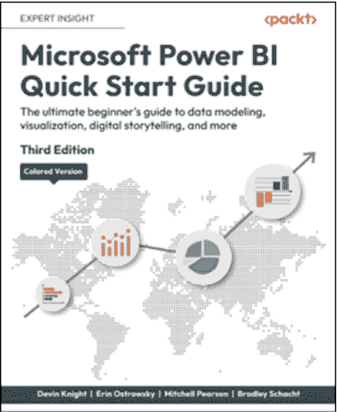

### Microsoft Power BI Quick Start Guide, Third Edition

Devin Knight, Erin Ostrowsky, Mitchell Pearson, Bradley Schacht

ISBN: 9781804613498

- 使用导入、DirectQuery 和实时连接选项连接到数据源
- 使用 Power Query Editor 进行数据转换和数据清理流程，并编写 M 和 R 脚本以及数据流在云中执行相同操作
- 使用内置和自定义视觉对象设计有效的报表，以优化用户体验
- 在仪表板中实现行级和列级安全性
- 为你的组织管理 Power BI 云租户
- 使用内置 AI 功能增强 Power BI 数据转换技术
- 将 Power BI Desktop 文件部署到 Power BI Report Server

## Packt is searching for authors like you

如果你有兴趣成为 Packt 的作者，请访问 [authors.packtpub.com](https://authors.packtpub.com) 并申请。今天我们已与数千名开发人员和技术专业人士合作，帮助他们与全球技术社区分享他们的见解。你可以提交通用申请、申请我们正在招聘作者的特定热门主题，或提交你自己的想法。

## Share your thoughts

现在你已经完成了 *Expert Data Modeling with Power BI, Second Edition*，我们很想听听你的想法！如果你从 Amazon 购买了本书，请[点击此处直接前往 Amazon 评论页面](https://www.amazon.com)为本书分享你的反馈或在你购买的网站上留下评论。

你的评论对我们和技术社区非常重要，将帮助我们确保提供优质内容。


