# 第 1 部分：提升可访问性

Merriam-Webster 词典为“可访问性”一词提供了五种不同的定义。本部分将重点介绍其中两个定义，“可触及”和“残障人士易于使用或访问”。第一章同时涵盖这两个定义，向您展示 Excel 中可以将更多功能和特性放在您触手可及之处的资源，并说明如何将电子表格调整为适合残障人士使用，实际上会让每个人都更容易使用。对于 Excel 用户来说，没有什么比工作突然从屏幕上消失更糟糕的了，因此第二章分享了您可以用来防范 Excel 崩溃并更好地理解 Excel 消息的一些方法。第三章完全关于通过内置和可自定义的快捷方式来简化对 Excel 功能的访问，包括向您展示如何恢复您可能认为已随时间流逝而消失的功能。第四章关于通过条件格式叠加颜色和/或形状来使数据更易于访问。

本部分包含以下章节：

- 第 1 章，实现可访问性
- 第 2 章，灾难恢复和文件相关提示
- 第 3 章，快速分析工具栏宝藏
- 第 4 章，条件格式

### 实现可访问性

没有什么比摔断手臂更能激发您对可访问性的兴趣了。我应该知道，因为在起草本书大约一个半月时，我在山地自行车事故中摔断了右臂。幸运的是，即使在将手臂复位所需的手术之前，我就已经能够打字了，所以我不需要深入研究语音听写和其他措施。尽管如此，即使在事故发生之前，我就计划以可访问性讨论作为本书的开篇，因为我意识到任何使电子表格对色盲人士或需要辅助技术的人士更易于使用的东西，也会使电子表格对 _所有用户_ 更易于使用。此外，不仅仅是电子表格可能感觉难以访问。您有时可能会觉得 Excel 本身难以理解。在整本书中，我的目标是尽可能在有限的篇幅内揭开 Excel 方方面面的神秘面纱。

在本章中，我将讨论改善所有用户可访问性的设计策略，并指出某些可以改善工作簿中可访问性的 Excel 功能，同时也包括程序本身。

本章将深入探讨以下领域：

- 无论您的能力如何，如何使 Excel 更易于访问
- 在电子表格中实现可访问性
- 使用 Excel 的可访问性检查器功能
- 访问 Excel 的可访问性提醒加载项
- 因设计策略而无法访问的电子表格的简要概述

#### 技术要求

本章中使用的示例工作簿可从 GitHub 下载，网址为 `https://github.com/PacktPublishing/Exploring-Microsoft-Excels-Hidden-Treasures/tree/main/Chapter01`。

## 让 Excel 更易于使用

虽然本书全书都围绕让 Excel 更易于使用展开，但我还是想先介绍一些可以让 Excel 显得更易于上手的功能。我会先向你展示如何判断 Excel 是否提供适合你考虑的计算或数据转换的工作表函数。然后，我会展示如何只需点击几下鼠标，就能将枯燥的数据列表转换为有用的报表和图表。之后，我会向你展示如何使用纯英文语句来启动 Excel 任务的隐藏方法，然后简要介绍 Excel 的帮助资源。让我们先从工作表函数开始。

### 查找工作表函数

取决于你的版本，Excel 拥有超过 500 个工作表函数，这可能会让人感到不知所措。幸运的是，Excel 提供了一些工具，你可以使用它们来判断你需要的工作表函数是否存在：

- 插入函数：此命令出现在 Excel 的公式栏上，**功能区**的**公式**选项卡中，或者你可以按 Shift + F3 来显示图 1.1 所示的对话框：

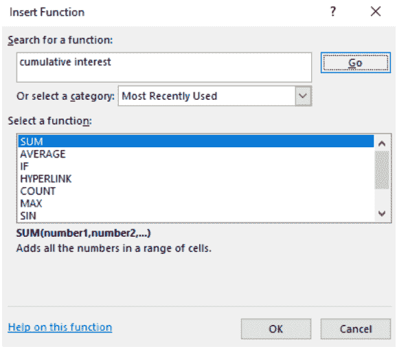

图 1.1 – 插入函数对话框

假设你想要计算贷款的总利息。我在第 10 章“查找函数和动态数组”中解释了如何构建摊销计划表，但你可以使用一个工作表函数来代替。在“搜索函数”字段中输入 cumulative interest，然后按 Enter 或单击 Go。“选择函数”列表将显示 CUMIPMT 和 CUMPRINC。函数描述出现在“选择函数”列表下方。例如，CUMIPMT“返回两个期间之间支付的累计利息”。单击 OK 以接受此选择并显示图 1.2 所示的函数参数对话框：

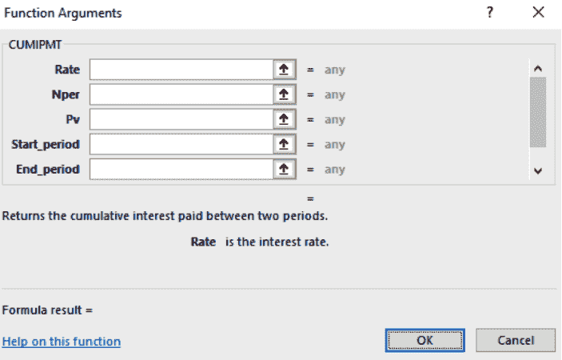

图 1.2 – 函数参数对话框

细微差别
“搜索函数”字段相当具体。例如，在该字段中输入 total interest 无法显示 CUMIPMT 函数，但 cumulative interest 可以。同样，car payment 无法使 PMT 函数可供选择，但 loan payment 可以。如果你找不到想要的内容，可以尝试进行互联网搜索，例如 Microsoft Excel total interest。另外，请注意，“或选择类别”列表设置为“最近使用”。这并不意味着你在工作表单元格中输入的函数会出现在最近使用列表中。此列表仅包含你在“插入函数”对话框中搜索过的函数。

我将在第 6 章“假设分析”中解释 CUMPRMT 函数，但我在此提及它，是为了指出函数参数对话框中的两个细微差别。CUMPRMT 有六个参数，但一次只能在函数参数对话框中显示五个。你可以使用右侧的滚动条来查看第六个参数，即 Type。第二个细微差别与函数参数对话框中的文档有关。Type 字段的有效选项为 0（表示贷款期末付款）或 1（表示贷款期初付款）。当你向下滚动到 Type 字段时出现的说明并未提供此信息，在这种情况下，这至少使函数参数对话框难以使用。相反，当你直接在单元格中输入 CUMPRMT 函数时，当你到达第六个参数时，Excel 将显示一个详细说明两个选项的下拉列表。总的来说，函数参数对话框是一个有用的工具，但与 Excel 的许多方面一样，它也有其怪癖和细微差别。

- 函数屏幕提示：每当你单击 Excel 公式括号内部时，就会出现函数屏幕提示，如图 1.3 所示：

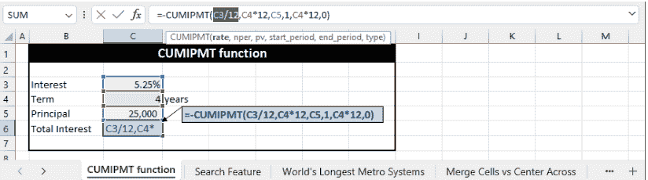

图 1.3 – 函数屏幕提示

关于函数屏幕提示，需要注意一些细微之处：

- 单击任意参数名称以选择公式的该部分。在图 1.3 中，我在函数屏幕提示中选择了 rate。
- 单击函数名称本身以显示该函数的帮助文档。
- 当函数屏幕提示遮挡了你希望看到的列字母或其他信息时，你可以移动它。使用鼠标左键抓住函数屏幕提示的任意一个角，并将提示拖动到新位置。这只是临时更改，因为当你开始编辑下一个公式时，函数屏幕提示会弹回到其正常位置。

## 细微差别

在公式内部工作时，你可以按 F9 将公式的一部分转换为其计算值。这样做后，你可以按 Ctrl + Z 撤销更改，或按 Esc 退出公式并丢弃更改。在 Excel 中工作时，你通常可以撤销最近的 100 个操作，但在工作表单元格或公式栏中只能撤销一个操作。更安全的方法是在验证公式计算时选择“公式”|“计算公式”，但请记住，你无法在“计算公式”对话框中进行任何编辑。

现在让我们看看如何找到那些对你来说是新的，或者你忘记了位置的 Excel 命令。

### Microsoft 搜索框

Microsoft 搜索框在早期版本的 Excel 中被称为“告诉我”功能，并出现在 Excel 的标题栏中。在图 1.4 中，我选择了图表数据中的一个单元格，然后在搜索字段中输入了 Create a chart：

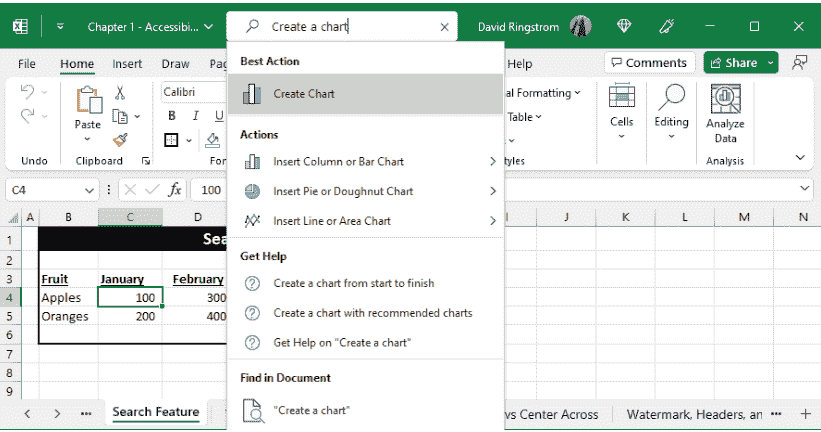

取决于你的请求，Microsoft 搜索框将为你提供各种选项，包括用于执行操作的命令：

- 最佳操作：基于 Excel 对你请求的解释，这是你想要执行的操作。
- 操作：此部分提供最佳操作的替代方案。
- 获取帮助：此部分建议与你输入的关键字或短语相关的帮助主题。
- 在文档中查找：选择此选项以在文档中搜索你输入的术语或短语。这是选择“开始”|“查找和选择”|“查找”或按 `Ctrl + F`（Excel for macOS 中为 `⌘ + F`）的替代方法。
- 文件：你最近使用的、Excel 确定可能与你输入的关键字或短语相关的工作簿。

**Microsoft 搜索**框使 Excel 更易于使用，因为它会在你请求时将命令带到你面前。这颠覆了正常的 Excel 体验，即用户不记得命令所在的位置，或者某个特定功能是否存在。

> **细微差别**
> **Microsoft 搜索**框是查找 Excel 命令的有效手段，但它在查找工作表函数方面表现不佳。本章前面讨论的“插入函数”命令是查找函数的更有效方法。此外，菜单中的并非每个命令都会出现，即使你按名称输入它。例如，输入 `Text to Columns` 会显示替代方案，但不会显示功能本身，该功能出现在“数据”选项卡上。与 Excel 的许多方面一样，盲点随处可见。

如果你对 Excel 用户界面的变化敏感，你可以将 **Microsoft 搜索**框折叠为图标：

1. 选择 **文件** | **选项** | **常规**。
2. 在“用户界面选项”部分中单击“默认折叠 Microsoft 搜索框”，然后单击 **确定**。

放大镜图标将保留在标题栏中，你可以随时单击它以使用 **Microsoft 搜索**框，或者在 Excel for Windows 中键入 `Alt + Q`。如 **图 1.5** 所示，你还可以通过在 Excel for Windows 中右键单击任何单元格来访问另一个版本的 **Microsoft 搜索**框：

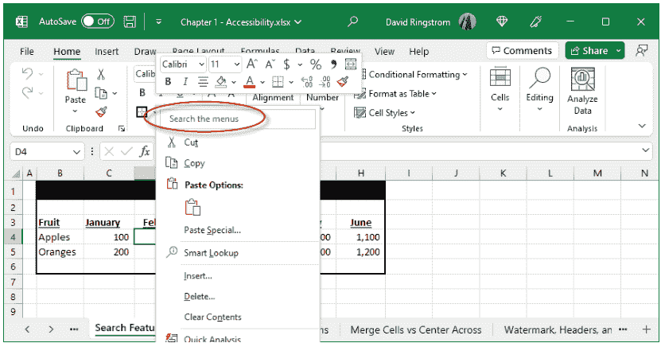

图 1.5 – 基于上下文菜单的搜索选项

你可以以与屏幕顶部的 **Microsoft 搜索**框相同的方式将搜索词输入到上下文菜单中。现在，让我们看看如何在 Excel 中获得更多帮助。

### Excel 功能区的帮助选项卡

**帮助**选项卡首次出现在 Excel 2019 中，旨在提供对多个支持资源的即时访问。

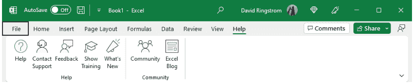

图 1.6 – 帮助选项卡

如图 1.6 所示，**功能区**的 **帮助**选项卡具有以下命令：

- **帮助**：单击此命令或按 _F1_ 以显示 **帮助** 任务窗格，你可以使用它来搜索 Excel 任何方面的帮助。

> **细微差别**
> 在使用 **帮助** 菜单上的任何命令之前，你的设备必须连接到互联网。

+   - **联系支持**：此部分需要您输入搜索词，然后单击 **联系支持**。相关文章将出现，其下方的 **联系支持** 按钮可让您与 Microsoft 支持代理创建在线聊天会话。如果您取消聊天会话，Microsoft 将通过电子邮件与您联系。
+   - **反馈**：此命令可让您就喜欢 Excel 的某些方面向 Microsoft 发送微笑表情，就不喜欢的某些方面发送皱眉表情，或发送建议。

> **细微差别**
> 
> 您可能会惊讶地发现，Microsoft 的 Excel 开发团队非常重视用户反馈。**建议**选项不仅可让您建议对 Excel 进行更改，还可让您对其他人的请求进行投票。例如，截至撰写本文时，276 票就足以让 Microsoft 承诺将 **跨选区居中** 添加到 **开始 | 合并并居中** 下拉菜单中。我将在 **使用跨选区居中代替合并单元格** 部分稍后解释如何访问 **跨选区居中**。简而言之，考虑到全球有数亿 Excel 用户，只需少数几个声音就能在 Excel 中推动变革。如果 Excel 的某些方面让您感到沮丧，那么很可能也困扰着其他人，因此请花点时间投票支持他人的建议或发布您自己的建议。

+   - **显示培训**：此命令可即时访问免费的视频培训资料库，这些资料通常包含可下载的模板，以便您可以跟随学习。
+   - **新增功能**：此命令可让您了解最近是否向您的 Microsoft 365 版本添加了任何新功能。
+   - **社区**：此命令链接到 Microsoft 认可的在线论坛，您可以在其中询问和回答有关 Excel 的问题。在发布新问题之前，请务必先搜索论坛，因为您通常会发现您的问题已经被问过并回答过了。
+   - **Excel 博客**：此命令打开一个页面，提供开发团队关于 Excel 的最新新闻，是了解最近添加或正在开发中的新功能的简单方法。

让我们现在来看看如何将数据列表转换为即时分析。

### 按需创建数据透视表和图表

Excel 提供了三种不同的方法，允许任何用户快速将数据列表转换为易于理解的报表或图表：

+   - **推荐的数据透视表**：此功能可从数据列表中创建即时报表：
+   
+     I. 在本章示例工作簿的 **世界最长地铁系统** 工作表中选择列表内的任意单元格。
+   
+     II. 选择“插入 | 推荐的数据透视表”。
+   
+     III. 从图 1.7 所示的推荐的数据透视表任务窗格中选择任何报表：

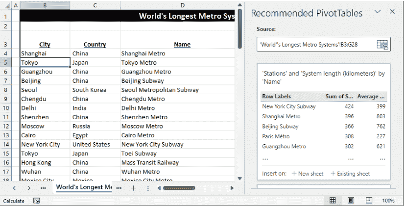

图 1.7 – 推荐的数据透视表任务窗格

> 细微差别
> 推荐的数据透视表在 Excel 2021 及更早版本中显示为对话框。您的 Microsoft 365 版本可能仍然有该对话框。新功能会分批次推送给用户，因此 Excel 的最新更改可能需要 6 个月或更长时间才能到达您的设备。

通过推荐的数据透视表生成的任何报表都只是一个起点。您可以根据需要通过数据透视表字段任务窗格添加或删除字段，该窗格在您单击任何数据透视表内时出现。

+   • 推荐图表：此人工智能功能分析您的数据，并就哪些 Excel 图表最适合您的需求提出建议：

+   I. 在本章示例工作簿的世界最长地铁系统工作表中选择列表内的任意单元格。

+   II. 单击“插入 | 推荐图表”。

+   III. 从图 1.8 所示的 **插入图表** 对话框的 **推荐图表** 选项卡中选择一个报表，然后单击 **确定**。在 Excel for macOS 中，图表建议显示为下拉菜单而不是对话框，并且不会提供图表适用的理由。

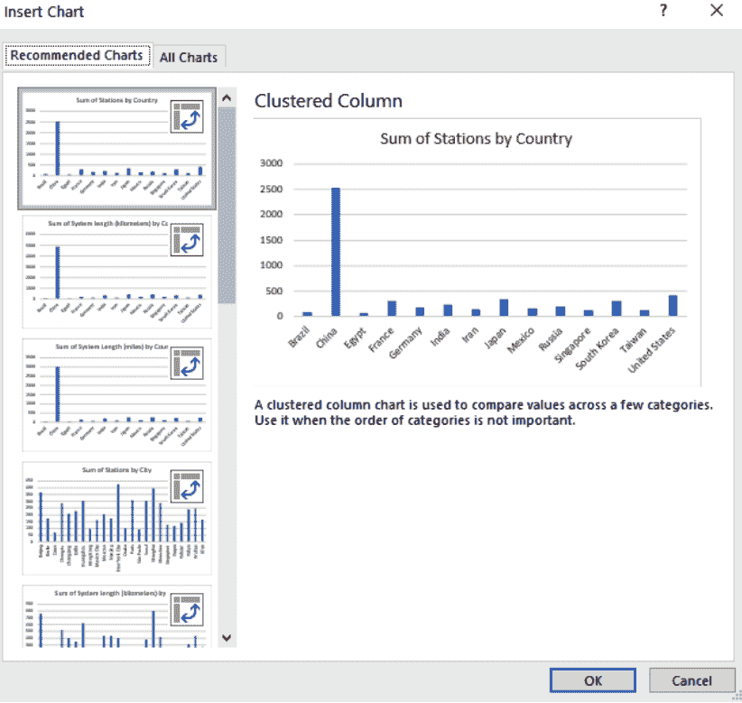

图 1.8 – 推荐图表对话框

+   • **分析数据**：此功能可以被视为 **推荐图表** 的增强版。该功能最初名为 **洞察**，随后更名为 **创意**，最后被称为 **分析数据**。您不仅可以创建报表，还可以在数据列表中发现异常方面：

+   I. 在本章示例工作簿的 **世界最长地铁系统** 工作表中选择列表内的任意单元格。

+   II. 单击“开始 | 分析数据”。

+   III. 从分析数据任务窗格中选择一个报表或图表，或如图 1.9 所示，输入一个纯英文问题，例如“每英里车站数”，以创建一个图表，该图表将显示按系统长度（英里）划分的车站分布。根据您提出的问题，分析数据将创建图表、数据透视图或数据透视表。

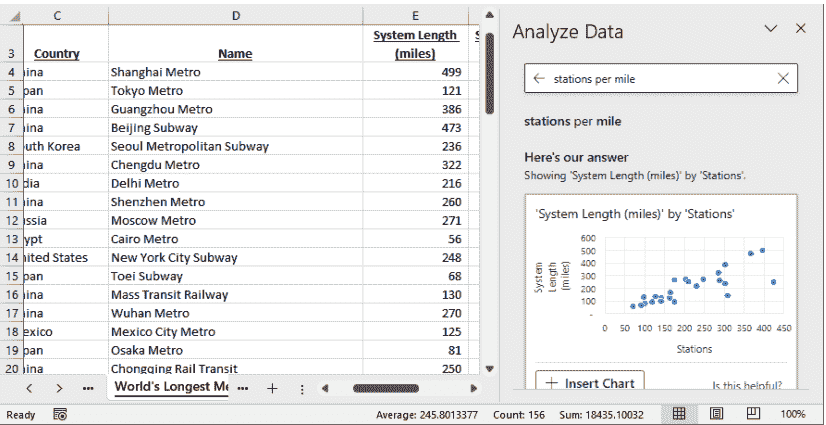

图 1.9 – 分析数据任务窗格

细微差别
目前，分析数据仅适用于包含 150 万个单元格或更少的数据集。当您的列表格式化为表格时，该功能效果最佳，我将在第 7 章“使用表格自动化任务”中讨论如何操作。yyyy-mm-dd 格式的日期，例如 2024-01-01（即 2024 年 1 月 1 日），将被视为文本，尽管您可以使用 DATEVALUE 或 VALUE 函数，或使用“文本分列”功能将这些日期转换为日期格式。要使用此功能，请选择要转换的日期，选择“数据 | 文本分列”，单击两次“下一步”，选择“日期”，然后从相应列表中指定 YMD，再单击“确定”。通常，“文本分列”功能用于将一列数据分隔为两列或多列，但它也可作为方便的数据转换工具，尤其是在日期或数字格式化或存储为文本时。

现在我们已经讨论了一些使 Excel 更易于访问的方法，让我们看看如何改善单个工作簿内的可访问性。

## 在电子表格中实施可访问性

关于电子表格可访问性的好消息是，您工作方式的几项小改变可以对需要辅助技术的用户和不需要辅助技术的用户都产生重大影响。将可访问性放在首位，可以让电子表格对 _每个人_ 都更易于使用。更棒的是，这些技术出奇地简单。正如您将看到的，为工作表命名、避免合并单元格、限制使用水印、页眉和页脚、谨慎使用颜色以及将列表转换为 **表格** 等技术，对健全用户和残障用户都是巨大的福音。

### 为工作表命名

每个新 Excel 工作簿最初至少包含一个工作表，第一个工作表的默认名称为 **Sheet1**。添加更多工作表的三种方法如下：

+   - 单击 **新建工作表**，它在较新版本的 Excel 中显示为工作表选项卡右侧的 +，或在较旧版本的 Excel 中显示为微型工作表选项卡
+   - 选择 **开始** | **插入** 下拉菜单 | **插入工作表**
+   - 按 _Shift + F11_

工作簿中的第二个工作表默认名称为 **Sheet2**，第三个为 **Sheet3**，依此类推。许多时候，用户关注工作表中的内容，而不花时间为工作表本身命名。正如您将在 **检查可访问性功能** 部分中看到的，Microsoft 会将默认工作表名称标记为可访问性问题，而且默认名称也会让每个人更难在工作簿中找到特定数据。以下是重命名工作表选项卡的方法：

+   1. 使用以下任意一种技术：
+      - 双击工作表选项卡
+      - 右键单击工作表选项卡，然后选择 **重命名**
+      - 在 Excel for Windows 中，按 _F6_ 选择当前工作表选项卡，按 _Shift + F10_ 显示上下文菜单，然后键入 R 以选择 **重命名**
+   2. 输入最多 31 个字符，然后按 _Enter_。

**细微差别**
工作表选项卡名称中不能使用以下字符：
\\, /, \*, [, ], 和 ?
如果您尝试输入这些字符，Excel 会忽略它们，就像忽略您尝试输入的前 31 个字符之后的任何字符一样。大多数其他标点符号都是允许的。

工作表名称应尽可能具体，以便用户更容易找到所需的数据。你可以通过多种方式在工作表之间导航：

- 在 Excel for Windows 中，按 F6 选择当前工作表选项卡，然后使用左箭头或右箭头键导航到新工作表，然后按 Enter。
- 右键单击 Excel 窗口左下角的导航箭头，以显示图 1.10 中所示的“激活”对话框。输入工作表名称的首字母，以有目的地在列表中移动。

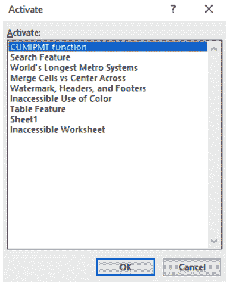

图 1.10 – “激活”对话框

细微差别

“激活”对话框仅显示工作簿中可见的工作表。选择“开始 | 格式 | 隐藏和取消隐藏 | 取消隐藏工作表”以取消隐藏任何隐藏的工作表，或右键单击任何工作表选项卡并选择“取消隐藏工作表”。如果“取消隐藏工作表”被禁用，那么很可能工作簿中没有隐藏的工作表。可以使用 Visual Basic 编辑器将工作表设置为 xlSheetVeryHidden，这意味着该工作表无法通过 Excel 的用户界面取消隐藏。

### 实现辅助功能

- 在 Microsoft 365 中选择“审阅 | 导航”以显示图 1.11 所示的“导航”窗格：

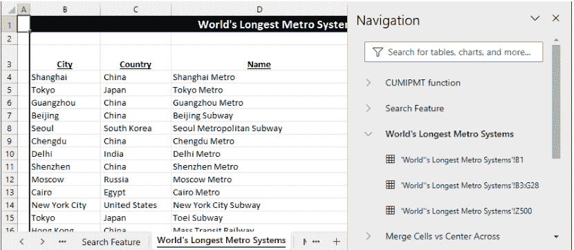

图 1.11 – Microsoft 365 中的“导航”窗格

请注意，**世界上最长的地铁系统**工作表上列出了三个区域：

- **B1**：工作表上的第一个非空单元格
- **B3:G28**：一组文本、值和/或公式
- **Z500**：我输入提示的一个随机单元格

**导航**窗格列出了每个连续的非空单元格块，以及单个非空单元格，因此你可以轻松确定每个工作表中数据出现的位置。

> **细微差别**
> **导航**任务窗格仅在有 Internet 连接时才能正常工作。截至撰写本文时，**导航**任务窗格仍处于 Beta 测试阶段，因此在阅读本文时，它可能可用也可能不可用，但最坏的情况下，它将在未来几个月内可用。

在 Excel for Windows 中，按 **Ctrl + PgUp** 每次向左移动一个工作表，或按 **Ctrl + PgDn** 每次向右移动一个工作表；或者在 Excel for macOS 中，按 **Fn + ↑ + ↓** 每次向右移动一个工作表，或按 **Fn + ↑ + ↑** 每次向左移动一个工作表。

> **怪癖**
> 你不能将 Excel 工作表命名为 History。Excel 的“更改跟踪”功能会创建一个名为 History 的工作表，因此该名称是保留字，不能在 Excel 中使用。你可以在 History 一词的开头或结尾添加空格来使用，但请注意，用户可能不会意识到选项卡名称有多余的空格，并且在尝试直接输入工作表名称来编写公式时可能会感到沮丧。

让我们现在来探讨一个有争议的功能，Excel 用户要么绝对喜欢，要么绝对讨厌。

### 合并单元格功能

如果有哪个真人秀节目让我们投票将功能从 Excel 中淘汰，合并单元格将是我的首选名单。我意识到，对于那些严重依赖合并单元格的用户来说，这些是挑衅性的言论，但从辅助功能的角度来看，应尽可能避免合并单元格。首先，合并单元格会对屏幕阅读器等辅助技术造成严重破坏。其次，合并单元格也会对你在 Excel 中尝试进行的日常任务造成严重破坏。生活中很少有事情能像图 1.12 所示的提示那样让我牙齿发痒。即使你进行的更改看似与合并单元格无关，也可能出现此提示，因为该操作会影响与合并单元格相交的行或列：

图 1.12 – 合并单元格错误提示

就 _并非你会这样做，但你可以这样做_ 而言，以下是合并单元格的示例：

1. 选择本章示例工作簿中“合并单元格与居中对齐”工作表上的单元格 B4:G5，然后选择“开始 | 合并并居中”。
2. 将出现图 1.13 所示的提示，因为我们正在尝试一次合并多行数据。如果你单击“确定”，Excel 将合并并居中单元格 B4:G5，但会丢弃第 5 行的数据。如果你不小心单击了提示，可以单击“撤销”或按 Ctrl + Z (⌘ + Z)，也可以单击“取消”以停止合并过程。

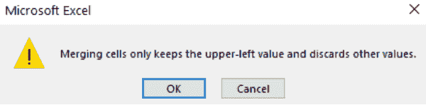

图 1.13 – 合并单元格错误提示

3. 单击“合并并居中”下拉菜单，然后选择“跨列合并”以分别合并单元格 B4:G4 和 B5:G5，并保留每行的数据，如图 1.14 所示：

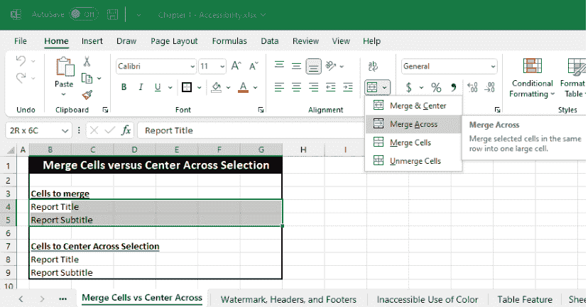

图 1.14 – 跨列合并

4. 可选：选择“开始 | 居中”以在合并单元格内居中数据，或在 Excel for macOS 中按 ⌥ + E。

要取消合并单元格，只需选择包含一个或多个合并单元格集合的范围，然后选择“开始 | 合并并居中”或选择“开始 | 合并并居中下拉菜单 | 取消合并单元格”。如本章后面“使用表格功能”部分所示，将单元格范围转换为表格会自动取消列表中任何单元格的合并。

合并单元格通常用于将标题居中于报表中，你可以通过不同的方式轻松实现此操作，以使电子表格对各类用户更具可访问性。

### 使用跨列居中而不是合并单元格

合并单元格的一个隐藏但非常有效的替代方案名为“跨列居中”。这个有用的功能隐藏在“设置单元格格式”对话框中。假设你想将图 1.14 中单元格 B8:B9 的标题跨列 B:G 居中：

1. 选择单元格 B8:G9。
2. 单击功能区“开始”选项卡上的“对齐方式设置”按钮，按 Ctrl + 1 (⌘ + 1)，或选择“开始 | 格式 | 设置单元格格式”。
3. 如有需要，激活“对齐方式”选项卡。
4. 从“水平”列表中选择“跨列居中”，如 _图 1.15_ 所示，然后单击“确定”：

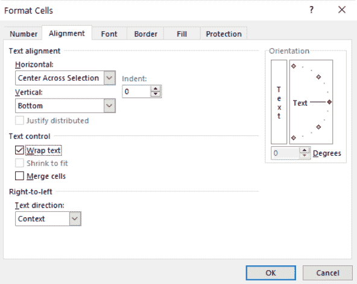

图 1.15 – 跨列居中

文本现在已跨列 B:G 居中。如果你改变了居中文本的主意，只需选择单元格 B8:G9 并选择“开始 | 左对齐”。“跨列居中”消除了合并单元格时可能出现的所有烦恼，但提供了相同的效果。

让我们现在来看看 Excel 中哪些方面可能会使某些信息无法查看，甚至无法编辑。

### 尽量减少使用水印、页眉和页脚

放置在水印、页眉或页脚中的信息对使用辅助技术的用户来说可能是一个特殊的挑战，因为该信息不会出现在工作表本身中。但是，_任何_ 用户都很容易忽略存储在这些位置中的信息，因为此类信息仅在 Excel 的特定上下文中显示。此外，由于 Excel 中没有“水印”命令，其他人可能很难知道如何删除或编辑现有水印。水印是一个标识符，例如公司徽标，或一条消息，例如 **DRAFT** 或 **CONFIDENTIAL** 字样，可以覆盖在工作表上方。一种方法涉及 **WordArt** 功能：

1. 选择“插入 | WordArt”，或“插入 | 文本 | WordArt”。
2. 单击工作表以创建浮动对象，并根据需要更改文本，如图 1.16 所示：

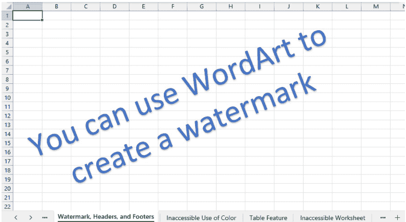

图 1.16 – WordArt

3. 可选：使用文本上方看起来像指向圆圈的箭头的按钮，如图 1.17 所示，旋转水印：

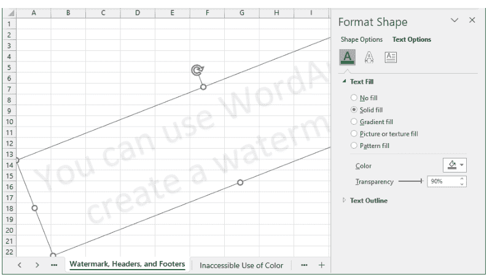

图 1.17 – “设置形状格式”任务窗格和旋转箭头

4. 可选：右键单击图像并选择“设置形状格式 | 文本选项 | 文本填充”，然后调整“透明度”设置，如图 1.17 所示，更改文本的透明度。

> **细微差别**
> 浮动在工作表上方的对象，例如 WordArt 和文本框，格式化起来可能比较棘手，因为你需要注意选中了什么。如果你在对象边缘周围看到控点，如图 1.17 所示，则格式更改将影响整个对象。如果你看不到控点，那么很可能你的格式更改将影响对象中部分或全部文本。

这种水印将浮动在工作表上方，这意味着它可能会遮挡其下的文本或混淆屏幕阅读技术。要删除水印，你可以单击一次图像，然后按键盘上的 **Delete** 键。

第二种方法是将水印放在工作表的页眉中。**页眉**功能允许你指定希望在打印页面顶部显示的文本，或希望在工作表正文中显示的图像。**页脚**功能允许你指定出现在打印页面底部的文本。页眉和页脚的挑战在于，用户可能不知道这些部分中存储了信息，除非他们选择“文件 | 打印”或“视图 | 页面布局”。**页面布局**模式允许你通过单击左侧、中间或右侧页眉和页脚字段来添加页眉或页脚。随后，**功能区**中会出现一个“页眉和页脚”选项卡，其中包含使创建页眉和页脚变得容易的命令。当你准备退出**页面布局**模式时，请选择“视图 | 正常”。

> **细微差别**
> **页面布局**模式与“视图 | 固定窗格”功能不兼容。如果你尝试在带有冻结窗格的工作表上进入**页面布局**模式，将出现一条警报消息。如果你单击“确定”，你将进入**页面布局**模式，但工作表窗格将不再冻结。

或者，你可以使用以下步骤将水印添加到页眉中，而不会干扰冻结的工作表窗格，以及向页眉或页脚添加文本：

1. 选择“页面布局 | 打印标题”。
2. 单击“页面设置”对话框中的“页眉/页脚”选项卡。
3. 单击“自定义页眉”或“自定义页脚”。

## Nuance

Images that you place in the **Header** section will appear near the top of your printout, while images that you place in the **Footer** section will appear near the bottom of the page. You cannot place an image in the center of the printed page in this fashion unless the image is large enough to span the entire printed page.

4. Select a section and then click the **Insert Picture** button, which is the second button from the right, as shown in **Figure 1.18**:

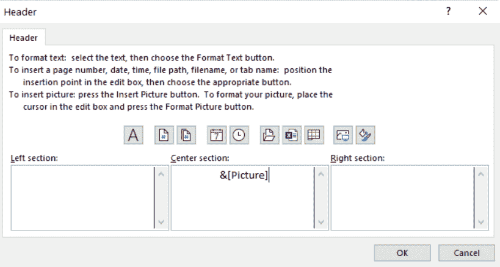

Figure 1.18 – Header dialog box

5. Make a choice from the **Insert Pictures** dialog box, which asks whether you want to choose a file from your local drive or an online resource.

6. Once you select an image, a **&[Picture]** placeholder will appear in the section you chose, as shown in **Figure 1.18**.

7. Optional: Click **Format Picture**, which is the last button on the right, to change the size of the picture. You may also wish to click on the **Picture** tab and change **Color** to **Washout** in the **Image** control section.

8. Click **OK** as needed to close any open dialog boxes.

9. Choose **File | Print** to display a print preview, because if you choose **View | Page Layout** to enter **Page Layout** mode, any frozen worksheet panes will become undone. You can return to the **Page Setup** dialog box and change the settings if needed, such as shrinking the dimensions to prevent an image from overrunning the printed page.

To remove headers or footers, choose Page Layout | Print Titles, activate the Header/Footer tab, and then choose (none) from the top of the corresponding drop-down list.

> Nuance
> Page Layout | Background offers a third approach for creating a watermark. The difference is that the image will repeat throughout Excel’s entire grid, and there is no way to edit the image. If you add an image in this fashion, the Background command toggles to Delete Background.

Any worksheet that has vital information in a watermark, header, or footer, such as CONFIDENTIAL or INTERNAL USE ONLY, should be considered inaccessible because assistive technology cannot access those areas of Excel. Any such information should also be repeated in cell A1, where it can be accessed by assistive technology but also be readily visible to all users of the worksheet.

Let’s now see how color can have an impact on the accessibility of your spreadsheets.

## Working carefully with color

Accessibility standards call for colors to have sufficient contrast between background fill and fonts used within cells. One sure-fire way to ensure proper contrast is to use a black background with white text or light shades of gray. Black text on a white background is accessible as well. Conversely, let’s say blue text on a red background can be difficult for anyone to read, much less anyone with vision impairments or color-blindness.

Further, standards call for any indicators in a spreadsheet that are represented by color-only to also have supportive text, as shown in Figure 1.19. As much as 8% of the world’s male population and 0.5% of the female population is color-blind. That means if you work with say nine other people, there’s a good chance at least one person may be color-blind.

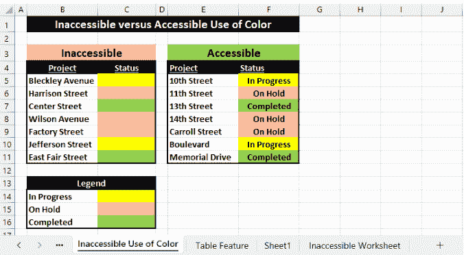

Figure 1.19 – An inaccessible list versus an accessible list

The list on the left only uses color to find the status of each project, such that anyone, no matter the level of vision they have, may find themselves struggling to make sense of the data, at least at first. Conversely, the list on the right pairs the color and text together, so that all users can decide the status of each project at once. I discuss how to automate color coding based upon cell contents in Chapter 4, Conditional Formatting, along with an approach where you can combine color coding with cell icons to provide an additional means for identifying types of data.

Let’s now see how the Table feature can improve accessibility within a worksheet.

## ##Using the Table feature

I talk extensively about the Table feature in Chapter 7, Automating Tasks with Tables, so I won’t go into much detail here, but the Table feature is one of the best ways to improve the accessibility of a worksheet. First, you cannot use merged cells within a Table; any commands or options related to merged cells are disabled when your cursor is within a Table.

> > Nuance
> > When you convert a range of cells into a Table, any merged cells within the list will be automatically unmerged because merging cells is not compatible with the Table feature.

Enabling the Header Row and First Column options, as shown in Figure 1.20, can particularly improve accessibility for all:

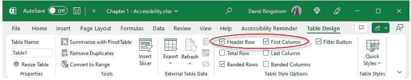

The Header Row allows you to place meaningful titles in the top row of a list. The titles move up into the worksheet frame when you scroll down past the first row of a Table. Filter arrows appear automatically in the Header Row to enable users to easily collapse the list down to just records of their choice. First Column makes the text in the first column bold but can also be used to help users of assistive technology know that they’re starting out in the first column rather than landing unexpectedly in the middle of a Table. Finally, assigning a meaningful name to the Table by way of Table Design | Table Name helps all users understand at once what type of data is contained within the Table. It is best to also supply a description of the data above the Header Row. As I discuss later in the book, Table Names supply an effortless way for all users of the spreadsheet to be able to jump directly to a list of data by selecting the Table Name from the Name box.

Leaving the default Table Names in place, such as Table1, Table2, Table3, and so on, quickly makes it difficult to know what data is where and cuts off the ability to move purposefully to a list of data anywhere in the workbook.

Let’s now see how you can easily find potential accessibility challenges in any workbook.

## #Accessibility Checker feature

The Accessibility Checker feature, available in Microsoft Excel and other Microsoft Office programs, can review your workbooks and supply feedback on changes you can make to improve the accessibility of your spreadsheets. You can launch the Accessibility Checker feature in one of three ways:

- Choose Review | Check Accessibility.
- In Excel for Windows, choose File | Info | Check for Issues | Check Accessibility.
- Click the Accessibility button in Excel’s status bar, which displays the message Accessibility: Investigate, as shown in Figure 1.21, when one or more potential accessibility issues have been noted, or Accessibility: Good to Go when no issues have been found.

Any of these choices will display in the Accessibility task pane shown in Figure 1.21:

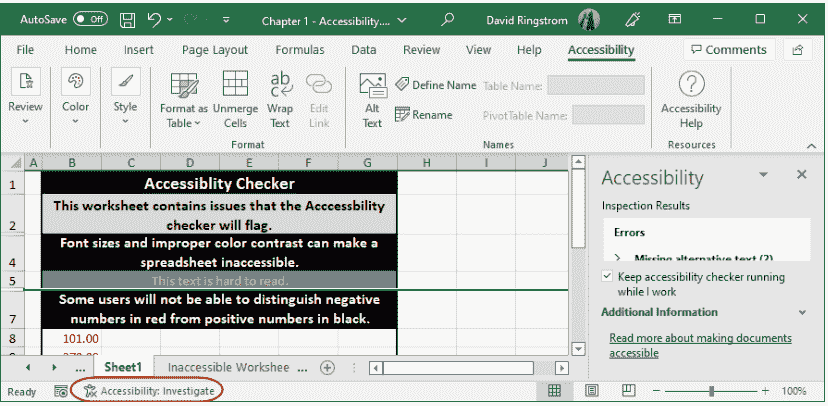

Figure 1.21 – Accessibility Checker

The Accessibility Checker feature has three levels of feedback and a Ribbon tab::

- **Errors** are content that will be exceedingly difficult or impossible for disabled users to use. Situations can include negative numbers formatting in red and information rights restrictions.
- **Warnings** are triggered by content that will be difficult for disabled users to use. Situations can include worksheets with default names, and insufficient contrast between font color and cell fill color, such as dark gray letters on light gray cell fill.
- **Tips** are triggered by content that could be better organized to improve the ease of use for disabled users.

> Nuance
> **Accessibility Checker** is an imperfect feature and may flag issues that seem immaterial while blithely ignoring blatant accessibility issues that you can see in plain sight. Similarly **Spell Check** won't inform you if you've used the word *principle* when you should have used *principal*. With both spelling and accessibility issues, you must trust but verify that everything is in order. The **Accessibility Checker** does offer a **Ribbon** comprised of tools that can help adjust formatting, assign names, along with other accessibility features.

Now, let's look at a hidden tool in Excel that you can use to annotate accessibility issues that you plan to clear up in your workbooks.

## #Accessibility Reminder add-in

The **Accessibility Reminder** add-in is a free tool that makes it easy to add comments to spreadsheets to call attention to accessibility issues. To install this add-in, follow these steps:

1. Choose **Insert** | **Get Add-ins**.
2. Type *Accessibility* in the **Search** field and then press *Enter*.
3. Click the **Add** button next to **Accessibility Reminder** and then click **Continue**.

A new **Accessibility Reminder** tab appears in the **Ribbon**, as shown in **Figure 1.22**.

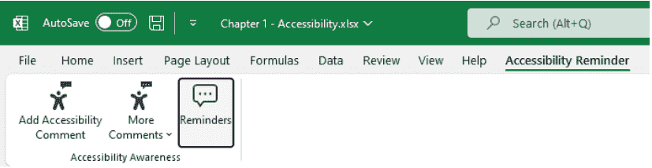

Figure 1.22 – Accessibility Reminder **Ribbon** tab

The **Accessibility Reminder** tab offers three commands:

- **Add Accessibility Comment**: Adds a generic comment that the file has accessibility issues.

+ **更多注释**：允许你在添加三种类型的注释中进行选择：**低视力**、**屏幕阅读器**和**自定义**。 **自定义** 注释默认与 **添加辅助功能注释** 相同的文本，但你可以在辅助功能提醒任务窗格的 **自定义** 选项卡上创建自定义消息。

+ **提醒**：显示一个 **辅助功能提醒** 任务窗格，其中包含三个部分，如 **图 1.23** 所示：

图 1.23 – 辅助功能提醒任务窗格

+ **提醒**：此部分有四个按钮，其功能与功能区 **辅助功能提醒** 选项卡上的 **添加辅助功能注释** 和 **更多注释** 命令相同。

+ **自定义**：此部分允许你创建自定义注释，并通过从功能区或任务窗格的 **提醒** 部分选择 **自定义注释** 选项将其添加到工作表中。

+ **培训**：此部分有三个按钮：

+ **启动培训**：此命令将你连接到基于视频的培训，该培训讨论整个 Microsoft 365 套件中的辅助功能

+ **观看视频**：此命令将你链接到特定于应用程序的基于视频的培训，其中包括 Excel

+ **查看功能**：此命令将你带到辅助功能讨论和资源的综合列表

### 无法访问的电子表格示例

美国最高法院大法官威廉·伦奎斯特曾指出：“我可能无法定义色情，但我一看到就知道。”关于无法访问的电子表格，也大致可以说同样的话；通常你一看到就知道。虽然我在本章中提出了一些准则，但每个 Excel 工作表中可用的 170 亿个单元格为用户创造各种混乱提供了大量空间。只要可能，垂直排列数据（沿列向下），并尽量减少工作表数量，电子表格始终更易于访问。这样做使你能够使用 Excel 中的各种功能快速完成任务。不过，从心理学上讲，许多用户感到必须将数据水平排列，即沿行向右。数据向右延伸得越远，对使用该电子表格的每个人来说就越不易访问。诚然，有时此类电子表格由会计程序生成，例如图 1.24 所示的报告：

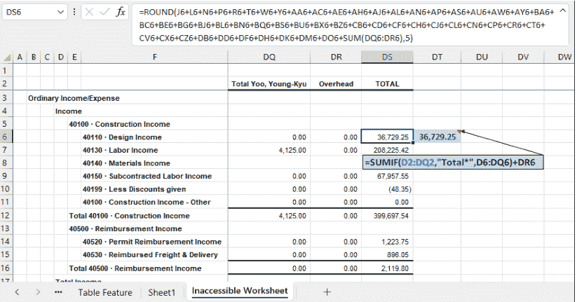

图 1.24 – 无法访问的会计报告

> **提示**
>
> www.section508.gov 上提供更多辅助功能培训，这是由美国总务署维护的网站。第 508 节是指美国法典中规定文件辅助功能标准的部分，所有联邦政府部门依法必须遵循。

使此报告无法访问的三个方面：

+ 账户号码出现在 D、E 和 F 列中，这可能会阻碍希望使用 VLOOKUP、XLOOKUP 和 SUMIF 等查找函数的用户（我将在第 10 章“查找函数和动态数组”中讨论这些函数）。

+ 电子表格中的数据从 A 列开始，到 DS 列结束，这意味着它横跨 123 列。在第 12 章“Power Query”中，我将展示如何取消透视此报告，即将数据从水平跨行转换为垂直沿列向下。

细微差别  
在任何工作表单元格中输入 =COLUMN() 以返回工作表中的列位置，或者在此情况下，输入 =COLUMN(DS1) 以返回位置而无需物理滚动到该列。

+ 无法访问的工作表选项卡上的单元格 DS6 包含公式 =ROUND(J6+L6+N6+P6+R6+T6+W6+Y6+AA6+AC6+AE6+AH6+AJ6+AL6+AN6+AP6+AS6+AU6+AW6+AY6+BA6+BC6+BE6+BG6+BJ6+BL6+BN6+BQ6+BS6+BU6+BX6+BZ6+CB6+CD6+CF6+CH6+CJ6+CL6+CN6+CP6+CR6+CT6+CV6+CX6+CZ6+DB6+DD6+DF6+DH6+DK6+DM6+DO6+SUM(DQ6:DR6),5)，这对大多数 Excel 用户来说完全无法访问。相反，单元格 DT6 包含公式 =SUMIF(G2:DQ2, "Total*",G6:DQ6)+DR6。SUMIF 函数有三个参数：

+ 范围 – 此参数指定 Excel 应搜索的单元格范围，在此情况下为 G2:DQ2。

+ 条件 – 此参数指定 Excel 应匹配的条件。在此情况下，“Total*”使 SUMIF 能够执行部分匹配，并将第 2 行中值以单词 Total 开头的每个列中的值相加。星号称为通配符字符，用于执行此类部分匹配。

+ 求和范围 – 找到匹配条件时应求和的单元格范围，在此情况下为单元格 G6:DQ6。

请注意，公式包含 +DR6，因为单元格 DR2 包含单词 Overhead，因此将根据 SUMIF 函数中指定的条件将其排除。

无法访问的电子表格对许多 Excel 用户来说是事实，但贯穿本书，你将发现扭转局面并改善其可用性的方法。我要给你留下最后一条经验法则，即尽可能少地在工作簿中使用工作表。例如，使用一个带有月份或期间列的单个工作表，并在每一行中填写，而不是创建 12 个每月工作表来按期间存储数据。一般来说，抵制反复重新创建相同工作表的冲动，例如为每个车辆、部门、项目等创建单独的工作表，而是对数据进行小幅修改以保持在单个工作表中。这样做将 Excel 更像数据库来对待，并解锁许多更有效地使用数据的方法。

选择 **审阅 | 工作簿统计** 以确定工作簿中的工作表数量，如 **图 1.25** 所示。双位数的工作表数量并不会自动使工作簿无法访问，但无法访问的工作簿通常具有双位数的工作表计数，有时甚至更多。

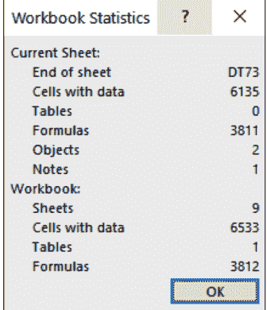

图 1.25 – 工作簿统计对话框

**细微差别**  
**工作簿统计** 对话框包括隐藏和可见的工作表，以及已填充单元格的数量、**表** 的数量、公式和对象。对象是任何浮动在工作表之上的内容，例如我们之前创建的 **WordArt**。

让我们现在来看看你在本章中学到了什么。

### 摘要

很容易将辅助功能视为类似于吃蔬菜或锻炼的事情；你知道你应该两者都做，但你会把它留到明天。辅助功能改善了每个人的体验，而不仅仅是使用辅助技术的人。如果你的老板要求你在 Excel 中执行分析任务，而你不知道从哪里开始，那么突然之间，Excel 就无法访问了。幸运的是，**插入函数** 命令让你可以轻松获取 Excel 中可用的数百个工作表函数中的任何一个。同样，**Microsoft 搜索** 框将最隐藏的 Excel 命令也放在你指尖。当你需要更进一步时，功能区的 **帮助** 选项卡将你连接到包括在线文档、培训视频、在线聊天支持以及通过 Excel 社区论坛的用户对用户支持在内的广泛资源。

你还了解到，人工智能通过 **推荐的数据透视表**、**推荐图表** 和 **分析数据** 等功能使 Excel 更易于访问。所有这些功能都可以帮助你克服分析数据集时的 _我不知道从哪里开始_ 阶段。

辅助功能远远超出了对残障用户的善意。任何时候你实施即使是简单的辅助功能技术，例如命名 **表** 和工作表、避免使用合并单元格、限制水印、标题和页脚中的关键信息、确保适当的颜色对比度，并在电子表格中使用 **表** 功能，你都会改善每个接触工作簿的用户的使用便捷性。

试图查找工作簿中的所有辅助功能问题可能会让人感到不知所措，尤其是如果你有法律要求这样做。幸运的是，**检查辅助功能** 功能对可能导致工作簿被视为无法访问的问题提供即时反馈。免费的 **辅助功能提醒** 外接程序使记录你希望清理的辅助功能问题变得容易，并提供更多培训材料的链接。

辅助功能是主观的，尤其是在大型工作簿中，但请记住，如果你在自己编写的工作簿中遇到困难，其他人不太可能能够理解它。好消息是，辅助功能贯穿本书，作为一个不言而喻的主题，随着你在书中的进展，你将变得越来越有能力使用 Excel，而不是让 Excel 推着你走，或者更糟的是，阻止你前进。

在下一章中，我将讨论如何实施灾难恢复技术，包括当糟糕的事情发生在好电子表格上时该怎么办。

