# 2 灾难恢复与文件相关提示

在本章中，我将向你展示各种方法，帮助你尽量减少，甚至希望能减轻电子表格灾难。我观察到，在丢失电子表格时唯一的安慰是，第二次操作会更快——这确实是一种苍白的安慰。幸运的是，无论你是将文件保存在本地计算机上，还是保存在云端，都可以采取一些措施来加强对电子表格崩溃的防御。此外，反复点击提示框会对你的工作效率和手腕造成负担。在本章中，我将讨论当你打开电子表格时，如何处理那些充当“减速带”的几个提示。

在本章中，你将了解以下主题：

- 撤销和重做
- 自动恢复功能
- 与 OneDrive 的自动保存
- OneDrive 版本历史记录
- 始终创建备份设置
- 打开工作簿时的警告提示

本章结束时，你将拥有新的防御层级来应对电子表格灾难。这将包括对电子表格意外事件的主动和被动响应。此外，你还将掌握新技巧，从而消除 Excel 中某些重复性任务和提示。

## 技术要求

本章中我分享的所有内容在 Excel for Windows 中均按描述运行。少数技术在 Excel for macOS 中的运行方式不同，或者根本无法运行。我将在讨论每个功能时指出这些区别。

本章中使用的不同工作簿和 CSV 文件可从 GitHub 下载，网址为 https://github.com/PacktPublishing/Exploring-Microsoft-Excels-Hidden-Treasures/tree/main/Chapter02。

### 撤销和重做

无论我们多么勤奋地保存工作，往往只需一次按键或一次鼠标点击，就可能导致电子表格灾难。例如，Excel 可能会毫无预兆地崩溃，导致你的工作突然从屏幕上消失。不过，这是一种极端情况——更有可能的是，你会删除错误的数据，或意外将内容粘贴到工作表的错误区域。在这种情况下，按下 Ctrl + Z（Excel for macOS 中为 ⌘ + Z）即可恢复。如果你想撤销工作簿中最近的 100 个操作，可以单击 **撤销** 下拉菜单，如图 2.1 所示，并选择一系列连续的操作进行撤销：

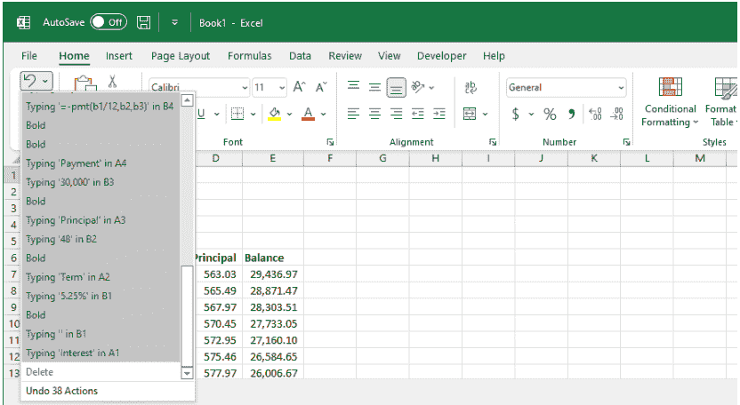

图 2.1 – 可撤销的操作

**撤销** 的一个隐藏好处是能够重做已撤销的操作。这意味着你可以将电子表格回溯至多达 100 步之前，查看当时的状态，然后再将电子表格向前回滚。如图 2.2 所示，**重做** 命令会显示可重做的操作列表。此外，你可以按 Ctrl + Y（⌘ + Y）或 F4 键（某些键盘上为 Fn + F4）来重做操作：

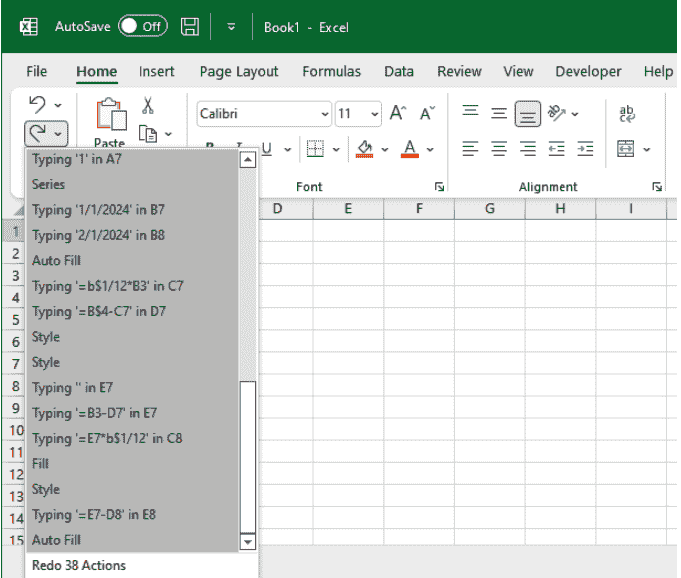

图 2.2 – 可重做的操作

**撤销** 是 Excel 中有用的安全网，但请注意，某些 Excel 操作会绕过你撤销任何先前操作的能力：

- 删除工作表
- 在 Excel 中运行宏
- 保存并关闭文档，以及涉及 Excel **文件** 菜单的其他操作

因此，建立次要措施非常重要，这些措施可以为你提供后备方案，例如 Excel 的 **自动恢复** 功能。

#### 自动恢复功能

Windows 和 macOS 版本的 Excel 都提供 **自动恢复** 功能，可在你工作时自动创建工作簿的备份副本。Excel for Windows 提供了自定义选项和额外功能，而 Excel for macOS 不提供，因此我将分别讨论这两个版本。

#### Excel for Windows 自动恢复

在 Excel for Windows 中，你可以指定 Excel 创建工作备份副本的时间间隔。默认值为每 **10** 分钟，但根据我的经验，这意味着备份会在 20 到 25 分钟之间生成。我不知道你的情况，但我可以在 Excel 任务中完成大量工作，因此我喜欢缩短这个间隔：

1. 选择 **文件 | 选项 | 保存**。
2. 确保 **保存自动恢复信息** 复选框已打开。
3. 将 **保存自动恢复信息** 设置从每 **10** 分钟更改为每 **2** 分钟，如 **图 2.3** 所示：

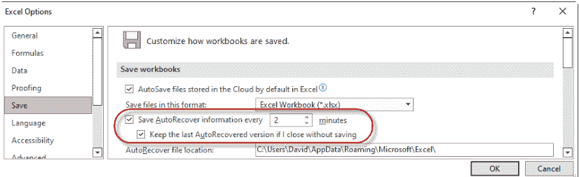

图 2.3 – 自动恢复设置

4. 确保 **如果我不保存就关闭，则保留最后一个自动恢复版本** 复选框已启用。
5. 单击 **确定**。

进行这些更改后，你将以两种不同的方式得到保护。首先，假设 Excel 崩溃，或者你关闭工作簿并意外单击 **不保存** 而不是 **保存**。最近的备份会在计算机上的 **未保存的工作簿** 文件夹中保留几天。文件似乎会在这个文件夹中保留 3 或 4 天，有时甚至更长。这是一个 *临时* 存档，因此请确保在文件消失前从该文件夹访问你需要的任何文件。

> **提示**
> 如果你将 **自动恢复** 文件位置更改为云文件服务（如 **OneDrive**、**Dropbox** 或 **Google Drive**）同步的文件夹，则可以延长对 **自动恢复** 文件的访问。通常，这些服务允许你恢复已删除的文件，时间为 30 天或更长。请记住，**自动恢复** 文件没有有意义的名称，但你可能可以根据日期/时间戳识别你想要恢复的文件。

#### 访问临时备份

Excel for Windows 中的 **自动恢复** 提供了另一层保护：你可以访问在积极处理电子表格时制作的最多五个备份。要访问这些备份，请执行以下步骤：

1. 单击 **文件 | 信息**。
2. 任何可用的备份都会显示为 **管理工作簿** 按钮旁边的时间戳，如 **图 2.4** 所示：

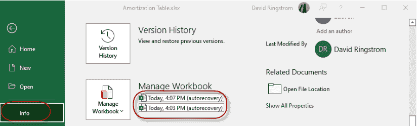

3. 单击任何时间戳，即可连同实时文件一起打开备份。

请记住，这些备份仅在你正在处理的文件关闭前存在。如果你有意或无意在未保存的情况下关闭工作簿，最后一个备份将在 **未保存的文件** 文件夹中保留几天，如上一节所述。

俗话说，最好的防御往往是良好的进攻。那么，让我们看看如何让 Excel for Windows 不那么容易崩溃。

#### 删除临时文件

当 Microsoft Windows 使用的临时文件在后台累积时，Excel 可能会更容易崩溃。通常，这种情况发生在成百上千个临时文件堆积时。Windows 不会总是自动清除这些文件。要定期删除这些文件，请执行以下步骤：

1. 打开 **我的电脑** 或 **Windows 资源管理器** 窗口。
2. 右键单击硬盘并选择 **属性**。
3. 单击 **磁盘清理**。
4. 从列表中选择 **临时文件**（这与 **临时 Internet 文件** 不同，后者你也可以删除），然后单击 **确定**。

或者，你可以采用更直接的方法：

1. 尽可能关闭所有打开的程序，包括浏览器窗口。
2. 在 **我的电脑** 或 **文件资源管理器** 窗口的地址栏中输入 `%temp%` 或 `%tmp%`。然后，按 **Enter**。
3. 选择 `Temp` 文件夹中的任何文件。然后，按 `Ctrl + A` 选择所有文件和文件夹。
4. 按 `Delete` 键删除文件。有些文件正在使用中，无法删除，因此请跳过正在使用或需要管理员权限的任何文件。

> **提示**
> 目标不是完全清空 `Temp` 文件夹，而是将文件数量理想地保持在几十个，而不是成百上千个。你拥有的临时文件越多，Excel 毫无预兆地崩溃的可能性就越大。

由此可见，Excel for Windows 提供了多种灾难恢复选项。不幸的是，Excel for macOS 的情况就不同了。

#### Excel for macOS 自动恢复

**自动恢复** 功能在 Excel for macOS 中要有限得多。你可以启用或禁用该功能，但不能设置时间间隔，也无法访问任何未保存的文件。此外，你无法访问 Excel 在你处理电子表格时制作的任何备份。在 Mac 上使用 **自动恢复** 时，你最好能期望的是，如果 Excel 崩溃，它会显示一个面板，允许你恢复正在处理的任何文档。

你可以使用以下步骤来管理 **自动恢复** 设置：

1. 选择 **Excel | 首选项 | 共享和隐私 | 保存**。
2. 如 **图 2.5** 所示，单击 **启用自动恢复** 以打开该功能。或者，清除复选框以关闭它，然后关闭 **Excel 首选项** 对话框：

Figure 2.5 – 适用于 macOS 的 Excel AutoRecover 首选项

鉴于 AutoRecover 的功能有限，你大概率会想要探索将 AutoSave 与 OneDrive 配合使用，以便在恢复文档的先前版本方面拥有更多选择。

### 将 AutoSave 与 OneDrive 配合使用

旧版 Excel 曾经内置 AutoSave 命令，可定期备份 Excel 工作簿。该功能在 Excel 2007 的大规模改版中被搁置。幸运的是，对于保存到 Microsoft OneDrive 和 SharePoint Online 服务的文档，AutoSave 已回归。如果你拥有 Microsoft 365 订阅，那么你已经拥有一个 OneDrive 账户。除此之外，任何人都可以通过创建免费的 Microsoft 账户获得 5 GB 的免费存储空间。如果你需要更多空间，家庭用户可以以每年 19.99 美元购买 100 GB 的存储空间，而 OneDrive for Business 起价为每用户每月 5 美元。了解更多信息或订阅，请访问 www.onedrive.com。

通常，保存到 OneDrive 的文件会每隔几秒钟保存一次，这意味着你丢失工作的可能性要小得多。如图 2.6 所示，你可以通过快速访问工具栏中的滑块，按工作簿逐个开启或关闭 AutoSave：

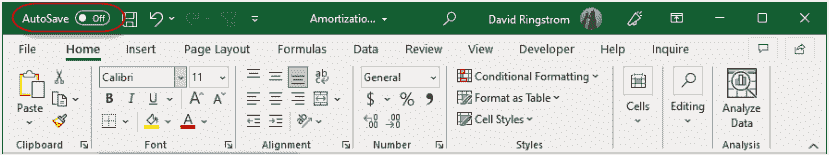

Figure 2.6 – AutoSave 切换开关

### 将文件保存到 OneDrive

如果你为给定文档开启了 AutoSave，系统会提示你将文件上传到 OneDrive。如图 2.7 所示，你将选择要使用的平台，然后系统会提示你为文件命名：

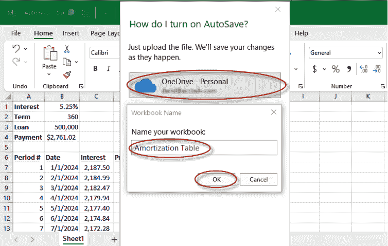

Excel 的标题栏始终显示工作簿的名称。如果你将文档保存到 OneDrive 或 SharePoint Online，通常，你会在文件名后看到“Saving”或“Saved”字样。“Saving”表示你对电子表格所做的更改尚未保存。“Saved”表示已保存包含你更改的新版本。Saving/Saved 指示器仅适用于保存到 Microsoft Cloud 的文件。有时，还会出现其他消息，例如“Awaiting Upload”或“Last Modified”。你仍然可以按 Ctrl + S（⌘ + S）。或者，如果你想特别确保工作已保存，可以点击 AutoSave 旁边的保存图标。

我刚才讨论的上传方法不允许你选择保存文件的文件夹，因此你的工作簿将出现在 **OneDrive** 账户的根目录级别。幸运的是，当你使用此方法时，可以完全控制：

1. 选择 File | Save As。
2. 选择 **OneDrive** 或 **SharePoint Online**，如 **Figure 2.8** 所示：

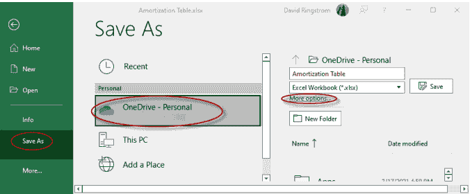

Figure 2.8 – 将 Save As 与 OneDrive 配合使用

3. 点击 **More options** 以显示 **Save As** 对话框。
4. 为你的电子表格选择或创建一个文件夹，指定名称，然后点击 **Save**。

但是，假设你在 **Figure 2.7** 中指定了文件名，但现在希望将文件重新命名或移动到其他位置。为此，请执行以下步骤：

1. 点击 Excel 屏幕顶部标题栏中的 _filename_。
2. 可选：指定新文件名，如 **Figure 2.9** 所示——这会在 **OneDrive** 中重命名文件，而不是制作新副本。
3. 可选：点击 **Location** 下方的按钮以显示一个对话框，你可以使用该对话框将文件移动到 **OneDrive** 中的不同文件夹。这与 **Save As** 对话框的工作方式类似：

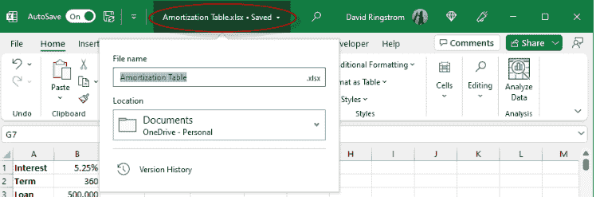

Figure 2.9 – 重命名和/或重新定位电子表格

### 访问先前的 AutoSave 版本

当你将文件保存到硬盘时，通常，你只能访问上次保存的副本。在本章后面的 _Always create backup_ 部分中，我将讨论一种你可以添加另一层备份的方法。当然，**AutoSave** 远不止于此，它允许你检索多个版本的工作。以下是如何访问 **AutoSave’s Version History** 功能：

1. 点击 Excel 屏幕顶部标题栏中的 _filename_。
2. 选择 **Version History**，如 Figure 2.9 所示。
3. **Version History** 任务窗格将出现在 Excel 的右侧，如 Figure 2.10 所示：

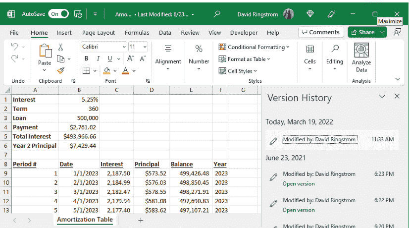

4. 点击你想要检索的备份副本下方的 **Open Version**。
5. 如 Figure 2.11 所示，你可以点击 Excel **Message Bar** 中的 **Restore** 以用此版本替换最新的备份。或者，你可以在 **File** 菜单中选择 **Save As** 以将备份副本保存到你选择的位置：

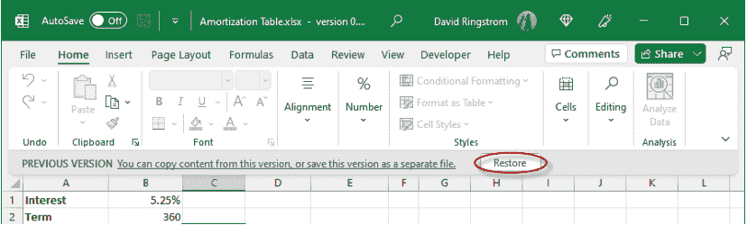

Figure 2.11 – Restore 按钮

### AutoSave 局限性

尽管功能名称相似，**AutoSave** 和 **AutoRecover** 的工作方式不同。如前所述，**AutoRecover** 允许你在当前工作会话期间恢复最多五个不同版本的文件。相反，**AutoSave** 会定期备份你的文件，但并非每个中间备份都可访问。**AutoSave** 最适合用于恢复文件在先前工作会话期间的状态。理想的场景是能够同时使用 **AutoSave** 和 **AutoRecover**，但 **AutoRecover** 仅适用于保存在本地计算机上的文件，而 **AutoSave** 仅适用于保存到云端的文件。

通常，**AutoSave** 将是一个设置一次即可遗忘的功能，但有时，可能会出现 **AutoSave** 无故被禁用的情况。

### 解决 AutoSave 被禁用的问题

默认情况下，任何保存到 **OneDrive**、**OneDrive for Business** 或 **SharePoint Online** 的文档都会自动启用 **AutoSave**。但是，有时，你可能会遇到 **AutoSave** 命令已被禁用的情况。以下是一些可能针对特定文档禁用 **AutoSave** 的场景：

- 你尚未保存文档，或者你将其保存到了本地硬盘或网络上。
- 有时，通过 **Microsoft Teams** 或 **SharePoint Online** 打开的工作簿，其 **AutoSave** 最初处于禁用状态。通常，你可以在打开文件后开启 **AutoSave**。
- 工作簿保存为 Excel 97–2003 工作簿格式（.xls 格式）。
- 我将在 _Chapter 3, Quick Access Toolbar Treasures_ 中讨论的旧版 **Share Workbook** 功能可能已启用。你必须禁用此功能才能使用 **AutoSave**。
- 文件具有工作簿级密码。选择 **Review** | **Protect Workbook** 并删除密码。
- 一个或多个 **Tables** 和/或 PivotTables 中启用了 **Refresh Data When Opening the File** 设置。我将在 _Chapter 12, Power Query_ 中讨论此功能，你必须禁用它才能使用 **AutoSave**。

还有更多场景可能会阻止 **AutoSave** 工作，但上述列表列出了最常见的原因。

> **Nuance**
> 为给定电子表格启用 **AutoSave** 将禁用 Excel File 菜单中的 **Save As** 命令。你可以选择 **Save As Copy** 来制作电子表格的离线副本，但请记住，你对副本所做的任何更改都不会与 **OneDrive** 或 **SharePoint Online** 同步。

当然，如果你希望控制文档保存的时间，可以关闭默认的 **AutoSave** 设置。

### 永久禁用 AutoSave

如果你愿意，可以为未来的工作簿禁用 **AutoSave** 功能：

1. 选择 **File** | **Options**。
2. 选择 **Save** 部分。
3. 取消选中 **AutoSave files stored in the Cloud by default in Excel** 的复选框，如 Figure 2.3 所示。
4. 点击 **OK**。

在 Excel for macOS 中，步骤略有不同：

1. 选择 **Excel** | **Preferences**。
2. 选择 **Save** 部分。
3. 取消选中 **Turn on AutoSave by default** 的复选框，如 Figure 2.5 所示。
4. 关闭 **Preferences** 对话框。

除非你为特定工作簿开启 **AutoSave** 命令，否则 Excel 不会再自动保存存储在 **OneDrive** 或 **SharePoint Online** 中的文档。在旧版 Excel 中，我们可以从 **Quick Access Toolbar** 部分中删除 **AutoSave** 命令：

1. 右键单击 **AutoSave** 命令。
2. 选择 **Remove from Quick Access Toolbar**。

### 始终创建备份设置

你可以指示 Excel for Windows 为关键工作簿创建自动回退位置。
需要注意以下几点：

- 你必须按工作簿逐个启用此设置。
- 你的备份副本是工作簿最近一次保存的副本。
- Excel 会创建一个带有 .XLK 扩展名的文件，当你打开备份文件时，Excel 不会识别该扩展名，我们将稍后讨论。
- 备份文件必须位于原始文档所在的同一文件夹中，因为没有提供将备份文件保存到其他位置的选项。
- 此功能在 Excel for macOS 中不可用。

让我们看看如何为关键工作簿建立自动备份：

1. 选择“文件”|“另存为”|“浏览”或“更多选项”。
2. 在“另存为”对话框中，单击“保存”按钮左侧的“工具”。
3. 单击“常规选项”。
4. 单击“始终创建备份”复选框，如图 2.12 所示，然后单击“确定”。
5. 单击“保存”：

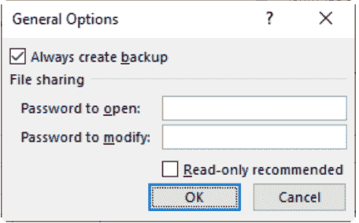

图 2.12 – 始终创建备份设置

假设你的工作簿名为 Budget.xlsx，并保存在你的 **Documents** 文件夹中。每次保存预算时，工作簿的前一个版本将被重命名为 Copy of years. You Budget .xlk，并且也会保存在你的 **Documents** 文件夹中。每次保存 Budget .xlsx 文件时，Excel 都会更新你的工作簿备份副本。我可以证明，多年来，此功能多次拯救了我的关键工作簿，免于丢失。你永远不知道文件在保存过程中何时会损坏。

你可以像打开普通 Excel 文件一样打开 .xlk 备份文件，但请注意，Excel 会警告你工作簿可能已损坏或不安全，如图 2.13 所示：

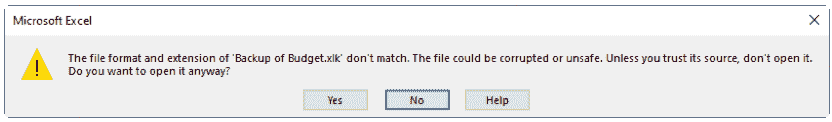

图 2.13 – 误导性的错误提示

Excel 的一个怪癖是它不将 .xlk 扩展名视为有效的 Excel 文件。请放心，你可以安全地单击 **是** 打开备份文件，然后将其另存为普通 Excel 工作簿。

> 提示
> 我经常将版本号纳入工作簿名称，并定期递增。
> 例如，我可能会使用 `2024 Cash Flow Projection 1.01.xlsx` 作为电子表格的初始文件名。每当我即将对工作簿进行重大更改时，我会将文件名递增到 `1.02`、`1.03`，依此类推，以构建回退位置。

有时，尽管我们尽了最大努力，Excel 工作簿仍可能损坏或开始显示异常行为。让我们看看在出现此类情况时可以采取哪些措施。

### 修复损坏的工作簿

没有人想在 Excel 中看到的提示是工作簿已损坏且无法打开。当然，工作簿损坏的程度各不相同。轻微损坏可能导致在处理文档时出现异常行为或提示，而更严重的损坏可能导致工作簿无法访问。在这种情况下，你可能能够在 Excel for Windows 中修复工作簿。确保关闭受影响的文件，因为你无法修复当前在 Excel 中打开的文件。完成后，执行以下步骤：

1. 选择“文件”|“打开”。
2. 单击 **打开** 按钮右侧的箭头，并选择 **打开并修复...**，如图 2.14 所示：
3. 单击 **修复**，如图 2.15 所示：
4.  hopefully，Excel 将显示第二个提示，告知你修复成功，如图 2.16 所示：

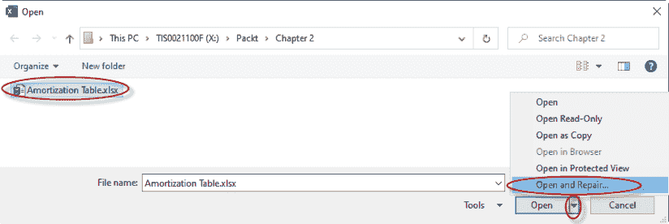

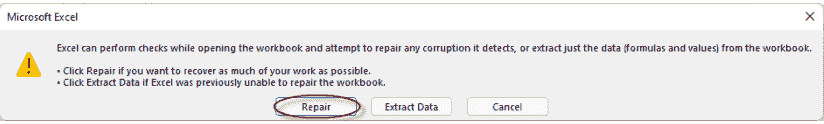

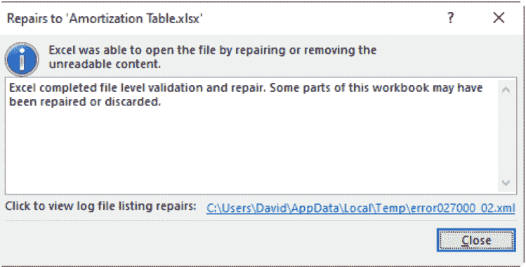

图 2.14 – 打开并修复命令

图 2.15 – 打开并修复对话框

图 2.16 – 修复成功

### 灾难恢复和文件相关提示

如果修复不起作用，请再次执行前面的步骤，但这次，在图 2.15 中单击 **提取数据**，而不是 **修复**。当它起作用时，**提取数据** 会丢弃工作簿中的所有格式——意味着字体、颜色、数字格式、边框等——只保留公式和数据。根据我的经验，如果第一个选项失败，**提取数据** 也会失败，但尝试一下也没有坏处。

如果 Excel 中的 **修复** 选项不起作用，我接下来尝试的步骤如下：

- 在 Excel for macOS 中打开损坏的工作簿，有时可以打开 Windows 版本无法打开的文件。
- 下载并安装免费的 **LibreOffice** 套件。有时，**LibreOffice** 中的 Calc 应用程序可以打开损坏的 Excel 工作簿。

> **提示**
> 此外，如果你需要打开 **Lotus 1-2-3** 文件以将其转换为 Excel 工作簿，也可以使用 **LibreOffice**。

- 在新工作簿中编写一个链接回损坏工作簿的公式。如果工作簿名为 `Damaged File.xlsx` 并存储在 `E:\Documents`，则在空白工作表的单元格 **A1** 中输入 `= 'E:\Documents\Damaged File.xlsx'!A1`。将公式向下和向右复制，以填充你认为损坏工作表所占据的大致区域。请注意，如果你知道工作表名称，可以引用工作表名称，也可以省略工作表名称仅从第一个工作表中提取数据。

现在，让我们看看你可以采取的一项主动措施，以提高工作簿的稳定性，尤其是那些在多个用户之间传阅的工作簿。

### 删除过多格式

有时，你可以通过删除过多格式来避免修复 Excel 工作簿的需要。这种格式出现在用户选择整个列，并将数字格式、字体、颜色等应用到一百多万个单元格时。当你在这里做一百万次，那里做一百万次时，工作簿很容易变得臃肿和不稳定。尽可能只将格式应用到需要的特定单元格。幸运的是，你可以克服你自己或他人过去的过失。**Microsoft 365 Apps for Enterprise** 提供了一个 **Inquire 加载项**，其中包含 **清除过多单元格格式** 功能，可以精简臃肿的工作簿。

> **细微差别**
> **Microsoft 365 Apps for Enterprise** 被视为 Excel 的商业版本，与 **Microsoft 365** 的 **家庭版** 相对。如果你不清楚自己拥有哪个版本的 Excel，请选择“文件”，然后选择“账户”。如果右侧出现 **Microsoft 365 Apps for Enterprise**，则你可以使用 **Inquire 加载项** 选项。

以下是如何在 Microsoft 365 Apps for Enterprise 中启用 Inquire 加载项选项：

1. 选择“文件”|“选项”。
2. 选择“加载项”。
3. 单击 Excel 加载项旁边的箭头，并选择 COM 加载项。然后，单击“转到”。
4. 如果可用，单击 Inquire，然后单击“确定”以在功能区中添加 Inquire 选项卡。
5. 选择 Inquire | 清除过多单元格格式，单击“确定”，然后单击“是”。

> 提示
> 如果你的 Excel 版本不提供 Inquire 加载项，你可以从 Windows 应用商店下载并安装免费的 XLStylesTool 工具，以从工作簿中删除过多样式。

现在我们已经探讨了各种灾难恢复选项，让我们看看如何管理每次打开某些工作簿时都会减慢你工作速度的大量提示。

### 打开工作簿时的警告提示

1999 年，Melissa 病毒感染了世界各地无数台计算机。该病毒以感染的 Microsoft Word 文档形式传播。多年来，Microsoft 为其产品添加了多层防御，以防止类似病毒再次发生。代价是，用户每次打开电子表格时，往往都会收到警告提示。

在本节中，我将讨论最常见的提示以及如何管理处理来源不明的电子表格的风险。首先，让我们讨论 Excel for Windows 中的受保护视图功能。

### 受保护视图

受保护视图首次出现在 Excel 2007 中。它旨在允许你在沙盒环境中安全地打开和审阅文档，防止其对你的计算机进行任何更改。如图 2.17 所示，当文档处于受保护视图时，你可以查看但不能编辑文档：

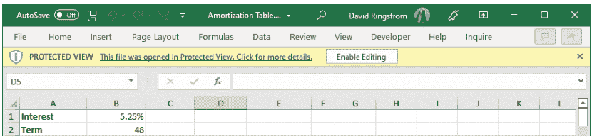

图 2.17 – 受保护视图提示

### 灾难恢复和文件相关提示

默认情况下，**受保护视图**每次你打开来自互联网或电子邮件附件的电子表格时都会触发。**受保护视图**会禁用工作簿的以下元素：

- 宏（嵌入在 Excel 工作簿中的编程代码）
- 外部数据连接，例如数据库查询
- 工作簿链接，即链接到其他电子表格的公式
- 动态数据交换链接，一种在程序之间传输数据的过时方式
- 超链接，可点击的导航链接，指向另一个文档或网页

简而言之，**受保护视图**会禁用工作簿内与外部世界的任何连接，这也会阻止你编辑工作簿。一旦你确定工作簿可以安全访问，就可以单击**启用编辑**，如图 2.17 所示，以正常方式使用工作簿。

与任何计算机安全一样，有时你可能会发现，预防措施比补救措施更难以接受。例如，如果你经常从某个基于云的会计软件导出文件，你可能每天需要多次单击**启用编辑**。如果你对下载的电子表格比较谨慎，可以考虑禁用**受保护视图**：

1. 选择“文件 | 选项 | 信任中心”。
2. 在“信任中心设置”部分右侧单击“信任中心设置”。
3. 在“信任中心”对话框左侧单击“受保护视图”。
4. 可选：清除“来自 Internet 的文件启用受保护视图”复选框，如图 2.18 所示。

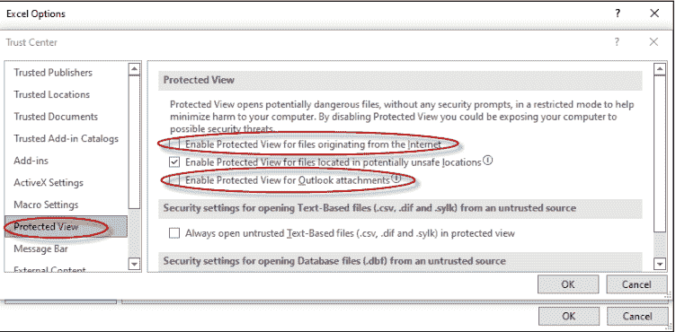

图 2.18 – 受保护视图选项

5. 可选：如果你在打开电子邮件附件时经常遇到**受保护视图**提示，请清除**Outlook 附件启用受保护视图**复选框。

> 警告
> 不要清除**潜在不安全位置的文件启用受保护视图**复选框，因为这样做会使你的计算机面临风险。

6. 单击两次**确定**以关闭**信任中心**和“Excel 选项”对话框。

如果你想在 Excel for Windows 中编辑来源不明的文件之前先进行检查，仍然可以按情况使用**受保护视图**：

1. 选择“文件 | 打开”。
2. 单击一次相关文件。
3. 单击**打开**按钮右侧的箭头。
4. 选择**在受保护视图中打开**，如图 2.14 所示。

这样你就可以以受保护的方式安全地查看文件。

### 受信任的文档

有时，你在打开 Excel 工作簿时会遇到安全警告提示。在**第 12 章，Power Query**中，我将向你展示如何使用**Power Query**从其他数据源（包括文本文件、Excel 工作簿、数据库、PDF 文件等）将数据导入 Excel。虽然不太可能，但恶意攻击者可以通过特制的查询对你的计算机进行破坏。由于存在这种潜在风险，**启用内容**提示（如图 2.19 所示）可能会成为另一个障碍，阻止你在电子表格中完成工作。

当你打开包含宏（用于在 Excel 中自动化任务的编程代码）或工作簿链接（从其他工作簿检索数据）的文件时，会出现类似版本的此提示：

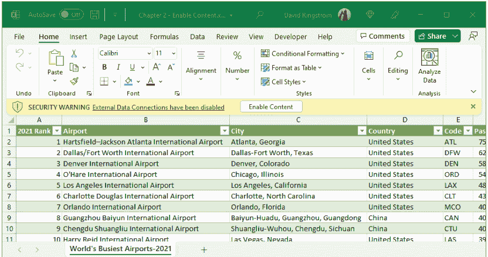

图 2.19 – 启用内容提示

如果你在 Excel 的“信任中心”设置中浏览，可以一次性禁用所有这些提示。但是，这样做所带来的风险高于仅禁用**受保护视图**。当你禁用**受保护视图**时，**启用内容**提示仍然会出现，形成一连串的提示。此外，**启用内容**提示可能由工作簿链接和带有宏的工作簿触发。如果你创建了外部连接、工作簿链接或宏，那么就没有风险，你可以通过创建受信任的文档安全地关闭这些提示。

> **细微差别**
> 如果你在 Excel 的“消息栏”中单击**启用内容**按钮，那么每次打开文件时都必须单击该按钮。如果你希望抑制提示，请不要单击**启用内容**；相反，请将该提示作为提醒，执行下一部分中的步骤。

如果你希望为特定工作簿抑制**启用内容**提示，请在该按钮出现在屏幕上时执行以下步骤：

1. 选择“文件 | 信息”。
2. 单击**启用内容 | 启用所有内容**。

如果你的**启用所有内容**命令显示（**将此设为受信任的文档**），那么你将不再在打开此文档时遇到安全警告。否则，你必须每次打开时都单击“启用内容”。

如果你改变了授予受信任文档状态的主意，可以清除受信任文档列表：

1. 选择“文件 | 选项 | 信任中心”。
2. 在“Excel 选项”对话框右侧单击“信任中心设置”按钮。
3. 在“信任中心”对话框左侧单击“受信任的文档”。
4. 单击“清除”。
5. 确认你希望清除受信任文档列表。
6. 单击两次“确定”以关闭“信任中心”和“Excel 选项”对话框。

清除受信任文档列表是一劳永逸的操作。你不能撤销单个工作簿的受信任文档状态。此外，受信任文档状态是按计算机计算的，因此如果你的同事希望抑制安全警告提示，他们也需要将文档标记为受信任。

### CSV 提示

如果你定期以**逗号分隔值 (CSV)** 文件格式保存文件，还有一个提示可能会减慢你的日常工作。要打开 CSV 文件，请执行以下步骤：

1. 选择“文件 | 打开 | 浏览”。
2. 将**文件类型**设置更改为**文本文件 (*.prn, *.txt, *.csv)**。
3. 选择一个 CSV 文件，然后单击**打开**。
4. 某些 CSV 文件会直接在 Excel 中打开；如果不是，文本导入向导将出现。在这种情况下，请执行以下操作：

   I. 在向导的第一个屏幕上接受默认的**分隔符**，然后单击**下一步**。
   II. 在向导的第二个屏幕上关闭**制表符**选项并打开**逗号**选项。然后，单击**完成**。

如图 2.20 所示，Excel 可能会提醒你存在数据丢失的风险。这是因为 CSV 文件是基于文本的，无法存储公式、数据连接、图表或 Excel 工作簿中除数字和字母以外的任何内容。

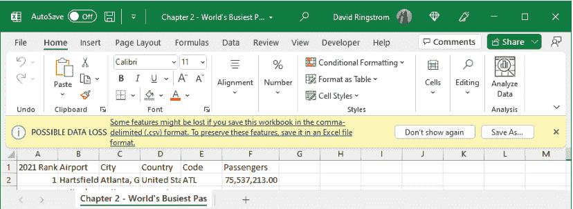

图 2.20 – 数据丢失警告

如果你觉得此提示令人分心，请单击**不再显示**以永久禁用它：

如果你希望恢复此提示，请执行以下步骤：

1. 选择“文件 | 选项 | 保存”。
2. 启用**编辑逗号分隔文件 (.csv) 时显示数据丢失警告**复选框，然后单击“确定”。

Excel for macOS 用户将使用以下步骤：

1. 单击“Excel | 首选项 | 保存”。
2. 启用**编辑逗号分隔文件 (.csv) 时显示数据丢失警告**复选框，然后关闭“首选项”对话框。

现在，你应该能够在 Excel 中更高效地工作，在使用 Excel 时抑制那些出于好意但往往不必要的提示。

### 摘要

在本章中，你了解了几种在 Excel 电子表格中建立一系列防御措施以应对意外的方法。**撤销**和**重做**允许你立即做出响应，除非某个 Excel 命令或功能在没有通知的情况下移除了该安全网。**自动恢复**和**自动保存**命令使你能够分别将工作备份副本保存在离线或云端。**始终创建备份**设置为本地保存的关键工作簿提供了额外的后备方案。

此外，你还了解了如何处理打开包含数据连接、工作簿链接或宏的 Excel 工作簿时可能出现的大量警告提示。出于好意的安全提示可能会中断你的工作流程，或者更糟的是，如果你不理解提示，可能会阻碍你的工作。

我们将在**第 3 章** _快速访问工具栏宝藏_ 中继续探索提高生产力的方法，我将向你展示如何使用图标和自定义键盘快捷键来简化常见任务。

