### 快速访问工具栏的宝藏

**快速访问工具栏**是一组可自定义的图标行，你可以将其配置在屏幕顶部。在本章中，我将向你展示如何为 Excel 中几乎所有功能创建键盘快捷键，包括某些 Microsoft 已从名为 **功能区** 的菜单界面中删除的功能。当然，**快速访问工具栏**不仅仅是关于键盘快捷键，如果你更喜欢使用鼠标来执行任务。

在本章中，你将了解以下主题：

- 如有需要，取消隐藏 **快速访问工具栏**
- 一个棘手的键盘快捷键细微差别
- **重新定位或移除**工具栏上的命令
- 节省时间的命令
- 访问不在 **功能区** 中的命令
- 创建特定于工作簿的工具栏
- 为 Excel 宏创建快捷键
- 在计算机之间迁移 **快速访问工具栏** 图标
- 在 Excel 中恢复旧版功能

随着本章的进展，你将能够添加 Microsoft 从未放在 **功能区** 上或已从 **功能区** 中移除的命令。你将发现新的键盘快捷键可能性，并将重复性任务压缩为单次鼠标点击或按键。你还将简要了解 Excel 的 **宏录制器** 功能，这可以让你开始在 Excel 中创建自己的自动化。

### 技术要求

本章中的所有内容均适用于 Windows 版 Excel。我将注明哪些功能和技术在 macOS 版 Excel 中不可用。此外，我将演示新的 **显示更改** 功能，目前该功能仅在 **Excel for the Web** 中可用，而不是 Excel Online，但可以用于查看在 Windows 或 macOS 版 Excel 中编辑过的工作簿的更改。你可以从 `https://github.com/PacktPublishing/Exploring-Microsoft-Excels-Hidden-Treasures/tree/main/Chapter03` 下载本章的示例。

### 探索快速访问工具栏

快速访问工具栏首次出现在 Excel 2007 中，一直是 Excel 功能区的常用组件，直到 Microsoft 正在逐步向 **Microsoft 365** 用户推出的即将到来的 _视觉刷新_ 为止。如图 3.1 所示，**撤销** 和 **重做** 命令传统上出现在快速访问工具栏上：

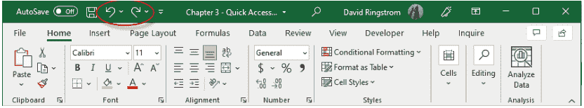

图 3.1 – 撤销和重做的传统位置

如图 3.2 所示，作为 Excel 用户界面更新的一部分，**撤销** 和 **重做** 按钮正在移动到 Excel 功能区的 **开始** 选项卡。奇怪的是，在这些新的 Excel 版本中，如果你之前没有自定义过，**快速访问工具栏** 会自动隐藏。一旦 Microsoft 将更新推送到你的计算机，这些更改将在未经你同意的情况下发生：

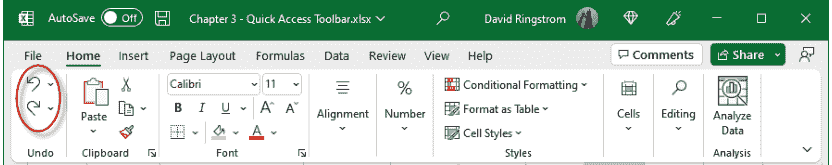

图 3.2 – 撤销和重做出现在开始选项卡上，快速访问工具栏被隐藏

### 提示

如果你不确定自己使用的是哪个版本的 Excel，请选择“文件 | 账户”。你将在账户屏幕右侧看到 Microsoft 365 的提及，或者你会看到类似 Excel 2021、Excel 2019 等内容。Microsoft 将后者称为 Excel 的单次购买版本，这意味着用户界面是冻结的，直到你升级到较新版本的 Excel 才会更改。

以下是恢复隐藏的快速访问工具栏的步骤：

1. 右键单击“文件”菜单。
2. 选择“显示快速访问工具栏”，如图 3.3 所示：

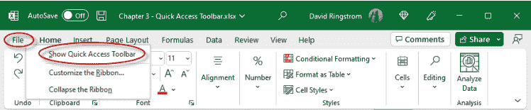

图 3.3 – 取消隐藏快速访问工具栏

3. “自定义快速访问工具栏”按钮将出现在“保存”命令旁边，如图 3.4 所示，否则你的快速访问工具栏将位于功能区下方，如图 3.5 所示：

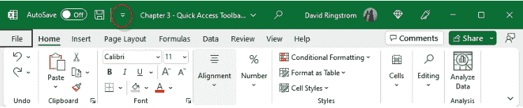

图 3.4 – 功能区下方的快速访问工具栏

4. 单击“自定义快速访问工具栏”以显示一个菜单，允许你执行以下操作：

- 如果你希望将命令添加回快速访问工具栏，请选择“撤销”和/或“重做”。当然，你可以使用 Ctrl + Z（macOS 版 Excel 中为 ⌘ + Z）来撤销，使用 Ctrl + Y（⌘ + Y）来重做。但是，如果你习惯于用鼠标点击这些命令，很难克服肌肉记忆。我可以证明，不得不激活“开始”选项卡来点击这些命令很快就会让人厌烦。你可能会发现其他有用的命令包括以下内容：

- 电子邮件 – 这将当前工作簿附加到一封空白电子邮件中，只需单击鼠标或使用键盘快捷键，这意味着如果需要，你的电子邮件软件将启动。
- **快速打印** – 这将当前工作表的打印范围直接发送到默认打印机。
- **打印预览和打印** – 这将启动 Excel 的 **打印预览** 屏幕，在 Windows 版 Excel 中也称为 **后台视图**。
- 选择“更多命令”以向工具栏添加其他命令，我们将在整个章节中执行此操作。
- 单击“显示在功能区上方”或“显示在功能区下方”以重新定位工具栏。此命令根据工具栏的当前位置在两者之间切换。
- 如果可用，请选择“显示命令标签”，如图 3.5 所示，以在工具栏显示在 **功能区** 下方时显示图标旁边的命令名称，如图 3.6 所示。此功能在 Microsoft 365 的 _视觉刷新_ 版本中可用：

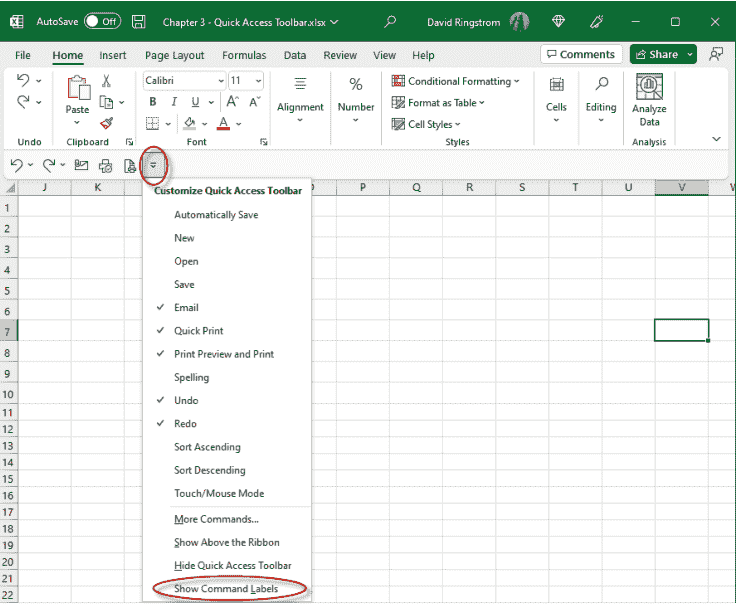

图 3.5 – 显示命令标签选项

至此，我们已确保你的 **快速访问工具栏** 可见，并且你已经了解了如何添加常用命令、重新定位工具栏，以及可能启用命令标签。现在，让我们自定义 Excel 的菜单界面，即 **功能区**。

### 自定义 Excel 的功能区

你可以以类似于 **快速访问工具栏** 的方式自定义 Excel 中的菜单界面。为此，请执行以下步骤：

1. 选择“文件 | 选项 | 自定义功能区”。
2. 从右侧列中选择你希望自定义的选项卡，或单击“新建选项卡”以向功能区添加一个空白选项卡。如果你希望更改功能区中任何选项卡的名称，请单击“重命名”。
3. 每个 **功能区** 选项卡都分为组，例如“开始”选项卡中的 **剪贴板**、**字体**、**对齐方式** 等。你无法向任何内置组添加命令，但你可以单击“新建组”以向现有 **功能区** 选项卡添加自定义组，或单击“新建选项卡”以创建新选项卡。
4. 通过从左侧列中进行选择，然后单击“添加”，将命令添加到新组和选项卡中。
5. 完成自定义后，单击“确定”以关闭 **Excel 选项** 对话框。

**快速访问工具栏** 可通过鼠标一键访问命令，但在 Windows 版 Excel 中，该工具栏还有一个额外的维度。

### 了解快速访问工具栏快捷键的细微差别

在 Windows 版 Excel 中，你 **快速访问工具栏** 上的每个命令都分配了一个字母数字键盘快捷键。（macOS 版 Excel 不提供此功能。）这些键盘快捷键涉及按下 **Alt** 键和由命令在 **快速访问工具栏** 中的位置确定的快捷码。我将在稍后的“重新定位和移除图标”部分讨论如何在工具栏上重新定位命令。如图 3.6 所示，当你按下 **Alt** 键时，屏幕提示将显示每个命令关联的键盘快捷键：

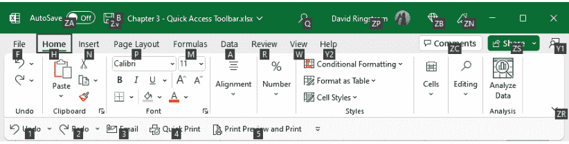

图 3.6 – 快速访问工具栏快捷键提示

### 快速访问工具栏的宝藏

快捷键命名约定如下：

- 前九个快捷键分配为 **1** 到 **9**，这意味着你按 _Alt + 1_ 访问第一个命令，按 _Alt + 2_ 访问第二个命令，依此类推。
- 第 10 到第 18 个快捷键分配为 **09** 到 **01**，这意味着你按 _Alt + 09_ 访问第 10 个命令，按 _Alt + 08_ 访问第 11 个命令，依此类推。第一个字符是零。
- 第 19 到第 44 个快捷键标记为 **0A** 到 **0Z**，这意味着你按 _Alt + 0A_ 访问第 19 个命令，按 _Alt + 0B_ 访问第 20 个命令，依此类推。
- 第 45 个命令及以后的命令将无法通过键盘访问。取决于你的屏幕分辨率和添加的命令数量，你可能需要单击工具栏末尾的按钮才能查看无法在屏幕上显示的命令。

快捷键基于命令在工具栏中出现的顺序。这意味着你可能希望将最常用的图标放在前九个位置。**快速访问工具栏** 图标永远不会有承诺问题。你可以随意移动命令或将其从工具栏中移除。如果你对工具栏或功能区的状态不满意，甚至可以重置整个工具栏连同功能区。

### 重新定位快速访问工具栏命令

你可以随意更改 **快速访问工具栏** 命令的顺序：

1. 单击由 _箭头_（或 macOS 版 Excel 中的 _三个点_）表示的 **自定义快速访问工具栏** 按钮，然后选择 **更多命令**...
2. 右侧列显示你现有命令的顺序，你可以通过以下步骤更改它：

- **Windows 版 Excel**：单击任何命令，然后使用列表右侧的 _上_ 或 _下_ 箭头重新定位命令。你无法在此版本的 Excel 中拖动命令。
- **Mac 版 Excel**：将命令拖动到列中的新位置。此版本的 Excel 中没有 _上_ 或 _下_ 按钮。

3. 完成更改后，执行以下步骤：

* **Excel for Windows**: 单击 **OK** 关闭 **Excel Options** 对话框
* **Excel for macOS**: 单击 **Save**，然后关闭 **Excel Preferences** 对话框

现在你已经了解如何重新组织 **Quick Access Toolbar**，接下来我们来看看如何删除不需要的命令。

### Removing Quick Access Toolbar commands

你可以通过三种方式从工具栏中删除命令：

* **Customize Quick Access Toolbar menu**: 如果你添加了常用命令，例如 **Undo** 或 **Redo**，请显示 **Customize Quick Access Toolbar** 菜单，然后取消勾选你希望删除的命令。
* **Quick Access Toolbar**: 右键单击工具栏上的任意命令，然后选择 **Remove from Quick Access Toolbar**。
* **Excel Options Dialog Box**: 选择 **File | Options | Quick Access Toolbar**（或者，在 Excel for macOS 中，选择 **Excel | Preferences | Ribbon & Toolbar | Quick Access Toolbar**）。单击右侧列中的任意命令，然后在 Excel for Windows 中单击 **Remove**（或者在 Excel for macOS 中单击左箭头按钮）。

> **Tip**
> 单击 **Customize Quick Access Toolbar** 按钮，然后选择 **More Commands**，这只是访问 **Options** 对话框中 **Quick Access Toolbar** 部分的次要方式。

在本章中，我将向你展示更多可以添加到 **Quick Access Toolbar** 的命令。请随意尝试，因为你可以随时一次性重置整个工具栏。

### Resetting the Quick Access Toolbar

重置工具栏意味着删除你所做的任何自定义，并将工具栏恢复到 Excel 首次安装在你的计算机上时的样子。步骤如下：

* Excel for Windows: 在 Excel Options 对话框中单击 **Reset | Reset Only Quick Access Toolbar**，如图 3.7 所示。然后，单击 **OK**：

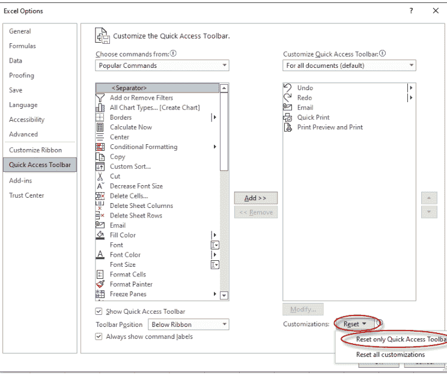

Figure 3.7 – Resetting the Quick Access Toolbar

* Excel for macOS: 单击 Excel Preferences 对话框第二列底部的 **three-dot** 按钮，然后选择 **Reset Only Quick Access Toolbar**。

Nuance
Reset 菜单还包含 **Reset All Customizations** 命令，如果你同时自定义了 Quick Access Toolbar 部分和 Excel 的 Ribbon，该命令将重置这两部分。如果你自定义了 Ribbon 但希望保留 Quick Access Toolbar 设置，则需要先导出 Quick Access Toolbar，然后在重置 Ribbon 和 Quick Access Toolbar 后再次导入 .exportUI 文件。

我们将稍后开始向 **Quick Access Toolbar** 添加更多命令，但首先，我想分享一个与 Excel for Windows 中键盘相关的细微差别。

### The Alt-Number Pad nuance

在 Excel for Windows 中，你可以通过轻敲 Alt 键并使用键盘上方输入 1 到 9 之间的任意数字来访问前九个命令。如果你的键盘有物理数字键盘，也可以轻敲 Alt 键并按下数字键盘上的 1 到 9 之间的任意数字。

请注意，我说的是 _tap_ Alt 键。这就是肌肉记忆可能会让我们措手不及的地方。我们习惯于按住 Ctrl 键，因此很容易对 Alt 键也做同样的操作。当你按住 Alt 键的同时在键盘上输入 1 到 9，而不是轻敲 Alt 键时，可能会出现两种不同的结果：

* 当你通过键盘字母上方的键输入 1 到 9 之间的任意数字时，你选择的 **Quick Access Toolbar** 图标关联的命令将执行
* 当你通过数字键盘输入 1 到 9 之间的任意数字时，Excel 会将一个符号插入电子表格中，如图 3.8 所示：

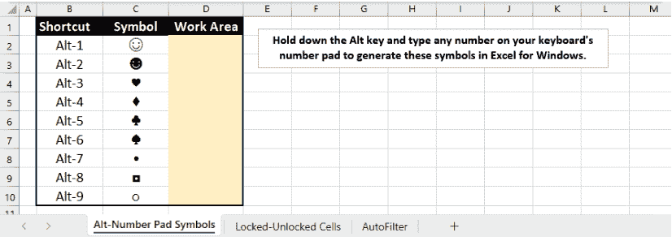

这些符号大多相当滑稽，但我确实觉得有用的是 Alt + 7，它会创建一个项目符号。按住 Alt 键并按下数字键盘上的数字 7，比在 Excel 中以传统方式查找项目符号要容易得多：

1. 选择 **Insert | Symbol**。

### 2. Choose a bullet symbol:

* **Excel for Windows**: 在 **Font** 字段中选择或键入 `Wingdings` 并按 `Enter`，如 **Figure 3.9** 所示。根据需要向下滚动几行，在第 8 行（或任何其他行）找到项目符号。双击插入符号（或单击任意符号，然后单击 **Insert**）。单击 **Cancel** 退出 **Symbol** 对话框：

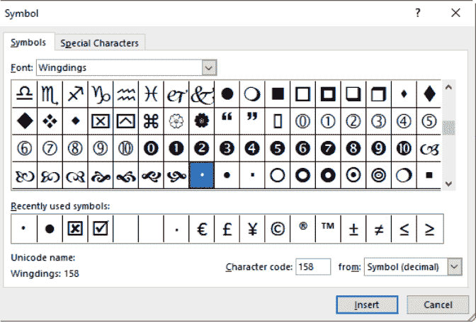

Figure 3.9 – The Symbol dialog box

* **Excel for macOS**: 在 **Search** 字段中键入 `bullet`，单击你选择的符号将其插入当前工作表单元格，然后关闭 **Symbol** 对话框。

现在我们已经介绍了 **Quick Access Toolbar** 键盘快捷方式的细微差别，让我们通过向工具栏添加节省时间的命令来找回一点时间。

### Adding Ribbon commands to the toolbar

将 Ribbon 中的命令添加到 **Quick Access Toolbar** 可能感觉有些多余，但这样做有两个好处。首先，当显示 **Ribbon** 时，**Quick Access Toolbar** 始终可见，这意味着你不需要激活特定的 **Ribbon** 选项卡。其次，向工具栏添加命令会为命令分配键盘快捷方式，例如 Home | Center，这些命令被认为不值得内置快捷方式。

### Center text

我长期以来对 Excel for Windows 的一个抱怨是，你无法像在 Microsoft Word、PowerPoint 或 Outlook 中那样按 Ctrl + E 来居中文本。几十年来，Ctrl + E 没有分配快捷方式，直到 Flash Fill 功能在 Excel 2013 中首次亮相。现在 Ctrl + E 在 Excel for Windows 中激活 Flash Fill，而在 Excel for macOS 中 ⌘ + E 居中文本，且 Flash Fill 没有快捷方式。幸运的是，你可以为在 Excel for Windows 中居中文本创建自己的键盘快捷方式：

1. 右键单击 Excel Ribbon 的 Home 选项卡中的 Center 命令。
2. 选择 Add to Quick Access Toolbar。

> Nuance
> 当特定命令已经出现在你的 Quick Access Toolbar 上时，Add to Quick Access Toolbar 选项将被禁用（变灰）。

3. 轻敲 Alt 键以显示键盘快捷方式。

就是这样，这意味着你现在可以为任何常用命令创建快捷方式。有时，我会暂时将快捷方式添加到工具栏中，以避免反复访问特定命令或下拉菜单的 Ribbon 选项卡。例如，你可以使用这些步骤为 Top and Double Bottom Border 命令创建快捷方式：

1. 选择 Home | Borders 下拉菜单。
2. 右键单击 Top and Double Bottom Border。
3. 选择 Add to Quick Access Toolbar。

现在你可以使用键盘快捷方式或单击鼠标，将顶部和双底边框，或任何你选择的边框，添加到单元格中。

> Nuance
> 你不能以这种方式将下拉菜单中的每个命令添加到工具栏。例如，右键单击 Fill、Font Color 或 Shapes 命令并选择 Add to Quick Access Toolbar 会将整个画廊添加到工具栏，而不是单个命令。虽然你不能将单个单元格颜色添加到工具栏，但你可以创建宏来应用单元格颜色。请参阅本章后面的 Creating shortcuts for macros 部分。

有时，从 Ribbon 添加命令会解锁一些隐藏功能，例如快速确定单元格是否标记为锁定的功能。

### Locking/unlocking worksheet cells

工作表中的每个单元格都标记为锁定，直到你使用以下一种技术解锁一个或多个单元格：

* **Format Cells dialog box**: 选择 **Home | Format | Format Cells | Protection** 以显示 **Format Cells** 对话框的 **Protection** 选项卡。根据你是否要解锁或锁定特定单元格，清除或单击 **Locked** 复选框。
* **Lock Cell command**: 选择 **Home | Format | Lock Cell**。这种方法的缺点是，当你单击 **Lock Cell** 时，锁定或解锁状态会切换，但菜单随后消失，因此你可能不确定是否做出了预期的更改。

**Tip**
在 _Chapter 4, Conditional Formatting_ 中，我将讨论如何使用 **Conditional Formatting** 为在保护工作表之前解锁的单元格进行颜色编码。

如果你需要反复解锁许多非相邻单元格，这些方法中的任何一种都可能变得繁琐，但你可以将步骤压缩为键盘快捷方式或单击鼠标：

1. 选择 **Home | Format**，然后右键单击 **Lock Cell**。
2. 选择 **Add to Quick Access Toolbar**。

当添加到 **Quick Access Toolbar** 部分时，**Lock Cell** 命令不仅切换单元格的锁定/解锁状态，还使你能够确定单元格是否已标记为锁定或解锁。

3. 单击本章示例工作簿中 **Locked-Unlocked** 工作表的单元格 **B3**。
4. 当单元格标记为锁定时，**Lock Cell** 图标后面会有阴影，如 **Figure 3.10** 所示：

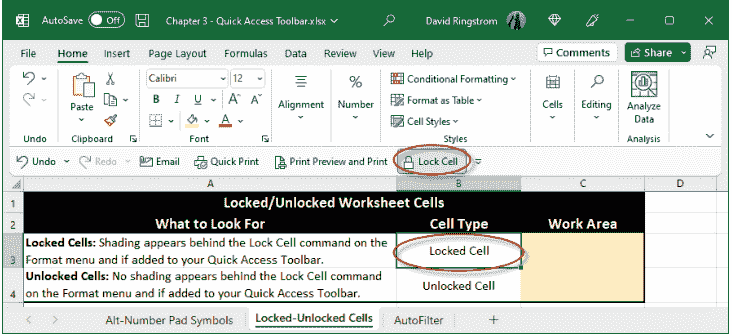

**Figure 3.10** – The Lock Cell command indicating a locked cell

### 将功能区命令添加到工具栏

5. 单击单元格 **B4**，你会发现阴影消失，因为我解锁了该单元格，如 **图 3.11** 所示：

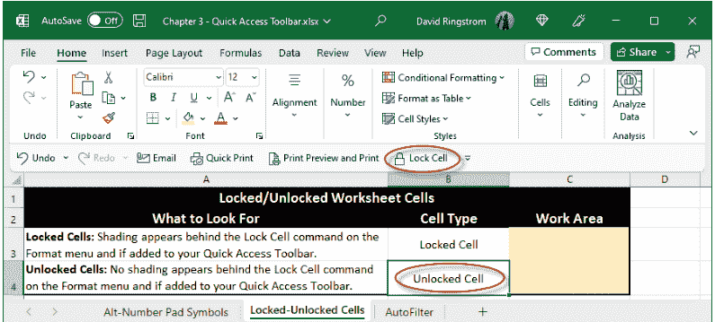

图 3.11 – “锁定单元格”命令指示单元格处于未锁定状态

如你所见，将 **锁定单元格** 命令添加到工具栏，可以让你在浏览工作表时轻松监控和更改单元格的锁定/未锁定状态。现在，让我们看看如何将 Excel **文件** 菜单中的命令添加到你的 **快速访问工具栏**。

### PDF 快捷方式

虽然你可以在 Excel for Windows 中右键单击 **功能区** 命令，但无法右键单击 Excel **文件** 菜单中的命令，这意味着你必须通过 Excel 的 **选项** 对话框来操作。你可能会惊讶地发现，Excel for Windows 提供了两个不同的命令，可让你只需单击鼠标或按下快捷键即可将电子表格转换为 **PDF** 文件：

1. 访问 **Excel 选项** 对话框中的 **快速访问工具栏** 部分。
2. 单击 **从命令中选择 | 文件选项卡**。
3. 可选，选择一个或两个命令：

   - **作为 PDF 附件发送** – 此命令将当前工作簿转换为 **PDF** 文件，并将其附加到你的电子邮件软件（如 **Outlook**）中的空白工作簿电子邮件。
   - **发布为 PDF 或 XPS** – 此命令显示 **发布为 PDF 或 XPS** 对话框，使你能够将工作簿的全部或部分保存为 **PDF** 文件。

4. 可选，浏览 **文件选项卡** 命令或其他功能区选项卡列表，以找到你可能希望添加到工具栏的命令。
5. 单击 **OK** 以关闭 **Excel 选项** 对话框。

### 功能区中不存在的命令

我在 Excel 中最喜欢探索的区域之一是 Excel **选项** 对话框 **快速访问工具栏** 部分中的 **功能区中不存在的命令** 列表。有时，你可以找到内置命令的增强版本，这些版本可以简化任务或启用隐藏功能。此外，你可能能够发掘并恢复 Excel 已从功能区中删除的命令。

### 增强命令

首先，让我们看看提供你无法通过 Excel **功能区** 实现的功能的命令版本。我将向你展示如何在 Excel for Windows 中添加并使用 **自动筛选** 命令，该命令可让你根据单个单元格的内容单击一次即可筛选列表：

1. 访问 **Excel 选项** 对话框中的 **快速访问工具栏** 部分。
2. 单击 **从命令中选择 | 功能区中不存在的命令**。
3. 在左侧列中单击一次 **自动筛选**。然后，单击 **添加**（或双击 **自动筛选** 以跳过 **添加** 按钮）。
4. 单击 **OK** 以关闭 **Excel 选项** 对话框。

5. 激活本章示例工作簿的 **自动筛选** 选项卡。
6. 单击列表中的任何单元格，然后单击 **快速访问工具栏** 中的 **自动筛选** 图标，或按 _Alt_ 并输入相应的快捷键，以筛选该项目的列表。

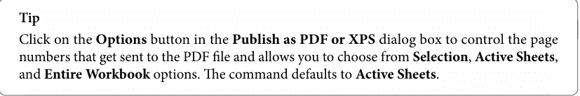

至此，你已经了解了如何将 Excel 功能区或 **文件** 菜单中的几乎任何命令添加到 **快速访问工具栏**。现在，让我们通过探索 **功能区中不存在的命令** 集合，深入了解更多内容。

### 注意事项

你一次只能将 **自动筛选** 命令用于一个单元格；如果选择两个或更多单元格，则不会执行任何操作。你不需要提前打开 **筛选** 箭头；如果需要，**自动筛选** 会自动开启该功能。你可以在多个列中使用 **自动筛选**，但一次只能根据一个单元格的内容进行筛选。最后，**自动筛选** 不适用于 **表格** 功能，我将在 _第 7 章，使用表格功能自动化 Excel 任务_ 中讨论。在这种情况下，单击 **自动筛选** 将简单地切换 **筛选** 箭头的开启和关闭。

现在，让我们看看 **功能区中不存在的命令** 列表中的一些其他你可能会发现有用的命令：

- **全部关闭** – 过去，如果你在 Excel 2003 或更早版本中按住 _Shift_ 键，**文件** 菜单上的 **关闭** 命令会变为 **全部关闭**。这提供了一种轻松关闭所有打开的工作簿但仍保持 Excel 运行的方法。该 _Shift_ 键技巧在随后的任何 Excel 版本中都不再有效，但你可以将 **全部关闭** 添加到 **快速访问工具栏**，以便一次轻松关闭所有打开的电子表格。

### 提示

当你单击 **全部关闭** 时，系统会询问你是否要保存任何打开的工作簿。确认对话框中有一个 **全部保存** 按钮，你可以单击该按钮保存所有打开的工作簿。但是，有时你不想保存任何内容。与其反复单击 **不保存**，不如按住 _Shift_ 键并单击 **不保存**，将 **不保存** 按钮转换为隐藏的 **全部不保存** 命令。按钮上的措辞不会改变，但所有打开的工作簿将一次性关闭。

- **自定义视图** – 在 _第 8 章，自定义视图_ 中，我讨论了许多使用 **自定义视图** 来自动隐藏和取消隐藏工作表、应用筛选和打印设置等方面的方法。从 **功能区中不存在的命令** 部分添加 **自定义视图** 会提供一个下拉列表，你可以从中选择以即时更改视图，无需选择 **视图 | 自定义视图**，选择视图，然后单击 **显示**。

### 提示

**自定义视图** 是一项功能，对于在大型工作簿中隐藏和取消隐藏大量工作表特别有用，但你可能只会在很小一部分工作簿中使用它。与其将 **自定义视图** 放在我的主 **快速访问工具栏** 上，我更喜欢创建特定于工作簿的工具栏，我将在下一节中讨论。

- **冻结窗格** – 此命令使你能够单击一次或使用键盘快捷键来冻结或取消冻结工作表窗格。通常，要冻结窗格，你必须选择 **视图 | 冻结窗格 | 冻结窗格**（Excel for macOS 只需要 **视图 | 冻结窗格**）。

### 注意事项

你可以右键单击功能区中的冻结窗格并选择添加到快速访问工具栏，但该版本的命令将要求你与下拉菜单进行交互。功能区中不存在的命令下的冻结窗格命令可通过单击鼠标或键盘快捷键来切换冻结窗格的开启或关闭。

• 打印预览全屏 – 在 Excel 2010 中，Microsoft 将打印预览屏幕集成到 Excel for Windows 的文件菜单的后台视图中。如果你怀念 Excel 2007 之前可用的经典全屏打印预览，请将此命令添加到你的快速访问工具栏。

我可以滔滔不绝地谈论功能区中不存在的命令部分中隐藏的所有好处，但我就到此为止。接下来，让我们看看如何创建将随单个工作簿一起传输的快速访问工具栏。

### 特定于工作簿的工具栏

到目前为止，在本章中，我们对快速访问工具栏所做的每一项更改都是全局更改，这意味着你打开的每个工作簿中都可使用这些命令。你还可以创建特定于单个工作簿的工具栏，这意味着任何其他打开该工作簿的人都可以访问自定义工具栏。如果你按照我上一节中描述的方式添加自定义视图，大多数时候，你最终会得到一个占用工具栏空间的空列表。此技术需要 Excel for Windows，因为在 Excel for macOS 中无法实现。以下是创建特定于工作簿的快速访问工具栏的方法：

1. 访问 Excel 选项 对话框中的快速访问工具栏部分。
2. 从右侧第二列上方的自定义快速访问工具栏列表中选择一个工作簿名称，如图 3.12 所示：

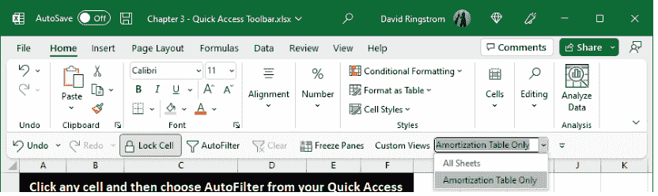

图 3.12 – 特定于工作簿的快速访问工具栏

+   3. 添加任何你希望在此工作簿处于活动状态时可用的命令。
+   4. 单击“确定”以关闭 Excel 选项对话框。

当你激活带有自定义快速访问工具栏的工作簿时，默认图标将始终显示，随后是特定于该工作簿的任何命令。同样，当你访问另一个工作簿时，工作簿特定的命令将消失。

到此为止，我已帮助你解锁了数百个可以添加到快速访问工具栏的潜在命令。但是，如果 Excel 没有用于自动化特定重复任务的命令，你可能能够通过录制宏来向 Excel 添加自定义功能。

### 为 Excel 宏创建快捷方式

Excel 宏是用 Visual Basic for Applications (VBA) 编写的编程代码。这是一种可以自动化 Excel 中重复任务的编程语言。我可以花整本书来探讨宏的概念，但我只有有限的空间。允许我分享一种使用 Excel 的宏录制器将一个或多个单元格的单元格颜色更改为黄色的技术，然后我们将其绑定到快速访问工具栏图标。让我们开始：

+   1. 选择空白工作表的单元格 A1。
+   2. 选择“视图 | 宏 | 录制宏...”
+   3. 在“录制宏”对话框的“宏名称”字段中分配一个名称，例如 YellowHighlight，如图 3.13 所示：

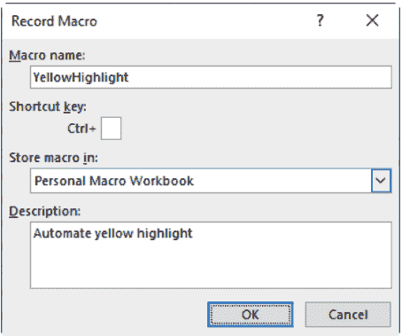

图 3.13 – 宏录制器

### 注意事项

命名 Excel 宏时不能使用空格或标点符号。宏名称的第一个字符必须是字母或下划线。你可以在第二位及以后的位置使用数字。如果要为合并单元格创建宏，请注意使用 Excel 功能名称，例如 **合并**。你可能会无意中违反 Excel 编程语言中的保留字。如果不确定，一个简单的解决方法是添加前缀，例如 **运行**，以便将宏命名为 **运行合并**。这样做将确保你避免因宏名称无意中使用保留字而出现的难以理解的错误提示。

4. 从“存储宏到”列表中选择 **个人宏工作簿**，如 **图 3.13** 所示。

### 提示

你放在 **个人宏工作簿** 部分中的任何宏都将可用于计算机上的任何 Excel 工作簿。这是自动化例行任务的好方法。**宏录制器** 功能无法创建涉及决策的宏，但它是简化重复任务（例如分配单元格颜色或应用可能需要多个步骤的其他格式）的一种方法。宏录制器也是学习更多 VBA 的垫脚石，以便你可以编写处理更复杂任务的宏，或寻求具备必要专业知识的人的帮助。

5. 将 `Automate yellow highlight` 输入到 **描述** 字段中，如 **图 3.13** 所示。

6. 单击 **确定** 以开始录制宏。

7. 选择 **开始 | 填充颜色**，并从库中选择一种颜色，例如黄色。

8. 选择 **视图 | 宏 | 停止录制**。

### 注意事项

录制此宏时，请务必不要单击任何其他单元格；否则，你可能会创建一个与特定工作表单元格绑定的宏。如果你在录制宏之前选择单元格 **A1** 并仅更改单元格颜色，然后停止录制，你将创建一个可用于你选择的任何单元格或单元格的宏。

到此为止，你可以手动运行宏：

+   1. 将光标移动到新单元格（或者如果你想花哨一点，可以一次选择多个单元格）。
+   2. 单击 **视图 | 宏** 的顶部部分（或选择 **视图 | 宏 | 查看宏**）。
+   3. 双击宏的名称（或单击一次宏名称，然后单击 **运行**）。

显然，这大约与从填充库中选择颜色所需的步骤数量相同，甚至更多。这就是为什么你想要为宏创建快速访问工具栏图标的原因：

+   1. 访问 Excel 选项对话框中的快速访问工具栏部分。
+   2. 单击“从命令中选择 | 宏”。
+   3. 双击宏的名称以将其添加到快速访问工具栏，或单击一次宏名称，然后单击“添加”。
+   4. 可选地，在 Excel for Windows 中，单击底部的“修改...”按钮为命令选择图标，如果需要，请将标题更改为“黄色高亮”，如图 3.14 所示。标题字段仅用于显示目的，这意味着允许使用空格：

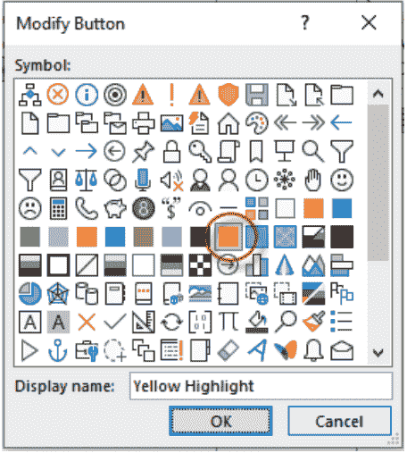

图 3.14 – “修改”按钮对话框

**注意事项**
你只能在将宏添加到工具栏时才能使用“修改”按钮。图 3.14 显示了一个黄色方块图标，这对于此宏来说是一个很好的选择。如果快速访问工具栏显示在功能区下方，你将始终在工具栏上看到一个黄色方块。如果工具栏显示在功能区上方，除非 Office 主题设置为“白色”或“使用系统设置”，否则你将看到一个白色方块。要更改 Office 主题，请选择“文件 | 账户”，然后从 Office 主题列表中选择。你将立即看到主题更改，以便在需要时可以在离开屏幕前恢复。

### 注意事项

宏可以在 Excel 中节省大量时间，但有一个问题。在 Excel 中运行宏后，你无法撤销在该 Excel 会话期间执行的任何先前任务。在第 2 章“灾难恢复和文件相关提示”中，我将向你展示如何访问 Excel 可能在你的工作会话中较早创建的备份文件，以便你需要返回到工作簿的先前点并且无法撤销过去的操作。

将来的某个时间点，Microsoft 365 可能会使我们能够在两台或多台使用的计算机之间同步 Excel 设置和偏好，就像网络浏览器可以同步书签一样。在此之前，你将不得不手动在计算机之间移植设置。

### 在计算机之间传输快速访问工具栏

你可以将工具栏设置导出到一个特殊文件，然后可以将其导入到另一台计算机上的 Excel 中。如果你使用的是 Excel for macOS，在这方面就没办法了，但使用 Excel for Windows 时，用户可以执行以下步骤：

+   1. 访问 Excel 选项对话框中的快速访问工具栏部分。

+   2. 单击“导入/导出 | 导出所有自定义设置”，如图 3.15 所示：

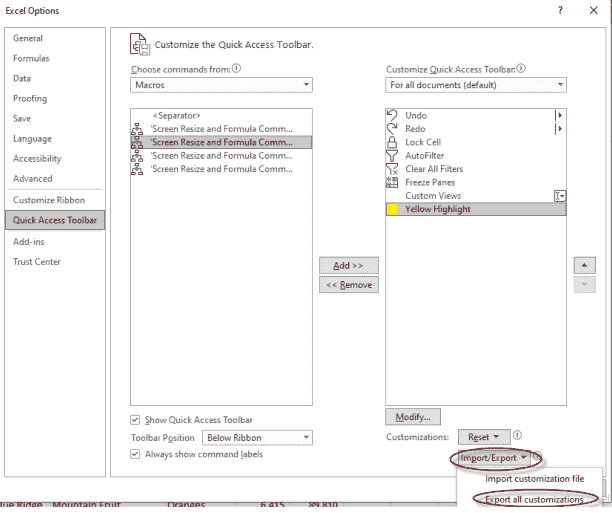

图 3.15 – 导出自定义设置

+   3. 可选地，指定位置和/或新文件名。
+   4. 单击“保存”。
+   5. 将 .exportUI 文件传输到新计算机，例如通过电子邮件，或将文件存档到你选择的文件夹以创建当前自定义设置的备份。
+   在任何其他你希望应用自定义设置的 Windows 计算机上执行这些命令（或在当前计算机上恢复设置）：
+   6. 访问 Excel 选项对话框中的快速访问工具栏部分。
+   7. 选择“导入/导出 | 导入自定义文件”。
+   8. 浏览并选择 .exportUI 文件。
+   9. 单击“打开”。

所有自定义设置都将应用到这台计算机上的 Excel 中。如果你对结果不满意，请参阅前面的“重置快速访问工具栏”部分。现在，让我们看看如何发掘 Microsoft 已从 Excel 功能区中移除的旧版功能。

### 恢复旧版功能

旧版功能是 Microsoft 用于描述他们认为已过时的功能的称呼。Microsoft 很少直接从软件中移除功能。通常，已弃用的命令会被埋在“功能区中不存在的命令”列表中，就像把东西存放在地下室或地窖里一样。让我们看看如何找回你可能以为早已消失的一些功能。

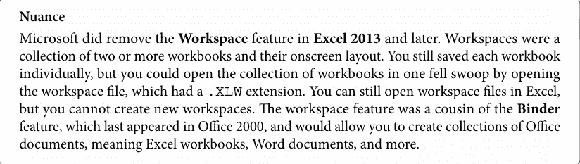

### 全屏功能

在 Excel 2013 中，Microsoft 也从功能区中移除了“视图 | 全屏”。全屏命令隐藏了功能区、公式栏和状态栏部分，这意味着工作表网格完全填满屏幕。让我定义几个术语以避免混淆：

+   • 功能区 – Microsoft 对选项卡式菜单界面的名称，该界面最初是在 Excel 2007 中引入的。

### 快速访问工具栏宝藏

- **公式栏** – 通常出现在工作表网格上方、功能区下方的屏幕元素，可通过 **视图** | **公式栏** 开启或关闭。

- **状态栏** – 通常是 Excel 屏幕的底部行，最左侧通常显示 **就绪** 一词。**状态栏** 功能提供有关 Excel 和工作表的信息。如果想在工作表网格中再添加一行，则没有内置选项可禁用 **状态栏** 功能，但可以使用少量 VBA 代码来关闭或重新打开状态栏：

- I. 按 **Alt + F11** 显示 Excel 的 **Visual Basic 编辑器**。

- II. 选择 **视图**，然后选择 **即时窗口**，或按 **Ctrl + G**。

- III. 在 **即时窗口** 中键入 **Application.DisplayStatusBar = False** 并按 **Enter**，即可永久隐藏状态栏。若想恢复，请在 **即时窗口** 中键入 **Application.DisplayStatusBar = True** 以恢复状态栏。

**全屏** 模式可让您一次在屏幕上查看更多数据，并减少滚动工作表的需求。您可以随时按 **Escape** 退出 **全屏**。

Microsoft 最初用 **自动隐藏功能区** 命令替换了 **全屏**，该命令后来更名为 **全屏模式**。如您所见，**全屏模式** 的行为与 **全屏** 不同，因此让我们对比这两个功能，因为您可以恢复 **全屏**。

### 全屏模式

执行以下步骤进入 **全屏模式**：

1. 单击功能区右下角的 **向下箭头**，如 **图 3.16** 所示：

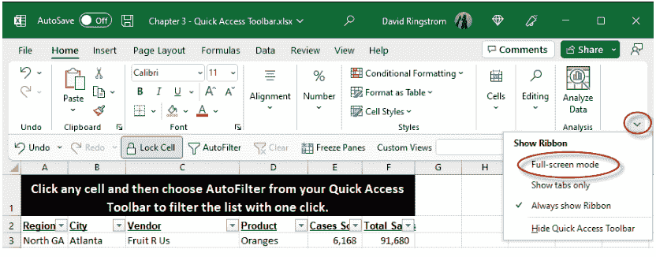

**图 3.16 – 全屏模式命令**

2. 选择全屏模式。

细微差别
您的 Excel 版本可能在 **功能区** 角落有一个 **向下箭头**，用于折叠界面。您可以双击任意选项卡来展开 **功能区**。在这种情况下，您将单击 **功能区显示选项**（即 Excel 右上角的第四个按钮）。然后，您将选择 **自动隐藏功能区**，而非全屏模式。

3. Excel 隐藏 **功能区** 和状态栏，但保留公式栏和屏幕顶部的空白栏。单击栏上的任意位置以显示 **功能区**，这会令人沮丧地遮挡电子表格的前几行，如 _图 3.17_ 所示：

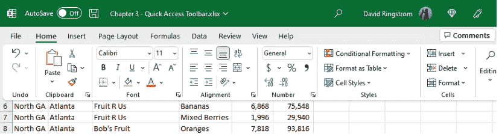

图 3.17 – 全屏模式遮挡工作表行

4. 与经典全屏模式不同，您不能只按 _Escape_ 退出全屏模式或 **自动隐藏功能区**。相反，您必须执行以下操作：

- A. 单击屏幕顶部的栏以显示 **功能区**。

- B. 单击屏幕右侧的 **显示功能区** 按钮（或屏幕顶部的 **功能区显示选项** 按钮），然后选择 **始终显示功能区**（或 **显示选项卡和命令**）。

**显示功能区**/**自动隐藏功能区** 菜单包含 **仅显示选项卡** (**显示选项卡**) 选项，该选项隐藏 **功能区** 主体和状态栏，同时保留 **功能区** 选项卡和公式栏。单击任意选项卡以显示 **功能区**，这同样会遮挡工作表的几行。我认为这种方法过于繁琐，尤其是与经典 **全屏** 功能相比。例如，您无法使用键盘访问 **显示功能区** 或 **功能区显示选项** 菜单，因此您 _必须_ 使用鼠标进入或退出全屏模式。现在，让我们看看如何使用全屏。

### 恢复全屏功能

您可以在 Excel for Windows 中将全屏添加到快速访问工具栏，但不幸的是，Excel for macOS 不行。以下是使用步骤：

1. 访问 Excel 选项对话框中的快速访问工具栏部分。

2. 选择 **命令来源** | **功能区中未包含的命令**。

3. 根据您的 Excel 版本，该命令可能名为 **全屏** (切换全屏视图) 或 **切换全屏视图**。您可以向下滚动列表，或单击列表中的任意命令并键入 g 以移至 **全屏** (切换全屏视图) 命令附近，或键入 u 以移至 **切换全屏视图** 命令附近。

4. 双击 **全屏** (切换全屏视图) 或 **切换全屏视图** 以跳过添加按钮。

5. 单击 **确定** 以关闭 Excel 选项对话框。

现在，您已准备好使用全屏：

1. 单击 **全屏** (或 **切换全屏视图**) 或按 Alt 键并输入命令上显示的数字。

2. Excel 隐藏功能区、公式栏和状态栏，这使您能够比全屏模式多看到至少两行工作表。

3. 随时按 Escape 退出全屏模式并恢复功能区、公式栏和状态栏。

现在，当您不需要访问功能区时，可以看到更多工作表内容。现在，让我们看看恢复经典共享工作簿功能。

### 共享工作簿功能

从历史上看，**审阅** | **共享工作簿** 允许您与其他用户同时处理一个工作簿。问题是，所有用户都必须能够访问工作簿的位置，这通常排除了远程用户。Microsoft 将替代功能称为共同创作，但您不会在 Excel 用户界面中看到共同创作一词——它简单地命名为 **共享**，并出现在右上角。**共享** 命令允许您与世界各地的任何人共同创作保存在 OneDrive 上的工作簿。如果您不愿或无法使用 OneDrive，可以改用共享工作簿功能：

1. 访问 Excel 选项对话框中的快速访问工具栏部分。

2. 选择 **命令来源** | **功能区中未包含的命令**。

3. 单击第一列中任意命令一次。

4. 键入字母 `t` 以跳转到以字母 T 开头的命令开头，这也会显示以字母 S 开头的命令。

5. 双击 **共享工作簿 (旧版)**，或单击一次 **共享工作簿 (旧版)** 然后单击 **添加**。

6. 单击 **确定** 以关闭 Excel 选项对话框。

**审阅** | **跟踪更改** 在 Excel 2016 中已从功能区移除，但您可以通过快速访问工具栏恢复该功能。话虽如此，Excel for the Web 有一个名为 **显示更改** 的功能，可以显示在桌面版本中所做的更改。

### 显示更改

**显示更改** 可在 Excel for the Web 中使用，但它可以用于跟踪您在任何其他支持我前面部分讨论的共同创作功能的 Excel 版本中编辑过的工作簿的更改。第一步是将工作簿保存到 OneDrive。

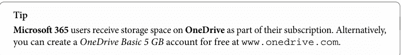

要从 Excel 内将电子表格保存到 OneDrive，请执行以下步骤：

1. 选择 **文件**，然后选择 **另存为**。

2. 在 **另存为** 屏幕上选择 **OneDrive**。系统可能会提示您验证帐户。

3. 为文件指定名称，然后单击 **保存**。

您还可以采用另一种方法，即在任何 Excel 屏幕左上角启用 **自动保存**。当您打开 **自动保存** 时，Excel 会引导您将文件保存到 OneDrive。我在第 2 章 **灾难恢复和文件相关提示** 中更详细地讨论了 **自动保存**。

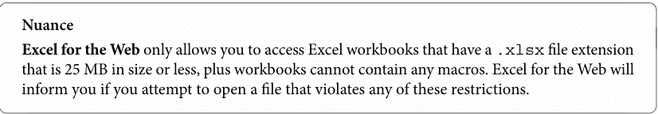

### 快速访问工具栏宝藏

Microsoft 正在逐渐在订阅 **Microsoft 365** 的用户与使用 _一次性购买_ 版本 Excel（名称中带有年份的任何 Excel 版本）的用户之间制造分歧。例如，当您在 Excel for the Web 中打开在其中一个版本中编辑过的工作簿时，任何跟踪的更改都会被删除。要查看工作簿中的更改，请执行以下步骤：

1. 登录 **Office Online** (`https://office.com`)。

2. 从 **最近** 列表中选择最近的工作簿，或单击左侧的 **Excel** 图标以查看仅显示 **Excel** 工作簿的 **最近** 列表。

3. 选择 **审阅** | **显示更改** 以显示 **更改** 任务窗格，如 **图 3.18** 所示，该窗格列出了过去 60 天内所做的所有更改：

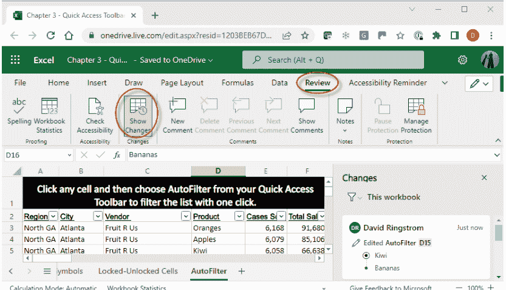

**图 3.18 – Excel for the Web 中的更改任务窗格**

4. 可选：单击任务窗格顶部附近的 **筛选器** 按钮，按 **范围** 或 **工作表** 筛选更改。

5. 可选：如果您希望折叠任务窗格，请单击任务窗格右上角边缘的右箭头。然后，您可以单击出现的左箭头以再次展开任务窗格。

6. 审阅完工作簿中的更改后，单击任务窗格右上角由 **X** 图标表示的关闭按钮。

Microsoft 正在使用 **Excel for the Web** 和 Excel Mobile 作为新功能（例如此功能）的测试平台，因此很可能，在未来的某个时间点，我们会看到此 **Show Changes** 功能进入 Excel 的桌面版本。例如，Excel Mobile 已经提供将文本和数字图片转换为可编辑数据的功能多年。截至撰写本文时，该功能正在 **Microsoft 365** 桌面版本中进行 Beta 测试。

### 摘要

在本章中，首先，您了解了 **Quick Access Toolbar** 在 **Microsoft 365** 中的演变，以及在需要时如何取消隐藏工具栏。**Quick Access Toolbar** 允许您在 Excel for Windows 中创建最多 44 个自定义键盘快捷方式，但如果您不了解其中的细微差别，可能会困惑为什么，比如说，爱心或黑桃会出现在工作表单元格中，而不是执行命令。执行如 `Ctrl + Z` 这样的快捷方式时，我们总是 _按住_ `Ctrl` 键，但对于 `Alt` 键，我们必须使用替代行为。如果您希望数字小键盘执行快捷方式，请记住 _轻点_ `Alt` 键。您可以完全控制图标的顺序，这使您能够优先安排键盘快捷方式。

我们探索了为 **Ribbon** 命令创建快捷方式的方法（这些命令没有快捷方式），并深入研究了 **Commands Not in the Ribbon** 区域，以挖掘可以简化重复任务的命令。您可以将命令添加到默认的 **Quick Access Toolbar**，也可以创建特定于工作簿的 **Quick Access Toolbars**。

有时，您想要简化的任务根本没有相应的命令，因此我们探索了如何使用 **Macro Recorder** 功能来自动化例行任务。如果您花费大量时间整理 **Quick Access Toolbar**，您可能希望对其进行备份，也许将其转移到新计算机，或与同事分享您的成果。在 Excel for Windows 中，转移很容易完成。本章中我分享的一些技术在 Excel for macOS 上不可用，但 **Quick Access Toolbar** 仍然可以是该平台上的宝贵资源。

然后，我们探讨了如何在 Excel 中恢复旧版功能——Microsoft 用来指代他们希望淘汰但您可能希望继续使用的功能的术语。正如您在 **Full Screen** 中所见，Microsoft 添加到 Excel 的替代功能不一定比被替换的功能更好。有时，替代功能（例如 Track Changes）在桌面版本中尚不存在，这由 Excel for the Web 中的 **Show Changes** 功能所证明。

在第 4 章 _Conditional Formatting_ 中，我将向您展示如何使用颜色、单元格格式甚至单元格内图表和图标来使工作簿中的数据更加生动。
