### 条件格式

在本章中，我将向您展示 Excel **Conditional Formatting** 功能的神奇之处，它可以帮助您使用颜色、图表或图标使数据更加生动。当然，您可以同时使用所有三种，但在数据可视化方面，您通常会更加…… **Conditional Formatting** 是工作表单元格的实时覆盖层，它根据单元格内容是否匹配特定条件，动态应用字体颜色、单元格颜色、边框和数字格式等格式。内置的 **Conditional Formatting** 规则消除了手动对数据进行颜色编码的需要，并且您可以通过创建自定义规则以无限的方式扩展此功能。在此过程中，我将指出即使是最有经验的电子表格用户也会感到沮丧的细微差别。

在本章中，我将介绍以下内容：

- 格式与条件格式
- 突出显示单元格规则
- 顶部和底部规则
- 数据条
- 色阶
- 图标集
- Wingdings 符号
- 自定义规则
- 管理条件格式规则
- 删除条件格式
- 条件格式细微差别

在本章结束时，您将看到 **Conditional Formatting** 识别和说明基于您指定的条件的数据的众多方式。二十年前，Excel 每个工作表最多限制三个 **Conditional Formatting** 规则，但现在您可以将应用于工作表的规则数量没有实际限制。

### 技术要求

本章中的所有内容在 Excel for macOS 和 Excel for Windows 中的工作方式相同。

在撰写本文时，Microsoft 对 **Excel for the Web** 中的 **Conditional Formatting** 功能进行了一些更改，这些更改很可能会进入 Excel 的桌面版本。Excel for the Web 已成为 Microsoft 正在考虑的用户界面更改的试验场。

我本章中使用的工作簿可从 GitHub 下载，网址为 `https://github.com/PacktPublishing/Exploring-Microsoft-Excels-Hidden-reasures/tree/main/Chapter04`。

### 格式与条件格式

在 Excel 中，您可以通过 **Format Cells** 对话框将各种格式应用于单元格。正如您将看到的，条件格式使用 **Format Cells** 对话框的一个子集，这意味着您可以使用 **Conditional Formatting** 应用几乎相同的所有格式。让我们比较一下两者：

1. 选择 **Home** | **Format** | **Format Cells**，或按 `Ctrl + 1 (`⌘` + 1 in Excel for macOS)`。

2. 如 _Figure 4.1_ 所示，**Format Cells** 对话框有六个选项卡，允许您控制工作表单元格内格式的各个方面：

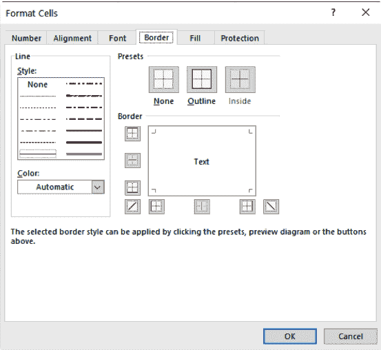

Figure 4.1 – Format Cells 对话框的“边框”选项卡

3. **可选**：单击每个选项卡以查看可用的格式。
4. 单击 **Cancel** 关闭 **Format Cells** 对话框。

现在让我们看看 **Format Cells** 对话框的 **Conditional Formatting** 版本：

1. 选择 **Home | Conditional Formatting | New Rule | Use a Formula to Determine Which Cells to Format**，然后单击 **Format...** 按钮。

2. **Format Cells** 对话框的缩写版本出现，只有四个选项卡而不是六个，如 **Figure 4.2** 所示。请注意，此版本的 **Border** 选项卡比 **Figure 4.1** 中显示的 **Border** 选项卡样式更少。此外，某些样式（如对角线）无法应用。

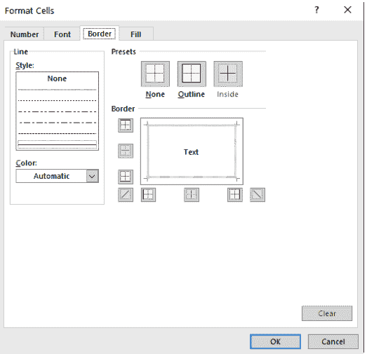

Figure 4.2 – Format Cells 对话框的 **Conditional Formatting** 版本

3. **可选**：单击每个选项卡以查看可用的格式。
4. 我们将在本章后面使用此对话框，因此现在，单击 **Cancel** 两次以关闭 **Conditional Formatting** 对话框。

如您所见，**Conditional Formatting** 允许您将以下一种或多种格式应用于工作表中任何单元格区域：

- 数字格式
- 下划线
- 删除线
- 字体颜色
- 粗体
- 斜体
- 某些单元格边框
- 背景颜色
- 单元格图案
- 填充效果

相反，您不能将以下任何格式应用于使用 **Conditional Formatting** 的单元格：

- 字体名称
- 字体大小
- 上标或下标
- 对齐方式，例如居中
- 单元格边框样式和位置
- 保护设置，例如解锁或隐藏单元格内容

但是，您可以超越 Format Cells 对话框，有条件地应用 **数据条**、**色阶** 和 **图标集**。此外，您可以将任意数量的 **Conditional Formatting** 规则应用于单元格区域。让我们看看如何将 **Conditional Formatting** 应用于单元格区域，从突出显示单元格规则开始。

> Nuance
> 长期使用 Excel 的用户可能记得，Excel 2003 及更早版本每个单元格限制三个 **Conditional Formatting** 规则。在 Excel 2007 及更高版本中，您可以应用的规则数量没有限制。

### 突出显示单元格规则

Home | Conditional Formatting | Highlight Cells Rules 子菜单提供八个不同的选项。我将在此处讨论前七个，然后在本章后面的 *自定义规则* 部分介绍 **More Rules** 命令。我将演示 **Greater Than** 和 **Less Than** 规则，然后简要讨论其他规则，因为所有规则的应用方式相同。示例工作簿中的 **Greater Than**-**Less Than**-Between 工作表对单元格 D6:D25 应用了三个规则。让我们首先将 **Greater Than** 规则应用于工作表的 **Work Area** 部分。

### 大于

正如您所期望的，大于规则允许您对包含大于特定值的数字或日期的单元格应用格式。让我们为每条大于 8,000 英里的道路分配一种颜色：

1. 选择一个单元格范围，例如本章示例工作簿中“大于-小于-介于”工作表上的 J3:J22，如图 4.3 所示。

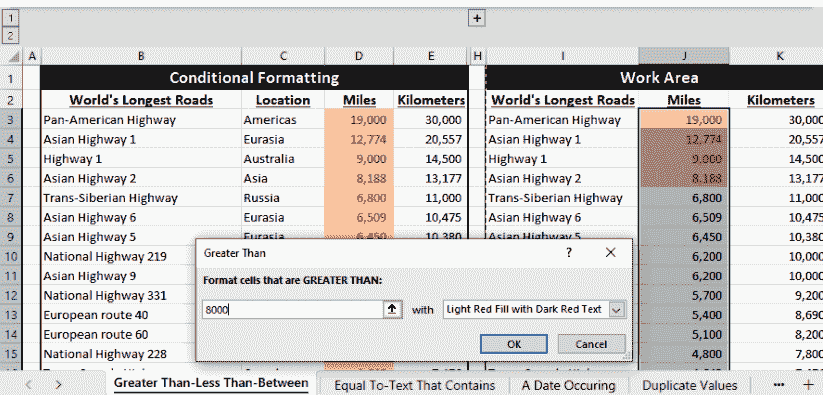

图 4.3 – 大于条件格式规则

2. 选择“开始 | 条件格式 | 突出显示单元格规则 | 大于”。

3. 在“格式大于以下值的单元格”字段中输入 8000，如图 4.3 所示。默认格式浅红色填充配深红色文字的预览应出现在单元格 J6:J9 中。

4. 单击“确定”以关闭条件格式对话框并接受默认格式浅红色填充配深红色文字。

#### 细微差别

与您应用于单元格的大多数格式不同，条件格式是一个动态格式层。如果您将单元格 J3 更改为小于 8,000 的数字，您会看到格式消失。相反，如果您将单元格 J10 的值更改为大于 8,000，则该单元格将以红色格式显示。

现在，让我们将小于规则应用于同一组单元格。

### 小于

小于规则允许您对包含小于特定值的数字或日期的单元格应用格式。让我们为每条长度小于 4,000 英里的道路分配第二种颜色：

1. 选择一个单元格范围，例如“大于-小于-介于”工作表上的 J3:J22，如图 4.4 所示。

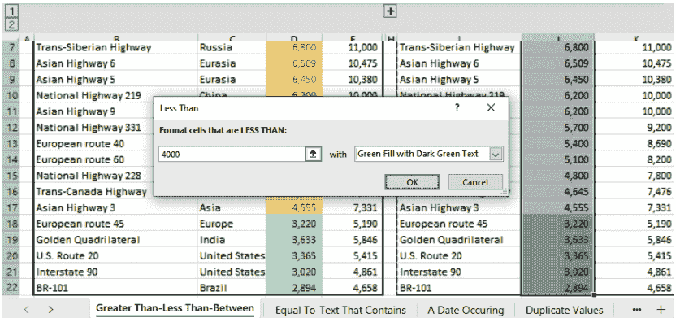

图 4.4 – 小于条件格式规则

2. 选择“开始 | 条件格式 | 突出显示单元格规则 | 小于”。

3. 在“格式小于以下值的单元格”字段中输入 4000，如图 4.4 所示。

4. 从“与”下拉列表中选择“绿色填充配深绿色文字”，如图 4.4 所示。

5. 单击“确定”以关闭条件格式对话框。

让我们将最后一条规则应用于此工作表，该规则将格式化长度介于 4,000 和 8,000 英里之间的单元格。

### 介于

介于规则允许您对包含介于两个值之间的数字或日期的单元格应用格式。让我们分配第三种颜色：

1. 选择一个单元格范围，例如“大于-小于-介于”工作表上的 J3:J22。

2. 选择“开始 | 条件格式 | 突出显示单元格规则 | 介于”。

3. 在“格式介于以下值之间的单元格”字段中输入 4000 和 8000，如图 4.5 所示。

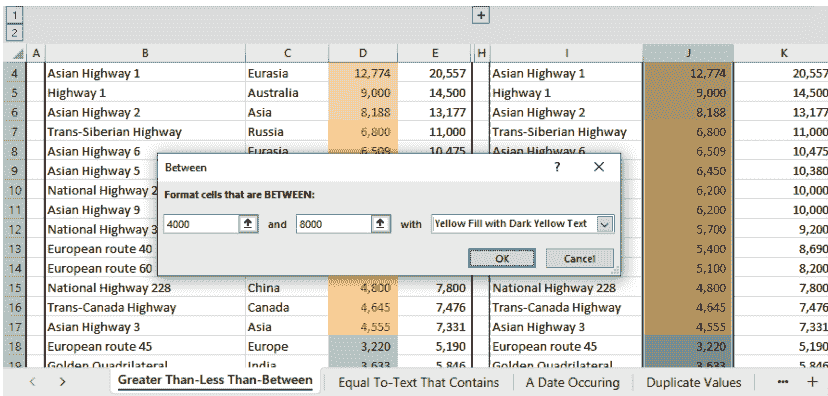

图 4.5 – 介于条件格式规则

4. 从 **与** 下拉列表中选择“黄色填充配深黄色文字”，如 *图 4.5* 所示。

5. 单击 **确定** 以关闭 **条件格式** 对话框。

> **细微差别**
> **介于** 规则包括您在 **条件格式** 对话框中输入的值。这意味着，如果您将单元格 J9 更改为 8000，它将变为黄色格式而不是红色。如果您希望 *大于或等于 8,000* 的金额以红色格式显示，请在相应的值字段中输入 7999 而不是 8000。

您可能已经注意到，单元格 B2:H4 包含一个记录 **条件格式** 规则的图例。这有助于用户了解当前的颜色方案。我将在本章后面的“管理条件格式”部分中描述如何创建这样的图例。既然您看到可以对单元格范围应用多个级别的 **条件格式**，那么让我们看看如何超越 **与** 下拉列表中的默认格式选项，并在应用 **等于** 规则时选择您自己的格式。

### 等于

**等于** 规则将格式化等于您指定的值的单元格，该值可以是文本、数字或日期：

1. 选择一个单元格范围，例如 **等于-文本包含** 工作表上的 H3:H22。

2. 选择 **开始 | 条件格式 | 突出显示单元格规则 | 等于**。

3. 在“格式等于以下值的单元格”字段中输入 Asia，如图 4.6 所示。

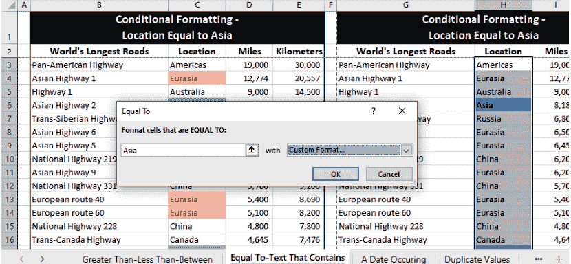

图 4.6 – 等于条件格式规则

> 细微差别
> 条件格式不区分大小写，这意味着您可以在“格式等于以下值的单元格”字段中输入 asia、ASIA 或甚至 aSIA，以格式化所有包含 Asia 的单元格。

4. 从“与”下拉列表中选择“自定义格式...”以显示“设置单元格格式”对话框，如前面所示的图 4.2。

5. 从“填充”选项卡中选择一种颜色，例如蓝色的色调，以及您想要的任何其他格式，例如“字体”选项卡中的粗体。

6. 单击两次“确定”以关闭“设置单元格格式”和“条件格式”对话框。

现在，让我们通过应用“文本包含”规则，为这组单元格应用第二条规则，这也将说明创建条件格式规则之间的冲突是多么容易。

### 文本包含

“文本包含”规则允许您格式化与您输入的文本完全匹配或部分匹配的单元格：

1. 选择一个单元格范围，例如“等于-文本包含”工作表上的 H3:H22。

2. 选择“开始 | 条件格式 | 突出显示单元格规则 | 文本包含”。

3. 在“格式包含以下文本的单元格”字段中输入 Asia，如图 4.7 所示。

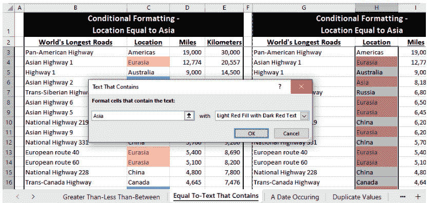

图 4.7 – 文本包含条件格式规则

#### 细微差别

“文本包含”规则也可以应用于数字。例如，您可以选择单元格 I3:I22，并在“格式包含以下文本的单元格”字段中输入 5，以格式化所有包含数字 5 的单元格。

4. 单击“确定”以关闭条件格式对话框并接受默认格式浅红色填充配深红色文字。

#### 细微差别

请注意，Asia 和 Eurasia 都被格式化为红色，尽管您之前将包含 Asia 的单元格设置为蓝色。在这种情况下，“文本包含”规则是在“等于”规则之前应用的，这导致 Asia 和 Eurasia 单元格被格式化为红色，而 Asia 单元格也被标记为粗体。我将在本章末尾的“排查条件格式”部分中向您展示如何解决此问题。

现在，让我们看看如何对日期范围应用格式。

### 日期发生

“日期发生”规则允许您格式化您指定的时间范围内的日期。可用的选项如下：

- 昨天
- 今天
- 明天
- 过去 7 天内
- 上周
- 本周
- 下周
- 上个月
- 本月
- 下个月

本章示例工作簿中的“日期发生”工作表对单元格 B2:B63 应用了三条规则，这些规则会动态地为上周、本周和下周的日期分配不同的颜色。如果您想在工作区中跟随操作，以下是步骤：

1. 选择“日期发生”工作表上的单元格 H2:H63。
2. 选择“开始 | 条件格式 | 突出显示单元格规则 | 日期发生”。
3. 从“格式包含以下日期的单元格”下拉列表中选择“上周”，如图 4-8 所示，然后单击“确定”以接受默认格式。

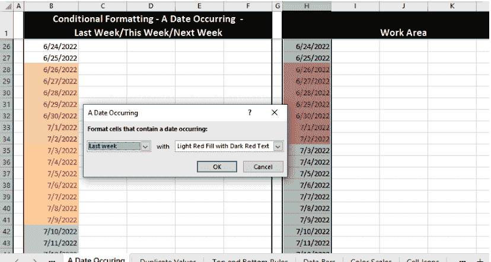

图 4-8 – 日期发生条件格式规则

4. 选择“开始 | 条件格式 | 突出显示单元格规则 | 日期发生”。

5. 从“格式包含以下日期的单元格”下拉列表中选择 **本周**，从“与”下拉列表中选择 **黄色填充配深黄色文字**，然后单击 **确定**。
6. 选择 **开始 | 条件格式 | 突出显示单元格规则 | 日期发生**。
7. 从“格式包含以下日期的单元格”下拉列表中选择 **下周**，从“与”下拉列表中选择 **绿色填充配深绿色文字**，然后单击 **确定**。

由于 **条件格式** 是一个动态层，您今天看到的日期格式在明天打开工作簿时可能会发生变化，如果您下周再次打开工作簿，则肯定会发生变化。

#### 细微差别

任何允许您输入数值的 **条件格式** 规则也接受日期。这意味着，如果您需要以先前选项无法实现的方式格式化日期，可以使用一个或多个其他规则，而不是 **日期发生**。

现在，让我们看看如何在列表中识别重复值。

### 重复值

**重复值** 是我快速识别列表中重复值或唯一值的最喜欢的方法。如您所见，您可以根据颜色筛选列表以处理数据子集。以下是应用该规则的方法：

1. 选择一个单元格范围，例如 **图 4.9** 中 **重复值** 工作表上的单元格 E4:E18。

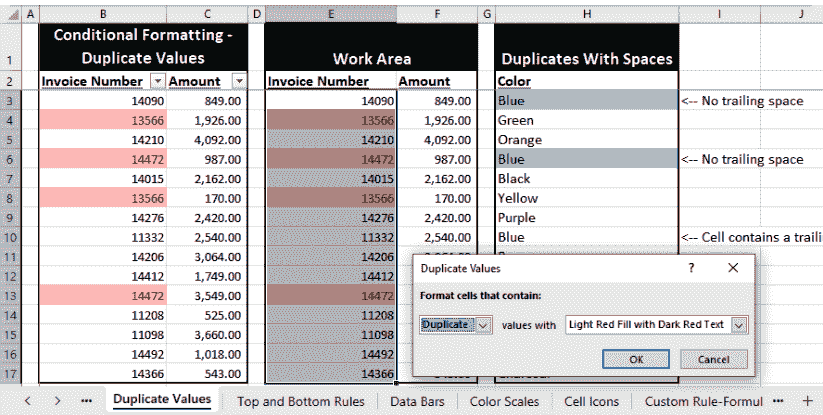

**图 4.9 – 条件格式**

### 顶部和底部规则

顶部和底部规则允许你根据值在列表中的相对位置来识别值。六个规则中有四个引用 10 个项目或 10%，但你可以输入任何想要的数字或百分比。要应用这些规则中的任何一个，请执行以下操作：

- 选择要格式化的单元格范围，例如本章示例工作簿中“顶部和底部规则”工作表上的单元格 H3:H22。
- 选择“开始”|“条件格式”|“顶部/底部规则”，然后选择一条规则：
  - 前 10 个项目：格式化列表中最大的 10 个值，除非你指定不同的值
  - 前 10%：格式化列表中最大的 10% 值，除非你指定不同的值
  - 后 10 个项目：格式化列表中最小的 10 个值，除非你指定不同的值
  - 后 10%：格式化列表中最大的 10% 值，除非你指定不同的值
  - 高于平均值：格式化超过平均值的单元格，意味着在包含 1 到 10 数字的列表中，6 到 10 将被格式化
  - 低于平均值：格式化低于平均值的单元格，意味着在包含 1 到 10 数字的列表中，1 到 5 将被格式化
- 可选：如果规则允许，输入一个数字或百分比。
- 可选：分配你选择的格式。
- 单击“确定”关闭“条件格式”对话框。

> Nuance
> 百分比基于列表中的项目数量。如果你的列表有 90 个项目并且你指定前 10%，条件格式功能将把 90 乘以 10 来确定应格式化 9 个最大值。

现在，让我们看看如何使用数据条来用单元格内图表说明你的数据。

### 数据条

数据条是出现在单元格内的图表，用于提供一列数字中比例尺度的感觉。如你所见，数字可以与图表一起出现在单元格中，或者你可以隐藏数字。本章示例工作簿中“数据条”工作表的单元格 D3:D22 展示了数字和数据条如何在同一单元格中共存。要创建这种类型的格式，请执行以下操作：

- 选择包含数字的单元格范围，例如“数据条”工作表上的单元格 K3:K22。
- 选择“开始”|“条件格式”|“数据条”，然后从“渐变填充”或“纯色填充”部分中选择。

> Tip
> Excel 桌面版本中的大多数条件格式规则在你创建规则时，或当你将鼠标悬停在特定数据条、色阶或图标集上时，都提供实时预览。

3. 如图 4.10 所示，数据条与单元格中数字相对于列表中其他数字的大小成比例。因此，最大的值将拥有最长的数据条，而最小的值将拥有最短的数据条。

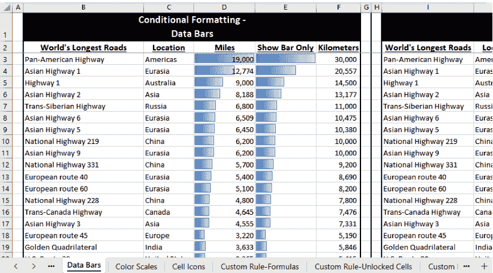

图 4.10 – 数据条条件格式

或者，你可以在一列中显示金额，在第二列中显示数据条：

- 选择“数据条”工作表中的单元格 L3:L22，其中包含与单元格 K3:K22 中相同的数字。
- 选择“开始”|“条件格式”|“数据条”|“更多规则...”。
- 单击“仅显示条”复选框，然后单击“确定”。

数据条是你可以在 Excel 中用来创建仪表板的众多工具之一，仪表板是一种尽可能在小空间内呈现大量信息的电子表格，通常使用可以立即理解的图形。例如，单元格 O3:P14 说明了正负值混合的呈现方式，如图 4.11 所示。

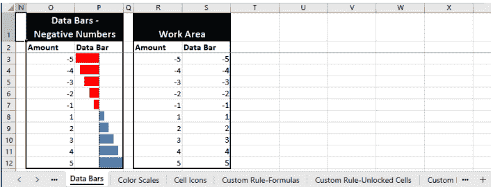

图 4.11 – 数据条呈现负数和正数金额

接下来，让我们看看如何通过条件格式应用色阶。

### 色阶

色阶是在数据中创建热图的简便方法，并根据数字在列表中的比例尺度分配颜色。以下是步骤：

- 可选：将金额按升序或降序排序。
- 选择包含数字的单元格范围，例如本章示例工作簿中“色阶”工作表上的单元格 I3:I22。
- 选择“开始”|“条件格式”|“色阶”，然后选择一个色阶分组来创建热图，例如图 4.12 中的单元格 D3:D22。

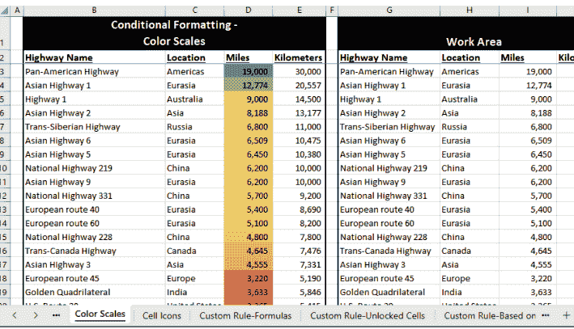

图 4.12 – 色阶条件格式

### 图标集

图标集，也称为单元格图标，是单元格内的图形指示器，用于提供相对于列表中其他数字的尺度或价值感。与数据条一样，你可以选择在同一单元格中显示数字和图标，或者隐藏数字且仅显示图标。默认情况下，图标集根据百分比对金额进行分组，但你可以编辑规则以使用百分位数。以下是 Excel 使用的默认百分比及其计算方式：

- 67 百分位：此计算采用列表中的最小值加上 0.67 乘以（最大值减最小值）的形式。这由“单元格图标 – 百分比”工作表中单元格 C2 的公式 =MIN(D8:D27)+0.67*(MAX(D8:D27)-MIN(D8:D27)) 说明。MIN 函数返回范围中的最小值，而 MAX 函数返回最大值。如单元格 D2 所示，此计算结果为 72.03%，这意味着任何大于列表中最大值乘以 72.03% 的金额都将使用集合中的第一个图标进行格式化。
- 33 百分位：此计算采用列表中的最小值加上 0.33 乘以（最大值减最小值）的形式。这由单元格 C3 中的公式 =MIN(D8:D27)+0.33*(MAX(D8:D27)-MIN(D8:D27)) 说明。如单元格 D3 所示，此计算结果为 43.21%，这意味着任何小于列表中最大值乘以 43.21% 的金额都将使用集合中的第三个图标进行格式化。
- 34 至 66 百分位：在这种情况下，任何大于最大值 43.21% 且小于最大值 72.03% 的金额都将使用集合中的第二个图标进行格式化。

> Nuance
> 包含四个图标的图标集将这些计算基于 25%、50% 和 75%，而包含五个图标的图标集使用 20%、40%、60% 和 80% 来确定区间。

> Nuance
> 与数据条一样，你可以选择“更多规则”来微调格式的呈现。

现在，让我们看看图标集规则，它提供了另一种以图形方式呈现数据的方法。

要根据百分比应用单元格图标，请执行以下操作：

- 1. 在“单元格图标”工作表中选择一个单元格区域，例如 I8:I27。
- 2. 选择“开始”|“条件格式”|“图标集”，然后选择一个图标集（例如，方向、形状、指示器或评级）。
- 3. 图 4.13 中的单元格 D8:D27 直观展示了当将单元格图标应用于采用百分比分组默认设置的单元格区域时的效果。

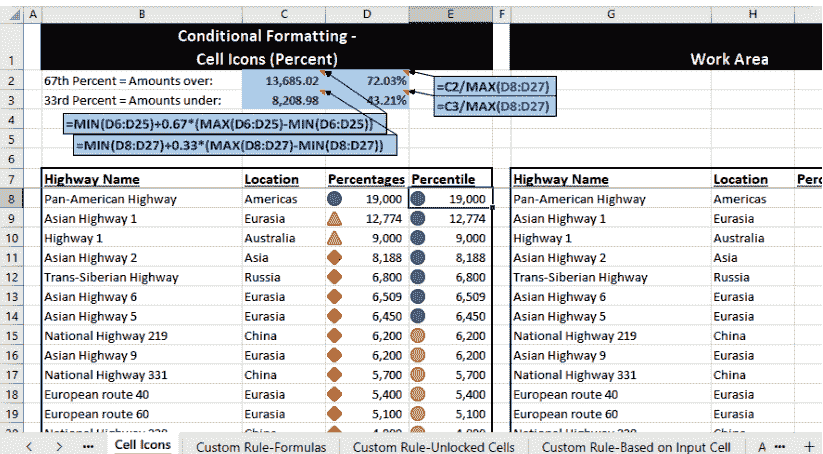

图 4.13 – 基于百分比和百分位数的单元格图标

或者，你可以根据百分位数应用图标集，将数值分为三等份，如图 4.13 中的单元格 E3:E28 所示：

- 1. 选择一个单元格区域，例如 J8:J27。
- 2. 选择“开始”|“条件格式”|“图标集”|“更多规则...”。

### 3. 在“编辑格式规则”对话框的“类型”下拉列表中选择“百分位数”，如图 4.14 所示。

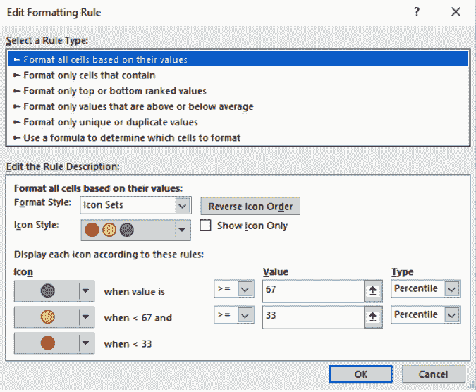

图 4.14 – 编辑图标集规则以使用百分位数

### 4. 单击“确定”关闭“编辑格式规则”对话框。

**细微差别**
你不局限于按三等份分组，因为可以根据需要调整“编辑格式规则”对话框中的值。你还可以选择包含四个图标的图标集来将数值分为四等份，或者如果你想展示五等分，可以选择五个图标。

### 5. 可选：右键单击任意单元格图标，然后选择“筛选”|“按单元格图标筛选”，将列表折叠为仅显示带特定图标的数值。

**细微差别**
你也可以通过选择“数据”|“筛选”或“开始”|“排序和筛选”|“筛选”来筛选。单击包含单元格图标的列的筛选箭头，选择“按颜色筛选”，然后选择一个图标。很容易忽略此功能，因为菜单不会切换为“按单元格图标筛选”。

现在我们已经探索了所有内置的 **条件格式** 规则，让我们看看如何通过创建自己的规则来进一步深入。

### 自定义规则

自定义 **条件格式** 规则使你能够测试任何可以表示为逻辑测试的条件。Excel 提供了一组 IS 函数，用于测试各种条件并返回 TRUE 或 FALSE。CELL 函数也返回等效的 TRUE 或 FALSE。你还可以使用 IF 公式中你会输入的 _logical_test_ 部分来创建 TRUE 或 FALSE 计算。让我们创建一条规则，如果用户用静态值（在 Excel 中也称为常量）覆盖了公式，则将单元格标记为红色。

### IS 函数

IS 函数的示例包括 ISBLANK、ISNUMBER 和 ISTEXT。每个 IS 函数都有一个单引用参数，用于引用你希望测试的单元格，函数返回 TRUE 或 FALSE。让我们创建一个自定义 **条件格式** 规则，如果用户覆盖了公式，则使单元格变为红色：

- 1. 在“自定义规则 – 公式”工作表中选择一个单元格区域，例如 J10:L57。
- 2. 选择“开始”|“条件格式”|“新建规则...”|“使用公式确定要设置格式的单元格”。
- 3. 在“使用此公式对值进行格式设置”字段中输入 =ISFORMULA(J10)=FALSE。

**细微差别**
如果你想使用箭头键在“使用此公式对值进行格式设置”等字段中左右移动，请按 F2（或 Fn + F2）键。此类字段默认处于输入模式，这意味着光标会在工作表中移动，并且当你触摸箭头键时，单元格引用会插入到字段中。当你有一个超出字段可见部分的公式时，编辑模式特别有帮助。

- 4. 单击“格式”按钮，从“填充”选项卡中选择一种颜色，例如亮红色。
- 5. 单击两次“确定”以关闭对话框。

### 条件格式

要测试功能，请将数字 1 输入到 J11:L57 范围内的任意单元格中。单元格应变为红色，如图 4.15 中单元格 E11 的情况所示。对于此工作表，你可以按 Ctrl + ‘ 然后按 Enter 来恢复公式，此时红色格式应消失。

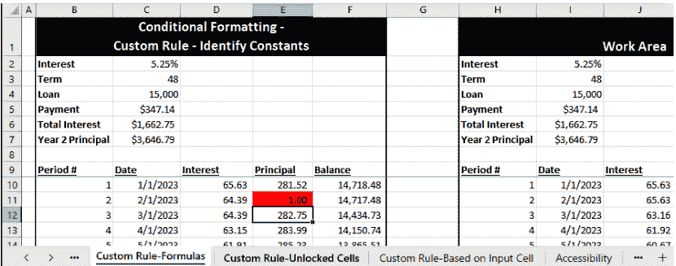

图 4.15 – 识别被覆盖公式的自定义条件格式规则

> **细微差别**
> 条件格式很容易通过简单地复制并粘贴到单元格上来擦除。例如，将数字 1 输入到单元格 N1，然后按 Ctrl + C（⌘ + C）将值复制到剪贴板。导航到任何应用了条件格式的单元格，例如 J11，然后按 Enter 粘贴值。请注意，公式现在已被覆盖，并且没有颜色编码，因为从其他单元格粘贴会覆盖条件格式。

最佳做法是通过选择“审阅”|“保护工作表”，可选输入密码，然后单击“确定”来保护包含公式的工作表。在第 3 章“快速访问工具栏宝藏”中，我讨论了如何解锁你希望用户能够更改的单元格。现在让我们看看如何创建一个条件格式规则，以识别工作表中的未锁定单元格。

### CELL 函数

CELL 函数返回有关工作表单元格的信息，例如列宽或单元格所在的文件名。该函数还可以确定工作表单元格是否标记为锁定或未锁定。该函数有两个参数：

- • **Info_type**：一个基于文本的值，描述你希望返回的信息类型。在此上下文中，我们将使用 "protect" _info_type 值来确定单元格是锁定还是未锁定。此信息类型仅在 Excel 的桌面版本中可用，因为它在 Excel for the Web、Excel Mobile 或 Excel Starter 中不可用。其他 _info_type 值包括但不限于用于返回列宽的 "width" 或用于返回单元格所在文件路径、文件名和工作表名称的 "filename"。

**细微差别**
在 Microsoft 365 和 Excel 2021 中，你可以使用公式 =@CELL ("width", A1) 仅返回列宽。@ 符号，即 **隐式交汇运算符**，返回动态数组的第一个结果（参见第 10 章“查找和动态数组函数”）。你也可能会在旧版 Excel 中创建的数组公式以及结构化引用公式中遇到 @。

- • **Reference**：此可选参数允许你提供要查询信息的单元格地址。
- • "protect" _info_type 值会导致 CELL 函数在单元格标记为未锁定时返回 **0**（零），或在单元格标记为锁定时返回 **1**。现在，让我们在条件格式规则中使用 CELL 函数。

### 创建自定义条件格式规则

如前所述，**条件格式** 是实时覆盖层，因此你设置的任何格式都会在单元格标记为未锁定时开启，或在单元格标记为锁定时消失。步骤如下：

- 1. 选择“自定义规则 – 未锁定单元格”工作表中的单元格 H1。通常，你会从单元格 A1 开始，但我已对单元格 A1:F57 应用了 **条件格式** 规则。
- 2. 按 Shift + End + Home（在 Excel for macOS 上为 Ctrl + Shift + Fn + 右箭头）以选择工作表的其余已使用区域，或手动选择你希望审核的单元格。
- 3. 选择“开始”|“条件格式”|“新建规则...”|“使用公式确定要设置格式的单元格”。

4. 在 **“使用此公式对值进行格式设置”** 字段中输入 =CELL ("protect" ,H1) =0，如图 4.16 所示。

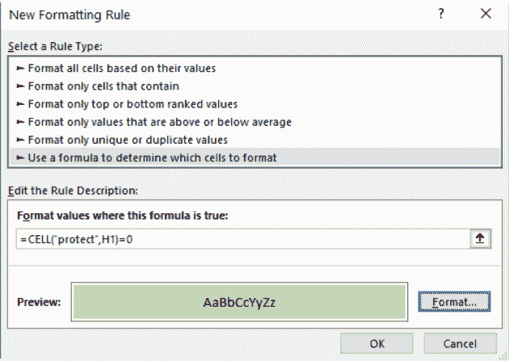

图 4.16 – 自定义条件格式规则

5. 单击 **“格式”** 按钮，并从 **“填充”** 选项卡中选择一种颜色，例如浅绿色。

6. 单击两次 **“确定”** 以关闭对话框。

如 **图 4.17** 所示，未锁定单元格现在已着色。有时，我会保留 **条件格式** 以便用户知道哪些单元格可以更改；其他时候，在审核了单元格的 **锁定** 状态后，我会擦除 **条件格式**，这将在即将到来的 *删除条件格式* 部分中介绍。

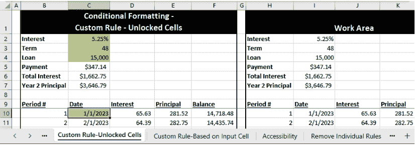

图 4.17 – 未锁定单元格标记有着色

### 逻辑测试

Excel 中的 IF 函数有三个参数，**logical_test**、**value_if_true** 和 **value_if_false**。后两个参数用于显示信息或执行计算。在 **条件格式** 的情况下，你只需要相当于 _logical_test_ 参数的内容。当测试返回 TRUE 时，你创建的自定义规则将被应用；当测试返回 FALSE 时，则不会应用。

> **细微差别**
> 很容易认为你需要在 **格式值，当此公式为真时** 字段中输入 IF 公式，但请记住，**条件格式** 需要的是一个逻辑测试。

假设你想创建一条规则，用于格式化金额大于或等于特定值的单元格。以下是要执行的步骤：

1. 激活本章示例工作簿中的 **基于输入单元格的自定义规则** 工作表。

2. 指定一个单元格作为驱动 **条件格式** 的输入，例如 **图 4.18** 中的单元格 H3，并输入一个金额，例如 7,500。

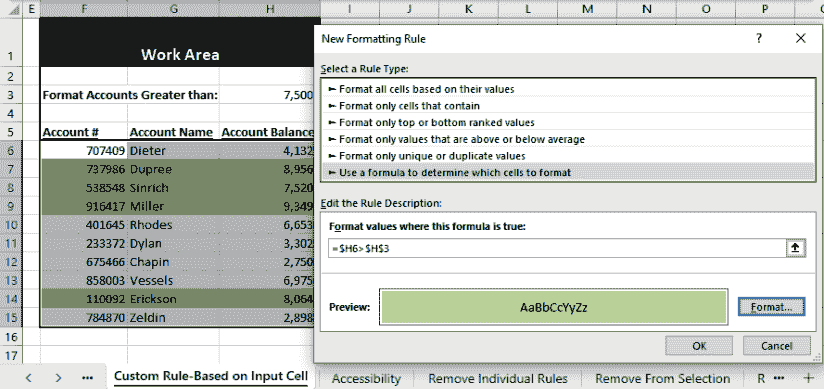

3. 选择要格式化的单元格范围，例如单元格 **F6:H15**。

### 条件格式

4. 选择 **开始 | 条件格式 | 新建规则... | 使用公式确定要格式化的单元格。**

5. 在 **格式值，当此公式为真时** 字段中输入 `=$H6>$H$3`。

> 细微差别
> $ 符号可以决定条件格式规则的成败。在此示例中，你 _不希望_ 在 H6 周围使用美元符号，因为你希望格式化基于单元格 F6:H15 的内容。如果使用了 $H$6，那么规则将仅根据单元格 H6 的内容来格式化第 6 到第 15 行。相反，你 _确实希望_ 在 H3 周围使用 $ 以创建对列 H 和第 3 行的绝对引用。如果省略 $，则条件格式将基于其他单元格相对于单元格 H3 位置的相对位置。

6. 单击 **格式** 按钮，并从 **填充** 选项卡中选择一种颜色，例如浅绿色。

7. 单击两次 **确定** 以关闭对话框。

8. 在单元格 **H3** 中输入 `5,000`，并注意更多行变为高亮显示。

现在我们已经掌握了应用或创建 **条件格式** 规则的许多方面，让我们来看看如何管理已应用到电子表格的规则。

### 管理规则

**条件格式** 中没有任何内容是一成不变的，因此你可以随时根据需要进行更改。我将在本节中讨论几种管理现有规则的方法，并在即将到来的 **排查条件格式** 部分提供更多选项。在本节中，我将向你展示如何更改规则应用的颜色，并调整 **条件格式** 应用到的单元格范围。我还将向你展示如何创建一个图例来记录正在使用的颜色方案，然后我们将探讨如何从单元格范围一直删除规则，直到整个工作表。

### 编辑现有规则

有时，你可能决定要更改 **条件格式** 规则应用的颜色。让我们更改本章开始时创建的第一条规则的 **填充颜色**：

1. 激活 **大于-小于-介于** 工作表，然后单击单元格 **D3**。

2. 选择 **开始 | 条件格式 | 管理规则**。

3. 双击 **单元格值 > 8000** 规则，或单击一次规则，然后单击 **编辑** 以显示 **编辑格式规则** 对话框。

4. 此对话框允许你更改 **条件格式** 规则的任何方面，除了规则应用到的单元格范围。单击 **格式** 按钮，并从 **填充** 选项卡中选择一种蓝色。

5. 单击 **确定** 以关闭 **设置单元格格式** 对话框。

6. 注意你现在有蓝色填充和红色文本。再次单击 **格式** 按钮，激活 **字体** 选项卡，然后从 **颜色** 下拉列表中选择 **自动**。

7. 单击两次 **确定** 以关闭对话框。

如我所提到，**编辑格式** 对话框允许你更改规则的每个方面，除了规则应用到哪些单元格。我们将使用 **条件格式规则管理器** 来调整要格式化的单元格。

### 应用到范围

如 _图 4.19_ 所示，**条件格式规则管理器** 对话框中的 **应用到** 列使你可以看到哪些单元格正在被格式化。你可以查看此列，以确保 **条件格式** 正在应用到你期望的单元格。

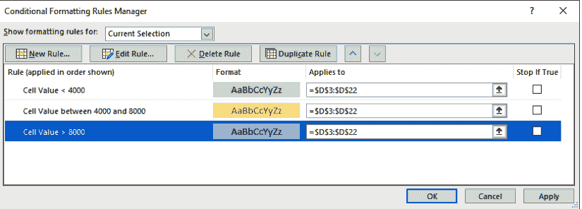

图 4.19 – 应用到列显示条件格式应用的位置

让我们看看这个单元格范围是多么容易受到破坏：

1. 激活 **大于-小于-介于** 工作表。

2. 在空白单元格（例如 **M9**）中输入 6450，然后按 **Enter**。

3. 复制单元格 **M9** 并将其粘贴到单元格 **J9**，这将擦除该单元格中的 **条件格式**。

4. 选择 **开始 | 条件格式 | 管理规则**。

5. 适用于列 **D** 的规则的 **应用到** 字段将显示两个范围，例如 $D$3 : $D$8 , $D$10 : $D$22 ，因为单元格 **D9** 不再包含 **条件格式**。

6. 要恢复你的 **条件格式**，请单击 **应用到** 字段右侧的按钮并重新选择范围，或关闭 **条件格式规则管理器** 对话框并选择 **开始 | 格式刷** 以将 **条件格式** 从现有单元格传输到格式已被删除的任何单元格。任何一种操作都将恢复你之前拥有的连续范围。

有时，规则可能受到如此严重的破坏，以至于最省力的路径是将其删除并重新开始。或者，规则会被重复多次，尤其是当应用到单个单元格时——我最近为一位客户清理了一个工作簿，其中少量 **条件格式** 规则已演变为超过 2,500 条规则。但更常见的是，我发现自己是根据情况使用 **条件格式**，即识别重复项或未锁定的单元格，然后删除格式。

### 创建条件格式图例

让我们看看如何创建出现在 **辅助功能** 工作表中单元格 B2:E4 的 **条件格式** 图例。第一步是识别分配给 **条件格式** 第一级别的填充颜色：

1. 选择 **大于-小于-介于** 工作表中的单元格 **H6**。
2. 选择 **开始 | 条件格式 | 管理规则**。
3. 双击 **单元格值 > 8000** 规则，或单击一次规则，然后单击 **编辑**。
4. 在 **编辑格式规则** 对话框中单击 **格式** 按钮。
5. 激活 **设置单元格格式** 对话框的 **填充** 选项卡。
6. 单击 **更多颜色** 按钮。
7. 选择 **十六进制** 字段中的字符，然后按 **Ctrl + C (**⌘**+ C)**，或右键单击所选内容并选择 **复制**。
8. 单击四次 **确定** 以关闭一系列对话框。
9. 选择单元格 **G2:I2**，然后选择 **开始 | 格式 | 设置单元格格式**，或按 **Ctrl + 1 (**⌘**+ 1)**。
10. 激活 **填充** 选项卡，然后单击 **更多颜色**。
11. 激活 **自定义** 选项卡，然后粘贴从 **步骤 7** 复制的 **十六进制** 代码。
12. 单击两次 **确定** 以关闭 **设置单元格格式** 对话框。
13. **可选**：重复相同的步骤来捕获 **条件格式** 使用的字体颜色，方法是激活 **字体** 选项卡而不是 **填充** 选项卡。

细微差别
十六进制代码使你能够精确匹配工作表中其他位置或颜色调色板图表中的颜色。十六进制代码的替代方案是 RGB 模型，它是红绿蓝的缩写，是一系列 1 到 3 位数字，也可用于匹配颜色。

### 使条件格式图例具有辅助功能

在第 1 章“实现辅助功能”中，我讨论了相当多的 Excel 用户因色盲或其他状况而无法看到颜色。由于条件格式主要基于颜色，因此很容易解决一个问题，例如对数据进行分类，同时创建一个新问题，例如使数据对部分用户不可访问。如图 4.20 所示，示例工作簿中的辅助功能工作表展示了你可以采取的一种方法，其中单元格 D6:D25 同时应用了颜色和单元格图标条件格式，而图例中包含描述形状的单词。这种方法结合了本章前面介绍的技术。

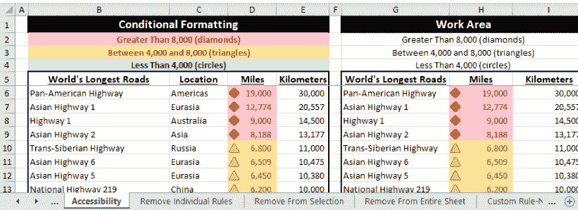

图 4.20 – 具有辅助功能的条件格式图例

### 删除条件格式

让我们先使用条件格式规则管理器来删除单个规则：

1. 激活 **删除单个规则** 工作表。
2. 选择 **开始 | 条件格式 | 管理规则**。
3. 如果需要，从 **显示工作表的格式规则** 列表中选择 **本工作表**。

### 4. 单击列表中的任意规则一次，然后单击 **Delete Rule**，如图 4.21 所示。

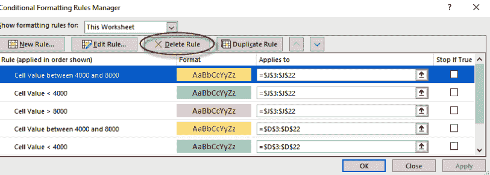

Figure 4.21 – 删除单个条件格式规则

> Nuance
> Excel 不会要求您确认删除规则。在选择性删除规则时，很容易误删除您想保留的规则。请定期单击 **Apply** 以确认您确定要删除的规则。您也可以单击 **Undo** 或按 _Ctrl + Z_ (⌘ + _Z_) 来恢复您刚刚通过 **Conditional Formatting Rules Manager** 删除的规则。

### 5. 根据需要重复上述操作，然后单击 OK 关闭 **Conditional Formatting Rules Manager** 对话框。

相反，您可以从工作表的一部分或整个工作表中删除规则。请记住，**Conditional Formatting** 是特定于工作表的，因此除非您编写一些编程代码来执行此操作，否则无法一次性删除整个工作簿中所有的 **Conditional Formatting**。以下是如何从工作表的特定区域中删除 **Conditional Formatting**：

- 1. 在 **Remove From Selection** 工作表上选择单元格 G3:G22。
- 2. 选择 **Home | Conditional Formatting | Clear Rules | Clear Rules from Selected Cells**。

另一方面，如果您认为 _everything must go_，以下是从工作表中删除所有 **Conditional Formatting** 的步骤：

- 1. 激活 **Remove From Entire Sheet** 工作表。
- 2. 选择 **Home | Conditional Formatting | Clear Rules | Clear Rules from Entire Worksheet**。

**Clear Rules** 子菜单上还有另外两个命令，通常会被禁用。要启用其中任何一条规则，请将光标放置在带有 **Conditional Formatting** 的表格或数据透视表中，以分别访问 **Clear Rules from This Table** 或 **Clear Rules from This PivotTable** 命令。

> Tip
> 近年来，Excel for the Web (https://www.office.com) 已成为微软测试新功能修订版以及对现有功能进行增强的平台。例如，**Excel for the Web** 具有一个任务窗格界面，用于替换本章中您看到的对话框。可以肯定的是，这种经过改造的界面，连同 **Show Changes** 等新功能，最终会进入 Excel 的桌面版本。

现在，让我们看看当 **Conditional Formatting** 因未呈现您期望的格式而让您感到沮丧时该怎么办。

## Troubleshooting Conditional Formatting

通常，您可以选择一组单元格并一次性将 **Conditional Formatting** 应用于所有单元格。但是，在创建自定义规则时，您可能需要先将 **Conditional Formatting** 应用于列表中的单行，然后使用 **Home** 菜单上的 **Format Painter** 命令将格式应用于列表中的其余单元格。如前所述，用于指示绝对或混合单元格引用的 $ 符号的位置可能决定 **Conditional Formatting** 公式的成败。如果您在工作表的某个区域应用多个规则，请选择 **Conditional Formatting** 和 **Manage Rules** 以显示正在应用的规则列表。在某些情况下，您可能需要更改列表中规则的顺序以消除冲突。

### No formatting appears

这种情况通常只会在您创建了自定义 **Conditional Formatting** 规则时出现。一个例外是 **Duplicate Values** 规则，如果没有重复值，则不会出现任何格式。当您的自定义规则未按预期格式化单元格时，以下是几个需要检查的事项：

- 如图 4.22 所示，确保在创建自定义规则时已设置要应用的格式。很容易在努力使自定义规则正确后，单击 **OK** 而未分配任何实际格式。

大多数其他 **Conditional Formatting** 命令要么提供自动格式，要么提供一个下拉列表供您选择格式。

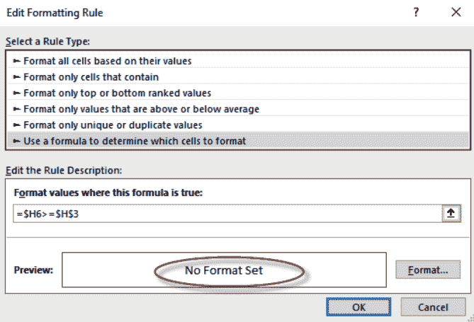

Figure 4.22 – 没有格式说明的自定义条件格式规则

- 接下来要检查的是自定义规则中美元符号的位置。请记住，在创建规则时单击工作表单元格，Excel 会创建对该单元格的绝对引用，例如 $A$2。在本章前面的 _Logical tests_ 部分中，我们使用了公式 =H6>$H$3。您可能会不小心将其写为 =H6>$H$3，这意味着只有当单元格 H6 中的金额大于或等于单元格 H3 时，您的单元格才会被格式化。确实，您也可能会得到相反的效果，即针对某个单元格的格式被应用于规则 **Applied to** 范围内的所有单元格。

- 第三个尝试方法是将规则应用于单行，而不是一次应用于多行。一旦您使规则在单行上正常工作，请使用 **Home | Format Painter** 将规则从第一行转移到您希望格式化的其他行。

正如您在本章中所见，在 Excel 中，条件格式的细微差别比平时更多。例如，在 Equal To-Text That Contains 工作表中，我们遇到了第二个 **Conditional Formatting** 规则覆盖第一个规则的情况。在其他情况下，您可能会改变主意并希望更改现有规则的某个方面，或者您可能希望从工作表的全部或部分中删除 **Conditional Formatting**。您将在本节中了解如何完成所有三项任务。您随时可以返回并修改已应用于工作表的规则。

## Changing the order of the rules

如果您执行了本章中 _Equal To_ 和 _Text That Contains_ 部分的步骤，您会发现第二个规则覆盖了第一个规则。目标是将单词 **Asia** 格式化为蓝色加粗文本，然后将任何其他包含 **Asia** 的单词格式化为红色。出现的情况是，所有匹配任一规则的单元格都被格式化为红色，这是由于规则应用的顺序造成的。当出现此类冲突时，通常第一步是更改规则的顺序：

- 1. 激活 Equal To-Text That Contains 工作表。
- 2. 选择 Home | Conditional Formatting | Manage Rules。
- 3. 从 Show formatting rules 列表中选择 This Worksheet 以显示当前工作表中使用的所有规则。

> Nuance
> Show formatting rules 列表显示工作簿中应用了条件格式的每个工作表的列表。在本章的示例工作簿中，您将在该列表中看到每个工作表，除了 IF Function-Windings 工作表，因为该工作表没有应用任何条件格式。

- 4. 单击一次 Cell Value contains “Asia” 规则以将其选中。
- 5. 单击 Duplicate Rule 按钮右侧出现的向上箭头，如图 4.23 所示。

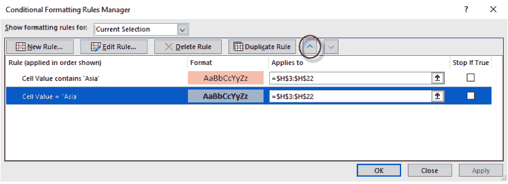

Figure 4.23 – 更改条件格式规则的顺序

- 6. 单击 Apply 以查看此更改的效果，并注意包含 Asia 的单元格被格式化为蓝色，尽管字体是红色而不是黑色。这是因为第二规则的一部分仍在被应用。
- 7. 单击 Cell Value contains ‘Asia’ 规则的 Stop If True 复选框，然后再次单击 Apply。

### Wingdings font

您可以通过将 **Wingdings** 字体与 `IF` 函数结合使用来创建自己的单元格图标类型。这使您可以超越 **Conditional Formatting** 来创建您选择的任何符号学。我将分享一个简短示例：

- 1. 在 Excel 工作表中单击一个空白单元格，例如图 4.24 中的单元格 G1。

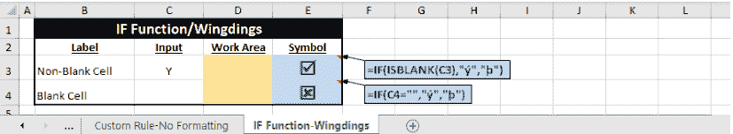

- 2. 从 Excel 的 **Insert** 菜单中选择 **Symbol** 命令。
- 3. 从 **Font** 列表中选择 **Wingdings**。
- 4. 选择一个符号，例如图 4.24 中显示的 **checkmark** (b) 图标，单击 **Insert**，然后单击 **Close**。
- 5. 将光标移动到另一个空白单元格，例如单元格 G2，然后重复 _steps 1–4_ 以选择第二个符号，例如图 4.24 中显示的 **x** (ý) 图标。

+   6. 在要显示符号的单元格（例如图 4.24 中的单元格 D3）中输入公式，如 =IF( ISBLANK(C3) ,"y","n")。
+   7. 从公式栏复制单元格 G1 中的字符，并将其粘贴到 IF 函数中以替换 Y。用单元格 G2 中的第二个符号替换 N。你的公式现在可能类似于 =IF( ISBLANK(C3) ,"ÿ","ß") 。
+   8. 在 Excel 功能区的“开始”选项卡的字体列表中输入 Wingdings，为单元格 D3 分配 Wingdings 字体。
+   9. 你现在可以根据需要将公式向下复制任意多行。
+   10. 当单元格 C3 或 C4 包含任何值时，单元格 D3 和 D4 将显示 ß；否则，将出现 ý 图标。

如果需要，你可以更改字体大小以使图标更大。这样，如果你需要更多灵活性，就可以超越 Excel 的图标集规则。

### 摘要

在本章中，你学习了如何使用条件格式根据你指定的条件识别工作表单元格中的数据。Excel 提供了几个易于应用的内置规则，例如当你想要识别列表中的顶部或底部值，或特定时间段内的日期时。然而，这些规则只是条件格式潜力的冰山一角。你现在可以使用条件格式，为试图用静态值覆盖公式的用户提供视觉提示。你还可以轻松识别工作表中的未锁定单元格，这样在工作表受保护时，就不太可能无意中将关键输入单元格锁定且无法访问。你还知道如何根据输入单元格的值来创建格式化特定单元格的规则。

自定义条件格式规则很难完善，因为一个放错位置的 $ 可能会导致公式以意外的方式运行。在其他情况下，很容易在创建规则时疏忽而遗漏格式。有时，只需更改规则应用的顺序即可。

在下一章中，我将指导你使用数据验证和表单控件功能为电子表格创建数据输入规则和文档。
