### 数据验证和表单控件

我经常将 Excel 电子表格描述为具有美国“西部荒野”氛围，什么都可以。想在哪里输入什么都可以。许多用户通过保护某些工作表单元格来应对这种情况，我将在本章后面讨论。然而，**工作表保护**仅限制单元格是否可以编辑。

**数据验证**允许你限制可以输入到特定单元格中的数据类型。此外，**数据验证**使你能够创建按需文档，当用户单击单元格时，该文档会出现在屏幕上。

更好的是，**数据验证**可以在用户不遵守规则时提供即时反馈。决心坚定的用户可以绕过**数据验证**，因此我们将提供两种防御措施。第一种是审核无效条目的方法。第二种方法将使你能够通过使用**表单控件**限制输入来提高标准。

在本章中，将涵盖以下主题：

- 介绍**数据验证**
- 实现**数据验证**规则
- 保护**数据验证**单元格
- 审核**数据验证**单元格
- 启用**开发人员**选项卡
- 探索**表单控件**
- **复选框和选项按钮**

到本章结束时，你将拥有可用于对电子表格进行“防用户”处理的工具，这将同时提高电子表格的完整性和可访问性。**数据验证**和**表单控件**是电子表格开发人员经常忽视的内部控制措施。

### 技术要求

本章中的所有内容在 **Excel for Windows** 和 **macOS** 中的工作方式相同。你需要启用 Excel 功能区的**开发人员**选项卡，我们将在“探索表单控件”部分中描述。

本章中使用的工作簿可从 GitHub 下载，网址为 `https:// github.com/PacktPublishing/Exploring-Microsoft-Excels-Hidden-Treasures/ tree/main/Chapter05`。

### 介绍数据验证

**数据验证**功能允许你创建规则，以限制可以在一个或多个工作表单元格中输入的数据类型。这些规则可以限制用户输入数字、列表项、日期或时间，并且你可以创建自定义规则。你还可以创建一个数据输入提示，当用户单击包含**数据验证**的单元格时该提示会出现，并对无效条目跟进错误提示。让我们先比较本章示例工作簿的**数据验证**工作表中的单元格 **C4** 和 **C5**，具体操作如下：

1. 选择单元格 **C4**，如 _图 5.1_ 所示。

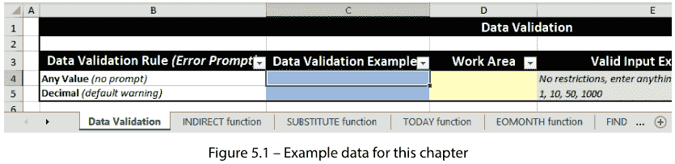

2. 选择 **数据 | 数据验证** 以显示如 _图 5.2_ 所示的**数据验证**对话框。

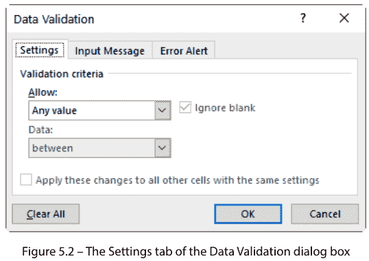

3. 注意对话框的“设置”选项卡上的**允许**字段设置为允许**任何值**。这意味着你可以在单元格 C4 中输入任何内容，这是工作表中所有单元格的默认设置，直到你启用另一个**数据验证**规则。

4. 激活“输入消息”选项卡，并注意如 *图 5.3* 所示的**标题**和**输入消息**字段。你可以使用这些字段创建数据输入提示。

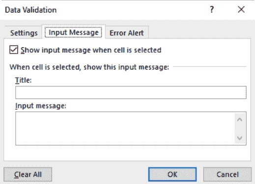

图 5.3 – 数据验证对话框的“输入消息”选项卡

5. 激活“错误警报”选项卡，并注意如 *图 5.4* 所示的**标题**和**错误消息**字段，以及一个**样式**列表，该列表使你能够控制**数据验证**规则的限制程度。输入字段允许你创建自定义错误警报，当输入无效内容时该警报会出现。

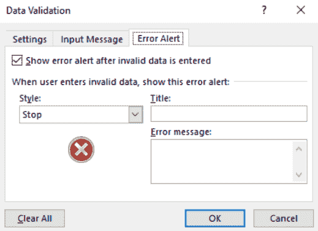

图 5.4 – 数据验证对话框的“错误警报”选项卡

6. 单击 **确定** 关闭**数据验证**对话框。你可以向单元格 **C4** 输入任何内容，因为未设置**数据验证**规则。

7. 接下来，在单元格 **C5** 中输入单词 `Excel` 并按 **Enter**。请注意，如 **图 5.5** 所示的通用**数据验证**错误提示会出现。

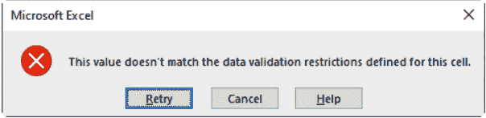

图 5.5 – 通用数据验证错误提示

- 此时你有以下几个选项：
  - 单击 **重试**，输入大于零的数字，然后按 **Enter**
  - 单击 **取消** 或按 **Esc** 以关闭错误提示并丢弃无效输入
  - 单击 **帮助** 以显示与**数据验证**相关的通用帮助，尽管我可以提前告诉你，帮助文档很少，如果有的话，也不会解释已实现的规则

> **提示**
> 你在 **图 5.5** 中看到的按钮与 **停止** 样式相关，这是最严格的样式。数据验证还提供**警告**和**信息**样式，如果用户希望，允许用户绕过规则。

你无法事先知道我为单元格 **C5** 创建了一个要求数字输入的规则，因为我在创建规则时没有填写“输入消息”或“错误警报”选项卡。相反，当你单击单元格 **C6** 时，会出现如 **图 5.6** 所示的数据输入提示，当你输入文本（例如 `Excel`）并按 **Enter** 时，会出现如 **图 5.7** 所示的警告提示。


Figure 5.6 – 选择单元格时会出现数据验证输入消息

Figure 5.7 – 描述性数据验证错误提示

以下步骤描述了如何在单元格 C6 中重新创建数据验证规则：

1. 选择单元格 D6，然后选择“数据 | 数据验证”。
2. 从“允许”列表中选择“小数”，从“数据”列表中选择“大于”。
3. 在“最小值”字段中输入 0（零）。
4. 激活“输入消息”选项卡，在“标题”字段中键入“数值”，在“输入消息”字段中键入“输入大于零的数字”。
5. 激活“错误警报”选项卡，在“标题”字段中键入“无效输入”，在“错误消息”字段中键入“必须输入大于零的数字”。
6. 单击“确定”关闭数据验证对话框。
7. 可选：尝试向单元格 D6 输入数字和非数字值。

Nuance
请记住，任何已应用数据验证的单元格中先前输入的数据都会被纳入规则，这意味着 Excel 不会提醒您无效条目，因此尽可能在空白单元格上应用数据验证是最佳选择。

现在让我们逐一了解 **数据验证** 对话框的每个选项卡，以了解完整的选项范围。

### 设置选项卡

**数据验证** 对话框 **设置** 选项卡上的“允许”列表使您可以将以下规则分配给一个或多个单元格：

- **任何值**：不设置限制 – 这是所有工作表单元格的默认值
- **整数**：输入仅限于整数
- **小数**：输入仅限于带小数或不带小数的数字
- **列表**：输入仅限于指定列表中的项目
- **日期**：输入仅限于日期值
- **时间**：输入仅限于时间值
- **文本长度**：输入基于指定的字符数进行限制
- **自定义**：返回 `TRUE` 或 `0`（零）的公式表示有效输入，而 `FALSE`、`1` 或错误（例如 `#VALUE!`）表示无效输入

您可以进一步限制除 **列表** 和 **自定义** 之外的每个规则，使用以下限制之一：

- **介于**：**最小值** 和 **最大值** 字段允许您指定有效值的范围。
- **不介于**：**最小值** 和 **最大值** 或 **开始** 和 **结束** 字段允许您指定无效值的范围。
- **等于**：**值** 字段使您能够指定用户必须输入的文本、值、日期或时间。
- **不等于**：**值** 字段使您能够指定用户不能输入的文本、值、日期或时间。
- **大于**：**最小值** 或 **开始** 字段允许您指定值范围的下限。提供的最小值或开始值 **_不会_** 是单元格中的有效选择。
- **小于**：**最大值** 或 **结束** 字段允许您指定范围的上限。提供的最大值或结束值 **_不会_** 是单元格中的有效选择。
- **大于或等于**：**最小值** 或 **开始** 字段允许您指定值范围的下限。提供的最小值或开始值 **_将_** 是单元格中的有效选择。
- **小于或等于**：**最大值** 或 **结束** 字段允许您指定范围的上限。提供的最大值或结束值 **_将_** 是单元格中的有效选择。

以下设置为可选：
• **忽略空白**：无论您创建哪种类型的 **数据验证**，此复选框都会出现，但通常仅适用于依赖于其他单元格的列表。我们将在本章后面的 *创建依赖列表* 小节中提供示例。
• **将这些更改应用到具有相同设置的所有其他单元格**：在您向单元格应用 **数据验证** 之前，此复选框处于禁用状态。其目的是允许您将后续的 **数据验证** 更改应用到具有相同限制的所有单元格。

现在让我们查看 **输入消息** 选项卡。

### 输入消息选项卡

**输入消息** 选项卡使您能够创建一条屏幕消息，当用户单击带有 **数据验证** 规则的单元格时，该消息会出现。我建议您在完成 **设置** 选项卡后立即填写此选项卡，以避免您在本章初始示例中可能遇到的混淆。**输入消息** 选项卡有两个字段和一个复选框，如下所示：
• **标题**：您可以在此字段中输入最多 32 个字符，以创建输入提示的标题，当您单击包含 **数据验证** 的单元格时，该标题将出现，例如 *数值*，如 *Figure 5.6* 所示。
• **输入消息**：在此字段中输入最多 255 个字符，以创建消息正文，当您单击单元格时，该消息将出现，例如 *输入大于零的数字*，如 *Figure 5.6* 所示。

> Nuance
> **输入消息** 和 **错误消息** 字段最初会接受超过 **255** 个字符，但当您单击 **确定** 关闭 **数据验证** 对话框时，仅保留前 **255** 个字符。

• **选中单元格时显示输入消息**：此复选框使您能够抑制 **标题** 和 **输入** 消息字段中出现的输入，如果您想在不擦除字段的情况下抑制提示。通常，您会保持此复选框处于选中状态。

现在让我们查看 **错误警报** 选项卡。

### 错误警报选项卡

**错误警报** 选项卡使您能够创建错误提示消息，例如 *Figure 5.7*，当用户的输入与给定单元格的 **数据验证** 规则冲突时，该消息会出现。与 **输入消息** 选项卡一样，您应在 **设置** 中设置规则后立即完成此选项卡。

错误警报选项卡有三个字段和一个复选框，如下所示：

- 样式：如下一节所示，您可以在 Stop、Warning 和 Information 样式之间进行选择。Figure 5.7 说明了 Stop 样式的使用，这是最严格的样式。
- 标题：您可以在此字段中输入最多 32 个字符，以创建输入提示的标题，当您单击包含数据验证的单元格时，该标题将出现，例如 *无效输入*，如 Figure 5.7 所示。
- 错误警报：在此字段中输入最多 255 个字符，以创建错误提示中出现的消息正文，例如 *必须输入大于零的数字*，如 Figure 5.7 所示。
- 输入无效数据后显示错误警报：此复选框使您能够抑制 Figure 5.7 中的错误提示。这样做允许用户在单元格中输入任何内容，即使已设置数据验证规则。通常，您会保持此复选框处于启用状态，因为正是错误提示强制执行数据验证规则。

现在让我们查看错误警报样式。

### 错误警报样式

错误警报样式通过确定错误提示中出现哪些按钮以及出现哪些图标来控制数据验证规则的强制执行。数据验证工作表上的单元格 C8:C10 要求输入大于零的整数。让我们看看这三种样式的使用情况。

### 停止样式

在 C8 中键入 -1 并按 Enter 以触发 Figure 5.8 中显示的提示。停止样式会导致以下按钮出现在错误提示对话框中：

- 重试：允许用户再次尝试输入有效数据，在此情况下，输入大于或等于 0 的数字
- 取消：丢弃用户可能已输入到单元格中的任何内容，并保留原始内容（如果有）
- 帮助：显示有关数据验证功能的帮助文档，但不显示规则本身

Figure 5.8 – 停止样式错误警报

### 介绍数据验证 127

使用以下步骤在单元格 C8 中重新创建规则：

1. 选择单元格 D8，然后选择“数据 | 数据验证”。
2. 从“允许”列表中选择“整数”，从“数据”列表中选择“大于”。
3. 在“最小值”字段中输入 0（零）。
4. 激活“输入消息”选项卡，在“标题”字段中键入“数值”，然后在“输入消息”字段中键入“输入大于零的数字”。
5. 激活“错误警报”选项卡，在“标题”字段中键入“无效输入”，然后在“错误消息”字段中键入“必须输入大于零的数字”。
6. 接受默认的停止样式，然后单击“确定”关闭数据验证对话框。
7. 向单元格 D8 输入 1.5 并按 Enter。注意 Figure 5.8 中显示的提示如何既会引起一个问题又会创建一个新问题。值 1.5 是大于零的数字，但我们的规则要求整数。单击“取消”或按 Esc 关闭错误提示。
8. 单击单元格 D8，然后选择“数据 | 数据验证”。
9. 激活“输入消息”选项卡，并将“标题”和“输入消息”字段分别更新为“整数”和“输入大于零的整数”。
10. 激活“错误警报”选项卡，并将“错误警报”字段更新为“必须输入大于零的整数”。

> Tip
> 在“错误警报”字段中可用的唯一格式选项是将某些单词输入为大写，因此输入“必须输入大于零的整数”是强调规则的一种方式。

11. 单击“确定”关闭数据验证对话框。
12. 向单元格 D8 输入 1.5 并按 Enter，以查看文档如何更清晰地传达规则。

现在让我们看看更宽松的警告样式。

### 警告样式

在单元格 C9 中键入 1.5 以触发 Figure 5.9 中显示的提示，该提示为用户提供了通过选择以下按钮之一来覆盖数据验证规则的选项：

- 是：允许用户绕过数据验证规则
- 否：拒绝无效输入并允许用户重试，其工作方式与停止样式启用时重试按钮的工作方式相同


+   - **Cancel**: 丢弃用户可能在单元格中输入的任何内容，并保留原始内容（如果有）
+   - **Help**: 显示有关 **Data Validation** 功能的帮助文档，但不显示规则本身

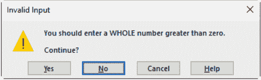

图 5.9 – 警告样式错误警报

使用以下步骤重新创建单元格 C9 中显示的规则：

+   1. 选择单元格 **D9**，然后选择 **Data | Data Validation**。
+   2. 从 **Allow** 列表中选择 **Whole Number**，从 **Data** 列表中选择 **Greater than**。
+   3. 在 **Minimum** 字段中输入 0（零）。
+   4. 激活 **Input Message** 选项卡，在 **Title** 字段中输入 `Numeric Value`，然后在 **Input message** 字段中输入 `Enter a whole number greater than zero.`。
+   5. 激活 **Error Alert** 选项卡，在 **Title** 字段中输入 `Invalid Input`，然后在 **Error message** 字段中输入 `You should enter a WHOLE greater than zero.`。
+   6. 从 **Style** 列表中选择 **Warning**，然后单击 **OK**。

> **Tip**
> 如 _图 5.9_ 所示，**Warning** 样式会导致短语 **Continue?** 出现在您指定的 **Error alert** 下方。因此，在此上下文中，使用 **Stop** 样式时，最好将警报措辞为建议而非指令。

+   7. 将 `1.5` 输入单元格 **D9**，按 **Enter**，然后单击 **Yes** 以覆盖 **Data Validation** 规则。

现在我们将转到 **Information** 样式，这是限制最少的样式。

### Information style

在 **C10** 中输入 `1.5` 以触发 _图 5.10_ 中显示的提示。**Information** 样式是最宽松的样式，并为用户提供以下按钮供其选择：

+   - **OK**: 接受用户的输入，即使它不符合 **Data Validation** 规则
+   - **Cancel**: 丢弃用户可能在单元格中输入的任何内容，并保留原始内容（如果有）。
+   - **Help**: 关于 Data Validation 的通用帮助

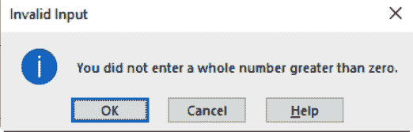

图 5.10 – 信息样式错误警报

使用以下步骤重新创建单元格 C10 中显示的规则：

+   1. 选择单元格 D9，然后选择 Data | Data Validation。
+   2. 从 Allow 列表中选择 Whole Number，从 Data 列表中选择 Greater than。
+   3. 在 Minimum 字段中输入 0（零）。
+   4. 激活 Input Message 选项卡，在 Title 字段中输入 Numeric Value，然后在 Input message 字段中输入 Enter a whole number greater than zero.。
+   5. 激活 Error Alert 选项卡，在 Title 字段中输入 Invalid Input，然后在 Error message 字段中输入 You did not enter a whole number greater than zero.。

> Tip
> 在这种情况下，错误警报应为信息性，因为用户可以单击 OK 来关闭错误提示。

+   6. 从 Style 列表中选择 Information，然后单击 OK。
+   7. 将 1.5 输入单元格 D10，按 Enter，然后单击 OK 以覆盖 Data Validation 规则。

让我们看看如何从一个或多个单元格中删除 Data Validation。

## Removing Data Validation

有几种方法可以有意删除 Data Validation，至少有一种意外方法。要有意删除 Data Validation，您需要执行以下步骤：

+   1. 选择一组单元格，例如 C12:C14，然后选择 Data | Data Validation。
+   2. 单击 Data Validation 对话框底部的 Clear All。
+   3. 单击 OK 关闭 Data Validation 对话框。

现在您可以将任何希望的数据输入这些单元格。

> Nuance
> Clear All 命令不会询问您是否确实要删除 Data Validation。
> 如果您单击 Clear All 然后改变主意，请单击 Cancel 而不是 OK 以保留 Data Validation。

第二种删除 Data Validation 的方法允许您在整个工作表上操作（如果您希望），如下所示：

+   1. 激活 Remove Data Validation 工作表。
+   2. 选择任何单元格，例如 A1，然后选择 Home | Find & Select | Data Validation。
+   3. Excel 选择应用了 Data Validation 规则的单元格，在此示例中为单元格 A2:A16 和 E2:E4，如图 5.11 所示。

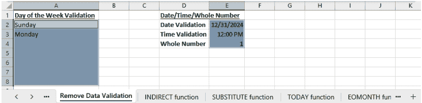

图 5.11 – 分配了 Data Validation 规则的多个单元格

+   4. 选择 Data | Data Validation。
+   5. 您在第 3 步中选择的单元格分配了多种类型的 Data Validation，因此 Excel 显示图 5.12 中所示的提示。单击 OK 以从所有选定的单元格中擦除 Data Validation，或单击 Cancel 以保留规则。

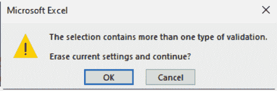

图 5.12 – 多个验证类型警告

## Implementing Data Validation rules

如您所见，**Data Validation** 规则限制用户可以在工作表单元格中输入的条目类型。本节将讨论您可以分配给工作表单元格的每个 **Data Validation** 规则。

### Any value

如前所述，**Any value** 意味着用户可以输入任何他们希望的值。如前一节中所示清除 **Data Validation** 规则会将单元格重置为允许任何值。工作表中的每个单元格默认均为 **Any value**。

### Whole Numbers

如前所述，**Whole Number** 规则限制用户将整数输入到单元格中。有效输入进一步受您从 **Data** 列表中所做选择的限制。

**Allow** 列表中的下一条规则是 **Whole Number**。

**Allow** 列表中的下一条规则是 **Decimal**。

现在我们已探索了 **Data Validation** 对话框，让我们逐一了解可以应用于工作表中单元格的各种规则。


## Decimal

如前所述，**Decimal** 规则适用于您希望允许数字输入但不一定将输入限制为仅整数的单元格。**Decimal** 规则接受您在 **Data** 列表中指定的约束以及随之出现的输入字段所满足的任何数字。

> Nuance
> 您必须在 **Data Validation** 对话框中使用小数值，例如 .10，但用户可以在工作表本身中输入小数或百分比，即 .10 或 10%。在 Excel 的大多数位置，值 .10 和 10% 是可互换的，但在 **Data Validation** 对话框中除外。

现在让我们看看如何使用 **Data Validation** 创建单元格内下拉列表。

## List

**List** 规则允许您将用户限制为从列表中进行选择，并在选中单元格时导致下拉箭头出现。您可以通过以下三种方式与列表交互：

+   - 使用鼠标单击 **图 5.13** 中显示的下拉箭头以显示列表。从列表中选择一个项目会将该值输入到工作表单元格中。

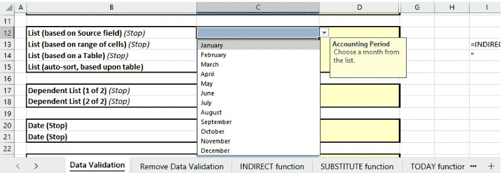

图 5.13 – 单元格内下拉列表

+   - 按 **Alt-Down** (**Option-Down**) 使用键盘显示列表，使用 **Down**（或 **Up**）箭头键浏览列表，然后在做出选择后按 **Enter**。

+   - 通过直接在工作表单元格中输入值来绕过下拉菜单，但请注意 **List** 规则区分大小写。如果您想从单元格 **C12** 中选择 **January**，则必须输入带大写 **J** 的 **January**，因为所有小写 **january** 都将被视为无效输入而被拒绝。

## Nuance

在旧版 Excel 中，单元格内下拉列表最多显示八个项目，然后需要滚动才能查看第九个项目及以后的项目。截至撰写本文时，Microsoft 正在对 List 规则进行测试版更新，该更新将显示屏幕上能容纳的尽可能多的选项，并在您输入时提供自动单元格内筛选，这使得在单元格中输入时更容易输入正确的数据。

列表可以嵌入到 Data Validation 对话框的 Source 字段中，或者您可以将列表存储在工作表单元格范围中。

## Storing a list in the Source field

现在让我们将所有 12 个月份的列表存储在 Data Validation 对话框中，步骤如下：

+   1. 单击 Data Validation 工作表中的单元格 D12，然后选择 Data | Data Validation。
+   2. 从 Allow 字段中选择 List，然后在 Source 字段中输入所有 12 个月份，用逗号分隔，如图 5.14 所示。Source 字段最多可包含 256 个字符，包括任何分隔符，例如逗号。

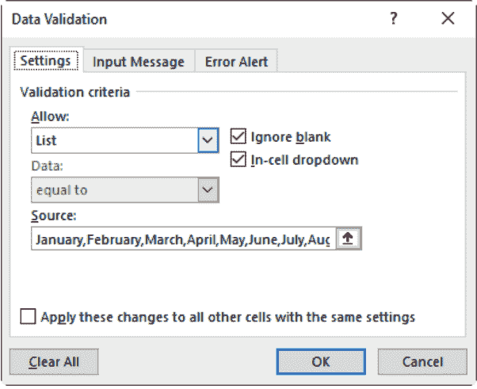

图 5.14 – Data Validation Source 字段


## 数据验证和表单控件

+   3. 激活 **输入消息** 选项卡，在 **标题** 字段中输入 `Accounting Period`，在 **输入消息** 字段中输入 `Choose a month from the list.`。

+   4. 激活 **错误警报** 选项卡，在 **标题** 字段中输入 `Invalid Input`，在 **错误消息** 字段中输入 `You must make a choice from the list. Inputs are case sensitive.`。

+   5. 单击 **OK** 关闭 **数据验证** 对话框。

> **细微差别**
> 
> 在 _第 9 章，Excel 的怪癖和细微差别_ 中，我讨论了 **输入** 模式与 **编辑** 模式，适用于 **数据验证** 对话框中 **源** 字段等字段。这意味着如果你在 **源** 字段中使用左箭头或右箭头键，你将插入工作表中的单元格引用。相反，如果你按 _F2_（某些键盘上为 _Fn_ + _F2_），你将切换到 **编辑** 模式，这允许你使用左箭头和右箭头键在字段中导航。

让我们现在看看你如何也可以使用 **源** 字段来引用存储在工作表中的列表。

## 在工作表单元格中存储列表

当你单击单元格 **C13** 中的下拉箭头时，你可以从出现在单元格 **H2:H6** 中的颜色列表中进行选择。以下步骤向你展示如何重新创建此规则：

+   1. 单击 **数据验证** 工作表中的单元格 **D13**，然后选择 **数据 | 数据验证**。

+   2. 从 **允许** 字段中选择 **列表**，然后在 **源** 字段中输入或选择 **H2 : H6**，如 _图 5.15_ 所示。

> **提示**
> 
> 当你选择一组单元格时，Excel 会添加美元符号 ($) 以创建绝对引用。如果你输入范围地址，可以包含美元符号，例如 `$H$2 : $H$6` 或简单地 `H2 : H6`。同样，你可以输入等号或省略它。

+   3. 填写 **输入消息** 和 **错误警报** 选项卡，然后单击 **OK** 关闭对话框。

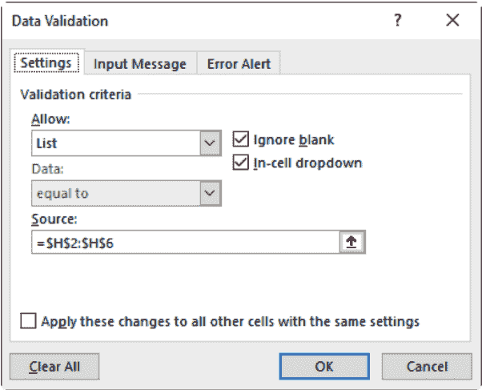

图 5.15 – 基于工作表的数据验证列表

你对单元格 H2:H6 所做的任何更改都会立即反映在单元格 C13 的下拉列表中。但是，你在单元格 H7 及以后添加的任何新颜色，直到你编辑源字段以包含新项目后才会出现，具体操作如下：

+   1. 在单元格 H7 中输入一种新颜色，例如 Brown。
+   2. 显示单元格 D13 中的下拉列表，并注意 Brown 不出现在列表中。
+   3. 选择 数据 | 数据验证，单击源字段，输入或选择 H2 : H7，然后单击 OK。
+   4. 显示单元格 D13 中的下拉列表，并注意 Brown 现在出现在列表中。

细微差别
一些用户尝试通过选择更大的范围（例如单元格 H2:H22）来尽量减少列表的调整大小，以允许扩展。这样做可能会导致数据验证列表底部出现一系列空白，这可能会让用户感到困惑。用户从列表底部选择的任何空白项都将被视为有效输入。

使列表自动扩展的更好方法是将列表转换为表格。

## 创建自动更新列表

单元格 **C14** 中的 **数据验证** 列表基于单元格 **J1:J6** 中的 **表格**，这使列表自动更新。要测试此功能，请执行以下步骤：

+   1. 显示单元格 **C14** 中的下拉列表，并注意列出的最后一种颜色是 **Green**。

+   2. 在单元格 **J7** 中输入 **Brown**，然后按 **Enter**。

+   3. 显示单元格 **C14** 中的下拉列表，并注意列出的最后一种颜色现在是 **Brown**。

以下步骤展示了如何创建基于 **表格** 的 **列表** 规则：

+   1. 单击 **L1:L16** 中的任何单元格。

+   2. 选择 **插入** | **表格** 或按 **Ctrl** + **T**（Excel for macOS 中为 ⌘ + **T**）。

+   3. 如果列表中的第一项是标题（例如单元格 **L1** 中的单词 **Colors**），请确保选中 **我的表格有标题** 复选框，然后单击 **OK**。

+   4. 选择单元格 **D14**，然后选择 **数据** | **数据验证**。

+   5. 从 **允许** 字段中选择 **列表**，然后在 **源** 字段中输入或选择 **L2 : L6**。除非你希望用户能够从列表中选择单元格 **L1** 中的列表标题，否则不要包含列表标题。

> > **细微差别**
> > 在 **第 7 章，使用表格功能自动化任务** 中，我讨论了将 **表格名称** 与 Excel 功能（如 **数据透视表**、**数据透视图**、图表等）配合使用。**数据验证** 功能不将 **表格名称** 视为有效引用，因此你必须选择 **表格** 中从第二个单元格到最后一个单元格的范围。

+   6. 完成 **输入消息** 和 **错误警报** 选项卡，然后单击 **OK**。

+   7. 在单元格 **L7** 中添加一种新颜色，例如 **Brown**。 **表格** 会自动扩展以包含最新项目。

+   8. 显示单元格 **D13** 中的下拉列表，并注意 **Brown** 出现在列表底部。

+   9. 你可以手动对 **表格** 进行排序，使项目按字母顺序排列，或者在 **Microsoft 365** 和 **Excel 2021** 中，你可以创建一个自动排序的自扩展列表。

## 创建自动更新列表

**数据验证** 工作表中单元格 **N2** 包含 `=SORT( Colors[Colors] )` 公式。这引用了从单元格 **J1** 开始的 **颜色表格**。 **SORT** 函数是一个动态数组函数，我在 **第 10 章，查找和动态数组函数** 中讨论过，简而言之，它会自动对你引用的数据进行排序，包括添加到 **表格** 中的其他数据。这使你能够创建一个自动排序的自动更新 **数据验证** 列表。

让我们先按以下方式测试此功能，然后我们将展示如何实现它：

+   1. 向 J 列中的列表添加一种新颜色。

+   2. 显示单元格 C15 中的下拉列表，并注意新颜色按字母顺序出现。

现在让我们按以下方式重新创建此功能：

+   1. 将单词 `Colors` 输入到单元格 P1 中。

+   2. 在单元格 P2 中输入 `=SORT(`，选择从单元格 J2 到 **表格** 底部的范围，关闭括号，然后按 `Enter`。这将创建 **数据验证** 将引用的动态列表。

+   3. 单击单元格 D15，然后选择 `Data` | `Data Validation`。

+   4. 从 `Allow` 字段中选择 `List`，在 `Source` 字段中输入 `P2#` 或单击单元格 P2，然后添加 **溢出范围运算符** (#)，这将创建可调整大小的单元格引用。正如我将在 _第 10 章，查找和动态数组函数_ 中讨论的那样，**溢出范围运算符** 仅在引用动态数组函数（例如 `SORT`）的结果时才可使用。

> Tip
> 如前所述，将 `Data Validation` 列表的源数据转换为表格可使列表自动更新。该技术适用于任何版本的 Excel。自动排序功能仅在 `Microsoft 365` 和 `Excel 2021` 中可用。

+   5. 完成 `Input Message` 和 `Error Alert` 选项卡，然后单击 `OK`。

+   6. 向 J 列添加一种新颜色，并注意单元格 D15 中的列表会自动扩展和排序。

我还想与你分享 `Data Validation` 列表的另一个维度，即创建一个次级列表，其选择取决于你从主列表中所做的选择。

## ##创建依赖列表

示例工作簿不包含此技术的演示，但我将引导你完成步骤。我们将使用 `Names` 和 `INDIRECT` 和 `SUBSTITUTE` 工作表函数，在单元格 `D18` 中创建一个依赖列表，该列表将由你在单元格 `D17` 中所做的选择驱动。我在 _第 11 章，LET 和 LAMBDA_ 中详细讨论了 `Names`，因此我不会在此处深入介绍。让我们先分配 `Names`。

## ##分配名称

创建依赖列表要求主列表中的每个项目都分配了 `Name`，具体操作如下：

+   1. 选择单元格 `R2:R4`，然后选择 `Formulas` | `Define Name`。


### 数据验证和表单控件

2. 键入 Recommended_for_promotion，如图 5.16 所示，然后单击“确定”。

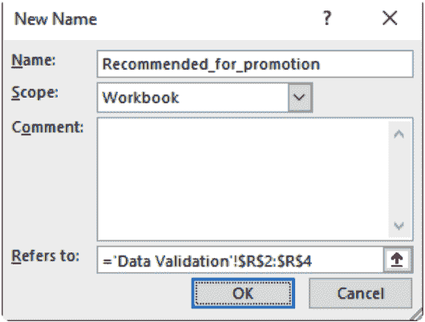

图 5.16 – “新建名称”对话框

> **提示**
> 名称不能包含空格，因此请确保在每个单词之间放置下划线。另外，请务必仔细检查拼写；否则，此技术将不起作用。名称不区分大小写。

3. 选择单元格 S2:S4，然后选择“公式”|“定义名称”。
4. 键入 Not_recommended_for_promotion，然后单击“确定”。

让我们现在来了解 INDIRECT 函数。

### INDIRECT 函数

INDIRECT 函数工作表中单元格 C3 包含 =INDIRECT(B3) 公式，如图 5.17 所示。当你在单元格 B3 中键入 F13 并按 Enter 键时，单元格 C3 将返回 December。这与键入 =F13 的工作方式相同，但区别在于，如果要引用 May，你需要将 =F13 替换为 =F6，而 INDIRECT 允许你在单元格 B3 中键入 F6。在此上下文中，INDIRECT 将单元格 B3 中的文本转换为有效的单元格引用。

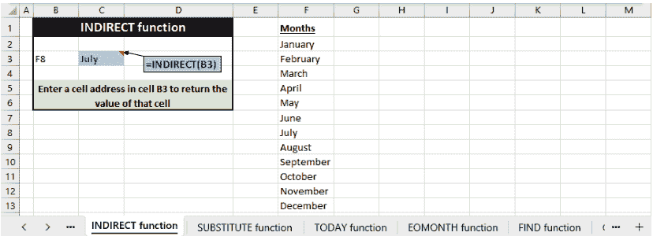

图 5.17 – INDIRECT 函数

INDIRECT 函数有以下两个参数：

- Ref_text: 你想要转换为单元格引用或 **名称** 的文本。
- A1: 一个可选参数，用于指定 TRUE 表示 **A1 引用** 样式，或 FALSE 表示 **R1C1 引用** 样式。在我们的示例中，我们将省略此参数，因为我们想要使用默认样式，即根据列字母和行号引用单元格，例如 **B3**，而不是 **R1C1** 引用样式 R3C2（表示第三行第二列）。

INDIRECT 将使我们能够动态引用两个依赖列表的名称。现在让我们看看如何使用 SUBSTITUTE 函数将空格替换为下划线。

### SUBSTITUTE 函数

如图 5.18 所示，单元格 **D4** 包含 =SUBSTITUTE(B4," ","_") 公式，该公式将单元格 **B4** 中的任何空格替换为下划线。

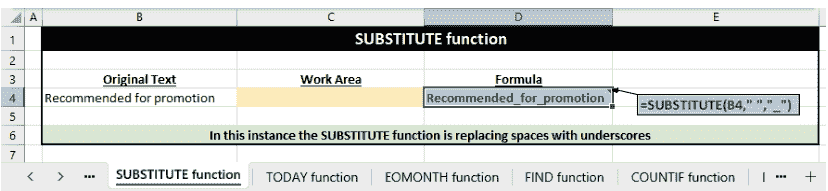

图 5.18 – SUBSTITUTE 函数

SUBSTITUTE 函数有以下四个参数：

- Text: 要搜索的文本。
- Old_text: 你希望删除的现有文本。
- New_text: 你希望用来替换的文本。
- Instance_num: 此可选参数允许你指示要替换的 old_text 的特定实例。单元格 D4 中的公式省略了此参数。

有了这些背景知识，现在让我们创建依赖的数据验证列表。

### 组装列表

让我们按照以下步骤创建主列表和次列表：

1. 单击数据验证工作表中的单元格 D17，然后选择“数据”|“数据验证”。
2. 在“允许”字段中选择“列表”，然后在“来源”字段中输入或选择 R1 : S1，如图 5.19 所示。

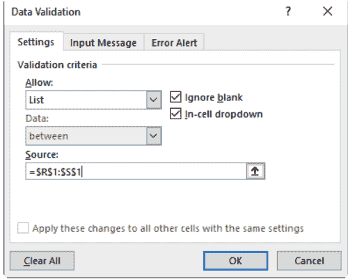

图 5.19 – 基于行的数据验证列表来源

3. 完成“输入消息”和“错误警报”选项卡，然后单击“确定”。
4. 选择单元格 D18，然后选择“数据”|“数据验证”。
5. 在“允许”字段中选择“列表”，然后在“来源”字段中输入 =INDIRECT(SUBSTITUTE($D$17,"","_"))，如图 5.20 所示。

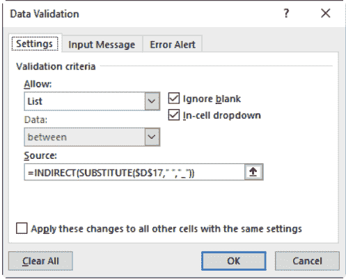

图 5.20 – INDIRECT/SUBSTITUTE 函数

6. 完成 **“输入消息”** 和 **“错误警报”** 选项卡，然后单击 **“确定”**。

单元格 **D18** 中可用的选项现在取决于你在单元格 **D17** 中做出的选择。

> 细微差别
> 如果你将单元格 **D17** 设置为 *Recommended for promotion*，并在 **D18** 中做出选择，但随后将单元格 **D17** 更改为 *Not recommended for promotion* 而不更新 **D18**，则无效条目可能会保留在单元格 **D18** 中。你可以在自定义 **条件格式** 规则中输入 =ISNA(MATCH(D17,INDIRECT(SUBSTITUTE(D17," ","_")),0)) 公式，以便当单元格中的条目未出现在相应列表时，单元格 **D18** 会改变颜色。我们分别在 *第 4 章，条件格式* 和 *第 10 章，查找和动态数组函数* 中讨论 **条件格式** 和 MATCH 函数。

现在让我们看看如何使用 **日期** 规则。

### 日期

**日期** 规则要求用户在使用该规则的单元格中输入日期。例如，**数据验证** 工作表中单元格 **C20** 的有效输入是 2024 年 1 月 1 日至 2024 年 12 月 31 日之间的任何日期。以下步骤展示了如何重新创建此功能：

1. 选择单元格 **D20**，然后选择 **“数据”|“数据验证”**。
2. 从 **“允许”** 列表中选择 **日期**，然后从 **“数据”** 列表中选择 **介于**。
3. 在 **“开始日期”** 字段中输入 `1/1/2024`，在 **“结束日期”** 字段中输入 `12/31/2024`。
4. 完成 **“输入消息”** 和 **“错误警报”** 选项卡，然后单击 **“确定”**。

你还可以使用 TODAY 和 EOMONTH 等函数创建动态验证规则。

### TODAY 函数

**TODAY 函数** 工作表中单元格 **C3** 的 `=TODAY()` 公式返回当前日期。此函数没有任何参数，**NOW** 函数（在单元格 **C4** 中）也没有任何参数，它返回当前日期和时间。除非你将日期与 NOW 函数的结果进行比较，否则 TODAY 和 NOW 通常可以互换——NOW 返回的表示当前时间的小数部分可能会导致比较失败。

现在让我们看看如何使用 EOMONTH。

### EOMONTH 函数

**EOMONTH 函数** 工作表中单元格 **D4** 的 `=EOMONTH(C4,0)` 公式返回 **12/31/2024**，因为单元格 **C4** 包含 **12/1/2024**。EOMONTH 是 _end of month_ 的缩写，具有以下两个参数：

- **Start_date**: 静态日期或计算日期。
- **Months**: 你想要计算月末日期的未来或过去的月份数。例如，使用 `0` 表示当前月，`1` 表示下个月的最后一天，`-1` 表示上个月的最后一天，依此类推。

现在让我们使用 TODAY 和 EOMONTH 创建动态 **数据验证** 规则。

### 基于公式的日期规则

**数据验证** 工作表中单元格 **C21** 要求输入大于或等于下个月第一天的日期。以下步骤展示了如何重新创建此功能：

1. 单击单元格 **D21**，然后选择 **“数据”|“数据验证”**。
2. 从 **“允许”** 列表中选择 **日期**，从 **“数据”** 列表中选择 **大于**。
3. 在 **“开始日期”** 字段中输入 `=EOMONTH(TODAY(),0)` 公式，如 **图 5.21** 所示。
4. 完成 **“输入消息”** 和 **“错误警报”** 选项卡，然后单击 **“确定”**。

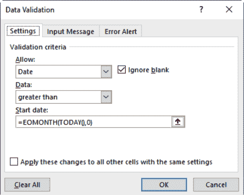

图 5.21 – 动态日期规则

细微差别
使用日期输入时，请特别注意是要使用 **大于** 还是 **大于或等于**。例如，如果你将 `=EOMONTH(TODAY(),0)+1` 与 **大于** 规则一起使用，则用户将无法将某月的第一天作为有效选项输入。相反，**大于或等于** 在这种情况下会起作用，因为将 1 加到 EOMONTH 计算结果上会返回下个月的第一天。

这使我们进入 **时间** 规则。

### 时间

**数据验证** 工作表中单元格 **C23** 要求输入介于 `8:00 AM` 和 `5:00 PM`（`08:00` 到 `17:00`）之间的时间。以下步骤展示了如何重新创建此功能：

1. 选择单元格 **D23**，然后选择 **“数据”|“数据验证”**。
2. 从 **“允许”** 列表中选择 **时间**，并在 **“数据”** 列表中接受默认的 **介于**。
3. 在 **“开始时间”** 字段中输入 8:00 AM（或 08:00），在 **“结束时间”** 字段中输入 5:00 PM（或 17:00），如图 5.22 所示。

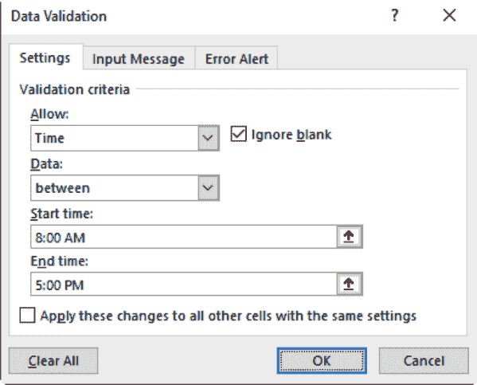

图 5.22 – 时间限制规则

提示
Excel 还将 8 a 和 5 p 等输入识别为有效的时间输入。8 和 17 等输入无效。

4. 完成 **“输入消息”** 和 **“错误警报”** 选项卡，然后单击 **“确定”**。

细微差别
12:00 PM 及以后的时间值比较棘手。如果你在单元格 C16 中输入 3:00，Excel 会将该输入解释为 3:00 AM，并显示错误警报。在完成 **“输入消息”** 和 **“错误警报”** 选项卡时，请提醒用户在其时间输入中包含 AM 或 PM，以避免沮丧。

这使我们进入 **文本长度** 规则，该规则控制单元格中可以出现的字符数。


### 文本长度

数据验证工作表中 C25 单元格允许输入最多 10 个字符。要重现此功能，请执行以下步骤：

1. 选择 D23 单元格，然后选择“数据 | 数据验证”。
2. 在“允许”列表中选择“文本长度”，然后在“数据”列表中选择“小于或等于”。
3. 在“最大值”字段中输入 10，如图 5.23 所示，完成“输入消息”和“错误警报”选项卡，然后单击“确定”。

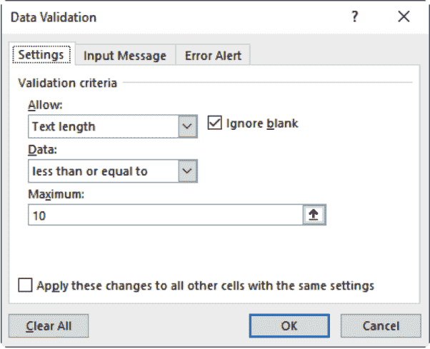

图 5.23 – 文本长度限制

> 注意
> 此规则最适合仅允许输入少量字符的情况，因为屏幕上没有反馈显示用户已输入了多少个字符。例如，如果将限制设置为小于或等于 50 个字符，用户很难知道自己输入了多少个字符。一种解决方案是先将文本输入到任何空白单元格中，例如本例中的 H25，然后使用 =LEN(H25) 公式返回字符数。

### 自定义规则

自定义数据验证规则允许您编写公式，以确定用户在单元格中是否进行了有效输入。自定义规则中使用的公式必须计算结果为 TRUE 或 0（零），输入才被视为有效。计算结果为 FALSE、1、错误（如 #N/A 和 #VALUE）等的公式为无效输入，并将触发“错误警报”提示。让我们使用 FIND 创建一条要求按“姓氏，名字”顺序输入姓名的规则，然后使用 COUNTIF 创建一条防止重复输入的自定义规则。

#### FIND 函数

FIND 函数工作表中 D4 单元格包含 =FIND(",",B4) 公式，该公式返回 10，因为 B4 单元格包含 Ringstrom, David，如图 5.24 所示。这意味着在 B4 单元格的第 10 个位置找到了逗号。相反，D5 单元格中的 =FIND(",",B5) 公式返回 #VALUE!，因为 B5 单元格包含 David Ringstrom，不包含逗号。

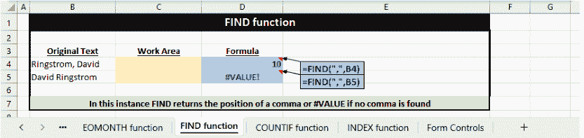

FIND 函数具有以下三个参数：

- Find_text：要搜索的文本
- Within_text：要被搜索的文本
- Start_num：可选的起始位置，用于在文本中开始搜索

该函数返回找到 find_text 的位置，或返回 #VALUE! 以指示找不到 find_text。

让我们现在来看看 COUNTIF 函数。

### COUNTIF 函数

COUNTIF 函数工作表中 E3 单元格包含 =COUNTIF($B$3:$B$11,D3) 公式，该公式返回 3，因为 D3 单元格中的值在 B3:B11 单元格中出现了三次，如图 5.25 所示。

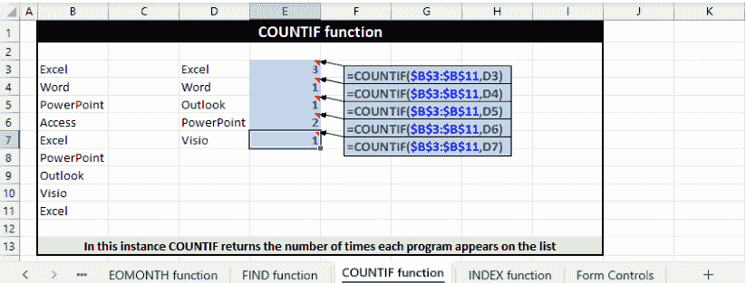

图 5.25 – COUNTIF 函数

COUNTIF 函数具有以下参数：

- Range：两个或多个单元格的地址，用于计算特定项目出现的次数
- Criteria：您希望计算其在单元格范围内出现次数的项目

让我们现在将 FIND 函数应用于数据验证规则中。

### 按姓氏，名字顺序输入姓名

数据验证工作表中 C27 单元格包含一条规则，要求您按姓氏，名字顺序输入姓名。以下步骤展示了如何重现此规则：

1. 选择数据验证工作表中 D27 单元格，然后选择“数据 | 验证”。
2. 在“允许”列表中选择“自定义”，并在“公式”字段中输入 =FIND(",",D27)，如图 5.26 所示。

图 5.26 – 姓氏，名字数据验证规则

3. 完成“输入消息”和“错误警报”选项卡，然后单击“确定”。

**注意**

在创建此类规则时，最好在单元格中放置占位符文本，同时编写规则。例如，如果您将 D27 单元格留空，并使用 =FIND(",",D27) 公式创建自定义规则，Excel 将显示一条提示，指出 **此公式当前计算结果为错误。是否要继续？** 这可能会使您难以确定公式中是否存在实际错误，或者此提示是因为单元格为空而出现。

#### 防止重复输入

数据验证工作表中 C29:C33 单元格包含一条规则，防止在工作表的此部分输入重复值。以下步骤展示了如何设置此类规则：

1. 选择 D29:D33 单元格，然后选择“数据 | 验证”。
2. 在“允许”列表中选择“自定义”，然后在“公式”字段中输入 =COUNTIF($D$29:$D$33,D29)=1，如图 5.27 所示。

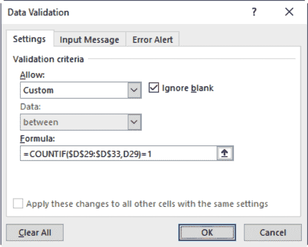

图 5.27 – 防止重复输入规则

完成“输入消息”和“错误警报”选项卡，然后单击“确定”。

在第 4 章“条件格式”中，我向您展示了如何对列表中的重复项进行颜色编码。您可以将该功能与数据验证配对，以实时识别和阻止重复输入。在此示例中，COUNTIF 确定单元格值在 D29:D33 中出现的次数。如果结果不是 1，数据验证将显示“错误警报”提示；否则，输入将被接受，不会出现问题。在此上下文中，空白单元格不会被评估。

> 注意
> 请密切关注 =COUNTIF($C$19:$C$23,C19)=1 中绝对引用与相对引用的区别。请注意，公式中的范围部分是绝对引用。如果省略 $ 符号，则数据验证将在每一行使用不同的范围，这会导致数据验证限制无法正确工作。相反，请确保在条件中不使用任何 $ 符号；否则，该单元格将被用作所有其他单元格的输入，这同样可能导致规则出现故障。

现在我们已经从各个角度探索了数据验证，让我们看看如何保护您在电子表格中实现的规则。

### 保护数据验证单元格

数据验证的一个缺点是，用户可以通过复制和粘贴，有意或无意地从单元格中删除规则。Excel 不会询问“您确定吗？”，它只是简单地擦除任何数据验证设置。以下步骤展示了如何保护您的数据验证规则：

1. 选择数据验证工作表中的任何单元格，然后选择“开始 | 查找和选择 | 数据验证”，以选择所有分配了数据验证规则的单元格。
2. 按 Ctrl+1（⌘+1）或选择“开始 | 格式 | 设置单元格格式 | 保护”。
3. 如图 5.28 所示，取消选中“锁定”复选框，然后单击“确定”。

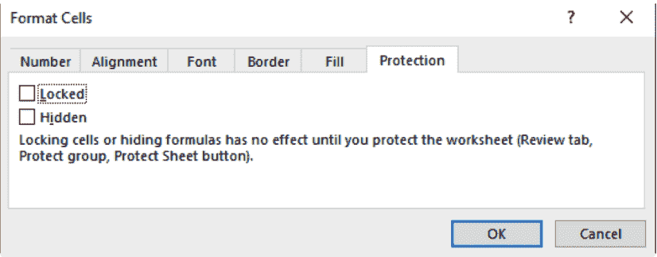

图 5.28 – 解锁单元格

4. 选择“审阅 | 保护工作表”，可选输入并确认密码，然后单击“确定”。

> 提示
> 您必须使用“保护工作表”命令来保护数据验证设置。解锁单元格只是一个前置步骤，单独使用并不提供任何保护。

这为您的数据验证设置提供了部分保护，因为用户无法通过将数据粘贴到单元格中来擦除规则，尽管无效输入仍会被粘贴。

### 审核数据验证单元格输入

Excel 中的“圈出无效数据”命令使您能够识别用户通过将信息粘贴到单元格中而绕过数据验证设置的单元格。以下步骤展示了如何执行审核：

1. 选择“审阅 | 取消保护工作表”，并在必要时输入密码以取消保护工作表。
2. 选择“数据 | 数据验证下拉菜单 | 圈出无效数据”，如图 5.29 所示。

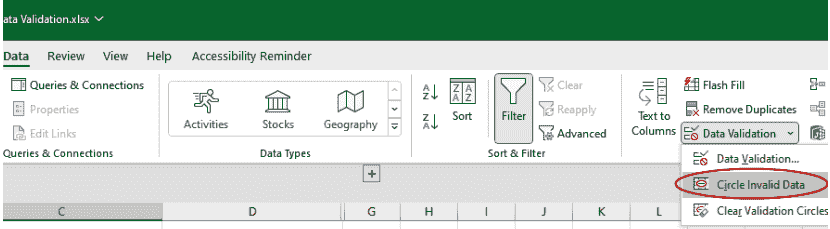

图 5.29 – “圈出无效数据”命令

红色圆圈将出现在用户输入无效数据的任何单元格周围。如果所有单元格都符合要求，则不会提供反馈。但请记住，当您保存文件或选择“数据 | 数据验证下拉菜单 | 清除验证圆圈”时，红色圆圈会消失。

现在您了解了数据验证的局限性，让我们探索一种更强大的替代方案，即表单控件。我们首先需要取消隐藏 Excel 功能区中的隐藏选项卡。

### 启用“开发人员”选项卡

Excel 屏幕顶部的菜单称为功能区。如您可能已注意到，某些选项卡会根据上下文在功能区中出现和消失。例如，当您单击工作簿中的表格时，会出现“表设计”选项卡，而当您单击不属于表格的任何单元格时，它会消失。隐藏的“开发人员”选项卡具有与创建宏、处理 XML 文件和创建表单控件相关的命令。如果您希望创建表单控件，则必须启用“开发人员”选项卡，具体步骤如下：

1. 选择“文件 | 选项 | 自定义功能区”。


### 2. 单击右侧的“开发者”复选框，如图 5.30 所示，然后单击“确定”。

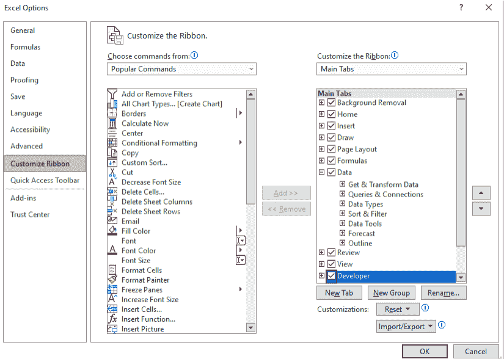

图 5.30 – 启用“开发者”选项卡

现在，您已在 Excel 功能区中启用了 **开发者** 选项卡，当需要额外控制或不同的交互性时，我们可以比较 **窗体控件** 与 **数据验证**。

### 探索窗体控件

**窗体控件** 是您可以用来为 Excel 工作表添加交互性的对象。与 **数据验证** 不同，用户无法通过粘贴数据来绕过 **窗体控件**。图 5.31 显示了 **开发者 | 插入** 命令，并展示了三种可用的 **窗体控件** 类型。

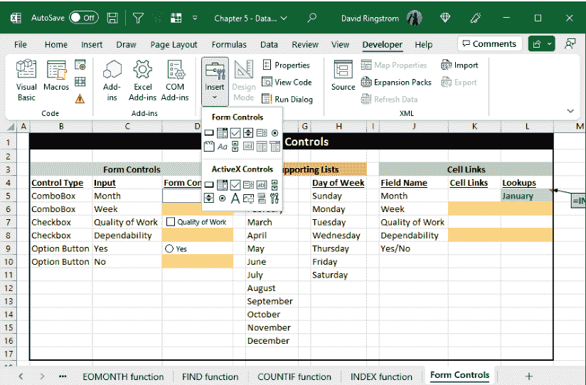

图 5.31 – 插入命令和窗体控件

我将演示以下 **窗体控件**：

- 单元格 D5 中的组合框
- 单元格 D7 中的复选框
- 单元格 D9 中的选项按钮

我没有空间深入探讨 **窗体控件**，但掌握前面提到的三种类型将使您很好地了解 **窗体控件** 的工作原理。

> 注意
> 如图 5.31 所示，Excel 提供了 **窗体控件** 和 **ActiveX 控件**。
> 通常，**窗体控件** 将使您能够创建所需的交互性。**ActiveX 控件** 类似但更复杂。例如，您必须在 **开发者** 选项卡上启用 **设计模式** 才能使用 **ActiveX 控件**，并单击 **属性** 命令以显示与控件相关的设置面板。此外，**ActiveX 控件** 无法在 Excel for macOS 中显示。

### INDEX 函数

INDEX 函数工作表中单元格 C4 包含公式 =INDEX($E$4:$E$7, B4)，该公式返回 Summer，因为单元格 B4 包含 3，如图 5.32 所示。这意味着 INDEX 函数正在从单元格 E4:E7 中返回第三个值。单元格 C5 包含公式 =INDEX($E$4:$E$7, B5)，该公式返回 #REF!，因为 E4:E7 是一个四单元格范围，而 B5 包含 5。从四单元格范围中返回第五个值是不可能的。

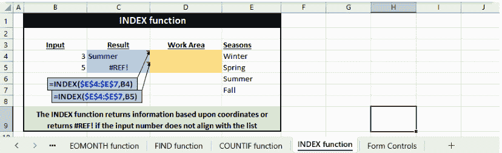

我在第 10 章“查找和动态数组函数”中更详细地讨论了 INDEX 函数，特别是它如何经常与 MATCH 函数配对使用。在此上下文中，我们不需要 MATCH，因为我们的窗体控件将提供一个位置号码。

现在让我们创建一个组合框，它的功能类似于数据验证列表。

### 组合框窗体控件

组合框是数据输入字段和下拉列表的组合。问题是您不能直接在字段本身中键入；您必须从列表中进行选择。这会让依赖键盘快捷键的用户感到沮丧，因为访问组合框需要鼠标或触摸屏。

窗体控件工作表中的单元格 D5 有一个与单元格 G5:G16 中的列表关联的组合框。当您单击下拉箭头时，请注意，您可以看到列表中的所有 12 个月，而无需像旧版 Excel 中的数据验证那样滚动。您所做选择的位置存储在单元格 L5 中，公式 =@INDEX(F5:F16, K5) 返回您选择的月份名称。

### 注意

@ 符号在 Excel 中被称为隐式交点运算符。我在公式中包含它，因为在 Microsoft 365 和 Excel 2021 中，当单元格 K5 为空白时，INDEX 函数将在单元格 L5:L16 中显示所有 12 个月，或者返回 #SPILL! 错误。@ 符号指示 Excel 始终显示数组中的第一个项目，该项目将是一月，或者列表中与组合框返回的索引号对应的项目。在 Microsoft 365 和 Excel 2021 中，INDEX 现在是一个动态数组函数，可以返回多个值。我在第 10 章中更详细地讨论了动态数组的概念。

现在让我们根据单元格 H5:H11 创建一个组合框，以便您了解该过程，具体步骤如下：

1. 选择开发者 | 插入，然后选择组合框控件，它是窗体控件部分第一行中的第二个图标，如图 5.31 所示。
2. 按住鼠标左键并在单元格 D6 中拖动一个矩形以创建组合框。

#### 提示

如果您的鼠标失去控制，屏幕上可能会出现一个大箭头。如果发生这种情况，请右键单击箭头，然后用鼠标抓住控点将箭头拉成类似单元格 D5 的组合框。在 Excel for Windows 中，您可以在单元格内拖动时按住 Alt 键，使组合框与底层工作表单元格的大小完全对齐。不幸的是，Excel for macOS 中没有等效的键。

3. 右键单击组合框，选择“设置控件格式” | “保护”，然后取消选中“锁定”。如果不这样做，当您保护工作表时，窗体控件将在屏幕上冻结。
4. 激活“控制”选项卡，然后在“输入区域”字段中输入或选择 H5 : H11，如图 5.33 所示。

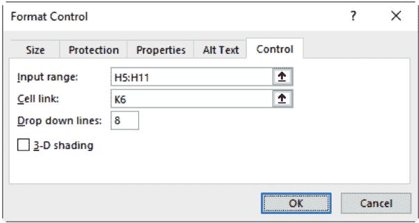

图 5.33 – “设置控件格式”对话框

5. 在“单元格链接”字段中输入或选择 K6。
6. 可选：如果需要，请调整“下拉行数”字段。
7. 单击“确定”。
8. 单击 D6 以外的任何单元格以取消选择组合框，然后注意当您从组合框中做出选择时，单元格 K6 中会出现一个位置号码。
9. 在单元格 L6 中输入 =@INDEX (H5 : H11 , K6 ) 以返回您选择的星期名称。

> 提示
> 通常最好将单元格链接存储在与窗体控件不同的工作表中，以便在编辑表单时不会意外破坏单元格。如果单元格链接位于您将要保护的工作表上，请确保取消保护单元格链接单元格；否则，当您尝试使用窗体控件时会遇到错误，因为 Excel 无法更新锁定的单元格。如果您不清楚如何解锁单元格，请参阅“保护数据验证单元格”部分。

如您所见，组合框控件类似于数据验证列表，但无法通过向其中粘贴数据来覆盖。现在让我们看看如何向工作表添加复选框和选项按钮。

### 复选框和选项按钮

复选框和选项按钮允许用户在电子表格中进行选择。用户可以勾选任意数量的复选框，而选项按钮（有时称为单选按钮）允许在一组中进行单一选择。让我们比较复选框和选项按钮之间的区别。

### 创建复选框

窗体控件工作表中单元格 D7 包含一个与单元格 K7 链接的复选框。当您单击复选框时，Excel 会在单元格 K7 中放置单词 TRUE。如果您再次单击复选框，Excel 会放置单词 FALSE。如果您想重置复选框，只需擦除单元格 K7 即可。

现在让我们看看如何将复选框添加到单元格 D8，具体步骤如下：

1. 选择开发者 | 插入，然后单击复选框命令，它是窗体控件下第一行中的第三个命令，如图 5.31 所示。
2. 单击单元格 D8 以创建复选框。
3. 如果需要，右键单击复选框以显示外部的控点，然后使用箭头键将复选框移动到所需位置。

### 创建选项按钮

窗体控件工作表中单元格 D9 包含一个与单元格 K9 链接的选项按钮。当您单击选项按钮时，Excel 会在单元格 K9 中放置数字 1。在添加另一个选项按钮之前，清除此选项的唯一方法是擦除单元格 K9。

现在让我们按以下步骤添加第二个选项按钮：

1. 选择开发者 | 插入，然后单击复选框命令，它是窗体控件下第一行中的第三个命令，如图 5.31 所示。
2. 单击单元格 D10 以创建选项按钮。
3. 如果需要，右键单击选项按钮以显示外部的控点，然后使用箭头键将控件移动到所需位置。
4. 当控点存在时，单击一次文本并进行任何编辑，例如输入 No。如果您只想要一个选项按钮而不是选项按钮和标签，请删除所有文本。
5. 右键单击复选框并选择“设置控件格式” | “保护”选项卡并取消选中“锁定”复选框。
6. 激活“控制”选项卡，并注意“链接单元格”已设置为 K9，因为选项按钮会自动共享同一个链接单元格，然后单击“确定”。
7. 单击 D10 以外的任何单元格以取消选择选项按钮，然后单击单元格 D10 中的选项按钮。数字 2 应该出现在单元格 K9 中，表示您选择了第二个选项按钮。

如果您希望在工作表中拥有一组以上的选项按钮，则需要在选项按钮周围放置一个组框窗体控件，以便 Excel 知道哪些按钮构成一组。组框控件出现在开发者 | 窗体控件下。


### 管理表单控件

由于 **表单控件** 浮动在工作表之上，如果你愿意，可以选择暂时隐藏它们，具体操作如下：

1. 选择 **开始** | **查找和选择** | **选择窗格**。
2. 在 **选择** 任务窗格中，单击任意对象右侧的图标以将其隐藏，如图 5.34 所示。该图标是一个切换开关，因此你可以以同样的方式取消隐藏对象。此外，你可以双击 **选择** 窗格中对象的名称，并为其提供一个更有意义的名称，以便更好地跟踪工作表中的各种对象。

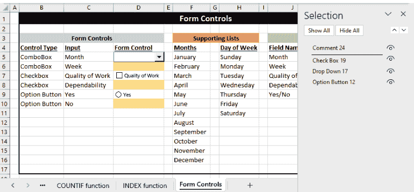

或者，你可以使用 **选择** 窗格顶部的 **全部隐藏** 和 **全部显示** 命令，批量隐藏或显示浮动对象。

> **细微差别**
> **选择窗格** 允许你显示或隐藏任何浮动在工作表之上的对象，包括但不限于 **数据透视图**、图表、文本框、切片器、形状以及任何其他浮动在工作表之上的对象。

由于 **表单控件** 浮动在工作表之上，它们很容易相互错位，但你可以按照以下方法将它们组合在一起：

1. 选择 **开始** | **查找和选择** | **选择对象**，然后单击任意表单控件。
2. 按住 _Ctrl_ 键（⌘），并选择任意数量的其他 **表单控件**。
3. 右键单击任意表单控件，并选择 **组** | **组合**。

现在，你可以将控件在工作表中批量移动，并保持它们之间的对齐方式和间距。如果你想编辑其中任何控件，则需要取消组合。具体操作是：右键单击组中任意控件，并选择 **组** | **取消组合**。如你所见，表单控件超越了数据验证。由于表单控件浮动在工作表之上，因此更难跟踪用户使用表单控件所做的选择，但设置单元格链接控件可以让你跟踪所做的选择。

### 摘要

在本章中，你学习了如何使用数据验证来限制用户在特定工作表单元格中的响应。你可以建立的默认规则包括整数、小数、列表、日期、时间和文本长度。如你所见，你还可以创建自定义规则，以建立你可能需要的任何类型的限制。

数据验证是一个不完美的功能，用户可以通过将数据粘贴到包含验证规则的单元格来绕过它。此外，你应用数据验证的单元格中已有的任何数据都不受规则约束。幸运的是，你可以通过让 Excel 在无效输入周围绘制红圈来审核数据验证条目。

最后，你了解到表单控件提供了数据验证的替代方案，它创建了用户无法通过粘贴数据来绕过的限制。简而言之，数据验证和表单控件都是关于为电子表格添加交互性。

在下一章中，你将了解如何在 Excel 中使用假设分析工具，为你的电子表格提供其他形式的交互性和自动化。

### 假设分析

许多用户不了解 Excel 中的 **假设分析** 功能，这些功能可以用于以自动化的方式找到问题的答案。我将首先向你展示如何使用 **情景管理器** 功能来备份关键输入并比较不同输入集的结果。然后，我将使用 **目标求值** 功能来自动求解计算中缺失的输入。之后，我将向你展示 **数据表** 功能如何简化那些通常需要用户重写公式以处理各种输入的情况，例如比较在两种不同利率和贷款期限下的抵押贷款付款额。我们将使用 **预测工作表** 功能将金额预测到未来，最后简要介绍 Excel 的 **求解器** 功能。

在本章中，我们将涵盖以下主要主题：

- PMT 函数
- CUMIPMT 函数
- CUMPRINC 函数
- **情景管理器** 功能
- **目标求值** 功能
- **数据表** 功能
- **预测工作表** 功能
- **求解器** 功能的简要介绍

本章结束时，你应该能够更好地理解 Excel 中的假设分析功能如何消除电子表格中的猜测和重复操作。在某些情况下，CUMIPMT 和 CUMPRINC 函数可能使你能够消除或验证在电子表格中使用的摊销表。你将看到 **目标求值** 是反向工作以提供缺失的输入，而 **求解器** 可以正向或反向工作。**数据表**、**预测工作表** 和 **情景管理器** 功能也可以帮助你展望未来。

### 技术要求

本章中我讨论的所有内容都适用于任何当前版本的 Excel，但 **预测工作表** 功能除外，该功能需要 **Excel 2016** 或更高版本的 Windows 版本。该功能在 Excel for macOS 或 **Excel for the Web** 中不可用。但是，你可以在 macOS 和在线版本中查看在 **Excel for Windows** 中创建的 **预测工作表**。

包含本章中使用的所有公式以及供你尝试我讨论的功能的工作区的示例工作簿，可以在 GitHub 上找到，网址为 `https://github.com/PacktPublishing/Exploring-Microsoft-Excels-Hidden-Treasures/tree/main/Chapter6`。

让我们先来看一个工作表函数，它使你能够计算贷款付款金额。在本章中，我们将在处理各种假设分析场景时使用此函数和其他函数。

### PMT 函数

如图 6.1 所示，**PMT-CUMIPMT 函数** 工作表中单元格 **C6** 的 `=-PMT(C3/12,C4*12,C5)` 公式返回 **$578.57** 作为每月付款额，用于偿还 4 年期、利率为 5.25% 的 $25,000 贷款：

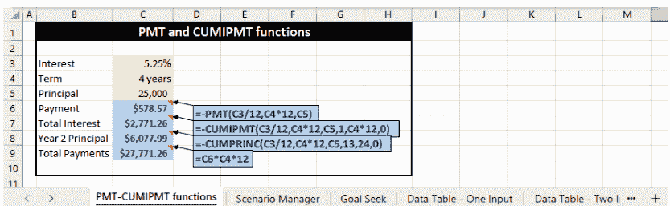

图 6.1 – PMT、CUMIPMT 和 CUMPRINC 函数

在介绍 PMT 函数之前，让我分享一个我在单元格 **C4** 中显示单词 **years** 的技巧。从视觉上看，你在单元格中看到 **4 years**，但如果你查看公式栏，只会出现数字 **4**。这是因为我使用了自定义数字格式来添加单词 **years**。这是一种在同一单元格中显示文本和数字，同时保持单元格为数字输入的方法。具体操作如下：

1. 选择要格式化的单元格，在此例中为单元格 **C4**。
2. 选择 **格式 | 设置单元格格式** 或按 _Ctrl + 1 (_⌘_+ 1 在 Excel for macOS 中)_。
3. 在 **数字** 选项卡上选择 **自定义**。
4. 在 **类型** 字段中输入 `0 " years"`。在此例中，`0` 表示我们的数字输入，而引号中的任何内容也会在单元格中视觉上出现，但不会成为单元格内容的一部分。
5. 单击 **确定** 以关闭 **设置单元格格式** 对话框。

> Nuance
> PMT 函数始终假设贷款付款是流出，因此结果始终为负数。通常，我在公式中在 PMT 前加上负号，以返回正数。

PMT 函数有三个必需参数和两个可选参数：

- **Rate**：此必需参数指定贷款的利率，在此例中，为单元格 C3 中的 5.25% 除以 12，因为我们计算的是每月贷款付款。
- **Nper**：此必需参数指定贷款的期数，在此例中，为单元格 C4 中的 4 乘以 12 或 48 个月。
- **Pv**：此必需参数的名称是现值的缩写，因为金钱随时间贬值，但也称为贷款金额或本金，来自单元格 C5，在此例中为 $25,000。
- **Fv**：此可选参数的名称是 **未来值** 的缩写，用于期末有 balloon payment 的贷款。在此例中，未提供 `fv`，因为贷款将在四年内全部付清。
- **Type**：此可选参数默认为 `0`，表示贷款期末付款，或者你可以指定 `1` 表示贷款期初付款；在此例中，付款是在每个贷款期末进行的。

现在，让我们计算整个贷款期间支付的利息。

### CUMIPMT 函数

如图 6.1 中单元格 **C7** 的 `=-CUMIPMT(C3/12,C4,C5,1,C4,0)` 公式所示，返回 2,771.26 作为利率为 5.25% 的 $25,000 贷款在四年内偿还的应付利息。

CUMIPMT 函数有六个必需参数：

- **Rate**：贷款的利率，在此例中，为单元格 C3 中的 5.25% 除以 12 以创建每月利率。
- **Nper**：贷款的期数，在此例中，为单元格 C4 中的 4 年乘以 12 或 48 个月。


### What-if Analysis

- **Pv**: 此参数名是 **present value** 的缩写，因为金钱会随时间贬值，但也称为来自单元格 C5 的贷款金额或本金，在此例中为 $25,000。
- **Start_period**: 贷款中开始计算应付利息的期间编号——这不是日期，而是期间编号，例如，1 表示贷款中的第一个期间。
- **End_period**: 用于计算利息金额的期间编号，在此例中为来自单元格 C4 乘以 12 的 4，即第 48 个月。
- **Type**: 与 PMT 函数不同，您 **必须** 指定 0 表示贷款期末付款，或 1 表示贷款期初付款；在此例中，0 表示每期期末付款。此参数在 PMT 中是可选的。

单元格 C8 中 **Figure 6.1** 的 `=-CUMPRINC(C3/12,C4*12,C5,13,24,0)` 公式计算贷款第二年偿还的本金，即第 13 个月至第 24 个月。CUMPRINC 与 CUMIPMT 要求相同的六个参数，但如果目标是全额偿还贷款，而不是在经过一定月数或年数后出现一次性大额付款，则通常不会对整个贷款使用它。

> **Tip**
> 如果您想使用 `PMT`、`CUMIPMT` 或 `CUMPRINC` 函数验证工作，只需点击几下鼠标即可将摊销表添加到任何工作簿中。在 Excel for Windows 中，右键单击任何工作表标签并选择 **Insert | Spreadsheet Solutions**。双击 **Loan Amortization**。在 Excel for macOS 中，您无法直接插入摊销表，但可以选择 **File | New From Template**，然后使用右上角的 **Search** 字段搜索 `Amortization Schedule`。双击您选择的模板，然后将工作表移动到现有工作簿中。

单元格 C9 中的 `=C6*C4*12` 公式返回 $27,771.26，即每月付款乘以年数再乘以 12。简而言之，此公式验证所有付款的总和是否与 $25,000 本金加上 $2,771.26 利息相匹配。

现在我们已经计算出特定贷款金额的贷款付款和总利息，让我们开始了解 Excel 中的 **What-if Analysis** 功能，从 **Scenario Manager** 开始。

### Understanding the Scenario Manager feature

**Scenario Manager** 可以节省您的时间，因为它消除了重新创建工作表部分以比较不同假设集的需要。更好的是，Excel 提供两个报表，可自动比较您的假设集的结果。

有几个限制需要牢记：

- 场景仅限于单个工作表，这意味着场景中的所有输入必须位于同一工作表上。
- 每个场景限制为 32 个输入。但是，您可以按顺序应用场景以超越 32 个输入项。
- 您可以在给定工作表上存储的场景数量没有限制。

首先，让我们设置一个作为理解场景载体的计算。在此之后，我们将创建多个场景，在计算中切换它们，然后使用比较报表并排查看我们场景的结果。此外，您将看到如何在工作表之间和工作簿之间转移场景。

#### Setting the scene for a scenario

假设您正在考虑购买两个不同价格水平的房屋，并希望比较 **15-year** 融资与 **30-year** 融资。对于这样简单的计算，您可能会将计算设置在四列中。相反，我们将使用 **Scenario Manager** 来比较结果，以便您可以推断这如何帮助简化更大的工作表。本章示例工作簿中的 **Scenario Manager** 工作表已为我们的第一个场景准备好输入，如图 6.2 所示：

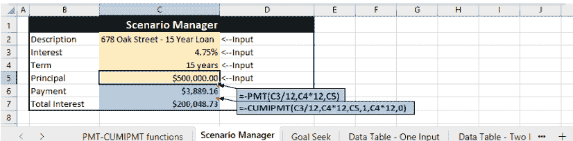

- 单元格 C2 包含 **Description** 输入，在此例中为 678 Oak Street – 15 Year Loan

> **Tip**
> 如果您的场景少于 32 个输入，请将场景描述存储在工作表单元格中，以便您可以将其包含在场景中。这样做将帮助您了解当前应用于工作表的是哪个场景。在工作表中切换多个场景时，很容易失去跟踪。

- 单元格 C3 包含 Interest 输入，在此例中为 4.75%
- 单元格 C4 包含 Term 输入，在此例中为 15 表示 15 年贷款
- 单元格 C5 包含 Principal 输入，在此例中为 $500,000

单元格 C2:C4 将构成场景，而单元格 C5:C6 包含每个场景将引用的计算：

- 单元格 C5 包含 = -PMT (C3/12, C4*12, C5) 公式以计算贷款的每月付款。
- 单元格 C6 包含 = -CUMIPMT (C3/12, C4*12, C5, 1, C4*12, 0) 公式以计算您在贷款期限内将支付的总利息。

> **Nuance**
> 您只能在场景中存储文本或数字——当您应用场景时，Excel 会警告您任何公式都将转换为静态值。此外，您也不能在场景中存储 Data Type 单元格。Data Types 是一种新的输入类型，链接到在线来源。Data Types 的示例包括但不限于股票和地理。

现在我们有了计算既定贷款的基础，让我们创建一些场景。

#### Creating scenarios

让我们根据工作表中已有的输入创建第一个场景：

1. 选择单元格 C2:C5。如果需要，您可以按住 Ctrl (⌃) 键以选择任何非相邻单元格。
2. 选择 Data | What-If Analysis | Scenario Manager。
3. 单击 Scenario Manager 对话框中的 Add 按钮（或在 Excel for macOS 中单击加号按钮）。
4. 在 Add Scenario 对话框中为场景分配名称，例如 678 Oak Street - 15 Year Loan，如图 6.3 所示：

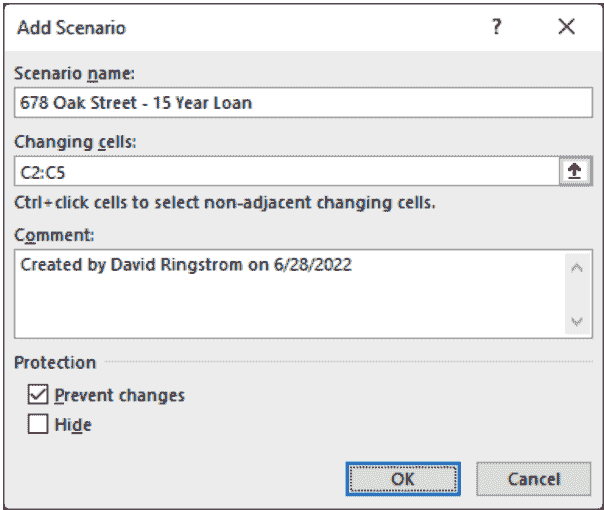

5. 确认 **Changing Cells** 字段包含您希望包含在场景中的单元格。

> **Nuance**
> 在此例中，**Changing Cells** 字段应预填您希望包含在场景中的单元格，因为我们在步骤 1 中预先选择了它们。如果您忘记预先选择单元格，您始终可以使用 **Changing Cells** 字段来选择字段。

6. 可选，选择 **Prevent Changes** 以防止用户在工作表受保护时修改场景。
7. 可选，选择 **Hide** 以防止用户在工作表受保护时应用场景。
8. 单击 **OK**。

9. 确认要在 Scenario Values 对话框中捕获的值，如图 6.4 所示。在 Excel for Windows 中，您将看到单元格和值的列表，而在 Excel for macOS 中，您需要单击每个单元格引用以查看底层值——尽管这将是您在工作表中可以看到的相同信息：

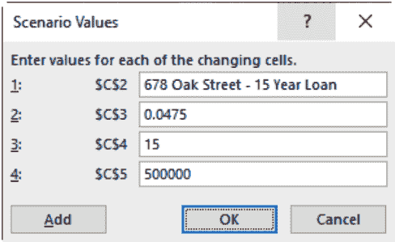

10. 此时，您可以单击 OK 保存场景或单击 Add 创建新场景。在此例中，单击 Add。
11. Add Scenario 对话框重新出现。在 Scenario Name 字段中输入 678 Oak Street – 30 Year Loan。
12. 可选，单击 Prevent Changes 和/或 Hide。单击 OK。
13. 将单元格 C2 的值更改为 678 Oak Street – 30 Year Loan。
14. 将单元格 C3 的值更改为 5.25%。
15. 将单元格 C4 的值更改为 30。
16. 单击 Add 以添加另一个场景。
17. 为 345 Pine Street 创建两个新场景，分别对应 15 年和 30 年贷款。15 年贷款的利率为 4.75%，30 年贷款的利率为 5.25%，本金金额为 $450,000。
18. 单击 Close 关闭 Scenario Manager 对话框。

一旦您创建了两个或多个场景，您就可以在工作表中切换它们。

#### Showing scenarios

现在我们有四个场景，让我们将其中一个应用到工作表中：

1. 选择 Data | What-If Analysis | Scenario Manager。


### 2. 选择一个场景，例如 345 Pine Street – 30 年贷款，然后单击 Show。

### 3. 如图 6.5 所示，单元格 C2:C5 应反映你的场景输入：

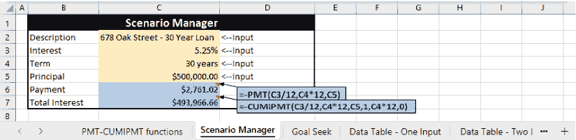

#### 图 6.5 – 应用于工作表的场景

显然，能够将各种场景应用于工作表可以帮助提高电子表格的完整性，因为你可以重复使用工作表中现有的计算。另外，场景管理器提供了一种备份一组假设的方法，特别是在某些用户可能倾向于覆盖工作表中假设的情况下。但是，场景管理器最好的方面之一是能够运行场景报告，该报告允许你比较场景的输入和输出。

### 场景报告

Excel 提供两种不同类型的场景报告：

- 场景摘要：提供全面的详细信息，包括列出场景中使用的所有输入以及最多 32 个结果单元格（这些单元格是引用输入的公式）。
- 场景数据透视表：以数据透视表格式比较摘要的结果，但不显示场景中使用的输入值。

每次生成报告时，每个报告都会出现在工作簿的新工作表中。两个报告都不包含任何实时公式，因此每当你更改现有场景中的值或添加/删除场景时，都需要重新创建场景摘要。

### 场景摘要报告

场景摘要报告为你提供了场景的最佳比较。报告显示输入和输出的单元格地址。在此上下文中，输出是依赖于一个或多个输入单元格的公式。要创建场景摘要报告，请执行以下步骤：

1. 选择 数据 | 什么如果分析 | 场景管理器 | 摘要。

### 2. 如有必要，在结果单元格字段中指定单元格 C6:C7，如图 6.6 所示：

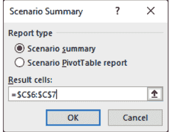

#### 图 6.6 – 场景摘要对话框

### 3. 单击 OK 接受场景摘要的默认选择。

### 4. 场景摘要报告出现在新工作表中，如图 6.7 所示：

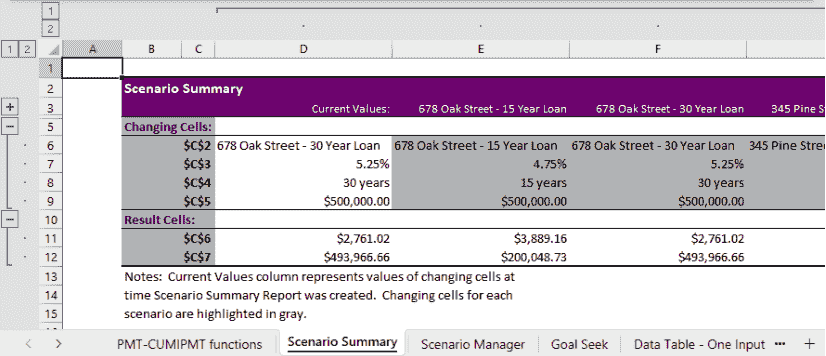

#### 图 6.7 – 场景摘要报告

取决于你的场景的复杂性，可能很难将更改单元格列中的地址与实际数据进行交叉引用。幸运的是，有一个简单的修复方法：

1. 在场景摘要工作表中选择单元格 B2:C7。
2. 选择 公式 | 从选择创建。
3. 选择 左列，然后取消选择任何其他预选的选项，如图 6.8 所示：

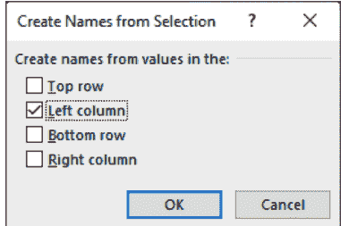

图 6.8 – 从选择创建名称对话框

在此示例中，Excel 将把列 B 中的单词分配给列 C 中的输入。现在，让我们再次创建场景摘要报告：

1. 如有必要，激活场景摘要工作表。
2. 选择 数据 | 什么如果分析 | 场景管理器 | 摘要。
3. 单击 OK 接受场景摘要的默认选择。
4. 第二个场景摘要报告出现在新工作表中，如图 6.9 所示：

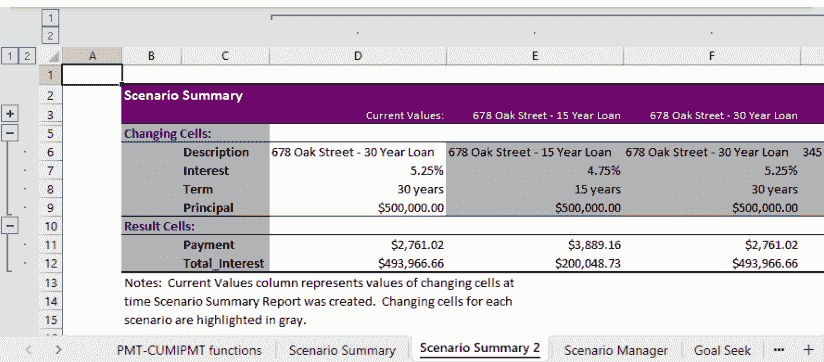

图 6.9 – 我们的第二个场景摘要报告

请注意，范围名称出现在更改单元格列中，而不是单元格地址，以便你可以轻松识别每个输入。Excel 在场景摘要报告中使用大纲功能。这会在工作表框架旁边添加按钮，你可以使用这些按钮来展开和折叠报告，这是管理信息过载的好方法。

### 场景数据透视表报告

场景数据透视表报告的生成方式与场景摘要报告类似，但乍一看，可能会觉得该报告只提供结果而不显示输入。如你稍后将看到的，你可以选择报告包含的内容。要创建 **场景数据透视表** 报告，请执行以下步骤：

1. 选择 数据 | 什么如果分析 | 场景管理器 | 摘要。
2. 确认 Excel 已选择结果单元格（有时，Excel 会将此字段留空），在此示例中，这些单元格是 C6:C7。
3. 双击场景数据透视表（或单击一次场景数据透视表，然后单击 OK）。
4. 第三个新工作表出现并显示场景数据透视表报告，如图 6.10 所示：

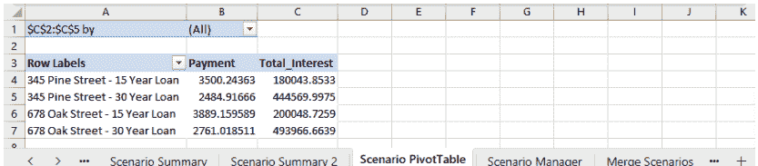

请注意，**数据透视表** 中的任何结果字段都将具有未格式化的数字。这是 Excel 的默认行为，因此每次创建 **场景数据透视表** 报告时，你都需要格式化结果字段。

> 注意
> 默认情况下，场景数据透视表报告选项仅显示结果单元格，即包含基于场景输入的公式的单元格。如果你将结果单元格选项更改为也包括输入单元格（在此示例中为 C2:C7，而不仅仅是 C6:C7），则数据透视表也将显示输入，从而创建一个更有用的报告。唯一的怪癖是，你选择的任何包含文本的输入单元格都将由数字 1 表示，该数字标识文本在该单元格范围内出现的次数。

虽然 **场景数据透视表** 报告看起来像常规数据透视表，但它无法刷新。因此，如果你更改场景中的任何输入，你需要再次创建 **场景数据透视表** 报告。话虽如此，假设你发现想要更改场景中的某些内容。

如果你从场景报告工作表选择 数据 | 什么如果分析 | 场景管理器，场景管理器将报告不存在场景。对于工作表来说这是真的，但对于工作簿则不是。请记住，要更改场景，你必须返回最初创建场景的原始工作表。但是，你可以将场景从一个工作表转移到另一个工作表或工作簿。

### 合并场景

你可以通过合并命令将场景移动到工作簿中的任何其他工作表或从外部工作簿移动。在这个上下文中很容易误解合并一词，因为场景实际上并没有被合并——更贴切的命令名称应该是转移或复制，因为场景是从一个工作表复制到另一个工作表。请记住，只有在结构相同的工作表之间合并场景才有意义，至少在输入单元格方面是这样；否则，你可能会意外覆盖工作簿中的数据。以下是合并场景的方法：

1. 激活合并场景工作表。
2. 选择 数据 | 什么如果分析 | 场景管理器。
3. 场景管理器对话框将报告未定义场景，因为目前此工作表上不存在任何场景。单击 合并。
4. 如图 6.11 所示，合并场景对话框将显示当前工作簿中的工作表列表。你从工作表列表中选择的工作表上可用的场景数量将显示在列表下方。如果给定工作表上没有可用场景，则 OK 按钮将被禁用。选择场景管理器工作表，然后单击 OK。

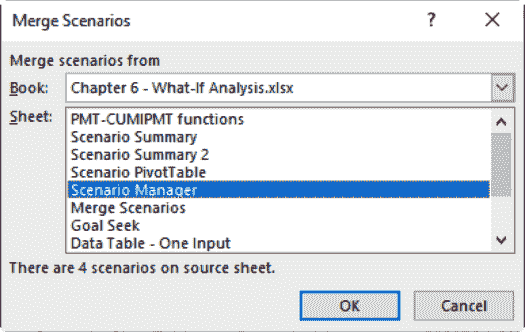

图 6.11 – 合并场景对话框

5. 场景管理器对话框重新出现并显示从场景管理器工作表复制的四个场景。选择一个场景并单击 OK，或单击 关闭 以关闭场景管理器对话框。

### 目标求值功能

Excel 的 **目标求值** 功能是一种在 Excel 中自动化猜测工作的方法。假设你想买一辆车，你知道利率、贷款期限和你想要的还款额，但不知道你能借多少钱。以下是步骤：

1. 激活目标求值工作表。
2. 选择 数据 | 什么如果分析 | 目标求值。
3. 在目标求值对话框的设置单元格字段中输入或选择单元格 C5，如图 6.12 所示：

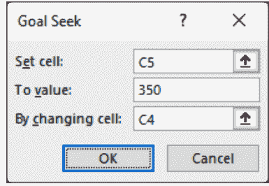

图 6.12 – 目标求值对话框

4. 在到值字段中输入一个金额，例如 350。
5. 在通过更改单元格字段中输入或选择单元格 C5。

提示
合并场景对话框不允许你选择要复制到工作表中的哪些场景。它基于全有或全无的原则运行，这意味着你必须从工作表中复制所有场景。但是，你可以使用场景管理器对话框中的删除按钮来删除任何多余的场景。

如你所见，场景管理器是一个强大的功能，可以帮助你控制 Excel 工作簿，因为你可以通过单个工作表交换一组输入，而不是一遍又一遍地重新创建计算。你确实需要在输入和结果方面遵守 32 个输入的限制。一个变通方法是，你可以创建相关的一组场景，并按顺序应用，例如 场景 1（2 组中的第 1 组）和 场景 1（2 组中的第 2 组）。你将无法创建包含两组输入的场景摘要报告，但你可以按顺序应用场景，然后使用此命名约定来创建任意数量的场景。现在，让我们看看 什么如果分析 菜单中的下一个命令，即目标求值功能。


### Nuance

Excel 会在 **Set cell** 字段中显示 $C$4，在 **By changing cell** 字段中显示 $C$5，前提是你使用鼠标点击工作表，而不是将单元格地址输入到字段中。$ 符号表示绝对引用，在这种情况下并不需要，因为如果你后来决定为不同的付款求解，**Goal Seek** 功能将不会记住你引用的单元格。

- 6. 单击 **OK** 以启动 **Goal Seek** 过程。

- 7. 如 _Figure 6.13_ 所示，**Goal Seek Status** 对话框会告知你是否找到了答案，缺失的输入将出现在你指定的 **By changing cell** 字段中。

如 _Figure 6.13_ 所示，**Goal Seek** 功能会在找到答案或无法找到答案时通知你。大多数情况下，**Goal Seek** 应该根据底层计算的复杂性返回一个答案：

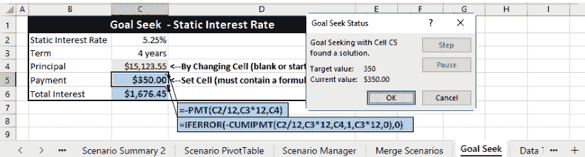

## Figure 6.13 – The Goal Seek results

让我们看一下 **Goal Seek** 更难找到解决方案的情况。在 **Goal Seek** 工作表的单元格 **C11** 中输入公式 =RANDBETWEEN ( 50 , 100 ) / 1000，以创建可变利率。

RANDBETWEEN 函数有两个参数：

- **Bottom** – 这是可能生成的最小随机数

- **Top** – 这是可能生成的最大随机数

在这种情况下，将 RANDBETWEEN 的结果除以 1,000 会给我们一个 5% 到 10% 之间的百分比。RANDBETWEEN 是一个易失性工作表函数，这意味着它在工作簿中任何地方发生更改时都会重新计算。大多数 Excel 工作表函数都是非易失性的，这意味着只有当公式引用的任何单元格发生变化时，Excel 才会重新计算公式。在这种情况下，我们正在创建一个移动目标，这将使 **Goal Seek** 更难以命中，以此来模拟你在复杂工作簿中可能遇到的情况。

### Nuance

RANDBETWEEN 只能返回整数值，这就是为什么我们必须除以 1,000。  
如果你使用的是 Microsoft 365 或 Excel 2021，一个替代方案是使用 RANDARRAY，它有五个参数：rows、columns、min、max 和 integer。在单元格 B1 中，你可以输入 =RANDARRAY(1,1,.05,.10,FALSE) 来生成 5% 到 10% 之间的小数值。

现在，让我们再次尝试使用 Goal Seek 功能：

1. 选择 Data | What-If Analysis | Goal Seek。
2. 在 Set cell 字段中输入或选择单元格 C14。
3. 在 To value 字段中输入一个金额，例如 350。
4. 在 By changing cell 字段中输入或选择单元格 C13。
5. 单击 OK，并注意 Goal Seek 将难以找到答案。
6. 单击 Pause 以暂时停止该功能，如 Figure 6.14 所示，单击 Cancel 以终止该过程，或者等待 Goal Seek 处理完 100 次迭代：

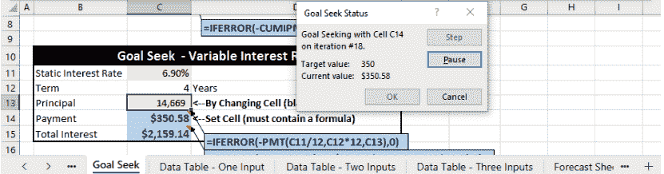

Figure 6.14 – Goal Seek Pause button

7. 如 Figure 6.15 所示，有时 Goal Seek 完全偏离目标，并且不接近：

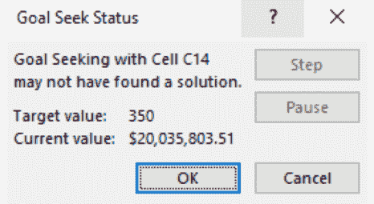

## Figure 6.15 – Goal Seek ran amok

你可以通过更改计算中使用的精度级别来微调 Goal Seek。默认情况下，Excel 对计算使用三位小数的精度。你可以通过指定更小的容差来更改此精度级别，这将防止 Excel 尝试协调计算中无关紧要的金额：

1. 选择 File | Options | Formulas（或在 macOS 的 Excel 中选择 Excel | Preferences | Formulas）。
2. 将 Maximum Change 字段设置为 0.00000001 或类似的小数字。
3. 单击 OK 关闭 Options 对话框，或关闭 Preferences。

现在 Goal Seek 应该运行得更快，因为它不会尝试找到那么精确的答案。本章稍后，我将把 Goal Seek 与 Solver 功能进行比较，但目前，让我们来看看 Data Table 功能，它允许你通过公式交换一个或多个输入，以创建比较结果表。

## The Data Table feature

Data Tables 允许你通过公式交换一个或多个输入，以返回一组结果。我将引导你了解三种不同的变体，用于计算贷款付款：

- 使用一个输入和五个利率
- 使用两个输入、五个利率和五个贷款期限
- 使用三个输入、五个利率、五个贷款期限和五个贷款金额

这三者之间的共同点是，我们将首先按照我在 PMT 函数中描述的方式计算贷款付款。PMT 函数将支撑我们将要处理的所有三个 Data Tables。

## Creating a Data Table with one input

本章示例工作簿中 Data Table-One Input 工作表的单元格 D2:D4 是公式 = –PMT(D2/12,D3*12,D4) 在单元格 D6 中使用的输入，该公式返回 $2,176.03 作为 30 年期、$500,000 贷款、3.25% 利率的付款金额。假设利率正在上升，你还想查看该贷款在其他利率下的付款金额。

> Nuance  
> 与 Data Table 相关的输入单元格必须位于与 Data Table 本身相同的工作表上。如果你将 Data Table 复制到新工作表，粘贴的表格结果将转换为静态值。

## What-If Analysis

_Figure 6.16_ 中单元格 D6 的公式支撑 **Data Table**，而单元格 C7:C11 提供列输入。在这种情况下，公式应始终位于两列范围的第一行和第二列：

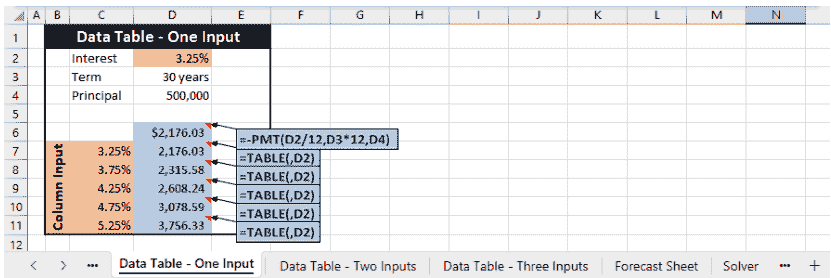

Figure 6.16 – A single input Data Table

你可以在从第 13 行开始的工作区中重新创建 Data Table：

1. 选择单元格 C18:D23。
2. 选择 **Data | What If Analysis | Data Table**。
3. 指定单元格 D14 作为 **Column input** 单元格，然后单击 **OK**。

现在，让我们来看看单元格 D19:D23。你会注意到 Excel 没有将 PMT 公式复制到这些单元格，而是在每个单元格中使用 `TABLE` 函数创建了这个公式：`{=TABLE(,D14)}` 。

> Nuance  
> 你不能单独使用 TABLE 函数来编写公式——它只能与 **Data Table** 功能配合使用。如果你尝试，Excel 将报告 _That function isn’t valid._。

`TABLE` 函数有两个未命名的输入，分别用于行输入和列输入。在这种情况下，我们没有行输入，但我们的列输入贯穿单元格 C7:C11。在单元格 D7 中，`TABLE` 函数将 **Data Table** 顶部公式中对 **Column Input Cell** 的引用（在此情况下为 D14）替换为列 C 中的相应输入。**Data Tables** 将每个输入传递给支撑表格的公式，即我们指定单元格 D14 作为 **Column Input Cell** 的地方。公式外部的花括号表示这是一个公式，它对单个项目执行多个计算。这就是 `TABLE` 函数如何能够同时将每个利率传递给 PMT 函数的方法。这是单元格 D30 中公式 `=-PMT(C30/12,D$27*12,D$28)` 的替代方案，我已将其复制到单元格 D34。请注意，在这种情况下，公式中行 27 和 28 前面需要 `$` 符号，以防止 Excel 更改这些参数的行号。

### Nuance

你不能删除与数组公式相交的行或列。如果你尝试删除第 21 行，Excel 将返回 Can’t change part of a data table 错误。虽然这是事实，但有一个简单的解决方法。擦除单元格 D19:D23，删除第 21 行，然后对单元格 C18:D22 重复上述步骤 1 到 3。

现在，让我们创建一个具有两个输入的 Data Table。

## Creating a Data Table with two inputs

Figure 6.17 中显示的 Data Table 根据五个利率和五个贷款期限计算贷款付款。我实际上使用了 Data Table – Two Inputs 工作表中单元格 D2:D4 中与单输入示例相同的输入，但这次，公式 = – PMT ( D2 / 12 , D3 * 12 , D4 ) 位于单元格 C7：

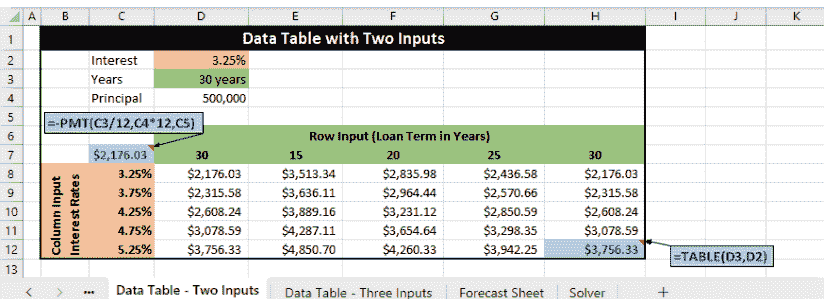

Figure 6.17 – A Data Table with two inputs

单元格 D7:H7 包含五个贷款期限，而单元格 C8:C12 包含五个利率。单元格 D8:H12 包含 = TABLE ( D3 , D2 ) 公式。单元格 D33 中的公式 = – PMT ( $C33 / 12 , D$32 * 12 , $D$30 ) 是一个基于公式的替代方案。请注意，这次需要额外的 $ 符号来保持参数的正确完整性。Data Table 功能允许你在单元格 C7 中放置一个更简单的公式，并知道结果将自动使用正确的输入。

如果你愿意，可以在 Data Table – Two Inputs 工作表的工作区中跟随操作：

1. 选择单元格 C20:H25。
2. 选择 Data | What If Analysis | Data Table。
3. 在 Row input cell 字段中输入 D16。
4. 在 Column input cell 字段中输入 D15。单击 OK。


### Nuance

与典型的 Excel 公式不同，你不能直接覆盖数据表中的结果，因为结果由数组函数提供。数组函数提供的结果以一种“一体化、全护一体”的方式绑定在一起，以保护结果的完整性。

现在，让我们看看如何创建一个使用三个输入的数据表，尽管数据表对话框只允许输入两个。

### 创建包含三个输入的数据表

如你所见，数据表对话框只提供两个输入字段：行输入单元格和列输入单元格，那么如何融入三个或更多输入呢？可以通过将期限和本金输入合并到一个单元格中，并用斜杠分隔（例如 120/375,000），如图 6.18 所示：

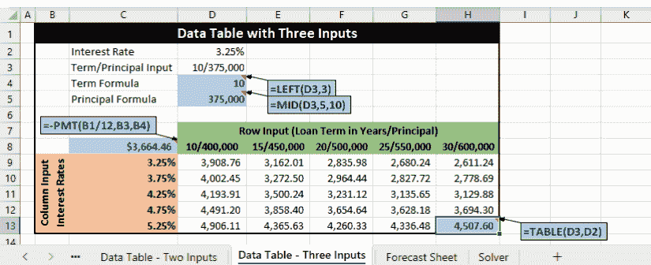

图 6.18 – 包含三个输入的数据表

然后，我们将使用 LEFT 和 MID 函数将输入提取到单独的单元格中，PMT 函数将引用这些单元格。表格的第一行将包含我们要计算的每个场景的合并输入。B1:H13 单元格中已建立好所有内容，但我将带你了解在工作区中输入公式的过程，如图 6.19 所示：

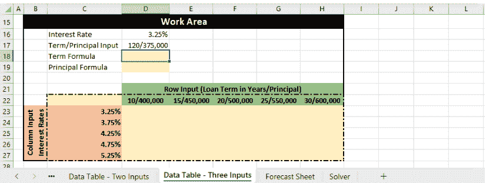

图 6.19 – 三输入数据表的工作区

1. 在单元格 D18 中输入 =LEFT(D17, 3) 以从单元格 D17 提取前三位数字。LEFT 函数有一个必需参数和一个可选参数：

   * Text：这是你希望从中提取字符的单元格引用或字符串。
   * Num_chars：这是你希望从左侧开始提取的可选字符数，默认值为 1，除非你另有指定。

2. 在单元格 D19 中输入 =MID(D17, 5, 10) 以提取贷款金额。MID 函数有三个必需参数：

   * Text：这是你希望从中提取字符的单元格引用或字符串。
   * Start_num：这是你希望开始提取字符的文本中的位置。
   * Num_chars：这是你希望提取的字符数。在此示例中，我输入了 10，以选择一个大于我计划提取的字符数的数字。

3. 在单元格 C22 中输入 =-PMT(D16/12, D18, D19) 以计算第一个场景的贷款还款额。PMT 函数有三个必需参数（有关另外两个可选参数的讨论，请参阅 PMT 函数部分）：

   * Rate：这是贷款的利率，在此示例中为单元格 D16，除以 12 以创建月利率。
   * Nper：这是贷款的期限。在此示例中，公式引用单元格 D18，我们从单元格 D17 提取了期限，然后乘以 12 将贷款期限转换为月数。
   * Pv：这是现值或本金金额。在此示例中，公式引用单元格 D19，我们从单元格 D17 提取了金额。

4. 选择单元格 C22:H27。
5. 选择 数据 | 什么如果分析 | 数据表。
6. 指定单元格 D17 作为行输入单元格。这里有一些细微差别，因为我们要选择包含合并输入的单元格，而不是分离输入的单元格中的任何一个。
7. 指定单元格 D16 作为列输入单元格。
8. 单击确定以创建数据表。

如果不使用数据表，你也可以将期限和贷款金额拆分为两个单独的行来计算这些金额。或者，你可以将 LEFT 和 MID 合并到 PMT 函数中，例如 =–PMT($C23/12, LEFT(D$22, 2) * 12, MID(D$22, 4, 10))。在此示例中，数据表既简化了计算，又确保了每个单元格中数据的完整性。

取决于计算的大小和复杂性，数据表有时会导致工作表重新计算所需的时间比平时更长。幸运的是，如果出现这种情况，有一个简单的解决方案。

### 提高计算性能

工作表中的数组公式会影响电子表格的计算性能。通常，Excel 只会重新计算受数据输入更改直接影响的公式。另一方面，数组公式在工作簿中任何位置进行更改时都会重新计算。如果你发现这会显著减慢电子表格的速度，你可以通过选择 公式 | 计算选项 | 除数据表外自动来防止数据表不断重新计算。

现在，你需要根据需要手动重新计算数据表，方法是单击包含数组公式的任何单元格，然后按 F9（Fn+F9），或者单击公式选项卡中的立即计算命令。选择 公式 | 计算选项 | 自动以恢复默认的计算方法。

现在你对数据表功能有所了解，让我们看看如何使用预测工作表功能将基于时间或日期的数据投射到未来。

### 使用预测工作表功能预测金额

**预测工作表**功能适用于 Windows 上的 **Excel 2016** 或更高版本。你可以将其用于包含日期/时间和数值的数据，如 **图 6.20** 所示。假设我们希望将此数据保护到 2024 年底：

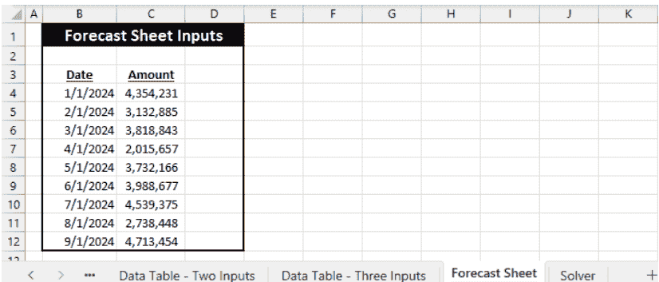

图 6.20 – 预测的源数据

> **细微差别**
> **预测功能**会向你的工作簿添加一个新工作表，该工作表使用 `FORECAST.ETS` 和 `FORECAST.ETS.CONFINT` 工作表函数来预测你的金额。你可以与使用 **Excel 2013** 或更早版本的人共享预测以供查看。问题是，对工作簿的任何编辑都可能导致预测函数重新计算。在这种情况下，预测金额将返回 `#NAME?`，因为旧版 Excel 无法识别这些工作表函数。

现在，让我们尝试使用预测工作表功能：

1. 选择基于日期或时间的数据中的任何单元格，例如本章示例工作簿中 **预测工作表** 工作表上的单元格 **B4**。

2. 选择 数据 | 预测工作表。

3. 在 **创建预测工作表** 对话框中确认 **预测结束** 日期，如图 6.21 所示：

使用历史数据创建可视化预测工作表


**预测结束** 12/1/2024

选项

创建 取消

图 6.21 – 预测工作表对话框

4. 可选，展开 **选项** 部分以进一步微调你的预测。你也可以在折线图和柱状图之间进行选择，尽管折线图提供了更全面的预测。

5. 单击 **创建**。

6. 如图 6.22 所示，Excel 会向你的工作簿添加一个 **预测工作表**。默认情况下，图表将重叠 **预测工作表** 结果，因此每次都要计划将图表移到一侧：


图 6.22 – 预测工作表结果

如你所见，为 **预测工作表** 功能创建的折线图根据工作表中存在的数据呈现了最佳情况、最可能情况和最坏情况。**预测工作表** 的柱状图版本使用误差栏来说明最佳和最坏情况。

现在，让我们通过发掘 **求解器** 功能来结束我们对 Excel 什么如果分析功能的探索，该功能只有在请求时才会出现在 Excel 的功能区中。

### 介绍求解器功能

我将简要介绍 Excel 的 **求解器** 功能，以便将其与 **目标求值** 进行比较。通常，我将 **求解器** 描述为 **目标求值** 的加强版。你可以求解多个缺失的输入，对求解施加约束，等等。话虽如此，如果你喜欢 **目标求值**，一旦你克服了更繁忙的用户界面，你会更喜欢 **求解器**。 **求解器** 功能是 Excel **加载项**，它启用了默认 Excel 安装中不可用的其他功能。使用 **求解器** 的第一步是启用 **加载项**：

1. 选择 文件 | 选项 | 加载项（或在 Excel for Mac 中选择 工具 | Excel 加载项）。

2. 在 **选项** 对话框的 **管理: Excel 加载项** 部分中单击 确定... 按钮（**Excel for Mac** 中跳过此步骤）。


### 3. 单击 **Solver Add-In** 复选框，如 **图 6.23** 所示：


图 6.23 – 启用 Solver 加载项复选框

- 4. 单击 **OK**。
- 5. 如有需要，关闭 **Options** 对话框。

此时，**Solver** 命令将出现在 Excel 功能区的 **Data** 选项卡上。单击此按钮将显示 **Solver** 对话框，如 **图 6.24** 所示：


图 6.24 – Solver 参数对话框

假设您想以与 **Goal Seek** 相同的方式求解付款金额。如果您将利率改回 5.25% 或任何其他静态金额，可以使用与 **Goal Seek** 相同的示例。以下是使用 **Solver** 确定基于特定利率、期限或付款可借款金额的步骤：

- 1. 激活本章示例工作簿中的 **Solver** 工作表。
- 2. 选择 **Data | Solver**。
- 3. 在 **Solver Parameters** 对话框的 **Set Objective** 字段中输入 C4，如 **图 6.21** 所示。
- 4. 选择 **Value Of**。
- 5. 在 **Value Of** 旁边的字段中输入付款金额，例如 350。
- 6. 将 **By Changing Variable Cells** 字段设置为 C5。
- 7. 单击 **Solve** 按钮。

8. Excel 将显示 **Solver Results** 对话框，如图 6.25 所示。可选地，如果您想更改此付款金额或返回可能包含在具有更多变量的场景中的任何其他变量，可以单击 **Return to Solver Parameters Dialog** 复选框。

9. 单击 **OK** 以根据上一步中的选择返回工作表或 **Solver Parameters** 对话框：


图 6.25 – Solver 结果对话框

**细微差别**

使用 **Solver** 而非 **Goal Seek** 的一个好处是，**Solver** 功能会记住您所做的选择，而 **Goal Seek** 对话框每次都会重置。如果您在启动 **Goal Seek** 命令之前单击公式单元格，可以预填 **Goal Seek** 对话框中的 **Set Cell** 字段。简而言之，如果您要执行重复的目标求解操作，**Solver** 更高效。

如图 6.25 所示，您还可以将 **Solver** 结果存储在 Excel 的 **Scenario Manager** 中，我在前面的 _Understanding the Scenario Manager feature_ 部分中讨论过该功能。

### 摘要

通常，Excel 的 **What-If Analysis** 功能作为自动化 Excel 中重复任务的手段而被忽视。在本章中，您了解了 `PMT`、`CUMIPMT` 和 `CUMPRINC` 函数，这些函数可用于计算贷款中一个或多个期间的贷款付款和总利息。我们使用这些函数作为基础，演示了 Excel 中的 **What-If Analysis** 功能。例如，**Scenario Manager** 功能使您能够将不同的输入集交换到工作表中，并通过场景报告比较结果。或者，**Goal Seek** 允许您求解单个缺失的输入。这消除了在尝试确定缺失金额时可能涉及的手动猜测。

然后，我们通过 Data | What-If Analysis 菜单来到了 **Data Table** 功能。**Data Tables** 可以基于交换一个或多个输入来一次求解多个方程式。这使您的公式具有更好的完整性，因为您不必尝试在公式中链接输入；您只需用单个公式锚定 **Data Table**，Excel 就会交换输入。

如果您想将一系列数字投射到未来，可以创建 **Forecast Sheet** 来自动化您的投射。此类表格无法在 **Excel for macOS** 中创建，但可以在该版本中访问。本章以介绍隐藏的 **Solver** 功能结束，该功能可用于求解两个或多个缺失输入。我没有空间深入探讨 **Solver**，但您看到了 **Solver** 如何简化您通常在 **Goal Seek** 中执行的任务，因为 **Solver** 会记住最近的设置，而 **Goal Seek** 对话框每次访问时都会重置。

在第 7 章 *Automating Tasks with the Table Feature* 中，您将了解通过仅将底层数据转换为 Table 来自动化 Excel 功能的众多方法。此外，我将阐明同样命名的 **Data Table**、**Table** 和 **PivotTable** 功能之间的区别。

### 使用 Table 功能自动化任务

我认为 **Table** 功能是 Excel 中的超能力，只需一个键盘快捷键或几次鼠标单击即可解锁巨大的自动化功能。例如，引用 **Table** 中数据（而非正常单元格范围）的公式和功能会自动“看到”您添加到 **Table** 的任何新数据。这消除了重写公式以扩展单元格范围并返回到 **PivotTables** 等功能以扩展源数据的需要。**Slicers** 在筛选时消除了导航下拉菜单的需要，而启用 **Total Row** 选项仅统计可见行而不是整个列表。**Tables** 允许 **Charts** 和 **Sparklines** 自动更新——列表还在继续。在本章中，我将涵盖以下主要主题：

- Excel 的不成文规则
- 什么是 Table？
- **Table** 增强功能
- **Table** 自动化机会
- 导航和选择细微差别
- **Table** 故障排除

简而言之，本章旨在向您展示如何一次性消除重复任务并提高数据完整性。本章还补充了 _Chapter 12, Power Query_，因为您通过 Power Query 从其他来源提取的数据通常会返回到 **Table**。

### 技术要求

本章中的所有键盘快捷键均适用于 **Excel for Windows**，但只有部分快捷键适用于 **Excel for macOS**。除非另有说明，本章中的所有功能在 **Excel for Windows** 和 **macOS** 中的工作方式相同。包含本章中使用的所有示例的工作簿可从 GitHub 下载，网址为 `https://github.com/PacktPublishing/Exploring-Microsoft-Excels-Hidden-Treasures/tree/main/Chapter07`。

### Excel 的不成文规则

多年来，我观察到一条不成文规则，即许多用户无意中违反了该规则：_任何_ 列表的第一行都应该是一行唯一的标题——即 Excel 术语中的 **Headers**。这适用于您在 Excel 中创建的每个列表，无论您是否使用 **Table** 功能。**Headers** 非常重要，以至于 **Table** 功能在需要时会添加占位符 **Headers**。**Tables** 和 **PivotTables** 都要求每个 **Header** 唯一，并会在重复 **Headers** 后追加数字以强制执行合规性。

> **Tip**
> 以上述规则的补充是，列表不应有任何空行或空列。大多数 Excel 功能作用于 **Current Region**，即活动单元格周围的非空单元格连续块。空行和空列会截断 **Current Region**，并要求您在排序或筛选前手动选择整个列表，而不是能够选择列表中的单元格然后排序或筛选。

创建新电子表格时，请尽量将 **Headers** 保持为单行，然后在需要多行显示时使用 **Home** | **Wrap Text**。您也可以在单元格中想要换行的每个位置按 `Alt + Enter` (`Option + Enter`)。如果您想保留多行 **Headers**，请考虑在最后一个 **Header Row** 上方插入一个空行，然后隐藏该行。

> **Tip**
> 此外，您可以在 **Excel 2019** 及更高版本中使用 `TEXTJOIN` 函数将多个单元格的文本合并为一个。将结果作为值复制并粘贴后，您可以删除原始行。


你可能会想：“我不需要添加标题，我知道每一列包含什么。” 这个观点很有道理，但 Excel 无论如何都会将第一行视为 **标题**，进而可能导致副作用，例如无法从列表创建 **数据透视表**、数据透视表中遗漏一行数据等。有时，根据你使用的功能，两行标题可能也能行。如果你在本章示例工作簿的 **Excel 的不成文规则** 工作表中筛选或排序列表，如 _图 7.1_ 所示，Excel 将忽略行 **1** 并适当地使用行 **2** 作为 **标题**。 **数据透视表** 和 **推荐的数据透视表** 功能也会忽略第一行：


图 7.1 – 违反不成文规则的数据集

另一方面，**表格** 功能 _始终_ 将列表的第一行视为 **标题**，这意味着，在这种情况下，行 **2** 将变成 **正文行** 并被视为数据集的一部分。大多数 Excel 功能将拥有三行或更多 **标题** 的列表视为没有标题。

绕过不成文规则的一种方法是，在将数据转换为 **表格** 或使用会被多行 **标题** 困扰的功能之前，先选择 **标题** 的最后一行以及列表的主体部分。

现在我们已经介绍了不成文规则，让我们来区分名称中带有“**表格**”的三个 Excel 功能。

### 什么是表格？

**功能比较** 工作表对比了 **表格**、**数据透视表** 和 **数据表** 功能。让我们逐一比较每个功能：

- **表格 – 表格** 将静态单元格区域转换为可自动扩展的列表，如 _图 7.2_ 所示，这将解锁多层自动化：


**图 7.2 – 表格**

- **数据透视表 – 数据透视表是一种报告编写功能，它将单元格区域或表格中的数据列表汇总为简洁的格式，如图 7.3 所示：**


图 7.3 – 数据透视表

**提示**  
我将在本章和 _第 9 章，Excel 的怪癖与细节_ 中简要探讨 **数据透视表**。

- 数据表 – 数据表允许你通过单个锚定公式交换一组或多组输入，以比较多种场景，如图 7.4 所示：


图 7.4 – 数据表

> 细微差别  
> 如图 7.4 所示的 TABLE 工作表函数特定于数据表功能，与表格功能完全无关。我已在第 6 章，假设分析中详细讨论了数据表。

现在，让我们看看如何将正常的单元格区域转换为表格。

## 设置表格格式命令

如你在复制和粘贴表格部分将看到的，一种可能具有误导性的识别 Excel 工作簿中表格的方法是基于格式。Excel 提供 60 种内置表格样式，你可以在通过设置表格格式命令将正常单元格区域转换为表格时从中选择：

1. 选择设置表格格式工作表列表中的任何单元格。

2. 选择“开始” | “设置表格格式”，然后在库的左上角选择第一个表格样式选项，如图 7.5 所示，该样式名为“白色，表格样式浅色 1”：

## 图 7.5 – 设置表格格式命令

3. **创建表格** 对话框将出现，如 _图 7.6_ 所示。在这种情况下，Excel 正确地确定列表的第一行不包含 **标题**，并取消选择 **我的表格有标题** 复选框。除非列表被一个或多个空行和/或空列中断，否则 **表格数据的位置** 字段将显示整个列表的单元格坐标。如有需要，重新选择列表，然后单击 **确定**：


## 图 7.6 – 取消选择我的表格有标题的创建表格对话框

### 使用表格功能自动化任务

4. 如图 7.7 所示，列表将转换为 **表格**，其中 **标题行** 包含占位符标题，你可以根据需要替换它们：


5. 在 **表格设计 | 名称** 字段中键入 `WithoutHeaders`，以将此 **表格** 与我们将在本工作簿中创建的其他 **表格** 区分开。

如果你不想选择样式，**插入表格** 命令会应用给定工作簿的默认样式，我将在 _设置默认表格样式_ 部分向你展示如何更改它。

### 插入 | 表格命令

让我们创建第二个 **表格**，看看默认 **表格样式** 是如何自动应用的：

1. 选择 **插入表格** 工作表列表中的任何单元格，然后选择 **插入 | 表格**。

> **提示**  
> 你可以按 `Ctrl + T`（Mac 版 Excel 中为 `⌘ + T`）代替选择 **插入 | 表格**。

2. **创建表格** 对话框将出现，如图 7.8 所示。Excel 正确地确定列表的第一行包含 **标题**，因此 **我的表格有标题** 已选中：


图 7.8 – 选择我的表格有标题的创建表格对话框

3. 单击确定将列表转换为表格，如图 7.9 所示。

4. 在 **表格设计 | 名称** 字段中键入 WithHeaders，以替换 Excel 分配的通用名称：


图 7.9 – 插入 | 表格的默认表格样式

现在你知道如何将正常的单元格区域转换为表格，让我们来看看出现的自动增强功能，以及你可以应用的可选设置。

### 表格特性

将正常的单元格区域转换为表格后，除了表格样式外，还会获得几个其他特性。让我们讨论自动应用于表格的特性，然后我们将讨论其他选项。

#### 自动更改

当你创建表格或活动单元格位于表格内时，Excel 或列表的以下方面会发生变化：

- **表格设计** 选项卡出现在 Excel 的功能区中，如图 7.10 所示：


图 7.10 – 表格设计菜单

- 筛选按钮出现在工作表的 **标题行** 中，如图 7.9 所示，除非你向下滚动工作表使 **标题行** 不再可见。

提示  
创建表格时，筛选按钮将始终出现——没有永久禁用此功能的方法。你可以通过在表格设计菜单中清除筛选按钮选项来关闭单个表格的按钮。

- 如图 7.11 所示，当表格的 **标题行** 在屏幕上不可见时，**标题** 和 **筛选按钮** 将出现在工作表框架中。当活动单元格位于表格外时，它们都会消失。你可以使用“窗口” | “冻结窗格” | “冻结首行”来保持筛选按钮和标题行始终在屏幕上可见，即使活动单元格不在表格内：

| 名称 | 国家 | 桥梁类型 | 英尺 | 米 | F | G | H | I | J |
|---|---|---|---|---|---|---|---|---|---|
| 丹阳–昆山大桥 | 中国 | 高速铁路 | 540,700 | 164,800 | | | | | |
| 常州–高雄高架桥 | 台湾 | 高速铁路 | 516,132 | 157,317 | | | | | |
| 北矢–矢板高架桥 东北新干线 | 日本 | 高速铁路 | 375,407 | 114,424 | | | | | |
| 天津大桥 | 中国 | 高速铁路 | 373,000 | 113,700 | | | | | |
| 沧德大桥 | 中国 | 高速铁路 | 380,200 | 115,900 | | | | | |
| 渭南渭河大桥 | 中国 | 高速铁路 | 261,588 | 79,732 | | | | | |
| 邦奈高速公路 | 泰国 | 高速公路 | 177,000 | 54,000 | | | | | |
| 北京大桥 | 中国 | 高速铁路 | 157,982 | 48,153 | | | | | |
| 马尼拉天空路系统 | 菲律宾 | 高速公路 | 128,600 | 39,200 | | | | | |
| 庞恰特雷恩湖堤道 | 美国 | 公路 | 126,122 | 38,442 | | | | | |

图 7.11 – 工作表框架中的标题和筛选按钮

提示  
创建表格时，**标题行** 将始终出现——也没有永久禁用此功能的方法。你可以通过在表格设计菜单中清除标题行选项来隐藏单个表格的标题行。

- 表格会自动扩展以包含你在最后一行或列旁边添加的新数据。如果表格未自动包含你添加的新数据，请选择“表格设计” | “调整表格大小”。

- Excel 会为工作簿中创建的第一个表格分配通用名称 Table1，为第二个表格分配 Table2，以此类推。与工作表和表格标题一样，每个表格必须具有唯一名称。你可以，也应该，为表格名称字段分配一个更有意义的名称，如图 7.10 所示。这样做将使导航到特定表格以及在编写使用结构化引用的公式时引用特定表格变得更加容易。

提示  
你可以通过单击 Excel 名称框中的箭头，然后从列表中选择表格名称来导航到工作簿中的任何表格。我将在第 11 章，名称、LET 和 LAMBDA 中更详细地讨论此技术。


关于命名 **Table** 的几点限制：

- 第一个字符必须是字母或下划线，名称中不能包含空格或除句点以外的标点符号。
- 数字可以出现在第二位及之后的位置，但 **Table Name** 不能与单元格地址匹配。表 7.1 对比了有效名称和无效名称：

| 有效的表名称 | 无效的表名称 |
|-------------------|---------------------|
| _2024_TAXES       | 2024 TAXES          |
| _2024TAXES        | 2024TAXES           |
| TAX_2024          | TAX2024             |

表 7.1 – 有效与无效的 **Table Name** 对比

- 无论你是否更改 **Table Name**，都可以单击 **Name Box** 字段中的箭头，然后选择一个 **Table Name**，即可立即导航到相应的 **Table**——前提是该 **Table** 所在的工作表未被隐藏。

> **Tip**
> 我将在 _第 11 章：名称、LET 和 LAMBDA_ 中更详细地讨论名称和 **Name Box** 选项。如果你为工作表单元格分配了名称，则不能将该名称分配给 **Table** 功能，反之亦然。

- 你可以在工作表公式中按名称引用 **Tables**，而无需指定或选择单元格坐标。此类公式称为结构化引用，可以使公式更易于编写和审计。无论你使用结构化引用还是常规单元格引用，通常任何引用 **Table** 的公式都会自动“看到”你添加到 **Table** 正下方或右侧的任何其他数据。我将在本章后面演示这一点，然后指出 **Troubleshooting Tables** 部分中两个可能导致公式无法以这种方式更新的细微差别。

> **Tip**
> **Tables** 中的 **Header Row** 只能包含文本。你不能在 **Header Row** 中输入公式，并且当你将常规单元格区域转换为 **Table** 时，**Header Row** 中的任何现有公式都会转换为值。你在 **Header Row** 中输入的任何日期或数字都将作为文本而非值存储。

### 可选增强功能

如前一节所示，你可以逐个基础关闭 **Table** 的某些自动特性。在本节中，我将向你展示可以逐个基础开启的其他增强功能：

- **Total Row** – **Total Row** 选项（如 **Figure 7.10** 所示）会自动对 **Table** 的最后一列求和或计数：
  - 在 **Feature Comparison** 工作表中选择 **Table** 中的任意单元格，然后选择 **Table Design | Total Row**。
  - 如 **Figure 7.12** 所示，**Meters** 列使用求和，因为它包含数字。当最后一列包含日期或其他非数值时，将显示计数。
  - 单击单元格 **F16** 以显示一个箭头，该箭头将显示可添加到给定列的多个统计选项，如 **Figure 7.12** 所示。选择 **Sum** 以向 **Feet** 列添加总计：


图 7.12 – 总计行

> **Tip**
> 当你需要添加更多数据时，请关闭 **Total Row** 选项，然后再次打开以恢复设置。你也可以按 **Ctrl + Shift + Tab** (**⌘ + Shift + T**) 来启用或禁用 **Total Row** 选项。

- **Banded Rows** – 默认的 **Table Style** 设置启用了此选项，**Table Styles** 库中的部分（但不是全部）选项也启用了此选项。取消选中 **Banded Rows** 复选框以覆盖对 **Table** 每隔一行进行着色的样式。
- **First Column** – **Table Style** 库中的任何内置样式都不使用此选项。如果你想要对 **Table** 的第一列应用 **Bold** 格式，请启用 **First Column** 设置。你也可以通过创建自定义 **Table Style** 来启用此设置。
- **Last Column** – 类似于 **First Column**，此选项对 **Table** 的最后一列应用 **Bold** 格式，并且仅在按需启用或创建自定义 **Table Style** 时启用。

- **Banded Columns** – **Table Style** 库中的任何内置样式都不使用此选项。如果你想要对 **Table** 中的每隔一列进行着色，请启用 **Banded Columns** 设置，或创建自定义 **Table Style** 来应用此设置。
- **Table Styles** – **Table Styles**（或 **Quick Styles**）库出现在 **Table Design** 选项卡的右侧。单击箭头以显示库，将鼠标悬停在任何样式上以查看实时预览，然后单击样式将其应用到你的 **Table**。如你所见，你创建的任何自定义样式都将出现在库的顶部，位于内置样式之上。库底部有两个命令，如下所示：
- **New Table Style** – 此命令允许你从头开始创建新样式。

> **Tip**
> **New Table Style** 和 **Modify Table Style** 对话框提供 **Set as default Table Style for this document** 选项。或者，你可以右键单击库中的任何内置样式（例如 **None**），并选择 **Set As Default**，这样你在工作簿中创建的任何其他 **Table** 都不会应用样式。

- **Clear** – 此命令从 **Table** 中删除 **Table Style**，使其看起来像常规单元格区域。此命令仅删除阴影和边框——不影响其他功能。此外，你可以从库中选择 **None** 作为 **Clear** 命令的替代方案。

> **Nuance**
> 选择 **Clear** 或 **None** 会删除 **Table** 的格式，但不会重置 **Table Design** 选项卡中的 **Banded Rows**、**Banded Columns**、**First Row** 或 **Last Row** 设置。看到这些选项已启用但在 **Table** 中未应用可能会令人困惑。为了避免混淆，当你从 **Table** 中删除样式时，也应该清除这些复选框。

我花了很多篇幅介绍 **Table Design** 选项，因为控制电子表格格式对 Excel 用户来说通常至关重要。别担心，我们只差一节就能进入精彩内容，即自动化方面，届时我们将看到如何将 **Table** 转换回常规单元格区域。

### 删除 Tables

通常，你希望在工作簿中保留 **Table**，但有时你可能会改变主意。或者你可能会发现 **Table** 功能与另一个功能（如 **Custom Views**，参见 **第 8 章：自定义视图**）冲突。删除 **Table** 可以简单到选择 **Table Design | Convert to Range**；如果你过早这样做，可能会解决一个问题并创造新问题。以下是我的建议：

### 使用 Table 功能自动化任务

1. 选择 **Table** 中的任意单元格，然后激活 Excel 功能区中的 **Table Design** 选项卡。
2. 在 **Table Styles** 库底部选择 **Clear**。

> **Nuance**
> 在将 **Table** 转换为常规单元格区域之前，重要的是先删除现有的 **Table Style**。否则，你或其他用户可能会错误地依赖在伪装成 **Table** 的常规单元格区域中不可用的自动化。有关详细信息，请参阅 _选择表的一部分_ 部分。

3. 可选地，如果已启用，可以清除 **Total Row** 选项。总计可以保留在常规单元格区域底部，但随后将像你在工作表中输入的任何其他公式一样工作，这意味着你将不再能够访问下拉列表功能，如 _Figure 7.12_ 所示。
4. 选择 **Table Design | Convert to Range**，然后单击 **Yes**，如 _Figure 7.13_ 所示：


图 7.13 – 从工作表中删除 Table 的确认提示

> **Tip**
> 如果你转换了错误的 **Table** 或改变了主意，请选择 **Undo** 命令。

现在我们已经介绍了创建和删除 **Table**，让我们看看如何自动化电子表格的各个方面。

### Table 自动化机会

电子表格通常涉及大量计算，因此首先，我们将看到 **Table** 如何改进并有时改变公式行为。引用 **Table** 的公式（无论是位于 **Table** 内，还是引用 **Table**）都会自动引用你添加到 **Table** 的其他数据。这消除了监控和重写引用常规单元格区域的公式的需求。然后，我将向你展示一种应用数字格式的简单技术。


### 计算列

**表**中的**计算列**完全由公式组成。如你所见，当你更改列中某个单元格的公式时，更改会自动应用到该列中的所有其他单元格：

1. 激活**插入表**工作表。如果列表尚未格式化为**表**，请单击列表中的任意单元格，选择**插入** | **表**，然后单击**确定**。

2. 将 `Miles` 键入单元格 **F1**，并按 **Enter** 键添加新列。

3. 在单元格 **F2** 中，键入 `=D2/528`，然后按 **Enter** 键创建**计算列**——不用担心，我知道这应该是 `5280`，我们将在下一步中更正。双击**Miles**列中的任意单元格，添加一个零，然后按 **Enter** 键，查看列中所有公式如何一次性更新。

> **提示**
> 如果您遇到**计算列**无法以这种方式更新的情况，请参阅本章末尾的_故障排除_部分。

4. 右键单击**Miles**列中的任意单元格，然后从上下文菜单中选择**选择** | **整个表列**。

5. 按 `Ctrl + Shift + !` (`⌘ + Shift + !`) 应用**逗号样式**数字格式，或应用您选择的任何数字格式。

6. 将 `Kilometers` 键入单元格 **G1**，并按 **Enter** 键添加第二列。

7. 在单元格 **G2** 中，键入 `=`，轻点左箭头键选择单元格 **E2**，然后键入 `/1000`。

8. 选择**公式 | 显示公式**以显示两列之间的差异。如**图 7.14**所示，**Miles**列中的公式采用 =D2/5280 的形式，而**Kilometers**列中的所有单元格都包含 =[@Meters]/1000 公式，其中 =[@Meters] 是一个**结构化引用**，它引用**标题**而不是单元格引用：


图 7.14 – 显示公式模式

关于结构化引用，有几点需要牢记：

- **Miles**列不使用结构化引用，因为我们键入的是单元格地址而不是选择单元格。相反，在**Kilometers**列中，我们键入了 = 符号，然后使用左箭头键或鼠标选择单元格 G2。当您单击或导航到**表**中的单元格时，Excel 会自动创建结构化引用。

- 要禁用自动结构化引用，请选择**文件 | 选项 | 公式**，清除**在公式中使用表名**选项，然后单击**确定**。

- 结构化引用应返回与单元格引用相同的数据，但有时它们可能会在每个单元格中返回**表**的第一个**正文行**的值。在这种情况下，我通过用单元格引用替换**标题**来解决问题。

- 在这种情况下，@ 符号称为**当前行**运算符，它指示公式引用与公式位于同一行的单元格，而不是引用整个**表**列。

9. 选择**公式 | 显示公式**以使其返回显示结果而不是公式。

**细微差别**
Microsoft 的文档指出，**显示公式**的键盘快捷键在 Windows 或 Mac 上为 `Ctrl + ‘`（反引号）。波浪号 (~) 字符位于同一键上，因此用户经常说按 `Ctrl + ~`，因为许多 Excel 用户很难在键盘上识别反引号。

现在，让我们看看如何创建自动调整大小的公式，这些公式会自动包含添加到**表**中的新数据。

### 自动调整大小的公式

公式引用工作表（如图 7.15 所示）包含 C:D 列中常规单元格范围内的列表，以及 L:M 列中的表：


图 7.15 – 比较引用单元格范围与表的公式

图 7.15 还显示了三种类型的公式：

- 引用常规单元格范围的单元格引用 – 单元格 G4:G5 是典型的 Excel 公式。

- 引用表的单元格引用 – 单元格 P4:B5 看起来像典型的 Excel 公式，但引用的是表。

- 结构化引用 – 单元格 P8:P9 包含结构化引用公式。由于公式不在表中，表名位于公式引用的列名之前。这些公式不包含当前行运算符 (@)，因为我们想要引用整个列。

让我们看看当我们增加两个数据集的大小时会发生什么。有三种不同类型的公式：

1. 选择单元格 C10:C11，然后将填充柄拖动到单元格 D13，以向列表添加两行。

> **细微差别**
> 单元格 D4:D11 包含一个计算金额的公式。与步骤 1 中描述的用鼠标拖动不同，您可能能够将 9 键入单元格 C12，将 1 键入单元格 C13，并观察到 Excel 自动填充单元格 D12 和 D13，或者至少应该如此。有时，常规单元格范围会表现出类似于计算列的行为。

### 使用表功能自动化任务

2. 注意单元格 G4:G5 中的公式不引用单元格 D12:D13 中的金额，这意味着必须手动更新公式。

3. 将 9 键入单元格 L13，将 10 键入单元格 L14，并注意以下差异：

- 金额列是计算列，因此单元格 M12:M13 会自动填充。

- 单元格 P4:P5 中的公式会自动更新以包含单元格 M12:M13，如图 7.16 所示：


现在，让我们进一步介绍结构化引用，展示如何编写引用另一个工作表数据的公式，而无需切换工作表选项卡。

### 使用结构化引用编写公式

功能比较工作表包含一个名为 Bridges 的表，我们将在下一个示例中引用它，通过分段编写公式，而无需在工作表之间切换：

1. 在公式引用工作表的单元格 V4 中键入 `=COUNTIF(Bridges[`。

2. 轻点向下箭头三次以选择桥梁类型，如图 7.17 所示，然后按 Tab 键将字段名添加到公式中。然后键入 `]` 以关闭字段名：


图 7.17 – 在不切换工作表的情况下引用功能比较工作表上的表

3. 键入 `,U4` ) 以完成公式，然后按 Enter 键创建计算列。

图 7.17 中的单元格引用公式列显示了使用单元格引用而不是结构化引用时公式的样子。

COUNTIF 函数有两个参数：

- 范围 – 您希望搜索的单元格范围或表引用，在此情况下为 Bridges [桥梁类型] 或 `Feature Comparison'!$E$4:$E$15`。

- 条件 – 此参数是您希望在范围字段中搜索的数据，在此情况下为 U4。

同样，`=COUNTIF (Bridges [桥梁类型] )` 公式不包含当前行运算符 (@)，因为我们引用的是整个列。图 7.18 显示了在向公式添加多余的当前行运算符 (@)（例如引用整个列的公式）时可能会遇到的错误提示。尽管错误提示未提及此问题，但真正的错误是多余的 @ 符号，如果将其删除，Excel 将接受该公式：


图 7.18 – 多余的 @ 符号会导致 Excel 拒绝的公式


### 筛选

筛选功能可让您暂时隐藏与给定搜索不相关的行，从而专注于希望查看的数据。例如，假设您只想查看位于中国的桥梁：

1. 在“功能比较”工作表的 D4 单元格中单击筛选按钮选项。

2. 清除“全选”，选择“中国”，然后单击“确定”。

> **Tip**
> 更快速的筛选方法是在搜索字段中键入一个或多个字符，然后在列表中仅出现所需项目时按 Enter。

3. Excel 隐藏表中除 D 列为“中国”外的所有行，如图 7.13 所示：


图 7.19 – 已筛选的列表

4. 选择“数据 | 清除”（或“主页 | 排序和筛选 | 清除”）以再次显示表中的所有行。

> **Tip**
> 此外，您可以从 D3 单元格的下拉列表中选择“清除”。键盘快捷键爱好者可以在 D3 单元格中按 Alt + 向下箭头（Option + 向下箭头），使用向下箭头选择“清除”命令，然后按 Enter。同样，空格键可在下拉菜单中切换复选框的开启或关闭状态。

与普通单元格区域一样，您可以根据需要对表筛选任意多个列。现在，让我们看看如何使用**切片器**自动筛选特定字段。

### 切片器

**切片器**是浮动在工作表上的对象，可充当**筛选**下拉菜单的遥控器。您可以向表或数据透视表添加一个或多个**切片器**，但让我们将重点放在表上：

1. 在“功能比较”工作表的表中单击任意单元格，然后选择“表设计 | 插入切片器”。

> **Tip**
> 此外，您可以单击表或数据透视表中的任意单元格，然后选择“插入 | 切片器”。

2. 选择要筛选的字段，例如“国家”和“桥梁类型”，然后单击“确定”。

3. 为您选择的每个字段显示一个**切片器**，如图 7.20 所示：


**图 7.20 – 切片器**

### 使用表功能自动化任务

4. 从“国家切片器”中选择“中国”，从“桥梁类型切片器”中选择“地铁”以筛选列表，如图 7.21 所示：


图 7.21 – 由切片器筛选的列表

5. 单击切片器右上角的“清除筛选”按钮以清除选择并再次显示所有项目；或者，您可以选择“数据 | 清除”。

6. 注意切片如何让您单击一下即可折叠列表。假设您想查看位于中国或美国的桥梁。为此，只需在选择要查看的项目时按住 _Ctrl (%_) 即可。

> **Tip**
> 您还可以按住鼠标左键并向下拖动切片器来选择切片器中的一组项目。或者，您可以单击切片器中的“多选”按钮，然后单击不希望在表中可见的项目。

要在屏幕上移动切片器一小段距离，请用鼠标左键抓住对象边缘并按需重新定位。要移动较长距离，例如从长列表底部移回顶部附近，请右键单击切片器并选择“剪切”。然后，将切片器粘贴到所需位置。**切片器**可以移动到工作表上的任何位置，但不能离开工作表。

当您选择切片器（例如单击对象边缘内部）时，Excel 功能区中会出现一个**切片器**选项卡，如图 7.22 所示。**列**字段允许您指定切片器应具有的列数：

**图 7.22 – 切片器选项卡**

“切片器 | 切片器设置”命令显示切片器设置对话框，如图 7.23 所示，您可以使用它来控制标题、排序和筛选选项：

**图 7.23 – 切片器设置对话框**

> **Tip**
> 切片器与数据透视表的工作方式与表相同。选择“数据透视表分析 | 插入切片器”（或“插入 | 切片器”）。要同时控制两个或多个数据透视表，请右键单击切片器并选择“报表连接”，选择要链接的数据透视表，然后单击“确定”。此技术仅适用于基于相同数据源的数据透视表。

如果您决定不再需要切片器，有几个选项：

- 右键单击切片器并选择“剪切”（或“删除”）。
- 单击切片器边缘并按 Delete。
- 将表转换回普通单元格区域。切片器只能与表和数据透视表一起使用，因此当表转换为普通单元格区域时，Excel 会自动删除任何关联的切片器。

### 数据透视表完整性改进

数据透视表是 Excel 中的报表编写功能，可让您立即将数据列表转换为有意义的报表。让我们先简要了解如何创建数据透视表，然后我将解释表功能如何提高数据透视表的完整性：

1. 单击“数据透视表数据”工作表中从 A3 单元格开始的列表内的任意单元格，然后选择“插入 | 推荐的数据透视表”。

2. 如图 7.24 所示，选择“按国家汇总英尺”，然后单击“确定”：


图 7.24 – 推荐的数据透视表对话框

> **Tip**
> 要暂时隐藏切片器，请选择“主页 | 查找和选择 | 选择窗格”，然后单击列表中切片器右侧的图标以隐藏对象。再次单击该图标以重新显示切片器。

现在，让我们看看表如何提高数据透视表的完整性。

#### 细微差别

**Excel for macOS 中的推荐数据透视表**会单方面创建一个**数据透视表**，而不给您任何选择。

3. 如图 7.25 所示，一个**数据透视表**出现在新工作表中：

图 7.25 – 数据透视表报表

4. 右键单击“按英尺汇总”列中的任意单元格，选择“数字格式”，选择您喜欢的数字格式，然后单击“确定”。

5. 双击新工作表选项卡并将其命名为“数据透视表报表”。然后，按 **Enter**。

> **Tip**
> **数字格式**命令仅在右键单击**数据透视表**时可用。它允许您在不选择任何单元格的情况下格式化数据透视表的整个列。

6. 在“数据透视表数据”工作表中选择单元格 **G4:K13** 并按 **Ctrl + C (**⌘**+ C)**。或者，您可以选择“主页 | 复制”。

7. 选择单元格 **C14**，然后按 **Enter**，或选择“主页 | 粘贴”。

8. 激活“数据透视表报表”工作表，并选择“数据透视表分析 | 刷新”。


> **Tip**
> 您也可以右键单击数据透视表并选择“刷新”，或在 Excel for Windows 中按 Alt + F5。

9. 汶莱、印度尼西亚、科威特和秘鲁未出现，因为基于普通单元格区域的数据透视表无法自动调整大小。要手动调整基于工作表的数据透视表的大小，请执行以下步骤：

   I. 选择“数据透视表分析 | 更改数据源”。

   II. 选择单元格 A3: E23，如图 7.26 所示，然后单击“确定”，这也将刷新数据透视表并导致新国家出现：

   **图 7.26 – 更改数据透视表数据源对话框**

   > **Nuance**
   > 初始数据透视表按字母顺序排列了国家名称；但是，有时调整大小的数据透视表不会自动排序。在这种情况下，右键单击任意国家，选择“排序”，然后选择“按 A 到 Z 排序”以按字母顺序排列列表。

10. 现在您知道如何手动调整数据透视表的大小，让我们使用表功能来消除重复性任务：

   I. 激活“数据透视表数据”工作表。

   II. 选择单元格 A3:A23 中的任意单元格，选择“插入 | 表”，然后单击“确定”。

   III. 从单元格 M4:Q8 复制数据，并将其粘贴到单元格 A24。


IV. 激活 **PivotTable Report** 工作表，单击 **PivotTable** 中的任意单元格，然后选择 **PivotTable Analyze | Refresh**。

V. **India** 现在应出现在你的 **PivotTable** 中。

**Tip**
**Table Design | Summarize with PivotTable** 命令使基于列表创建 **PivotTable** 变得轻而易举，无需激活 **Insert** 选项卡。

如你所见，**Tables** 消除了使用 **Change Data Source** 选项重新选择扩展数据集的需求，但无论何种方式更改 **Table** 内容时，你仍必须刷新 **PivotTables** —— 这与引用普通单元格区域的 **PivotTables** 相同。

现在，让我们看看如何以类似方式自动化现有图表。

## ##自动调整大小的图表

图表是另一个会让用户陷入重复循环的功能，即每次向 **Chart Range** 添加更多数据时都需要调整大小。首先，让我们看看如何手动调整图表大小，然后我们将自动化该过程：

+   1. **Charts** 工作表包含反映 **January** 和 **February** 的图表。单击单元格 **E3** 并输入 **March**，然后在单元格 **E4** 中输入 **300**，在单元格 **E6** 中输入 **600**。

+   2. 图表在调整大小之前不会反映 **March** 数据。单击一次图表，然后使用以下任一方法：

+   • 如 **Figure 7.27** 所示，将单元格 **D5** 中的 **Resize Handle** 工具拖动到单元格 **E5**。


Figure 7.27 – Resize Handle

+   • 选择 **Chart Design | Select Data**，在 **Chart data range** 字段中选择单元格 **B3:E5**，然后单击 **OK**。

## #Nuance

确保在将区域转换为 **Table** 之前，图表引用的是整个源数据范围；否则，图表不会自动调整大小。如果在此处跳过 _步骤 2_，那么在执行 _步骤 3_ 和 _步骤 4_ 后，你的 **Table** 不会扩展。

+   3. 要自动化该过程，选择 **B3:E5** 内的任意单元格，选择 **Insert** | **Table**，然后单击 **OK**。

+   4. 在单元格 **F3** 中输入 `April`，在单元格 **F4** 中输入 `400`，在单元格 **F5** 中输入 `700`。你的图表应如 _Figure 7.28_ 所示：


Figure 7.28 – A self-resizing chart

## #Tip

我将展示如何使用 **Table** 功能来自动化 **Sparklines** 功能，内容见 _Chapter 9, Excel Quirks and Nuances_。

现在你已经了解了可能的自动化，让我们看看一些键盘和鼠标技巧，你可以使用这些技巧在 **Tables** 中工作时节省时间。

## #其他 Table 技巧

本节提供了一系列与 **Tables** 相关的技巧。首先，我将向你展示如何自定义 **Table Styles**，然后如何将你创建的 **Table Styles** 在工作簿之间传输。之后，我将向你展示如何从 **Table** 复制数据，然后在将其粘贴为 **Table** 或普通单元格区域之间进行选择。最后，我将比较你可能已经用于在工作表周围导航的键盘快捷键在 **Tables** 内可能表现出的不同行为。

## #自定义 Table Styles

具有讽刺意味的是，**Table** 功能使你能够自动化许多重复性任务，但对于某些用户来说，它也会产生新的重复性任务，即删除或更改 **Table Styles**。只有少数几个 **Table** 相关设置可以在全局范围内管理，我将在即将到来的 _Troubleshooting Tables_ 部分中讨论。否则，你必须按工作簿逐个自定义 **Table** 设置。

## ##设置默认 Table Style

让我们先看看如何将 **None** 设置为工作簿的默认 **Table Style**：

+   1. 单击 **Table** 内的任意单元格，选择 **Table Design** | **Table Styles arrow** (**Quick Styles arrow**) 以显示库。

+   2. 右键单击左上角的第一个样式，该样式标记为 **None**，然后选择 **Set As Default**。

**None** 现在是此工作簿的默认样式，这意味着你创建的任何新 **Table** 都将具有与未格式化的普通单元格区域相同的外观。现在，让我们更进一步，自定义现有样式。

## ##自定义内置 Table Style

你无法编辑任何内置的 **Table Styles**，但可以复制然后自定义内置样式：

+   1. 激活 **Format as Table** 工作表，单击 **Table** 内的任意单元格，并选择 **Table Design** | **Table Styles arrow** (**Quick Styles arrow**)。如果 **Table Design** 选项卡不可用，请按 _Ctrl_ + _T_ (_⌘_ + _T_) 然后按 _Enter_。

+   2. 右键单击库中 **Medium** 部分的第一个蓝色 **Table Style** 选项，然后选择 **Duplicate**。

## ##3. 为 Modify Table Style 对话框分配一个名称，例如 Three Row Style，如 Figure 7.29 所示：


Figure 7.29 – The Modify Table Style dialog box

+   4. 选择 First Row Stripe，然后从 Stripe Size 列表中选择 3。
+   5. 选择 Second Row Stripe，然后从 Stripe Size 列表中选择 3。
+   6. 可选，单击 Set as default Table Style for this document。
+   7. 单击 OK 以创建 Table Style。

> > Nuance
> > 你创建的新样式将添加到 Table Styles 库顶部的 Custom 部分，
> > 但直到你从库中选择它们之前，不会应用到你的 Table 上。

+   8. 选择 Table Design | Table Styles arrow (Quick Styles arrow)，然后从 Custom 部分选择 Three Row Style 选项以应用该样式。

> > Tip
> > 将鼠标悬停在库中的样式上以显示其名称。

现在，让我们看看如何将你创建的自定义 Table Styles 传输到其他工作簿。

## #将 Table Styles 传输到其他工作簿

如你所见，你可以通过将一个工作簿中的 Table 复制并粘贴到另一个工作簿，或者移动包含一个或多个 Table 的工作表到另一个工作簿，来在工作簿之间移动自定义 Table Styles。如果你删除传输 Table Styles 的 Table 和/或工作表，则自定义 Table Styles 将成为工作簿的永久组成部分。

## ##将 Table 复制并粘贴到其他工作簿

让我们将自定义 Table Style 传输到空白工作簿：

+   1. 单击 Format as Table 工作表中 Header Row 的任意单元格，按 Ctrl + A (⌘ + A) 选择整个 Table，然后按 Ctrl + C (⌘ + C) 或选择 Home | Copy。

> Tip
> 我将在本章后面的 Keyboard and mouse shortcuts 部分讨论 Ctrl + A (⌘ + A) 和其他与 Table 相关的键盘快捷键。

+   2. 按 Ctrl + N (⌘ + N) 创建新工作簿（或选择 File | New | Blank Workbook）。

+   3. 按 Enter 将复制的 Table 粘贴到新工作簿中（或选择 Home | Paste）。

+   4. 选择 Table Design | Table Styles arrow (Quick Styles arrow)，然后注意 Three Row Style 选项出现在 Custom 部分。可选，你可以右键单击该样式并选择 Set as Default，使此样式成为此工作簿的默认样式。

+   5. 可选，选择 Home | Clear | Clear All 删除 Table，然后选择 Home | Format as Table。观察自定义样式在工作簿中仍然可用。复制并粘贴应用了自定义样式的 Table 会使自定义样式成为工作簿的永久添加内容。

> Nuance
> 我发现，有时 Excel for macOS 会莫名其妙地更改从一个工作簿复制到另一个工作簿的 Table 的颜色。通常，Home | Format Painter 命令是我解决此类情况的首选方法，但它也会导致相同的颜色变化。

现在，让我们通过在工作簿之间复制或移动工作表来传输自定义 Table Styles。

## #将带有 Table 的工作表复制或移动到其他工作簿

在工作簿之间传输自定义 Table Styles 的另一种方法是移动或复制工作表：

+   1. 右键单击 Format as Table 工作表选项卡，然后选择 Move or Copy。你也可以选择 Home | Format | Move or Copy Sheet)。

+   2. 在 To book 列表中选择 (new book) 以创建新工作簿，或从列表中选择工作簿名称。

+   3. 可选，如果你从 To book 列表中选择现有工作簿，可以通过 Before sheet 列表选择工作表应出现的位置。

+   4. 如果要复制工作表，请单击 Create a copy，然后单击 OK 将工作表移动或复制到指定的工作簿。

+   5. 原始工作簿中的任何自定义 Table Styles 将在你选择 Home | Format as Table 或选择 Table Design | Table Styles arrow 时出现。此外，你可以将其中一个自定义样式设置为新工作簿的默认样式。

Nuance
在 Chapter 11, Names, LET and LAMBDA functions 中，我将向你展示如何以同样的方式在工作簿之间传输自定义工作表函数，这意味着你可以创建一个集中式工作表，其中包含 LAMBDA 函数和自定义 Table Styles，并可以一起传输。

现在，让我们看看如何修改或删除自定义 Table Styles。

## #修改或删除自定义 Table Styles

如你所见，你可以复制然后自定义内置样式。我没有介绍如何从头创建 Table Style，但唯一的区别是你从库底部选择 New Table Style。首先，让我们看看如何修改现有 Table Style：

+   1. 选择 Home | Format as Table。或者，你可以选择 Table Design | Table Styles arrow (Quick Styles arrow)。

+   2. 右键单击你想要更改的样式，然后选择 Modify。

+   3. 进行任何你想要的更改，然后单击 OK。

Nuance
当你右键单击内置样式时，Modify 命令被禁用。在这种情况下，请从右键菜单中选择 Duplicate 而不是 Modify。


删除 **表格样式** 的工作方式类似。你无法删除内置样式，但可以删除你创建的任何自定义样式：

1. 选择 **开始 | 设为表格** 或 **表格设计 | 表格样式箭头** (**快速样式箭头**)。
2. 右键单击你想要更改的样式，然后选择 **删除**。
3. 单击 **确定** 以确认你希望删除该样式。

现在，让我们来看看与从 **表格** 复制和粘贴数据相关的一些细微差别。

### 复制和粘贴表格

复制和粘贴 **表格** 就像从正常单元格区域复制和粘贴一样，但可以选择创建一个新 **表格** 或粘贴为正常单元格区域。根据你采用的方法，现有列宽可能会转移到你粘贴的区域，也可能不会转移。

#### 选择整个工作表列

与正常单元格区域一样，当你复制整个列时，第一个 **表格** 的列宽会连同任何数据一起应用：

1. 从 **功能比较** 工作表复制列 B:G。
2. 创建一个新工作簿，然后将数据粘贴到单元格 **A1**。
3. **表格** 将与原始 **表格** 同名复制，并应用原始工作表的列宽。

如果 **表格** 外部的列为空白，或者你也想复制和粘贴该数据，这是最直接的复制粘贴技术。

#### 选择整个表格

复制和粘贴整个 **表格** 会在粘贴位置创建一个新 **表格**，但你需要执行几个额外步骤来应用列宽：

1. 在 **功能比较** 工作表中单击单元格 **C4**，然后按 **Ctrl + A** (**⌘ + A**) 选择整个 **表格**。

> **细微差别**
> 在正常单元格区域中，在单元格 **C4** 中按 **Ctrl + A** (**⌘ + A**) 也会将行 **3** 作为单元格 **C4** 的 **当前区域** 的一部分选中。由于单元格 **C4** 在 **表格** 内，只会选择 **正文行**。

2. 创建一个新工作簿，然后将数据粘贴到单元格 **A1**。

3. 将创建一个与原始 **表格** 同名的新 **表格**。要转移列宽，请单击 **粘贴选项** 按钮，并在 **粘贴** 部分中选择 **保留源列宽**，如 **图 7.30** 所示：


**图 7.30 – 自动填充选项命令**

> **细微差别**
> 如果你希望将数据粘贴为正常单元格区域，请选择 **粘贴选项 | 值和数字格式** (**粘贴值** 部分中的第二个命令)。但是，你随后无法通过 **粘贴选项** 按钮应用列宽——这样做会将数据转换回 **表格**。相反，请再次复制原始 **表格**，选择你粘贴的数据中的第一个单元格，选择 **开始 | 粘贴 | 选择性粘贴 | 列宽**，然后单击 **确定**。

#### 选择表格的一部分

如果你复制 **表格** 的一部分，你将粘贴一个伪装成 **表格** 的正常单元格区域：

1. 在 **功能比较** 工作表中复制单元格 B4:F14，这样你就复制了除第 15 行之外的所有内容。
2. 创建一个新工作簿，粘贴数据后，你会注意到单元格看起来像 **表格**，但实际上是伪装成 **表格** 的正常单元格区域。
3. 单击粘贴选项按钮，从 **粘贴** 部分中选择 **公式和数字格式**，或者从 **值** 部分中选择 **值和数字格式**。

> **提示**
> **表格设计** 选项卡的存在与否，是判断单元格区域是实际 **表格** 还是冒牌单元格的决定性证据。

> **提示**
> 你也可以通过将填充颜色和边框选项更改为无，从正常单元格区域中删除表格样式。这将保留应用于单元格的任何其他格式。

正如你所见，根据你复制和粘贴表格的方式，会出现不同的行为，这也为键盘和鼠标快捷方式如何转换提供了很好的过渡。

### 键盘和鼠标快捷方式

键盘和鼠标技巧可以帮助你轻松浏览任何大小的列表，而无需使用滚动条进行浏览。让我们来看看一些你可能在正常单元格区域和表格中发现有用的键盘快捷方式。

#### 在工作表或表格中选择数据

以下快捷方式使你能够选择正常单元格区域和表格：

- Ctrl + A (⌘ + A) – 当活动单元格在标题行或总计行时，这会选择正常单元格区域的当前区域或整个表格；否则，只会选择正文行。
- Shift + 空格键 – 这会在 Excel for Windows 或 macOS 中选择整个工作表行或表格行。
- Ctrl + 空格键 – 这仅在 Excel for Windows 中选择整个工作表列或表格列。

#### 插入或删除列/行

你可以在表格中右键单击以显示插入和删除命令，这些命令带有特定于表格的子菜单。以下键盘快捷方式适用于正常单元格区域和表格：

- 在正常单元格区域中，Ctrl + 加号显示插入对话框或插入与当前选定的整个行/列数量相对应的行/列。Ctrl + 减号显示删除对话框或以同样的方式删除整个行/列。
- 当表格正文行中的一个或多个单元格被选中时，Ctrl + 加号插入一个新正文行，而 Ctrl + 减号删除当前正文行。
- 当表格正文中列的两个或多个单元格被选中时，Ctrl + 加号插入当前选择跨越的列数，而 Ctrl + 减号删除选择跨越的列数。

#### 在工作表或工作簿中移动光标

以下键盘和鼠标技巧在处理大型表格时尤其有帮助，但也适用于正常单元格区域：

- 在正常单元格区域中，按住 Ctrl (⌘) 并轻敲箭头键，可以移动到下一个空白或非空白单元格，具体取决于你从哪个类型的单元格开始。但是，如果你不小心，可能会最终到达工作表的外边缘，即列 XFD 或行 1048576。如果发生这种情况，请按 Ctrl + Home (Fn + Ctrl + 左箭头) 将活动单元格移动到单元格 A1。
- 在表格中，Ctrl + 任何箭头键 (⌘ + 任何箭头键) 会将你移动到表格的相应边缘。

#### 移动列

你可以用鼠标在表格中移动列：

1. 将鼠标定位在标题行中任何单元格的底部边缘。
2. 当出现四向箭头时，将列在表格中向左或向右拖动，然后释放鼠标按钮以重新定位列。请确保将鼠标保持在标题行内；否则，你会遇到图 7.31 所示的提示，或者会使表格中的列错位：


现在，让我们看看如何通过移动列来重新组织表格。


图 7.31 – 移动列时，光标必须保持在标题行内

**细微差别**
你可以使用两种不同的鼠标技巧在工作表中移动列。首先，选择一个或多个列，然后按住 Shift 键，将选择的左侧或右侧边缘拖动到新位置。然后，释放鼠标和 Shift 键。或者，使用右键将选择拖动到新位置。当你释放鼠标时，将出现一个上下文菜单，允许你移动或复制列。如果你使用这两种技巧中的任何一种出错，Excel 会假设你想要覆盖现有数据，并显示确认提示。

一旦你习惯了使用表格，当自动化无法按预期工作时，会感到沮丧。在下一节中，我将向你展示需要注意什么。

### 表格故障排除

表格应始终扩展以包含你添加到表格右侧或下方的新数据。但是，正如你将看到的，很容易意外关闭“在表格中包含新行和列”选项。重新打开此设置需要一些坚持。你也可以以类似的方式意外关闭“在表格中填充公式以创建计算列”选项。即使两个选项都已启用，另一种场景也可能导致表格和计算列无法按预期工作。

#### “在表格中包含新行和列”选项

首先，让我们故意阻止单个表格扩展以包含新数据行：

1. 激活“公式引用”工作表，然后在“项目”列的下一个可用行中输入一个数字，例如在单元格 L14 中输入 11。


### 228 使用表格功能自动化任务

2. 单击 **AutoCorrect Options** 按钮，然后选择 **Undo Table AutoExpansion**，如 **图 7.32** 所示：


**图 7.32 – AutoCorrect Options**

3. **Table** 将恢复到其先前的大小，并删除添加到 **Amount** 列的公式。**Item** 列中的最后一个数字不再属于 **Table**。

> **Tip**
> 您也可以按 _Ctrl + Z_ (_⌘ + Z_) 撤销 **Table** 扩展。如果您改变了主意，请按 _Ctrl + Y_ (_⌘ + Y_) 恢复扩展。

如果您从菜单中选择 **Stop Automatically Expanding Tables**，则将阻止所有 **Table** 扩展以纳入您在 **Table** 下方或右侧添加的新数据。

> **Nuance**
> **Control AutoCorrect Options** 命令是重新启用 **Table** 自动扩展设置的快捷方式，但您无法从此处到达该设置。选择 **Stop Automatically Expanding Tables** 后，**AutoCorrect Options** 按钮将不再出现在屏幕上。

以下是您需要经历的步骤，以恢复 Tables 的自动扩展：

1. 选择 **File | Options | Proofing | AutoCorrect Options | AutoFormat As You Type**。

2. 单击 **Include new rows and columns in Table** 复选框，如 **图 7.33** 所示，然后单击两次 **OK**：


图 7.33 – AutoCorrect Options 对话框

### 在表格中填充公式以创建计算列

AutoCorrect 按钮在计算列中提供略有不同的设置：

1. 在 Formula References 工作表中双击单元格 M4，添加一个零，使 10 变为 100，然后按 Enter。

2. 单击 AutoCorrect Options 按钮，然后选择 Undo Calculated Column，如图 7.34 所示：


图 7.34 – Undo Calculated Column

3. 所有其他单元格中的公式恢复到先前的公式，而仅您编辑的单元格包含新公式。

4. 从现在起，此列现在像正常的单元格范围一样工作，其中一个单元格的更改不会影响其他单元格。有几种方法可以恢复 **Calculated Column**：

- 将相同的公式手动复制到列中的所有单元格。
- 如果您看到带有感叹号的错误警报按钮，请单击下拉菜单并选择 **Restore to Calculated Column Formula**。
- 如果您覆盖了列中的另一个公式，**AutoCorrect Options** 按钮将提供 **Overwrite all cells in this column with this formula** 选项。

如果您选择 **Stop Automatically Creating Calculated Columns**，则在恢复设置之前，您的任何 **Table** 中都将不再有 **Calculated Column**。您可以使用上一节中的步骤访问 **Fill formulas in Tables** 以创建计算列的设置。

现在，让我们来看看数据从 **Table** 中遗漏的一种微妙方式，这也可能影响 **Calculated Column**。

### 删除行会阻止表格扩展

通常，**Table** 在您在 **Table** 下方或右侧输入新数据时会自动扩展。此规则的例外情况是当您尝试通过删除行或列来合并两个数据集以扩展 **Table** 时：

1. 从 **PivotTable Data** 工作表复制单元格 G4:K13，然后将其粘贴到 **Format as Table** 工作表的单元格 **A13**。在这种情况下，请勿将数据粘贴到单元格 **A12**——暂时留出一行或两行的空隙。

2. 如果 **Format as Table** 工作表的单元格 **A1** 包含 `Danyang-Kunshan Grand Bridge`，则将单元格 **A1:A10** 转换为 **Table**。

3. 删除空行以合并两个数据集。如 **图 7.35** 所示，**Table** 不会自动纳入新数据：

| Column1 | Column2 | Column3 | Column4 | Column5 | F | G | H | I |
|---|---|---|---|---|---|---|---|---|
| Danyang–Kunshan Grand Bridge | China | High-speed rail | 540,700 | 164,800 | | | | |
| Changhua–Kaohsiung Viaduct | Taiwan | High-speed rail | 516,132 | 157,317 | | | | |
| Kita–Yaita Viaduct Tohoku Shinkansen | Japan | High-speed rail | 375,407 | 114,424 | | | | |
| Tianjin Grand Bridge | China | High-speed rail | 373,000 | 113,700 | | | | |
| Cangde Grand Bridge | China | High-speed rail | 380,200 | 115,900 | | | | |
| Weinan Weihe Grand Bridge | China | High-speed rail | 261,588 | 79,732 | | | | |
| Bang Na Expressway | Thailand | Expressway | 177,000 | 54,000 | | | | |
| Beijing Grand Bridge | China | High-speed rail | 157,982 | 48,153 | | | | |
| Metro Manila Skyway System | Philippines | Expressway | 128,600 | 39,200 | | | | |
| Lake Pontchartrain Causeway | United States | Highway | 126,122 | 38,442 | | | | |
| Line 1, Wuhan Metro Bridge | China | Metro | 123,976 | 37,788 | | | | |
| Manchac Swamp Bridge | United States | Highway | 120,440 | 36,710 | | | | |
| Sheikh Mohammed bin Zayed Skyway | Indonesia | Highway | 119,400 | 36,400 | | | | |
| Sheikh Jaber Al-Ahmad Al-Sabah Causeway | Kuwait | Highway | 118,570 | 36,140 | | | | |
| Yangcun Bridge | China | High-speed rail | 117,493 | 35,812 | | | | |
| Hangzhou Bay Bridge | China | Expressway | 117,037 | 35,673 | | | | |

图 7.35 – 通过删除列或行合并数据集时，**Table** 不会扩展

4. 您可以通过两种方式调整 **Table** 的大小：

- 将单元格 E11 中的 **Resize Handle** 工具向下拖动到单元格 E21。
- 选择 **Table Design** | **Resize Table**，选择单元格 A1:E21，然后单击 **OK**，如 **图 7.36** 所示：


图 7.36 – Resize Table 对话框

好了，让我们花点时间回顾一下本章所学的内容。

### 摘要

本章首先讨论了 Excel 的不成文规则，即确保电子表格中任何列表的第一行包含一行唯一的标题。然后我们比较了 **Table**、**PivotTable** 和数据 **Table**，接着讨论了将正常单元格范围转换为 **Table** 的两种方法。**Table** 功能添加了自动增强功能，其中一些可以禁用或通过额外特性进行补充。请记住，在将 **Table** 转换为正常单元格范围时要小心，以防止任何人错误地依赖于正常单元格范围中不存在的自动化功能，而该范围伪装成 **Table**。

**Table** 特别增强了 Excel 中的公式，既通过 **Table** 内部的 **Calculated Column**，也通过 **Table** 外部的自动调整大小公式。结构化引用使编写和审计引用 **Table** 内数据的公式变得更加容易。我们从公式转到筛选，然后您看到 **Slicers** 如何将 **Table** 的自动化提升到另一个层次。**Table** 与 **PivotTable** 和图表配合得特别好，消除了重复调整大小以及不确定报告或图表是否包含所有应有数据的问题。

Excel 提供 60 个内置 **Table Style**，但您也可以自定义，或在工作簿级别将 **None** 样式设为默认。您可以从头创建自定义样式，或使用现有样式作为起点，然后通过复制粘贴 **Table** 或转移包含一个或多个 **Table** 的工作表，将自定义 **Table Style** 迁移到其他工作簿。

说到复制粘贴 **Table**，您了解这并不总是简单的复制/粘贴，尤其是如果您想将 **Table** 转换为正常单元格范围并保留 **Table** 的列宽。键盘和鼠标快捷方式也不一定简单，这就是为什么会有像本书这样的书籍的原因。我们以一些故障排除技巧结束了本章，介绍如何恢复被埋藏的设置，当这些设置被触发时，将禁用与 **Table** 相关的关键自动化方面。除此之外，即使是删除行以合并两个数据集这样最常规的任务，也可能产生意想不到的后果。

在下一章中，我们将探索 **Custom Views** 功能，它还为 Excel 中的日常任务提供了突出的自动化级别，例如隐藏和取消隐藏工作表、应用筛选器、创建多用途工作表、向工作表应用两个或多个打印设置组，以及更多内容。


### 自定义视图

在本章中，你将了解一种强大的自动化工具，它可以立即转换工作簿。被忽视的 **自定义视图** 功能可以大幅提高电子表格的可访问性。除其他功能外，**自定义视图** 可以隐藏和取消隐藏行、列和工作表。**自定义视图** 功能还可以应用打印设置、应用筛选设置、调整 Excel 中窗口的位置等。**表格** 和有时 **Power Query** 功能会禁用 **自定义视图** 功能，因此我将向你展示如何识别出现这种情况的时机。

我们将在本章中介绍以下主要主题：

- 自定义视图简介
- 多用途工作表
- 创建自定义视图快速访问工具栏下拉列表
- 隐藏和取消隐藏工作表
- 自动化筛选
- 自定义视图冲突

本章结束时，你将能够为自己和他人自动化重复性任务。在某些情况下，你可能能够最大限度地减少持续的电子表格维护工作，并且你将清楚地了解在工作簿中何时可以以及何时不能使用 **自定义视图** 功能。

#### 技术要求

**自定义视图** 功能在所有版本的 Excel 中均可用。本章中使用的工作簿可以从 GitHub 下载，网址为 `https://github.com/PacktPublishing/Exploring-Microsoft-Excels-Hidden-Treasures/tree/main/Chapter08`。

### 自定义视图简介

**自定义视图** 捕获并应用 Excel 工作簿和工作表的视觉方面。明确地说，**自定义视图** 不会更改工作表单元格的内容。在这方面，我在 _第 6 章，假设分析_ 中讨论了 Excel 的 **情景管理器** 功能，该功能确实允许你替换不同的输入集。**自定义视图** 使你能够管理 Excel 工作簿的以下方面：

- 工作表和功能设置：
  - 工作表的隐藏或可见状态
  - 行和列的隐藏或可见状态
  - 固定窗格设置
  - 单元格选择和光标定位
  - **筛选按钮和设置**
  - 页面设置设置，包括打印范围和页面方向
  - 显示分页符
  - 从右到左显示工作表列（而不是从左到右）

- 视觉设置：
  - 显示模式，包括 **正常**、**分页预览** 和 **页面布局**
  - 窗口大小和位置
  - 工作表缩放设置
  - 行和列标题
  - 显示公式而不是计算结果
  - 在值为零的单元格中显示零
  - 如果应用了大纲，则显示大纲符号
  - 显示网格线
  - 网格线颜色

简而言之，你可以通过 **自定义视图** 功能按需捕获并稍后重新应用这些设置的不同组合。但是，你不能使用 **自定义视图** 更改工作簿中对象的状态。这意味着你不能执行以下操作：

- 更改 **数据透视表**、**数据透视图** 或图表中的筛选设置
- 隐藏或取消隐藏任何对象，如图表、形状或切片器
- 在受保护的工作表中进行某些更改
- 在受保护的工作簿中隐藏或取消隐藏工作表

尽管存在局限性，**自定义视图** 仍然提供了几种方法来简化在 Excel 电子表格中的工作。让我们从创建多用途工作表开始。

### 创建多用途工作表

你可能已经在 Excel 工作表中达到临界点，数据积累得如此之多，以至于你想，_哇，我应该创建此信息的摘要_。然后你就开始添加另一个工作表到工作簿中。这反过来又提高了电子表格维护的门槛，因为向详细工作表添加更多信息可能需要不断进行更改，以保持摘要工作表的最新状态。与其添加更多工作表，你可能可以使用 **自定义视图** 功能在单个工作表中同时拥有详细视图和摘要视图。

_图 8.1_ 显示了一个假设的财务报告，我们将以此作为 **自定义视图** 的基础。我们将能够在工作表视图之间切换，以查看全年详细信息和按季度的活动，以及第三个高管摘要视图，所有这些都来自单个工作表：

|    | A    | B        | C        | D        | E        | F        | G        | H        | I        | J        |
|---|---|---|---|---|---|---|---|---|---|---|
| 1  |      |          |          |          |          |          |          |          |          | Summary  |
| 2  |      | January  | February | March    | Quarter 1| April    | May      | June     | Quarter 2|          |
| 3  | Revenue|          |          |          |          |          |          |          |          |          |
| 4  | Product Sales| 84,354 | 145,865 | 32,545   | 262,764  | 27,562   | 18,021   | 63,509   | 109,092  |          |
| 5  | Services| 15,896  | 25,432   | 42,555   | 83,883   | 45,222   | 27,433   | 60,262   | 132,917  |          |
| 6  | Other   | 1,573   | 2,154    | 2,165    | 5,892    | 2,375    | 2,345    | 1,355    | 6,075    |          |
| 7  | Total Revenue| 101,823| 173,451 | 77,265   | 352,539  | 75,159   | 47,799   | 125,126  | 248,084  |          |
| 8  | Cost of Goods Sold| 12,765| 14,526   | 36,554   | 63,845   | 14,358   | 35,224   | 24,866   | 74,448   |          |
| 9  | Gross Profit| 89,058 | 158,925 | 40,711   | 288,694  | 60,801   | 12,575   | 100,260  | 173,636  |          |
| 10 | Operating Expenses|      |          |          |          |          |          |          |          |          |
| 11 | Wages   | 34,750  | 34,750   | 34,750   | 104,250  | 34,750   | 34,750   | 34,750   | 104,250  |          |
| 12 | Rent    | 2,500   | 2,500    | 2,500    | 7,500    | 2,500    | 2,500    | 2,500    | 7,500    |          |
| 13 | Utilities| 378    | 478      | 478      | 1,334    | 478      | 478      | 478      | 1,434    |          |
| 14 | Interest| 415    | 415      | 415      | 1,245    | 415      | 415      | 415      | 1,245    |          |
| 15 | Depreciation| 525   | 525      | 525      | 1,575    | 525      | 525      | 525      | 1,575    |          |
| 16 | Total Expenses| 38,568| 38,668   | 38,668   | 115,904  | 38,668   | 38,668   | 38,668   | 116,004  |          |

图 8.1 – 用于创建自定义视图的示例数据

### 创建基础视图

首先，我将创建我称之为 _基础视图_ 的内容，即没有任何隐藏行或列的视图：

1. 打开本章的示例工作簿，然后激活 **Summary** 工作表。

2. 如 _图 8.2_ 所示，单击工作表左上角以选择所有行和列。右键单击任何列（例如本例中的列 **B**），然后选择 **取消隐藏**：


图 8-2 – 取消隐藏所有列和行

3. 右键单击任何行（例如第 2 行），然后选择 **取消隐藏**。

4. 选择单元格 C3，然后选择 **视图** | **固定窗格** | **固定窗格**，以将第 1 行和第 2 行固定在屏幕顶部，并将列 **A** 和 **B** 固定在屏幕左侧。此操作将选择单个单元格而不是整个工作表。这还设置了重新应用视图时光标返回的位置。

> **提示**
> **自定义视图** 在创建视图时会捕获光标位置以及工作表中任何单元格的选择状态。这意味着你可以创建一个视图，以自动预先选择你经常复制和粘贴的单元格，从而消除手动选择单元格的重复任务。

5. 选择 **视图** | **自定义视图**，然后单击 **添加**，如 _图 8.3_ 所示：


6. 在 **添加视图** 对话框的 **名称** 字段中键入 **整个工作表**，如 **图 8.4** 所示，然后单击 **确定**：


**提示**

我们创建的用于显示 **摘要** 工作表中所有列和行的 **自定义视图** 也会捕获工作簿中所有其他工作表的设置。**自定义视图** 始终在工作簿级别应用，即使你专注于单个工作表。

现在，让我们测试一下该视图：

1. 选择一个或多个列，例如 C:R。

2. 右键单击所选内容中的任何列，然后选择 **隐藏**（或选择 **开始 | 格式 | 隐藏和取消隐藏 | 隐藏列**）。

3. 选择 **视图 | 自定义视图**，然后单击 **确定**，因为我们只有一个视图。


### 创建仅季度视图

既然我们已经建立了一个取消隐藏所有列和行的基础视图，那么让我们通过创建更多**自定义视图**来使工作簿更具交互性：

- 1. 在 **Summary** 工作表中选择 C:E 列，然后按 `Ctrl + 0 (zero)`（**Excel for macOS** 中为 `⌘ + 0`）将其隐藏。如你在上一节中所见，你也可以右键单击所选内容并选择 **Hide**（或选择 **Home** | **Format** | **Hide & Unhide** | **Hide Columns**）。
- 2. 隐藏 G:I、K:M 和 O:Q 列。
- 3. 单击任何可见单元格，例如单元格 B3，当你应用视图时，光标将返回到该单元格。
- 4. 选择 **View** | **Custom Views** | **Add**，在 **Name** 字段中键入 `Quarters Only`，然后单击 **OK**。

你现在有两个可以在之间切换的视图：

- 1. 选择 **View** | **Custom Views**，选择 **Entire Worksheet**，然后单击 **Show** 以显示所有列。

> **Tip**
> 在 Excel for Windows 中，你可以通过双击任何 **Custom View** 的名称来跳过 **Show** 按钮。同样，你可以通过双击列表项或选项按钮来跳过大多数对话框中的 **OK** 按钮。你不能双击复选框选项，因为这样做只会切换复选框的开启或关闭状态。

- 2. 选择 **View** | **Custom Views**，选择 **Quarters Only**，然后单击 **Show** 以隐藏月份列。

既然我们可以使用 **Quarters Only** 和 **Entire Worksheet** 视图分别隐藏和取消隐藏列，那么让我们更进一步，创建一个还会隐藏行并增加工作表缩放大小的视图。

### 创建执行摘要视图

现在，让我们创建一个 **Executive Summary** 视图，它将隐藏列和行，并更改工作表的缩放级别：

- 1. 在 **Summary** 工作表中隐藏 C:R 列。
- 2. 选择第 3:6 行，然后按 Ctrl+9（`⌘ + 9`）。你也可以右键单击所选内容并选择 Hide（或选择 Home | Format | Hide & Unhide | Hide Rows）。
- 3. 隐藏第 10:15 行。
- 4. 选择单元格 S7 作为应用自定义视图时光标放置的位置。
- 5. 如图 8.5 所示，选择 View | Zoom，选择 200%，然后单击 OK：


图 8.5 – 缩放对话框

- 6. 选择 View | Custom Views | Add，在添加视图对话框的 Name 字段中键入 Executive Summary，然后单击 OK。

你现在有三个可以在之间切换的视图。当你选择 Entire Worksheet 或 Quarters Only 视图时，工作表将以 100% 的缩放级别显示；当你选择 Executive Summary 视图时，将以 200% 的缩放级别显示。自定义视图可供工作簿的所有用户使用，这意味着你无法创建只有特定用户才能选择的视图。除非你保护工作簿，否则任何打开工作簿的人都可以无限制地访问自定义视图，我将在自定义视图冲突部分进行讨论。

### 页面布局视图冲突

View | Page Layout 命令允许你将工作簿切换到页面布局视图，这使你可以轻松地为页面添加页眉和页脚，以及查看数据在打印页面上的布局方式。页面布局视图的一个缺点由图 8.6 中显示的提示说明，该提示显示冻结窗格和页面布局功能彼此不兼容。

### 自定义视图

自定义视图提供了一种绕过这种情况的方法，因此你不需要在工作表中重复重新建立冻结窗格，当你需要在这些工作表的 **Normal** 视图和页面布局视图之间来回切换时。


图 8-6 – 冻结窗格和页面布局不兼容

关键是提前创建一个自定义视图，其中工作表窗格已冻结，就像我们在本章前面的创建基础视图部分所做的那样。这样做使你能够自动恢复页面布局取消冻结的任何冻结窗格。请记住，你也可以创建一个切换到分页预览或页面布局的自定义视图，尽管通常从视图菜单中选择其中任何命令同样容易。

现在，让我们学习如何使用户更容易意识到在给定工作簿中可用自定义视图。

### 创建自定义视图快速访问工具栏快捷方式

很容易忘记或不知道工作簿中已创建自定义视图。为特定工作簿将自定义视图下拉列表添加到快速访问工具栏，可提供即时访问，并消除培训用户如何切换视图的需要。

> **Tip**
> 如果你的快速访问工具栏在 Microsoft 365 中不可见，请参阅第 3 章，快速访问工具栏宝藏。

以下是如何将自定义视图下拉列表添加到快速访问工具栏：

- 1. 如果你尚未执行本章创建多用途工作表部分中的步骤，请执行这些步骤以创建至少两个自定义视图。
- 2. 选择 File | Options | Quick Access Toolbar 以显示 Excel 选项对话框中的快速访问工具栏部分。
- 3. 如图 8.7 所示，从 Excel 选项对话框右上角的自定义快速访问工具栏列表中选择你的工作簿名称，例如 Chapter 8 – Custom Views：


图 8.7 – Excel 选项对话框中的快速访问工具栏部分

- 4. 从 **Choose commands from** 列表中选择 **Commands Not in the Ribbon**。
- 5. 向下滚动左侧列表，选择 **Custom Views**，然后单击 **Add**。
- 6. 单击 **OK** 以关闭 **Excel Options** 对话框。
- 7. 如 **Figure 8.8** 所示，**Custom Views** 下拉列表已出现在 **Quick Access Toolbar** 区域。你现在可以通过从列表中选择来应用视图，而不是选择 **View | Custom Views**。这个列表的一个特点是，视图是按你创建它们的顺序列出的，而不是按字母顺序：


图 8.8 – 快速访问工具栏区域中的自定义视图下拉列表

### 自定义视图

细微差别
请注意，我在 **步骤 3** 中说要选择特定的工作簿。如果你跳过此步骤，你将把 **Custom Views** 添加到 Excel 中出现的默认 **Quick Access Toolbar**，这意味着 99% 的时间列表将为空白，因为你可能只会在特定情况下使用 **Custom Views**。相反，你添加到特定工作簿的命令将对任何打开该工作簿的人在 **Quick Access Toolbar** 区域中可用。这大大提高了 **Custom Views** 功能的可访问性，并确保你可以从你的工作中受益，因为有一个视觉提醒表明视图是可用的。

如果你的 **Quick Access Toolbar** 显示在 **Ribbon** 下方，你可能会看到 **Custom Views** 命令标签出现在列表旁边。此类命令标签在旧版 Excel 中不可用。你可以通过 **Customize Quick Access Toolbar** 菜单显示或隐藏命令标签。

现在，让我们看看 **Custom Views** 下拉列表在工作簿之间移动时如何出现和消失：

- 1. 按 _Ctrl + N (⌘ + N)_ 创建新工作簿或选择 **File | New | Blank Workbook**。
- 2. 注意 **Custom Views** 下拉列表如何从 **Quick Access Toolbar** 区域消失。
- 3. 选择 **View | Switch Windows**，然后选择 **Chapter 8 – Custom Views** 工作簿。
- 4. **Custom Views** 下拉列表将重新出现。

现在，让我们学习如何使用 **Custom Views** 来隐藏和取消隐藏工作簿中的工作表。

### 隐藏和取消隐藏工作表

如前所述，**Custom Views** 功能捕获整个工作簿的视图，包括每个工作表的隐藏或可见状态。首先，让我们学习如何手动隐藏和取消隐藏工作表，然后我们将使用 **Custom View** 来自动化此过程。

你可以轻松隐藏任意数量的工作表：

- 1. 打开本章的示例工作簿。
- 2. 选择 **January** 工作表，按住 _Shift_ 键，然后单击 **Table Feature** 工作表。
- 3. 右键单击任何工作表选项卡，然后选择 **Hide**（或选择 **Home | Format | Hide & Unhide | Hide Sheet**）。

此时，只有 **Summary** 工作表应该可见。Excel 要求每个工作簿中至少有一个可见工作表。


### 隐藏和取消隐藏工作表


历史上，在 Excel 中取消隐藏工作表一直是一项繁琐的工作。在 Excel 2019 及更早版本中，你一次只能取消隐藏一个工作表：

1. 右键单击任何工作表选项卡，然后选择 **取消隐藏**（或选择 **开始** | **格式** | **隐藏和取消隐藏** | **取消隐藏工作表**）。


2. 选择要取消隐藏的任何工作表，然后单击 **确定**。

3. 重复步骤 1 和 2，直到你取消隐藏了所有希望在工作簿中可见的工作表。

相反，在 **Microsoft 365** 和 **Excel 2021** 中，你可以一次取消隐藏所有隐藏的工作表：

1. 右键单击任何工作表选项卡并选择 **取消隐藏**（或选择 **开始** | **格式** | **隐藏和取消隐藏** | **取消隐藏工作表**）。

2. 在 **取消隐藏一个或多个工作表** 列表中选择第一个工作表。

3. 滚动到工作表列表的底部并按住 **Shift** 键，然后选择最后一个工作表。或者，如果你只想选择单个工作表来取消隐藏，请按住 **Ctrl** 键。

4. 单击 **确定** 以取消隐藏所选工作表。

无论你使用哪个版本的 Excel，都可以通过在 Excel 中创建宏，将取消隐藏工作簿中所有工作表的操作缩减为单个按键，如下一节所示。

### 使用宏取消隐藏工作表

宏是可以嵌入 Excel 工作簿中的编程代码。我将向你展示的过程适用于任何版本的 Excel，并且如果你将宏存储在 **个人宏工作簿** 中，它将可用于任何打开的 Excel 工作簿。

让我们使用 Excel 的 **宏录制器** 在正确位置启动宏。然后，我们将添加将取消隐藏所有工作表的编程代码：

1. 选择 **视图** | **宏** 下拉菜单 | **录制宏**。

2. 在宏名称字段中键入 UnhideAllSheets，如图 8.9 所示。Excel 中的宏名称不允许包含空格和标点符号：


图 8.9 – 录制宏

3. 可选：分配快捷键，例如 Ctrl + Shift + U。在快捷键字段中键入大写字母，以将 Shift 键纳入快捷键。

> **细微差别**
> 为 Excel 宏分配快捷键时要小心，因为你很容易覆盖内置功能。假设你在快捷键字段中输入了小写字母 u。那么你的宏的快捷键将是 Ctrl + U。你的宏的快捷键将覆盖 Ctrl + U 的正常行为，即切换下划线格式的开启或关闭。

4. 从存储宏位置列表中选择个人宏工作簿。
5. 可选：输入宏的描述。如果你在第 4 步中分配了键盘快捷键，我强烈建议你在描述字段中记录该快捷键，以便你在宏对话框中单击宏名称时可以轻松查看该快捷键。
6. 单击确定以启动宏录制器。
7. 单击停止录制按钮，该按钮由 Excel 状态栏上的一个小方块表示，或选择 视图 | 宏下拉菜单 | 停止录制。我们希望用代码自动化的步骤无法被录制，但宏录制器已创建宏，以便我们可以手动添加所需的编程代码。

8. 选择 **视图 | 取消隐藏**，然后单击 **确定** 以关闭 **取消隐藏** 窗口并取消隐藏 **个人宏工作簿**。此步骤是必要的，因为 Excel 的一个特性阻止你使用 **宏** 对话框中的 **编辑** 按钮来访问隐藏工作簿中的宏。另一种方法是直接在 **Visual Basic Editor** 中编辑宏，但如果你不熟悉 Excel 中的宏，这可能会令人望而生畏。

9. 选择 **视图 | 宏**（即 **宏** 命令的上半部分）或按下 _Alt + F8_（在某些键盘上，你可能需要使用 _Alt + Fn + F8_）。

10. 如 _图 8.10_ 所示，单击一次你创建的宏——在我的例子中是 **UnhideAllSheets**——然后单击 **编辑** 按钮以显示 Excel 的 Visual Basic Editor：


图 8.10 – 编辑现有宏

11. 在编辑宏之前，切换回 Excel，确保 **个人** 工作簿处于活动状态，并选择 **视图 | 隐藏** 以再次隐藏个人宏工作簿。

> **细微差别**
> 你只需取消隐藏 **个人宏工作簿** 足够长的时间以访问宏即可。保持 **个人宏工作簿** 隐藏很重要，以便它在后台保持打开状态。如果它保持可见，你意外或故意关闭它的几率将呈指数级增加，这将阻止你在工作簿关闭时使用其中的宏。

12. 返回 **Visual Basic Editor** 并输入 _图 8.11_ 中显示的以下代码行：

```vb
For Each s In Sheets: s.Visible = True: Next
```

此宏遍历工作簿中的每个工作表，并将 **Visible** 属性设置为 **True**。得益于冒号，这三行编程代码被浓缩为一行。单词 `Sheets` 表示 Sheets 对象，即工作簿中所有工作表的集合。`s` 是一个变量，用于跟踪要处理的工作表。`Visible` 是一个属性，可以设置为 `True`、`False` 或 `xlSheetVeryHidden`，如果你想以这种方式隐藏工作表，使其只能通过 **Visual Basic Editor** 取消隐藏，而不能通过 Excel 的用户界面取消隐藏。单词 `Next` 指示 Excel 循环到下一个工作表，直到所有工作表都被处理。


13. 在 **Visual Basic Editor** 中单击 **文件 | 保存** 以保存更改。

14. 选择 **文件 | 关闭并返回 Microsoft Excel**。

要运行宏，你可以使用分配的快捷键，在我的例子中是 `Ctrl + Shift + U`，或者你可以选择 **视图 | 宏**，在 **宏** 对话框中单击一次宏名称，然后单击 **运行**。

### 使用自定义视图隐藏和取消隐藏工作表

现在，让我们看看 **自定义视图** 如何简化隐藏和取消隐藏工作表的过程：

1. 如果你还没有这样做，请使用前面突出显示的程序之一，取消隐藏本章示例工作簿中的所有工作表。

2. 选择 **视图 | 自定义视图 | 添加**，在 **添加视图** 对话框的 **名称** 字段中键入 `All Sheets`，然后单击 **确定**。

这将为你提供一个视图，在任何版本的 Excel 中，只需几次鼠标单击即可取消隐藏所有工作表。接下来，我们将创建一个视图，该视图将隐藏工作簿中除一个工作表外的所有工作表。

### 创建仅摘要视图

现在，让我们创建一个视图，该视图将隐藏所有月度和季度工作表：

1. 在本章示例工作簿中激活 **一月** 工作表。
2. 按住 **Shift** 键并选择 **第 4 季度** 工作表。
3. 右键单击任何工作表选项卡，然后选择 **隐藏**（或选择 **开始 | 格式 | 隐藏和取消隐藏 | 隐藏工作表**）。
4. 激活 **摘要** 工作表，并可选地单击工作表左上角附近的单元格。
5. 选择 **视图 | 自定义视图 | 添加**，在 **添加视图** 对话框的 **名称** 字段中键入 `Summary Only`，然后单击 **确定**。

现在，你可以在两个视图之间切换：

- 选择 **视图 | 自定义视图**，选择 **All Sheets**，然后单击 **显示** 以显示所有工作表。
- 选择 **视图 | 自定义视图**，选择 **Summary Only**，然后单击 **显示** 以隐藏所有月度和季度工作表。

你可以使用 **自定义视图** 隐藏或显示不同组合的工作表。对于大型工作簿，这是一个巨大的时间节省者，因为你可以为相关工作表创建视图，从而花费更少的时间在工作簿中艰难查找。

> **细微差别**
> 如果你向工作簿中添加新工作表，则需要更新任何现有的 **自定义视图**，如本章后面 *更新自定义视图* 部分中所述。

现在，让我们看看如何使用 **自定义视图** 自动应用筛选器。

### 自动化筛选

**自定义视图** 功能可以一次应用一个或多个筛选器，而不是让你单独操作。首先，我们将简要了解 **筛选** 命令。许多 Excel 用户熟悉 **排序** 命令，它会物理重新排列列表中的数据。相反，**筛选** 功能显示列表中信息的子集，从而隐藏与筛选器不匹配的数据的行。

让我们筛选 *图 8.12* 中显示的列表，筛选出长度大于 `100 kilometers` 的海滩：

1. 激活本章示例工作簿的 **筛选** 工作表，并选择列表中的任何单元格。


## 自定义视图

Tip
在 Excel 中，只有少数几种情况需要在筛选前选择整个列表，
例如列表包含空行或空列时。另一种情况是列表包含三个或更多标题行时。在这种情况下，你需要从最后一个标题行一直选择到列表底部，以正确定位筛选按钮。
否则，当光标位于列表中的任何位置时，Excel 都会正确放置按钮。

2. 使用以下任一方法在每个列顶部启用筛选按钮：
- 选择 Data | Filter
- 选择 Home | Sort & Filter | Filter
- 在 Excel for Windows 中按 Ctrl + Shift + L：


图 8.12 – 准备筛选长度超过 100 公里的海滩列表

3. 单击 Length (kilometers) 列顶部的筛选箭头。然后，选择 Number Filters，再选择 Greater Than，如图 8.13 所示：


图 8.13 – 大于筛选器

4. 输入 100，如图 8.14 所示，然后单击 OK：


图 8.14 – 设置大于数值筛选器

如图 8.15 所示，Excel 隐藏不符合筛选条件的行。你可以根据需要筛选任意多个列：


图 8.15 – 已筛选的列表

Tip
对筛选后的数据所做的任何更改仅影响可见单元格。例如，如果在图 8.15 中删除行 3:6，则行 4:5 不会受到影响。

现在，让我们通过使用自定义视图来自动化筛选，进一步深入：

1. 选择 View | Custom Views | Add。
2. 为视图指定名称，例如 Beaches Longer than 100 Kilometers，然后单击 OK。

要测试自定义视图，请执行以下步骤：

1. 虽然不是必须的，但选择 Data | Filter（或 Home | Sort & Filter | Filter，或按 Ctrl + Shift + L）以关闭筛选功能，以便你可以看到自定义视图将如何重新启用该功能。
2. 选择 View | Custom Views，选择 Beaches Longer than 100 Kilometers，然后单击 Show。

筛选按钮将重新出现，且仅显示长度超过 100 公里的海滩。你可以创建任意多个自定义视图，以便在列表的各种条件之间轻松切换。

Tip
自定义视图特定于创建视图的工作簿和工作表，因此，不幸的是，这不是针对多个工作簿中出现的列表进行筛选的全局解决方案。在这种情况下，你必须手动应用筛选器或创建新的自定义视图。不幸的是，你也无法在工作簿之间传输自定义视图。

## 按需应用打印设置

默认情况下，**自定义视图**会捕获视图中包含的每个工作表当前的打印设置，除非在创建视图时清除 **打印设置** 复选框。让我们创建一个工作表的审计视图，以说明可以通过 **自定义视图** 功能管理的一些其他设置：

1. 打开本章的示例工作簿并激活 **贷款计算器** 工作表。

2. 如有必要，最大化工作表窗口，以便你可以看到 **自定义视图** 如何调整窗口大小：

- **Excel for Windows**：单击标题栏右上角的 **最大化** 按钮，该按钮看起来像一个正方形。

> **Tip**
> 如果在标题栏右上角看到两个重叠的正方形（即还原下方按钮），则表示窗口已最大化。

- **Excel for macOS**：单击窗口标题栏中的绿色 **进入全屏** 按钮。

3. 选择 **视图 | 自定义视图 | 添加**，并在 **添加视图** 对话框的 **名称** 字段中输入 `Loan Calculator - Normal`。然后，单击 **确定**。

4. 现在，让我们为第二个视图配置设置。首先，选择 **页面布局 | 方向 | 横向**。

5. 在功能区的 **页面布局** 选项卡的 **工作表选项** 部分中，单击 **网格线** 和 **标题** 的 **打印** 复选框。

6. 选择 **公式 | 显示公式** 以显示工作表上的所有公式。

7. 缩小 Excel 窗口的大小，使其不再全屏：

- **Excel for Windows**：单击标题栏右上角的 **还原下方** 按钮，该按钮看起来像两个堆叠的正方形

- **Excel for macOS**：单击绿色 **退出全屏** 按钮以缩小窗口大小

8. 单击工作表框架左上角的按钮以选择工作表上的所有单元格，以说明 **自定义视图** 如何捕获并重新应用工作表单元格的选择状态。

9. 选择 **文件 | 打印** 以显示 **图 8.16** 中的打印预览。注意打印输出将包括工作表框架和网格线，以及显示所有公式。然后，按 **Esc** 关闭打印预览：


图 8.16 – 贷款计算器 – 审计视图的打印预览

10. 选择 **视图 | 自定义视图 | 添加**，然后在 **添加视图** 对话框的 **名称** 字段中输入 Loan Calculator – Audit。

11. 选择 **视图 | 自定义视图**，选择 Loan Calculator – Normal，并单击 **显示**。注意 Excel 如何最大化窗口且仅选择一个单元格。

12. 选择 **文件 | 打印** 以显示图 8.17 中的打印预览。打印输出为纵向方向，看起来像是一个普通的 Excel 工作表：


图 8.17 – 贷款计算器 – 正常视图的打印预览

13. 选择 **视图 | 自定义视图**，选择 Loan Calculator – Audit，然后单击 **显示**。注意 Excel 窗口如何调整大小且所有单元格都被选中。如果选择 **文件 | 打印预览**，你会看到打印设置也已更改。

我希望到这一点，你能更好地了解可以使用 Excel 的 **自定义视图** 功能捕获和应用多少设置。到目前为止，我们专注于创建新的自定义视图。现在，让我们学习如何更新已创建的视图。

## 更新自定义视图

你无法编辑已创建的现有自定义视图，但可以使用以下任一方法替换视图：

- 删除并重新创建视图：

  I. 选择 **视图 | 自定义视图**，然后单击一次要更新的视图。

  II. 单击 **删除** 按钮，然后单击 **是** 确认要删除该视图。

  III. 创建视图的新版本。

- 替换现有视图：

  I. 选择 **视图 | 自定义视图 | 添加**，在 **添加视图** 对话框的 **名称** 字段中输入现有 **自定义视图** 的精确名称，然后单击 **确定**。

  II. 单击提示中的 **是**，该提示告知视图已存在并询问是否要删除它并继续。

## 从工作簿中删除所有自定义视图

有时，你可能会遇到包含大量 **自定义视图** 的工作簿。例如，**审阅 | 共享工作簿** 命令为访问工作簿的每个用户创建一个 **自定义视图**。随着时间的推移，这可能导致工作簿中出现大量 **自定义视图**。

在开始从工作簿中清除视图之前，请确保应用任何会取消隐藏工作表和列以及撤销筛选的视图；否则，由于删除视图也会删除自动化，你将需要手动重新显示和取消筛选。

**Tip**

**审阅 | 共享工作簿** 不再出现在功能区区域，但可以添加到 **快速访问工具栏** 区域，如在 _第 3 章，快速分析工具栏珍宝_ 中讨论的那样。

你可以使用一行编程代码一次性从工作簿中删除所有 **自定义视图**：

1. 按 _Alt + F11_ (_Option + F11_)（在某些键盘上，这可能是 _Alt + Fn + F11_；或者，选择 **开发者 | Visual Basic**)。


### 提示

我讨论了如何在 Excel 的 **功能区** 区域启用 **开发者** 选项卡，内容见 _第 5 章，数据验证和窗体控件_。

+   2. 在 **Visual Basic 编辑器** 中，选择 **视图 | 即时窗口** 或按 _Ctrl + G_ (_Ctrl + ⌘ + G_)。

+   3. 如 _图 8.18_ 所示，**即时** 窗口是一个空间，你可以在其中执行单行代码而无需创建正式宏。将以下代码行键入 **即时** 窗口，然后按 _Enter_：

```
For each v in ActiveWorkbook.CustomViews: v.Delete: Next
```

就像本章前面介绍的用于取消隐藏工作表的宏一样，这是一个将三行宏压缩为一行的宏。`ActiveWorkbook.CustomViews` 表示当前工作簿中所有 **自定义视图** 的集合。`v` 是一个变量，用于存储当前正在处理的 **自定义视图** 的名称。`Delete` 是一个用于删除视图的方法：


## 图 8.18 – Excel 的即时窗口

如果你发现需要定期使用此代码，可以使用本章前面 _使用宏取消隐藏工作表_ 部分中展示的相同技术将其正式化为宏。

### 自定义视图冲突

在本章中一直赞扬自定义视图之后，我现在有个坏消息要传达。每当你使用表格功能时，自定义视图功能均不可用，该功能我在 _第 7 章，使用表格功能自动化任务_ 中也有赞扬。有时，自定义视图与 Power Query 功能会发生冲突，我将在 _第 12 章，Power Query_ 中讨论该功能。旧版 macOS Excel 允许用户在同一工作簿中同时使用自定义视图和表格功能，但 Windows 版从未支持过。这意味着，你有时需要在自定义视图、表格或 Power Query 这三个功能中，选择哪一个能在给定的工作簿中提供最大且最有效的自动化和数据完整性。此外，**审阅 | 保护工作表** 和 **审阅 | 保护工作簿** 命令有时也会与自定义视图发生冲突。

### 表格功能冲突

让我们创建并解决冲突，以免你将来措手不及：

+   1. 打开本章的示例工作簿，然后激活表格功能工作表。
+   2. 单击 A1:D11 范围内的任意单元格。
+   3. 选择 **插入 | 表格**，然后单击 **确定** 将列表转换为表格。

到目前为止，我们专注于创建影响单个工作表的自定义视图。现在，让我们学习如何创建可以帮助你管理工作簿中单个工作表隐藏或可见状态的自定义视图。

让我们具体看看表格功能如何使自定义视图功能不可用。


### 4. 视图 | 自定义视图 命令显示为灰色，如图 8.19 所示：


图 8.19 – 表格禁用自定义视图命令

> > **细微差别**
> > 在实现 **表格** 之前创建的任何视图仍然存在于工作簿中，但在从工作簿中删除所有 **表格** 之前均不可用。

从工作簿中删除所有 **表格** 将使 **视图 | 自定义视图** 再次可用：

+   1. 选择 **表格** 内的任意单元格。
+   2. 选择 **表格设计 | 表格样式下拉列表 | 清除** 以删除 **表格** 的阴影。
+   3. 选择 **表格设计 | 转换为范围**，然后单击 **是** 以针对该列表关闭 **表格** 功能。
+   4. 注意 **视图 | 自定义视图** 已启用，且任何现有视图都可以再次显示。

> > **提示**
> > 你可以选择 **公式 | 名称管理器** 以识别工作簿中 **表格** 的位置。单击 **筛选器** 按钮，然后选择 **表格名称** 以查看工作簿中 **表格** 的列表。你无法通过 **名称管理器** 删除 **表格**，但可以识别 **表格** 所在的单元格地址。

当 **视图 | 自定义视图** 被表格功能禁用时，这是一回事；而当该功能作为受保护工作表或工作簿的副作用而神秘故障时，则是完全不同的情况。

### 工作表保护冲突

在本节中，我将展示 **审阅 | 保护工作表** 命令有时如何与自定义视图功能产生一个或多个冲突。虽然工作表中每个单元格的锁定状态默认已启用，但这在保护工作表之前没有任何影响。如果你计划使用 **审阅 | 保护工作表**，则必须先解锁任何你希望用户能够执行操作（例如编辑、筛选等）的单元格。以下是解锁工作表中单元格的方法：

+   1. 激活本章示例工作簿中的筛选工作表。
+   2. 如果有一行或多行已筛选，请选择 **数据 | 清除** (或 **开始 | 排序和筛选 | 清除**)。
+   3. 选择单元格 F3:F12。
+   4. 选择 **开始 | 格式 | 设置单元格格式** 或按 Ctrl + 1 (⌘ + 1) 以显示设置单元格格式对话框。

> > **提示**
> > 你也可以单击功能区 **开始** 选项卡相应角落中的字体设置、对齐方式设置或数字格式按钮，以显示设置单元格格式对话框。

+   5. 激活设置单元格格式对话框的 **保护** 选项卡，清除 **锁定** 复选框，如图 8.20 所示，然后单击 **确定**。


图 8.20 – 取消保护工作表单元格

### 细微差别

或者，你可以选择单元格 F3:F12，然后选择 **开始 | 格式 | 锁定单元格**。我倾向于不使用这种方法，因为当你单击 **锁定单元格** 时菜单会消失，因此很难判断自己刚刚锁定了还是解锁了单元格。在 _第 3 章，快速访问工具栏宝藏_ 中，我使用此命令创建了一种方法，可以通过单击鼠标或键盘快捷键来监控和切换单元格的 **锁定** 状态。

更改单元格的锁定状态在打开 **审阅 | 保护工作表** 功能之前对工作表没有任何影响。在本节中，我将给你一个“一鱼两吃”的内容，即我将解释与在受保护工作表上筛选以及使用 **自定义视图** 相关的细微差别。让我们先启用 **保护工作表** 功能：

+   1. 如果你尚未执行，请按照本章前面 _自动化筛选_ 部分中的步骤，创建一个可以在工作表受保护时应用的 **自定义视图**。

+   2. 激活本章示例工作簿中的 **筛选** 工作表。

+   3. 选择 **审阅 | 保护工作表**。

+   4. 单击 **格式列** 和 **使用自动筛选** 复选框，如 _图 8.21_ 所示，然后单击 **确定**。将 **取消保护工作表的密码** 字段留空，因为我们稍后将使用 **审阅 | 取消保护工作表** 命令：


图 8.21 – 保护工作表

### 自定义视图冲突

5. 即使你打开了 **使用自动筛选** 设置，**数据 | 筛选** 和 **开始 | 排序和筛选 | 筛选** 命令也不可用，因为工作表受到保护，但你仍然可以使用工作表上的 **筛选按钮**。

> > **细微差别**
> > **审阅 | 保护工作表** 命令始终会导致 **数据 | 筛选** 和 **开始 | 排序和筛选 | 筛选** 命令不可用，直到你通过选择 **审阅 | 取消保护工作表** 来取消保护工作表。除非你在 **保护工作表** 对话框中打开 **使用自动筛选** 设置，否则受保护工作表上的任何 **筛选按钮** 都无法使用。用户无法更改受保护工作表中禁用 **筛选按钮** 的状态。

6. 选择 **视图 | 缩放**，选择 **75%**，然后单击 **确定**。

7. 选择 **页面布局 | 方向 | 横向**。

8. 单击单元格 **F1** 并按 **Ctrl + 0 (零)** (**⌘ + 0**)，或右键单击 **F** 列并选择 **隐藏** (或选择 **开始 | 格式 | 隐藏和取消隐藏 | 隐藏列**)。

9. 选择 **视图 | 自定义视图**，选择 **海滩长度超过 100 千米**，然后单击 **显示**。

10. 单击 **某些视图设置无法应用** 提示上的 **确定**，如 **图 8.22** 所示：


**图 8.22 – 与自定义视图功能和受保护工作表相关的警告提示**

即使工作表受到保护，**自定义视图** 功能也可以执行以下步骤：

+   - 将工作表的缩放级别从 **75%** 恢复到 **100%**
+   - 将打印方向从 **横向** 更改为 **纵向**

但是，**自定义视图** 无法执行以下操作：

+   - 应用 **筛选** 设置，即使启用了 **使用自动筛选**。你可以使用鼠标或 **Alt + 向下 (Option + 向下)** 使用任何 **筛选按钮**。使用 **Tab**、**向上** 或 **向下** 通过键盘导航。使用 **空格** 切换选项的开启或关闭，并按 **Enter (Esc)** 关闭列表。
+   - 取消隐藏列 **F**，即使启用了 **格式列**。另一方面，你可以手动选择列 **E:G**，右键单击所选内容中的任意列，然后选择 **取消隐藏** (或选择 **开始 | 格式 | 隐藏和取消隐藏 | 隐藏列**，或在 macOS Excel 中按 **⌘ + Shift + 0 (零)**)。


### 自定义视图

细微差别
如果您在 Windows 中禁用了某项设置，则可以在 Excel for Windows 中再次使用 Ctrl + Shift + 0（零）取消隐藏列。单击 Windows 开始按钮，然后选择“设置”。在“查找设置”字段中输入 Language，然后选择“语言设置 | 键盘”。单击“语言栏选项 | 高级键设置 | 输入语言之间”。单击“更改键序”按钮，在“切换键盘布局”部分中选择“不分配”，单击两次“确定”，然后关闭“设置”对话框。

奇怪的是，您可以在受保护的工作表上手动执行某些任务，例如隐藏列或取消隐藏列，而“自定义视图”功能除非取消保护工作表，否则无法执行这些操作：

- 1. 选择“审阅 | 取消保护工作表”。

提示
在 Excel for Windows 中，您还可以选择“文件 | 信息”，然后单击“保护工作簿”部分中任何工作表名称右侧的“取消保护”。如果未列出任何工作表名称，则工作簿中当前没有受保护的工作表。

- 2. 选择“视图 | 自定义视图”，选择“Beaches Longer than 100 Kilometers”，然后单击“显示”以观察“自定义视图”功能现在可以正常工作。

在下一节中，我们将介绍当您尝试在受保护的工作簿中应用隐藏或取消隐藏工作表的自定义视图时出现的另一个更大的怪癖。

### 工作簿保护

工作表保护影响单个工作表，而工作簿保护影响整个工作簿。保护工作簿可防止用户执行以下操作：

- 隐藏工作表
- 取消隐藏工作表
- 移动工作表
- 插入工作表
- 删除工作表
- 重命名工作表

“自定义视图”功能只能执行列表中的前两项，并且，如您将看到的，仅在未受保护的工作簿中可行：

- 1. 打开本章的示例工作簿，然后激活“Summary”工作表。

- 2. 选择“视图 | 自定义视图 | 添加”，在“添加视图”对话框的“名称”字段中键入“Display Summary Worksheet”，然后单击“确定”。

> 提示
> 如果“视图 | 自定义视图”被禁用，则必须使用本章前面“表格功能冲突”部分讨论的技术删除在示例工作簿中创建的任何表格。

- 3. 右键单击“Summary”工作表选项卡，然后选择“隐藏”（或选择“格式 | 隐藏与取消隐藏 | 隐藏工作表”）以隐藏“Summary”工作表。

- 4. 选择“审阅 | 保护工作簿”，然后如图 8.23 所示单击“确定”：


图 8.23 – 保护工作簿

- 5. 选择“视图 | 自定义视图”，选择“Display Summary Worksheet”，然后单击“确定”。

请记住，将自定义视图应用于受保护的工作表至少会触发图 8.22 所示的模糊提示。相反，当您在受保护的工作簿中应用隐藏或取消隐藏工作表的自定义视图时，您不会收到任何反馈。此外，在关闭工作簿保护之前，不会取消隐藏或隐藏任何工作表：

- 1. 选择“审阅 | 保护工作簿”（注意，当启用工作簿保护时，该命令带有阴影背景）。

- 2. 选择“视图 | 自定义视图”，选择“Display Summary Worksheet”，然后单击“确定”。

“Summary”工作表现在将毫无问题地出现。现在，让我们回顾一下您在本章中学到的内容。

### 摘要

在本章中，您了解了可以通过 Excel 的 **自定义视图** 功能控制的各种功能。您不必创建提供详细工作表摘要视图的补充工作表（当详细工作表更改时，您必须维护这些工作表），而是可以使用 **自定义视图** 功能创建多用途工作表。

很容易忽略您或他人创建的 **自定义视图**。您可以通过将 **自定义视图** 下拉菜单添加到使用 **自定义视图** 功能的任何工作簿的 **快速访问工具栏** 中，使此功能更易于访问。请记住，您无法编辑 **自定义视图**，但可以保存覆盖现有视图。您也可以删除一个视图，然后创建一个替代视图。

您还可以通过隐藏与当前任务无关的工作表来减少在大型工作簿中导航所花费的时间，然后只需几次鼠标单击即可轻松取消隐藏所有工作表。您还可以将多个打印范围和打印设置分配给单个工作表，而无需仅仅为了适应打印要求而在其他工作表上复制数据。如您所见，**自定义视图** 还可以自动化重复的筛选任务。

很难找到一个没有瑕疵的 Excel 功能，**自定义视图** 也不例外。**自定义视图** 功能在包含一个或多个 **表格**（包括包含 **Power Query** 结果的表格）的工作簿中不可用。**自定义视图** 在应用于受保护的工作表或工作簿时也可能出现故障。当 **自定义视图** 无法在一个或多个受保护的工作表上完全实现时，Excel 至少会提供一个模糊的提示。相反，Excel 会悄悄拒绝在受保护的工作簿中应用 **自定义视图**。

我认为本章中分享的这些怪癖，如果可以这么说的话，是一道开胃菜，为我将在 **第 9 章** Excel Quirks and Nuances 中分享的怪异自助餐做铺垫。

### Excel Quirks and Nuances

我们都经历过电子表格出错的情况。Excel 中的软件错误并非罕见，但大多数时候，我们告诉 Excel 做的事情与我们希望 Excel 做的事情之间存在脱节。我写这本书是为了扩大对 Excel 可能性的认识，具体希望今后您不会经常遇到此类情况。然而，有时 Excel 中的事情就是非常奇怪。在本章中，我收集了一系列功能和技术，它们确实会让毫无防备的用户措手不及，同时还有一个强大的电子表格审计功能，Microsoft 认为只有某些用户才能访问。

在此过程中，您将了解以下主题：

- **兼容性检查器** 功能
- 在工作表中导航的鼠标技巧
- **输入** 模式与 **编辑** 模式
- 从图表中排除周末日期
- **迷你图**
- 循环引用
- **Inquire** 加载项

在本章结束时，您将能够识别较新版本和较旧版本 Excel 之间的兼容性问题，因为并非每个用户都能决定自己使用的软件版本。您将能够优雅地避开某些对话框字段中潜伏的几个绊脚石。您还将从分类上了解什么是循环引用以及如何追踪那些讨厌的公式。

### 技术要求

某些但并非所有功能将在 **Excel for macOS** 中工作，而大多数功能将在所有版本的 Excel **for Windows** 中工作。**Inquire** 加载项需要 **Microsoft 365 Apps for enterprise** 订阅。示例工作簿可在 GitHub 上找到，地址为 `https://github.com/PacktPublishing/ Exploring-Microsoft-Excels-Hidden-Treasures/tree/main/Chapter09`。

### 兼容性检查器功能

如果您与组织内外的其他人共享电子表格，那么接收者很可能正在使用较旧版本的 Excel，即 **Excel 2016** 或更早版本。**Microsoft 365** 为我们带来了源源不断的新功能，例如我在 _第 10 章，查找和动态数组函数_ 中讨论的动态数组函数，以及相对较新的 LET 函数和我在 _第 11 章，名称、LET 和 LAMBDA_ 中讨论的较新的 LAMBDA 函数。在 Excel 中拥有新工具令人振奋，直到您与之共享工作簿的用户问“我在这本书中到处都看到 #NAME？是怎么回事？”。很难跟踪哪些新功能在哪些地方有效。例如，您可以在 **Excel 2021** 中使用 LET 但不能使用 LAMBDA。您不能在 **Excel 2019** 及更早版本中使用这两个函数。我很遗憾地通知任何 **Excel for macOS** 用户，**兼容性检查器** 对您不可用，但它对所有 **Excel for Windows** 用户都可用。以下是使用方法：

- 1. 打开本章的示例工作簿 _Chapter 9 - Quirks and Nuances.xlsx_。

- 2. 如 _图 9.1_ 所示，**兼容性检查器** 工作表包含与 **Excel 2007** 甚至更早版本不兼容的工作表函数：


图 9.1 – 将触发兼容性检查器的工作表函数

- 3. 根据您的 Excel 版本，列 D 中的一个或多个公式在打开工作簿后可能会立即返回 `#NAME？`，或者您可能会看到 _图 9.1_ 中显示的金额。不过，在工作表单元格中看到有效值并不意味着该工作表函数与旧版本兼容。如果您在 **Excel 2019** 或更早版本中双击单元格 D4 或 D5 然后按 _Enter_ 键，您编辑的相应单元格将返回 `#NAME？`，因为


Excel 将重新计算公式，并意识到它不认识 LAMBDA 或 LET 函数。无论如何，请选择“文件 | 信息 | 检查问题 | 检查兼容性”，以显示图 9.2 所示的对话框：


图 9.2 – 兼容性检查器

4. 兼容性检查器对话框可能会报告一个或多个场景，此处提供了一些示例：

+   - **功能重大丢失**：单击每个问题旁边的“查找”链接，以导航到使用工作表函数或功能的单元格或单元格区域，这些函数或功能与一个或多个版本的 Excel 不向后兼容。不兼容的函数在打开电子表格时可能会最初返回有效结果，但当进行任何触发 Excel 重新计算工作表的更改时，这些工作表函数将返回 #NAME?。

> Nuance
> 图 9.2 中显示的“选择要显示的版本”下拉列表允许您确定要确保与哪个早期版本的 Excel 兼容，以便尽量减少误报。请记住，只有在出现一个或多个“功能重大丢失”问题时，此列表才会出现。如果您关心与（例如）Excel 2019 或更高版本的兼容性，您可以从列表中选择该版本，这样您就不会收到关于 Excel 2016 及更早版本中不兼容问题的警报。如果您希望 Excel 在每次保存文件时自动运行兼容性检查器，请启用“保存此工作簿时检查兼容性”，或者您可以不时手动运行兼容性检查器。这不是 Excel 中的全局设置，这意味着您需要按工作簿逐个配置兼容性检查器。

## Excel Quirks and Nuances

+   - 功能轻微丢失：这通常意味着您使用了与 Excel 97-2003 不兼容的字体或填充颜色。在过去，Excel 的调色板有 256 种颜色，但从 Excel 2007 开始，您可以访问 43 亿种颜色，这意味着您选择的几乎任何颜色都不会是原来的 256 种颜色之一。在这种情况下，旧版 Excel 只需选择尽可能接近的颜色。我们大多数人可以安全地从“选择要显示的版本”列表中删除 Excel 97-2003，这样就不会不必要地出现此警告。兼容性检查器不提供“查找”链接来识别受影响的单元格，因为这是一个良性问题。

+   - 未发现兼容性问题：兼容性检查器确定您没有使用与“选择要显示的版本”列表中启用的早期版本的 Excel 不兼容的任何功能或工作表函数。

> Tip
> Excel“开始”选项卡上的“填充颜色”和“字体颜色”命令中的“标准颜色”选项是原始 256 种颜色的子集。您指定的任何其他颜色都会在该功能设置为包含 Excel 97-2003 时触发兼容性检查器警告。

虽然兼容性检查器将帮助您确保与旧版 Excel 的兼容性，但当 Microsoft 推出新功能时，它对 Microsoft 365 用户来说留下了一个巨大的盲点。Microsoft 365 用户通常分为三个不同的更新通道：当前通道、每月企业通道和半年企业通道。当前通道和每月企业通道通常每月接收程序更新，其中可能包含新功能。半年企业通道用户仅在 1 月和 7 月接收程序更新，这意味着在当前通道和每月企业通道中的 Microsoft 365 用户正在使用的新功能可用之前，可能会有六个月或更长的滞后。这意味着，如果您将工作簿与组织外的其他人共享，在使用 LAMBDA 函数等新功能或较新功能时应谨慎行事。您的最佳防护措施是通过选择“文件 | 账户”来检查您的计算机以及您希望共享电子表格的计算机上的生成号码。如果“关于 Excel”按钮旁边的版本和生成号码与您的相同或更高，那么就可以安全地在电子表格中实现这些新功能。您还可以通过此屏幕识别分配给您计算机的通道。

## 兼容模式

现代版本 Excel 中兼容性的棘手之处在于，除非您碰巧知道哪些功能和函数适用于哪些版本的 Excel，或者运行兼容性检查器，否则您不会知道是否使用了不向后兼容的功能。此规则的例外情况是，当您打开使用 Excel 97-2003 工作簿 (.XLS) 格式的工作簿时。在这种情况下，Excel 将启动兼容模式，如图 9-3 所示：


## 图 9.3 – 兼容模式

兼容模式会保护性地禁用任何无法保存到 .XLS 文件格式的现代功能。如果您不了解这一细微差别，可能会困惑于为什么某些功能被禁用。要明确的是，Excel 功能区中每个被禁用的功能都不是由兼容模式引起的。虽然图 9.3 中未显示，但如果撤销堆栈已清除或您尚未开始编辑工作簿，则“重做”命令通常会被禁用。相反，兼容模式故意禁用“开始”选项卡上的“分析数据”功能，因为使用此功能创建的数据透视表和数据透视图无法保存到 Excel 97-2003 工作簿。

> Nuance
> 除非您在特定工作簿中取消选中“保存此工作簿时检查兼容性”复选框，否则保存 .XLS 工作簿时兼容性检查器会自动运行。

消除兼容模式混淆的最佳方法是将 .XLS 工作簿转换为现代文件格式，但如果您不小心，可能会解决一个问题却创建一个新问题。

## “另存为”命令与“转换”命令

当然，您不会这样做，但您可以按照这种方式将 .XLS 工作簿重新保存为现代 .XLSX 格式：

+   1. 打开“第 9 章 – 兼容模式 – 另存为.xls”工作簿。
+   2. 选择“文件 | 另存为 | 浏览”。
+   3. 将工作簿类型更改为 **Excel 工作簿**。
+   4. 单击 **保存**。

此时，您现在会有同一工作簿的 _两个_ 副本。如果您不立即删除 .XLS 文件，那么有人（包括您自己）打开错误的文件并在那里进行更改的可能性极高。诚然，这是在 **Excel for macOS** 中转换 .XLS 工作簿的唯一选择，但在 **Excel for Windows** 中有一种更好的方法，如下面的步骤所示：

1. 打开本章的 **第 9 章 - 兼容性 - 转换命令.xls** 示例工作簿。

2. 选择 **文件 | 信息 | 转换**，如 **图 9.4** 所示：


**图 9.4 – 转换命令**

**Nuance**
**转换**命令仅在工作簿处于 **兼容模式** 时出现，因此您通常不会在 **Excel for Windows** 的 **后台视图** 的 **信息** 部分中看到它。

3. 如果需要，请在出现的第一个对话框中单击 **不再询问我有关转换工作簿** 复选框，以永久抑制有关转换工作簿的信息提示，然后单击 **确定**。

**Nuance**
如果当前文件夹中存在与 .XLS 工作簿同名的 .XLSX 工作簿，您将看到 **另存为** 对话框，而不是信息提示。

4. 当被问及是否要关闭并重新打开工作簿时，始终单击 **是**，如 **图 9.5** 所示：


图 9.5 – 始终在此提示上单击“是”

## Nuance

消除图 9.5 中显示的提示是我对 Excel 的愿望清单中排在前面的事项，因为正确答案始终是“是”。如果您在此提示上单击“否”，您的工作簿将转换为 .XLSX 文件格式，但您的 Excel 工作簿将保持在兼容模式中，直到您关闭并重新打开工作簿。

## 工作表内导航的双击技巧

假设您想要编辑工作表单元格的内容。我们许多人会下意识地双击相关单元格并开始工作。喜欢键盘快捷键的人通常会按 F2（某些键盘上为 Fn + F2），而不是双击。或者，您可以选择一个单元格，然后单击公式栏。这三种方法都有效，但第一种方法的微小变化可能会让您觉得 Excel 被附身了。请允许我为您演示一个场景：

1. 激活双击导航工作表，如图 9.6 所示：


图 9.6 – 四向箭头指示导航模式


### Excel Quirks and Nuances

2. 将鼠标悬停在单元格 **B4** 的中间，注意光标呈现为白色十字，然后单击一次以选中单元格 **B4**。

3. 将鼠标悬停在单元格 **B4** 的底部边框，注意光标变为四向箭头，如图 9.6 所示。这里有一个细微之处：双击单元格 **B4** 的底部边框，注意光标会移动到单元格 **B13**，这是工作表此区域中最后一个填充的单元格。

这是 Excel 中的一个隐藏双击技巧，如果你不了解该技巧，可能会觉得 Excel 失控了。你也可以使用键盘快捷键以类似方式导航，具体如下：

- Ctrl + 向下箭头键将光标移动到下一个空单元格或填充单元格（取决于你的起始位置），或移动到工作表底部。如果你在数据所在区域之外的单元格中执行此操作，则表示第 1048576 行。鼠标等效操作是双击单元格的底部边缘。

- Ctrl + 向上箭头键将光标沿列向上移动到下一个空单元格或填充单元格，同样取决于你的起始位置。鼠标等效操作是双击单元格的顶部边缘。

- Ctrl + 向右箭头键将光标沿当前行向右移动到下一个空单元格或填充单元格，同样取决于你起始的单元格类型。如果你在数据右侧操作，按 Ctrl + 向右箭头键会带你到达列 **XFD**，即最右侧的列。鼠标等效操作是双击单元格的右侧边框。

- Ctrl + 向左箭头键将光标沿当前行向左移动到下一个空单元格或填充单元格。鼠标等效操作是双击单元格的左侧边框。

> **Nuance**
> Ctrl + 箭头键盘快捷键在 Excel 中到处都有效，这意味着如果你的光标在单元格 **B13** 且你按下 Ctrl + 向下，你将到达单元格 **B1048576**，即电子表格的最后一行。相反，鼠标双击技巧仅在电子表格填充区域内或导航至填充区域时有效。如果你单击单元格 **B16** 然后双击底部边框，将不会发生任何事情。但是，如果你双击单元格 **B16** 的顶部边框，光标将移动到单元格 **B14**，即数据相邻的空单元格。这意味着你可以在数据内部或朝向数据双击，但你不能像使用 Ctrl + 箭头快捷键那样无意中双击到达工作表的远端边缘。

没有鼠标等效操作来对应按 Home 键（Excel for Mac 中为 Fn + 向左箭头）将光标移动到当前行的列 **A**，或按 Ctrl + Home（Excel for Mac 中为 Fn + ⌃ + 向左箭头）。

让我们现在探索 Excel 中一个更棘手的细微之处，即 **Enter** 模式和 **Edit** 模式之间的区别。

### Enter 模式与 Edit 模式

通常，用户将数据添加到图表中，然后必须手动调整图表大小以包含新数据。我在 _第 7 章，使用表功能自动化任务_ 中展示了如何消除这种重复性任务，但我在这里想比较两种手动方法。让我们开始：

1. 激活本章示例工作簿中的 **Enter 模式与 Edit 模式** 工作表。

2. 注意图表不反映 **March** 的值。解决此问题的第一种方法是执行以下操作：

   I. 单击一次图表。

   II. 将 _Figure 9.7_ 中单元格 D5 显示的 **Selection Handle** 拖动到单元格 E5：

   

   图 9.7 – 使用 Selection Handle 调整图表大小

   III. 此时，你的图表应该反映 **March** 月份。

> **Nuance**
> 如果你在 _Figure 9.7_ 中看不到 **Selection Handle**，请选择 **File | Options | Advanced**，然后打开 **Enable fill handle and cell drag-and-drop** 设置。

3. 现在，让我们添加 **April** 并使用第二种方法调整图表大小，以便我可以向你展示 **Enter** 模式和 **Edit** 模式之间的区别。首先，输入这些值：

   - 单元格 F3: `April`
   - 单元格 E4: 700
   - 单元格 E5: 800

4. 再次，**April** 未出现在图表中，因此单击一次图表，然后这次选择 **Chart Design | Select Data**。

5. 细微之处就在这里。**Chart data range**（如 _Figure 9.8_ 所示）等字段是 **RefEdit** 字段，即 **Reference Edit** 的缩写，它使你能够选择或指定单元格范围，有时也可以输入数据。**RefEdit** 字段有三种不同的模式，具体如下：

   - **Point**：如 _Figure 9.8_ 所示，当你打开包含 **RefEdit** 字段的对话框时，Excel 的 **Status Bar** 中最初会出现单词 **Point**，并且被引用的单元格周围会出现一个选框边框：

     

     图 9.8 – Point 模式

   - **Enter**：当你在 **Excel for Windows** 中单击 **RefEdit** 字段时，Excel 的 **Status Bar** 中会出现单词 **Enter**，取代 **Point**，如 _Figure 9.9_ 所示：

     

     图 9.9 – Enter 模式

取决于你接下来选择的操作，可能会发生棘手的事情，具体如下：

- 你可以按住 _Shift_ 键并使用键盘上的箭头键来调整单元格范围，这会将字段切换到 **Point** 模式。这实际上是在 **Enter** 模式下你唯一可行的基于键盘的操作，除非你先清除 **RefEdit** 字段的内容。如果你没有正确执行步骤，你将无意中执行接下来介绍的技术。

- 如果你用鼠标单击工作表，你会将一个或多个单元格追加到 **RefEdit** 字段内容中，这通常会导致无效的单元格引用，例如 =’Enter Mode Versus Edit Mode’!$C$4:$E$5+’Enter Mode Versus Edit Mode’!$F$4:$F$5。

- 同样，按键盘上的左箭头或右箭头键也会以与使用鼠标相同的方式追加一个额外的单元格引用。但是，你可以用鼠标选择该字段，然后按 _Delete_ 清除字段，然后再用鼠标重新选择单元格。

> **Nuance**
> Excel for Mac 不使用 **Enter** 模式，因此你只能在该平台上在 **Point** 和 **Edit** 模式之间切换，这意味着 Mac 上的 **Point** 模式的功能与 Windows 上的 **Enter** 模式相同。

- **Edit**：如下面的屏幕截图所示，当你单击进入 **RefEdit** 字段后按下 _F2_ 时，**Edit** 会出现在状态栏中，这使你能够使用键盘在字段内导航或编辑字段内容：

  

  图 9.10 – Edit 模式

你可以在 **Excel for Windows** 的 **Edit** 模式下使用这些键盘快捷键：

- 按左箭头或右箭头键在字段中逐字符导航
- 按 Ctrl + 左箭头键或 Ctrl + 右箭头键逐个单词或单元格引用导航
- 按 Home 或 End 键跳转到字段的开头或结尾
- 按 Shift + Home 或 Shift + End 键从字段中光标位置选择到字段的任一端

> **Nuance**
> 有时，Excel 的 **Formula Bar** 会进入 **Enter** 模式，你可以按 F2（Fn + F2）将其切换回 **Edit** 模式。你也可以按 F2 来编辑工作表单元格的内容，或编辑 **Power Query** 中的列标题。

6. 使用 **Edit** 模式导航到 `= 'Enter Mode Versus Edit Mode'!$B$3:$E$5` 中的列 E 引用，并将其更改为列 F。

> **Nuance**
> 我要在这里插入一个不相关的图表技巧：图 9.10 中显示的 **Hidden and Empty Cells** 按钮允许你指示 Excel 是将空单元格视为空白还是零，是否将 #N/A 视为空单元格，以及是否显示隐藏行和列中的数据。

现在你了解了 **Enter** 和 **Edit** 模式之间的区别，希望当你遇到 **RefEdit** 字段时，就不那么想把键盘或鼠标扔出窗外了。让我们稍微转换一下思路，看看另一个与图表相关的情况，这也可能让你的鼠标处于危险之中。

### 从图表中排除周末日期

有时，Excel 会过于乐于助人，让我们不得不想办法撤销不想要的帮助。例如，如图 9.11 所示，示例工作簿中的 **Excluding Chart Weekend Dates** 工作表包含两个周一至周五期间的数据，但 Excel 却坚持为周末创建一个间隔：


### 从图表中排除周末日期

幸运的是，有一个简单的修复方法，尽管我们大多数人很难自己想出来。请看下面：

1. 右键单击水平（类别）轴，然后选择“设置坐标轴格式”。
2. 选择“坐标轴选项 | 坐标轴类型 | 文本坐标轴”以消除间隙。设置如图 9.12 所示：

图 9.12 – 选择文本坐标轴以从图表中删除虚假日期

如您所见，当图表坐标轴选项设置为“根据数据自动选择”或“日期坐标轴”时，Excel 会插值任何缺失的日期以显示一周中的每一天。选择文本坐标轴指示 Excel 仅显示基础图表数据中存在的日期。好消息是这是一个简单的修复方法，但坏消息是这可能意味着 Excel 中又一项重复性任务——除非您创建一个已设置此选项的图表模板。

Tip
创建图表模板的第一步是右键单击一个包含您希望今后使用的所有设置的图表，然后选择 **另存为模板**。为模板命名，然后单击 **保存**。要使用模板，请单击您要绘制图表的数据集，然后选择 **插入 | 推荐图表 | 所有图表 | 模板**。双击您选择的模板以跳过 **确定** 按钮。

### 迷你图

Excel 中的传统图表可能会占用屏幕或打印页面上的大量空间，但并非唯一的选择。**迷你图** 是出现在工作表单元格中的微型图表，如图 9.13 中单元格 B4:B8 所示：

图 9.13 – 迷你图

例如，您可以将 **迷你图** 用作仪表板的一部分，仪表板是一种以紧凑形式传达大量信息的电子表格。让我们先了解创建每种 **迷你图** 类型的过程，然后我将向您展示一个奇怪的特性。请按照以下步骤操作：

1. 激活本章示例工作簿中的 **迷你图** 工作表。
2. 选择单元格 **F4:I4**，然后在 **迷你图** 组中选择 **插入 | 折线图** 以显示 **创建迷你图** 对话框。
3. 如图 9.14 所示，**数据范围** 设置已预填为您选择的单元格范围：

图 9.14 – 创建迷你图对话框

Nuance
通常在 Excel 中，我们会在启动命令之前选择要处理的数据，如前所述。虽然您 _可以_ 对 **迷你图** 这样做，但最好采取相反的做法，即 _先_ 选择您希望 **迷你图** 出现的单元格或单元格区域，如您将在本章后面看到。

4. 单击 **位置范围** 字段，然后单击单元格 E4 或键入 `E4`，然后单击 **确定** 以在单元格 E4 中显示 **折线迷你图**。

Tip
**迷你图** 图表的大小与单元格的高度和宽度相关。如果您希望 **迷你图** 更大，请增加底层单元格的行高和/或列宽。

5. 选择单元格 E5，然后从 **迷你图** 组中选择 **插入 | 柱形图**。
6. **位置范围** 设置为 E5，因此为 **数据范围** 字段指定单元格 F5:I5，然后单击 **确定** 以创建 **柱形迷你图**。
7. 选择单元格 E6，然后选择 **插入 | 胜负图**。
8. **位置范围** 设置为 E6，因此为 **数据范围** 字段指定单元格 F6:I6，然后单击 **确定** 以创建 **胜负迷你图**。

Tip
**折线** 和 **柱形迷你图** 提供一种比例感，而 **胜负迷你图** 仅指示哪些金额为正，哪些为负。

9. 现在您已创建每种类型的一个 **迷你图**，让我们来了解这个特性。激活 **输入模式与编辑模式** 工作表。

10. 选择单元格 C4:F5，然后选择 **插入 | 柱形图**。

11. 单击位置范围字段，然后尝试单击迷你图工作表。不可思议的是，您只能从位置范围字段中选择活动工作表上的单元格。单击 **取消** 以关闭创建迷你图对话框。

12. 在迷你图工作表上选择单元格 E7:E8，然后选择 **插入 | 柱形图**。

13. 在数据范围字段中指定 **输入模式与编辑模式** 工作表上的单元格 C4:F5，然后单击 **确定**。请注意，现在如果您希望，_可以_ 将迷你图添加到多个单元格。

> Tip
> 您可以通过将源数据转换为表格来创建自动扩展的迷你图。我在 _第 7 章，使用表格功能自动化任务_ 中更详细地讨论了表格。在这种情况下，请单击 **输入模式与编辑模式** 工作表上的单元格 **B3**，选择 **插入 | 表格**，然后单击 **确定**。您添加到列 F 及以后的新周期将自动出现在迷你图工作表中单元格 E7:E8 的迷你图中。

请注意，当您单击包含 **迷你图** 的单元格时，Excel 功能区中会出现 **迷你图** 选项卡。此选项卡使您能够执行以下操作：

1. 编辑 **迷你图** 引用的数据范围，包括以类似于我前一节中描述图表的方式控制隐藏和空单元格的设置。
2. 切换到不同类型的 **迷你图**。
3. 识别 **迷你图** 中的各种点——例如，最小值和最大值。
4. 更改 **迷你图** 的样式和颜色。
5. 控制坐标轴设置。
6. 从一个或多个单元格中清除 **迷你图**。

> Nuance
> 您应选择 **迷你图 | 清除** 或 **开始 | 清除 | 清除全部** 以删除 **迷你图**。在包含 **迷你图** 的单元格中按 **删除** 键将擦除单元格内容（如果有），但会保留 **迷你图** 完好，这意味着如果您愿意，可以在包含 **迷你图** 的单元格中键入其他信息。**清除全部** 命令将擦除不仅 **迷你图** 还有任何其他单元格格式或内容。

让我们继续了解如何解决电子表格中可能出现的循环引用问题。

### 循环引用

**循环引用** 是指自身的公式，就像一条试图吃掉自己尾巴的蛇。假设您在 **循环引用** 工作表的单元格 B5 中输入了公式 =SUM(B3:B5)，如 _图 9.15_ 所示。通常，循环引用是意外创建的。Excel 会显示 _图 9.15_ 中所示的提示来提醒您。

图 9.15 – 循环引用

如果您在此提示中单击 **确定**，公式可能会返回一个金额，也可能返回零。Excel 在 **状态栏** 上显示 **循环引用** 消息，告知您包含循环引用的单元格，如 _图 9.16_ 所示：

图 9.16 – 循环引用状态栏消息

相反，如果循环引用存在于另一个工作表甚至另一个打开的工作簿中，则不会出现任何单元格引用，状态栏将简单地报告 **循环引用**。幸运的是，有一个隐藏的菜单命令，您可以按照以下步骤使用它直接导航到循环引用：

1. 选择 **公式 | 错误检查** 下拉菜单 | **循环引用**，然后选择一个单元格引用，如 **图 9.17** 所示：

图 9.17 – 循环引用菜单命令

> **Nuance**
> 当没有打开的工作簿包含循环引用，或者下一节讨论的 **启用迭代计算** 选项已启用时，**循环引用** 命令不可用。

2. Excel 激活您选择的工作表单元格。
3. 编辑公式以消除循环引用，即调整单元格引用，使其不包含公式所在的单元格。
4. 根据需要重复 _步骤 1 到 3_，直到消除所有循环引用。

虽然大多数循环引用都是意外的，但让我们看看当您故意想要创建循环引用时该怎么办。

#### 启用迭代计算选项

您可能偶尔会遇到一种情况，即您需要在电子表格中故意使用循环引用。假设一名房地产开发商被委托建造一座成本为 1 亿美元 **美元 (USD)** 的新建筑，开发商将获得 3% 的开发费。如果开发商同意费用为 _建筑成本_ 的 3%，他们将获得 300 万美元。


As you’re about to see, it behooves the developer to negotiate their fee as 3% of the _project cost_ instead. Here’s what you can do:

1. Enter =D10*C9 in cell **D9** of the **Circular References** worksheet of this chapter’s example workbook.
2. Click **OK** to dismiss the circular reference warning.
3. Choose **File | Options | Formulas** and then click **Enable iterative calculation**, as shown in _Figure 9.18_, and then click **OK**:


Figure 9.18 – Enable iterative calculation setting

**Nuance**

The **Maximum Iterations** field controls the number of times that Excel will attempt to resolve the circular reference before giving up. **Maximum Change** represents the threshold that Excel looks at to determine when to stop trying to resolve the circular reference. In rare instances, I have needed to change this field to 0.01, but usually, the default of 0.001 is acceptable.

4. The word **Calculate** appears in the status bar in place of the **Circular Reference** prompt. This is an indication that one or more open workbooks have purposeful circular references.

### Nuance

**Calculate** can also appear in the status bar when a workbook has been set to **Manual Calculation** mode, which Excel sometimes does of its own accord. If you see the word **Calculate** in the status bar, choose **Formulas** | **Calculation Options**, and then choose **Automatic** if needed. If a workbook is set to **Automatic** and you still see the word **Calculate**, then you’ll know that an open workbook has at least one circular reference and that **Enable iterative calculation** is enabled.

5. When calculated as 3% of the project cost, the developer fee comes to $3,092,784, or $92,784 more than the non-circular calculation.

### Nuance

You must set **Enable iterative calculation** on a workbook-by-workbook basis when needed.

As you can see, there is sometimes a place for purposeful circular references, but that is very much the exception rather than the rule in Excel. I struggled with tracking down circular references for far longer than I should have until, one day, I ran across the **Circular References** command buried in the **Error Checking** drop-down menu. In any case, I’m about to show you a feature that is buried even deeper, and only available to certain Excel users.

### Inquire add-in

Most Excel features are baked into the software, but sometimes Microsoft provides features through a type of software known as add-ins. I discuss the **Solver** add-in for **Excel for Windows** in **Chapter 6**, **What-If Analysis**. Since you cannot enable add-ins within **Excel for macOS** the Solver feature is built into the Data tab of the **Ribbon**. Let’s turn our attention to the **Inquire** add-in, which is available in **Microsoft 365 Apps for enterprise**. I’m going to cross my fingers and hope you can access this great feature:

1. Choose **File** | **Account**.
2. As shown in **Figure 9.19**, the **Account** screen may display **Microsoft 365 Apps for enterprise**, or it may simply reference **Microsoft 365**.

If you don’t see the words **Apps for enterprise** as shown in **Figure 9.19**, then this section will be a dead end for you; otherwise, read on to see how to enable the **Inquire** add-in:


Figure 9.19 – Account page of Excel's Backstage view

Here’s how to enable the **Inquire** add-in if it is available in your version of Excel:

1. Choose **File | Options | Add-ins**.
2. Choose **COM Add-ins** from the **Manage Excel Add-Ins** drop-down menu and then click **Go**.
3. Choose **Inquire**, as shown in _Figure 9.20_, and then click **OK**:


Figure 9.20 – COM Add-ins dialog box

### 4. An **Inquire** tab appears on Excel’s **Ribbon**, as shown in _Figure 9.21_:


Figure 9.21 – Inquire Ribbon tab

You now have access to a suite of auditing tools in Excel that you can use to create extensive documentation of any workbook, including relationship flow charts. You can also compare two different versions of the same workbook and improve the integrity of workbooks by removing excess formatting. The **Inquire** add-in offers the following commands:

- **Workbook Analysis**: This command can generate exhaustive documentation of an Excel workbook. To use this feature, do the following:

  I. Save your workbook.
  II. Choose **Inquire | Workbook Analysis**.
  III. Click **Items**, as shown in _Figure 9.22_, to create a full analytical report, or else make individual selections:


Figure 9.22 – Workbook Analysis feature

IV. Click **Excel Export** to export the findings to a new Excel workbook.
V. Click **Load Export File** to open a workbook with up to 47 worksheets that document almost every aspect imaginable of an Excel workbook.

- **Workbook Relationship**: Creates a graphical illustration of how the current workbook links to other workbooks via formulas or features such as **Power Query**.

**Nuance**

If the current workbook does not have any formulas that link to other workbooks, then only the workbook name will appear in the **Workbook Relationship Diagram** dialog box. If you use **Power Query** to link to other workbooks, as we will discuss in _Chapter 12, Power Query_, then a generic $Workbook$ placeholder will appear instead of a workbook name.

- **Worksheet Relationship**: Creates a graphical illustration of how worksheets within the current workbook reference each other via formulas.
- **Cell Relationship**: Creates a graphical illustration of how a formula in the current cell links directly or indirectly to cells on other worksheets and—optionally—other workbooks.
- **Compare Files**: This feature enables you to compare two versions of an Excel workbook.
- **Clean Excess Cell Formatting**: Users often unwittingly apply formatting to entire columns instead of only specific cells, which, over time, results in bloated Excel workbooks that are subject to data corruption. **Clean Excess Cell Formatting** removes formatting such as fonts, borders, and fill colors from cells that do not contain data.
- **Workbook Passwords**: This feature allows you to store workbook passwords for password-protected workbooks that you plan to in conjunction with the **Inquire** add-in.

It’s unfortunate that Microsoft limits the use of the **Inquire** add-in to **Microsoft 365 Apps for enterprise** users only, as the tools contained within it can be a benefit to all Excel users. Granted, the **Formulas** menu does offer commands such as **Trace Precedents** and **Trace Dependents**, but there’s no comparison when it comes to the extensive documentation that you can create instantly with the **Inquire** add-in. Third-party auditing add-ins are available for Excel for those that want to go beyond the **Inquire** add-in, or in place of the add-in.

### Summary

In this chapter, you learned how to ensure that your spreadsheets are backwards compatible with Excel 2021 and earlier. The rolling release of new features across three channels presents a special challenge for Microsoft 365 users looking to take advantage of the rapid pace of improvements. You can determine if other users have the same functionality as you --or better --by comparing the build and version numbers between your copy of Excel and theirs.

You also learned about one of the biggest nuances in Excel, the difference between **Enter** mode and **Edit** mode, so that you can now spend less time fighting with Excel when you need to make changes to formulas and cell references. We also looked at an odd quirk of the **Sparklines** feature where the order in which you carry out steps will predicate whether you can complete a task or not. Fortunately, this is an outlier in Excel—I don’t know of any other feature that has this curious restriction.

If circular references have caused you gnash your teeth, you’re now empowered to trace such formulas anywhere, any time. And should you purposefully need to create a circular reference, you can do that as well. Finally, I hope that you have access to the **Inquire** add-in, or that Microsoft makes it more widely available. It is a tremendous resource for documenting spreadsheets, identifying certain types of errors, and removing the excess formatting that can culminate in damaged workbooks if left unchecked. In _Chapter 10, Lookup Functions and Dynamic Arrays_, I will share worksheet functions that can retrieve data from **Tables** and lists of data in any version of Excel. I will also show you how to leverage dynamic array functions in **Microsoft 365**, **Excel 2021**, **Excel for the Web**, and **Excel Mobile**. Think of these as super-functions that can spill results into as many worksheet cells as needed.


