### 查找和动态数组函数

在本章中，我们将讨论两种工作表函数，它们将彻底改变您的工作簿。**查找函数**长期以来允许我们创建公式，从电子表格的其他位置检索数据，而无需直接连接到单个单元格。**动态数组函数**是一个巨大的飞跃，使我们能够创建单个公式，将结果返回到多个单元格。新的 SORT、FILTER 和 UNIQUE 函数使我们能够自动化以前必须手动执行的任务。新的 XLOOKUP 函数既是查找函数，也是动态数组函数，是 VLOOKUP 和 MATCH/INDEX 的现代替代品。正如您将发现的，动态数组函数可以通过创建自动调整大小的计划表（例如动态摊销计划表）来大幅提高电子表格的完整性。摊销计划表用于记录贷款期限内的利息、本金和余额。您将看到如何创建一个计划表，当您调整贷款期限时，它只需添加或删除行。此外，您将看到新的溢出范围运算符 (#) 如何用于使 Excel 中甚至长期存在的工作表函数也具有动态数组功能。

在本章中，您将了解查找函数和动态数组函数，以及 Excel 的许多传统工作表函数也可以动态工作。我将介绍以下概念：

- VLOOKUP、INDEX 和 MATCH 函数作为从列表查找数据的传统方式
- XLOOKUP 函数用于从列表查找数据
- XMATCH 函数用于查找单元格区域中数据的位置
- UNIQUE 函数用于从列表中删除重复项
- SORT 和 SORTBY 函数用于对数据进行排序
- FILTER 函数用于筛选数据
- 溢出范围运算符 (#)
- 动态摊销表
- #SPILL! 和 #CALC! 错误
- RANDARRAY 函数及生成随机数的替代方案

本章结束时，您将清楚了解 VLOOKUP、INDEX/MATCH 和 XLOOKUP 之间的区别，以及 XLOOKUP 允许您以早期版本的 Excel 中根本不可能的方式查找信息的几种方法。您将能够使用工作表函数操作数据，而无需使用菜单命令执行排序、筛选和删除重复项等任务。此外，您将能够创建可调整大小的公式，根据您提供的输入扩展到更多行或更少行，从而消除了手动扩展或收缩公式行的需求。

#### 技术要求

动态数组函数在 Microsoft 365、Excel 2021、Excel for Web、Excel for iPad、Excel for iPhone 和 Excel for Android 中可用。这些函数在 Excel 2019 及更早版本中返回 #NAME?，使用溢出范围运算符 (#) 也可能导致其他错误，例如 #VALUE。

本章中使用的所有公式的示例工作簿可在 GitHub 上找到，网址为 https://github.com/PacktPublishing/Exploring-Microsoft-Excels-Hidden-Treasures/tree/main/Chapter10。

现在我们已经了解了本章的先决条件，让我们从 VLOOKUP 和 INDEX/MATCH 函数开始，它们通常用于在电子表格中查找信息，并看看 XLOOKUP 如何让您做到比您以前想象的更多。

#### VLOOKUP 函数

Excel 中的查找函数使您能够从列表中检索数据。本章示例工作簿的 VLOOKUP 和 IFNA 工作表中，单元格 H3 的 =VLOOKUP(G3,B3:E12,3,FALSE) 公式返回 94 作为 Ninety Mile Beach 的长度（英里），如图 10.1 所示。本节稍后，我将讨论为什么 VLOOKUP 只返回单个匹配项：

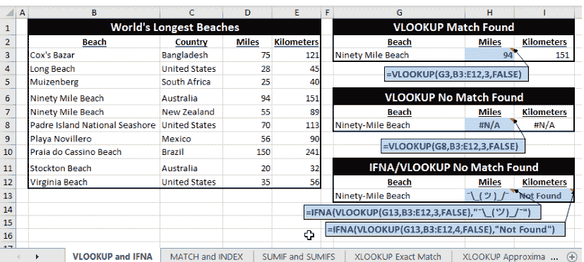

**图 10.1 – VLOOKUP 和 IFNA 函数**

VLOOKUP 有四个参数：

- **Lookup_value** – 这是您在列表中搜索的值，在此例中为 G3。VLOOKUP 在 _table array_ 的第一列向下查找此值。
- **Table_array** – 这指的是您希望搜索的列表的单元格坐标；在此例中为 B3 : E12。
- **Col_index_num** – 这是您希望从中返回数据的 _table_array_ 内的列位置；在此例中，3 表示 _第三_ 列，以便我们可以查找英里长度。
- **Range_lookup** – _FALSE_ 指示 VLOOKUP 查找 _精确_ 匹配，而 _TRUE_ 允许 _近似_ 匹配。

> **提示**
> 您可以使用 0（零）来表示精确匹配，或使用 1 来表示近似匹配，以替代 VLOOKUP 中的 _FALSE_ 和 _TRUE_。

VLOOKUP 在 Excel 中被广泛使用，但有一些令人沮丧的限制：

- VLOOKUP 只能返回列表右侧的数据，这意味着您无法从查找列的左侧查找数据。
- VLOOKUP 要求您指定列表中的列位置。许多用户会在此处输入一个静态数字，如果列表中删除了一个或多个列，这可能会导致 #REF! 错误，或者如果添加了新列，则会从错误的列返回数据。
- VLOOKUP 默认使用近似匹配，这意味着如果您不声明需要精确匹配，可能会做出错误的匹配。
- VLOOKUP 只能返回单个匹配项。因此，如图 10.1 中单元格 H3 所示，公式与单元格 B6 中的第一个 Ninety Mile Beach 匹配，但忽略了任何其他实例，例如单元格 B7 中的第二个实例。本章稍后，您将看到如何使用 FILTER 函数从列表中返回多个值，例如此列表。有趣的是，澳大利亚的 Ninety Mile Beach 长 94 英里，而新西兰的 Ninety Mile Beach 仅长 55 英里。但要说明的是，这些都不是笔误。
- 图 10.1 中单元格 H8 的 =VLOOKUP(G8,B3:E12,3,FALSE) 公式返回 #N/A，因为单元格 G8 包含带连字符的 Ninety-Mile Beach 版本，与单元格 B3:B12 中的任何值都不匹配。任何引用包含 #N/A 的单元格的公式也将返回 #N/A，有时会在整个电子表格中产生连锁反应。

像这样不一致的数据可能是 Excel 中的噩梦。幸运的是，我们可以通过将 IFNA 函数包装在 VLOOKUP 之外来解决 #N/A 问题。

#### IFNA 函数

单元格 H13 中的 =IFNA(VLOOKUP(G13,B3:E12,3,FALSE),"\\_\\_(ツ)_/\\_") 公式返回一个俏皮的表情符号 shrug，`\\_\\_(ツ)_/\\_`，以替代 #N/A 错误。相比之下，单元格 I14 中的 =IFNA(VLOOKUP(G13,B3:E12,4,FALSE),"Not Found") 公式在 VLOOKUP 返回 #N/A 时返回更实用的消息 **Not Found**。

> **细微差别**
> 有时，用户在 Excel 中输入数据时会不小心碰到空格键，这可能导致难以追踪的尾随空格。像这样的不一致会导致用户认为 Excel 坏了，或者他们根本不理解查找函数。当您双击单元格时，检查光标是否位于单元格中最后一个字符的紧邻位置。如果不是，请根据需要按退格键以消除多余空格，或使用 TRIM 函数。

IFNA 有两个参数：

- **Value** – 这是可能返回 #N/A 的计算，例如 VLOOKUP(G13,B3:E12,3,FALSE)。
- **Value_if_na** – 这是要显示的内容，以替代 #N/A 错误，可以包含数字、文本或另一个公式，例如 "Not found"。


一些用户依赖于 IFERROR 函数，该函数有一个 value_if_error 参数来替代 value_if_na。如果您需要掩盖错误 #N/A，例如 #DIV/0!，或者需要与 Excel 2010 及更早版本兼容，则 IFERROR 很有用。IFNA 在 Excel 2013 及更高版本中工作，并且只会掩盖 #N/A 错误，以便您可以轻松查看是否出现其他错误，例如 #REF! 或 #VALUE。简而言之，IFERROR 掩盖所有错误，这可能会使查找公式故障排除工作变得复杂。现在我们已经探索了 VLOOKUP 以及如何处理可能出现的任何错误，让我们看看 MATCH 函数如何使 VLOOKUP 更加通用，或者如何完全消除对 VLOOKUP 的需求。

### MATCH 函数

图 10.2 中 MATCH 和 INDEX 工作表中单元格 H3 的 =MATCH(G3,B3:B12,0) 公式返回 2，因为它在 B3:B12 范围的第二行找到了 Long Beach：

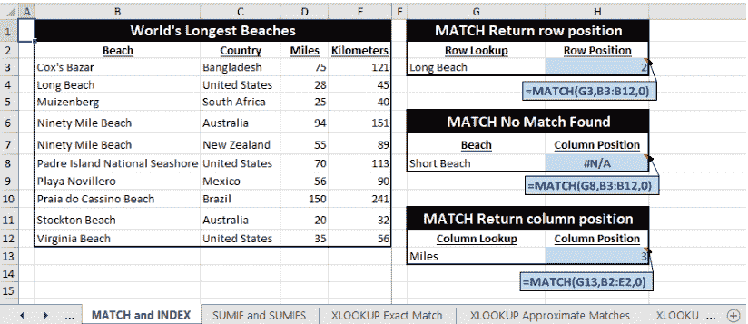

MATCH 函数有三个参数：

- **Lookup_value** – 要查找的内容，在单元格 H3 的情况下，即单元格 G3 的内容。
- **Lookup_array** – 可以是要搜索的行、列或数组；在单元格 H3 的情况下，它是 B3:B12 范围。
- **Match_type** – 这个可选参数提供三个选项：
  - -1 – 查找等于或小于 lookup_value 的最接近的匹配项。
  - 0 – 查找与 lookup_value 的精确匹配项，我在单元格 H3 中指定了此选项。
  - 1 – 查找等于或大于 lookup_value 的最接近的匹配项。如果您不指定第三个参数，这是 MATCH 的默认值。

图 10.2 中单元格 H8 的 =MATCH(G8,B3:B12,0) 公式返回 #N/A，因为 Short Beach 不出现在单元格 B3:B12 中。相反，图 10.2 中单元格 H13 的 =MATCH(G13,B2:E2,0) 公式返回 3，因为 Miles 出现在单元格 B2:E2 的第三列中。

图 10.3 中单元格 K3 包含 =VLOOKUP($J3,$B$2:$E$12,3,FALSE) 公式，而单元格 L3 包含 =VLOOKUP($J3,$B$2:$E$12,4,FALSE) 公式。这两个公式之间的唯一区别是，在单元格 K3 中，我为英里指定了 col_index_num 参数为 3，而在单元格 L3 中，我为千米指定了 4。必须手动更改 col_index_num 参数是 VLOOKUP 的另一个令人沮丧的限制：

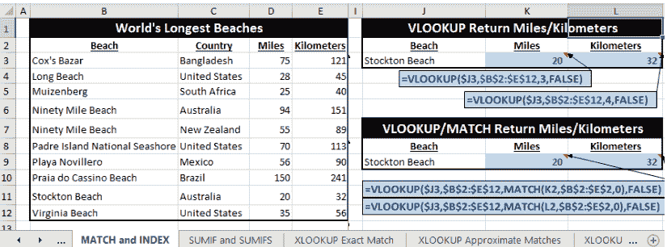

图 10.3 – VLOOKUP 和 VLOOKUP/MATCH 函数

#### 细微差别

$J3 中的 $ 符号表示混合引用，它指示 Excel 在将公式向右复制时不要将引用从列 J 更改为列 K 及以后，但在向下复制列时，行号将更改为 4 及以后。$B$2:$E$12 中的 $ 符号表示绝对引用，Excel 不会更改列或行号。没有 $ 符号的单元格引用，例如 B2，是相对引用，这意味着当您沿行或沿列复制公式时，Excel 会更改列字母或行号。

图 10.3 中单元格 K9 的 =VLOOKUP($J9,$B$2:$E$12,MATCH(K8,$B$2:$E$2,0),FALSE) 公式向您展示了如何在 VLOOKUP 内部使用 MATCH 函数来创建双重查找。VLOOKUP 将沿 table_array 的第一列向下查找，而 MATCH 可以沿行向右查找以确定您希望 VLOOKUP 从中返回信息的列。虽然这提高了 VLOOKUP 的完整性，但除非您改用 INDEX 函数，否则您仍然受其他限制的约束。图 10.4 中单元格 O8 的 =INDEX(D3:D12,MATCH($N3,$B$3:$B12,0)) 公式向您展示了如何在 INDEX 函数内部使用 MATCH 函数，以类似于 VLOOKUP 的方式返回 Stockton Beach 的长度（以英里为单位）：

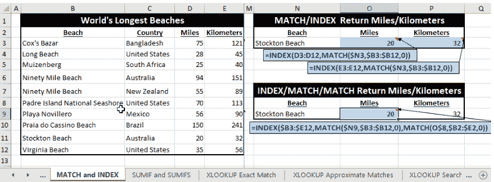

图 10.4 – INDEX/MATCH 函数

INDEX 函数有三个参数：

- **Array** – 行或列中的单元格范围，或数据数组；在此示例中，它是 D3:D12。
- **Row_num** – 要从中返回数据的行号或单元格范围，可以由 MATCH 函数提供；在此示例中，它是 MATCH($N3,$B3:$B12,0)。
- **Column_num** – 可选，您可以指定数组内的列位置，在此示例中我省略了此参数。

INDEX/MATCH 函数消除了 VLOOKUP 造成的许多沮丧，因为该组合可以返回 **Lookup** 列左侧或右侧的信息，甚至可以执行双向查找，沿行向下并沿列向右搜索，以根据两个条件查找信息。图 10.4 中单元格 **O9** 的 =INDEX($B3:$E12,MATCH($N9,$B3:$B12,0),MATCH(O$8,$B2:$E2,0)) 公式向您展示了如何执行双重匹配。第一个 MATCH 函数识别 **Stockton Beach** 出现的行，第二个 MATCH 函数返回单词 **Miles** 出现的列。按原样编写，此公式可以复制到单元格 **P9** 以查找以千米为单位的长度。

VLOOKUP 和 INDEX/MATCH 的一个局限性是它们只能匹配单个数据。SUMIF 使您能够搜索一个或多个条件的实例，然后加上相应的值。

### SUMIF 函数

图 10.5 中单元格 **H3** 的 `=SUMIF($B$3:$B$12,$G$3,D3:D12)` 公式返回 **149**，作为 Ninety Mile Beach 两个实例的英里总和：

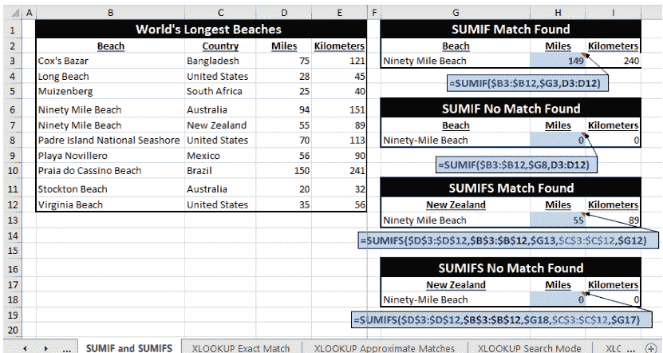

`SUMIF` 函数有三个必需参数：

- **Range** – 这指的是您希望搜索的行或列，在此示例中，它是 `$B$3:$B$12`。
- **Criteria** – 这指的是要搜索的值，在此示例中，它是 `$G$3`。
- **Sum_range** – 这指的是您希望从中加总值的行或列，在此示例中，它是 `D3:D12`。

如图 10.5 中单元格 **H8** 所示，`=SUMIF($B$3:$B$12,$G$8,D3:D12)` 公式返回 0，因为带连字符的 **Ninety-Mile Beach** 版本不出现在单元格 **B3:B12** 中。如前面所见，在这种情况下，`VLOOKUP` 和 `MATCH` 将返回 `#N/A`。通常，您不希望将两个 Ninety Mile Beach 加在一起，而是希望查找其中一个海滩的长度，您可以使用 `SUMIFS` 函数来实现这一点。

### SUMIFS 函数

图 10.5 中单元格 **H13** 的 `=SUMIFS(D3:D12,$B$3:$B$12,$G$13,$C$3:$C$12,$G$12)` 公式返回 **55**，作为新西兰 Ninety Mile Beach 的距离。

SUMIFS 函数可以根据最多 127 个条件对数据求和：

- **Sum_range** – 这指的是您希望从中加总值的行或列，在此示例中，它是 D3:D12。
- **Criteria_range1** – 这指的是您希望搜索的行或列，在此示例中，它是 $B$3:$B$12。
- **Criteria** – 这指的是要搜索的值，在此示例中，它是 $G13，用于 **Ninety Mile Beach**。
- **Criteria_range2** – 这指的是您希望搜索的行或列，在此示例中，它是 $C$3:$C$12。
- **Criteria2** – 这指的是要搜索的值，在此示例中，它是 $G12，用于 **New Zealand**。

如果找不到匹配项，SUMIFS 将返回零，如图 10.5 中单元格 **H18** 所示。当您需要为公式添加更多规范时，请根据需要继续添加其他条件范围和条件。现在我们已经回顾了 Excel 中最广泛使用的查找函数，让我们来看看相对较新的 XLOOKUP 函数。

### XLOOKUP 函数

正如您将看到的，XLOOKUP 不仅消除了我为 VLOOKUP 提到的沮丧，它还使您能够创建比 INDEX/MATCH 更简单的公式，并添加了更多功能。图 10.6 中 XLOOKUP `Exact Match` 工作表中单元格 **H3** 的 =XLOOKUP($G3,$B3:$B12,D3:D12) 公式返回 **94**，作为 **Ninety Mile Beach** 以英里为单位的长度。与 VLOOKUP 一样，XLOOKUP 在找到初始匹配项后停止查找：

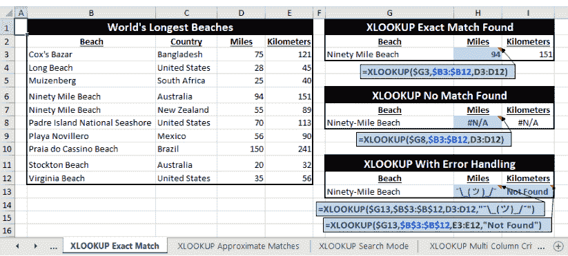

图 10.6 – XLOOKUP 函数


### Lookup and Dynamic Array Functions

#### Tip

XLOOKUP eliminates most, but not all, of the previous uses for `INDEX/MATCH`. XLOOKUP doesn’t allow you to simultaneously search down a column and across a row like `INDEX` with two `MATCH` functions allows, so it’s good to have both approaches in your repertoire.

XLOOKUP has a total of six arguments, but often, you’ll only need to enter the three required arguments:

- **Lookup_value** – A value that you’re searching for, such as the contents of cell $G3
- **Lookup_array** – A column or row that you wish to search, such as $B3:$B12
- **Return_array** – A column or row that you wish to return data from, such as D3:D12

As shown in cell **H8** of Figure 10.6, XLOOKUP returns #N/A if a match cannot be found, which is the same as VLOOKUP and MATCH. The difference is that XLOOKUP has a fourth argument that allows us to indicate what should be displayed in lieu of #N/A, which generally obviates the need to wrap `IFNA` or `IFERROR` around XLOOKUP.

#### The if_not_found argument

The `=XLOOKUP($G13,$B$3:$B$12,D3:D12,"\_(ツ)_/")` formula in cell **H13** returns a whimsical emoji shrug, `\_(ツ)_/`, in place of the #N/A error, while the `=XLOOKUP($G13,$B$3:$B$12,E3:E12,"Not Found")` formula in cell **I13** returns a more practical message of **Not Found** when XLOOKUP cannot find a match.

The initial matches we’ve made have been based upon exact matches with the lookup value, but sometimes, you might need to return results based upon an approximate match instead.

#### The match_mode argument

The `=XLOOKUP(G3,D3:D12,B3:B12,,-1)` formula in cell **H3** of the XLOOKUP Approximate Matches worksheet in Figure 10.7 returns **Playa Novillero** as the beach that is closest to **60** miles long without going over:

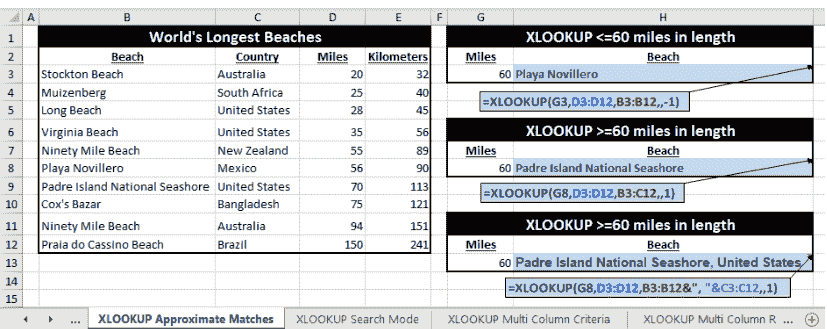

Figure 10.7 – Approximate matches

In this case, I omitted the if_not_found argument because XLOOKUP should always find a match in this context, but I did add a fifth argument:

- Match_mode – The four options include the following:
- 0 – Exact match, or return #N/A, which is the default response unless you specify otherwise.
- –1 – Exact match, or return the next smaller item, as shown in cell H3 of Figure 10.7.
- 1 – Exact match, or return the next larger item, as shown in cell H8 of Figure 10.7.
- 2 – A wildcard match using \*, ?, or ~ for performing partial text matches.

Nuance
Be mindful of the sort order of your data if you’re performing an approximate match on numbers. XLOOKUP will match with the first value it finds and then stops looking. It’s a good practice to sort text-based lists if you’re performing an approximate match, but it isn’t necessarily required.

The `=XLOOKUP(G8,D3:D12,B3:C12,,1)` formula in cell H8 of Figure 10.7 returns Padre Island National Seashore as the beach that is closest to but greater than 60 miles in length. Again, I omitted the if_not_found argument and specified 1 for the match_mode argument to have XLOOKUP find the next highest value greater than or equal to 60. Conversely, VLOOKUP can only return the next lowest value.

Now, let’s explore the search_mode argument for XLOOKUP.

### Combining results into a single column

The `=XLOOKUP(G8,D3:D12,B3:B12&", "&C3:C12,,1)` formula in cell H13 of Figure 10.7 shows you how to concatenate, or combine together, values from two or more columns by using ampersands (&) along with a comma and a space inside double quotes between the two column references. This causes XLOOKUP to return the beach and country in a single cell.

Concatenation is by no means unique to XLOOKUP. You can join two or more pieces of text together by using the CONCAT function in Excel 2019 and later, the CONCATENATE function in any version of Excel, or as I’ve done, simply use the ampersand in any version of Excel. Any text that isn’t in a worksheet cell must be enclosed in double quotes as shown.

Now, let’s look at the sixth and final argument for XLOOKUP.

### The search_mode argument and returning results to multiple columns

The `=XLOOKUP(G3,B3:B12,C3:E12,"Not found",1,1)` formula in cell H3 of Figure 10.8 returns the first instance of Ninety Mile Beach, while the `=XLOOKUP(G3,B3:B12,C3:E12,"Not found",1,-1)` formula in cell H8 returns the last instance. The only difference is the sixth argument, search_mode:

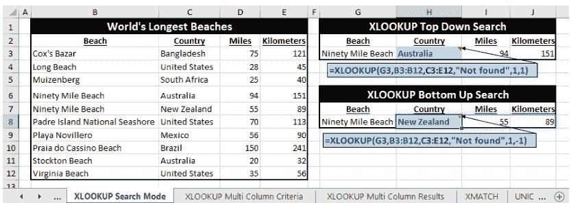

Figure 10.8 – The top-down and bottom-up lookups

The search_mode argument offers four options:

- 1 – This default value, which I used in cell H3 of Figure 10.8, instructs XLOOKUP to search from the top of the list to the bottom, just the same as VLOOKUP. The data does not necessarily need to be sorted to perform this type of search.
- -1 – This value, which I used in cell H8 of Figure 10.8, instructs XLOOKUP to search from the bottom of the list up, which is a new functionality for any worksheet function in Excel. Again, the data doesn’t necessarily need to be sorted.
- 2 – This value instructs XLOOKUP to perform a binary search from top to bottom. If you do not sort the list in ascending order, invalid results might be returned.
- -2 – This value instructs XLOOKUP to perform a binary search from bottom to top. Once again, if you do not sort the list in descending order, invalid results might be returned.

Binary searches offer faster performance, whereas non-binary searches are more forgiving of users who don’t take the time to sort their lists or aren’t aware of the need to sort. Also, note that return_array in both formulas is C3:E12, which means XLOOKUP returns three columns of data instead of just one. I’ll share more examples of this capability in the next two sections. Now, let’s see how to perform a match based upon criteria from two or more columns.

### Matching on multiple column criteria

The `=VLOOKUP($H3&" "&$I3,$B3:$F12,4,FALSE)` formula in cell J3 of Figure 10.9 shows you how to use VLOOKUP to find a match on two or more criteria. lookup_value of $H3&" "&$I3 combines the beach and country together, but a helper column is required for this to work:

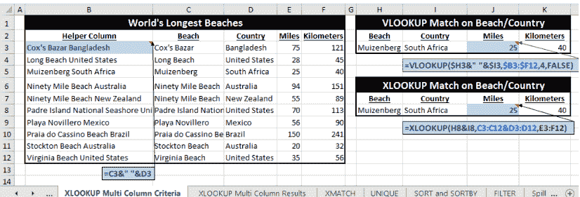

**Figure 10.9 – Multiple column lookups**

The `=C3&" "&D3` formula in cell B3 of Figure 10.9 is an example of a helper column that is required with VLOOKUP if you wish to match on multiple criteria. The formula, which I copied down to cell B12, combines the beach and country together so that VLOOKUP has a single column that it can match. Fortunately, you do not need to create helper columns when you use XLOOKUP.

The `=XLOOKUP(H8&I8,C3:C12&D3:D12,E3:F12)` formula in cell J8 of Figure 10.9 shows you how XLOOKUP can match multiple criteria without a helper column. The formula can be broken down as follows:

- **Lookup_value** – H8&I8 combines the beach and country together into a single input.
- **Lookup_array** – C3:C12&D3:D12 instructs XLOOKUP to combine columns C and D into a single list.
- **Return_array** – B3:F12 instructs XLOOKUP to return both miles and kilometers, which is another example of XLOOKUP returning results to two or more columns.

### Returning results from multiple cells

The `=XLOOKUP(B11,B3:B7,C3:N7)` formula in cell C11 of Figure 10.10 returns results for the Blue team for January through December. Historically, you would have needed to enter a formula using VLOOKUP or SUMIF in cell C11 and then copy the formula across to column N. XLOOKUP accomplishes this same task with a single formula:

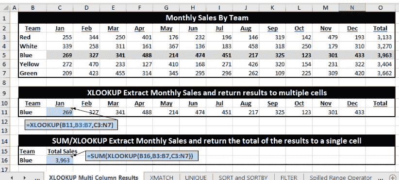

Figure 10.10 – XLOOKUP returns results and addresses of results

Dynamic array formulas return a set of data, known as an array, and can spill the data into adjacent cells. This functionality is only available in Microsoft 365, Excel 2021, Excel Mobile, and Excel for the Web. Dynamic array formulas will return an error such as #NAME? or #VALUE! in older versions of Excel. As you’ll see later in this chapter, dynamic array functionality is not limited to modern functions such as XLOOKUP but can be used with almost any worksheet function when you employ the Spilled Range Operator (#).

Further, XLOOKUP returns both the results shown and the addresses of the result cells.

The `=SUM(XLOOKUP(B16,B3:B7,C3:N7))` formula in cell C16 of Figure 10.10 sums multiple lookup results because, in this context, the SUM function is using the cell addresses of the matches returned by XLOOKUP versus the values themselves. No function in Excel has been capable of the feats that XLOOKUP does handily.


### Nuance

XLOOKUP 只能从单行返回结果，但可以从多列返回结果。相反，SUMIF 和 SUMIFS 可以从多行返回结果，但仅限于单列。如果指定多个 sum_range 列，SUMIF 仅返回第一列的结果，而 SUMIFS 返回 #VALUE!。

现在，让我们比较 XLOOKUP 与 XMATCH。

### The XMATCH function

Figure 10.11 中单元格 H3 的 =XMATCH(G3,B3:B12) 公式返回 9，因为它在 B3:B12 范围的第九行找到了 Stockton Beach。单元格 H8 中的 =XMATCH(G8,B3:B12) 公式返回 #N/A，因为 Short Beach 不出现在单元格 B3:B12 中。最后，Figure 10.11 中单元格 H13 的 =XMATCH(G13,B2:E2) 公式返回 3，因为它在 B2:E2 范围的第三列找到了 Miles。如您所见，XMATCH 可以向下查找行或横向查找列，就像 MATCH 函数一样：

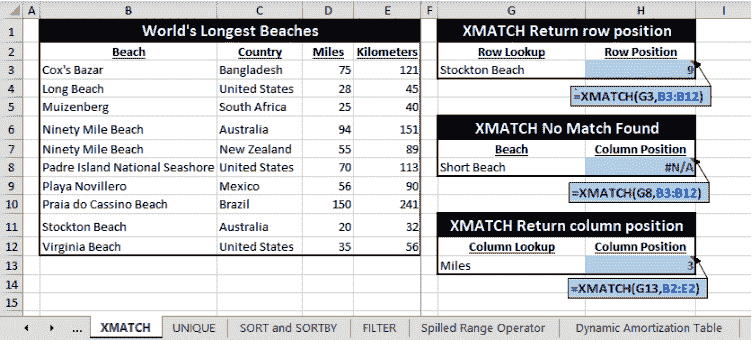

Figure 10.11 – The XMATCH function

The XMATCH function has four arguments:

- Lookup_value – What to look for.
- Lookup_array – A row, column, or array to search.
- Match_type – This optional argument offers the same four choices as XLOOKUP:
  - 0 – Exact match, or return #N/A
  - -1 – Exact match, or return the next smaller item
  - 1 – Exact match, or return the next larger item
  - 2 – Wildcard match using *, ?, or ~

### The UNIQUE function

The UNIQUE function gives you a self-updating means of removing duplicates from another list. The =UNIQUE(C3:C12) formula in cell G3 of Figure 10.12 returns one of each country’s names from the list in cells C3:C12, spilling the results into cell G4 and beyond as needed:

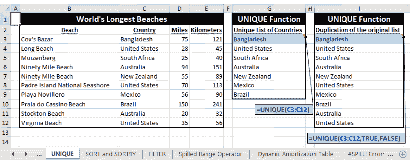

Figure 10.12 – The UNIQUE function

The UNIQUE function has three arguments:

- Array – The range of cells that you wish to remove duplicates from, which, in this case, is cells C3:C12.
- search_mode – The argument has the same options as XLOOKUP:
  - 1 – This default value instructs XMATCH to search from the top of the list to the bottom. The data does not necessarily need to be sorted to perform this type of search.
  - -1 – This value instructs XMATCH to search from the bottom of the list up, which, like XLOOKUP, is a new functionality for any worksheet function in Excel. Again, the data doesn’t necessarily need to be sorted.
  - 2 – This value instructs XMATCH to perform a binary search from top to bottom. If you do not sort the list in ascending order, invalid results might be returned.
  - -2 – This value instructs XMATCH to perform a binary search from bottom to top. Once again, if you do not sort the list in descending order, invalid results might be returned.

Just as XLOOKUP enables you to go far beyond what VLOOKUP offers, XMATCH expands the previous limitations of the MATCH function. Now, let’s look at other functions that have been recently added to Excel, such as the UNIQUE function.

- by_col – An optional argument that defaults to TRUE, which instructs Excel to remove duplicates from columns. Use FALSE if you wish to instead remove duplicates across rows. In this case, I omitted the argument.
- exactly_once – An optional argument that defaults to TRUE to remove duplicates. Use FALSE if you wish to display every item from the original range. In this case, I omitted the argument.

The =UNIQUE(C3:C12, TRUE, FALSE) formula in cell I3 of Figure 10.12 returns every item from the original list. This is useful if you want to replicate the original list in a new location. Doing so enables you to use the Spilled Range Operator (#) in formulas, as I’ll discuss in The Spilled Range Operator section of this chapter.

> Nuance
> Sometimes, you can omit arguments within Excel formulas by placing commas in lieu of the argument itself, such as =UNIQUE(C3:C12, , FALSE). The default by_col value is TRUE, but in this case, Excel assumes FALSE instead, which duplicates the entire list in the same fashion as the formula in cell I3 instead of removing duplicates. Watch out for unintended consequences if you omit function arguments in this fashion.

Next, let’s look at how to dynamically sort data based on a formula.

### The SORT function

In Figure 10.13, I clicked on cell D3 and then clicked on Sort Largest to Smallest on the Data tab of Excel’s ribbon. The =SORT(B3:E12) formula in cell G3 shows the list sorted back into alphabetical order again. In this case, the SORT function is spilling results into columns H:J and rows 4:12:

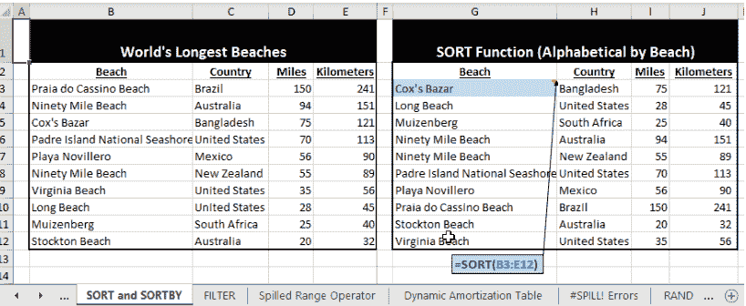

Figure 10.13 – The SORT function

### Lookup and Dynamic Array Functions

The SORT function has the following arguments:

- Array – The range of cells that you wish to sort, which, in this case, is cells B3:E12.

**Tip**
Make sure that you don’t include your heading row in the array; otherwise, you’ll most likely sort the column headings into the body of your list.

- Sort_index – An optional column position that you wish to sort on. In this case, I omitted this argument, but I’ll show you an example later.
- Sort_order – This optional argument defaults to 1, which indicates you want to sort in ascending order, or you can enter –1 to instruct Excel to sort in descending order. In this case, I omitted sort_order.
- By_col – Optionally, enter FALSE to confirm the default sort order of sorting by rows, or enter TRUE if you wish to sort sideways by columns, which, again, I omitted in this case.

**Tip**
You can wrap the SORT function around the UNIQUE function to sort a dynamic list of unique items, as discussed in the previous section.

The =SORT(B3:E12,3) formula in cell L3 of Figure 10.14 sorts the list in ascending order based on miles:

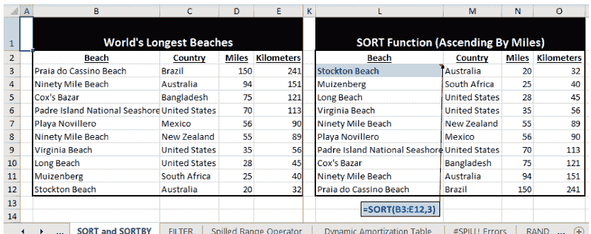

Figure 10.14 – Sorting in ascending order based on miles

In this case, 3 indicates that we want to sort based on the third column of the array.

The =SORT(SORT(B3:E12,3,-1),2) formula in cell Q3 of Figure 10.15 shows you how to sort alphabetically by country and then in descending order by miles:

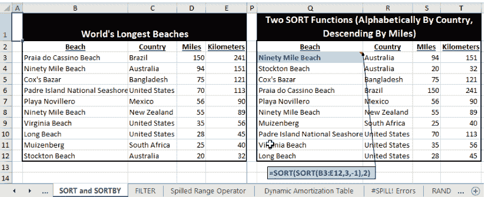

In this case, the first sort, meaning the inside SORT function, sorts the list in descending order based on miles. The outside SORT function arranges the list in alphabetical order by country since I specified the second column as sort_index. The nuance is that the SORT functions must be nested in the proper order to achieve the desired result.

> Nuance
> You can use the SORT function to sort data from another workbook. Excel's online help states that dynamic arrays between workbooks only work when both workbooks are open at the same time. However, my experience is that dynamic arrays do indeed still return results whether the other workbook is open or not.

Conversely, the alternative =SORTBY(B3:E12,C3:C12,1,D3:D12,-1) formula, as shown in cell V3 of Figure 10.16, achieves the same outcome:

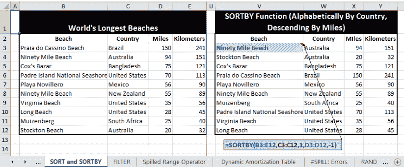

Figure 10.16 – The SORTBY function

The SORTBY function allows you to sort based upon up to 126 columns and has the following arguments:

- Array – The range of cells that you wish to sort, which, in this case, is B3:E12.
- By_array1 – The cell coordinates of the first column that you wish to sort on, such as C3:C12.
- Sort_order1 – Enter 1 to confirm the default sort order of ascending, or enter -1 to sort in descending order. I chose 1 for ascending.
- By_array2 – The cell coordinates of the second column that you wish to sort on, such as D3:D12.
- Sort_order2 – All sort_order arguments default to 1 for ascending or -1 for descending. In this case, I specified -1 for descending.

> Nuance
> You can only sort rows with the SORTBY function. If you wish to sort two or more columns sideways, you’ll need to nest two or more SORT functions, as described earlier.


### The FILTER function

Now that you can dynamically sort data with a formula, let’s up our game by seeing how to filter a list by using the FILTER function.

The =FILTER(B3:E12,B3:B12=H2) formula in cell G6 of Figure 10.17 displays all the beaches for the name entered in cell H2, in this case, Ninety Mile Beach. Earlier in the chapter, you saw that functions such as VLOOKUP, MATCH, and XLOOKUP stop looking after finding an initial match. The FILTER function gives you a way to return multiple values from a list:

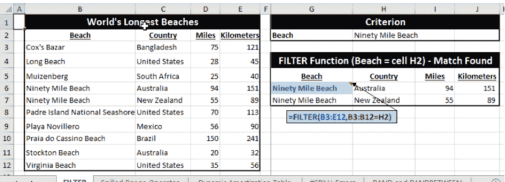

Figure 10.17 – The FILTER function

> **Tip**
> It’s best not to embed criteria within the formula itself. Using input cells such as cell H2 enables you or other users to change the criteria without having to edit the formula.

The FILTER function has two required arguments and one optional argument:

- Array – This required argument is a list composed of one or more columns that you wish to filter, which, in this case, is B3:E12.
- Include – This required argument is the cell coordinates of the column that you wish to filter on and the criteria itself, which, in this case, is B3:B12=H2. You can only provide one criterion per column, but you can filter on multiple columns.
- If_empty – An alternate message to display, which I omitted in this case but will be illustrated later.

The =FILTER(B3:E12,B3:B12=M2) formula in cell **L6** of Figure 10.18 shows that if you omit the if_empty argument, the FILTER function returns #CALC! if no matches are found. In this case, cell **M2** contains the hyphenated Ninety-Nine Mile Beach version, which does not appear in cells **B3:B12**:

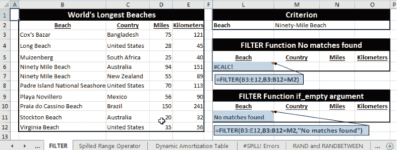

Figure 10.18 – The #CALC! error and the if_empty argument

The =FILTER(B3:E12,B3:B12=M2,"No matches found") formula in cell **L11** of Figure 10.18 indicates that you can display an alternate message instead of #CALC! if no match is found. Additionally, if you wish, you could nest the FILTER function in this argument with other criteria that might match.

The =FILTER(B3:E12,C3:C12=R2,"No matches found") formula in cell **Q6** of Figure 10.19 displays records where the country matches the value in cell **R2**, which, in this case, is United States. By default, the FILTER function presents results in the same order that the items appear in the specified array, but you can use the SORT function to change the sequencing:

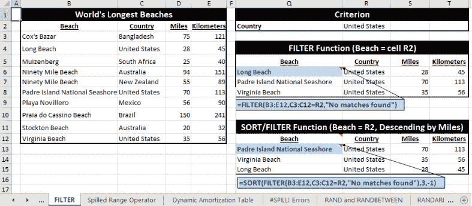

Figure 10.19 – Records being shown in default order and sorted order

The =SORT(FILTER(B3:E12,C3:C12=R2,"No matches found"),3,-1) formula in cell Q13 of Figure 10.19 sorts those same records in descending order. The 3 value means the sort is based on the third column, and -1 corresponds with the descending order.

The =FILTER(B3:E12,(C3:C12=W2)*(D3:D12>=W3)) formula in cell V7 of Figure 10.20 shows that you can filter on two or more columns:

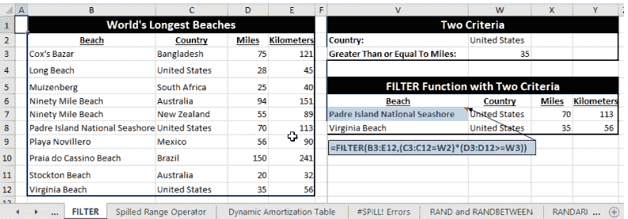

However, you can only provide a single criterion for each column. Each include statement must be enclosed in parentheses and connected with an asterisk. The formula looks at cells C3:C12 for the words United States, which appear in cell W2, and simultaneously looks at cells D3:D12 for amounts that are greater than or equal to 35 miles, which is listed in cell W3. Let’s look at one more example, which will illustrate how to omit columns from the results that FILTER returns.

The =FILTER(B3:B12&" : "&D3:D12&" miles",C3:C12=AA3) formula in cell AA6 of Figure 10.21 concatenates the beach name and length in miles together. Instead of the array being B3:E12, in this case, the array is B3:B12 and D3:D12, with a colon inserted after the results from column B and the word miles after the results from column D. The concatenation causes the results to be returned to a single column instead of multiple columns as before:

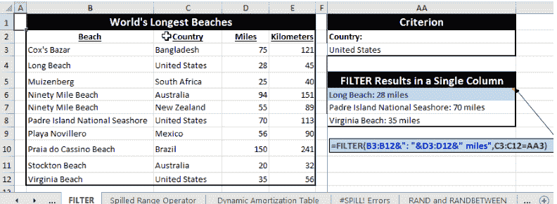

Figure 10.20 – FILTER allows one criterion per column

Figure 10.21 – Omitting columns from the FILTER results

### The Spilled Range Operator

The average spreadsheet user spends a lot of time managing formulas in spreadsheets, particularly when new data is added to a list. The **Table** feature, which I discuss in _Chapter 7, Automating Tasks with the Table Feature_, offers one approach for eliminating this manual task. A second approach involves using the **Spilled Range Operator** (#) to create formulas that expand into more rows or contract into fewer rows based on changes in your data.

> **Nuance**
> You can only use the Spilled Range Operator in conjunction with formulas that reference results generated by a dynamic array function. This means the Spilled Range Operator is not available in Excel 2019 and earlier. If you use the Spilled Range Operator to reference data that is not in a dynamic array, the formula might return zero or a #VALUE! error.

The `=SORT(UNIQUE(FILTER(C3:C12,D3:D12>H2)))` formula in **G6** of Figure 10.22 combines several concepts from this chapter to generate an alphabetical list of countries that have beaches greater than or equal to the number of miles in cell **H2**:

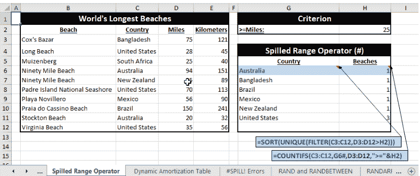

Figure 10.22 – The SORT/UNIQUE functions and the Spilled Range Operator (#)

In this case, the **FILTER** function in cell **G6** is filtering the list of countries that have beaches greater than the number listed in cell **H2**, which, in this case, is 25. The **UNIQUE** function then removes duplicates from the resulting list of countries, and the **SORT** function sorts the list in alphabetical order.

### The dynamic amortization table

An amortization table details how loan payments are allocated on a period-by-period basis, such as monthly. Additionally, an amortization table shows how the amount of the loan declines over time, typically down to zero or to an agreed-upon balloon payment to be made at the end. You might have encountered an amortization table in the paperwork provided along with the purchase of a car or a house. Historically, amortization tables generally required manual adjustments to accommodate different loan lengths. For instance, an amortization table for a 48-month car loan would need to have 12 more rows added if you opted for a 60-month loan instead. Dynamic array functions now enable us to create dynamic amortization tables that do not require much maintenance but instead expand or contract automatically to match the length of the loan.

Prior to the advent of dynamic array functions, you could create a macro to resize an amortization table on demand, or you could use the IF function to craft formulas that make cells appear blank in rows that are greater than the length of the loan. The Conditional Formatting feature, which I discuss in Chapter 4, Conditional Formatting, can be used to hide formulas, too. Fortunately, we no longer need to rely on workarounds.

The =COUNTIFS(C3:C12,G6#,D3:D12,">="&H2) formula in cell H6 of Figure 10.22 utilizes the Spilled Range Operator (#).

The COUNTIFS function allows you to count instances of items based on up to 127 criteria pairs. Its arguments take the following form:

- Criteria_range1 – The first range of cells to search, which, in this case, is C3:C12.
- Criteria1 – The value to search for, which, in this case, is the country name in cell G6. I’ll explain how the Spilled Range Operator (#) works later.
- Criteria_range2 – The second range of cells to search, which, in this case, is D3:D12.
- Criteria2 – The value to search for, which, in this case, is the lengths in miles that are greater than or equal to the number in cell H2.

Using G6# as the input for criteria1 causes the COUNTIFS function in cell H6 to become dynamic. To test this, change the value in cell H2 to 60. When cell H2 was set to 25, the formula in cell G6 displayed six countries but should now only show four countries. Accordingly, the COUNTIFS function shrank its results to only four rows. If you change cell H2 to 0, then all seven countries will be listed in column G and the corresponding beach counts will appear in column H.

This brings us to one of my favorite ways to demonstrate the Spilled Range Operator: a dynamic amortization table.


### 查找和动态数组函数

本章示例工作簿的动态摊销表工作表中，G:K 列包含一个工作区，您可以在 G9:K9 单元格中输入动态数组公式，跟随文本进行操作。

如图 10.23 所示，当您更改 B4 单元格中的年数时，摊销表中的明细行将相应地扩展或收缩。摊销表基于以下输入：

- 开始日期：图 10.23 中的 B2 单元格指定 1/1/2024 作为贷款的开始日期：

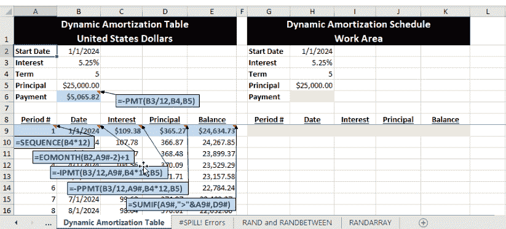

图 10.23 – 我们动态摊销表的初始设置

- 利率：图 10.23 中的 B3 单元格指定 5.25% 作为贷款的利率。

利率和年利率这两个词在贷款中经常被混用。通常，虽然我们以年度来考虑利率，但我们将要使用的 PMT、IPMT 和 PPMT 函数需要月利率，只需在工作表函数中将年利率除以 12 即可轻松实现。

- 期限 – 图 10.23 中的 B4 单元格指定贷款的期限（以年为单位），在此示例中为 5 年。

PMT、IPMT 和 PPMT 函数都要求期限以月表示，因此我将乘以 12 将输入从年转换为月。

### 动态摊销表

- 本金 – 图 10.23 中的 B5 单元格指定贷款金额，在此示例中为 $25,000。

图 10.23 中 B6 单元格的 =-PMT(B3/12,B4*12,B5) 公式不会在摊销表本身中引用，但会显示每月还款金额。PMT 函数有五个参数，但这里我们只需要前三个：

- 利率 – B3/12 返回月利率。如果忘记除以 12，年利率将按月而不是按年应用。在此示例中，这意味着每月利率为 5.25%，年利率为 63%。

- 期数 – B4*12 表示月度期数的数量。在此示例中，我们有一个 5 年期贷款，因此 5 x 12 = 60 个月。

- 现值 – B5 单元格包含贷款金额，通常称为现值（pv），因为金钱随时间贬值。

默认情况下，PMT 函数返回负数。我在 B6 单元格的等号后输入了一个负号，以便将还款显示为正数，但这只是个人偏好，可选。此数字不会在摊销表主体中引用，因为我们将使用 IPMT 和 PPMT 函数分别计算贷款还款的每月利息和本金部分。

如果您想在 Excel 中跟随操作，请在动态摊销表工作表的工作区中 H6 单元格输入 =-PMT(H3/12,H4*12,H5)。

现在我们已准备好摊销表输入并设置好列，将使用 SEQUENCE 函数动态创建期数。

#### SEQUENCE 函数

图 10.23 中 A9 单元格的 =SEQUENCE(B4*12) 公式创建从 1 到 60 的一系列数字。SEQUENCE 函数具有以下参数：

- 行数 – 您希望显示一系列数字的行数，在此示例中为 B4*12，用于引用贷款期限（以月为单位）。如果 B4 或 H4 单元格包含 60，则不需要乘以 12，而是直接引用 B4 或 H4 单元格。

- 列数 – 您希望添加一系列数字的列数，在此示例中我省略了此参数。

- 起始值 – 数字系列的起始值；在 A9 单元格中，由于我省略了该参数，默认值为 1，但您可以输入任何希望的数字。

- 步长 – 每个数字的增量；在 A9 单元格中，由于我省略了该参数，默认值为 1，但您可以输入任何希望的数字。

此初始列将固定我们的摊销表，并允许我们使用溢出范围运算符 (#) 使其他工作表函数也表现得动态。现在我们将在表中添加一系列日期。如果您在 Excel 中跟随操作，请在 G9 单元格输入 =SEQUENCE(H4*12)。在此上下文中，您将看到 SEQUENCE 创建从 1 到 60 的一系列数字。

### EOMONTH 函数

图 10.23 中 B9 单元格的 =EOMONTH(B2,A9#-2)+1 公式创建一系列日期。EOMONTH 是“月末”的缩写，具有两个参数：

- 开始日期 – 用作起始点的日期，在此示例中为 B2 单元格中的值。
- 月数 – 您希望计算新日期的过去或未来的月数；在此示例中，A9#-2 解析为 -1，这意味着 EOMONTH 返回上个月的最后一天，即 12/31/2023。

在 EOMONTH 后添加 +1 将日期向前滚动一天到 1/1/2024。溢出范围运算符 (#) 指示 EOMONTH 返回一系列日期，直到 6/1/2024，这与列 A 中列出的期数相对应。

如果您在工作区中跟随操作，请在 H9 单元格输入 =EOMONTH(H2,G9#-2)+1。该公式将返回一系列日期序列号，您可以通过选择 H9:H68 单元格，然后在 Excel 功能区“开始”选项卡的“数字”组中从“数字格式”菜单中选择“短日期”，或在“数字格式”菜单字段中输入字母 s 并按 Enter 来将其转换为日期。

现在，让我们计算贷款每月应付的利息。


### IPMT 函数

图 10.23 中 C9 单元格的 =-IPMT(B3/12,A9#,B4*12,B5) 公式计算每笔贷款还款的利息部分。IPMT 有六个参数：

- 利率 – 贷款每期的利率，在此示例中为 B3/12，用于返回月利率。
- 期数 – 您希望计算利息金额的期数；在此示例中，A9# 使用溢出范围运算符 (#) 创建对列 A 中期数的动态单元格引用。
- 总期数 – 贷款期限，在此示例中为 B4 单元格中的值。如果 B4 单元格指定的是年而不是月，则应使用 B4*12，如我们所做的那样。
- 现值 – 贷款的现值，在此示例中为 B5 单元格中的金额。
- 未来值 – 这是可选的，指贷款的未来值，默认值为 0（零），除非您另有指示。
- 类型 – 这是可选的。IPMT 默认值为 0（零），表示贷款期末付款，但您可以输入 1 以表示贷款期初付款。我通过省略该参数接受了期末付款的默认值。

默认情况下，IPMT 返回负金额，您可以通过在等号后添加负号将其更改为正金额。

如果您在工作区中跟随操作，请在 I9 单元格输入 =-IPMT(H3/12,G9#,H4*12,H5)。下一个公式将计算贷款每月偿还的金额。

#### PPMT 函数

图 10.23 中 D9 单元格的 =-PPMT(B3/12,A9#,B4*12,B5) 公式计算每笔贷款还款的本金部分。公式参数与 IPMT 相同，因此我不会再次详细说明。如果您在工作区中跟随操作，可以单击 I9 单元格，在公式栏中选择公式，按 Ctrl + C（或在 macOS 的 Excel 中按 ⌘ + C）或右键单击并选择“复制”，然后将公式粘贴到 J9 单元格。然后您只需将 IPMT 中的字母 I 改为 P 即可得到 PPMT。或者，您可以在 J9 单元格输入 =-PPMT(H3/12,G9#,H4*12,H5)。现在，我们将通过将溢出范围运算符 (#) 与 SUMIF 函数结合使用来完成动态摊销表，以计算贷款的运行余额。

#### SUMIF 函数

图 10.23 中 E9 单元格的 =SUMIF(A9#, ">"&A9#,D9#) 公式计算每个贷款期的期末余额。SUMIF 有三个参数：

- 区域 – 您希望搜索的行或列；在此示例中，A9# 使用溢出范围运算符 (#) 创建一个延伸到列 A 中最后一个期数的区域。
- 条件 – 您希望搜索的值；在此示例中，">"&A9# 使用溢出范围运算符 (#) 指示 Excel 包含大于当前期数的期数。在此上下文中，大于运算符必须用双引号括起来，并与单元格引用连接。

> 注意事项
> 如果省略溢出范围运算符，则 SUMIF 将仅在 E9 单元格中返回一个值。

- 求和区域 – 您希望从中求和值的行或列；在此示例中，D9# 使用溢出范围运算符创建一个延伸到列 A 中最后一个单元格的区域。


实际上，SUMIF 函数通过添加贷款每个期间的剩余本金付款来返回期末余额。如果你正在工作区中跟随操作，请在单元格 K9 中输入 =SUMIF (G9#, ">"&G9#, J9#)。动态摊销表展示了动态数组函数的变革能力。当然，Excel 中的每个功能都有一个或多个粗糙之处，因此让我们来看看两个特定于动态数组函数的错误。

### #SPILL! 错误

正如你所料，Excel 中的新功能（如动态数组函数）也可能导致新类型的错误提示。在 FILTER 函数部分，我讨论了 #CALC! 错误。在本节中，我将讨论 #SPILL! 错误。我们要看的第一个错误发生在动态数组函数需要显示其结果的紧邻区域中已有其他数据时。当用户覆盖了动态数组函数返回的数据时，也可能出现此错误。

#SPILL! 错误可能出现在两种不同的条件下：

- 图 10.24 中的单元格 G7 包含阻挡 UNIQUE 的单词 Obstruction。如果你随后在单元格 G3 中输入 =UNIQUE (C3:C12) 公式，Excel 将返回 #SPILL!，而不是你期望的国家列表。这是因为单元格 G7 的内容位于 UNIQUE 需要显示其结果的范围内。如图所示，当你单击包含 #SPILL! 的单元格（例如 G3）时，Excel 会在需要清除的区域周围绘制边框，以便公式返回其结果。清除单元格 G7 的内容或移动其内容以消除 #SPILL! 错误。或者，单击感叹号以显示与理解和解决此类错误相关的菜单选项：

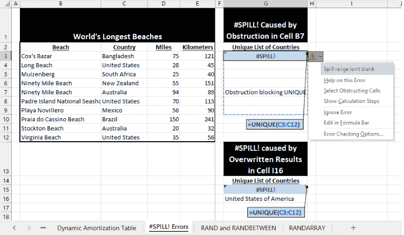

图 10.24 – #SPILL! 错误

图 10.24 中单元格 **G15** 的 =UNIQUE(C3:C12) 公式返回 #SPILL!，因为我将函数在单元格 **G16** 中返回的 **United States** 替换为 United States of America。如果用户覆盖了动态数组函数返回的任何结果，则公式将返回 #SPILL!，直到任何被覆盖的单元格被清除。简而言之，#SPILL! 和 #CALC! 错误旨在当动态数组函数由于电子表格中的条件而无法返回任何结果时，为你提供即时反馈。

现在，让我们看看如何在 Excel 电子表格中生成随机数。

### RANDARRAY 函数

Excel 有三个不同的函数可让你生成随机数。让我们先看看两个长期存在的选项，然后再看看 RANDARRAY。图 10.25 中单元格 **B2** 的 =RAND() 公式生成 0 到 1 之间的随机数：

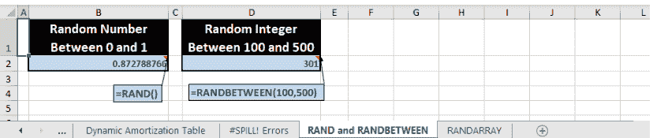

图 10.25 中单元格 **D2** 的 =RANDBETWEEN(100,500) 公式允许你生成 100 到 500 之间的随机整数。RANDBETWEEN 有两个参数：

- **Bottom** – 你想要返回的最低可能整数，在此示例中为 100
- **Top** – 你想要返回的最高可能整数，在此示例中为 500

**细微差别**

Excel 中的所有随机数函数都是易失性的，这意味着，与大多数公式不同，它们在工作簿中任何地方更改任何单元格时都会重新计算。通常，Excel 仅在你更改公式直接或间接引用的值时才重新计算公式。

图 10.26 中单元格 F2 的 =RANDARRAY(3) 公式返回 0 到 1 之间的三个随机数：

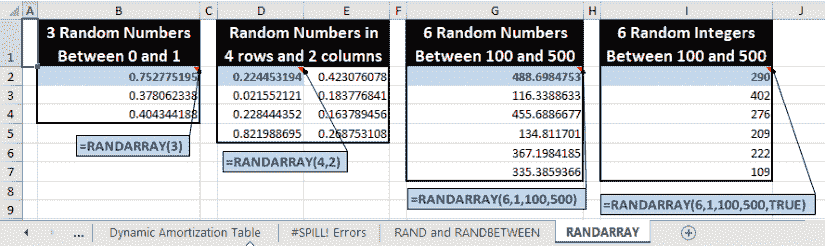

图 10.26 – RANDARRAY 函数

RANDARRAY 函数有五个参数：

- Rows – 这是一个可选参数，允许你指定要在其中显示随机数的行数。该参数默认为 1；在此示例中，我输入了 3。
- Columns – 这是一个可选参数，允许你指定要在其中显示随机数的列数。该参数默认为 1。
- Min – 这是一个可选参数，用于你想要显示的最小数字，在此示例中我省略了它。
- Max – 这是一个可选参数，用于你想要显示的最大数字，在此示例中我省略了它。
- Integer – 这是一个可选参数，在此示例中我省略了它，允许你指定以下内容：
  - TRUE 以显示整数。
  - FALSE 以显示小数；这是默认参数。

图 10.26 中单元格 D2 的 =RANDARRAY(4,2) 公式向你展示了如何跨四行两列返回随机数。图 10.26 中单元格 G2 的 =RANDARRAY(6,1,100,500) 公式使用四个参数返回带有小数位的随机数，跨 6 行 1 列，且介于 100 和 500 之间。最后，图 10.26 中单元格 I2 的 =RANDARRAY(6,1,100,500,TRUE) 公式添加了值为 TRUE 的第五个参数，指示 RANDARRAY 返回整数，也称为整数。通常，随机数在 Microsoft Excel 中与统计抽样一起使用，但也有许多其他用途。

### 摘要

在本章中，你了解了 Excel 中动态数组功能的概念。某些函数，如 UNIQUE、SORT、SORTBY、FILTER、RANDARRAY 和 SEQUENCE，是从头开始编写为动态数组函数的。XLOOKUP 函数是一种混合体，可以作为 VLOOKUP 函数的替代品。或者，它可以作为现代动态数组函数，将多个结果返回到单元格块中，或在另一个函数（如 SUM 或 AVERAGE 函数）内进行汇总。

此外，通过我们在动态摊销计划部分中组合的电子表格，我们看到 Excel 中的长期函数（如 EOMONTH、IPMT、PPMT 和 SUMIF）都可以呈现动态特性。我们将溢出范围运算符 (#) 与引用动态数组函数返回的一组数据结合使用。

动态数组函数使你能够简化公式，因为单个公式可以一次将结果返回到数百甚至数千行。用户在公式列表中键入一个或多个值的风险被消除，因为这样做会在工作表中引发 #SPILL! 错误。动态数组函数使现代版本的 Excel 与所有早期版本的 Excel（即 Excel 2019 及更早版本）完全区分开来。

在下一章中，我将引导你了解 LET 和 LAMBDA 函数，它们提供了前所未有的电子表格完整性改进潜力。这两个函数都能简化复杂公式，并使复杂公式更易于访问。

### 名称、LET 和 LAMBDA

如果你曾经想过：“哦，我希望 Excel 有某种方法来自动计算 x，”那么你的日子已经到来。在过程中会有一些细微差别和日益增加的复杂性，这就是为什么我为我们选择了一条简单直接的路径。我们将从简单的乘法开始计算盒子的体积，然后以多种方式对该计算进行变体，直到我们了解 LET 和 LAMBDA 函数。我将介绍名称的概念，有时也称为范围名称。名称可以简化公式编写，并更容易确定公式引用和计算的内容。LET 和 LAMBDA 函数与名称共享一些特性。为了帮助任何使用旧版 Excel 的人，我还将简要讨论使用 Visual Basic for Applications 编程代码创建自定义工作表函数。

在本章中，我将涵盖以下主题：

- PRODUCT、IF、CHOOSE、SWITCH、IFERROR 和 ISERROR 函数
- 分配名称工作表和输入
- 介绍 LET 函数
- 介绍 LAMBDA 函数
- 深入了解 LAMBDA 函数
- 自定义 VBA 工作表函数

到本章结束时，你将能够在 Excel 中创建自定义工作表函数。在此过程中，你将能够比较每种方法的优缺点，并希望扩展你的 Excel 工具箱。

### 技术要求

IF、CHOOSE 和 PRODUCT 函数以及名称在任何版本的 Excel 中均可用。SWITCH 函数需要 Excel 2019 或更高版本，而 LET 函数需要 Excel 2021 或 Microsoft 365。LAMBDA 函数适用于 Microsoft 365 和 Excel for the web。本章有两个示例工作簿：Chapter 11 – Names, LET, and LAMBDA.xlsx 工作簿


### 在 Excel 中进行简单体积计算

在本章中，我们将计算矩形体（例如运输箱）的体积，方法是将其长、宽、高相乘。在整个章节中保持一致的计算方法，将使您更容易专注于我将在过程中介绍的 Excel 功能和函数。让我们打开本章的示例工作簿 Chapter 11 - Names, LET, and LAMBDA.xlsx 并开始。

### 乘法

初次接触 Microsoft Excel 的人通常会从加法、减法、乘法和除法等基本计算开始，因此让我们从这里开始。请放心，我们不会在这里停留太久；我们主要是在建立一个可以在此基础上扩展的框架：

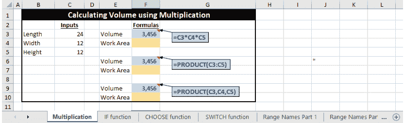

**图 11.1 – 简单乘法与 PRODUCT 函数的对比**

图 11.1 中 Multiplication 工作表的单元格 **C3:C5** 包含假设箱子的长、宽和高，单位由您选择。单元格 **F3** 包含公式 =C3*C4*C5，并返回 3,456 作为容器的立方体积。单元格 **F4** 是一个工作区，如果您想重新创建公式，可以在此跟随操作。在示例工作簿中，您会看到类似的工作区。

现在，让我们使用 PRODUCT 函数来相乘单元格。

### PRODUCT 函数

图 11.1 所示 Multiplication 工作表的单元格 **F6** 包含公式 =PRODUCT(C3:C5)，并返回 3,456。PRODUCT 函数将所有值相乘并返回结果，因此单元格 **F6** 中的公式等同于 =C3*C4*C5。

PRODUCT 函数具有以下参数：

number1, number2... 您希望相乘的数字、单元格引用或单元格区域；最多 255 个参数

单元格 **F9** 包含公式 =PRODUCT(C3,C4,C5)，并返回 3,456，以说明您也可以引用单个单元格。现在，让我们继续介绍一些可用于在 Excel 中执行决策操作的工作表函数。

### 决策函数

我将暂时搁置我们的体积计算主题，以便介绍一些决策工作表函数，我认为这些函数将有助于为 LET 和 LAMBDA 函数铺平道路。我们将从 IF 函数开始，然后将其与 CHOOSE 函数进行对比，接着介绍 SWITCH 函数。

### IF 函数

图 11.2 所示 IF 函数工作表的单元格 **D3** 包含公式 =IF(C3>=70, "Pass","Fail")，并返回 Fail，因为单元格 **C3** 包含 61，小于 70。相反，单元格 **D4** 包含公式 =IF(C4>=70,"Pass","Fail")，并返回 Pass，因为 **C4** 包含大于或等于 70 的数字：

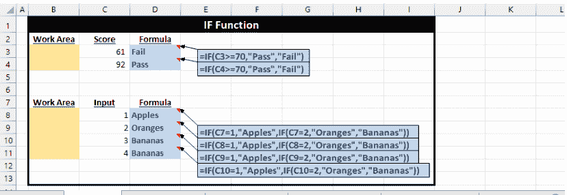

图 11.2 – IF 函数

IF 函数有三个参数：

+   - logical_test: 计算结果为 TRUE 或 FALSE 的计算。在单元格 D3 中，我们检查 C3 是否大于或等于 70。

+   - value_if_true: 如果 logical_test 计算结果为 TRUE，则返回或计算的数字、文本或公式。在此示例中，我们希望为大于或等于 70 的分数返回单词 Pass。如您所见，Excel 公式中的文本值必须用双引号括起来。

+   - value_if_false: 如果 logical_test 计算结果为 FALSE，则返回或计算的数字、文本或公式。在此示例中，我们将返回单词 Fail。

您可以将多达 64 个 IF 函数嵌套在一起，因此可以根据需要在 value_if_true 或 value_if_false 参数中放置其他 IF 函数。老实说，我对 Excel 2003 非常满意，它将单个公式中的 IF 函数限制为最多八个。我一次又一次地发现，每当我发现自己试图嵌套超过两三层 IF 函数时，几乎总是有更好的函数可以替代，或者有更好的数据结构方式。让我们看一个示例，了解嵌套 IF 函数如何导致电子表格错误。

单元格 D8 包含公式 =IF(C8=1, "Apples", IF(C8=2, "Oranges", "Bananas"))，如图 11.2 所示。在此示例中，我嵌套了两层 IF 函数。如果 C8 等于 1，我希望显示单词 Apples；否则，我将执行第二个 IF 计算。如果 C8 等于 2，我将显示单词 Oranges；否则，我将显示 Bananas。相同的公式出现在单元格 D9:D11 中。请注意，单元格 C11 包含 4，但 D11 中的 IF 函数返回 Bananas。该公式没有考虑到第四个选项，因此返回了最后一个选项，即 Bananas。对于用户，尤其是不精通 Excel 的用户来说，很容易认为如果公式返回结果，那么结果必须是正确的。您串联的 IF 函数越多，测试每个结果就越困难。

对于这种情况，CHOOSE 函数可能是更好的替代方案。

### CHOOSE 函数

图 11.3 所示 CHOOSE 函数工作表的单元格 D3 包含公式 =CHOOSE(C3, "Apples", "Oranges", "Bananas")，它显示列表中的第一项——在此示例中为 Apples——因为单元格 C3 包含数字 1：

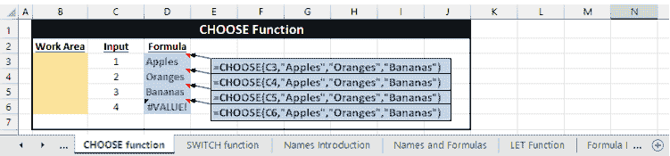

图 11.3 – CHOOSE 函数

CHOOSE 函数具有以下参数：

+   - index_num: 此参数必须包含一个数字、公式或单元格引用，其计算结果为 1 到 254 之间的数字。

+   - value1, value2...: 您希望返回的数字、文本或公式，它与提供的 index_num 对应。您的列表最多可包含 254 个值，但每个值都必须在函数中列出。这意味着您不能引用位于单元格区域中的列表。

如单元格 **D6** 所示，如果 index_num 没有对应的值，CHOOSE 将返回 #VALUE。在此示例中，我们要求 CHOOSE 返回第四个值，但在公式中只指定了三个。与 IF 不同，CHOOSE 在您将意外输入传递给公式时提供了一种安全保障。

当输入为 1 到 5 之间的数字时，CHOOSE 函数很有帮助。我不想考虑编写具有许多超出该范围选项的 CHOOSE 函数。这使我们想到了 SWITCH 函数，它允许我们根据匹配数字或文本返回结果，并且不必从 1 开始。

### SWITCH 函数

图 11.4 所示 SWITCH 函数工作表的单元格 **D3** 包含公式 =SWITCH(C3,10,"Apples",20,"Oranges",30,"Bananas","Unknown")，它返回 Apples，因为单元格 **C3** 包含 10：

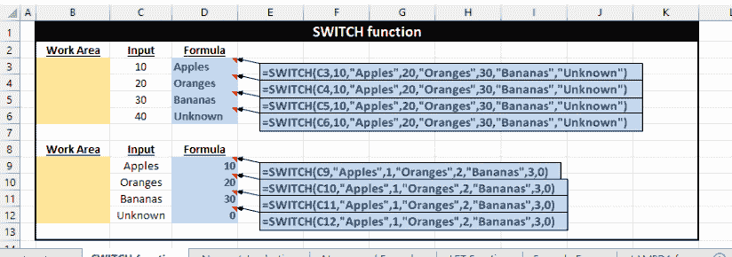

SWITCH 函数具有以下参数：

+   - expression: 此参数必须包含数字、文本或返回数字或文本的公式。在此示例中，这是单元格 **C3** 中的 10。

+   - value1 ...: 此参数包含数字或返回数字或文本的公式，您希望匹配它——在此示例中为 10。

+   - `result1` ... 如果值匹配，您希望返回的内容——在此示例中为 Apples。

+   - `default_or_value2`: 您最多可以提供 126 个结果/值对，而最后一个参数应该是如果没有任何值参数匹配时您希望返回的默认数字、文本或公式。因此，在此示例中，`20` 被替换为 `Oranges`，`30` 被替换为 `Bananas`，任何其他值都将被替换为 `Unknown`。

单元格 D9 包含公式 `=SWITCH(C9,"Apples",10,"Oranges",20,"Bananas",30,0)`，它显示与 CHOOSE 不同，您可以匹配数字或文本。该公式返回 `10`，因为单元格 C9 包含 `Apples`。在本章后面，您将看到 LET 和 LAMBDA 提供了另一层交换功能，但首先，让我们看看如何为工作表单元格分配 **名称**。

### 为工作表单元格命名

为工作表单元格命名允许您通过分配的 **名称** 而不是单元格引用来引用单元格或单元格块。您可以在电子表格中互换使用 **名称** 和单元格引用。Excel 提供四种为单元格分配 **名称** 的方法：**名称框**、**从选定内容创建**、**定义名称** 和 **名称管理器**。有几条规则需要牢记：

+   - **名称** 必须以字母、下划线 (`_`) 或反斜杠 (`\`) 开头，因此 `2024TAX` 不是有效的名称。

+   - **名称** 可以短至一个字母，但您不能将字母 `C` 或 `R` 分配为名称。这是因为当您在 **名称框** 中键入 `C` 并按 `Enter` 时，Excel 将选择当前列，而 `R` 和 `Enter` 将选择当前行。

+   - **名称** 不能与任何单元格引用相同，例如 `TAX2024`。Excel 工作表中的最后一列是 `XFD`，因此将单词与一到三个字母和数字组合在一起将构成无效名称。

+   - **名称** 不能包含空格，因此 `TAX 2024` 不是有效名称，但 `TAX_2024` 是。

现在，让我们使用 **名称框** 来分配 **名称**，并看看这样做如何改变您的 Excel 公式。

### 名称框

如 _图 11.5_ 所示，**名称框** 出现在每个工作表左上角上方，通常显示活动单元格的地址或您选定的单元格区域中第一个单元格的地址。在此示例中，我已选择 `Names Introduction` 工作表的单元格 **C3**，因此 **名称框** 也显示 `C3`。如果这是一本更长的书，我会向您展示可以在这个无害字段中进行的二十多项活动。无论如何，我希望专注于我们通往 `LET` 和 `LAMBDA` 的旅程，因此我会克制自己，只向您展示几个示例：


Figure 11.5 – 名称框显示单元格地址

让我们使用名称框为三个单元格分配名称：

- 选择“名称简介”工作表中的单元格 C3，在名称框区域中输入字母 L，然后按 Enter。

- 如图 11.6 所示，当您单击单元格 C3 时，名称框区域中现在显示的是字母 L 而不是单元格地址，这表示已为该单元格分配了名称：

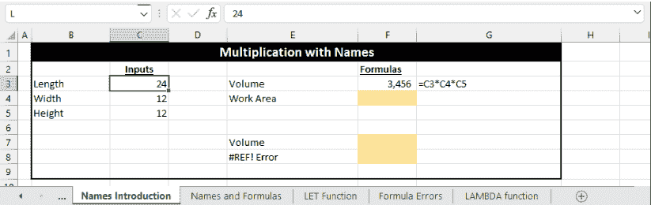

Figure 11.6 – 名称框显示名称

**提示**
如果您不小心为错误的单元格命名，请按 Ctrl + Z（macOS 版 Excel 中为 ⌘+ Z）或单击“撤销”命令来撤销该操作。

- 选择单元格 C4，在名称框区域中输入字母 W，然后按 Enter。

- 在选中单元格 C5 的情况下，在名称框区域中输入字母 H，然后按 Enter。

- 单元格 F3 包含公式 =C3 * C4 * C5，我们将通过在单元格 F4 中输入 =L * W * H 来复制该公式。您的公式应返回 3 , 456，但如果您未分配任何名称，则会返回 #NAME?。

## 名称、LET 和 LAMBDA

> **提示**
> 单元格 **G3** 和 **G4** 共同使用 `IFNA` 和 `FORMULATEXT` 函数，以便您可以比较基于单元格引用的公式与基于名称的公式。单元格 **G3** 包含公式 `=IFNA( FORMULATEXT( F3 ) , "" )`，该公式要么显示单元格 **F3** 中输入的公式，要么如果单元格 **F3** 不包含公式，则使单元格 **G3** 看起来是空白的。

- 选择单元格 **F3:F4** 并按 `Ctrl`+`C` (`⌘`+`C`)（或选择 **开始** | **复制**）。

- 选择单元格 **F7** 并按 `Enter`（或选择 **开始** | **粘贴**）。

> **提示**
> 粘贴已复制的单元格时，可以按 `Enter` 键，而不是按 `Ctrl`+`V` (`⌘`+`V`) 或选择 **开始** | **粘贴**。请记住，Excel 在按下 `Enter` 后会清除剪贴板，因此仅在您只粘贴一次的数据上使用此快捷方式。此技术不适用于从 **公式栏** 区域、单元格内或任何浮动在工作表上方的对象中复制的数据。

在此示例中，将公式从单元格 **F3:F4** 复制到 **F7** 可实现两个目的：

- 注意单元格 **F7** 中的公式引用了单元格 **C7**、**C8** 和 **C9**，因为单元格 **F3** 中的公式在行号前没有美元符号 (`$`)。因此，Excel 根据我们粘贴的行数更改了行号。

- 单元格 **F8** 中的公式正确返回 `3 , 456`，因为您在公式中引用的命名单元格具有绝对引用。相反，如果单元格 **F3** 中的公式是 `=C$3*C$4*C$5` 或 `=$C$3*$C$4*$C$5`，那么您可以将其复制到单元格 **C7** 而不会出现问题。

- 我们将在本章后面将单元格 **F8** 中的公式称为工作表中删除命名单元格时可能出现的错误。

如您所见，**名称框** 区域允许您一次为单元格或单元格区域分配一个 **名称**，并导航到工作簿中的任何位置。请记住，您无法通过 **名称框** 编辑 **名称**；任何此类尝试都只会为相关区域分配一个额外的名称。本章后面，您将学习如何使用 **名称管理器** 编辑或删除您创建的 **名称**。

> **提示**
> 您可以将 **名称框** 用作导航辅助工具：在工作表中选择单元格 **A1**，在 **名称框** 中输入 `C4`，然后按 `Enter` 将光标移动到单元格 **C4**。键入诸如 `Multiplication!A1` 或 `'CHOOSE Function'!A1` 的引用，将光标移动到另一个工作表（请记住，对带有空格的工作表 **名称** 使用单引号）。若要按名称导航，请单击 **名称框** 区域中的箭头并从列表中选择。按 `F5`（某些键盘上为 `Fn` + `F5`）键（或选择 **开始** | **查找和选择** | **定位**），然后按 `Enter` 返回到上一个单元格。

现在，让我们看看“公式”|“从选定区域创建”命令如何使您能够在单元格区域内分配单个名称。

### 从选定区域创建

使用名称框区域为多个单元格命名可能很繁琐，这引出了“从选定区域创建”命令。如图 11.7 所示，“名称和公式”工作表中的单元格 B3:B5 包含我们将分配为单元格 C3:C5 名称的文本：

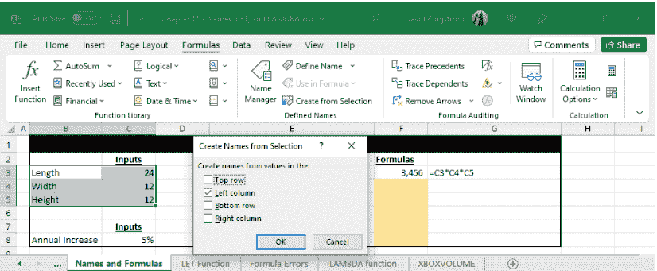

图 11.7 – 从选定区域创建名称对话框

让我们一次创建多个名称：

- 选择单元格 B8:C10，选择“公式”|“从选定区域创建”或按 Ctrl + Shift + F3 以显示“从选定区域创建名称”对话框。

> **提示**
> “从选定区域创建”命令要求您选择两列或两行。使用此命令时，只能为单个单元格命名。“第一行”选项为选区中的第二行单元格命名，而“最后一行”选项为选区中的第一行单元格命名。“最右列”将名称分配给选区中的第一列。用作名称的文本中的空格和标点符号将替换为下划线，并且如果文本的第一个字符是数字，则在名称开头添加下划线。这意味着“Annual Increase”将变为 Annual_Increase，而“2024 Taxes”将变为 _2024_Taxes。

- 接受默认选择的“左列”，然后单击“确定”。在此，Excel 已正确假设我们希望将两列选区中左列的值分配给右列中的单元格。虽然此处不适用，但您可以取消 Excel 选择的多余复选框。

## 名称、LET 和 LAMBDA

- 单击单元格 **C3**、**C4** 和 **C5**，注意分别为名称分配了 **长度**、**宽度** 和 **高度**。

- 在单元格 **F4** 中键入 `=L`，注意 **Excel for Windows** 中的 **自动完成** 菜单（如 **图 11.8** 所示）将显示与您输入的字符匹配的 **名称**、工作表函数以及任何 **表名称** 列表。现在，键入 `ENG`，注意列表仅显示 `LENGTH`。按 `Tab` 键选择 **长度**。键入 `*` 然后选择 **宽度**。再次键入 `*`，选择 **高度**，然后按 `Enter`。我们将在本章后面讨论删除 **名称** 时引用此公式：

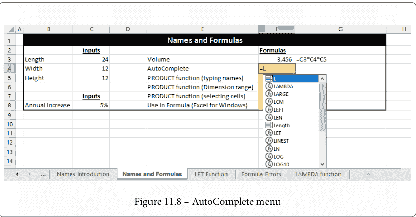

现在，让我们看看第三种命名单元格的方法，这在使用 `LAMBDA` 创建自定义工作表函数时也会用到。

### 定义名称

**公式** | **定义名称** 命令为在工作簿中创建 **名称** 提供了更多控制。首先，您可以创建一个可被工作簿中所有工作表识别的名称，或者仅可被包含命名区域的工作表识别的名称。其次，您可以将最多 255 个字符的描述与名称关联。除此之外，该过程与使用 **名称框** 类似：

- 选择 `名称和公式` 工作表中的单元格 **C8**。

### 命名工作表单元格 333

2. 选择“公式”|“定义名称”以显示“新建名称”对话框，如 **图 11.9** 所示：

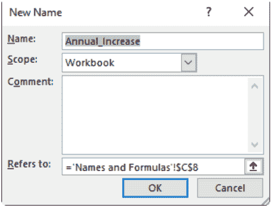

**图 11.9 – 新建名称对话框**

3. `Annual_Increase` 出现在 **名称** 字段中，因为 Excel 假设您希望使用相邻单元格中的文本作为单元格 C8 的名称。您可以根据需要更新 **名称** 字段。您可以使用的替代名称是 `AnnualIncrease`，因为在复合词中大写字母是不使用空格但保持 **名称** 易于阅读的另一种方法。

4. 您通常会接受 **范围** 列表中的默认值 **工作簿**，但如果需要，选择 **工作表** 将把名称的范围限制在单个工作表。这意味着在任何其他工作表中使用该名称都会导致 #NAME? 错误。

**细微差别**

请注意，工作簿中名称的第二个实例的范围将为 **工作表**。您不能在 **名称框** 区域中第二次创建名称，因为键入重复名称会将光标移动到现有名称。如果您尝试在 **定义名称** 对话框中这样做，系统会告知您 **名称** 必须是唯一的。漏洞在于，您可以使用“从选定区域创建名称”来复制现有名称。您不会收到警告或通知，任何重复的 **名称** 都将具有 **工作表** 范围。因此，可能会出现错误，因为您可能会无意中引用错误的单元格。

5. 可选：在 **注释** 字段中输入描述，例如 `Annual increase amount`，以创建在将名称键入公式时出现的 **屏幕提示**。注释也可以在 **名称管理器** 对话框中查看。


### Names, LET, and LAMBDA

6. 在“Refers To”字段中接受默认单元格引用 = 'Names and Formulas'!$C$8，除非你希望将名称分配给不同的单元格。你不需要添加等号 (=) 或美元符号 ($)，因为当你单击 OK 时，Excel 会自动添加。

7. 单击 OK 创建名称。

8. 在任意单元格中键入 =Annual，观察自动完成菜单如何显示完整名称，以及你输入的注释。然后，按 Escape 键放弃输入。

**Nuance**
你也可以在“Refers To”字段中输入数字、文本或公式。文本必须用双引号括起来，公式必须以等号 (=) 开头。这种方法可以让其他人更难修改工作簿中的关键输入，因为信息不会出现在工作表单元格中，但可以通过其名称引用，就像它是单元格一样。与此类名称关联的数据可以在名称管理器中编辑。你在“Refers to”字段中输入的公式，列和行前面应有美元符号 ($)；否则，当你在单元格之间移动光标时，可能会发现名称引用了随机单元格。

既然我们已经以三种不同的方式创建了名称，现在让我们使用名称管理器来编辑或删除它们。

### Name Manager

在 Excel 工作簿中创建的每个名称都会出现在名称管理器中，同时还会显示工作簿中的任何表格。名称管理器允许你执行以下任务：

- 为名称或表格添加或删除注释
- 更改名称和表格名称
- 更改名称的 Refers to 字段，并删除名称。

**Tip**
在第 7 章“使用表格功能自动化任务”中，我向你展示了如何编辑和重命名表格，以及如何将表格转换回正常的单元格范围。

让我们浏览一下名称管理器：

1. 选择 Formulas | Name Manager 以显示图 11.10 所示的对话框：

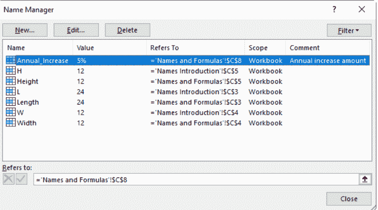

图 11.10 – 名称管理器

2. 单击 **New** 以显示 **New Name** 对话框，这是选择 **Formulas** | **Define Name** 的替代方法。按 **Escape** 或单击 **Cancel** 以关闭 **New Name** 对话框。

3. 从列表中选择任意名称，然后单击 **Edit** 以显示 **Edit Name** 对话框，如图 11.11 所示，它与 **New Name** 对话框相同。你可以编辑任何字段，但 **Names** 的 **Scope** 除外——对于 **Tables**，你只能编辑 **Name** 和 **Comment** 字段。按 **Escape**（或单击 **Cancel**）关闭 **Edit Name** 对话框而不做任何更改；否则，按 **Enter**（或单击 **OK**）。你必须先删除名称，然后重新创建它才能更改其范围：

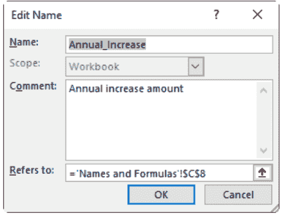

图 11.11 – Edit Name 对话框

**Nuance**
诸如 **Refers to** 之类的字段默认处于 **Enter** 模式，这意味着按左箭头或右箭头键会插入通常不需要的单元格引用，而不是将光标向左或向右移动。按 _F2_ (_Fn_ + _F2_) 键切换到 **Edit** 模式，以便在字段内导航。我在 _第 9 章，Excel Quirks and Nuances_ 中更详细地讨论了这一概念。

4. 从列表中选择 **Height**，单击 **Delete** 按钮，然后单击 **Close**。

5. 观察 `Names and Formulas` 工作表中单元格 **F4** 的公式如何返回 `#NAME?`。此错误是因为我们删除了 **Height** 范围，而公式仍引用它。如果你尚未在单元格 **F4** 中输入公式，请键入 `=Height` 并按 **Enter**，这也会返回 `#NAME?`。

**Tip**
公式中引用的 **Names** 在名称被删除时不会恢复为单元格引用。要解决由删除 **Names** 引起的 `#NAME?` 错误，你必须手动更新任何公式以使用单元格引用，或者重新创建 **Names**。请注意，当你拼写错误名称或工作表函数名称，或引用不存在的名称或工作表函数时，也可能出现 `#NAME?` 错误。

6. 单击单元格 **C5**，在 **Name Box** 区域中键入 `Height`，然后按 **Enter**。观察单元格 **F4** 中的公式现在如何返回正确的结果。

**Tip**
我们用来创建 **Names** 的任何方法也可以用来重新创建已删除的 **Names**。

现在，让我们回到 `Names Introduction` 工作表，看看当命名单元格被删除时会发生什么：

1. 双击单元格 **F3**，按 _Ctrl_ + _A_ (`⌘` + _A_) 选择整个公式，按 _Ctrl_ + _C_ (`⌘` + _C_) 复制公式，然后按 **Escape**，以免意外修改公式。

2. 单击单元格 **F7**，然后按 _Ctrl_ + _V_ (`⌘` + _V_) 或选择 **Home | Paste** 粘贴公式，它应该返回 `3, 456`。

**Nuance**
从 **Formula Bar** 区域（而不是从单元格）复制公式，可以防止 Excel 更改列字母和/或行号。在 **Formula Bar** 区域中按 _Ctrl_ + _A_ (`⌘` + _A_) 是选择整个公式的简便方法。

3. 如果需要，在单元格 F8 中输入 =L*W*H 公式。此公式也应返回 3 , 456。

4. 在 Names Introduction 工作表中选择行 2:5，然后选择 Home | Delete（或右键单击所选内容并选择 Delete）。

5. 原本在 F7:F8 中的公式现在位于单元格 F4:F5 中，并返回 #REF!，因为被引用的底层单元格已被删除。

6. 选择 Formulas | Name Manager，观察 Refers to 列现在如何为 L、H 和 W 名称返回 #REF!，如图 11.12 所示：

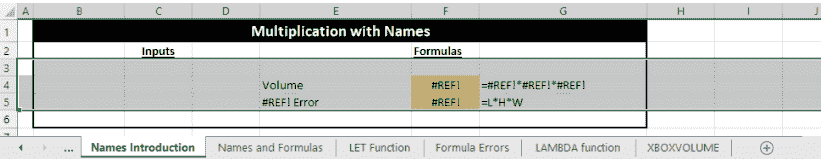

图 11.12 – 删除单元格导致名称返回 #REF!

7. 删除行删除了单元格，但没有删除名称。要解决与命名单元格相关的 #REF! 错误，你可以执行以下操作：

- 使用撤销命令恢复已删除的单元格。
- 在新位置重新创建名称。
- 通过名称管理器删除名称：
  - 单击一个名称，然后单击 Delete。
  - 单击 Value 标题以对已删除的名称进行分组，单击要删除的第一个名称，按住 Shift 键的同时单击要删除的最后一个名称，然后单击 Delete。
  - 按住 Ctrl (⌘)，选择两个或多个名称，然后单击 Delete。

8. 既然我们在这里，让我们完成对名称管理器的浏览：如果你已按其他列排序，请单击 Name 列以将名称重新按字母顺序排列。你可以根据任何列标题对名称进行排序。

9. 单击 Filter 按钮，根据名称的范围、错误状态和名称类型筛选名称。随时从列表顶部选择 Clear 以重新显示所有名称。

10. 名称管理器底部的 Refers to 字段允许你编辑与名称关联的单元格引用或数据，而无需显示 Edit Name 对话框。如果你进行了任何更改，请单击复选标记按钮；或者单击 X 按钮以放弃你已开始的任何编辑并希望丢弃。

11. 按 Escape（或单击 Close）以关闭名称管理器对话框。

### Names, LET, and LAMBDA


现在，让我们再看一下在公式中使用 **Names**。

#### 在公式中使用名称

命名单元格可以使公式更容易编写，因为你不一定需要导航到单元格才能在公式中使用它们：你可以直接键入 **Names**。让我们看看在公式中使用 **Names** 的几个示例：

1. 在 `Names and Formulas` 工作表的单元格 F5 中输入 `=PRODUCT(Length:Height)`。这说明你可以为你希望引用的范围两端的单元格指定 **Names**。如果你正确输入公式，它将返回 `3,456`。

2. 选择单元格 `C3:C5`，在 **Name Box** 区域中键入 `Dimensions`，然后按 `Enter`。现在，共有四个 **Names** 被分配给单元格 `C3:C5`：**Length**、**Width**、**Height** 和 **Dimension**。

3. 在单元格 F6 中，键入 `=PRODUCT(Dimensions)` 并按 `Enter`。这说明你可以在公式中引用由两个或多个单元格组成的命名范围。此公式也应返回 `3,456`。

4. 在单元格 F7 中，键入 `=PRODUCT(`，然后单击单元格 `C3`，键入 `:`；单击单元格 `C5`，然后键入 `)`，并按 `Enter`——生成的公式应为 `=PRODUCT(Length:Height)`，这展示了 Excel 如何自动将你选择的单元格中的 **Names** 纳入公式中。在单元格中选择或键入名称可以消除在工作表之间切换的需要。公式应返回 `3,456`。

5. 如果你使用的是 Windows 版 Excel，请选择单元格 F8，然后选择 **Formulas | Use in Formula** 并选择 **Height**，键入 `*`，选择 **Use in Formula** 并选择 **Length**，键入 `*`，选择 **Use in Formula** 并选择 **Width**，然后按 `Enter`。公式应返回 `3,456`。

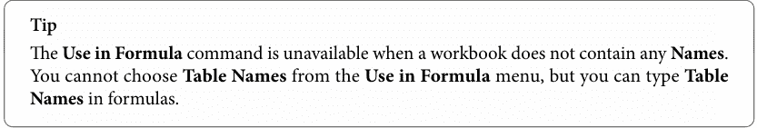

如我们所讨论的，你可以创建范围为整个工作簿或单个工作表的 **Names**。`LET` 函数更进一步，使我们能够创建范围为单个单元格的 **Names**。


## 介绍 LET 函数

LET 函数至少需要一个 **Name**，即 **Variable**。这些 **Names** 仅在单个单元格的上下文中有效。这意味着你可以随意重复使用 **Variables**，尽管最好将 **Names** 分配给你反复引用的输入单元格。正如我们所讨论的，你可以使用“新建名称”对话框将公式存储在 **Name** 中。但是，此类公式在驻留在工作表单元格中的公式中使用往往很困难。相反，LET 函数中的 **Variables** 可以包含文本、数字或计算，然后可以通过 **calculation** 参数中的 **Name** 引用。正如你将看到的，这可以消除公式中的重复计算。

LET 函数工作表中单元格 G3 包含 =LET(length,C3,width,C4,height,C5,length*width*height) 公式并返回 1,000。如图 11.13 所示，这就像使用 **Names**，但你不需要提前创建 **Variables** – 你只需在编写公式时将它们添加进去：

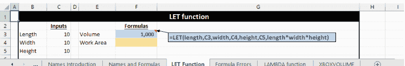

图 11.13 – LET 函数

LET 函数具有以下参数：

- Name1：此必需参数 **Names a Variable**，即你将在公式中使用的变量 – 在本例中为 len。你最多可以指定 126 个 **Names**。

> **Nuance**
> Excel 的 LEN 函数计算工作表单元格或文本字符串中的字符数，但在 LET 中，在 name 参数中使用 len（或 LEN）将创建一个覆盖 LEN 工作表函数的 Variable。LET 还会忽略已存在的 **Names**。

- name_value1：此必需参数是要存储在 Name1 **Variable** 中的值或计算 – 在本例中为单元格 C3。name_value 参数可以是单元格引用、数字、用双引号括起来的文本或计算。你最多可以指定 126 个 name_value 参数，每个参数都必须与一个 **Name** 配对。

- calculation_or_Name2：在指定 name1 和 name_value1 后，你可以添加更多 name/name_value 对，也可以输入计算。因此，在此上下文中，我们将创建一个名为 width 的 **Variable**。

- name_value2：每个 **Name** 都必须有一个对应的 name_value，因此在此示例中，我们将引用单元格 C4。

- calculation_or_Name3：我们的第三个 **Variable** 名为 height。

- name_value3：**C5** 被分配为 height **Variable** 的值。

- calculation_or_Name4：现在所有输入都已命名，我们可以指定计算，即 length*width*height。

你可能记得，我们在“名称和公式”工作表的单元格 F4 中使用了 =Length*Width*Height 公式。如果你没有更改原始输入，该单元格将返回 3,456。相反，LET 函数返回 1,000，因为 **Variables** 引用的是 LET 函数工作表上的单元格 **C3:C5**，而不是“名称和公式”工作表上的命名单元格。

稍后，我们将学习如何使用 LET 来消除公式中的重复计算，但首先，我想比较 IFERROR 和 ISERROR 工作表函数。

## 处理公式错误

IFERROR 和 ISERROR 都用于测试计算中的错误。如果计算结果不是错误，IFERROR 将显示计算结果。相反，如果计算结果是错误（例如 #DIV/0!、#N/A 等），IFERROR 将返回你指定的备用值，该值可以是数字、文本或计算。

如果计算返回错误，ISERROR 返回 TRUE；如果不返回错误，则返回 FALSE。如图 11.14 所示，“公式错误”工作表中单元格 **D3** 包含 =(C3–D3)/D3 公式。该公式返回 11%，因为单元格 **C3** 和 **D3** 都包含非零值。在单元格 **D4** 中，=(C4–D4)/D4 公式返回 #DIV0!，因为 Excel 不允许除以零。单元格 **E3** 包含 =D4 公式，由于 # 错误在 Excel 中产生的级联效应，该公式也返回 #DIV/0!。IFERROR 函数是管理此类错误的现代方法：

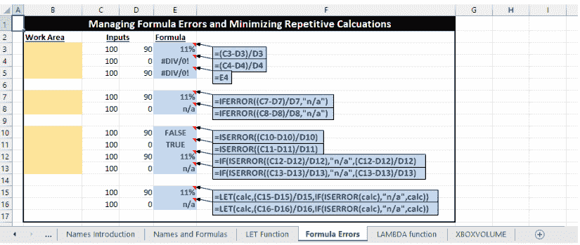

图 11.14 – 公式错误处理

## IFERROR 函数

如图 *Figure 11.14* 所示，“*Formula Errors*”工作表中单元格 **D7** 包含 =IFERROR((C7-D7)/D7, "n/a") 公式并返回 11%。相反，单元格 **D8** 包含 =IFERROR((C7-D7)/D7, "n/a") 公式并返回 n/a，因为单元格 **D8** 包含零。

IFERROR 函数有两个参数：

- value：这是一个可能在 Excel 中返回任何类型 # 符号错误的计算，例如 #DIV/0!、#NAME?、#CALC! 等。在单元格 **E7** 中，IFERROR 返回 11%，因为 (C7-D7)/D7 计算结果不是错误。

- value_if_error：当 *value* 参数返回错误时返回的备用值或计算。单元格 **D8** 显示 n/a，因为 (C8-D8)/D8 计算结果是错误。

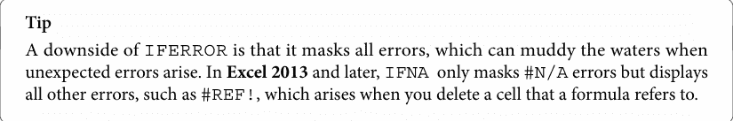

如果你使用 Excel 已经有 15 年或更长时间，你可能还记得 IFERROR 函数不存在的时代。那时，错误处理通常涉及同时使用 IF 和 ISERROR 函数。

## ISERROR 函数

“公式错误”工作表中单元格 **E10** 包含 =ISERROR((C10-D10)/D10) 公式并返回 **FALSE**，因为 (C10-D10)/D10 计算结果不是错误。相反，单元格 **E11** 包含 =ISERROR((C11-D11)/D11) 公式并返回 **TRUE**，因为 (C11-D11)/D11 计算结果是错误。


单元格 **E12** 包含 =IF(ISERROR((C12-D12)/D12), "n/a", (C12-D12)/D12) 公式并返回 11%。单元格 **E13** 包含 =IF(ISERROR((C13-D13)/D13), "n/a", (C13-D13)/D13) 公式并返回 n/a。

我提供这个简单示例，说明像 (C13-D13)/D13 这样的重复计算（在单元格 E13 中出现两次）如何潜入我们的公式中。IFERROR 被添加到 Excel 中，以在处理公式错误时消除重复计算，但我们发现自己多次重复公式片段的方式有无数种。在公式的多个位置进行相同的编辑总是很棘手，如果你漏掉了 _一个_ 位置，那么公式中可能会出现错误，这也可能影响其他单元格。这让我们回到了 LET 函数。

## 消除重复计算

“公式错误”工作表中单元格 E15 包含 =LET(calc, (C15-D15)/D15, IF(ISERROR(calc), "n/a", calc)) 公式并返回 11%，因为 (C15-D15)/D15 计算结果不是错误。让我们分解一下公式：

- Name1：此参数建立一个我们稍后可以在公式中使用的 calc Variable。

- name_value1：此参数包含我们计算的重复部分，(C15-D15)/D15，我们将能够通过 calc Variable 引用它，而不是重复计算两次。

- Name2_or_calculation：由于我们只需要一个 Variable，第三个参数包含 IF(ISERROR(calc), "n/a", calc) 计算。现在，(C15-D15)/D15 在公式中只出现一次，但被使用了两次。这意味着如果我们需要编辑公式，只需在一个位置进行编辑。

如果你正在 B 列跟随操作，你可以将在单元格 B15 中输入的公式复制到单元格 B16，无需进行任何编辑。

Tip

LET 函数在 Excel 2019 及更早版本中将返回 #NAME?。在第 9 章“Excel Quirks and Nuances”中，我解释了如何使用 Compatibility Checker 来确定工作表是否使用了任何与旧版 Excel 不向后兼容的工作表函数或功能。

现在，让我们使用 LET 创建第三个计算，以便我可以进一步阐述 Variables 的工作原理。

## Variables 限制

让我们回到 LET 函数工作表，如图 11.15 所示，以便我可以向你展示如何在 LET 函数中建立 Variables 而不在计算中使用它们：


单元格 F8 包含 =B8*C8 公式，该公式将单元格 B8 中的数量乘以 C8 中的价格，以供你参考。LET 函数工作表中单元格 F9 包含 =LET(quantity,B8,price,C8,tax,B15,quantity*price) 公式。在此示例中，tax 变量已创建但未在计算参数中引用。变量可以使公式更易于审计，因为每个输入都可以标记，但并非必须如此，因为你可以根据需要引用任意数量的未命名单元格。

让我们逐一了解 LET 函数工作表中的其余公式：

- 单元格 F11 包含 =(C11+(C11*C16))*B11 公式，该公式返回 1,203.75。单元格 C11 包含价格，公式分别引用该价格两次，使价格乘以税率，然后再将结果乘以单元格 B11 中的数量。

- 单元格 F12 包含 =LET(quantity,B9,price,C9,tax,B15*price,(price+quantity*tax) 公式，该公式同样返回 1,203.75。这说明在从左到右处理时，一个变量可以引用另一个变量。在此示例中，quantity 变量引用单元格 B12，price 引用 C12，而 tax 将单元格 C16 乘以 price 变量。计算参数将 price 和 tax 相加，然后将结果乘以 quantity。

> Tip
> 我喜欢在单元格或公式栏中选中公式的全部或部分内容，然后按 F9（Fn + F9）来显示底层值。要使此操作生效，你必须选中完整的单元格引用或公式中的某个计算部分。请务必按 Escape 或 Ctrl + Z（⌘ + Z）撤销更改，以免将硬编码值嵌入公式中。在 Excel 工作表中最多可撤销 100 个操作，但在公式栏中只能撤销一个操作。此外，LET 函数不支持此技术：如果你在单元格 F12 中选中 (price+tax)*quantity 并按 F9（Fn + F9），Excel 将返回 #NAME? 而不是计算结果。不过，你可以使用“公式”|“求值公式”来调试返回意外结果的 LET 函数。

- 单元格 F14 包含 =LET(quantity,B14,price,C14*tax+C14,tax,C16,quantity*price) 公式，该公式返回 #NAME?，因为我在 tax 变量建立之前就引用了它，从而打破了从左到右的约定。在此示例中，quantity 引用单元格 B14，price 引用单元格 C14 乘以 tax 再加上 C14，然后 tax 引用单元格 C16。计算参数将 quantity 乘以 price。#NAME? 错误是由 price 在 tax 变量被赋值之前引用 tax 导致的。

- 单元格 F15 包含 =LET(quantity,B15,tax,C16,price,C15*tax+C15,quantity*price) 公式，该公式返回 1,203.75。请注意，仅仅改变变量的顺序，即在 price 变量之前创建 tax 变量，即可解决单元格 F14 中出现的 #NAME? 错误。

由此可见，LET 的使用可能会变得棘手，因此我一直坚持使用简单的计算。LET 为文档化公式和提升电子表格完整性提供了许多可能性，因为它消除了重复计算。现在，让我们看看如何使用 LAMBDA 函数创建基于内置工作表函数组合的自定义工作表公式——而无需编写任何编程代码。

### 介绍 LAMBDA 函数

在 LAMBDA 出现之前，在 Excel 中创建自定义工作表函数需要编写编程代码，例如使用 Excel 中的 Visual Basic for Applications，或使用其他语言为 Excel 创建加载项。你会感到欣慰，甚至可能会惊讶地发现，使用 LAMBDA 不需要任何编程经验。你只需具备在 Excel 中编写公式的能力以及对定义名称的理解，即可使用 LAMBDA 创建自定义工作表函数。

> Tip
> 基于 JavaScript 的工作表函数可以在 Microsoft 365、Excel 2021 和 Excel for Web 中创建。

LAMBDA 函数可能会变得非常复杂，因为你可以创建递归公式，其中 LAMBDA 函数多次引用自身，类似于循环引用，如第 9 章“Excel 的怪癖与细微差别”中所述。我没有足够的篇幅深入探讨 LAMBDA，因此我不会创建任何递归公式，但我可以帮助你快速上手创建自定义工作表函数。

### 开发 LAMBDA 公式

LAMBDA 函数具有类似于我们在 LET 中使用的变量的参数，以及一个计算参数。不同之处在于，参数不像 LET 中那样嵌入在函数内部。相反，参数的工作方式类似于大多数 Excel 函数的参数，即你按规定的顺序将单元格引用或输入输入到函数中。你不需要任何参数，但通常你会希望至少有一个。如本章后面所述，你可以创建可选参数，用户在使用 LAMBDA 函数时可以选择省略这些参数。

使用 LAMBDA 创建工作表函数共有四个阶段：

- 使用 LAMBDA 函数命名参数并定义计算
- 通过提供指定输入的函数调用来求值 LAMBDA 函数
- 通过分配名称来正式化 LAMBDA 函数
- 就像使用任何内置工作表函数一样使用 LAMBDA 函数

让我们来处理第一个阶段。

### 命名参数并定义计算

如图 11.16 所示，LAMBDA 函数工作表中单元格 F3 包含 =LAMBDA(length,width,height,length*height*width) 公式，并返回 #CALC!，因为尚未提供任何输入，即我尚未添加函数调用：

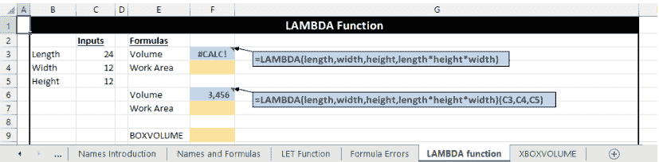

图 11.16 – LAMBDA 函数

LAMBDA 函数最少可以有一个参数，但通常会有两个或更多：

- parameter：此可选参数包含你想要传递给函数的信息，例如单元格引用、数字或文本。单元格 F3 中的公式有三个参数：length、width 和 height。你最多可以输入 253 个参数。
- calculation：此必需参数始终必须是公式中的最后一个，并表示你想要计算的公式。与 LET 类似，你可以将其视为公式中的公式。如果你不提供参数，则 calculation 将是第一个参数。

**Tip**
你可以通过将名称放在方括号中（例如 [parameter]）来指定参数为可选。然后，你可以在计算参数中使用 ISOMITTED 函数来确定是否提供了该参数。

### 求值 LAMBDA 函数

LAMBDA 函数工作表中单元格 F6 包含 =LAMBDA(length, width,height,length*height*width)(C3,C4,C5) 公式，并返回 3,456。在此示例中，公式中的 (C3,C4,C5) 部分是一个函数调用，它使我们能够通过将单元格 C3、C4 和 C5 中的值传递给 LAMBDA 函数来求值我们的公式：

- C3 对应 length 参数
- C4 对应 width 参数
- C5 对应 height 参数

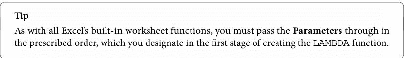

由于所有参数都已填充，LAMBDA 函数可以返回结果。如果你省略了一个参数，除非将该参数标记为可选，否则 LAMBDA 函数将返回 #VALUE!。

现在我们有了一个可用的 LAMBDA 公式，下一步是使公式可重复使用。

### 创建可重复使用的 LAMBDA 函数

我们将使用“定义名称”命令创建与我们的 LAMBDA 函数关联的区域名称。但是，与引用特定单元格不同，该名称将成为名为 BOXVOLUME 的新 Excel 工作表函数：

1. 双击单元格 F3 并按 Ctrl + A（⌘ + A）选中整个公式。然后，按 Ctrl + C（⌘ + C）（或右键单击所选内容并选择“复制”）。

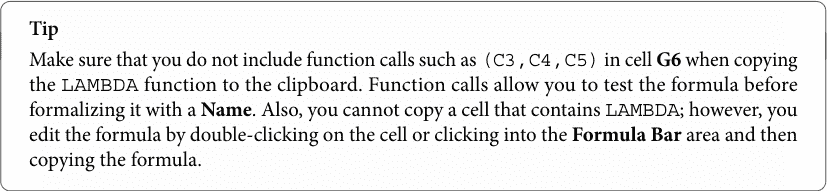

与 LET 函数一样，名称与我们的参数重叠不会造成冲突。第四个参数 length*height*width 表示我们希望 LAMBDA 函数执行的计算。

编写 LAMBDA 函数的第二个阶段涉及将输入传递给公式。


2. 选择“插入 | 定义名称”（或“公式 | 名称管理器 | 新建”）。
3. 在“名称”字段中输入 BOXVOLUME，如图 11.17 所示：

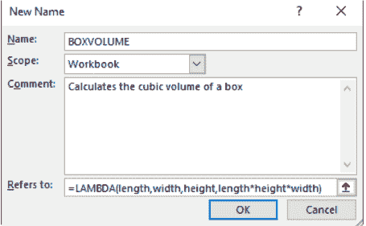

Nuance
我建议使用全大写来命名函数，以与 Excel 的内置函数保持一致，但你也可以使用标题大小写或混合大小写，例如 BoxVolume 或甚至 bOxVoLuMe。

4. 重要：确保“范围”字段设置为“工作簿”。
5. 在“注释”字段中输入“计算盒子的立方体积”。你在“注释”字段中输入的任何信息，当你在工作表单元格中输入足够多的函数名称字符以使自动完成匹配该名称时，都会作为屏幕提示出现。
6. 擦除“引用位置”字段的内容，并粘贴你在第 1 步中复制的公式。
7. 单击“确定”以创建新的自定义工作表函数。
8. 在单元格 F9 中键入 =BOX，并注意函数名称如何出现，如果你在第 5 步中填写了“注释”字段，还会出现屏幕提示，如图 11.18 所示：


9. 按 Tab 键填写函数名称的其余部分。注意参数会在新的屏幕提示中出现，如图 11.19 所示：


图 11.19 – 参数屏幕提示

10. 输入 C3,C4,C5 以及右括号，然后按 Enter。公式应返回 3,456。
你现在可以在创建 LAMBDA 函数的工作簿中的任何位置使用 BOXVOLUME 函数，并且可以将其转移到其他工作簿。

## 在工作簿之间移动 LAMBDA 函数

你可以通过复制单元格或复制工作表将 LAMBDA 函数转移到其他工作簿。让我们从复制使用 BOXVOLUME 函数的单元格开始：

1. 复制 LAMBDA 函数工作表中的单元格 F9，其中应包含一个功能正常的 BOXVOLUME 公式。
2. 按 Ctrl + N（⌘ + N）并选择“文件 | 新建 | 空白工作簿”以创建新工作簿或打开现有工作簿。
3. 按 Enter（或选择“开始 | 粘贴”）将 BOXVOLUME 公式粘贴到任何工作表单元格中，这取决于你粘贴的位置，将返回 0 或 #REF!。
4. 选择“公式 | 名称管理器”以确认 BOXVOLUME 出现，如图 11.20 所示：

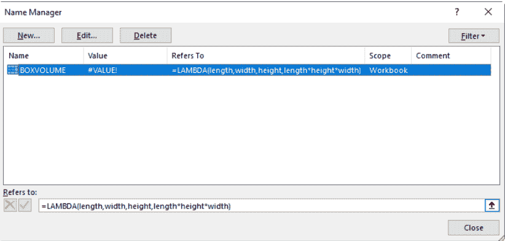

图 11.20 – BOXVOLUME 已转移到另一个工作簿

Nuance
当你以这种方式复制和粘贴公式时，在“新建名称”或“编辑名称”对话框中输入的任何注释都不会转移到新工作簿。#VALUE! 会出现在名称管理器的“值”列中，因为该函数在此上下文中没有传递任何参数值。这是可以预期的错误，并不表示你的 LAMBDA 函数已损坏或损坏。该判断是在工作表单元格中做出的。

转移 LAMBDA 函数的第二种方法是将使用一个或多个 LAMBDA 函数的工作表复制到另一个工作簿：

1. 右键单击 LAMBDA 函数工作表，然后选择“移动或复制”（或激活 LAMBDA 函数工作表并选择“开始 | 格式 | 移动或复制工作表”）。
2. 从“移到工作簿”列表中选择（新建工作簿）或从列表中选择工作簿。
3. 单击“创建副本”复选框，以免不小心移动工作表，然后单击“确定”。

4. 选择“公式 | 名称管理器”以确认你的 LAMBDA 函数在工作簿中可用，如图 11.21 所示：

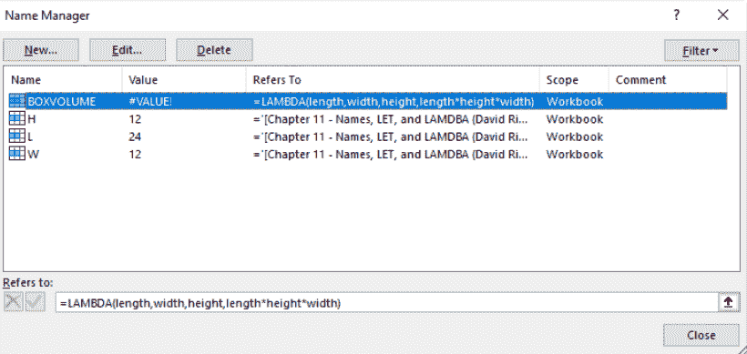

图 11.21 – 将工作表复制到其他工作簿可能会不小心复制名称

5. 可选：删除分配给已移到新工作簿的工作表单元格的任何名称，如图 11.21 所示。否则，每次打开你将工作表复制到的工作簿时，都会遇到令人讨厌的“此工作簿包含链接”提示。请注意，H、L 和 W 名称被分配给了我们复制的不同工作表，但 Excel 仍然任意地将名称复制了过来。

> Tip
> 你可以保留复制到新工作簿中的工作表或删除该工作表。无论哪种方式，LAMBDA 函数都将保持可用。

现在你已经了解了如何创建 LAMBDA 函数，让我们进一步探讨一些细节。

## 深入了解 LAMBDA 函数

到目前为止，我只涉及了 LAMBDA 的冰山一角，但我确实有空间进一步深入探讨。首先，我们将了解如何将可选参数纳入 LAMBDA 函数。之后，我将详细介绍在创建和使用 LAMBDA 函数时可能出现的一些错误和冲突。然后，我将介绍免费的高级公式环境，它为创建复杂的 LAMBDA 函数提供编程界面。我们还将创建一个 XBOXVOLUME 自定义工作表函数，允许你将一个两列三行的单元格块传递给 LAMBDA 函数，该函数将在计算盒子的立方体积之前将任何以英尺为单位的测量值转换为英寸。

## 可选 LAMBDA 参数

LAMBDA 函数工作表中的单元格 F11，如图 11.22 所示，包含
`=LAMBDA(quantity,price,[tax],(price+IF(ISOMITTED(tax),0,price*tax))*quantity)`
公式，该公式有一个可选 [tax] 参数，如方括号所示：

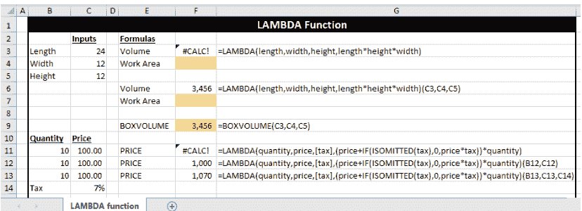

该公式还使用 ISOMITTED 函数，如果正在测试的参数未提供，则返回 TRUE；如果指定了参数，则返回 FALSE。此计算与我们使用 LET 函数进行的计算类似。LAMBDA 函数的计算参数获取 price 参数并确定是否应计算税款。如果未提供 tax 参数，则 IF 函数返回 0；否则，它将 price 乘以 tax。IF 返回的结果将加上 price 乘以 quantity 的结果。

单元格 F12 添加了 (B12,C12) 的函数调用，将 B12 传递给 quantity，将 C12 传递给 price，但省略了 tax，因此公式返回 1,000。

单元格 F13 添加了 (B13,C13,C14) 的函数调用，分别将 B13、C13 和 C14 传递给 quantity、price 和 tax，因此公式添加税款并返回 1,070。

这些公式中的 IF 函数说明了如何将现有 Excel 工作表函数纳入 LAMBDA。只需为现有工作表函数所需的每个参数创建一个参数，再加上你想要包含的任何其他输入。

现在，让我们看看如果将现有工作表函数的名称分配给 LAMBDA 函数会发生什么。

## LAMBDA 冲突和错误

LAMBDA 函数为 Excel 打开了无限的可能性，但仅限于使用 Microsoft 365 的用户。如果有人在 Excel 2021 或更早版本中打开使用一个或多个 LAMBDA 函数的工作簿，公式将返回 #NAME?，因为其他 Excel 版本无法将你的 LAMBDA 识别为有效函数。

> Tip
> LAMBDA 在 Excel for the web (http://www.office.com) 中也可用，只需免费的 Microsoft 帐户即可访问。在撰写本文时，Excel for the web 不提供“定义名称”和“名称管理器”命令，因此你无法使用该平台创建 LAMBDA 函数。但是，你可以使用现有函数。

让我们将单元格 F11 中的 LAMBDA 函数正式化为名为 PRICE 的工作表函数，以查看是否会与 Excel 中用于计算证券价格的内置 PRICE 函数发生冲突：

1. 双击单元格 F11 并按 Ctrl + A（⌘ + A）选择整个公式。然后，按 Ctrl + C（⌘ + C）（或右键单击所选内容并选择“复制”）。
2. 选择“插入 | 定义名称”（或“公式 | 名称管理器 | 新建”）。
3. 在“名称”字段中输入 PRICE，如图 11.23 所示：

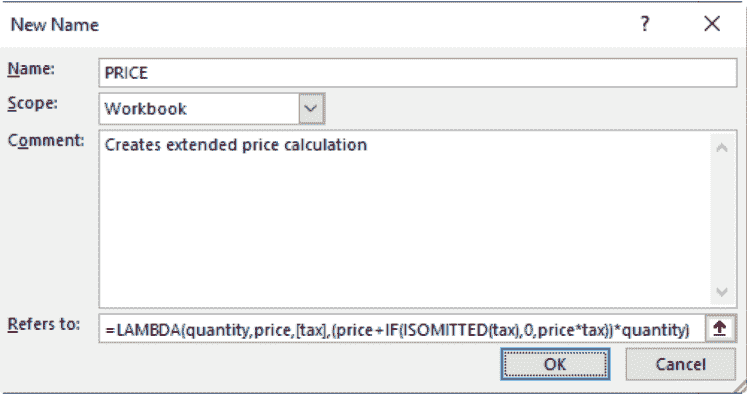

图 11.23 – 创建名为 PRICE 的 LAMBDA 函数

4. 重要：确保“范围”字段设置为“工作簿”。
5. 在“注释”字段中输入“创建扩展价格计算”。
6. 擦除“引用位置”字段的内容，并粘贴你在第 1 步中复制的公式。


+   7. 单击 **OK** 以创建自定义工作表函数。
+   8. 在单元格 **F14** 中键入 `=PRICE`，并注意 **AutoComplete** 菜单会显示两次 **PRICE** 函数。无论选择哪一个，Excel 都会默认使用内置的 **PRICE** 函数。你无法替代内置的 Excel 函数，因为如果可以替代，将会在电子表格中造成混乱。按 **Escape** 键以放弃对单元格 **F14** 的编辑。
+   9. 选择 **Formulas | Name Manager**，选择 **PRICE**，然后单击 **Edit**。
+   10. 清除 **Name** 字段，输入 **EXTEND**，单击 **OK**，然后单击 **Close**。
+   11. 现在，你可以使用 **EXTEND** 函数来计算扩展价格。

> Tip
> 为避免出现此类冲突，请在空白工作表单元格中键入 `=PROPOSEDNAME`，其中 **PROPOSEDNAME** 是你考虑为 **LAMBDA** 函数使用的 **Name**。如果 **AutoComplete** 菜单中没有出现匹配项，则你的 **LAMBDA** 名称可以使用。

以下是可能出现的其他错误的概述：

+   - 如你在 **Figure 11.16** 中所见，如果将函数输入工作表单元格但未包含函数调用，**LAMBDA** 将返回 **#CALC!**。
+   - 如果在 **calculation** 参数中拼写错误 **Parameter** 名称，或引用不存在的 **Parameter**，**LAMBDA** 函数将返回 **#NAME?**。
+   - 如果在 **公式栏** 区域中选择 **calculation** 参数，然后按 **F9**（如前面本章 **Variables restrictions** 部分中所述），**LAMBDA** 函数也会返回 **#NAME?**。你可以使用 **Formulas | Evaluate formula** 来调试包含函数调用的 **LAMBDA** 函数。
+   - 如果传递的 **Parameters** 数量不正确，**LAMBDA** 函数将返回 **#VALUE!**。
+   - **LAMBDA** 内部的循环引用（与递归相反）将返回 **#NUM!**。
+   - 虽然可以在范围 **Names** 中使用句点，但不能在 **LAMBDA** 函数的 **Parameter** 中使用句点。

从工作簿中删除 **LAMBDA** 函数就像删除 **Name** 一样简单：

+   1. 选择 **Formulas | Name Manager**。
+   2. 单击 **LAMBDA** 函数的 **Name**，然后单击 **Delete**。
+   3. 按 **Escape**（或单击 **Close**）以关闭 **Name Manager** 对话框。

工作簿中任何使用已删除 **LAMBDA** 函数的公式都将返回 **#NAME?**。如果你对使用 **New Name** 和 **Edit Name** 对话框来创建和编辑 **LAMBDA** 函数感到沮丧，我有一个解决方案。

### Advanced Formula Environment 加载项

**Advanced Formula Environment** 是 Microsoft 开发的一个免费加载项，它为查看和编辑 `LAMBDA` 函数提供了更好的环境。以下是将其添加到你的 Excel 版本的方法：

+   1. 单击 **Insert**（与我在 _第 9 章：Excel Quirks and Nuances_ 中讨论的 **Inquire** 等加载项不同，**Insert** 在 **Excel for macOS** 中可用）。
+   2. 在 **Search** 字段中键入 **Advanced**，然后按 **Enter**。
+   3. 单击 Figure 11.24 中显示的 **Advanced Formula Environment** 旁边的 **Add** 按钮：


Figure 11.24 – Office 加载项对话框

> Nuance
> 以这种方式添加的加载项与你的 Microsoft 帐户关联。如果你在两台或更多计算机上使用 Excel，那么在第二台计算机上，你可以选择 **Get Add-ins** 并在左上角单击 **MY ADD-INS**。你可能需要在右上角单击 **Refresh** 才能查看你从其他计算机添加的加载项。

4. 在出现的确认提示中单击 **Continue**。

5. 单击 **Got it** 以确认 **Advanced Formula Environment** 命令出现在 Excel 功能区的 **Home** 选项卡上。

6. 选择 **Home | Advanced Formula Environment** 以显示包含 **Manager** 和 **Editor** 视图的任务窗格。如 Figure 11.25 所示，**Manager** 视图为活动工作簿中的每个 `LAMBDA` 和命名范围显示一个卡片：

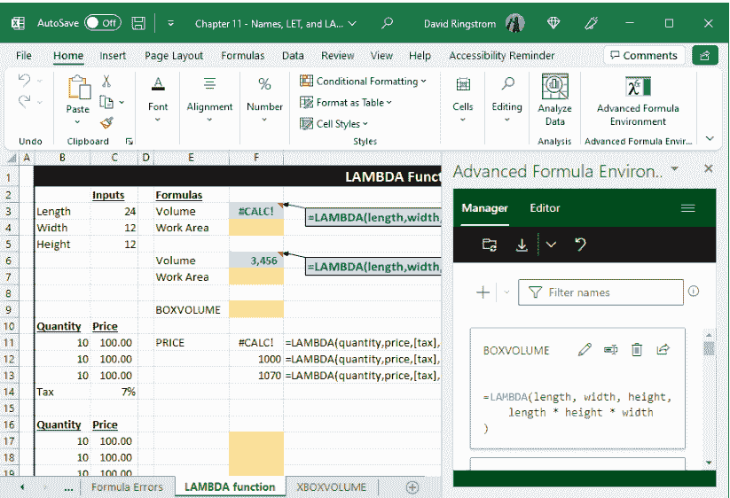

Figure 11.25 – Advanced Formula Environment Manager 视图

**Editor** 选项卡包含一个编程界面，通过该界面你可以将 `LAMBDA` 分布在多行上，如 Figure 11.26 所示。注释可以用 `/ *` 和 `* /` 括起来，如所示，你可以根据需要按 `Enter` 键将公式分布开来，以便更容易理解：


Figure 11.26 – Advanced Formula Editor 视图

**Tip**
如果你觉得 **Advanced Formula Environment** 没有帮助，可以选择 **Insert | My Add-ins**，单击 **Advanced formula environment** 的三点菜单，然后选择 **Remove** 将其删除。

现在，让我们看看如何通过 **Advanced Formula Environment Manager** 创建一个 LAMBDA。

### XBOXVOLUME 函数

XBOXVOLUME 工作表中单元格 G3 包含公式 =LAMBDA (range, INDEX (range, 1, 1) * IF (INDEX (range, 1, 2) = "feet", 12, 1) * INDEX (range, 2, 1) * IF (INDEX (range, 2, 2) = "feet", 12, 1) * INDEX (range, 3, 1) * IF (INDEX (range, 3, 2) = "feet", 12, 1)) (C3 : D5)。当你指定一个宽两列、高三行的六个单元格范围时，此公式可以根据英尺或英寸计算盒子的体积。

让我们使用 **Advanced Formula Environment** 根据此公式向工作簿添加一个新的 LAMBDA：

+   1. 复制 XBOXVOLUME 工作表中单元格 G3 的公式，但不包括末尾的 (C3 : D5) 函数调用和开头的等号 (=)。

### Nuance

使用 **Define Name** 命令创建 LAMBDA 函数时，必须在公式开头包含等号 (=)。使用 **Advanced Formula Environment** 时，必须 _省略_ 等号 (=)。在这两种情况下，你还需要省略在公式末尾括号中包含的任何 **Parameters**。

+   2. 单击 **Advanced Formula Environment** **Manager** 视图上的加号 (+) 按钮。

### Nuance

你也可以单击 **Advanced Formula Environment** **Editor** 视图上的加号 (+) 符号。屏幕将提示你为函数输入 **Name**，然后单击 **Add**。之后，你可以将 LAMBDA 函数粘贴到编辑器中的一行或多行中。

+   3. 在 **Formula name** 字段中输入 **Name**，例如 `XBOXVOLUME`，如下面的屏幕截图所示：


Figure 11.27 – 在 Advanced Formula Environment 中创建新函数

+   4. 将步骤 1 中的公式粘贴到 **Refers to** 字段中。

+   5. 单击 **Add** 以创建新函数。

+   6. 单击 **Advanced Formula Environment** 工具栏上的 **Sync** 按钮，该按钮由两个箭头或文件夹图标表示。

### Nuance

你在 **Advanced Formula Environment** 中创建的新函数在单击 **Sync** 按钮将 **Names** 与 Excel 的 **Name Manager** 同步之前不可在 Excel 中使用。首次单击 **Sync** 按钮后，图标将从两个弯曲的箭头变为带有两个较小弯曲箭头的文件夹。同样，如果你通过 **Advanced Formula Environment** 删除 `LAMBDA` 函数，则自定义函数将在工作簿的 **Name Manager** 中保持可用，直到你单击 **Sync** 按钮。

`LAMBDA` 代表 Excel 自定义工作表函数的未来，当你看到在 `LAMBDA` 函数之前用于创建自定义工作表函数的一种主要方法时，我想你会更加欣赏这一点。

### 自定义 VBA 工作表函数

**VBA** 是 **Visual Basic for Applications** 的缩写，这是你可以在 **Excel for Windows** 和 **Excel for macOS** 中用于创建宏和自定义工作表函数（称为 **user-defined functions**）的编程语言。多年来，我曾断断续续尝试学习其他几种编程语言，但从未取得进展，因为我认为在 Excel 中编程的能力几乎是无限的，至少就我的目的而言。话虽说，由于 **Power Query**，我现在写的代码少了很多，我将在下一章中讨论它。

#### Tip

**Excel for the web** 不支持 Visual Basic for Applications，这意味着你甚至无法在该平台上 _打开_ 包含宏的工作簿。

`Chapter 11 - BOX_VOLUME and XBOX_VOLUME.xlsm` 工作簿中已经安装了两个用户定义工作表函数的编程代码。你可能会遇到 Figure 11.28 所示的安全警告，这意味着在你解除文件阻止之前，你将无法在 **Excel for Windows** 中访问此工作簿中的宏：


Figure 11.28 – 阻止宏的安全警告


## 以下是解除文件阻止的方法：

- 1. 关闭 Chapter 11 - BOX_VOLUME 和 XBOX_VOLUME.xlsm 工作簿。
- 2. 使用文件资源管理器导航到保存工作簿的文件夹。
- 3. 右键单击文件并选择“属性”。
- 4. 如图 11.29 所示，单击“解除阻止”，然后单击“确定”：


## 图 11.29 – Microsoft Windows 文件属性对话框

- 5. 打开工作簿，并在提示是否要尝试自定义工作表函数时单击“启用内容”。

## 以下是测试函数的方法：

- 1. 在“用户定义的函数”工作表的 G3 单元格中输入 =BOX_VOLUME(C3,C4,C5)。该公式应返回 3,456。

> Nuance
> 用 VBA 编写的自定义工作表函数不提供 LAMBDA 所提供的屏幕提示功能，因此您需要记住要输入哪些参数以及输入顺序。

- 2. 在“用户定义的函数”工作表的 G8 单元格中输入 =XBOX_VOLUME(C8:D10)。
该公式应返回 3,456。

您会发现这两个函数的工作方式与 LAMBDA 函数相同。这两个函数的名称中都包含下划线，以便与 LAMBDA 函数区分开来。

现在，让我们学习如何在 VBA 中创建 BOX_VOLUME 函数，与 LAMBDA 函数不同，该函数可在任何版本的 Excel for Windows 或 Excel for macOS 中工作。函数名称中包含下划线，以便与我们在上一节中创建的基于 LAMBDA 的函数区分开来。以下是步骤：

- 1. 删除 G3 和 G8 单元格。
- 2. 选择“开始” | “格式” | “移动或复制工作表”（或右键单击工作表选项卡，然后选择“移动或复制”）。
- 3. 从“到工作簿”列表中选择“(新建工作簿)”。
- 4. 单击“创建副本”复选框，以免不小心移动工作表。
- 5. 单击“确定”将工作表的副本移动到新工作簿中。
- 6. 按 Alt + F11 (Option + F11) 显示 Excel 的 Visual Basic 编辑器，或者如果已在 Excel 功能区中启用“开发人员”选项卡，则选择“开发人员” | “Visual Basic”。
- 7. 在 Visual Basic 编辑器中选择“插入” | “模块”。
- 8. 将以下编程代码输入到模块工作表中：

```
Function BOX_VOLUME(length, height, width)
BOX_VOLUME = length * height * width
End Function
```

- 9. 在新工作簿中激活“用户定义的函数”工作表。
- 10. 在 G3 单元格中输入 =BOX_VOLUME(C3,C4,C5)。

如果 C3、C4 和 C5 单元格包含有效金额，并且您指定了所有三个参数，则 BOX_VOLUME 函数将计算金额；否则，它将返回 #VALUE!。在此示例中，length、height 和 width 是用于存储函数所用数据的变量。Function 和 End Function 这两个词告知 Excel，这段代码是计算，而不是执行任务的子例程。子例程也可以执行计算，但仅在宏触发时才会执行，而函数会自动重新计算。

诚然，这是一个简单的工作表函数，与使用 LET 不相上下。VBA 打开了一个充满可能性的世界，例如，您可以将一组单元格传递给工作表函数，就像我们使用 LAMBDA 时所做的那样。

## Nuance

包含用户定义函数的工作簿必须保存为 **启用宏的工作簿** (.XLSM 文件)；否则，您为自定义函数添加的编程代码将被丢弃。这也意味着每次打开工作簿时都需要启用宏。我在第 2 章“灾难恢复和文件相关提示”中讨论了如何抑制此提示。

Chapter 11 - BOX_VOLUME 和 XBOX_VOLUME.xlsm 工作簿还包含 XBOX_VOLUME 函数的编程代码。以下步骤将使您能够查看该函数的编程代码。每当您想要编辑自己创建的函数时，都可以使用这些步骤：

- 1. 按 Alt + F11 (Option + F11) 显示 Excel 的 Visual Basic 编辑器，或选择“开发人员” | “Visual Basic”。
- 2. 选择“视图” | “项目资源管理器”或按 Ctrl + R (Ctrl + ⌘ + R)。
- 3. 展开 Chapter 11 - BOX_VOLUME 和 XBOX_VOLUME.xlsm 的相应 VBAProject，然后展开其中的“模块”文件夹。
- 4. 双击 modBOX_VOLUME 模块工作表以显示编程代码。如果您愿意，可以编辑该函数。

## Tip

要删除用 VBA 编写的自定义工作表函数，请选择从“Function”一词开始一直到“End Function”的编程代码，然后按 Delete。另一种方法是选择“文件” | “另存为”，将工作簿另存为 Excel 工作簿，而不是启用宏的工作簿。请记住，这样做将从工作簿中删除所有 Visual Basic 编程代码，而不仅仅是自定义函数。

在本章中，我只能向您介绍使用 LAMBDA 和 VBA 函数的一点入门知识，但希望您能看到自定义函数所能带来的巨大威力。LAMBDA 函数有可能使 Excel 中的复杂计算对无数电子表格用户来说更加易于使用，而无需具备任何编程代码知识。此外，LAMBDA 函数可以让更多用户发挥 Excel 的威力，因为执行复杂计算可以变得像向预先编写的 LAMBDA 函数传递几个参数一样简单。

## Summary

本章引导您走了一条从使用简单乘法计算盒子体积开始的路径。然后，我们在通往 LET 和 LAMBDA 函数的过程中逐层增加复杂性。“改变游戏规则”这句话常常显得陈词滥调，但如果您在 Excel 中编写复杂公式，LET 和 LAMBDA 都能让您编写今天的公式，而在将来再次看到它们时不会感到尴尬。在我的职业生涯中，当重新查看公式栏区域中跨越多行的公式时，我不止一次地想过“我那天到底在哪个星球？”。

## Names, LET, and LAMBDA

我们做了几次停留，包括访问 `PRODUCT`、`IF`、`CHOOSE` 和 `SWITCH` 等函数。我包含这些函数是因为向函数传递信息或交换信息的方式存在相似之处，这些可以作为通往 `LET` 和 `LAMBDA` 的垫脚石。从那里，我们开始创建 **Names**，部分是为了关联 `LET` 和 `LAMBDA` 函数之间的相似之处，但也因为 **Names** 是我们将 `LAMBDA` 正式化为自定义工作表函数的方式。除此之外，**Names** 还创建内置的导航辅助工具，并简化公式编写和审计。

`LET` 和 `LAMBDA` 的最大好处之一是能够消除公式中的重复段落。我觉得 `LET` 提供了最简单的方法，即将重复计算存储在 **Variable** 中，然后在需要时在 _calculation_ 参数中引用它。`LAMBDA` 函数确实要求您每次需要在计算中使用时都要拼写出重复计算，但您只需在创建 `LAMBDA` 函数时考虑它。一旦使用 **Name** 正式化 `LAMBDA` 函数，重复计算就会在后台进行而不被看到，因此您可以简单地专注于将正确的输入传递给自定义工作表函数。我没有足够的篇幅来探讨这一点，但您可以在 `LAMBDA` 函数中使用 `LET`，然后兼得两者之长。

既然我们可以使用 `LAMBDA`，本章的最后一部分感觉更像是一种“_不是那样做，但你可以那样做_”的事情。如果您没有任何编程经验，使用 VBA 创建自定义工作表函数可能会感觉像是在海滩上走进水中，突然发现自己身处深水之中。我包含该部分部分是为了向 Excel 的过去致敬，但主要是为了与 `LAMBDA` 对现代 Excel 用户所带来的赋权感形成鲜明对比。

在下一章中，我们将探讨 **Power Query**，它使您能够将 Excel 工作簿连接到各种数据源，包括 Excel 工作簿、文本文件、PDF 文件、数据库等。


