### 12 Power Query

在一本关于 Excel 细微差别和怪癖的书中，我将我认为最具细微差别和怪癖的功能留到了最后：Power Query。我可以证明，在最终理解之前，我多次拿起 Power Query 并坐下来研究，持续了数月之久。这个功能已经存在了 10 年，但大多数 Excel 用户都不知道它巨大的潜力。

在本章中，我的目标是帮助你使用 Power Query 自动化重复流程，而无需编写任何编程代码。我只能分享几个示例，但在此过程中，我会指出各种障碍和节省时间的技巧，这些都将帮助你快速提高效率。如果本章让你意犹未尽，Andrea Janicijevic 编写的 Power Query Cookbook 是一本全面的资源，其内容远超我在此处能分享的范围。

在本章中，我们将涵盖以下主题：

- 介绍 Power Query
- 创建工作表列表
- 自动报告清理
- 从 PDF 文件提取数据
- 取消数据透视
- 从多个来源追加和合并数据
- 连接到数据库并安装 ODBC 驱动程序

### 技术要求

如果你使用的是 Microsoft 365 或 Excel 2021，将获得最佳的 Power Query 体验，但我分享的大部分内容都可以在 Excel 2010 及更高版本中完成。在撰写本文时，Power Query 正处于 macOS 版 Excel Microsoft 365 用户的 beta 测试阶段。任何使用 Excel 2010 或 Excel 2013 的人都需要下载并安装免费的 Power Query 加载项。你可以在 Excel 2016 中通过“数据 | 新建查询”访问 Power Query，而不是“数据 | 获取数据”（后者是 Excel 2019 及更高版本必须执行的操作）。从 PDF 文件提取数据需要 Microsoft 365 或 Excel 2021。本章中使用的工作簿、PDF 文件和文本文件可以从 GitHub 下载，网址为 https://github.com/PacktPublishing/Exploring-Microsoft-Excels-Hidden-Treasures/tree/main/Chapter12。

### 介绍 Power Query

每次使用 Power Query 时，你都会经历一系列至少三个、有时多达五个阶段：

- **连接**：Power Query 使你能够连接到各种数据源，包括工作表区域、工作簿、文本文件、PDF 文件和数据库。

> 细微差别
> 在 Excel 工作簿中连接到的任何工作表区域都会自动转换为表格。

- **转换**：Power Query 编辑器使你能够塑造数据，就像陶艺师塑造一团黏土一样，但在此情况下，你可以选择删除不必要的行和列、添加列、将单个列中的数据分离为两个或多个列，以及更多操作。

- **合并**：可选的合并阶段使你能够将不同的数据集堆叠在一起，例如将工作簿中的单个工作表合并为一个列表，或合并数据，这类似于在 Excel 中使用查找公式将第二个列表中的相关数据匹配到列表中，我在第 10 章“查找函数和动态数组”中详细讨论了这一点。

- **加载**：此阶段将数据返回到你的 Excel 工作簿，并保持可刷新的连接。数据通常作为表格返回到 Excel，因此请务必阅读第 7 章“使用表格功能自动化常见 Excel 任务”，以了解如何进一步利用 Power Query 的结果。

- **刷新**：刷新 Power Query 连接意味着用来自数据源的新副本替换工作簿中的现有数据。如果你只有一次性访问数据集的需求，那么可能不需要担心刷新。但更多时候，Power Query 的目的是建立与数据源的可更新、持久连接。如你所见，你可以手动或自动刷新连接。

通常，你只需处理前四个阶段中的步骤一次，而无需像手动清理报告那样进行无休止的工作。当然，你可以随时编辑步骤。Power Query 的另一个独特之处在于，你可以在转换步骤之间来回走动，以查看在添加另一个步骤之前和之后数据的样子。

### 创建工作表列表

我可以想象，自动生成的工作表列表将成为许多工作簿的有益补充。几个想法包括跟踪工作簿审计的进度、粗略查看工作簿中所有工作表的简单列表，或者通过构建可点击的工作表索引来提升一个层次。这样的索引可能感觉多余。毕竟，当你右键单击 Excel 左下角的导航箭头时，你可以通过双击“激活”对话框中的任何工作表名称来导航。另一方面，这个索引将是一个自动更新的列表，包括隐藏工作表的名称，并且如果需要，可以按字母顺序排序。让我们开始吧：

1. 打开本章的示例工作簿 Chapter 12 - Workbook Index.xlsx，其中包含 17 个工作表。

2. 激活“摘要”选项卡，以便你的索引将作为工作簿中的第一个工作表出现。

> 提示
> 当你将 Power Query 数据加载到工作簿时，将在活动工作表左侧创建一个新工作表。

3. 在 Excel 2019 或更高版本中，选择“数据 | 获取数据 | 来自文件 | 来自 Excel 工作簿”。在 Excel 2016 中，选择“数据 | 新建查询 | 来自文件 | 来自 Excel 工作簿”。在 Excel 2013 和 2010 中，你必须先下载并安装免费的 Power Query 加载项，然后才能选择“Power Query | 来自文件 | 来自工作簿”。

4. 再次导航并选择 Chapter 12 - Workbook Index.xlsx 工作簿，然后单击“导入”。如你所见，Power Query 连接可以引用你正在处理的工作簿。这可能感觉像是在创建循环引用，但我们只是将当前工作簿用作数据源。

5. 在“导航器”对话框的列表中选择 Chapter 12 - Periodic Income Statement.xlsx，然后单击图 12.1 所示的“转换数据”按钮。“加载”按钮加载你已直接连接到 Excel 工作表的数据，而“转换数据”启动 Power Query 编辑器，以便你在将数据返回工作簿之前进行更改。显示“无数据选定以预览”的区域会让你一窥你选择的表格或工作表的数据，但在此情况下，我们选择的是工作簿本身。

> 细微差别
> 当 Power Query 编辑器打开时，你无法在 Excel 中工作。如你所见，你可以随时从 Power Query 将数据返回到 Excel，然后稍后返回继续在 Power Query 中编辑。

### 提示

根据你连接的数据源类型，你可能会在左侧列表中看到表格、工作表或 PDF 文件的页面。你可以连接到列表中的任何项目，并可选地单击“选择多个项目”以创建两个或多个连接。

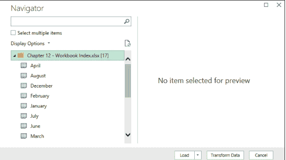

Power Query 导航器窗口

### 6. Power Query 编辑器将打开，如图 12.2 所示：

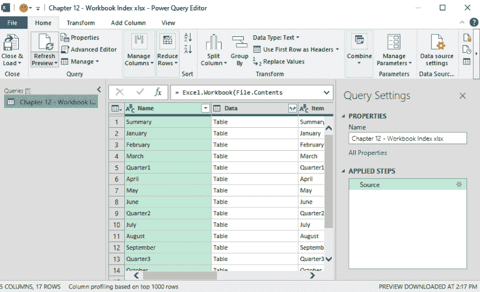

图 12.1 – Power Query 编辑器

如图 12.2 所示，Power Query 编辑器具有以下方面：

- 功能区界面：Power Query 使用类似于 Microsoft Excel 的功能区概念。
- 查询列表：出现在左侧的任务窗格，列出当前工作簿中存在的所有连接。
- 数据预览：这是一个网格，提供加载到 Excel 工作表后数据的预览。
- 查询设置任务窗格：出现在屏幕右侧的面板。它记录数据转换中发生的每个步骤。

7. 在查询设置任务窗格的名称字段中为查询输入新名称，例如 Index。

8. 右键单击“名称”列，然后选择“删除其他列”。这将在数据预览窗口中留下工作表名称列表，如下所示：

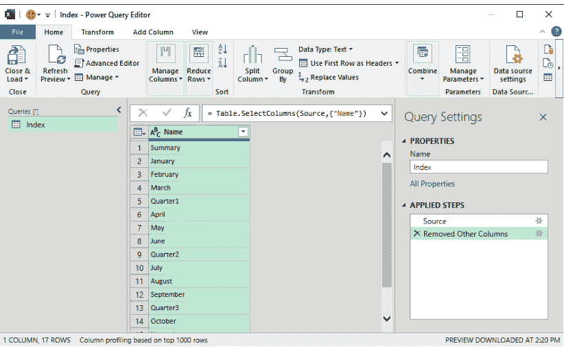

图 12.2 – 将数据加载到工作表之前的 Power Query 结果

9. 选择“主页 | 关闭并加载 | 加载到”以打开“导入数据”对话框。如你所见，Power Query 结果可以以多种方式查看：

- 表格：工作簿中新工作表内格式化为表格的单元格区域。

### PivotTable 报表

一种动态报表，根据你所做的选择，将列表中的信息汇总为行和列。本章我不会创建 PivotTable，但如果你是该功能的新手，PivotTable 任务窗格将出现在新工作表的右侧。将字段列表中的字段拖放到底部的四个象限中，即可创建报表。

> Tip
> 我将在第 1 章 *实现无障碍访问* 和第 7 章 *使用表功能自动化任务* 中讨论表和 PivotTable。

### PivotChart

一种动态图表，以图形形式汇总信息。本章我不会向你展示如何创建 PivotChart，但该过程与创建 PivotTable 类似，事实上，你最终会同时得到一个 PivotTable 和一个 PivotChart。

### 仅创建连接

此选项使你能够创建到数据源的连接，而不将结果返回到 Excel。本章稍后我将提供一个示例，演示如何将两个或多个数据源的数据合并到单个列表中。

10. 单击 OK 接受表的默认选择。这将向工作簿中添加一个新工作表，如图 12.4 所示：

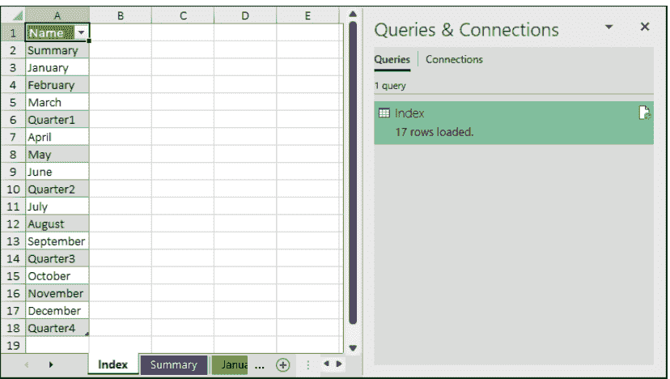

图 12.3 – 将 Power Query 结果返回到工作表

## HYPERLINK 函数

如图 12.5 所示，Chapter 12 - HYPERLINK function.xlsx 中 HYPERLINK 函数工作表的单元格 C3 包含公式 `=HYPERLINK( "#" "&B3&" !"A1", B3)`，该公式创建一个可单击的链接，指向单元格 B3 中引用的工作表的单元格 A1：

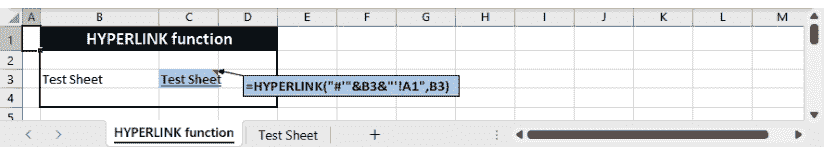

## 运算符指示 Excel 引用活动工作簿。& 符号是 Excel 中的一种串联形式，即组合文本的一种方式。在此示例中，我们正在组合以下组件：

- #
- 由单引号括起来的工作表名称
- 感叹号 (!)
- 单元格地址，例如 A1

HYPERLINK 函数有两个参数：

- `link_location`：你希望为其创建超链接的地址或 URL。在此处，你可以引用文件中的位置，或提供指向外部文档或网页的 URL。
- `friendly_Name`：可选参数，表示你希望在单元格中显示的文本，而不是 `link_location`。

现在，让我们将工作表列表转换为可单击的索引。

## 将 Power Query 结果转换为可单击的索引

我们将向 Power Query 创建的表中添加一个新列。这将把我们的列表转换为可单击的索引。请执行以下步骤：

1. 在单元格 B1 中输入 Index。这将导致表创建一个空白列。

2. 在单元格 B2 中输入 `=HYPERLINK ( "#" "&A2&" "!A1" ,A2)`，并注意当你按 Enter 键时，公式会自动填充整列。现在，你可以单击表中第二列的任何单元格以导航到相应的工作表——前提是该工作表可见，即未隐藏。

> Nuance
> 如果在编写公式时导航到单元格 A2 而不是键入 A2，则你的公式将如下所示：`=HYPERLINK ( "#" "&[@Name]&" !A1" , [@Name] )`。`[@Name]` 在 Excel 中被称为结构化引用，这意味着 Excel 正在引用表中的字段 Name。

现在你可以单击一次即可跳转到工作簿中的任何工作表，你可能希望在工作表上创建指向索引的链接。一种方法是使用 Excel 的“分组工作表”功能：

1. 激活 Summary 工作表。

2. 按住 Shift 键并选择 Quarter4 工作表，以分组 Summary 和 Quarter4 之间（包括这两个工作表）的所有工作表。注意，单词 Group 现在会出现在 Excel 标题栏中，紧跟在你的工作簿名称之后。

3. 可选：右键单击第 1 行并选择“插入”，或单击第 1 行并选择“开始 | 插入”，以在每个工作表的开头插入一个空白行。这将确保你不会意外覆盖工作表中的任何数据。

4. 如果插入了空白行，请在单元格 A1 中输入 `=HYPERLINK ( "#" 'Index' !A1" ,"Index" )`；如果跳过了该步骤，则在 B1 中输入——我碰巧知道该组中每个工作表的单元格 B1 都是空白的。

5. 右键单击任何工作表选项卡并选择“取消分组”以取消工作表分组。尽快取消工作表分组非常重要，以免你无意中执行本应针对单个工作表的任务，而该任务却被执行到了整个组中。

> Nuance
> 将 HYPERLINK 函数与“分组工作表”功能一起使用的一个次要副作用是，你输入公式的工作表上会出现一个看起来像可单击链接的内容。其他工作表将有一个未格式化的链接，该链接可单击，但用户可能不易察觉。你可以使用“格式刷”将格式复制到其他工作表，也可以在单个工作表上输入 HYPERLINK 公式，然后将公式复制并粘贴到其他工作表中。

现在，让我们看看如何刷新列表，以便你添加的新工作表会出现在列表中。这将说明刷新 Power Query 连接的一般工作原理。

## 刷新 Power Query 连接

刷新 Power Query 连接意味着用来自数据源的新副本替换工作簿中的现有数据。我将向你展示如何手动和自动刷新 Power Query 连接。我还将向你展示如何编辑查询，以防你重命名或移动工作簿，或者只是想连接到不同的数据源。

> Tip
> Power Query 结果是时间上的快照，仅在刷新时才会更新。在我们的工作簿索引的情况下，你添加的任何新工作表都不会出现在索引中，直到你刷新 Power Query 连接。

你可以通过多种方式手动刷新 Power Query 结果：

- 选择“查询 | 刷新”（仅当光标位于从 Power Query 返回结果的表中时，该选项卡才存在）
- 右键单击表或 PivotTable 并选择“刷新”
- 选择“表设计 | 刷新”或“PivotTable 分析 | 刷新”
- 单击“数据 | 刷新全部 | 刷新”（Alt + F5）仅刷新当前工作表，或单击“数据 | 刷新全部”（Ctrl + Alt + F5）刷新工作簿中的所有连接

你还可以指示 Excel 自动刷新查询，具体步骤如下：

1. 单击包含 Power Query 结果的任何表或 PivotTable，然后选择“查询 | 属性”。

2. 从“使用”选项卡中选择“打开文件时刷新数据”，如图 12.6 所示：

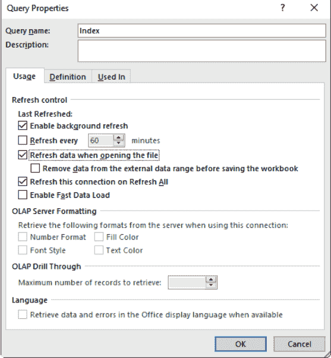

图 12.5 – 查询属性对话框

当你打开工作簿时，Power Query 将自动刷新连接。这意味着任何新添加的工作表都将自动出现在索引中。这适用于你在 Power Query 中创建的任何连接。

## 更新工作表索引

你可能已经注意到，索引工作表没有出现在 Power Query 结果中。在这种情况下，索引工作表是在我们建立 Power Query 连接之后创建的，因此 Power Query 尚未了解新工作表。正如你即将看到的，对于这种特定类型的查询，仅刷新列表不足以使新工作表出现在列表中：

1. 右键单击索引工作表的单元格 A1，然后选择“刷新”。注意，索引仍然没有出现。Power Query 引用的是我们的 Chapter 12 – Workbook Index.xlsx 工作簿的保存版本，而不是内存中存在的版本。

2. 选择“文件 | 保存”或按 Ctrl + S（⌘ + S）。

3. 右键单击单元格 A1 并选择“刷新”。

4. 如图 12.7 所示，现在索引工作表出现在列表中，以及其他项目，例如单元格 A20 和 A21 中的项目。这些杂项结果是 Power Query 捕获的元数据，并会自动创建无效链接，单击时会出现“引用无效”提示：

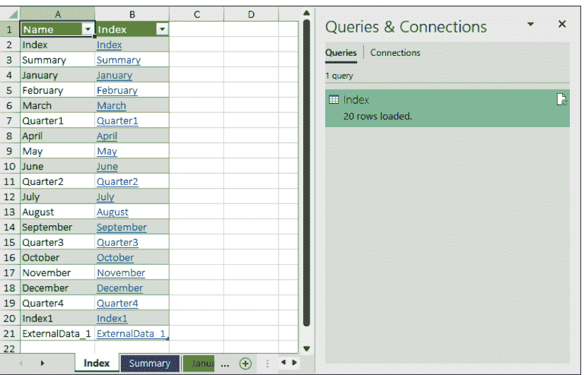

图 12.6 – 已刷新的索引工作表

5. 我们需要返回到 Power Query 编辑器并筛选掉杂项结果，选择索引工作表中表内的任何单元格，然后选择“查询 | 编辑”。

> Tip
> 返回到 Power Query 编辑器的其他方法包括转到“查询 | 编辑”、双击“查询和连接”任务窗格中的连接名称，或右键单击“查询和连接”任务窗格中的连接并选择“编辑”。如果任务窗格不存在，请选择“数据 | 查询和连接”。

6. 在 Power Query 编辑器中，单击“数据预览”窗口中“名称”列顶部的筛选按钮，取消选中 Index、Index1 和 ExternalData_1 的复选框，然后单击“确定”。

### 更新源数据连接

当你移动或重命名数据源（例如你已连接的数据源）时，Power Query 连接将保持附加到该数据源——在此示例中，即 Chapter 12 - Workbook Index.xlsx。让我们为工作簿指定一个新名称，然后更新 Power Query 连接：

+   1. 选择 File | Save As，指定一个新名称，例如 Power Query Index.xlsx，然后单击 Save。
+   2. 激活 Summary 工作表并按 Shift + F11 创建新工作表。

> Tip
> 你也可以通过选择 Home | Insert | Worksheet 来插入新工作表。

+   3. 选择 File | Save。
+   4. 右键单击单元格 **A1** 并选择 **Refresh**。请注意，即使你刷新了列表，新工作表也不会出现。这是因为 **Power Query** 仍在引用 *Chapter 12 – Workbook Index.xlsx* 工作簿。
+   5. 在 **Index** 工作表的 **Table** 中选择任意单元格，然后选择 **Query | Edit**。
+   6. 在 **Query Settings** 任务窗格的 **Applied Steps** 列表中，单击 **Source** 步骤旁边的 **Gear Icon**。
+   7. 单击 **Browse** 按钮以选择文件的更新版本，然后单击 **OK**，如 *Figure 12.8* 所示：

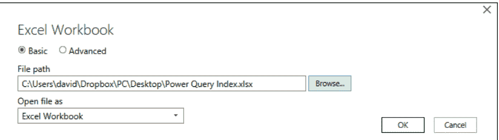

Figure 12.7 – Excel Workbook connection dialog box

+   8. 选择 **Home | Close & Load** 将数据返回到工作表。
+   9. 你添加的新工作表现在将出现在列表中。

这个创建工作簿工作表索引的简单示例涵盖了你在 **Power Query** 中连接和刷新数据源时会遇到的几个常见问题。现在，让我们学习如何使用 **Power Query** 来自动化会计报告的清理工作。

### 自动化报告清理

你可能会发现自己手头有一些需要在 Excel 中分析的报告，但这些报告从分析角度来看非常不友好。你甚至可能每月都在手动清理此类报告。或者，你可能正在编写 Excel 宏来自动化此类重复性任务。我要告诉你，自从有了 **Power Query**，我现在编写的宏少得多了。

正如我们在工作簿索引示例中所见，**Power Query** 提供了一种无需编码的方法，旨在实现“设置并遗忘”。我们将把一份 1 月份会计报告转换为可分析的格式，然后用 2 月份的报告覆盖它。这将说明一旦你建立了 **Power Query**，唯一的重复步骤就是运行新报告并覆盖数据源的先前版本。

首先，让我们看看从其他软件程序导出到 Excel 的报告中出现的一些常见问题。

### 分析障碍

本章 GitHub 仓库中提供的 _Chapter 12 - January Aging.xlsx_ 工作簿说明了 Excel 用户可能遇到的常见问题。**应收账款账龄报告**是一份会计报告，显示客户应付款项以及发票未付的时间长度。如 **Figure 12.9** 所示，该报告从分析角度存在几个问题。

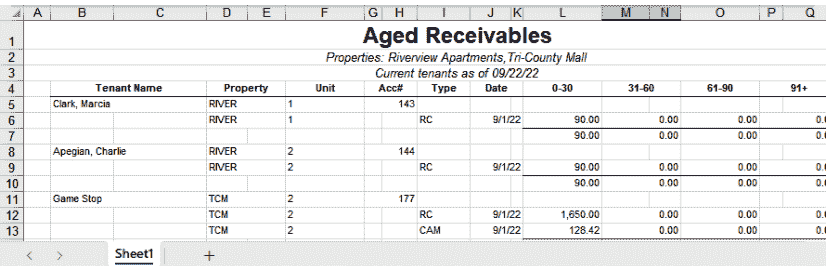

Figure 12.8 – Typical issues that arise in reports exported from accounting software and other tools

一些问题包括：

+   - 列 B:C、D:E、G:H、J:K、M:N、P:Q 和 R:S 中的合并单元格
+   - 每个租户后面出现一个总计行，这使得筛选更加困难，并且在求和时不小心重复部分或全部金额的风险也更大。
+   - 租户和账户 **名称** 仅出现在第一行，但交易出现在其他行
+   - 虽然 _Figure 12.9_ 中未显示，但与特定租户无关的其他报告总计出现在报告下方

任何 _一项_ 这些问题都足以令人沮丧，更不用说同时存在多个问题了。我们将使用 **Power Query** 将 _Figure 12.9_ 中所示的丑陋报告转换为 _Figure 12.10_ 中所示的可分析格式：

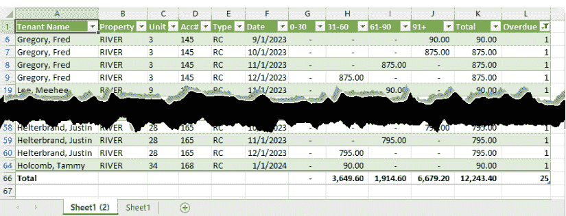

Figure 12.9 – Data transformed by Power Query

让我们看看 Power Query 如何消除解锁感觉被困在电脑玻璃下的数据所涉及的挫败感和障碍。

### 转换报告

像通过下一个示例进行操作这样的实践经验，是克服 Power Query 带来的学习曲线的好方法：

+   1. 打开 Chapter 12 - January Aging.xlsx 工作簿。
+   2. 选择 File | Save As 并输入名称 Aging.xlsx。请注意，这里没有月份名称，以避免未来月份混淆。稍后在此序列中，我们将用 Chapter 12 - February Aging.xlsx 工作簿覆盖此 Aging.xlsx 工作簿。
+   3. 选择 File | Close 关闭 Aging.xlsx 工作簿。
+   4. 按 Ctrl + N (% + N) 创建空白工作簿（或选择 File | New 并选择 Blank Workbook）。
+   5. 选择 Data | Get Data | From File | From Excel Workbook，选择 Chapter 12 - January Aging.xlsx 工作簿，然后单击 Import。
+   6. 从 Navigator 窗口左侧列表中选择 Sheet1。请注意数据预览如何出现。单击 Transform Data 打开 Power Query 编辑器。
+   7. 在 Query Settings 任务窗格的 Applied Steps 列表中，右键单击 Promoted Headers，选择 Delete Until End，然后单击 Delete。请小心操作，以免不小心删除 Source 或 Navigation 步骤，因为这样做可能会从 Data Preview 窗口中删除数据，或者更糟的是，完全中断与数据的连接。无论哪种情况，如果你是 Power Query 新手，阻力最小的路径是选择 File | Discard & Close，然后从步骤 5 重新开始。

### Power Query

> > **Tip**
> > **Power Query** 有时会假设你希望将工作表的第一行提升为列标题，并自动更改某些列的 **Data Type** 属性。这样做通常会将基于文本的数字转换为整数或小数值。我倾向于删除 **Power Query** 添加到 Applied Steps 列表中的任何“有帮助”的步骤，以便我从 Source 和 Navigation 步骤开始，然后添加我需要的任何其他步骤来转换报告。有时，当这些“有帮助”的步骤与你稍后添加的步骤发生冲突时，它们会变得无帮助。

+   8. 在 **Power Query** 中删除列就像单击列并按 _Delete_ (_Fn + Delete_) 一样简单。尝试此技术，删除 Column1，它不包含最终报告中需要的任何数据。

> > **Tip**
> > **Power Query** 没有撤销命令，但你可以通过从 Applied Steps 列表中删除步骤来回滚转换。如果你连续执行某个步骤，例如删除空列，Applied Steps 列表中只会有一个跨越你删除的所有列的 Removed Columns 步骤。如果你删除此步骤，所有已删除的列都将返回，但你可以再次删除它们。

+   9. 在 **Applied Steps** 列表中右键单击 **Removed Columns**，选择 **Rename**，将标题更改为 `Removed First Column`，然后按 _Enter_。

> > **Tip**
> > 随着 **Applied Steps** 列表的增长，很容易在数据转换过程中失去对正在发生的事情的跟踪。在操作过程中重命名步骤可以记录转换过程，并使排查产生意外结果的转换变得容易得多。

+   10. 报告的前三行是多余的，但你无法删除它们。相反，请选择 **Home** | **Remove Rows** | **Remove Top Rows**。
+   11. 在 _Figure 12.11_ 所示的 **Remove Top Rows** 对话框的 **Number of rows** 字段中输入 3，然后单击 _OK_：

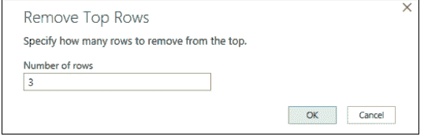

Figure 12.10 – The Remove Top Rows dialog box

12. 右键单击 **Removed Top Rows**，选择 **Rename**，然后键入 Removed Top 3 Rows 并按 **Enter**。

**Tip**
注意 **Removed Top 3 Rows**（或 **Removed Top Rows**）步骤旁边的 **Gear Icon**。如果要调整要删除的行数，可以单击此图标以重新显示 Remove Top Rows 对话框。

13. 选择 **Home | Use First Row as Headers** 以使用第一行中的标题替换通用的 **Data Preview** 列标题。

14. **Changed Type** 步骤出现在 **Applied Steps** 列表中，因为 **Power Query** 更改了一个或多个列的数据类型。有时这很有帮助，有时则不然。幸运的是，您可以确定哪些列发生了更改：

+   I. 单击 **Promoted Headers** 步骤，这会导致 **Data Preview** 窗口显示在应用 **Changed Type** 步骤之前数据的样子。

+   II. 注意标题行中单词 **Unit** 旁边的 ABC123 图标，这表示该列包含文本和/或数字。这在 **Power Query** 中也称为 **Any** 数据类型，这意味着一列可能包含文本、数字或两种数据类型。

+   III. 单击 **Changed Type** 步骤，注意单词 **Unit** 旁边现在出现了 **123**，这表示该列已转换为整数。

+   IV. 如果在操作过程中在 **Promoted Headers** 和 **Changed Type** 之间来回单击，您还会注意到其他列类型更改。

15. 选择 **Home | Choose Columns**（如果单击了命令的下半部分，则再次单击 **Choose Columns**）。

16. 在 **Choose the columns to keep** 字段中键入 **Col** 以一次性选择所有空白列。

17. 清除 **(Select All Search Results)** 复选框，然后单击 **OK**。

**Nuance**
您可以稍后通过单击 **Gear** 图标并更新选择来轻松修改此类步骤。如果需要更新没有 **Gear Icon** 的步骤，您有两种选择：删除该步骤并重新添加，或编辑 **Formula Bar** 区域中的 **M** 代码。**Power Query** 在幕后使用一种称为 **M** 的编程语言，**Power Query Editor** 大多会屏蔽这种语言，但在您准备好时也会提供该语言。

18. 将 **Removed Other Columns** 步骤的 **Name** 更改为 **Removed Blank Columns**。

### Power Query

19. 选择 **Tenant** 列，然后选择 **Transform** | **Fill** | **Down**，如 **Figure 12.12** 所示，以填充未显示租户 **Name** 的行：

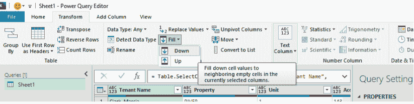

## Figure 12.11 – The Fill | Down command

> Nuance
> Fill 命令仅在列中的一个或多个单元格中出现单词 null 时才起作用。
> 如果要填充的单元格是空白，请选择该列，然后选择 Transform | Replace Values。将 Value To Find 字段留空，在 Replace With 字段中键入 null，然后单击 OK。在此上下文中，单词 null 必须全部小写。然后可以使用 Transform | Fill | Down 来填充缺失的值。

20. 重复步骤 24 以同样方式向下填充 Acc# 列。
21. 在 Applied Steps 列表中将 Filled Down 重命名为 Filled Tenant Name/Acc# Down。

> Nuance
> 注意 Power Query 只向 Applied Steps 列表添加了一个 Filled Down 步骤。连续的同一任务版本会自动合并为单个步骤。在这种情况下，您无法从一个列中删除任务而不同时从其他列中删除。解决此问题的唯一方法是在执行将与初始实例合并的任务之前先执行不同的任务。

22. 单击 Date 列中的筛选箭头，清除 Null 复选框，然后单击 OK 以删除不包含事务数据的行。

> Nuance
> Power Query 中的字段可以标记为 null，也可以完全为空白。在此情况下，任何不包含日期的行都是我们想要删除的行。在数据中识别此类模式有助于使转换变得轻松。

23. 在 Applied Steps 列表中将 Filtered Rows 重命名为 Filtered Null Date Rows。

24. 选择 **0-30** 列，然后按住 *Shift* 键并用鼠标选择 **Total** 列。或者，单击 **0-30**，按住 *Shift* 键，并使用右箭头键选择老化列直到 **Total**，然后选择 **Transform | Data Type: Any | Currency** 选项以将老化列转换为货币值。

**Nuance**
在 **Power Query** 中将列设置为 **Currency** 不会将 **Currency** 数字格式应用于 Excel 中的单元格，因此您仍然需要格式化工作表单元格。

25. 将 **Changed Type** 命令重命名为 *Changed Amount Fields to $*。

26. 选择 **Home | Close & Load** 以将数据返回到 Microsoft Excel。

27. 注意 **F** 列可能会以序列号格式显示日期：

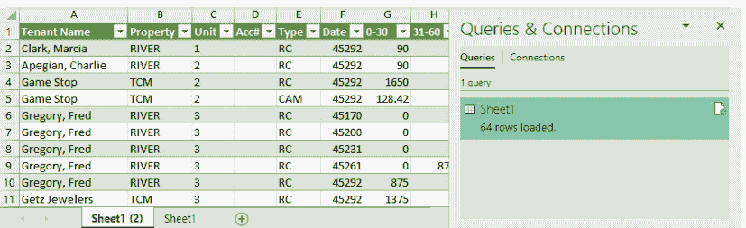

**Figure 12.12 – The F column may show serial numbers instead of dates**

如果发生这种情况，您可以在 Excel 中手动格式化这些日期，也可以在 **Power Query** 中进行更改：

+   1. 选择 **Table** 中的任何单元格，然后选择 **Query | Edit**。

+   2. 单击 **Date** 列标题中的 **ABC123** 图标，并从列表中选择 **Date**，作为选择 **Transform | Data Type: Any | Date** 的替代方案。

+   3. 右键单击并重命名 **Applied Steps** 中的 **Changed Amount Field to $** 标题，因为该步骤现在包含两个连续的相同类型的转换。

+   4. 选择 **Home | Close & Load** 以将数据返回到 Excel。

**Nuance**
您并不总能判断何时需要更改数据类型，例如 **Date** 列。在此情况下，Data Preview 通过显示日期而不是序列号误导了我。

### Setting a locale or region

我住在亚特兰大，这意味着在 2024 年，*Ides of March* 对我来说将是 03/15/2024，但对您来说可能是 15/03/2024。同样，您导入到 **Power Query** 的数据可能反映数据来源的区域设置，或最后保存文件的人的区域设置。**Power Query** 将世界区域称为 **locales**。区域设置会影响日期、时间和数字的格式。让我们看看如何在操作系统、工作簿或文本文件中，以及查询中的列内更改区域设置：

+   - **Operating System**: Power Query 默认使用 Windows 中的 **Regional Settings** 首选项以及 Excel for macOS 中的 **Region and Language** 设置。要更改这些设置：
+   
+     - **Windows**: 选择 Start | Settings | Time & Language | Region，并从 **Regional format** 列表中进行选择，然后关闭 **Settings** 窗口。
+   
+     - **Mac**: | **System Preferences** | **Language & Region**，从 **Region** 列表中进行选择，然后关闭 **Language & Region** 对话框。
+   
+   - **Workbook**: 在 Excel for Windows 中，您可以通过为工作簿指定区域设置来覆盖操作系统的 **Regional Settings**：选择 **Data** | **Get Data** | **Query Options** | **Regional Settings**，从 **Locale** 列表中进行选择，然后单击 **OK**。
+   
+   - **Text file**: 您可以在导入过程中或查询级别为文本文件设置区域设置，这也将覆盖操作系统的设置：
+   
+     - **At import**: 步骤在不同平台之间有所不同：
+   
+       - **Excel for Windows**: 选择 **Data** | **From Text/CSV**，更改 **File Origin** 字段，然后选择 **Load** 或 **Transform Data**。
+   
+       - **Excel for macOS**: 选择 **Data** | **Get Data (Power Query)** | **Text/CSV**，单击 **Browse** 并选择文件，然后单击 **Next**。更改 **File Origin** 然后单击 **Load** 或 **Transform Data**。
+   
+       - **Query settings**: 单击 **Query Settings** 任务窗格的 **Applied Steps** 列表中 **Source** 步骤的 **Gear Icon**，更新 **File Origin** 字段，然后单击 **OK**。
+   
+   - **Change Type action**: 您可以通过按列指定区域设置来同时覆盖 **Operating System** 和 **Power Query**：
+   
+     I. 单击查询列 **Header** 字段中的 **Data Type** 按钮，并选择 **Using Locale**，（或右键单击 **Header** 并选择 **Change Type** | **Using Locale**）以显示 **Figure 12.14** 中所示的 **Change Type with Locale** 对话框：

### 向 Power Query 结果添加补充公式

让我们创建一个 **Overdue** 列，以便我们可以筛选应收账款账龄分析表中的逾期金额：

- 1. 在单元格 **L1** 中键入 `Overdue`。
- 2. 在单元格 **L2** 中输入公式 `=COUNTIF(H2:J2,">0")`。请记住，如果您导航到单元格 **H2** 或 **J2**，您的公式将使用列 **Names** 作为结构化引用，这意味着您的公式可能看起来像 `=COUNTIF(Sheet1[@[31-60]:[91+]],">0")`。后者是一种结构化引用公式，返回与基于单元格引用的公式相同的值。
- 3. 单击单元格 **L1** 中的 **筛选** 箭头，取消选中 0 的复选框，然后单击 **确定**。
- 4. 可选：在 **表设计** 选项卡上单击 **总计行** 复选框。Excel 将自动将求和添加到 **L** 列，这将为您提供逾期发票的计数。单击 **0-30** 列中的总计单元格，然后从下拉列表中选择 **求和**。然后，您将 **0-30** 单元格中的 **填充柄** 拖动到其他列以添加总计。

您现在有一份应收账款账龄报告，该报告仅显示超过 30 天的金额。在此示例中，`COUNTIF` 函数正在计算 **H:J** 列中包含大于零的金额的单元格数量。

### 使用新数据更新 Power Query 连接

Power Query 的主要优点之一是您可以创建可重复使用的数据转换。让我们看看如何使用二月账龄分析表更新我们的电子表格：

- 1. 打开 Chapter 12 - February Aging.xlsx 工作簿。
- 2. 选择文件 | 另存为，将工作簿保存到您在本章前面创建的 Aging.xlsx 工作簿上，并在询问您是否要替换文件时单击是。
- 3. 选择文件 | 关闭以退出 Aging.xlsx 工作簿。
- 4. 右键单击显示一月账龄的表，然后选择刷新，或选择表设计 | 刷新。

您的工作簿现在应反映二月账龄，这说明持续转换报告是多么容易。现在，让我们看看如何创建报告的存档副本。

### 断开 Power Query 连接

Power Query 连接旨在持久存在，并在需要时（例如我们将二月报告版本保存到 Aging.xlsx 工作簿上）使用。相反，如果您不希望数据被刷新，可以断开链接：

- 1. 选择文件 | 另存为，输入新工作簿名称，例如 February Aging.xlsx，然后单击保存。
- 2. 单击表设计 | 取消链接，如图 12.14 所示，然后单击确定：

> 提示
> 我将在第 5 章“数据验证和表单控件”中更详细地讨论 COUNTIF 函数。

我们创建的账龄报告显示一月的结果。现在，让我们使用二月结果更新报告。

提示
谨慎使用取消链接命令，因为您无法撤销此操作，也无法撤销任何先前的操作。如果您意外取消了查询的链接，可以右键单击查询和连接任务窗格中的查询，然后选择加载到，这将显示加载到对话框。选择表 | 新工作表，然后单击确定以重新创建数据连接。

- 3. 单击数据 | 查询和连接以显示查询和连接任务窗格（除非它已显示）。
- 4. 单击任务窗格中的任何查询一次，然后按删除键（或右键单击查询并选择删除），并在提示时单击删除。

细微差别
与取消链接表不同，您可以撤销从查询和连接任务窗格中删除连接的操作。

一旦您从查询和连接任务窗格中删除连接，工作簿将无法再从 Power Query 刷新，并将作为数据的永久快照。现在，让我们使用 Power Query 从 PDF 文件中提取数据。

### 从 PDF 文件中提取数据

一些用户购买第三方软件来从 PDF 文件中提取数据，因为缺乏更好的替代方案。**PDF** 代表 **可移植文档格式**，是 **Adobe Corporation** 的产品。PDF 文件具有跨平台兼容性，可以在任何设备上打开。使用 **Power Query** 从 PDF 文件中提取数据需要 **Excel 2021** 或 **Microsoft 365**。本节中的步骤无法在 **Excel 2019** 或更早版本中执行。撰写本文时，**Excel for macOS** 不支持从 PDF 文件中提取数据。

> 提示
> **Word 2013** 及更高版本允许您打开和编辑大多数 PDF 文件，如果您的 Excel 版本不允许使用 **Power Query** 提取数据。打开 PDF 文件的方式与打开 Word 文档相同，然后将结果复制并粘贴到 Excel 中。某些 PDF 文档会干净地传输，而另一些则会变得一团糟。

任何从 PDF 文件中提取数据的软件都使用 **光学字符识别**，因此有时您的数据可能会被误解。我将在下一系列步骤中指出两个特定实例。我选择作为示例的 PDF 文件是 **QuickBooks Desktop** 提供的示例公司的 **损益** 报告。请准备好处理 PDF 文件特有的光学字符识别问题，这些问题在将 **Power Query** 连接到其他数据源时不会出现。

现在让我们从 PDF 文件中提取数据。我将通过不重命名 **应用的步骤** 列表中的任何内容来更快地操作，但如果您觉得有帮助，请随时这样做：

- 1. 按 **Ctrl + N** 创建空白工作簿（或选择 **文件 | 新建** 并选择 **空白工作簿**）。
- 2. 选择 **数据 | 获取数据 | 从文件 | 从 PDF**。
- 3. 选择一个 PDF 文件，例如 **Chapter 12 - Profit & Loss.pdf**，然后单击 **导入**。
- 4. 如 **图 12.15** 所示，**导航器** 对话框可能同时显示 **表** 和页面。在此上下文中，**表** 和页面都是 PDF 文件的数据子集。您可以单击 **选择多个项目** 复选框以查看两个或多个 **表** 或页面。相反，让我们从列表中选择 **Chapter 12 - Profit & Loss.pdf**，然后单击 **转换数据**，这将确保 **Power Query** 将导入 PDF 文档的所有页面：

5. 如图 12.16 所示，将出现 PDF 文件中的 **表** 和页面列表。单击 **种类** 列中的 **筛选** 按钮，清除 **表** 复选框，然后单击 **确定**：

6. 右键单击数据列，然后选择删除其他列。

7. 单击数据列标题中的双向箭头，清除使用原始列名作为前缀复选框，然后单击确定以展开数据，如图 12.17 所示，以显示 PDF 文件中的所有数据：

让我们看看我们提取的数据的一些特点：

- 某些账户编号在 Column2 中，而其他账户编号在 Column3 中，如图 12.18 所示：

- 字母 N 从 **Column2** 和 **Column3** 中的 **Net** 单词在行 **61**、**66** 和 **67** 上被删除了，如图 12.19 所示。在我的测试中，我发现并非所有人都会遇到这种情况，但它发生在我的计算机上，因此我将向您展示如何修复它，以防您遇到这种奇怪现象：

- 某些金额出现在 **Column6** 中，而其他金额出现在 **Column7** 中，如下所示：

- **13,68553** 出现在行 **67** 的 **Column7** 中，而不是 **13,685.53**，因为小数点缺失。如果您单击 **Column7** 标题中的 **ABC123** 图标并选择 **货币**，**Power Query** 会将此数字翻译为 **13,685,533**。

幸运的是，我们可以使用 **Power Query** 功能来解决上述所有四个问题。

- 8. 单击 **Column1**，然后按住 **Shift** 键的同时单击 **Column5**。
- 9. 右键单击所选内容并选择 **合并列**（或单击 **转换 | 合并列**）。

10. 在“新建列名（可选）”框中键入 Account，然后单击“确定”，如图 12.21 所示：

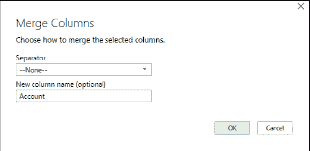

图 12.21 – 合并列对话框

11. 单击 Column6，然后按住 Shift 键的同时单击 Column9。
12. 右键单击所选内容，然后选择“合并列”（或单击“转换 | 合并列”）。
13. 在“新建列名（可选）”框中键入 Initial Amount，然后单击“确定”。
14. 单击 Account 字段中的筛选箭头，取消选择 (blank)，然后单击“确定”。
15. 单击 Initial Amount 字段中的筛选箭头，取消选择 (blank)，然后单击“确定”。
16. 单击 Initial Amount 标题中的数据类型图标（显示为 ABC），然后选择“货币”。
17. 选择 Account 列，然后选择“转换 | 替换值”。
18. 在“查找值”字段中输入 "et "（不含引号），在“替换为”字段中输入 "Net "（不含引号），然后单击“确定”。请确保在 et 和 Net 后面都包含一个空格。
19. 第 41 行的净收入金额为 13,368,553，我们将通过创建条件列来更正：

1. 单击“添加列 | 条件列”。
2. 在“新建列名”字段中键入 Amount。
3. 从“列名”字段中选择 Initial Amount。
4. 从“运算符”字段中选择“大于”。
5. 在“值”字段中输入 1000000。
6. 在“输出”字段中键入 [Initial Amount]/100。

### 注意

在自定义列或 **Power Query 中的条件列** 引用字段名时，必须将字段名用方括号括起来。

7. 单击 **Else** 下方的 **ABC123** 按钮，然后选择“选择列”。
8. 从 **Output** 列表中选择 **Initial Amount**，如下所示：

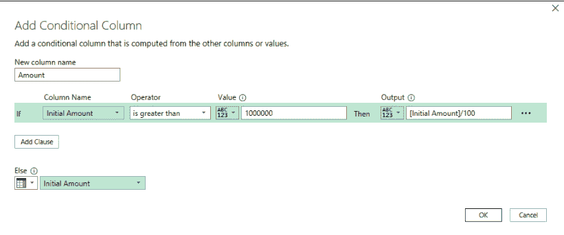

图 12.22 – 添加 **条件列** 对话框

9. 单击 **OK** 关闭 **添加条件列** 对话框。

### 提示

根据您正在处理的数据，使用 **条件列** 的方法可能存在一些风险。对于此数据集，实际数字绝不会接近 1,000,000，因此除以 100 不会造成问题。这绝非万能解决方案，而只是说明当 **Power Query** 错误解读部分数据时，解决问题的一种方法。

20. 第 **41** 行的 **Amount** 列显示 **[Initial Amount]/100**，而不是计算结果。要解决此问题，请删除 **Power Query 的公式栏** 中 **[Initial Amount]/100** 周围的双引号，如 **图 12.23** 所示。如果需要展开 **公式栏**，请单击右上角的向下箭头：

### 图 12.23 – 在 **公式栏** 中删除 [Initial Amount]/100 周围的引号

21. 单击 **Initial Amount** 列并按 _Delete_ 键（或右键单击列并选择“删除”）。

22. 单击 **Amount** 列的 **数据类型** 图标（显示为 **ABC123**），然后选择“货币”；否则，在某些情况下，数字可能会作为文本加载到工作表中。

23. 单击 **主页 | 关闭并加载**，将数据返回到 Microsoft Excel，以便将 PDF 数据返回到 Excel。

24. 如果我提供了第二个 PDF 文件，您可以覆盖现有的 PDF 文件，右键单击 **表**，然后选择“刷新”，方式与本章前面使用的账龄表相同。

现在，让我们来看看我最喜欢的 **Power Query** 用途之一，即取消数据透视。您将看到，这意味着将宽达几十列或更多列的笨拙报告转置为仅几列宽且易于筛选的分析就绪格式。

### 取消数据透视

取消数据透视有时也称为扁平化数据，这意味着所有相似值都出现在列中而不是行中。例如，我从 QuickBooks Desktop 导出的 _Profit & Loss By Class_ 报告（如图 12.24 所示）跨越 123 列，从列 **A** 到列 **DS**。对于这样的报告，很难做太多事情，因为数据分布过于分散。让我们使用 Excel for Windows 或 macOS 中的 **Power Query** 将 123 列的数据转置为三列。再次，我将通过不在“应用的步骤”列表中重命名任何内容来加快速度：

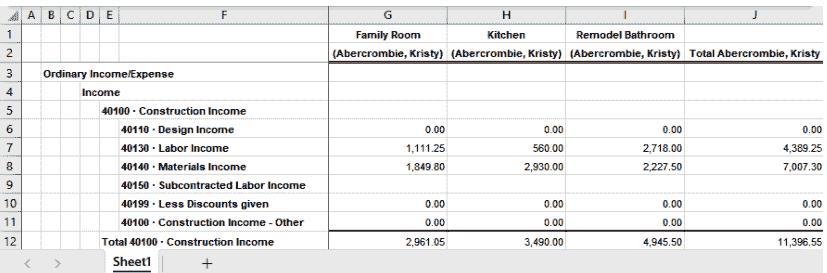

图 12.24 – 待取消数据透视的数据

1. 按 `Ctrl + N` (`⌘ + N`) 创建空白工作簿（或选择“文件 | 新建”，然后选择“空白工作簿”）。
2. 单击“数据 | 获取数据 | 来自文件 | 来自 Excel 工作簿”，选择 _Chapter 12 – Unpivoting Data.xlsx_，然后单击“导入”。
3. 从列表中选择 **Sheet1**，然后单击“转换数据”。
4. 单击 **Column1**，然后按住 _Shift_ 键并单击 **Column6**，以将包含账户编号的多个列合并为一列。
5. 右键单击所选内容，然后选择“合并列”（或选择“转换 | 合并列”），在“新建列名”字段中输入 `Account`，然后单击“确定”。
6. 单击 **Account** 列，这会取消选择其他列。
7. 右键单击 **Account** 列，然后选择“取消数据透视其他列”（或选择“转换 | 取消数据透视列”）。
8. 如图 12.25 所示，数据现在出现在三列中。您现在可以构建 **数据透视表**、筛选数据、使用 **切片器**，并执行任何数量的其他分析任务：

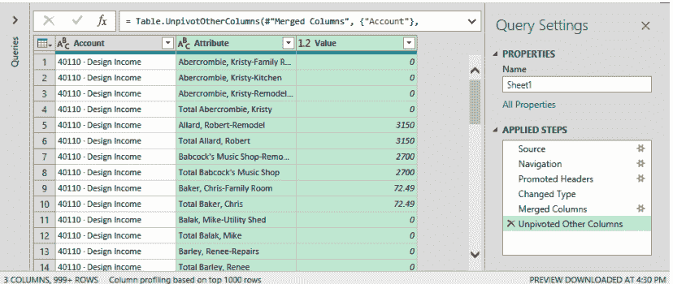

图 12.25 – 取消数据透视的按类别的损益报告

9. 此时可以添加的一些收尾工作包括：

- 从 **Value** 列中筛选出 **0** 值
- 通过双击列标题、键入 `Class` 然后按 `Enter` 来将 **Attribute** 列重命名为 **Class**
- 将 **Values** 列重命名为 **Amount**

10. 单击“关闭并加载”以将取消数据透视的数据返回到 Microsoft Excel。

现在，让我们学习如何将两个或多个来源的数据关联起来。我将使用文本文件作为数据库 **表** 的替代品，因为并非所有人都能随时访问数据库。

### 从多个来源追加和合并数据

到目前为止，我们已经了解了如何从单个数据源（例如 PDF 文件或 Excel 工作簿）中提取数据。在本节中，我将为您提供一个二合一的教程，您不仅将学习如何从文本文件中提取数据，还将学习如何将两个或多个来源的数据关联起来。本章的示例文件包括六个 **逗号分隔值 (CSV)** 文件。**图 12.26** 显示了每个文件中包含的数据，这些数据也在 Chapter 12 - Appending and Merging Data.xlsx 工作簿中。这些文本文件的结构与数据库中存储数据的 **表** 类似。

您可能无法立即访问数据库，但执行从这些文本文件中追加和合并数据的步骤后，您将确切地知道如何将数据从数据库提取到 Excel 中：

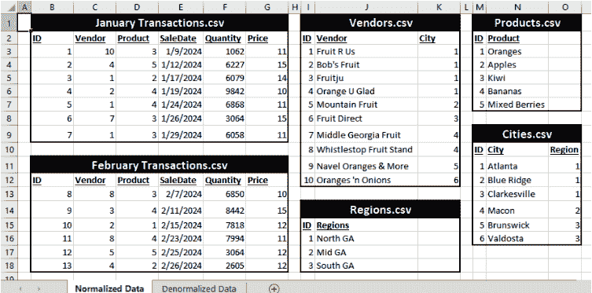

图 12.26 – 规范化数据

规范化数据意味着尽可能减少冗余。在此示例中，我提供了 1 月和 2 月的交易文件。首先，我们将这两个文件追加在一起，这意味着将它们堆叠为一个包含总共 13 笔交易的合并列表。此时，数据将被合并，但可能不太实用，因为供应商和产品由 ID 编号表示，这些编号分别对应 Vendors.csv 和 Products.csv 文件。我们无法直接从 Transactions.csv 文件中确定交易属于哪个城市或地区，因为这些数据被移除了两到三个层级。但是，通过在 Power Query 中追加和合并数据，我们可以得到非规范化格式，如图 12.27 所示：

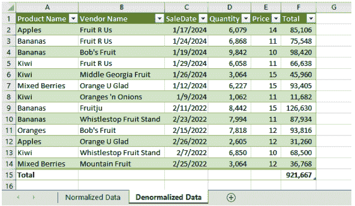

图 12.27 – 非规范化数据

与前面几个示例一样，我将通过不在“应用的步骤”列表中重命名任何内容来加快过程，以尽量减少在 Excel for Windows 或 Mac 中涉及的总步骤数：

1. 按 Ctrl + N (⌘ + N) 创建空白工作簿（或选择“文件 | 新建”，然后选择“空白工作簿”）。
2. 选择“数据 | 获取数据 | 来自文件 | 来自文本/CSV”，选择 Chapter 12 - January Transactions.csv 文件，然后单击“导入”。
3. 单击“转换数据”以关闭导航器窗口并打开 Power Query 编辑器。

> 提示
> 通常，您必须从导航器窗口中选择工作表、页面或查询，但在此上下文中，文本文件被视为带有单个表的数据库，因此无需选择。

4. 在 Power Query 编辑器中，单击“主页 | 新建源 | 文件 | 文本/CSV”，选择 Chapter 12 - February Transactions.csv 文件，单击“导入”，然后单击“确定”。

> 注意
> 当您将数据直接导入 Power Query 编辑器时，导航器窗口中的“加载”和“转换数据”按钮将被单个“确定”按钮取代。

5. 我们有两个查询，将通过选择“主页 | 追加查询 | 作为新查询追加”将它们追加到第三个查询中。
6. 从第一个表列表中选择 Chapter 12 – January Transactions，从第二个表列表中选择 Chapter 12 – February Transactions，如图 12.28 所示，然后单击“确定”：

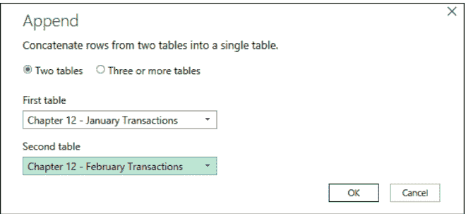

图 12.28 – 追加对话框

### Power Query

Nuance  
你可以像在 Excel 中一样对 Power Query 中的数据进行排序，因此我们同样可以先选择二月份文件，再选择一月份文件。

- 7. 在“查询设置”任务窗格的“名称”字段中键入 Fruit Sales，然后按 Enter 为合并后的列表指定比默认名称 Append1 更具描述性的名称。

- 8. 现在，让我们导入供应商列表，以便在 Fruit Sales 查询中用供应商名称替换供应商 ID 号。单击“主页 | 新建源 | 文件 | 文本/CSV”，选择 Chapter 12 - Vendors.csv 文件，单击“导入”，然后单击“确定”。

- 9. 此时，我们将把 Chapter 12 - Vendors.csv 文件中的数据合并到 Fruit Sales 查询中，但首先，我们需要确保 ID 号具有相同的数据类型。如果要匹配的字段类型不同（例如文本和数字），则无法合并来自两个不同查询的数据。检查方法如下：

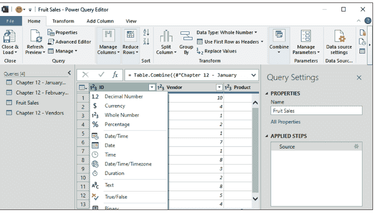

## 图 12.29 - Power Query 中的数据类型

- 11. 从 Power Query 编辑器左侧的查询列表中选择 Fruit Sales，并记下 Vendor 字段的数据类型，它也是 123，表示整数。现在可以合并这两个查询了，因为两个查询中的匹配字段都设置为相同的数据类型。

## 提示

如果你遇到一种情况，即要匹配的某个字段存在数据类型冲突（例如文本），则可以从列表中选择另一种数据类型来转换数据。如果选择不正确（例如尝试将一列单词转换为整数），将出现错误，但将文本形式的数字列更改为数值不会有任何问题。此类更改仅影响 Power Query 中的数据，不影响原始数据。

- 10. 选择“主页 | 合并查询”，然后单击 Fruit Sales 列表中的 Vendor 列。

- 11. 从 Fruit Sales 列表下方的列表中选择 Chapter 12 - Vendors，然后单击 Chapter 12 - Vendors 列表中的 ID 字段，如图 12.30 所示。请注意合并对话框底部的状态消息，在此示例中，它指示 13 行中有 13 行匹配，然后单击“确定”：

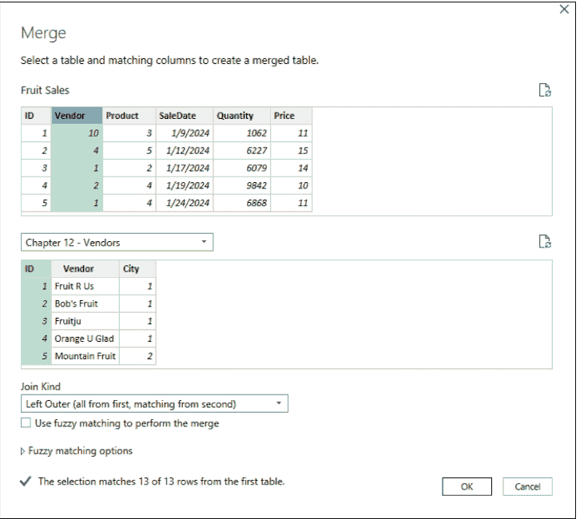

图 12.30 – 合并对话框

## 从多个源追加和合并数据 399

提示  
部分匹配数量通常表明存在诸如合并了错误的 **Table**、 **Table** 中缺少数据，或要匹配的字段之间数据类型不匹配等问题。

12. 在 **Data Preview** 窗口中将出现一个 **Chapter 12 – Vendors** 列，每一行都显示单词 **Table**。这表示 **Chapter 12 – Vendors** 查询已与 **Fruit Sales** 查询合并，但供应商详细信息尚未展开：

- I. 单击 **Chapter 12 – Vendors** 列标题中的双向箭头。
- II. 清除 ID 复选框，以避免添加重复列，因为 **Fruit Sales** 已经有一个包含供应商 ID 的 **Vendor** 列。
- III. 可选：清除 **Use original column Name as prefix** 复选框。如果保持选中，两个字段的列 **Names** 将变为 **Chapter 12 – Vendors.Vendor.1** 和 **Chapter 12 – Vendors.City**。如我通常所做的那样，我将清除该复选框。
- IV. 单击 **OK** 以展开列，这将向查询中添加两个新列，如 **Figure 12.31** 所示：

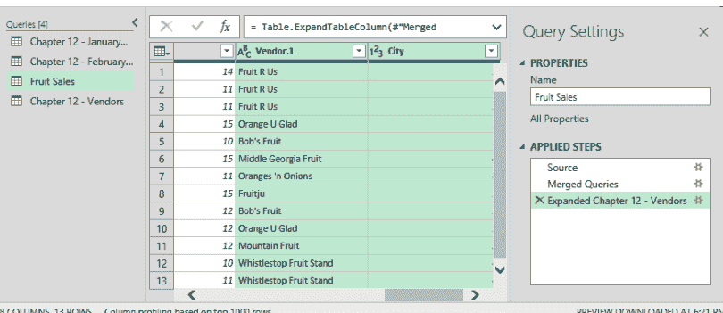

**图 12.31 – 来自 Chapter 12 – Vendors 查询的展开列**

Nuance  
在 **Figure 12.31** 中，包含供应商 **Names** 的列标记为 **Vendor.1** 而不是 **Vendor**，因为 **Fruit Sales** 查询中已经有一个名为 **Vendor** 的列。**Data Preview** 窗口中的每个列 **Name** 必须唯一。

13. 双击 **Vendor.1** 并输入 **Vendor Name**（或右键单击 **Vendor.1**，选择 **Rename**，然后输入 **Vendor Name**）。

### Power Query

> **提示**  
> 如果需要重命名查询中的多个列，请单击第一个列，然后按 _F2_（某些键盘上为 _Fn + F2_），输入新字段 **Name**，然后按 _Enter_。使用左箭头或右箭头键移动到下一列，然后按 _F2_ 重命名下一个字段。

- 14. 右键单击 **Vendor Name**，然后选择 **Move | To Beginning**，将 **Vendor Name** 字段移动到查询中的第一列位置（或使用鼠标将列拖动到新位置）。

- 15. 单击 **ID** 字段并按 _Delete_，然后单击 **Vendor** 字段并按 _Delete_，以从 _Fruit Sales_ 查询中删除两个多余字段。

> **提示**  
> 以这种方式删除列仅从结果中移除字段。如果单击 _Chapter 12 - January Transactions_ 或 _Chapter 12 - February Transactions_ 查询，你会发现 **ID** 和 **Vendor** 列仍然存在。

- 16. 单击 **Home | New Source | File | Text/CSV**，选择 _Chapter 12 - Products.csv_ 文件，单击 **Import**，然后单击 **OK**。

- 17. 现在，让我们将 **Product Names** 合并到 _Fruit Sales_ 查询中：

- I. 确认 **Transactions Table** 中的 **Product** 字段与 **Products Table** 中的 **ID** 字段具有相同的数据类型，如在 _Step 9_ 中讨论的那样。
- II. 从 **Query** 列表中选择 _Fruit Sales_ 查询。
- III. 选择 **Home | Merge Queries**，然后单击 **Fruit Sales** 中的 **Product** 列。
- IV. 从第二个列表中选择 _Chapter 12 - Products_，并选择 **Chapter 12 - Products** 列表中的 **ID** 列。
- V. 单击 **OK** 关闭 **Merge** 对话框。

- 18. 单击 _Chapter 12 - Products_ 列标题中的双向箭头。

- 19. 清除 **ID** 复选框，以免重复现有的产品 ID 列，然后单击 **OK**。

> **提示**  
> 如果你在本序列的前面选择了清除，则 **Use original column Name as prefix** 已经被清除。

- 20. 双击 **Product.1** 标题，输入 `Product Name`，然后按 _Enter_。

## 从多个源追加和合并数据 401

21. 右键单击 **Product Name**，然后选择 **Move | To Beginning**，将 **Product Name** 字段移动到查询中的第一列位置（或使用鼠标将列拖动到新位置）。

22. 单击一次 **Product** 列并按 **Delete** 以删除多余字段（或右键单击 **Product** 并选择 **Remove**）。

23. 可选：要进一步运用此技术，你可以导入 Chapter 12 – Cities .csv 和 Chapter 12 – Regions.csv 文件，并以我们之前对 **Vendors** 和 **Products** 所做的相同方式关联它们各自的列。请记住，你需要先导入 Cities 文件，因为 **Region ID** 列出现在 Cities 文件中，但目前不存在于 Fruit Sales 查询中。此类排序通常是合并两个或多个数据源的关键部分。

24. 单击 **Home | Close and Load** 将数据返回到 Microsoft Excel。

25. **Power Query** 为你添加的每个查询创建一个新工作表，这可能会导致多余的工作表。右键单击 Chapter 12 – January Transactions 工作表，选择 **Delete**，然后再次选择 **Delete**。对 Chapter 12 – February Transactions、Chapter 12 – Vendors、Chapter 12 – Products 和 Sheet1 工作表重复此过程。如图 12.32 所示，**Queries & Connections** 任务窗格显示已从 Fruit Sales 查询加载 13 行，而其他查询指示 **Connection only**。这意味着 **Power Query** 仍然连接到显示的数据源，但工作簿中没有直接与这些数据源相关的结果：

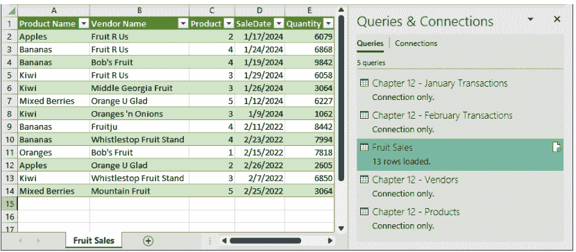

图 12.32 – Queries & Connections 任务窗格

26. 如图 12.32 所示，如果你没有继续关联数据，城市 ID 号将出现在列 F 中。右键单击列 F，然后选择 **Delete**。

### 连接到数据库并安装 ODBC 驱动程序

你会注意到，本书远未达到 1,000 页，这意味着根本没有足够的篇幅深入探讨连接数据库和安装 ODBC 驱动程序的话题。话虽如此，本章中的示例被选中是为了让你了解如何将 **Power Query** 与各种数据源一起使用。正如你将看到的，连接到数据库通常只涉及几个步骤，具体取决于你正在连接的平台。

### 建立 Access 数据库和 SQL Server 连接

让我们先从在 **Excel for Windows** 中链接到 Access 数据库开始（你无法在 **Excel for macOS** 中连接到 Access 数据库）：

1. 按 Ctrl+N 创建一个空白工作簿（或选择 File | New 并选择 Blank Workbook）。
2. 选择 Data | Get Data | From Database | From Microsoft Access Database，从本章的示例文件中选择 Chapter 12 - Fruit Sales.accdb 数据库，然后单击 Import。
3. 如图 12.33 所示，你现在处于熟悉的环境中，Navigator 窗口显示了数据库中包含的 Tables：

27. 右键单击 **Table** 属性中的任何单元格，然后选择 **Refresh**。**City** 列将再次出现。你从 **Power Query** 结果中删除的任何内容都会以这种方式重新出现，除非你在 **Power Query** 中删除列。要执行此操作，请执行以下步骤：

I. 选择 **Query | Edit**。

II. 单击一次 **City** 列并按 **Delete** 以删除多余的字段（或右键单击 **City** 并选择 **Remove**）。

III. 选择 **Home | Close & Load** 以返回到 Excel。

28. 你可能希望考虑的一些收尾工作如下：

- 在单元格 G1（如果你删除了 **City** 列，则为 F1）中输入单词 **Total**，并在单元格 G2（或 F2）中输入公式 =E2*D2。
- 选择 **Table Design | Total Row** 为列 G 添加自动总计。
- 选择 **Query | Properties**，单击 **Refresh data when opening the file**，然后单击 **OK**，如果你希望在打开文件时查询自动刷新，尤其是当你使用这些技术将电子表格连接到数据库时。

如前所述，用于从文本文件追加和合并数据的技术与你从数据库和其他数据源追加和合并数据的方式相同。现在，让我们简要了解如何将 **Power Query** 连接到数据库。

#### 12.33 – 从 Microsoft Access 数据库检索数据

要进一步操作，请选择一个或多个 **Tables**，然后使用我们在 *Appending and merging data from multiple sources* 部分中应用的相同技术。

> Tip
> 即使你的计算机上未安装 Microsoft Access，也可以连接到 Access 数据库并提取数据。

现在，假设你想要连接到 Microsoft SQL Server 数据库，你 *可以* 从 Excel for macOS 执行此操作：

1. 按 *Ctrl + N*（⌘ + *N*）创建一个空白工作簿（或选择 **File | New** 并选择 **Blank Workbook**），或打开现有工作簿。
2. 选择 **Data | Get Data | From Database | From SQL Server Database** 以显示 SQL Server 数据库对话框，如 *Figure 12.34* 所示：

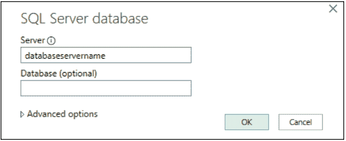

#### Figure 12.34 – SQL Server 数据库对话框

3. 在 **Server** 字段中输入服务器 **Name** 或地址，然后可选地在 **Database (optional)** 字段中输入数据库 **Name**，然后单击 **OK**。
4. 如 *Figure 12.35* 所示，将出现第二个对话框，要求你输入凭据。你选择 **Windows**、**Database** 还是 **Microsoft account** 将取决于你的数据库配置：

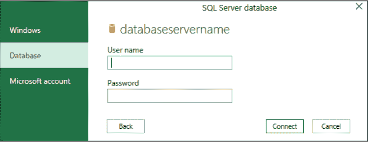

Figure 12.35 – SQL Server 身份验证对话框

5. 你可能会遇到警告，即 **Power Query** 无法与数据库建立加密连接。单击 **OK** 以继续使用未加密的连接。
6. 此时，熟悉的 **Navigator** 窗口将出现，你可以从中选择数据库，然后选择要附加到的 **Tables** 或视图——并且你有权访问。

连接到 Access 或 SQL Server 数据库很容易，因为连接软件（称为驱动程序）已预先安装在 Excel 中。如果你想连接到另一种类型的数据库，例如 MySQL 或会计程序，你可能需要做一些功课。

### 建立 ODBC 连接

**ODBC** 代表 **Open Database Connectivity**，是用于访问数据库平台中数据的 **Application Programming Interface**（API）。假设你想能够从会计软件（例如 **QuickBooks Desktop**）中检索数据。QuickBooks 的 **Enterprise** 版本附带 ODBC 驱动程序，而 **Pro** 和 **Premier** 版本要求你购买第三方 ODBC 驱动程序。我分享这个例子是为了说明 ODBC 驱动程序通常如何分发：它们可能与你的软件捆绑在一起，或者你可能需要额外付费。

如果你知道你需要的 ODBC 驱动程序已经安装，步骤将类似于我们连接到 SQL Server 数据库的方式（**Excel for macOS** 不支持 ODBC）：

1. 按 _Ctrl + N_ 创建一个空白工作簿（或选择 **File | New** 并选择 **Blank Workbook**）或打开现有工作簿。
2. 选择 **Data | Get Data | From Other Sources | From ODBC** 以显示 **From ODBC** 对话框。
3. 从 **Data source Name (DSN)** 列表中选择数据源 **Name**，然后单击 **OK**。

接下来出现的内容将取决于数据源及其 ODBC 驱动程序。某些驱动程序允许你在计算机上的驱动程序设置中存储数据库 **Name** 和凭据，这意味着连接将类似于连接到 Access 数据库的步骤。其他驱动程序可能要求你在连接时进行身份验证，类似于 SQL Server 过程。

### 安装 ODBC 驱动程序并创建数据源

安装 ODBC 驱动程序的过程与在计算机上安装任何其他类型的程序非常相似。你将下载设置文件并运行安装过程。其余步骤将在 **ODBC Data Source Administrator** 窗口中发生：

1. 单击 Microsoft Windows 中的 **Start** 按钮。
2. 输入 **ODBC**，然后单击 **ODBC Data Sources (32-bit)** 或 **ODBC Data Sources (64-bit)** 应用。
3. 已经设置好的任何可用驱动程序将出现在 **ODBC Data Source Administrator** 窗口中，如 *Figure 12.36* 所示。仅仅安装驱动程序不会使驱动程序出现在此对话框中。为此，你必须单击 **Add** 按钮，选择驱动程序，然后单击 **Finish**：

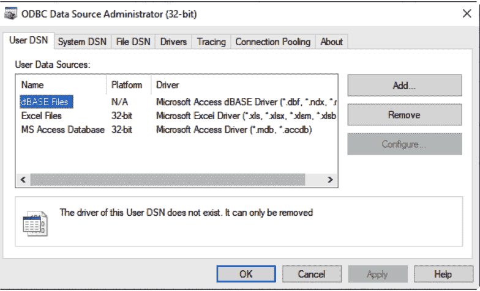

Figure 12.36 – ODBC 数据源管理员窗口

4. 从那里，涉及的步骤将取决于你的 ODBC 驱动程序，但你可以期望能够提供数据库的 **Name** 和/或地址，以及用户凭据。

现在，让我们总结一下你在本章中学到的内容。

### Summary

在这本关于 Microsoft Excel 细微差别和怪癖的书中，我将最细微和最古怪的功能留到了最后。**Power Query** 可以成为你的变革性工具，只要你能避免受阻。我分享了我在学习曲线中遇到的几个绊脚石。你现在应该已充分准备好应对 **Power Query** 可能向你抛出的大多数事情。

在本章中，你学习了如何在任何工作簿中创建工作表列表，然后将其转换为交互式索引列表。重要的是要理解，**Power Query** 不提供实时数据连接，而是提供可以刷新的数据快照。然后，我们将基于 Excel 的会计程序报告转换为精简的、可分析的数据集。

如果你过去在从 PDF 文件提取数据方面遇到困难，那么使用 **Power Query** 执行此操作的能力可能会让你兴奋地在椅子上跳舞。我知道，能够取消透视我们在本章前面处理过的那种报告，每次使用该功能都会让我开心。

从那里，我们探讨了如何追加和合并数据，这都是将已压平为数据库格式以最小化冗余的数据进行反规范化的一部分。这些任务是将数据转换回对人类有用的格式所必需的，而不是对数据库有用的格式。

如果你读到这里，那么你希望对 Microsoft Excel 的特性有更深入的理解。在过去 30 年里，我花了大量不健康的时间观察他人使用 Microsoft Excel，通常效果不佳。这本书是对 Excel 陷阱和黑暗角落的总结，因为根据我的经验，挫败感就在那里。Excel 的大多数功能都很容易掌握，但当出现意外情况时，你可能会感觉自己像个完全的新手。

这本书远非详尽的细微差别和怪癖列表。我根据我被要求最常教授的网络研讨会以及经常重复出现的观众问题来选择本书的材料。我要重申我在 _Chapter 1, Implementing Accessibility_ 中提出的建议。尝试用你的数据建造摩天大楼，也就是说，将其垂直地沿着列向上和向下排列。尽可能限制水平扩展，因为你添加的每个可避免的列和工作表都会不可避免地将你的电子表格推向挫败感、低效率，最终导致不可访问性。感谢阅读我的书！

