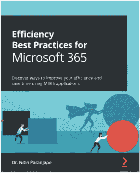

### 索引

#### 符号

#CALC! 错误 290  
#SPILL! 错误  
关于 290, 318  
条件 318, 319  

#### A

Access 数据库  
链接，在 Excel for Windows 中 402, 403  
辅助功能检查器功能  
关于 25, 26  
错误 25  
提示 26  
警告 26  
辅助功能提醒加载项  
关于 26  
命令 26, 27  
ActiveX 控件 153  
高级公式环境 354, 355  
应收账款账龄报表 376  
Alt 数字键盘细微差别 63, 64  
始终创建备份设置 45, 46  
摊销表  
关于 313  
参数 314, 315  

应用程序编程接口 (API) 404  
数组 302  
数组公式 182  
自动筛选命令 69  
自动报告清理  
关于 375  
分析障碍 376  
Power Query 连接，断开 385  
Power Query 连接，更新  
使用新数据 384  
报表，转换 377-381  
补充公式，添加到  
Power Query 结果 383, 384  
自动恢复功能  
关于 35  
Excel for Mac 自动恢复 38, 39  
Excel for Windows 自动恢复 36, 37  
与 OneDrive 的自动保存  
关于 39  
禁用的自动保存，解决 43, 44  
永久禁用 44, 45  
文件，保存 40-42  
先前的自动保存版本，访问 42, 43  

#### B

后台视图 58, 70  
基础视图，多用途工作表  
创建 236-238  

#### C

计算器应用 48  
计算参数 344  
CELL 函数  
关于 103  
参数 103  
自定义条件格式  
规则，创建 103-105  
单元格图标  
应用 99, 100  
百分位规则 98-100  
单元格链接 154  
跨选区居中  
使用 18, 19  
居中文本  
关于 65  
键盘快捷键，创建 65  
图表区域 217  
图表  
关于 11, 12  
周末日期，排除 274, 276  
复选框  
关于 156  
创建 156  
CHOOSE 函数 327  
循环引用  
关于 279, 280  
迭代计算选项，  
启用 280, 281  
可点击索引  
工作表列表，转换为 370  

全部关闭命令 69  
共同创作 78  
色阶  
关于 97  
应用 97, 98  
组合框窗体控件 154-156  
功能区中未列出的命令  
命令，具有别名的 68-70  
探索 68  
逗号分隔值 (CSV) 文件 53  
兼容性检查器功能  
关于 264-266  
与兼容性模式相比 266, 267  
计算机  
快速访问工具栏，在  
之间传输 74, 75  
CONCATENATE 函数 300  
连接 300  
CONCAT 函数 300  
条件格式  
关于 85, 86  
故障排除 111  
条件格式规则  
可访问的条件格式  
图例，创建 109  
适用于列 107, 108  
条件格式图例，创建 108  
条件格式，删除 109, 110  
编辑 106  
管理 106  
转换命令  
与另存为相比 267-269  
COUNTIF 函数  
条件参数 209  
区域参数 209  
COUNTIFS 函数  
参数 313  
CUMIPMT 函数 163, 164  

自定义数据验证规则  
关于 146  
COUNTIF 函数 147  
重复项，防止 148, 149  
FIND 函数 146  
名称，按姓氏、名字  
顺序输入 147, 148  
自定义规则  
关于 101  
CELL 函数 103  
IS 函数 101, 102  
逻辑测试 105, 106  
自定义视图  
关于 69, 234, 235  
应用，隐藏受保护工作簿中的工作表 260, 261  
应用，取消隐藏受保护工作簿中的工作表 260, 261  
冲突 255  
从工作簿中删除 253-255  
表功能，与之冲突 257  
用于，自动应用筛选器 247-250  
用于，隐藏工作表 246  
用于，取消隐藏工作表 246  
工作表，保护与之冲突 257-260  
自定义视图快速访问工具栏  
快捷方式，创建 240-242  

#### D

损坏的工作簿  
过多格式，删除 48, 49  
修复 46-48  
数据  
追加，来自多个来源 394-402  
反规范化 395  
提取，来自 PDF 文件 386-392  

合并，来自多个来源 394-402  
规范化 395  
取消透视 393, 394  
数据条  
关于 95  
使用 95, 96  
数据库  
连接到 402  
数据源  
创建 405, 406  
数据表  
关于 177, 196  
计算性能，提高 182  
数据表，使用一个输入创建 177, 178  
数据表，使用三个  
输入创建 180-182  
数据表，使用两个输入创建 179, 180  
数据验证  
关于 119-123  
错误警告选项卡 125  
输入消息选项卡 125  
限制 150  
删除 129, 130  
设置选项卡 124, 125  
数据验证单元格  
输入，审核 151  
保护 150  
数据验证规则  
任意值 131  
自定义规则 146  
日期 141  
小数 132  
基于公式的日期规则 142, 143  
实现 131  
列表 132  
文本长度 145  
时间 143, 144  
整数 131  

决策函数  
关于 325  
CHOOSE 函数 326, 327  
IF 函数 325, 326  
SWITCH 函数 327, 328  
开发人员选项卡  
启用 151, 152  
双击技巧  
用于，在工作表内导航 270  
动态摊销表 290, 313  
动态数组公式 302  
动态数组函数 289  

#### E

启用内容提示 52  
输入模式  
与编辑模式相比 271-274  
EOMONTH 函数  
关于 142, 316  
参数 316  
错误警告选项卡  
关于 125, 126  
错误警告样式 126, 127  
信息样式 128, 129  
警告样式 127, 128  
Excel  
功能区，自定义 59  
版本，查找 57  
体积计算 324  
Excel 辅助功能  
图表 11, 12  
颜色，使用 23, 24  
页脚使用，最小化 19-23  
页眉使用，最小化 19-23  
帮助选项卡 9  
实现 14  
使 4  

合并单元格 17, 18  
Microsoft 搜索框 7-9  
数据透视表 10, 11  
表功能，使用 24  
水印使用，最小化 19-23  
工作表函数，查找 4  
工作表名称，分配 14-16  
Excel for Mac 自动恢复 38, 39  
Excel for Windows 自动恢复  
关于 36, 37  
临时备份，访问 37  
临时文件，删除 37, 38  
Excel 宏  
陷阱 74  
命名 72  
快捷方式，创建 71-74  
执行摘要视图，  
多用途工作表  
创建 238, 239  

#### F

筛选按钮 199  
FILTER 函数  
关于 289, 309  
参数 309-311  
筛选器  
应用，自动使用  
自定义视图 247-250  
预测工作表功能  
金额，使用 183-185 进行预测  
格式设置为表命令 196-198  
格式设置  
与条件格式相比 84, 85  
窗体控件  
关于 119, 152  
组合框 154-156  
探索 152-154  

#### G

求目标功能 174-177  
分组框窗体控件 157  

#### H

标题行 200  
页眉 192  
帮助选项卡  
关于 9  
命令 9, 10  
隐藏的快速访问工具栏  
恢复 57, 58  
突出显示单元格规则  
关于 86  
介于规则 88, 89  
日期发生规则 91-93  
重复值 93, 94  
等于规则 89, 90  
大于规则 87  
小于规则 88  
包含文本规则 90, 91  

#### I

图标集  
关于 98  
应用 99, 100  
IFERROR 函数 341  
IF 函数 325, 326  
IFNA 函数  
关于 292  
参数 292  
无障碍电子表格  
示例 28-30  
INDEX 函数  
关于 289  
参数 295  
INDIRECT 函数 138  
Inquire 加载项 48, 284, 285  
插入函数 4, 5  
插入表命令 198  
IPMT 函数  
关于 316  
参数 316, 317  
ISERROR 函数 341, 342  
IS 函数  
自定义条件格式  
规则，创建 101, 102  
示例 101  
迭代计算选项  
启用 280, 281  

#### K

键盘和鼠标快捷方式  
用于列插入 225  
用于光标移动 226  

INDEX 函数 154  
管理 158  
公式错误  
处理，使用 LET 函数 340  
冻结窗格命令 69, 70  
全屏功能  
关于 75, 76  
恢复 78  
全屏模式 76, 77  
函数参数 6  
函数调用 346  
函数屏幕提示 6, 7  
未来值 (fv) 163  

HYPERLINK 函数  
关于 369  
参数 369  

用于数据选择，在  
工作表或表中 225  
用于移动列 226  
用于行插入 225  

范围名称，分配 137  
自更新列表，创建 136, 137  
存储，在源字段中 133, 134  
存储，在工作表单元格中 134, 135  

#### L

LAMBDA 公式  
开发 344  
工作表函数，使用 345 创建  

LAMBDA 函数  
关于 344  
高级公式环境  
加载项 354-356  
计算，使用 345 定义  
冲突和错误 352, 353  
求值 346  
探索 350  
移动，在工作簿之间 348-350  
可选参数 351  
参数，使用 345 命名  
XBOXVOLUME 函数 356-358  

旧版功能  
关于 75  
全屏功能 75, 76  
全屏功能，恢复 78  
全屏模式 76, 77  
恢复 75  
共享工作簿功能，恢复 78  
显示更改功能 79-81  

LET 函数  
关于 339  
公式错误，使用 340 处理  
重复计算，使用 342 消除  
变量名称限制 342-344  
LibreOffice 套件 48  

列表  
组装 140, 141  
依赖列表，创建 137  

工作表列表  
转换，为可点击索引 370  
创建 365-369  
Power Query 连接，  
刷新 371, 372  
源数据连接，更新 374, 375  

逻辑测试  
关于 105  
自定义条件格式  
规则，创建 105, 106  
查找函数 289  

#### M

宏  
用于，取消隐藏工作表 243-246  
启用宏的工作簿 361  
宏录制器 72, 243  

MATCH 函数  
关于 289, 293  
参数 293, 294  

合并单元格  
关于 17, 18  
示例 17, 18  

Microsoft 搜索框  
关于 7-9  
命令 7  

Microsoft SQL Server 数据库  
连接到 403, 404  
混合引用 294  
修改按钮 73  
多用途工作表  
基础视图，创建 236-238  
创建 235  

### 索引

Executive Summary 视图，创建 238, 239
Page Layout 视图冲突 239, 240
Quarters Only 视图，创建 238

### N

Navigation 任务窗格 16

### O

ODBC 连接
建立 404, 405
ODBC 驱动程序
安装 402-406
Office Online
URL 80
Office 主题 73
OneDrive
URL 79
Open Database Connectivity (ODBC) 404
光学字符识别 386
选项按钮
关于 156
创建 157
大纲功能 171

### P

页面布局模式 21
页面布局视图冲突 239, 240
PivotTables 10, 11, 195, 393
完整性 214-216
PMT 函数 162, 163
Portable Document Format (PDF)
关于 386
数据，从中提取 386-392
快捷方式 67, 68
Power Query
关于 51, 363

数据预览 367
查询列表 367
查询设置任务窗格 367
功能区界面 367
技术要求 363, 364
Power Query 阶段
合并 364
连接 364
加载 364
刷新 364
转换 364
PPMT 函数 317
现值 (pv) 164
打印预览 58
打印预览全屏命令 70
打印设置
应用 251-253
PRODUCT 函数 325
受保护视图 49-51

### Q

Quarters Only 视图，多用途工作表
创建 238
快速访问工具栏
Alt-数字键盘细微差别 63, 64
探索 56
重置 62, 63
功能区命令，添加到 64
传输，在计算机之间 74, 75
特定于工作簿的工具栏 70
快速访问工具栏命令
删除 61
重新定位 60
快速访问工具栏快捷方式
命名约定，工作 60
细微差别 59, 60
QuickBooks Desktop 404

### R

- 单选按钮 156
- RANDARRAY 函数
  - 关于 290, 319
  - 参数 319, 320
- 重做命令 34-56
- 重复计算
  - 消除，使用 LET 函数 342
- 报表
  - 转换 377-381
- 重置所有自定义命令 62
- 可重用 LAMBDA 函数
  - 创建 346-348
- 功能区
  - 关于 151
  - 自定义 59
- 功能区命令
  - 添加到快速访问工具栏 64
  - 居中文本 65
  - PDF 快捷方式 67, 68
  - 工作表单元格，锁定 66, 67
  - 工作表单元格，解锁 66, 67

### S

- 另存为
  - 与转换命令相比 267-269
- 场景管理器功能
  - 关于 164
  - 约束 165
  - 场景，创建 166-168
  - 场景，显示 168, 169
  - 场景，合并 173, 174
  - 场景，设置 165, 166
- 场景报表
  - 关于 169
  - 场景 PivotTable 报表 169-173
  - 场景摘要报表 169-171

- 第 508 节
  - URL 28
- SEQUENCE 函数
  - 关于 315
  - 参数 315
- 共享工作簿功能
  - 恢复 78
- 快捷方式
  - 创建，用于 Excel 宏 71-74
- 显示更改功能
  - 关于 79
  - 工作簿更改，查看 80
  - 工作簿，保存到 OneDrive 79
- 单次购买版本 57, 80
- 切片器 393
- 求解器功能
  - 关于 185-188
  - 与求目标值功能相比 188
- SORTBY 函数 289
- SORT 函数
  - 关于 289, 305
  - 参数 306-308
- 迷你图 276-278
- 溢出范围运算符 137, 289, 312
- 结构化引用
  - 用于公式 205, 206
- SUBSTITUTE 函数 139
- SUMIF 函数
  - 关于 296, 317
  - 参数 296, 317
- SUMIF 函数参数
  - 条件 29
  - 范围 29
  - 求和范围 29
- SUMIFS 函数
  - 关于 296
  - 参数 297

### T

### U

表
关于 194
单元格，转换为表 196-198
数据表 196
整个表，复制 223
整个表，粘贴 223
整个工作表列，复制 223
整个工作表列，粘贴 223
PivotTables 195
部分，复制 224
部分，粘贴 224
删除 203, 204
故障排除 227-231
表自动化机会
关于 204
计算列 205, 206
筛选功能 210
PivotTable 完整性 214-216
自动调整大小的图表 217, 218
自动调整大小的公式 207, 208
切片器 211-213
结构化引用，用于编写公式 208-210
表特征
关于 199
自动更改 199-201
可选增强功能 201-203
表功能
关于 24
冲突，与自定义视图 257
使用 24

表样式
关于 196
内置样式，自定义 219, 220
自定义 219
自定义表样式，传输到工作簿 221, 222
默认表样式，设置 219
表技巧
关于 218
自定义样式，修改 222, 223
自定义样式，删除 222, 223
键盘和鼠标快捷方式 225
表，复制 223
表，粘贴 223
表样式，自定义 219
表样式，传输到工作簿 221
告诉我功能 7
文本框 21
TODAY 函数 142
顶部和底部规则 94, 95
顶部和双底边框命令
快捷方式，创建 65
跟踪更改功能 17
故障排除，条件格式
无格式说明 111, 112
规则顺序，更改 113
Wingdings 字体 114, 115
撤销命令 34-56
UNIQUE 函数
关于 289, 304
参数 304
不成文规则 192, 193
在公式中使用命令 338
用户定义函数 358

仅摘要视图
创建 247
SWITCH 函数 327

### V

- 变量 339
- VBA 工作表函数
  - 关于 358
  - 编辑 361
  - 文件，解除阻止 359
  - 测试 359, 360
- Visual Basic for Applications (VBA) 71, 358
- VLOOKUP 函数
  - 关于 289, 290
  - 参数 291
  - 约束 291, 292
- 体积计算，Excel
  - 关于 324
  - 决策函数 325
  - 乘法，使用 324
  - PRODUCT 函数，使用 325

### W

- WordArt 19-21
- 工作簿
  - 自定义视图，从中删除 253-255
  - LAMBDA 函数，移动
    - 在之间 348-350
  - 警告提示 49
  - 特定于工作簿的工具栏
    - 关于 70
    - 创建 70
  - 工作簿统计对话框 30
- 工作簿，警告提示
  - CSV 提示 53, 54
  - 受保护视图 49-51
  - 受信任文档 51-53
- 工作表单元格
  - 锁定 66, 67
  - 命名约定 328
  - 解锁 66, 67

- 工作表单元格，命名
  - 从选择创建命令 331
  - 定义名称命令，使用 334
  - 名称框，使用 328-330
  - 名称管理器区域 334-337
  - 名称，在公式中使用 338
- 工作表函数
  - 查找 4
- 工作表函数工具
  - 函数参数 6
  - 函数屏幕提示 6, 7
  - 插入函数 4, 5
- 工作表索引
  - 更新 372-374
- 工作表
  - 隐藏 242, 243
  - 隐藏，使用自定义视图 246
  - 导航，使用双击技巧 270
  - 保护，冲突与
    - 自定义视图 257-260
  - 仅摘要视图，创建 247
  - 取消隐藏 242, 243
  - 取消隐藏，使用自定义视图 246
  - 取消隐藏，使用宏 243-246
  - 工作区功能 75

### X

- XBOXVOLUME 函数 356-358
- XLOOKUP 函数
  - 关于 289, 297
  - 参数 298
  - if_not_found 参数 298
  - 匹配，在多个列条件中查找 301, 302
  - match_mode 参数 298, 299
  - 结果，合并到单个列 300
  - 结果，返回到多个单元格 302
  - 结果，返回到多个列 301
  - search_mode 参数 300, 301
- XMATCH 函数
  - 关于 289, 303
  - 参数 303, 304

### 为什么订阅？

- 花更少的时间学习，花更多的时间编码，使用来自 4000 多位行业专业人士的实用电子书和视频
- 使用专为您构建的技能计划改善学习
- 每月免费获取一本电子书或视频
- 完全可搜索，轻松访问重要信息
- 复制和粘贴、打印和加书签内容

您知道 Packt 提供每本出版书籍的电子书版本，并提供 PDF 和 ePub 文件吗？您可以在 `packt.com` 升级到电子书版本，作为印刷书籍客户，您有权获得电子书副本的折扣。如需更多详情，请联系我们 `customercare@packtpub.com`。

在 `www.packt.com`，您还可以阅读一系列免费技术文章，注册一系列免费通讯，并获取 Packt 书籍和电子书的独家折扣和优惠。

订阅我们的在线数字图书馆，即可完全访问超过 7000 本书籍和视频，以及行业领先的工具，帮助您规划个人发展并推进职业生涯。如需更多信息，请访问我们的网站。

`Packt.com`

### 您可能还喜欢的其他书籍

如果您喜欢这本书，可能会对 Packt 的这些其他书籍感兴趣：

### Microsoft 365 效率最佳实践

Dr. Nitin Paranjape

ISBN: 9781801072267

- 了解不同的 MS 365 工具，例如 Office 桌面版、Teams、Power BI、Lists 和 OneDrive，如何提高工作效率
- 将内容替换为以下项目符号列表：
- 识别耗时的流程，并了解如何更高效地处理它们
- 用最小的努力快速创建专业文档
- 在多个团队、会议和项目之间工作，而不会电子邮件过载
- 自动化琐碎、重复和耗时的手动工作
- 管理工作、委派、执行和项目管理

## Hands-On Financial Modeling with Excel for Microsoft 365 - Second Edition

Shmuel Oluwa

ISBN: 9781803231143

- 识别从处理 Excel 中历史数据得出的增长驱动因素
- 使用折现现金流 (DCF) 进行高效的投资分析
- 在 Excel 中准备详细的资产和债务计划模型
- 使用各种利润参数计算盈利能力比率
- 使用 Power Query 获取和转换数据
- 深入了解资本预算技术
- 应用蒙特卡洛模拟来推导财务模型的关键假设
- 通过预测资产负债表和损益表构建财务模型

## Packt is searching for authors like you

如果您有兴趣成为 Packt 的作者，请访问 `authors.packtpub.com` 并立即申请。我们与成千上万的开发人员和技术专业人士（就像您一样）合作，帮助他们将洞察力分享给全球技术社区。您可以提交一般申请，申请我们正在招募作者的特定热门主题，或提交您自己的想法。

## Share Your Thoughts

现在您已经阅读完了 *Exploring Microsoft Excel's Hidden Treasures*，我们很乐意听取您的想法！如果您从 Amazon 购买了本书，请点击此处直接前往本书的 Amazon 评论页面并分享您的反馈，或在您购买的网站上留下评论。

您的评论对我们和技术社区非常重要，将帮助我们确保提供优质内容。

