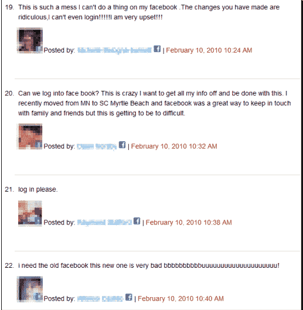
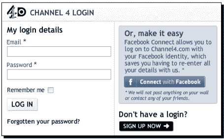
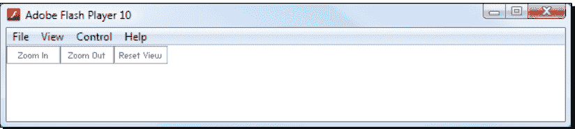
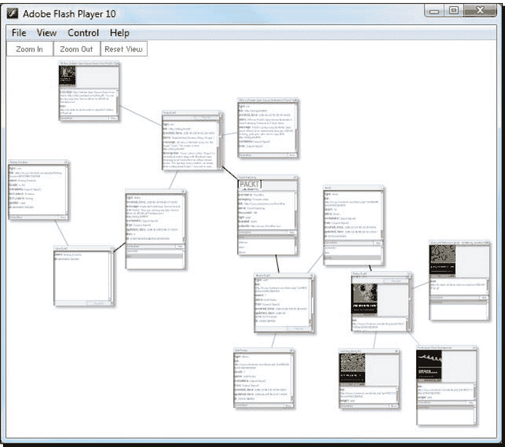
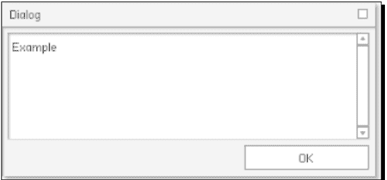
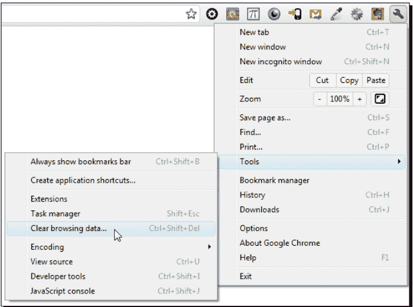
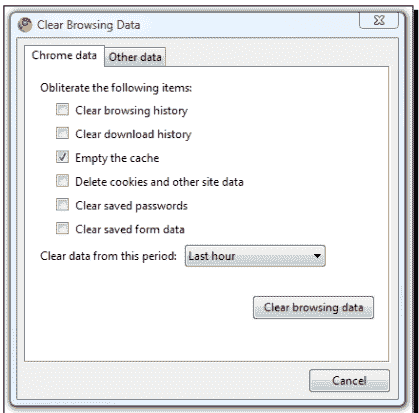

## Introduction

More and more Flash games and **Rich Internet Applications (RIAs)** are allowing users to log in using their Facebook account—it's a safe assumption that most users will have one. Companies are asking freelancers for deeper Facebook integration in their projects. It's practically a buzzword.

But why the big fuss?

## It's popular

- Facebook benefits from the snowball effect: it's big, so it gets bigger.
- People sign up because most of their friends are already on it, which is generally not the case for, say, Twitter. Businesses sign up because they can reach so many people. It's a virtuous circle.
- There's a low barrier to entry, too; it's not just for techies, or even people who are "pretty good with computers;" even old people and luddites use Facebook. In February 2010, the technology blog **ReadWriteWeb** published an article called "Facebook Wants to Be Your One True Login," about Facebook's attempts to become the de facto login system throughout the Web. Within minutes, the comments filled up with posts from confused Facebook users:



(Source: http://www.readwriteweb.com/archives/facebook_wants_to_be_your_one_true_login.php.)


显然，ReadWriteWeb 文章暂时成为 **Facebook Login** 的顶级搜索结果，导致数百名 Facebook 用户——将 Google 或 Bing 等同于互联网——误以为这篇博文实际上是重新设计的 `Facebook.com`。评论表单恰如其分地有一个 **Sign in with Facebook** 按钮，可以用来代替手动输入姓名和电子邮件地址来签署评论——当然，Facebook 用户将其误解为新的 **Log in** 按钮。

然而……所有这些人都能熟练地使用 Facebook，以至于当它似乎变得无法使用时，他们会大发雷霆。这不仅仅是极客和学生的网站；它具有严重的市场吸引力。

甚至《社交网络》——一部基于 Facebook 创立的电影——也具有这种吸引力：它以 #1 开画，并在第二个周末继续保持。

## Numbers

根据 Facebook 的统计页面（`http://www.facebook.com/press/info.php?statistics`），在 2010 年 11 月时，任何一个月内都有超过 5 亿人登录 Facebook。为了便于理解，整个世界的人口还不到 70 亿。

据估计，Twitter 拥有 9500 万月活跃用户（根据 `eMarketer.com` 2010 年 9 月的报告），MySpace 也是如此。基于 Facebook 平台的最大游戏 **FarmVille** 拥有超过 5000 万用户：超过任一竞争社交网络人口的一半以上。

据报道，FarmVille 利润巨大，一些外部报告声称其母公司 **Zynga** 产生的利润是 Facebook 本身的两倍以上（尽管对此要持保留态度）。当然，并非每个 Facebook 游戏或应用程序都能如此成功，而且 FarmVille 也受益于与 Facebook 本身相同的滚雪球效应，使得竞争变得困难——但这几乎无关紧要；这些数字验证了 Facebook 作为可以建立盈利业务的平台。

## It's everywhere

正如上述 ReadWriteWeb 文章所解释的，Facebook 已成为许多网站的标准登录方式。为什么还要在浏览器的列表（或你的记忆）中再添加另一个用户名/密码组合，如果你可以用一个 Facebook 登录来替代它们全部呢？

## Introduction

这并不仅限于发布博客评论。英国电视广播公司 Channel 4 允许观众按需访问其整个电视节目单，无需为特定的 Channel 4 账户注册：



同样，Facebook 也受益于这种滚雪球效应：随着越来越多的网站启用 Facebook 登录，它变得越发成为标准，而又越多的网站决定添加 Facebook 登录以跟上其他人。

除了登录功能外，许多网站还允许用户通过 Facebook 分享其内容。另一家英国电视广播公司 BBC 允许用户将他们推荐的电视节目链接直接发布到 Facebook：


博客——或者，确实是带有文章的许多网站——允许读者点赞一篇帖子，将这一事实发布在 Facebook 上以及网站本身：


因此，每月有五亿人使用 Facebook 网站，同时 Facebook 也在互联网上进一步传播，甚至超越。 “Facebook Messages” 存储用户整个对话历史，包括电子邮件、短信、聊天和 Facebook 本身；“Facebook Places” 允许用户签到某个物理位置，让朋友知道他们在那里。

没有其他网络具有这种覆盖范围。

## It's interesting to develop for

随着所有这些扩展，开发人员很难跟上 Facebook 平台。 有时会出现错误、未记录的区域和停机时间，所有这些都可能使开发更加困难。

但底层系统——在 2010 年 4 月引入的 **Graph API**——非常有趣。之前的 API 在其四年的生命周期中变得臃肿和笨重；Graph API 感觉设计良好，有充足的扩展空间。

本书主要关注 Graph API，因为它是现代 Facebook 开发的基础。你将在 *Chapter 2, Welcome to the Graph* 中正式了解它。

## Have a go hero – get on Facebook

如果你还没有在 Facebook 上，立即注册（免费） http://facebook.com。你需要一个账户才能开发使用它的应用程序。花点时间熟悉它：

- 设置个人资料。
- 在朋友的 **Walls** 上发布消息。
- 在 http://apps.facebook.com/onthefarm 上看看 FarmVille 的喧嚣到底是怎么回事。
- 使用 Facebook Places 签到某个位置。
- 使用你的 Facebook 账户登录一些博客。
- 从 YouTube 网站将一些 YouTube 视频分享到你自己的 Wall 上。
- “Like” 一下某物。
- Go native!

## Web hosts

如果你已经拥有一个可公开访问的 Web 服务器，或者已注册一个可通过 FTP 上传 SWF 和 HTML 页面的 Web 主机，请跳到 *How much AS3 knowledge is required?* 部分。

### What's a web host?

我假设你大致了解互联网的工作原理：当你在计算机上的 Web 浏览器中输入 URL 并点击 **Go** 时，它会从另一台计算机、**web server** 检索所需的所有页面和图像并显示它们。它用来查找 Web 服务器的确切方法和信息返回到计算机的协议在这里不相关。

你可以买一台电脑，安装一些服务器软件，并将其连接到你的互联网连接，你就会拥有一个功能性的 Web 服务器。但你必须维护它并保持安全，而且你的 ISP 可能不会很高兴你向其他人的浏览器发送所有这些页面和图像。更好的选择是付钱给另一家公司为你处理所有这些——一个 Web 主机。

### Why do you need one?

- 为了构建一个基于在线 SWF 的应用程序或游戏，允许用户使用其 Facebook 账户登录（SWF 能够访问他们的个人资料、朋友列表、Wall 等），你需要控制一个网页。
- 技术上，你可能可以想出一些黑客方法来绕过这一点——也许通过在 Google sites 和 MegaSWF 上托管所有内容——但从长远来看，这不值得。为学习而花钱购买一个 Web 主机；如果你将来从事专业的 Facebook 应用程序开发，你肯定需要访问一个。

### How do you choose one?

- 有大量 Web 主机可供选择，它们之间也有大量可配置的选项。你需要多少磁盘空间？每月多少带宽？多少处理能力？一些主机将为你提供一台专属服务器，而另一些则将你的文件放在与其他客户相同的计算机上。当然，你还要考虑客户服务的质量以及公司保持服务器在线的可靠性。加上“云托管”等术语，足以让人头晕。
- 你只需要一个允许你上传 HTML 文件和 SWF 的主机；本书还假设你能够使用 FTP 将文件从计算机传输到主机，尽管这不是严格必要的。
- 想在不浪费时间比较主机的情况下立即开始吗？选择 Media Temple。本书中的代码都是使用 Media Temple Grid Service 账户测试的，可在 http://mediatemple.net/webhosting/gs/ 获取。它提供的功能远超本书项目所需，当然，价格为每月 $20。这不是最便宜的选择，但额外的服务和功能在你构建自己的 Facebook 应用程序和游戏时肯定会派上用场。

- **How To Use A Document Class In Flash**—一个简短的教程，帮助你快速掌握在 Flash CS3 及以上版本中使用文档类的方法：http://active.tutsplus.com/tutorials/actionscript/quick-tip-how-to-use-a-document-class-in-flash/。
- **AS3 101**—一系列教程，带你了解 AS3 开发的基础知识。特别是，从第 8 部分开始阅读，因为这些部分涉及 AS3 中的 OOP：http://active.tutsplus.com/series/as3-101/。

- 你还应该知道如何创建和编译 SWF 项目，并且熟悉足够的 HTML 以便能够在其中嵌入 SWF。我们将为此目的使用 **SWFObject**（这是 Flash CS5 使用的默认嵌入方法）；如果你不确定这意味着什么，请在此熟悉一下：http://code.google.com/p/swfobject/。
- 本书中使用的所有重要 AS3 类和关键字在变得相关时都会简要解释，因此即使你还没有记住 **LiveDocs** 也不用担心。说到 LiveDocs，请记住你始终可以使用它们来查找不熟悉的代码：http://help.adobe.com/en_US/FlashPlatform/reference/actionscript/3/index.html。

## The source code

在 *Chapter 2, Welcome to the Graph* 开始时，你将获得一个 Flash 项目，它只是一个空的用户界面——后端将由你使用第 2 章到第 6 章中学到的知识来构建。

该项目名为 **Visualizer**，包含类结构和所有 UI，用于一个可以用来表示 Facebook 上存储的所有信息的应用程序。你将远远超出仅仅允许人们登录应用程序并获取他们的用户名；使用 AS3 和 Graph API 可以实现更多，你将了解所有内容。

尽管项目很复杂，但类被安排成你只需要修改其中少数几个，而且这些类最初几乎没有代码。这意味着你不必深入挖掘你没有编写的大量代码！你可以完全专注于学习 Facebook 方面的 Flash 开发。

第 2 章到第 6 章中的每一章都有两个关联的 ZIP 文件：一个是章节开始时的项目，另一个是章节结束时的项目。这意味着你可以按任何顺序跳过这些章节，但如果你按顺序进行学习会更容易。所有项目文件均以兼容 Flash CS3 及以上版本、Flash Builder 和 FlashDevelop 的形式提供——如果你使用不同的 Flash 编辑器，你应该很容易转换项目。


## 简介

当你第一次编译这个项目时，它看起来像这样：



没什么可看的。但用不了多久，你就会添加各种功能，让它能够用来浏览 Facebook，渲染不同的页面和照片：



## 简介

然而，本书的主要目的是教你 Facebook Flash 开发背后的底层概念；一旦你理解了这些，实际使用的代码和 SDK 就无关紧要了。因此，本书还会教你如何从头开始编写你可能需要的每一种 Facebook 交互程序。代码将完全属于你自己，你会理解每一行，没有任何抽象阻碍。

除了用于 Facebook 平台的 Adobe AS3 SDK 之外，还大量使用了另外两个代码库：

- **MinimalComps**：Keith Peters 编写的出色轻量级用户界面组件，可在 http://www.minimalcomps.com/ 获取，采用 MIT 许可证。
- **as3corelib**：一组用于处理 AS3 的类和工具，包括用于 JSON 序列化的类，可在 https://github.com/mikechambers/as3corelib 获取，采用 BSD 许可证。

## 调试

从第 3 章开始，你的 SWF 需要从你的服务器上通过 Web 浏览器运行才能正常工作。（原因请看那一章。）这使调试变得棘手——浏览器中没有“输出”面板，因此 trace 语句不会自动可见。

Visualizer 包含一个对话框功能，你可以用它来解决这个问题。可以从显示列表中的任何类创建它。为此，首先导入 DialogEvent 类：

```
import events.DialogEvent;
```

然后，分发一个类型为 DIALOG 的 DialogEvent，参数中包含你希望输出的文本：

```
dispatchEvent(new DialogEvent(DialogEvent.DIALOG, "Example"));
```

它看起来像这样：



当然，这只对 Visualizer 项目有用。当你构建自己的项目时，又能做些什么呢？

## 简介

在 Google Chrome 中，你可以通过点击[扳手] | 工具 | 清除浏览数据...，选择“清空缓存”，并选择适当的时间段来完成：





你应该可以轻松地通过 Google 搜索«浏览器名称»删除缓存，为你的浏览器找到等效选项。

## 最后说明...

Facebook 的开发人员一直在调整这个平台。这会使得在其上开发令人兴奋，因为新功能总在不断添加；但也可能让人非常沮丧，因为旧功能可能会被移除，或者其实现方式发生变化；任何内容都可能在任何时候被修改。

新的平台 API（Graph API）是一个坚实的基础，而且看起来会持续一段时间——请记住，以前的平台 API 持续了四年。但它是模块化的，各个部分可能会发生变化，甚至可能被移除。

因此，本书的部分内容在你阅读时可能已经过时，某些指令在当前的 Facebook 平台版本上可能不会产生与本书编写时相同的结果。如果你担心这一点，可以在*第 8 章：跟上扎克伯格家族*的最后一节了解如何跟上平台的所有变化。

但现在，请直接进入*第 2 章：欢迎来到图谱*，开始开发吧！
