## 2

## 欢迎来到图谱

> Facebook 拥有关于人物、公司、活动、相册等的大量信息。它也知道这一切是如何关联的：哪个人拥有哪个相册；哪些人出现在哪张照片中；哪个公司组织哪场活动。

四年来，这些信息都是通过一个庞大而杂乱的 API 来访问的，随着新功能的不断加入，它变得越来越复杂。2010 年 4 月，Facebook 推出了 Graph API，极大地简化了开发人员检索所有这些数据的方式。

在本章中，我们将：

- 探索 Facebook 图谱
- 了解 Graph API 是什么，以及它如何组织 Facebook 上的所有数据
- 使用 AS3 和 Graph API 访问公开图谱数据

那么让我们开始吧。

## 通过浏览器访问 Graph API

我们直接来看看 Graph API 如何表示一个公共页面的信息。

当我提到大写 P 的页面（Page）时，我指的不是 Facebook 网站中的任意网页；我指的是一种特定类型的页面，也称为公共主页。每个 Facebook 用户都有自己的个人主页；你可以通过登录 Facebook 并点击网站顶部导航栏中的“主页”链接来查看自己的个人主页。公共主页看起来类似，但它是为商家、乐队、产品、组织和公众人物设计的，作为他们在 Facebook 上存在的一种方式。

这意味着许多人同时拥有个人主页和公共主页。例如，Facebook 的首席执行官马克·扎克伯格在 http://www.facebook.com/zuck 有一个个人主页，在 http://www.facebook.com/markzuckerberg 有一个公共主页（页面）。这样，他可以用个人主页与朋友和家人保持联系，同时用公共主页与粉丝和支持者建立连接。

还有第二种页面类型：社区主页。同样，这些页面看起来与个人主页非常相似；区别在于它们基于主题、经历和事业，而不是实体。此外，它们会自动从维基百科检索相关主题的信息，并包含一个实时更新的关于该主题的帖子动态。

这一切可能让人有点困惑——别担心！一旦你开始使用，一切都会变得有意义。

### 动手实践 —— 加载一个页面

浏览到 http://www.facebook.com/PacktPub 加载 Packt Publishing 的 Facebook 页面。你会看到最近的帖子列表、一个信息标签、一些相册（大多包含书籍封面）、一张主页头像照片，以及粉丝和链接的列表。

## Packt Publishing

主页  信息  照片  讨论

添加到我的主页收藏

推荐给朋友

通过短信订阅

我们的书籍和出版物分享您的 IT 同行在采用和定制当今系统、应用程序和框架方面的经验。

# 信息

成立时间：
2004 年

# 412 人赞

# 照片

3 个相册中的 2 个  查看全部

主页照片
约 2 个月前更新。

书籍
约 7 个月前更新。

# 链接

449 个链接中的 3 个  查看全部

Packt 开源畅销书优惠 | Packt Publishing 技术与 IT 书店
10 月 22 日 13:35

Packt 最新发布：PHP 5 社交网络 | Packt Publishing 技术与 IT 书店
10 月 22 日 10:41

Packt 全新十月开源书籍 | Packt Publishing 技术与 IT 书店
10 月 22 日 09:45

# 基本信息

成立时间：2004 年

# 详细信息

网站：http://www.PacktPub.com

公司概述：Packt 是一家现代 IT 图书出版商，专注于为开发人员、管理员和新手社区出版前沿书籍。

Packt 于 2004 年 4 月出版了第一本书《Mastering phpMyAdmin for MySQL Management》。

Facebook 页面：http://www.facebook.com/PacktPub

这就是网站用户查看信息的方式。我们的代码会如何“看待”它？让我们看一下 Graph API 如何表示 Packt Publishing 的页面：在浏览器中访问 https://graph.facebook.com/PacktPub。这称为 Graph URL——请注意，它与页面本身的 URL 相同，但使用的是安全的 https 连接，并使用 graph 子域，而不是 www。

你将看到如下内容：

```
{
  "id": "204603129458",
  "name": "Packt Publishing",
  "picture": "http://profile.ak.fbcdn.net/hprofile-ak-snc4/hs302.ash1/23274_204603129458_7460_s.jpg",
  "link": "http://www.facebook.com/PacktPub",
  "category": "Products_other",
  "username": "PacktPub",
  "company_overview": "Packt is a modern, IT focused book publisher, specializing in producing cutting-edge books for communities of developers, administrators, and newbies alike.\n\nPackt published its first book, Mastering phpMyAdmin for MySQL Management in April 2004.",
  "fan_count": 412
}
```

## 刚才发生了什么？

你刚刚在浏览器中获取了 Graph API 对 Packt Publishing 页面的表示。

Graph API 的设计目标是易于上手——几乎可以说是自文档化的——你可以看到它在这方面非常成功。很明显，上述数据是一个字段及其值的列表。

有一个字段可能不太清楚：id；这个数字是 Facebook 在内部用来引用该页面的。这意味着页面可以有两个 ID：一个是 Facebook 自动分配的数字 ID，另一个是页面所有者选择的字母数字 ID。这两个 ID 是等价的：如果你浏览 https://graph.facebook.com/204603129458，你会看到与浏览 https://graph.facebook.com/PacktPub 完全相同的数据。

## 自己动手 —— 探索其他对象

当然，Packt Publishing 页面并不是你可以在浏览器中使用 Graph API 探索的唯一页面。通过 Facebook 网站找到一些其他页面，然后使用 https://graph.facebook.com/id 格式，查看它们的 Graph API 表示。它们的信息是更多，还是更少？


接下来，继续看看其他类型的 Facebook 对象：个人主页、活动、群组。对于个人主页，其 `id` 可能由字母和数字组成（如果该用户注册了自定义 Facebook 用户名，网址为 http://www.facebook.com/username/），但通常情况下 `id` 是数字，由 Facebook 在用户注册时自动分配。

对于某些类型的对象（如相册），`id` 的值在 Facebook 网站内的 URL 中并不明显；我们将在本章后面介绍如何找到这些 `id`。

在某些情况下，你会收到一条错误消息，例如：

```
{
  "error": {
    "type": "OAuthAccessTokenException",
    "message": "An access token is required to request this resource."
  }
}
```

同样，我们稍后会在本书中讨论这意味着什么以及如何解决它。

## 通过 AS3 访问 Graph API

现在你已经了解了在浏览器中访问和读取 Facebook 数据是多么容易，我们将看看如何在 AS3 中获取这些数据。

### 动手实践——在 AS3 中检索页面信息

按照第 1 章中的说明，从第 2 章的起始文件设置项目。检查项目能否无错误地编译（可能会有一些警告，具体取决于你的 IDE）。你应该看到一个 640 x 480 像素的 SWF，全白色，左上角只有三个按钮：放大、缩小和重置视图：


这个项目是一个富互联网应用程序（RIA）的基础，它将能够使用 Graph API 探索 Facebook 上的所有信息。所有 UI 代码都已就位，只等着一些 Graph 数据来渲染。我们的任务是编写代码来检索数据并将其传递给渲染器。

我不打算分解整个项目并解释每个类的作用，因为本书的重点是使用 Facebook 和 Flash，而不是构建 RIA。目前你需要知道的是，项目初始化时会创建 `controllers.CustomGraphContainerController` 类的一个实例，它负责引导数据流入和流出 Facebook。为此，它从 `controllers.GCController` 类继承了一些有用的方法；我们稍后会用到这些方法。

在你的 IDE 中打开 `CustomGraphContainerController` 类。它位于 `\src\controllers\CustomGraphContainerController.as`，应该与下面的代码清单类似：

```
package controllers
{
    import ui.GraphControlContainer;

    public class CustomGraphContainerController extends GCController
    {

        public function CustomGraphContainerController
            (a_graphControlContainer:GraphControlContainer)
        {
            super(a_graphControlContainer);
        }

    }
}
```

我们要做的第一件事是通过 Graph URL 获取 Packt Publishing 页面的 Graph API 表示，就像我们使用 Web 浏览器时所做的那样。为此，我们可以使用 `URLLoader`。

> `URLLoader` 和 `URLRequest` 类通常一起使用，用于从 URL 下载数据。数据可以是文本、二进制数据或 URL 编码的变量。
> 下载过程通过将 `URLRequest` 对象（其 `url` 属性包含请求的 URL）传递给 `URLLoader` 的 `load()` 方法来触发。
> 一旦所需数据下载完成，`URLLoader` 会分发一个 `COMPLETE` 事件。然后可以从其 `data` 属性中检索数据。

按照下面的方式修改 CustomGraphContainerController.as（突出显示的行是新增的）：

```
package controllers
{
    import flash.events.Event;
    import flash.net.URLLoader;
    import flash.net.URLRequest;
    import ui.GraphControlContainer;

    public class CustomGraphContainerController extends GCController
    {

        public function CustomGraphContainerController
            (a_graphControlContainer:GraphControlContainer)
        {
            super(a_graphControlContainer);

            var loader:URLLoader = new URLLoader();
            var request:URLRequest = new URLRequest();
            //Specify which Graph URL to load
            request.url = "https://graph.facebook.com/PacktPub";
            loader.addEventListener(Event.COMPLETE,
                onGraphDataLoadComplete);
            //Start the actual loading process
            loader.load(request);
        }

        private function onGraphDataLoadComplete(a_event:Event):void
        {
            var loader:URLLoader = a_event.target as URLLoader;
            //obtain whatever data was loaded, and trace it
            var graphData:String = loader.data;
            trace(graphData);
        }

    }
}
```

我们在这里所做的只是下载 https://graph.facebook.com/PacktPub 上的任何信息，并将其输出到输出窗口。

测试你的项目，并查看输出窗口。你应该看到以下数据：

```
{"id":"204603129458","name":"Packt Publishing","picture":"http:\\\\profile.ak.fbcdn.net\\hprofile-ak-snc4\\hs302.ash1\\23274_204603129458_7460_s.jpg","link":"http:\\\\www.facebook.com\\PacktPub","category":"Products_other","username":"PacktPub","company_overview":"Packt is a modern, IT focused book publisher, specializing in producing cutting-edge books for communities of developers, administrators, and newbies alike.\n\nPackt published its first book, Mastering phpMyAdmin for MySQL Management in April 2004.","fan_count":412}
```

如果出现错误，请检查你的代码是否与上面提到的代码一致。如果输出窗口中没有任何内容，请确保你已连接到互联网。如果仍看不到内容，可能是你的安全设置阻止了 Flash 访问互联网，请检查这些设置。

## 刚才发生了什么？

值之间的换行和制表符丢失了，一些字符也被转义了，这使数据难以阅读……但你可以看到，这与我们浏览 https://graph.facebook.com/PacktPub 时获得的数据完全相同。这并不奇怪；`URLLoader` 所做的就是这些。

这种形式的数据对我们来说不太有用。要对它进行处理，我们需要将其转换为一个可以在 AS3 中原生交互的对象。

Graph API 使用的格式称为 JSON（JavaScript Object Notation，读作“Jason”）。

JSON 是一种人类可读的、基于文本的数据格式标准。它允许你以键值对的形式表示对象，如下所示：

```
{
  "key1": "value1",
  "key2": "value2",
  "key3": "value3"
}
```

值可以是字符串（用引号括起来），也可以是数字、布尔值或 null（不用引号括起来）。

JSON 对象还可以包含数组，使用方括号：

```
{
  "key1": "value1",
  "array":
  [
    "First item in array",
    "Second item in array",
    "Third item in array"
  ]
}
```

它们甚至可以通过嵌套花括号来包含其他 JSON 对象：

```
{
  "key1": "value1",
  "subObject":
  {
    "subKey1": "subValue1",
    "subKey2": "subValue2",
  }
}
```

这些子对象可以包含其他对象和数组，而数组也可以包含其他对象或数组。

请注意，这与 AS3 中声明对象的语法非常相似：

```
var as3Object:Object = {
  key1:"value1",
  key2:"value2",
  subObject:{
    subKey1:"subValue1"
  },
  myArray:[1, 2, 3]
}
```

更多信息，请访问 http://www.json.org。

与 XML 不同，AS3 没有用于处理 JSON 对象的原生特性——但有一个官方支持的库可以实现这一点。

```
"category": "Products_other",
"username": "PacktPub",
"company_overview": "Packt is a modern, IT focused book publisher, specializing in producing cutting-edge books for communities of developers, administrators, and newbies alike.\n\nPackt published its first book, Mastering phpMyAdmin for MySQL Management in April 2004.",
"fan_count": 412
}
```

并且它将字符串转换成了一个原生 AS3 对象，就像我们键入了以下代码一样：

```
var graphObject:Object = {};
graphObject.id = "204603129458";
graphObject.name = "Packt Publishing";
graphObject.picture = "http://profile.ak.fbcdn.net/hprofile-ak-snc4/hs302.ash1/23274_204603129458_7460_s.jpg";
graphObject.link = "http://www.facebook.com/PacktPub";
graphObject.category = "Products_other";
graphObject.username = "PacktPub";
graphObject.company_overview = "Packt is a modern, IT focused book publisher, specializing in producing cutting-edge books for communities of developers, administrators, and newbies alike.\n\nPackt published its first book, Mastering phpMyAdmin for MySQL Management in April 2004."
graphObject.fan_count = 412;
```

（请注意，与我们之前看到的原始字符串不同，URL 中的斜杠没有被转义。）

这意味着我们可以轻松地访问 Facebook 关于该页面的任何信息，甚至可以遍历每一条数据。

### 动手实践——可视化信息

不要再只是输出了！是时候在我们的实际 SWF 中显示一些内容了。

`CustomGraphContainerController` 继承了一个名为 `renderGraphObject()` 的方法，它可以帮助我们完成这项工作。我们只需要向它传递一个 `graph.GraphObject` 类型的参数。

`GraphObject.as` 是一个简单的类；你可以随意打开并查看它：

```
package graph
{
    import graph.controls.GraphObjectRenderer;
    public dynamic class GraphObject extends BaseGraphItem
```


```
{
    public var rendererObject:GraphObjectRenderer;
    public var graphObjectListRenderers:Array = [];

    public function GraphObject()
    {

    }

}
}
```

老实说，我们无需担心这里的任何代码。你只需要知道它是动态的，也就是说我们可以在运行时为它分配新的属性，而不必预先指定它们的名称。所以我们可以这样做：

```
var graphObject:GraphObject = new GraphObject();
graphObject.favoriteColor = "red";
```

当一个 GraphObject 被传递给 CustomGraphContainerController.renderGraphObject() 方法时，该 GraphObject 的每一个属性都会被自动渲染到一个漂亮的列表中。也就是说，除了类中已经定义的那两个属性之外的所有属性！

因此，我们必须在 CustomGraphContainerController.onGraphDataLoadComplete() 内完成的工作是：

- 1. 创建一个 GraphObject 的新实例。
- 2. 将 decodedJSON 的所有属性复制到这个新的 GraphObject 中。
- 3. 将 GraphObject 传递给 renderGraphObject()。
- 4. 实现该操作的代码如下：

```
private function onGraphDataLoadComplete(a_event:Event):void
{
    var loader:URLLoader = a_event.target as URLLoader;
    //obtain whatever data was loaded, and trace it
    var graphData:String = loader.data;
    var decodedJSON:Object = JSON.decode(graphData);

    var graphObject:GraphObject = new GraphObject();
    //copy all the properties from decodedJSON to graphObject
    for (var key:String in decodedJSON)
```

```
{
    graphObject[key] = decodedJSON[key];
}
this.renderGraphObject(graphObject);
}
```

5. 编译并测试。SWF 显示在下面的截图中：

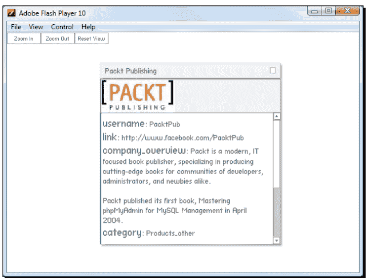

你可以多次点击“放大”按钮，使渲染器更大更清晰，如上图所示。你的渲染器可能以不同于图示的顺序显示字段；Facebook 会以任意顺序返回字段。

## 刚才发生了什么？

舞台上出现的窗口就是我所称的渲染器——具体来说，是一个 Graph Object 渲染器。你可以通过标题栏拖动它，内容可以滚动，也可以通过点击右上角的按钮来关闭它。

因此，你已经成功地从 Facebook 的 Graph API 获取数据，并将它显示在 SWF 中。你的 SWF 非常灵活；将 request.url 改为指向另一个 Facebook 对象的 Graph URL，你就会看到它显示在渲染器中。

GraphObject 中的大部分数据会以简单的“key: value”格式显示在窗口内的文本区域中。Page 的 name 字段显示在窗口的标题栏中，如果 Page 具有 picture 字段（我们可以从 JSON 中看到 PacktPub 确实有），则图像会被下载，并通过 Loader 显示在渲染器中。

> 与 URLLoader 一样，flash.display.Loader 类会下载给定 URLRequest 所指向的对象，并在就绪时分派一个 COMPLETE 事件。与 URLLoader 不同的是，Loader 用于下载图像和 SWF，而且该事件实际上是由其子对象之一 contentLoaderInfo 分派的。此外，Loader 扩展了 DisplayObject，并在下载完成后呈现图像的外观。
>
> Flash 的安全模型会阻止图像数据被与其所在域不同的 SWF 访问，除非图像所在域中存在允许该访问的跨域策略文件。幸运的是，Facebook 的跨域策略文件非常宽松，允许所有域进行此类访问。

所以，事实上，这仅仅是以图形方式表示 Graph API 中的 Page 对象的一种方式。

## 理解连接

你可能会想：“这固然不错，但它并没有显示与 Page 关联的所有数据，是吗？墙帖和照片在哪里呢？”

## 动手实践——在浏览器中查找连接

Facebook 将墙帖、照片、视频甚至状态都视为 Graph API 中的独立对象，而不是将它们全部塞进一个 Page 对象中。例如，下面是一个表示 Packt Publishing 单条 Post 的对象：

```
{
  "id": "204603129458_127056137323572",
  "from": {
    "name": "Packt Publishing",
    "category": "Products_other",
    "id": "204603129458"
  },
  "message": "The Amazon SimpleDB Developer Guide has been published! Get your copy now! http://bit.ly/b1FQUG",
  "picture": "http://external.ak.fbcdn.net/safe_image.php?d=c4a7887cb52dd8f93e439aaec13c034b&w=130&h=130&url=https%3A%2F%2Fwww.packtpub.com%2Fsites%2Fdefault%2Ffiles%2Fimagecache%2Fproductvw%2F2F7344EN_MockupCover%2520Template.jpg",
  "link": "http://bit.ly/b1FQUG"
}
```

```
"name": "Amazon SimpleDB Developer Guide | Packt Publishing Technical & IT Book Store",
"caption": "bit.ly",
"description": "Gain in-depth understanding of Amazon SimpleDB with PHP, Java, and Python examples, and run optimized database-backed applications on Amazon\\'s Web Services cloud",
"icon": "http://static.ak.fbcdn.net/rsrc.php/zB010/hash/9yvl7ltw.gif",
"type": "link",
"created_time": "2010-06-04T12:39:44+0000",
"updated_time": "2010-06-04T12:39:44+0000",
"likes": 1
}
```

这个对象现在已经过期，无法再通过 Graph API 获取，但正如你所猜测的，它之前可以在 https://graph.facebook.com/204603129458_127056137323572 访问到。它采用与 Page 对象相同的格式——尽管字段略有不同——因此我们的 Graph Object 渲染器可以正常渲染它。

当然，除非我们知道与 Packt Publishing 关联的每个 Post 的 ID，否则这毫无用处，而且我们无从得知去哪里找这些 ID。真的是这样吗？

我之前说过，Graph API 被设计为自文档化的。我们可以通过在任意 Graph URL 末尾添加一个 metadata=1 标志来请求关于任何 Graph Object 的额外“元”信息。请在浏览器中查看：https://graph.facebook.com/PacktPub?metadata=1。JSON 中出现了一个新属性 type：

```
"type": "page"
```

这很有用；正如我所说，Posts 和 Pages（实际上所有 Graph Objects）都采用相同的格式，因此这为我们提供了一种区分它们的方法。

不过，更直接有趣的是新的 metadata 对象。它包含一个对象 connections 和一个数组 fields。我们先来看看 fields：

```
"fields": [
{
"name": "id",
"description": "The page's ID"
},
{
"name": "name",
"description": "The page's name"
},
{
"name": "picture",
"description": "The pages profile picture"
```

```
},
{
  "name": "category",
  "description": "The page's category"
},
{
  "name": "fan_count",
  "description": "\\/* The number of fans the page has"
}
]
```

这个列表说明了 Graph Object 主体中每个字段的含义。在撰写本文时，这仍然是一个相当新的功能，因此当你加载时，列表可能会更完整。

connections 对象如下：

```
"connections": {
  "feed": "https://graph.facebook.com/packtpub/feed",
  "posts": "https://graph.facebook.com/packtpub/posts",
  "tagged": "https://graph.facebook.com/packtpub/tagged",
  "statuses": "https://graph.facebook.com/packtpub/statuses",
  "links": "https://graph.facebook.com/packtpub/links",
  "notes": "https://graph.facebook.com/packtpub/notes",
  "photos": "https://graph.facebook.com/packtpub/photos",
  "albums": "https://graph.facebook.com/packtpub/albums",
  "events": "https://graph.facebook.com/packtpub/events",
  "videos": "https://graph.facebook.com/packtpub/videos"
}
```

浏览上面列表中的某个 URL：http://graph.facebook.com/packtpub/posts。它返回一个 JSON，包含一个名为 data 的数组和一个名为 paging 的对象。data 数组包含多个 Post 对象；我们将在本书后面讨论 paging。

## 刚才发生了什么？

metadata=1 参数告诉 Graph API 显示当前对象的所有元数据，在本例中，包括该对象的类型、对象属性描述的数组，以及包含与此 Page 连接的对象的列表的所有 URL。

Graph API 名称正源于这种布局。在日常用法中，“graph”指的是下图所示的那种图表：


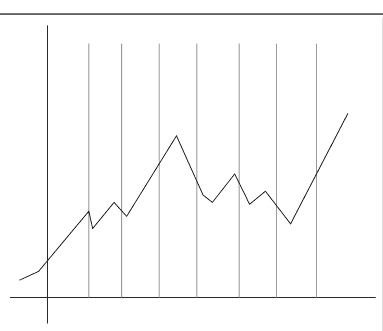

但在数学中，“图”指的是由边连接起来的任意节点集合，如下一张图所示：

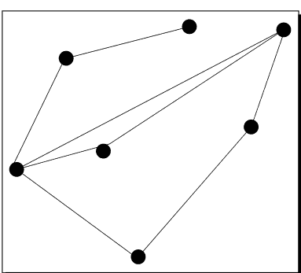

Graph API 对 Facebook 数据的表示方式如下图所示：

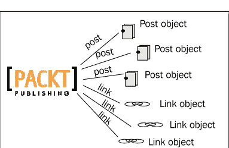

在上图中，每个对象都是一个节点，线条代表不同类型的连接。

获取 http://graph.facebook.com/packtpub/posts 可以得到所有通过 “post” 连接与 PacktPub 相连的节点——即所有发布在 Packt 主页上的 Post 对象：

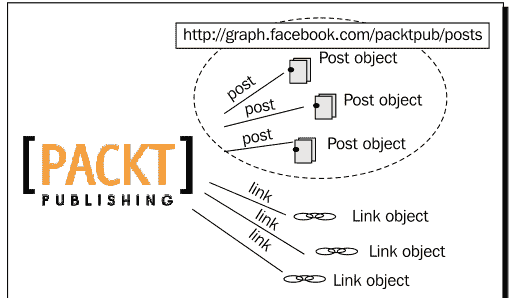

## 动手实践——探索连接

既然你已经了解了 metadata 参数，不妨在浏览器中探索不同类型的连接，看看你还能发现哪些新类型的对象。

## 渲染列表

如果尝试使用我们加载 Packt Publishing Page 对象时所用的同一段代码来加载 https://graph.facebook.com/packtpub/posts，会发生什么？

我们在输出面板中得到：

Graph Object was null!

并不成功。Graph API 在这里组织 JSON 的方式与它为 Page、Post 或任何其他 Graph Object 组织 JSON 的方式完全不同。其他连接 URL 返回的 JSON 也是如此。我们把这种结构称为 Graph List。

## 动手实践——渲染帖子列表

由于 Graph List 的 data 属性是一个由 Graph Object 组成的数组，我们可以直接遍历该数组，并为每个元素创建一个新的 Graph Object Renderer。如果你愿意，当然可以自己试一试，不过我有另一种解决方案。

我创建了第二个渲染器——这次是 Graph List Renderer。我还创建了一个名为 graph.GraphList 的类。CustomGraphContainerController 继承了一个名为 renderGraphList() 的方法。不出意料，该方法接收一个 graph.GraphList 类型的对象作为参数，并创建一个新的 Graph List Renderer 来显示其内容。因此，我们需要从 Graph API 接收一个 Graph List，并将其转换为 GraphList 类的实例。GraphList 类比 GraphObject 类要稍微复杂一些；它有一个名为 addToList() 的方法，我们可以向它传递任意 GraphObject 实例，将其添加到列表中。

我们仍然需要遍历 data 数组，但不再单独渲染每个 GraphObject，而是将每个对象添加到一个 GraphList 中，然后渲染该列表。

修改 CustomGraphContainerController 请求的 URL，使其加载帖子列表：

```
public function CustomGraphContainerController
    (a_graphControlContainer:GraphControlContainer)
{
    super(a_graphControlContainer);

    var loader:URLLoader = new URLLoader();
    var request:URLRequest = new URLRequest();
    //Specify which Graph URL to load
    request.url = "https://graph.facebook.com/PacktPub/posts";
    loader.addEventListener(Event.COMPLETE, onGraphDataLoadComplete);
    //Start the actual loading process
    loader.load(request);
}
```

现在，加载完成后，我们需要检查返回的项目是 Graph Object 还是 Graph List。我们可以通过查找名为 data 的属性来判断：如果该属性存在，我们就假定它属于 Graph List。

```
private function onGraphDataLoadComplete(a_event:Event):void
{
    var loader:URLLoader = a_event.target as URLLoader;
    //obtain whatever data was loaded, and trace it
    var graphData:String = loader.data;
    var decodedJSON:Object = JSON.decode(graphData);

    if (decodedJSON.data)
    {
        //has a "data" property so we assume it is a Graph List
    }
}
```

```
else
{
    //no "data" so we assume it is a Graph Object
    var graphObject:GraphObject = new GraphObject();
    //copy all the properties from decodedJSON to graphObject
    for (var key:String in decodedJSON)
    {
        graphObject[key] = decodedJSON[key];
    }
    this.renderGraphObject(graphObject);
}
```

在这个 if 块中，我们首先创建一个新的 GraphList 实例：

```
if (decodedJSON.data)
{
    //has a "data" property so we assume it is a Graph List
    var graphList:GraphList = new GraphList();
}
```

（你需要导入 graph.GraphList。）

接下来，记住 decodedJSON.data 是一个对象数组；我们遍历这个数组，并从每个元素创建一个 GraphObject。

```
if (decodedJSON.data)
{
    //has a "data" property so we assume it is a Graph List
    var graphList:GraphList = new GraphList();
    var childGraphObject:GraphObject;
    for each (var childObject:Object in decodedJSON.data)
    {
        childGraphObject = new GraphObject();
        for (var childKey:String in childObject)
        {
            childGraphObject[childKey] = childObject[childKey];
        }
    }
}
```

这基本上与加载单个 Graph Object 时我们对 decodedJSON 所做的操作相同。

那么 Graph List 中的另一个属性——paging 对象呢？我们也应该把它加进来：

```
if (decodedJSON.data)
{
    //has a "data" property so we assume it is a Graph List
    var graphList:GraphList = new GraphList();
    var childGraphObject:GraphObject,
    for each (var childObject:Object in decodedJSON.data)
    {
        childGraphObject = new GraphObject();
        for (var childKey:String in childObject)
        {
            childGraphObject[childKey] = childObject[childKey];
        }
        graphList.addToList(childGraphObject);
    }
    graphList.paging = decodedJSON.paging;
}
```

最后，我们将 GraphList 实例传递给 renderGraphList()：

```
if (decodedJSON.data)
{
    //has a "data" property so we assume it is a Graph List
    var graphList:GraphList = new GraphList();
    var childGraphObject:GraphObject,
    for each (var childObject:Object in decodedJSON.data)
    {
        childGraphObject = new GraphObject();
        for (var childKey:String in childObject)
        {
            childGraphObject[childKey] = childObject[childKey];
        }
        graphList.addToList(childGraphObject);
    }
    graphList.paging = decodedJSON.paging;
    this.renderGraphList(graphList);
}
```

## 欢迎来到 Graph

编译 SWF 并进行测试。下面的截图显示了结果：

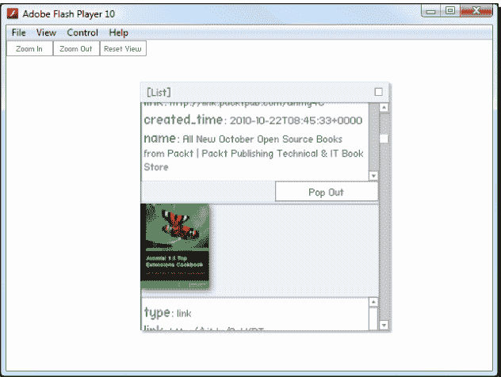

它是一个可滚动的窗口，包含列表中的所有 Graph Object。

当你点击 Graph Object 下方的 Pop Out 按钮时会发生什么？

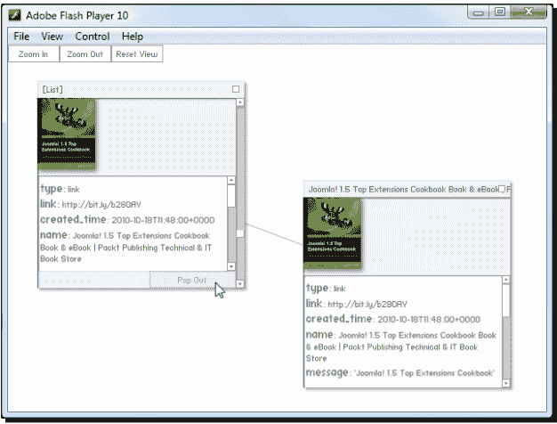

你可能已经猜到，设置 variables.metadata = 1 与在 URL 末尾加上 ?metadata=1 完全一样。这样做虽然需要多写几行代码，但可以更容易地设置不同的参数，也能让参数与 URL 分离。

无论如何，编译 SWF，你应该会看到下面的截图：

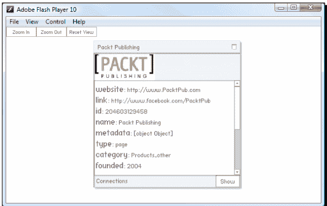

注意到 Renderer 底部新增的 Connections 栏了吗？点击 Show 按钮：

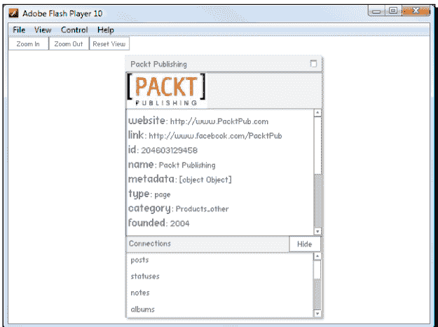

## 刚才发生了什么？

我们现在可以在 Graph Object 的渲染器中直接看到它的所有连接。当然，除非我们能看到每条连接的末端是什么，否则这并没有太大意义！

## 引入 Requestor

理想情况下，当用户从滚动列表中点击某个连接时，应该创建并显示该连接对应的一个新的 Graph List Renderer。

为此，我们需要向列表添加一个 MouseEvent.CLICK 监听器，并用它来触发对被点击连接的新 URLLoader 请求。

幸运的是，项目中的其他地方已经提供了全部 UI 代码；我们只需要接入即可。为此，我们需要使用我所说的 Requestor。

## 动手实践——创建 HTTP Requestor

思路是将 CustomGraphContainerController 中与 URLLoader 相关的所有代码移动到一个单独的类中，名为 HTTPRequestor。然后，我们将 CustomGraphContainerController 的构造函数替换为以下内容：

```
public function CustomGraphContainerController(a_graphControlContainer:GraphControlContainer)
{
    super(a_graphControlContainer);
    _requestor = new HTTPRequestor();
    _requestor.request(new GraphRequest("PacktPub"));
}
```

为什么要这么做？除了更简洁之外，还有两个主要优点：

- 1. 请求多个 Graph Object 或 Graph List 要简单得多；无需处理多个 URLLoader 实例。
- 2. 在下一章中，我们将看到如何使用官方的 Adobe AS3 Facebook SDK 从 Graph API 检索信息。如果请求的所有代码都封装在一个类中，那么只需要修改一行代码，就可以从使用 HTTP 切换到使用 Adobe 的 SDK：

```
public function CustomGraphContainerController(a_graphControlContainer:GraphControlContainer)
{
    super(a_graphControlContainer);
    _requestor = new SDKRequestor();
    _requestor.request(new GraphRequest("PacktPub"));
}
```


GraphRequest 是一个简单的类；其构造函数允许你使用两个参数来指定要从 Graph API 获取的内容：

- objectID，任意 Graph 对象的名称。
- connectionID，该 Graph 对象的任意连接名称。

因此，要请求 Packt Publishing 页面，你可以使用以下 GraphRequest：

```
newGraphRequest("PacktPub");
```

而要从 Packt Publishing 页面请求帖子列表，你可以使用以下代码：

```
newGraphRequest("PacktPub", "posts");
```

该类已经编写完成，位于 \src\com\graph\apis\http\HTTPRequestor.as。看一下！它与我们在 CustomGraphContainerController.as 中编写的代码有一些不同，但都有注释进行解释：

```
package graph.apis.http
{
    import events.DialogEvent;
    import events.RequestEvent;
    import flash.events.Event;
    import flash.events.EventDispatcher;
    import flash.events.HTTPStatusEvent;
    import flash.events.IEventDispatcher;
    import flash.events.IOErrorEvent;
    import flash.net.URLLoader;
    import flash.net.URLRequest;
    import flash.net.URLVariables;
    import flash.utils.Dictionary;
    import graph.apis.base.IRequestor;
    import graph.BaseGraphItem;
    import graph.GraphList;
    import graph.GraphObject;
    import graph.GraphRequest;
    import com.adobe.serialization.json.JSON;

    //the class needs to dispatch events (see later in code for why)
    public class HTTPRequestor extends EventDispatcher implements IRequestor
    {
        //this is used to figure out which GraphRequest created each
        //loader
        private var _requests:Dictionary = new Dictionary();

        public function HTTPRequestor(target:IEventDispatcher = null)
        {
            //this is needed because the class extends EventDispatcher
            super(target);
        }

        public function request(a_request:GraphRequest):void
        {
            var loader:URLLoader = new URLLoader();
            var urlRequest:URLRequest = new URLRequest();
            var variables:URLVariables = new URLVariables();

            //We construct a URL from the parameters of the GraphRequest
            urlRequest.url = "https://graph.facebook.com/" + a_request.objectID;
            if (a_request.connectionID)
            {
                urlRequest.url += "/" + a_request.connectionID;
            }

            variables.metadata = 1;
            urlRequest.data = variables;

            //this is used to figure out which GraphRequest created the loader later
            _requests[loader] = a_request;

            loader.addEventListener(Event.COMPLETE, onGraphDataLoadComplete);
            loader.load(urlRequest);
        }

        private function onGraphDataLoadComplete(a_event:Event):void
        {
            var loader:URLLoader = a_event.target as URLLoader;
            var graphData:String = loader.data;
            var decodedJSON:Object = JSON.decode(graphData);

            //we find the original GraphRequest used to start the loader
            var originalRequest:GraphRequest = _requests[loader] as GraphRequest;

            if (decodedJSON.data)
            {
                var graphList:GraphList = new GraphList();
                var childGraphObject:GraphObject;
                for each (var childObject:Object in decodedJSON.data)
                {
                    childGraphObject = new GraphObject();
                    for (var childKey:String in childObject)
                    {
                        childGraphObject[childKey] = childObject[childKey];
                    }
                    graphList.addToList(childGraphObject);
                }
                graphList.paging = decodedJSON.paging;

                //we use the properties of the original GraphRequest to add
                //some extra data to the GraphList itself
                graphList.ownerID = originalRequest.objectID;
                graphList.connectionType = originalRequest.connectionID;

                //since this class does not have a renderGraphList() method,
                //we dispatch an event, which CustomGraphContainerController
                //will listen for, and call its own renderGraphList() method
                dispatchEvent(new RequestEvent(RequestEvent.REQUEST_COMPLETED,
                    graphList));
            }
            else
            {
                var graphObject:GraphObject = new GraphObject();
                for (var key:String in decodedJSON)
                {
                    graphObject[key] = decodedJSON[key];
                }

                //since this class does not have a renderGraphList() method,
                //we dispatch an event, which CustomGraphContainerController
                //will listen for, and call its own renderGraphList() method
                dispatchEvent(new RequestEvent(RequestEvent.REQUEST_COMPLETED,
                    graphObject));
            }
        }
    }
}
```

编译并运行你的 SWF，然后展开 **连接** 框并点击 "posts"：

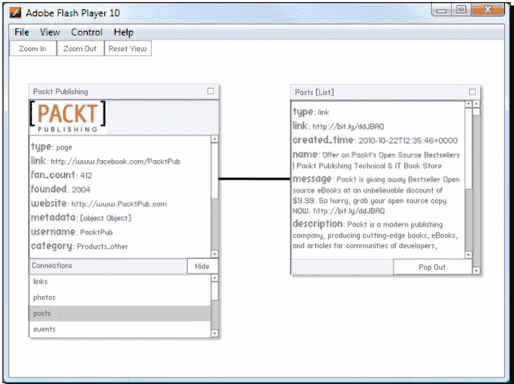

太好了！Graph List Renderer 出现了，并带有一条指向该页面的黑线，表示它们之间存在连接。其他连接呢？试着点击 **状态**。

**Error #2044: Unhandled ioError.text=Error #2032: Stream Error. URL:**
**https://graph.facebook.com/204603129458/statuses?metadata=1**

糟糕。

## 刚才发生了什么？

如果你在浏览器中加载这个有问题的 URL（https://graph.facebook.com/packtpub/statuses），你将看到以下消息：

```
{
  "error": {
    "type": "OAuthAccessTokenException",
    "message": "An access token is required to request this resource."
  }
}
```

这个错误是由于未通过你的 SWF 登录 Facebook 造成的。我们将在下一章探讨如何解决这个问题。

目前，你可以通过向 URLLoader 添加一个 IO_ERROR 事件监听器来绕过该错误。在 HTTPRequestor.as 中，修改 request()：

```
public function request(a_request:GraphRequest):void
{
    var loader:URLLoader = new URLLoader();
    var urlRequest:URLRequest = new URLRequest();
    var variables:URLVariables = new URLVariables();

    //We construct a URL from the parameters of the
    //GraphRequest
    urlRequest.url = "https://graph.facebook.com/" +
        a_request.objectID;
    if (a_request.connectionID)
    {
        urlRequest.url += "/" + a_request.connectionID;
    }

    variables.metadata = 1;
    urlRequest.data = variables;

    //this is used to figure out which GraphRequest
    //created the loader later
    _requests[loader] = a_request;

    loader.addEventListener(Event.COMPLETE,
        onGraphDataLoadComplete);
    loader.addEventListener(IOErrorEvent.IO_ERROR,
        onIOError);
    loader.load(urlRequest);
}
```


你需要导入 flash.events.IOErrorEvent。现在，在同一个类中，创建一个简单的事件处理函数来跟踪错误：

```
private function onIOError(a_event:IOErrorEvent):void
{
    trace(a_event.text);
}
```

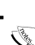

这样，你可以在输出窗口中看到错误，但它不会导致 SWF 崩溃。注意：try-catch 块无法处理这类错误。

```
"updated_time": "2010-03-18T14:46:50+0000"
},
{
  "id": "307932939458",
  "from": {
    "name": "Packt Publishing",
    "category": "Products_other",
    "id": "204603129458"
  },
  "name": "Books",
  "description": "Packt Books",
  "link": "http://www.facebook.com/
    album.php?aid=180619&id=204603129458",
  "count": 32,
  "type": "normal",
  "created_time": "2010-02-04T12:32:17+0000",
  "updated_time": "2010-03-18T16:08:42+0000"
}
],
"paging": {
  "previous": "https://graph.facebook.com/204603129458/
    albums?metadata=1&limit=25&since=2010-09-30T10%3A13%3A53%2B0000",
  "next": "https://graph.facebook.com/204603129458/
    albums?metadata=1&limit=25&until=2010-02-04T12%3A32%3A16%2B0000"
}
}
```

## 动手实践 – 从相册加载照片

然而，正如我们已经确认的，data 中的每个对象本身都是一个 Graph Object。让我们通过浏览 https://graph.facebook.com/307932939458?metadata=1 来查看 id 为 307932939458 的 Packt Books 相册：

```
{
  "id": "307932939458",
  "from": {
    "name": "Packt Publishing",
    "category": "Products_other",
    "id": "204603129458"
  },
  "name": "Books",
  "description": "Packt Books",
  "link": "http://www.facebook.com/
    album.php?aid=180619&id=204603129458",
  "count": 32,
  "type": "album",
  "created_time": "2010-02-04T12:32:17+0000",
  "updated_time": "2010-03-18T16:08:42+0000",
  "metadata": {
```


这张图看起来越来越复杂了（而且与之前画出的数学图的相似之处现在也一目了然）。当然，一旦涉及人，连接数量就会变得离谱。用户可以通过各种方式连接到任何其他对象：与另一个用户成为好友、在照片、视频或笔记中被标记、发布评论、链接或其他条目，或者在 Facebook 上点击喜欢任何其他元素。

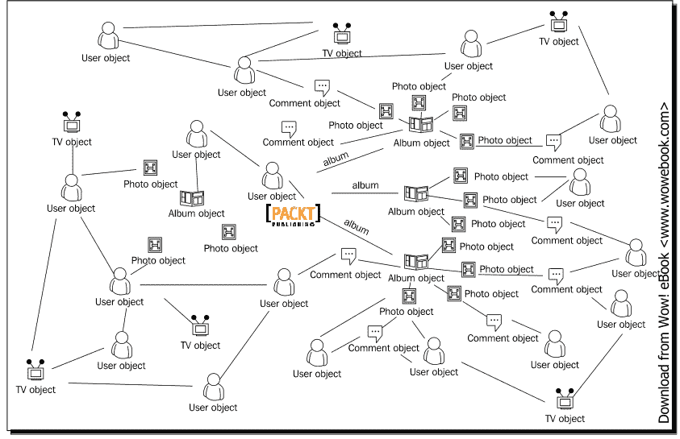

如果你从一个主页开始，不断遍历与它相连的所有对象，然后再遍历与这些对象相连的所有对象，如此反复，你就可以覆盖大量节点，而不必再从新的主页开始。

图的力量在于其灵活性。每种类型的图对象（Graph Object）与其他类型的图对象都具有相同的基本结构——图列表（Graph List）除外（图列表包含图对象数组）。这就是为什么我们的图对象渲染器（Graph Object Renderer）可以轻松显示任何类型的图对象。

另外，你注意到了吗？并非只有评论才有`from`属性。相册也有，单独的照片也有，几乎所有不是主页或用户的对象类型都有。这意味着你可以从任何对象开始，找到它的创建者，然后从那里向外遍历图。

图模型对隐私有重要影响。假设我们被授予访问某个主页信息的权限，同时也能访问与该主页相连的任何对象的信息。那么，我们就可以从该主页出发依次到达：

- 该主页发布的相册，再到
- 该相册中的一张照片，再到
- 在照片中被标记的用户，再到
- 该用户的墙贴列表，再到
- 第一个用户的朋友在某条帖子上发表的评论，再到
- 发表该评论的用户，再到
- 该用户喜欢的电视节目，再到
- 在该电视节目主页上发布的链接，再到
- 发布该链接的用户

以此类推。因此，Facebook 使用一套更详细的规则来决定用户能访问什么、应用能代表用户访问什么，也就不足为奇了。我们将在下一章讨论这些规则。

## 整合起来

最后，让我们来看看，从 Packt Publishing 主页出发，我们能在图中遍历多远。

## 动手时间 – 遍历图

将可视化工具（Visualizer）设置为从请求 PacktPub 主页开始。现在，编译并运行你的 SWF，使用**连接**框和**弹出**按钮来探索图，看看你能走多远。别忘了你可以拖拽渲染器，还可以缩小视图，让 Flash Player 窗口中容纳更多内容！另外请记住，黑线表示连接，而灰线表示对象属于某个列表。

## 小结

本章我们学到了很多关于 Graph API 的知识：不仅了解了它是什么，还学会了如何在 AS3 中访问它。

需要掌握的关键点：

- Graph API 之所以叫这个名字，是因为它将 Facebook 的所有数据表示为一个由对象和连接组成的巨大图。
- Graph API 有两种元素类型：图对象和图列表。
- 图对象可能有两个 ID：一个是 Facebook 指定的数字 ID，另一个可能是图对象所有者指定的字母数字 ID。
- 图对象有连接；连接指向图列表；图列表包含图对象。
- 用于获取图对象的 Graph URL 格式为 `https://graph.facebook.com/graph_object_id`。
- 用于获取图列表的 Graph URL 格式为 `https://graph.facebook.com/graph_object_id/connection_id`。
- Graph URL 以 JSON 格式返回数据。这是一种基于文本的格式，使用键值对来表示包含属性、数组和其他对象的对象。
- 有时，Graph URL 会返回错误消息；这些消息也是 JSON 格式。
- 我们可以在 Graph URL 中使用 `?metadata=1` 参数，让它返回关于该元素的额外信息，比如从图对象出发的连接列表。
- 对于属于图列表的图对象，不会返回元数据。
- 图对象的 JSON 表示可以使用 `as3corelib` 库反序列化为我们可以在代码中使用的 AS3 对象。

我们还讨论了 Graph API 为何如此灵活，因为它对 Facebook 数据库中的每种对象类型都使用相同的基本结构。

但当我们尝试获取某些对象的信息时，如果遇到授权错误，又该怎么办呢？这正是我们下一章要讨论的内容。

## 刚才发生了什么？

如你所见，Facebook 的安全机制限制了你能够查看关于某个人的哪些信息。这并不是一个简单的二元设置——"要么你能看到这个信息，要么你能看到那个信息"——而是基于：

- 你与对方的连接方式
- 你是否已登录 Facebook

特别有意思的是，即使你从未见过某人，也没有共同的朋友或网络，仅仅通过登录 Facebook，你往往就能看到关于这个人的更多信息。对有些人来说，如果你没有登录，甚至可能无法查看他们的个人主页；Facebook 甚至可能会否认它的存在。

每个 Facebook 用户都有一个权限列表，其中规定了其他用户根据与该用户的连接关系可以查看哪些关于他们的信息。如果你没有权限查看某些数据，Facebook 的安全机制就不会将其显示给你。

权限可能非常复杂，难以弄清楚。下面是一个用户的权限可能呈现的样子：

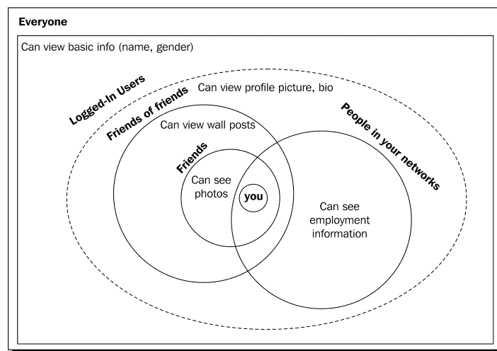

这个页面分为两个主要部分：**基本目录信息**和**在 Facebook 上的分享**。花点时间深入研究这些部分，看看哪些信息可以被谁查看。你可能会惊讶地发现，关于你的大量信息对任何想看的人来说都是公开的。

在这两个页面中自定义设置时，你可以点击**预览我的个人主页**，查看你指定的任何人眼中的个人主页是什么样子。

有几项信息始终对任何已登录用户可见：你的姓名、性别、个人主页头像和网络列表。其他所有信息的访问权限都可以修改。

## 这和图 API 有什么关系？

这些信息都很好，但它会影响我们的应用程序吗？

试着通过他们的 Graph URL 访问你刚才查看过的所有人的个人主页。请记住，如果他们的 Facebook URL 是 http://www.facebook.com/username，那么他们的 Graph URL 就是 https://graph.facebook.com/username；如果他们的 Facebook URL 是 http://www.facebook.com/profile.php?id=12345678，那么他们的 Graph URL 就是 https://graph.facebook.com/12345678。

你会注意到，你能看到的信息只有：

- 姓名（以及名字、姓氏等单独的字段）
- 个人主页头像（通过 https://graph.facebook.com/id/picture）
- 性别

所有这些信息都是公开可用的。即使你在未登录时能在他们的个人主页上看到额外信息，这一点也依然成立。

Graph API 无法检测我们是否在另一个浏览器窗口中登录了 Facebook，所以这里我们看到的一切都是从尚未登录的用户的视角看到的。

例如，我的页面如下面几行代码所示：

```
{
  "id": "«redacted»",
  "name": "Michael James Williams",
  "first_name": "Michael",
  "middle_name": "James",
  "last_name": "Williams",
  "gender": "male",
  "locale": "en_GB"
}
```

而且，虽然你可以通过在 URL 中添加 metadata=1 来查看连接 URL 列表，但尝试访问其中任何一个 URL 都会导致以下错误：

```
{
  "error": {
    "type": "OAuthAccessTokenException",
    "message": "An access token is required to request this resource."
  }
}
```

但什么是访问令牌？

## 访问令牌是授权的证明

想象一栋安保严密的大楼。要从正门进入，你需要向门卫出示护照、驾照和社会安全号码——只是为了证明你是谁。一旦他确认无误，就会给你一张临时通行证，上面写着你的名字，让你别在夹克上。

在大楼里，大家都信任这张通行证。你不需要冒险向他们出示重要的个人证件；这些证件只有门卫会看到。

访问令牌就像那张通行证。Facebook 会向已登录用户提供一串字符，这串字符表示"我是这个人，并且我已登录"，它可以作为参数传递给 Graph URL，从而访问该用户有权查看的信息。

不过，事情还不止这些。

## 用户/应用程序授权

实际上需要两种授权：用户的授权和应用程序的授权。其运作方式如下：

用户乔（Joe User）想在比尔的酷应用（Bill's Cool Application）中做某件事，这件事需要该应用访问乔的一些受限信息。应用无法访问这些信息，于是他们俩通过 Graph API 联系 Facebook。

这个应用说："嘿，Facebook，我是比尔的酷应用，我想访问用户乔的数据。"


Facebook 回复：“首先我需要看看你的 ID，以证明你确实是 Bill 的酷应用。”

应用说：“没问题，这是我的凭证。”

Facebook 检查了一下，说：“这些看起来没问题。等等，我怎么知道这是真正的用户 Joe，而不是某个戴假发的家伙？”

Joe 用他的电子邮件地址和密码登录 Facebook，同时遮挡住这些信息，以免 Bill 的酷应用看到。应用礼貌地看向别处。

Facebook 说：“嘿，Joe，很高兴见到你。你愿意让 Bill 的酷应用访问它请求的这些数据吗？”

Joe 检查了应用想要获取的内容，说：“是的，当然，我没问题。”

Facebook 说：“太好了。好的，Bill 的酷应用，这是访问令牌。如果你想访问 Joe 的任何数据，在请求信息时只需出示这个令牌，我就会把数据给你。”

应用说：“酷！那么，我可以随时使用这个令牌吗？”

Facebook 说：“嗯，不是的。它会在几个小时内过期。之后，你必须再申请一个，而且需要 Joe 保持登录状态才能获取。如果 Joe 登出，情况也一样；你需要获取另一个令牌，这意味着要让 Joe 再次登录。”

应用说：“这似乎有点不方便。你的意思是我每隔几个小时就得让 Joe 同意我访问他的数据？”

Facebook 回答：“哦，不，不，不。既然 Joe 已经同意你可以查看他的信息，我会记住这一点，不会再打扰他询问。而且如果他已经登录，我也不需要查看他的电子邮件和密码。”

Joe 和应用感谢了 Facebook，然后去做他们最初想做的事情。

当然，这些信息并不是通过对话形式传递的，那太傻了。应用凭证通过 Graph URL 传递给 Facebook，而用户通过标准的 Facebook 登录网页提供他们的凭证。Facebook 不是通过 JSON 返回访问令牌，而是通过一个参数传递给应用的 URL——这就是为什么你的应用需要一个 Web 主机。

首先，你可能想知道我们从哪里获得应用凭证。我们不能凭空捏造；我们需要先在 Facebook 上注册我们的应用。现在让我们来做这件事。

## 动手实践 – 在 Facebook 上注册应用

在 http://www.facebook.com/developers/ 注册成为 Facebook 开发者。别担心；这是免费的，而且是即时的。

你可能会被要求通过输入有效的手机号码或添加信用卡来验证你的 Facebook 账户。你不会被收费（如果你选择短信验证方式，可能需要支付标准短信的费用）；这是为了确保每个应用都对应着一个真实的人。

在开发者页面，点击右上角的**设置新应用**：


你将被要求输入应用的名称。最好将你的名字或公司名称作为应用名称的一部分，这样更有可能确保唯一性。（如果你愿意，之后也可以更改应用名称；这并不是一成不变的。）你还需要同意**Facebook 条款和条件**——请务必先阅读它们。

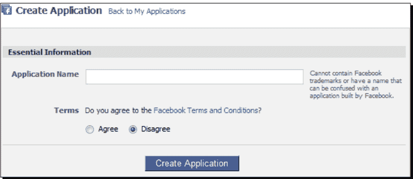

## 动手实践 – 使用浏览器请求访问令牌

打开浏览器，访问 https://graph.facebook.com/oauth/authorize?client_id=<insert_application_id> （将 <insert_application_id> 替换为你应用的应用程序 ID）。

你会看到以下错误：

```
{
  "error": {
    "type": "OAuthException",
    "message": "Missing redirect_uri parameter."
  }
}
```

Facebook 不会直接输出访问令牌；它希望将浏览器重定向到另一个网页，并将访问令牌传递给该页面。目前，这还不是很有用。我们的 Flash 应用是作为独立的 SWF 文件运行的，并未嵌入到页面中——所以我们将采用一个快速的变通方法。

### 在我们的应用中注册重定向 URI

进入你的应用设置（访问 http://www.facebook.com/developers，然后点击你的应用名称，再点击“编辑设置”）。点击左侧导航栏中的“网站”选项卡。

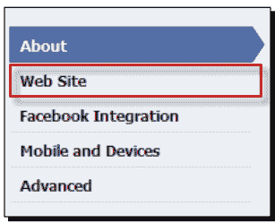

你会看到如下截图所示的面板：

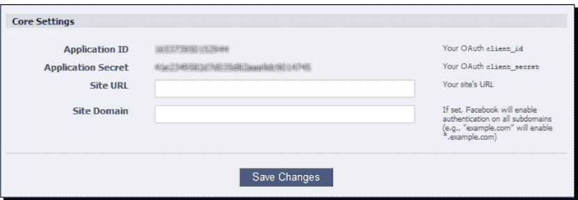

“站点 URL”框定义了在授权用户和应用后 Facebook 重定向到的 URL。这也是访问令牌将被传递到的 URL。

在我们创建自己的页面之前，我们将其设置为 Google 首页。我相信他们不会介意的。在框中输入 http://google.com/ ，然后点击“保存更改”。

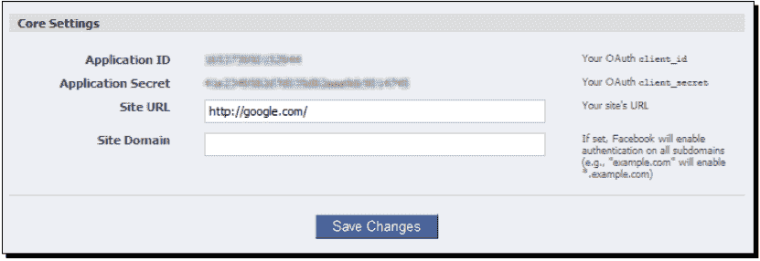

如果你再次尝试访问 https://graph.facebook.com/oauth/authorize?client_id=<your_application_id> ，你仍然会得到相同的错误信息。即使我们在应用设置中指定了重定向目标页面，我们仍然需要将它传递给授权 URL。

将凭证作为参数输入到 URL 中存在安全风险；它们不够安全，可能被任何人读取。这就产生了一个问题：Facebook 希望看到我们的应用密钥，以证明我们确实是使用所提供的应用 ID 登录的，但我们不能冒险通过 URL 传递密钥。

为了解决这个问题，我们可以告诉 Facebook，我们正在使用用户端的 Web 浏览器进行身份验证，这样 Facebook 就会让我们通过，而无需我们的应用密钥。这需要传递另一个参数：type=user_agent（user agent 是运行在用户计算机上的 Web 浏览器等应用程序的通用术语）。

所以，请访问此 URL：https://graph.facebook.com/oauth/authorize?client_id=«your_application_id»&redirect_uri=http://google.com&type=user_agent。

> 请注意，每个参数的值与下一个参数的名称之间用“&”符号分隔，而且第二个参数叫作 redirect_uri，而不是 redirect_url。（这不是笔误；URL 是 URI 的一种特定类型。）

你应该会看到一个 Facebook 登录网页：


输入你的详细信息并点击“登录”。你将被要求允许该应用访问你的基本信息：

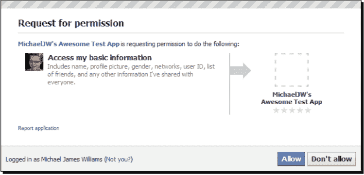

### 放我进去！

点击“允许”。你将被重定向到 Google——但请仔细查看这个 URL：

```
http://google.com/#access_token=123675230995389%7C2.hX2Png6g2LUuczfd4tLPbQ__.3600.1276960311-169573433058884%7C8BAAidDtlt8fulZHA3bC3YxcCwM
```

终于！我们有了访问令牌。你可以看到它是我们被重定向到的 URL 中 access_token 参数的值。在这个例子中，它是：123675230995389%7C2.hX2Png6g2LUuczfd4tLPbQ__.3600.1276960311-169573433058884%7C8BAAidDtlt8fulZHA3bC3YxcCwM。

（你的令牌会不同，因为令牌是基于用户 ID、应用 ID 和授权时间生成的，但看起来会类似。）

### 使用访问令牌

让我们试一试。像之前一样，尝试通过 Graph API 加载你自己的个人资料：

```
https://graph.facebook.com/«your_username»
```

如果你还记得，我之前得到的是：

```
{
  "id": "«redacted»",
  "name": "Michael James Williams",
  "first_name": "Michael",
  "middle_name": "James",
  "last_name": "Williams",
  "gender": "male",
  "locale": "en_GB"
}
```

现在再试一次，但这次在 URL 中添加一个 access_token 参数：

```
https://graph.facebook.com/«your_username»?access_token=123675230995389%7C2.hX2Png6g2LUuczfd4tLPbQ__.3600.1276960311-169573433058884%7C8BAAidDtlt8fulZHA3bC3YxcCwM
```

这一次，你会得到更多数据，如下面的代码片段所示：

```
{
  "id": "«redacted»",
  "name": "Michael James Williams",
  "first_name": "Michael",
  "middle_name": "James",
  "last_name": "Williams",
  "link": "«redacted»",
}
```


"about": "Twitter: @MichaelJW",
"gender": "male",
"timezone": 1,
"locale": "en_GB",
"verified": true,
"updated_time": "2010-06-16T20:38:01+0000"
}

好，虽然不多，但它证明了我们已成功获得授权，并且可以看到在获得访问令牌之前无法看到的更多信息。

尝试在没有访问令牌的情况下访问你的好友列表：

```
https://graph.facebook.com/«your_username»/friends
{
  "error": {
    "type": "OAuthAccessTokenException",
    "message": "An access token is required to request this resource."
  }
}
```

几乎什么都没有。现在，使用访问令牌（将 «your_access_token» 替换为实际的访问令牌）：

```
https://graph.facebook.com/«your_username»/friends?access_token=«your_access_token»
{
  "data": [
    {
      "name": "JohnFaikname",
      "id": "«redacted»"
    },
    {
      "name": "Sarah Toetalee-Maidup",
      "id": "«redacted»"
    },
    {
      "name": "Bob Frendomyn e",
      "id": "«redacted»"
    },
  ]
}
```

- 2. 你通过直接通过 `Facebook.com` 登录网页登录到自己的账户，证明了自己作为 Facebook 用户的身份。
- 3. Facebook 问你是否愿意让该应用程序访问你的信息，而你授予了它权限。
- 4. Facebook 将访问令牌传回应用程序先前指定的页面（在本例中为 Google 主页）。

这种工作流程并不独特于 Facebook。它实际上是 **OAuth 2.0 协议** 的一部分，被称为 **用户代理流程**。这意味着一旦你掌握了允许应用程序使用 Facebook 进行身份验证所需的工作流程，你就能将该知识应用到编写可使用任何其他使用 OAuth 2.0 的系统进行身份验证的应用程序。

> OAuth 2.0 协议的官方文档在这里：http://tools.ietf.org/html/draft-ietf-oauth-v2-05#section-3.5。

## 保持秘密

看起来我们不需要在 Graph URL 中传递 **应用程序密钥** 来进行身份验证，这很奇怪。其原因在于，如果我们以这种方式传递密钥，那么用户或用户计算机上运行的另一个程序就可以获取它，并冒充我们的应用程序使用它——请记住，密钥类似于密码。因此，用户代理流程让我们能够在不使用其密钥的情况下对应用程序进行身份验证，适用于这种不安全的情况。

用户或桌面应用程序仍然有可能获取访问令牌并用它冒充用户登录到我们的应用程序。但用户这样做没有意义，因为他使用此方法可以访问的任何信息，他本来就可以通过 Facebook 网站访问。至于桌面应用程序，好吧，这只是运行计算机的日常风险之一，与病毒和间谍软件一样。

## Facebook 给了我们什么？

查看 Facebook 在身份验证后重定向我们的 URL：

```
http://google.com/#access_token=123675230995389%7C2.hX2Png6g2LUuczfd4tLPbQ__.3600.1276960311-169573433058884%7C8BAAidDt1t8fulZHA3bC3YxcCwM.&expires_in=6561
```

有两个参数：`access_token` 和 `expires_in`。

第二个参数告诉我们访问令牌在多少秒后过期。它看起来像一个随机数字，但有一个规律：如果我们在 14:32:07 请求令牌，它将在 16:00:00 过期；9:15:34 请求的令牌将在 11:00:00 过期。将令牌生成时间的两小时后，去掉分钟和秒，你就会找到过期时间。

乍一看，访问令牌似乎是一堆字符。实际上，它包含了一些有用的信息。

首先，你应该知道 %7C 是 “管道” 字符 | 的代码，这样它才能在 URL 中传递。因此将两个 %7C 替换为管道：

```
123675230995389|2i.hX2Png6g2LUuczfd4tLPbQ__.3600.1276960311-169573433058884|8BAAidDtl8fulZHA3bC3YxcCwM.
```

这里有三条有用的信息：

- 1. 应用程序 ID：第一个管道之前的数字——本例中为 123675230995389。
- 2. 当前用户的 ID：在破折号之后、最后一个管道之前——本例中为 169573433058884。
- 3. 过期时间：在用户 ID 之前——本例中为 1276960311。这是以 Unix 时间给出的。

Unix 时间系统将时间点描述为从 1970 年 1 月 1 日午夜 UTC 起算的秒数，不考虑闰秒。它提供了一种简单的方法，将自 1970 年以来的任何时间点编码为单个整数。

网站 UnixTime.info 包含一个简单的转换器，用于在 Unix 时间戳和常规日期格式之间切换。

> 在 AS3 中，Date 类可用于在两种时间格式之间转换。将值 epochTime*1000 作为第一个参数传递给 Date() 构造函数以用该时间初始化 Date。Date 对象的 time 属性将以 Unix 格式返回日期，尽管 Flash 使用毫秒作为其基本时间单位，因此乘以了 1000。

这意味着，给定任何访问令牌，你都可以找出哪个用户请求了它、何时过期以及它适用于哪个应用程序——尝试浏览 https://graph.facebook.com/your_application_id。

```
var variables:URLVariables = new URLVariables();

//We construct a URL from the parameters of the GraphRequest
urlRequest.url = "https://graph.facebook.com/" + a_request.objectID;
if (a_request.connectionID)
{
    urlRequest.url += "/" + a_request.connectionID;
}

variables.metadata = 1;
variables.access_token = "123675230995389%7C2.hX2Png6g2LUuczfd4tLPbQ__.3600.1276960311-169573433058884%7C8BAAidDtl8fulZHA3bC3YxcCwM."
urlRequest.data = variables;

//this is used to figure out which GraphRequest created the loader later
_requests[loader] = a_request;

loader.addEventListener(Event.COMPLETE, onGraphDataLoadComplete);
loader.addEventListener(IOErrorEvent.IO_ERROR, onIOError);
loader.load(urlRequest);
}
```

测试应用程序；如果它没有加载任何 Renderer，你的访问令牌可能已过期。在这种情况下，Graph API 将返回以下内容（在浏览器中加载时）：

```
{
  "error": {
    "type": "OAuthException",
    "message": "Error processing access token."
  }
}
```

并且 I/O 错误将被传递给你的应用程序。我们可以通过将 IOErrorEvent 监听器添加到 URLRequest 对象来对这些错误做出反应；第 2 章《Time for Action: Creating an HTTP Requestor》中的 What Just happened? 部分提供了此方面的说明。

因此，如果你确实收到 I/O 错误，请在浏览器中像我们之前那样生成一个新的访问令牌。在浏览器中加载 https://graph.facebook.com/oauth/authorize?client_id=«your_application_id»&redirect_uri=http://google.com&type=user_agent，提取加载的 URL 参数中的访问令牌，然后将其粘贴到你的代码中。

## 让我进入！

这次测试应用程序时，你应该会看到下一个截图：

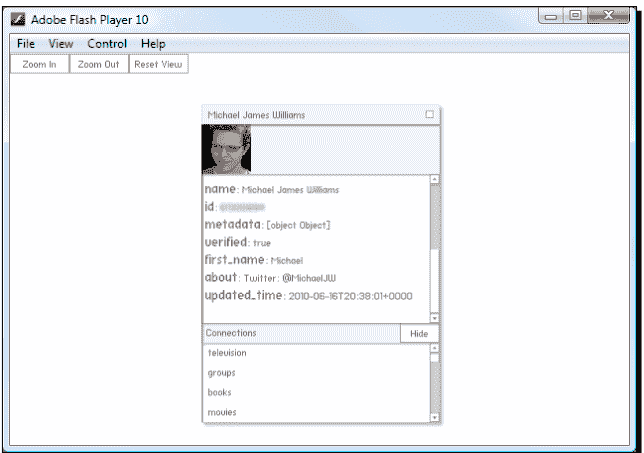

太好了！我们可以看到列表中出现了新的字段，比如 verified 和 about。

再试着点击列表中的 friends 连接：

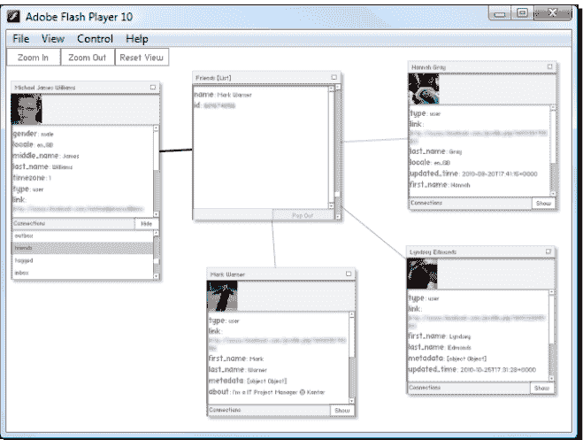

它工作得正如我们所期望的那样。 （请记住，HTTPRequestor 将访问令牌作为参数传递给所有请求的 Graph URL。）

看看我们请求用户资料时加载的内容：

```
https://graph.facebook.com/your_user_id?access_token=«your_access_token»&metadata=1
{
  "id": "169573433058884",
  "name": "Michael James Williams",
  "first_name": "Michael",
  "middle_name": "James",
  "last_name": "Williams",
  "link": "http://www.facebook.com/«redacted»",
  "about": "Twitter: @MichaelJW",
  "gender": "male",
  "timezone": 1,
  "locale": "en_GB",
  "verified": true,
  "updated_time": "2010-06-16T20:38:01+0000",
  "metadata": {
    "connections": {
      "home": "https://graph.facebook.com/«redacted»/home?access_token=«your_access_token»",
      "feed": "https://graph.facebook.com/«redacted»/feed?access_token=«your_access_token»",
      "friends": "https://graph.facebook.com/«redacted»/friends?access_token=«your_access_token»",
      «...some datacut out here, for length...»
    }
  },
  "type": "user"
}
```

请注意，connections 列表中的 Graph URL 已预先填入了 access_token 参数。Visualizer 的代码不使用这些 Graph URL——它使用形式为 https://graph.facebook.com/<id_of_object>/<name_of_connection> 构造它们——但这项知识可能对你的项目有用。

正如你从 Visualizer 中看到的，friends 连接的 Graph List 只包含非常基本的信息：用户的 ID 和姓名。然而，你朋友的完整 Graph 对象中加载了更多信息——不过具体数量取决于你朋友的隐私设置。


## 让我进去！

要了解你的朋友可以通过应用程序访问到关于你的多少信息，请登录 Facebook 网站，依次点击“账户 | 隐私设置”，选择“编辑使用应用程序、游戏和网站的设置”，然后查看“通过你的朋友可访问的信息”设置：

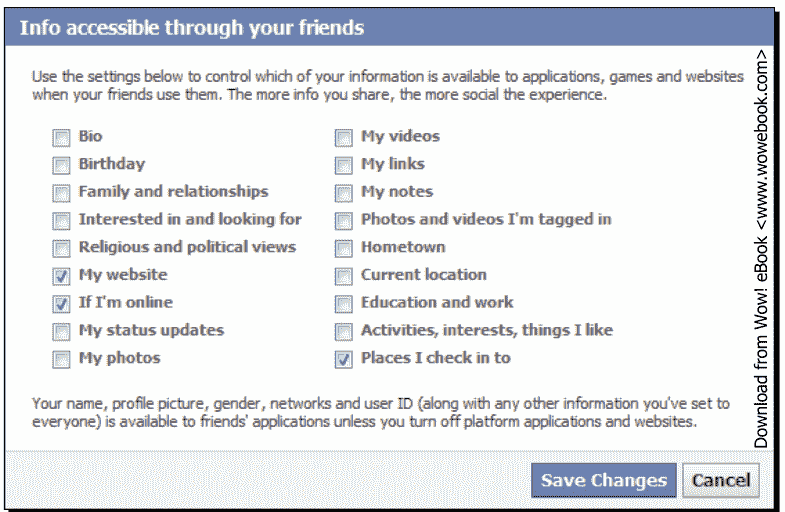

## 这是作弊！

好吧，在浏览器中生成访问令牌，然后直接将其粘贴到源代码中，并不是一种好的认证处理方式。我们需要在应用程序本身中获取访问令牌。

## 动手实践 – 通过应用程序进行认证

在浏览器中进行认证时，我们会访问 `https://graph.facebook.com/oauth/authorize?client_id=<your_application_id>&redirect_uri=http://google.com&type=user_agent`，所以让我们从在代码中加载该 URL 开始。

首先，在 HTTPRequestor.as 中创建一个新函数 attemptToAuthenticate()：

```
public function attemptToAuthenticate():void
{
    var loader:URLLoader = new URLLoader();
    var urlRequest:URLRequest = new URLRequest();

    var variables:URLVariables = new URLVariables();

    urlRequest.url = "https://graph.facebook.com/oauth/authorize";
    variables.client_id = "<your_application_id>";
    variables.type = "user_agent";
    variables.redirect_uri = "http://google.com";
    urlRequest.data = variables;

    loader.addEventListener(Event.COMPLETE, onAuthenticationComplete);
    loader.addEventListener(IOErrorEvent.IO_ERROR, onIOError);
    loader.load(urlRequest);
}
```

请确保将 <your_application_id> 替换为你的实际应用程序 ID。

我们使用与加载 Graph 对象时相同的 IO_ERROR 处理函数，但需要一个新的函数 onAuthenticationComplete()，用于加载完成后的处理；将其添加到 HTTPRequestor.as 中：

```
private function onAuthenticationComplete(a_event:Event):void
{
    trace("Authentication complete");
    var loader:URLLoader = URLLoader(a_event.target);
    trace(loader.data);
}
```

这里没什么复杂的；它会输出返回的任何内容。

在 CustomGraphContainerController.as 中，让我们修改构造函数，使其启动此认证流程，而不是加载用户配置文件：

```
public function CustomGraphContainerController(a_graphControlContainer:GraphControlContainer)
{
    super(a_graphControlContainer);
    _requestor = new HTTPRequestor();
    addEventListenersToRequestor();
    _requestor.attemptToAuthenticate();
    //_requestor.request(new GraphRequest("<your_user_id>"));
}
```

在此之前，我们需要将该函数添加到 IRequestor 接口中。将 \src\graph\apis\base\IRequestor.as 修改为：

```
package graph.apis.base
{
    import flash.events.IEventDispatcher;
    import graph.GraphRequest;

    public interface IRequestor extends IEventDispatcher
    {
        function request(a_request:GraphRequest):void;
        function attemptToAuthenticate():void;
    }
}
```

测试一下。会输出什么？会输出大量 HTML，将其粘贴到空白的 .html 文件中并在浏览器中打开后，效果如下：

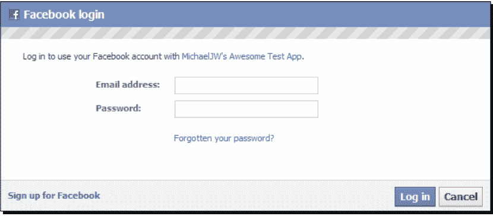

> 如果遇到错误，或者根本没有返回数据，请在浏览器中加载该 URL，查看返回的错误消息。确保 URLVariables 对象的所有属性都设置正确。

## 刚才发生了什么？

哦，对，我们需要先登录。但这里有个问题：由于我们是在 Flash Player 内加载 URL，而不是在浏览器中，因此无法访问浏览器 Cookie，所以 Facebook 无法记住我们是谁，并将我们重定向到登录页面。当然，由于我们不在浏览器中，我们实际上看不到这个页面！

我们可以编写代码创建一个 Flash 登录表单，并将用户的电子邮件地址和密码提交到真正的 Facebook 登录表单，但用户为什么要相信我们的应用不会劫持他们的数据呢？

## 另一种方法

有几种方法可以解决这个问题，具体取决于我们使用的是 AIR 还是 Flash Player。在本章中，我们将使用最简单的方法：将 SWF 嵌入网页中，并使用 JavaScript 打开登录页面，然后将访问令牌传回 Flash Player。

## 动手实践 – 通过 JavaScript 进行认证

接下来会发生以下步骤：

- 1. 我们将把应用程序的 SWF 嵌入网页中，并在浏览器中加载该页面。
- 2. 应用程序将调用网页内的 JavaScript 函数，让它在新的浏览器窗口中加载“授权”URL。
- 3. 新窗口可能会要求我们登录；一旦认证成功，它将重定向到重定向 URI 页面，就像我们之前使用它时一样。
- 4. 不过，这次我们将把重定向 URI 页面改为我们控制的页面（而不是使用 Google 主页）。该页面将获取访问令牌，并将其传回包含我们应用程序 SWF 的页面中的 JavaScript 函数。
- 5. 然后，该 JavaScript 函数会将访问令牌传递给应用程序中的 AS3 函数，之后该函数就可以在任何地方使用它了。

要让这正常工作，Facebook 将我们重定向到的网页（第 4 步中包含 SWF 的页面）必须在线。这意味着我们需要有一个 Web 主机。有关如何设置，请参阅第 1 章。

将你的项目发布到 Web，这样最终会得到一个包含 Visualizer SWF 的网页——同样，具体方法在第 1 章中已概述——并将其上传到你的主机。假设该网页名为 `index.html`，并且你已将所有文件上传到 `http://host.com/visualizer/`。

在浏览器中加载 `http://host.com/visualizer/index.html`。你会看到……嗯，没什么内容，因为应用程序仍然设置为尝试认证，而不是加载任何数据，并且在认证这一步失败了。但如果你看左上角，应该会看到熟悉的 UI 控件：**放大**、**缩小**和**重置视图**。（如果你看到“Movie Not Loaded”，请检查你的 HTML 页面是否设置为加载正确的 SWF，以及你是否将所有文件（而不是仅仅 `index.html`）上传到了 Web 主机。）

要打开一个包含 Facebook 登录页面的新窗口，我们需要在 index.html 中运行以下 JavaScript 代码：

```
window.open('https://graph.facebook.com/oauth/authorize?client_id=<your_application_id>&redirect_uri=http://google.com&type=user_agent', '<window_name>', 'height=370,width=670');
```

你可能已经猜到这段代码的作用了，因为 JavaScript 语法与 ActionScript 非常相似；它会加载一个弹出窗口，并指定高度、宽度和 URL。`<window_name>` 参数是一个稍后可以用来引用该窗口的值。

我们可以将这段代码放到页面的 HTML 中。但是，为了避免弄乱 SWF 嵌入代码（并让我们的 SWF 更灵活一些），我们将使用 ExternalInterface 从 SWF 中将其注入页面。


> flash.external.ExternalInterface 类允许 SWF 中的 ActionScript 代码与包含该 SWF 的 HTML 页面中的 JavaScript 代码进行通信。这意味着 SWF 可以调用 JavaScript 方法，反之亦然。

打开 HTTPRequestor.as 并导入 ExternalInterface 类：

```
import flash.external.ExternalInterface;
```

现在，移除我们之前放在 attemptToAuthenticate() 中的所有代码，并将其替换为 ExternalInterface 调用：

```
public function attemptToAuthenticate():void
{
    ExternalInterface.call("window.open",
        "https://graph.facebook.com/oauth/authorize?client_id=<your_application_id>&type=user_agent&redirect_uri=http://google.com",
        "facebookLoginWindow",
        "height=370, width=600");
}
```

编译你的 SWF（避免在独立 Flash Player 中测试，因为它在浏览器之外无法访问 ExternalInterface），并将其上传到你的 Web 主机，覆盖之前的版本。然后，在浏览器中刷新 index.html。


> 弹出窗口很可能会被拦截。为了防止你能够自动加载无数个弹出窗口，浏览器会阻止通过调用 `window.open()` 打开的弹出窗口，除非该调用来自 `MOUSE_CLICK` 事件的处理程序。
> 你可以随意在应用程序中添加一个“登录”按钮，并将 `attemptToAuthenticate()` 函数的内容移到该按钮的点击处理函数中；反正我会直接在浏览器中点击**允许弹出窗口**。

一旦弹出窗口正常工作，你会看到 Facebook 登录页面或 Google 首页，具体取决于你当前是否已登录 Facebook。为了确保你能看到登录页面，请退出 Facebook，或在隐私浏览模式下加载 `index.html`。最终，你会看到下面这张截图：


## 创建回调网页

一旦你登录，你会被重定向到 Google。然而，我们需要用户被重定向到的页面——**回调**网页——是一个由我们控制的页面，这样我们才能在页面内放入一些 JavaScript 来获取访问令牌并将其传递回我们的应用程序。

新建一个 HTML 页面 `callback.html`，并输入以下代码：

```
<html>
<head>
  <script type="text/javascript">
  <!--
  window.opener.setAccessToken(window.location.hash);
  //-->
</script>
</head>
<body>
<h2>Close this window</h2>
<p>The access token has been passed back to index.html.</p>
</body>
</html>
```

你可能希望该窗口在完成任务后自动关闭。这很简单：只需在 JavaScript 中再添加一行代码，如下所示：

```
<script type="text/javascript">
<!--
    window.opener.setAccessToken(window.location.hash);
    self.close();
//-->
</script>
```

我突出显示了最重要的一行；它找到打开弹出窗口的窗口，并在该窗口的页面中调用名为 setAccessToken() 的 JavaScript 函数，将弹出窗口 URL 的“哈希值”传递给它（也就是 `#` 字符之后的所有内容）。记住，弹出窗口的 URL 将是：

```
http://www.google.com/#access_token=123675230995389%7C2._X2CYJw2h7tOH9T9i7tkCg__.3600.1277610200-169573433058884%7Cy3fkK9oobNvC6DSSFChUVFeJrMO
```

因此，哈希值中会包含访问令牌。

我们需要编写这个 setAccessToken() 函数——不过首先，让我们把 callback.html 设为正式的回调网页。将 callback.html 上传到你的 Web 主机上与 index.html 相同的目录，然后转到 Facebook 开发者页面并编辑你的应用程序设置。

在 Web Site 标签页中，在 Site URL 输入框中输入你的主机的基础域名。例如，如果你的 callback.html 页面位于 http://host.com/visualizer/callback.html，请输入 http://host.com/。

现在，在 HTTPRequestor.as 中，在 attemptToAuthenticate() 函数里，将 URL 的 redirect_uri 参数改为指向 callback.html：

```
public function attemptToAuthenticate():void
{
    ExternalInterface.call("window.open",
        "https://graph.facebook.com/oauth/authorize?client_id=165373950152944&type=user_agent&redirect_uri=http://host.com/visualizer/callback.html",
        "facebookLoginWindow",
        "height=370, width=600");
}
```

重新编译你的应用程序，并上传到你的 Web 主机，覆盖旧版本。在浏览器中刷新 `index.html`。你应该会看到弹出窗口出现，并且（一旦你登录）它会加载 `callback.html`：

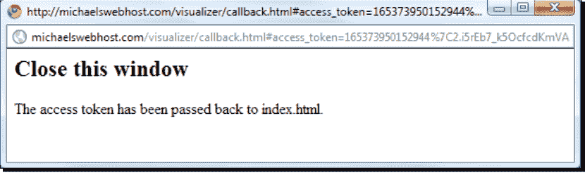

不过，目前这实际上是在“说谎”。访问令牌并没有传回，因为还没有 `setAccessToken()` 函数来接收它！

## 接收访问令牌

借助 `ExternalInterface`，我们可以让 `index.html` 中的 JavaScript 调用我们 SWF 内的 ActionScript 函数。

1. 我们来创建一个 ActionScript 函数，它接收哈希值并从中提取访问令牌。
2. 将这个新函数添加到 `HTTPRequestor.as` 中：

```
private function setAccessToken(a_hashValue:String):void
{
    var hashParams:Array = a_hashValue.substr(1).split("&");
    var hashKeyAndValue:Array;

    for (var i:int = 0; i < hashParams.length; i++)
    {
        hashKeyAndValue = (hashParams[i] as String).split("=");
        if (hashKeyAndValue[0] == "access_token")
        {
            this.accessToken = hashKeyAndValue[1];
            break;
        }
    }
    this.request(new GraphRequest("me"));
}
```

现在，将以下代码添加到你的 HTTPRequestor() 构造函数中：

```
public function HTTPRequestor(target: IEventDispatcher = null)
{
    //this is needed because the class extends EventDispatcher
    super(target);
    ExternalInterface.addCallback("setAccessToken", setAccessToken);

    ExternalInterface.call("function() {\n" +
        "window.setAccessToken = function(hashValue){\n" +
        "  var visualizer = document.getElementById('Visualizer');\n" +
        "  visualizer.setAccessToken(hashValue);\n" +
        "}\n" +
        "}");
}
```

突出显示的代码创建并调用了一个匿名函数，该函数包含我们真正想要调用的函数。这有点乱，但确实有效。

重新编译你的 SWF 并上传到你的主机。刷新 index.html。弹出窗口会显示，可能会提示你登录，然后重定向到“Close this window”页面。紧接着，你会看到下面这张截图：

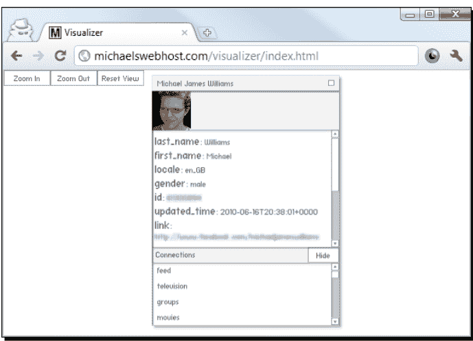

成功！

## 刚才发生了什么？

你刚刚为你的 Flash 应用添加了真正的 Facebook 身份验证。

用户直接在 Facebook 上登录，而不是通过你的应用，从而将安全风险降到最低。Facebook 将访问令牌传回你编写的回调页面，该页面再通过另一个网页将其传回你的 SWF，现在 SWF 就可以在请求 Graph API 数据时使用它了。

## 那些之前没有使用过该应用的用户呢？

我们还没有完整地测试身份验证，因为之前在浏览器中做实验时，我们已经授予了应用程序访问我们数据的权限。

幸运的是，撤销这一切非常容易，我们可以假装从未见过这个应用。登录 Facebook，点击 Account | Application Settings。在列表中找到你的应用程序，然后点击 X 按钮，如下面截图所示：

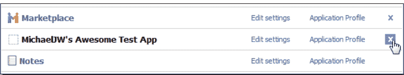

Facebook 会要求你确认此决定。（应用程序将保留在你的开发者页面，即使它会从你的应用页面中移除。）

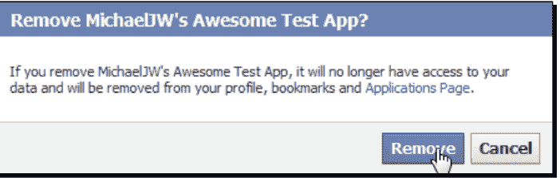

刷新 index.html。这一次，弹出窗口会请求获取你信息的权限：

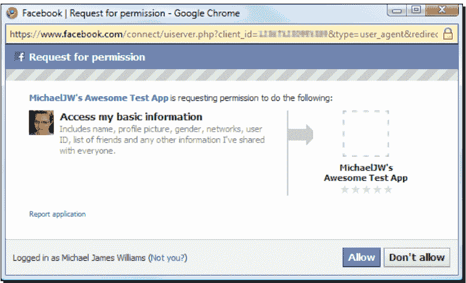

点击**允许**，弹出窗口就会被重定向到 callback.html，它会像之前一样将访问令牌传递给 visualizer。

## 小试牛刀——处理犹豫不决的用户

如果用户点击了**不允许**对话框呢？

目前，如果没有访问令牌，应用程序什么都不会做；它只是耐心地等待。如果弹出窗口出现时，用户没有点击**允许**——或者用户因为弹出窗口被拦截而没有看到它——应用程序就不会优雅地失败，而只是坐在那里一直等待。

为你的应用程序添加一些功能，让它能处理这类情况。也许它可以在几秒钟后弹出一条消息，提示“你需要登录 Facebook 并批准此应用程序才能使用它。”或者你也可以先加载一个不同的 Graph 对象，只在用户试图访问需要访问令牌的内容时才要求登录。

既然你的应用已经上线，你可以让别人通过访问 index.html 来查看它。找一些朋友来测试一下吧。

## 扩展权限

不过，我们目前还不能访问所有内容。在你的浏览器中，尝试加载 https://graph.facebook.com/me/inbox （将访问令牌作为一个参数传入）。你会收到以下消息：

```
{
  "error": {
    "type": "Exception",
    "message": "(#612) mailbox requires the read_mailbox extended permission."
  }
}
```

就像作为用户，你可以限制其他用户查看你 Facebook 个人资料的某些部分一样，你也可以通过 Graph API 限制某些应用访问特定信息。

在这个例子中，我们正以应用的身份尝试访问我的收件箱，但被告知没有权限。那么我们又该如何获得权限呢？

## 实践时刻——获取扩展权限

要请求超出基本范围的权限，其实非常容易：在调用授权 URL 时，额外传入一个名为 scope 的参数。

将 scope 参数的值设置为你想要请求的扩展权限的名称。例如，要请求访问用户的收件箱，请使用以下 URL：

```
https://graph.facebook.com/oauth/authorize?client_id=<your_application_id>&type=user_agent&redirect_uri=<your_callback_url>&scope=read_mailbox
```

在浏览器中尝试这个 URL，你会看到这个对话框：

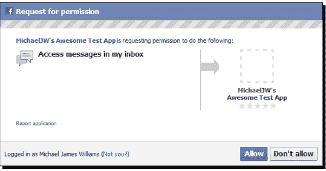


## 刚才发生了什么？

一旦用户点击“允许”（Allow），Facebook 就会记住该决定，你的应用将无需再次请求该权限——就像用户首次授权应用查看其基本信息时一样。

你可以一次请求多个扩展权限；只需用逗号将它们分隔开：

```
https://graph.facebook.com/oauth/authorize?client_id=<your_application_id>&type=user_agent&redirect_uri=<your_callback_url>&scope=read_mailbox,user_photos,user_interests
```

不过，扩展权限不仅仅与你有关。授予 `user_interests` 扩展权限后，应用可以访问用户的兴趣列表（当然，这些兴趣以 Graph 对象列表表示）；此外还有一个 `friends_interests` 扩展权限，允许应用访问用户所有好友的兴趣列表。

实际上，大多数扩展权限都有“仅用户”和“好友”两个版本；查看官方文档可了解所有权限的列表：http://developers.facebook.com/docs/authentication/permissions.

## 动手实践 – 请求扩展权限

要让应用始终请求 `user_interests` 扩展权限，我们只需将 `HTTPRequestor.attemptToAuthenticate()` 修改为：

```
public function attemptToAuthenticate():void as shown in the following code:
{
    ExternalInterface.call("window.open",
    "https://graph.facebook.com/oauth/authorize?
    client_id=<your_application_id>&type=user_agent&
    redirect_uri=<your_callback_url>"
    + "&scope=user_interests",
    "facebookLoginWindow",
    "height=370, width=600");
}
```

这样就能正常运行了；它会弹出一个窗口，询问你是否允许应用访问你的个人资料信息。

如果这就是你所需要的——而且以后也只需要这些——那么可以就此打住。但如果你希望让它更灵活一点呢？

首先，我们让 `attemptToAuthenticate()` 函数接受任意数量的扩展权限作为参数，并将它们以逗号分隔的列表形式追加到 `scope` 参数中：

```
public function attemptToAuthenticate(...permissions):void
{
    var scope:String = "";
    if (permissions.length > 0)
    {
        scope = "&scope=" + permissions.join(",");
    }
    ExternalInterface.call("window.open",
        "https://graph.facebook.com/oauth/authorize?client_id=165373950152944&type=user_agent&redirect_uri=http://gamedev.michaeljameswilliams.com/scrap/visualizer/callback.html"
        + scope,
        "facebookLoginWindow",
        "height=370, width=600");
}
```


> 将 `permissions` 作为函数的唯一参数，意味着我们可以向它传递任意数量的参数，它们会组成一个名为 `permissions` 的数组。（这被称为 `...`（rest）参数，如果你想进一步了解的话。）
>
> 然后，我们可以使用 `Array.join()` 方法将该数组中的所有字符串合并为单个字符串，形式为逗号分隔的列表。

我们必须修改 `IRequestor.as` 中方法的签名，以匹配我们对该函数所做的更改：

```
package graph.apis.base
{
    import flash.events.IEventDispatcher;
    import graph.GraphRequest;

    public interface IRequestor extends IEventDispatcher
    {
        function request(a_request:GraphRequest):void;
        function attemptToAuthenticate(...permissions):void;
    }
}
```

## 让我进去！

现在，我们只需将所需的扩展权限传递给该方法。在 `CustomGraphContainerController.as` 中，修改构造函数：

```
public function CustomGraphContainerController(a_graphControlContainer:GraphControlContainer)
{
    super(a_graphControlContainer);
    _requestor = new HTTPRequestor();
    addEventListenersToRequestor();
    _requestor.attemptToAuthenticate("friends_interests",
        "read_mailbox");
}
```

编译 SWF 并上传到你的主机。在浏览器中测试时，它会要求你授予这两项权限：

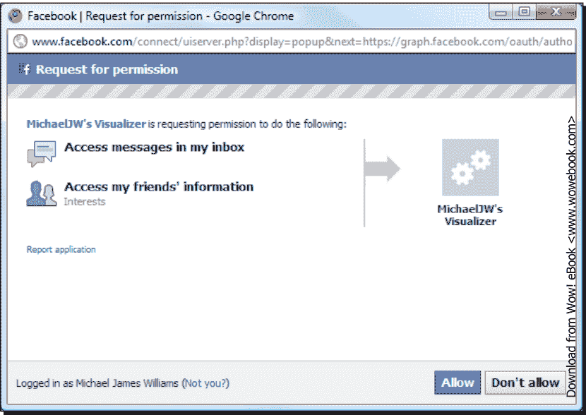

Visualizer 项目包含一个 `ExtendedPermissions.as` 类，旨在让这一过程更简单。它为每个扩展权限都定义了一个 `public static const`，并在注释中附带简短的功能说明。

## 动手实践 – 实现 SDK

SDK 源文件已下载并复制到 Visualizer 项目目录中；你可以在 `\src\com\facebook\` 下找到它们。（有关下载最新版 SDK 并将其包含到你自己的项目中的信息，请参阅第 1 章。）

我们将构建另一个 Requestor，不过这次它将由 SDK 驱动，而不是我们自己的 `URLRequest`。首先在 `\src\apis\` 中创建一个名为 `\sdk\` 的新文件夹。然后，在该文件夹中创建一个名为 `SDKRequestor.as` 的新文件。让它像 `HTTPRequestor` 一样继承 `EventDispatcher` 并实现 `IRequestor`。

以下是该类的基本代码：

```
package graph.apis.sdk
{
    import flash.events.EventDispatcher;
    import flash.events.IEventDispatcher;
    import graph.apis.base.IRequestor;
    import graph.GraphRequest;

    public class SDKRequestor extends EventDispatcher
        implements IRequestor
    {

        public function SDKRequestor(target:IEventDispatcher = null)
        {
            super(target);
        }

        public function request(a_request:GraphRequest):void
        {
        }

        public function attemptToAuthenticate(...permissions):void
        {
        }
    }
}
```

接下来，导入 `Facebook` 类。这是用于基于 Web 应用的 API：

```
import com.facebook.graph.Facebook;
```

在使用这个类之前，需要先对其进行初始化。为此，我们必须向它传递应用的 ID 和一个回调函数。请在 `SDKRequestor()` 构造函数中完成：

```
public function SDKRequestor(target:IEventDispatcher = null)
{
    super(target);

    Facebook.init("«your_application_id»", initComplete);
}
```

接下来，我们必须创建 `initComplete()` 函数，它会在初始化过程完成后被调用。请将以下代码添加到 `SDKRequestor.as` 中：

```
private function initComplete(success:Object, fail:Object):void
{
}
```

该函数需要这两个参数——`success` 和 `fail`——否则代码将无法编译。如果初始化没有问题，那么 `success` 将是一个 `com.Facebook.graph.data.FacebookSession` 类型的对象；否则，`success` 将为 `null`，而 `fail` 将包含详细信息。让我们用以下代码来处理：

```
private function initComplete(success:Object, fail:Object):void
{
    if (success is FacebookSession)
    {
        //was a success.
    }
    else
    {
        //was a failure. See contents of 'fail' object.
    }
}
```

你还必须导入 `FacebookSession`，如下所示：

```
import com.facebook.graph.data.FacebookSession;
```

我们让它准备就绪时派发一个 `COMPLETE` 事件，这样就能知道调用其他方法是安全的：

```
private function initComplete(success:Object, fail:Object):void
{
    if (success is FacebookSession)
    {
        dispatchEvent(new Event(Event.COMPLETE))
    }
    else
    {
        //was a failure. See contents of 'fail' object.
    }
}
```

为此，你必须导入 `flash.events.Event`，否则无法正常工作。

API 初始化完成后，我们可以使用 `Facebook.login()` 方法对用户进行身份验证。对该方法的调用应放在 `attemptToAuthenticate()` 中：

```
public function attemptToAuthenticate(...permissions):void
{
    Facebook.login(loginComplete);
}
```

这将弹出一个窗口，要求用户登录并允许我们的应用访问其个人资料。如果没有弹出窗口，请检查是否启用了 Cookie；否则将无法正常工作。

传给 `Facebook.login()` 的 `loginComplete` 参数是另一个回调函数，其形式与 `initComplete()` 相同，会在用户完成身份验证后被调用。请将其添加到 `SDKRequestor.as` 中：

```
private function loginComplete(success:Object, fail:Object):void
{
    if (success is FacebookSession)
    {
        //was a success.
    }
    else
    {
        //was a failure. See contents of 'fail' object.
    }
}
```


`requestComplete()` 回调所需的格式几乎与其它回调相同，如下面几行代码所示：

```
private function requestComplete(result:Object, fail:Object):void
{
    if (result != null)
    {
        //was a success.
    }
    else
    {
        //was a failure. See contents of 'fail' object.
    }
}
```

将它添加到 `SDKRequestor.as` 中。注意这次我们使用的是 `result` 参数而不是 `success` 参数（这其实并不重要，但名字更准确），而且它只是一个 `Object`，而不是 `FacebookSession` 的实例。

事实上，`result` 的形式与我们在 `HTTPRequestor.onGraphDataLoadComplete()` 中自己创建的 `decodedJSON` 对象完全相同。这意味着我们可以复制粘贴之前处理它的代码——就这么做：

```
private function requestComplete(result:Object, fail:Object):void
{
    if (result != null)
    {
        var decodedJSON:Object = result;
        if (decodedJSON.data)
        {
            var graphList:GraphList = new GraphList();
            var childGraphObject:GraphObject;
            for each (var childObject:Object in decodedJSON.data)
            {
                childGraphObject = new GraphObject();
                for (var childKey:String in childObject)
                {
                    childGraphObject[childKey] = childObject[childKey];
                }
                graphList.addToList(childGraphObject);
            }
            graphList.paging = decodedJSON.paging;
            graphList.ownerID = originalRequest.objectID;
            graphList.connectionType = originalRequest.connectionID;

            dispatchEvent(new RequestEvent(RequestEvent.REQUEST_COMPLETED,
                graphList));
        }
        else
        {
            var graphObject:GraphObject = new GraphObject();
            for (var key:String in decodedJSON)
            {
                graphObject[key] = decodedJSON[key];
            }

            dispatchEvent(new RequestEvent(RequestEvent.REQUEST_COMPLETED,
                graphObject));
        }
    }
    else
    {
        //was a failure. See contents of 'fail' object.
    }
}
```

你还需要以下导入：

```
import graph.GraphList;
import graph.GraphObject;
import events.RequestEvent;
```

这里有一个大问题。我们在代码中引用了 originalRequest，但我们没有任何办法获取原始的 GraphRequest 实例！

解决方案是使用一种叫做柯里化的编程技巧。这允许我们在发出请求时向回调函数传递额外的值。

> 如果你不明白柯里化是如何工作的，不用担心。我不会在这里解释它，因为它比较高级，而且与 Facebook 关系不大——使用它的代码是特定于 Visualizer 的。关于柯里化的优秀解释，请参阅 Jackson Dunstan 的文章：http://jacksondunstan.com/articles/338。


将 `request()` 函数改为：

```
public function request(a_request:GraphRequest):void
{
    var graphItem:String = "/" + a_request.objectID;
    if (a_request.connectionID)
    {
        graphItem += "/" + a_request.connectionID;
    }
    Facebook.api(graphItem, function(result:Object, fail:Object):void {
        requestComplete.call(this, result, fail, a_request); } );
}
```

现在，修改 `requestComplete()` 的签名以接受一个额外参数：

```
private function requestComplete(result:Object, fail:Object, originalRequest:GraphRequest):void
```

SDKRequestor 现在可以进行测试了。切换到 CustomGraphContainerController.as，并将其改为：

```
package controllers
{
    import flash.events.Event;
    import graph.apis.base.ExtendedPermissions;
    import graph.apis.http.HTTPRequestor;
    import graph.apis.sdk.SDKRequestor;
    import graph.GraphRequest;
    import ui.GraphControlContainer;

    public class CustomGraphContainerController extends GCCcontroller
    {
        public function CustomGraphContainerController
            (a_graphControlContainer:GraphControlContainer)
        {
            super(a_graphControlContainer);
            _requestor = new SDKRequestor();
            addEventListenersToRequestor();
            //we must wait for the SDK to initialize before we can do
            //anything else with it
            _requestor.addEventListener(Event.COMPLETE, onSDKInitialize);
        }

        private function onSDKInitialize(a_event:Event):void
        {
            _requestor.attemptToAuthenticate();
        }
    }
}
```

现在我们要做的就是创建一个包含 SWF 的 HTML 页面。我们不能使用到目前为止一直使用的标准 `index.html` 页面，因为 SDK 需要某些 JavaScript 函数才能工作。

Adobe 提供了一些 **wrapper** HTML 页面作为我们 SWF 的容器。其中一个页面 `sdkindex.html` 位于 `\bin\adobesdk\` 文件夹中，旁边有一个名为 `FBJSBridge.js` 的 JavaScript 文件。将 `sdkindex.html` 和 `FBJSBridge.js` 都复制到你的 `\bin\` 目录中。

在文本编辑器中打开 `sdkindex.html`，并找到以下行：

```
embedSWF("Visualizer.swf", "flashContent", "600", "300", "10.0");
```

将 `Visualizer.swf` 替换为你的 SWF 名称。

最后，将 `sdkindex.html`、`FBJSBridge.js` 和你的 SWF 上传到你的网络主机上的同一目录，如往常一样，并在网络浏览器中加载 `http://host.com/sdkindex.html`。

## What just happened?

你刚刚将官方的 Adobe ActionScript 3 SDK for Facebook Platform 添加到你的应用程序中，作为本章前面构建的类的替代方案。

SDK 的工作方式与我们的类非常相似，只是更加精致；它也使用 `URLRequest` 对象来检索数据，并将结果 JSON 解码为原生的 AS3 对象。

为了使 SDK 正常工作，它导入了两个包含 JavaScript 函数的 JS 文件，这些函数实际上驱动了 Facebook 登录和集成。这两个文件称为：`FBJSBridge.js`，包含在项目中；以及 `all.js`，从 Facebook 服务器加载。只要你的网页使用 SWFObject 并导入这些 JavaScript 文件，你就应该能够使用 SDK。

## Have a go hero – requesting extended permissions with the SDK

`Facebook.login()` 方法接受第二个参数：`options`，一个原生的 AS3 `Object`。它用于请求扩展权限；只需提供一个具有字符串属性 `perms` 的对象，该属性是权限的逗号分隔列表。

使用它来修改你的 `SDKRequestor.attemptToAuthenticate()` 方法，使其可以接受任意数量的扩展权限作为参数并使用 `Facebook.login()` 方法请求它们。

## Pop Quiz

- 1. What does "me" do?
  - a. Returns the authenticated user's ID
  - b. Stands in as the authenticated user's ID when used in a Graph URL.
  - c. It represents the ID of a Facebook user called Mike Eddington

- 2. Why didn't we obtain an access token using AS3 alone?
  - a. `URLRequest` objects can't load the Facebook login page
  - b. It's only possible to obtain a token using JavaScript
  - c. We wanted to present the user with a genuine Facebook login page, for trust reasons

- 3. Why shouldn't you ask for all the extended permissions your application might possibly need at once?
  - a. It's likely to scare users away
  - b. Only five permissions can be granted at any one time
  - c. This is a violation of the Facebook terms of service

## Summary

在本章中，关键词是安全、权限和身份验证。
我们学习了：

- Facebook 如何限制我们访问不应该访问的信息
- 用户如何决定哪些信息可以被其他用户（和应用）看到
- 应用如何请求查看用户更多信息的权限
- 用户和应用如何共同使用 Facebook 进行身份验证

## Key takeaways

- 如果你尝试在没有身份验证证明的情况下访问 Graph 对象，Graph API 只会提供关于某人的某些细节。
- 访问令牌是授权证明，与用户和应用程序相关联。
- 用户有两个凭证：电子邮件地址和密码。
- 应用程序有三个凭证：应用程序 ID（类似于用户名）、应用程序密钥（类似于密码，可以更改）和 API 密钥（用于访问 Graph API）。


## Time for action – displaying the number of objects in a list

打开你的 `Visualizer` 项目。我们将打开一个隐藏选项，使 List Renderer 窗口的标题包含 Graph List 中的项目数量。

- 1. 首先，让我们从 `SDKRequestor` 切回 `HTTPRequestor`。打开 `CustomGraphContainerController.as` 并更改创建新 Requestor 的那一行：

```
public function CustomGraphContainerController(a_graphControlContainer:GraphControlContainer)
{
    super(a_graphControlContainer);
    _requestor = new HTTPRequestor();
    addEventListenersToRequestor();
    //we must wait for the Requestor to initialise before we can do anything else with it
    _requestor.addEventListener(Event.COMPLETE, onRequestorInitialize);
}
```

我们将在本章后面再回到 SDK Requestor。

- 2. 有一个小问题：这个类正在等待 Requestor 分发 `COMPLETE` 事件，表明它已完成初始化，但我们的 `HTTPRequestor` 并没有这样做。我们可以移除事件监听器，但修改 Requestor 会更容易；打开 `HTTPRequestor.as`，并添加一个新函数：

```
public function initialize():void
{
    dispatchEvent(new Event(Event.COMPLETE));
}
```

- 3. 也修改 `SDKRequestor.as`，将对 `Facebook.init()` 的调用从构造函数函数移动到新的函数 `initialize()`：

```
public function SDKRequestor(target:IEventDispatcher = null)
{
    super(target);
    //Facebook.init("165373950152944", initComplete);
}

public function initialize():void
{
    Facebook.init("165373950152944", initComplete);
}
```

- 4. 将 initialize() 函数添加到 IRequestor.as 接口中：

```
package graph.apis.base
{
    import flash.events.IEventDispatcher;
    import graph.GraphRequest;

    public interface IRequestor extends IEventDispatcher
    {
        function request(a_request:GraphRequest):void;
        function attemptToAuthenticate(...permissions):void;
        function initialize():void;
    }
}
```

- 5. 最后，在 CustomGraphContainerController.as 的构造函数中添加对这个新的 initialize() 函数的调用：

```
public function CustomGraphContainerController(a_graphControlContainer:GraphControlContainer)
{
    super(a_graphControlContainer);
    _requestor = new HTTPRequestor();
    addEventListenersToRequestor();
    //we must wait for the Requestor to initialise before we can do anything else with it
    _requestor.addEventListener(Event.COMPLETE, onRequestorInitialize);
    _requestor.initialize();
}
```

这会更改项目其他地方的一个设置，进而指示新的 Graph List Renderer 在渲染器窗口的标题中显示其 Graph Objects 的总数。你无需理解其工作原理；可以说它使用了适当 GraphList 实例内部的列表数组的 length 属性。

- 8. 重新编译 SWF 并加载相同的连接：

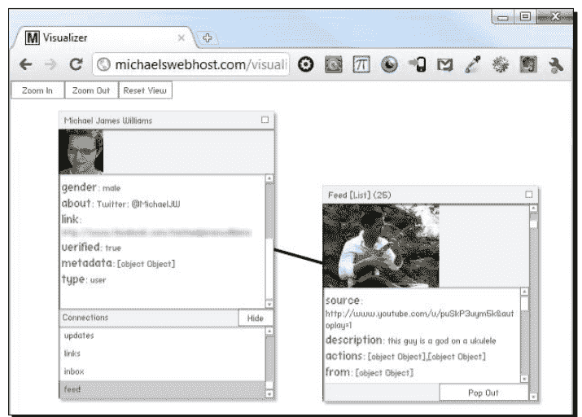

## What just happened?

我们现在可以看到我个人资料的 feed 连接返回的 Graph List 中有多少个对象：25。但自然地，我加入 Facebook 以来发布的动态更新远不止 25 条。发生了什么？进一步探索显示，25 似乎是请求列表时返回项目的默认最大数量。有时你会得到更少的结果，即使相册或 feed 中有超过 25 个对象。

对于新闻 feed 来说，这可能没问题，因为只有最近的条目才相关，但对于相册来说却是无用的；自然地，你希望看到所有照片。

我们如何让 Facebook 给我们更多对象？

## What just happened?

发生了四种可能的情况之一：

- 1. 你的 SWF 变得很慢并最终崩溃
- 2. 没有数据传到 SWF
- 3. SWF 渲染了一个新的列表，但其中不包含 5,000 个对象
- 4. SWF 渲染了一个包含 5,000 个对象的新列表

很难预测你会看到哪种结果。以前，Graph API 甚至无法处理一次请求 500 个对象 – 它会超时并返回一个完全空白的页面，甚至没有空的 JSON 或错误消息。

最近情况有了巨大改善；似乎 Facebook 会一次性返回尽可能多的对象，直到包括你指定的 `limit` 数量。如果有任何问题，更可能是你的代码处理数据花费时间过长，而不是 Facebook 超时。

这意味着，在很多实际情况下，你可以请求列表中大量对象并获得所需的一切。但这很粗糙。让我们来看一个替代方案。

## Paging

与其一次性请求例如 250 个对象，我们可以让列表分成几个页面，每个页面包含较少数量的对象。

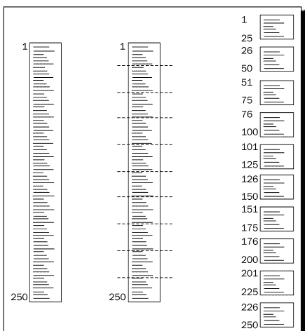

我们应该能够看到 feed 中第 301 – 325 条帖子。试试看。写作时的结果如下：

```
{
  "data": [

  ]
}
```

等等，什么？

## What just happened?

Graph API 对可以从用户或页面的流和状态更新中检索的内容有限制，其中包括其 feed 连接。官方文档说这些连接仅限于最近 30 天或 50 条帖子，以较大者为准。

这并不是 limit-offset 参数的唯一问题。尝试加载此 URL：

```
https://graph.facebook.com/facebook/feed?offset=2&limit=1
```

...你会得到与之前相同的空 JSON – 但加载此 URL：

```
https://graph.facebook.com/facebook/feed?offset=2&limit=4
```

...你会收到恰好一个结果。然而，你可以将 limit 设置为 6 而不会收到任何额外对象！

这毫无意义。越深入研究，越显得不合逻辑。

这是一个持续存在的问题；如果你想跟上该领域所做的任何更改，请订阅此链接上的官方 Facebook Bug Tracker 线程：

```
http://bugs.developers.facebook.net/show_bug.cgi?id=10576
```

> 当然，很有可能等你读到这本书时，这些问题已经得到解决。那样的话，恭喜你！

尽管如此，我们可以看到 limit 和 offset 对于其他连接是如何工作的。

## What just happened?

我们现在已将 `limit-offset` 分页功能添加到我们两个 Requestor 中：我们从头构建的 HTTP Requestor，以及基于官方 SDK 的 SDK Requestor。

要测试这一点，在 `CustomGraphContainerController.as` 中创建一个新的 `GraphRequest` 实例，在当前 Requestor 初始化后使用：

```
private function onRequestorInitialize(a_event:Event):void
{
    _requestor.attemptToAuthenticate(ExtendedPermissions.READ_STREAM);
    var testRequest:GraphRequest = new GraphRequest("me", "likes");
    testRequest.limit = 20;
    testRequest.offset = 50;
    _requestor.request(testRequest);
}
```

不要忘记用两个 Requestor 都测试它！

## Date-Based filtering

你是否注意到上面概述的分页系统存在任何潜在问题（除了目前按预期工作不正常之外）？

对于获取某个特别受欢迎的帖子的评论列表呢？

假设你希望获取帖子的 100 条最新评论，并且需要使用分页来实现。你请求评论 1-25、26-50，然后是 51-75。然而，在这时，其他人发布了一条评论，被添加为新的 #1。旧的 #1 变成新的 #2，旧的 #2 变成新的 #3，依此类推，因此当你请求 76-100 时，你实际上收到了评论 #76 两次 – 几秒钟前它是 #75！

更糟的是，你现在没有新的评论 #1。因此，你可以尝试按相反顺序获取页面：76-100、51-75，然后是 26-50。这次，如果添加了一条新评论作为 #1，旧的 #25 变成 #26。但你现在请求评论 1-25；旧的 #25 没有进入你的列表，所以出现了空白。这甚至还没提到如果删除了一条评论会发生什么。

现实中，这些并不是大问题；它们只是说明 `limit-offset` 分页方法并不完美。作为替代方案，我们可以根据时间和日期对数据进行分页。


