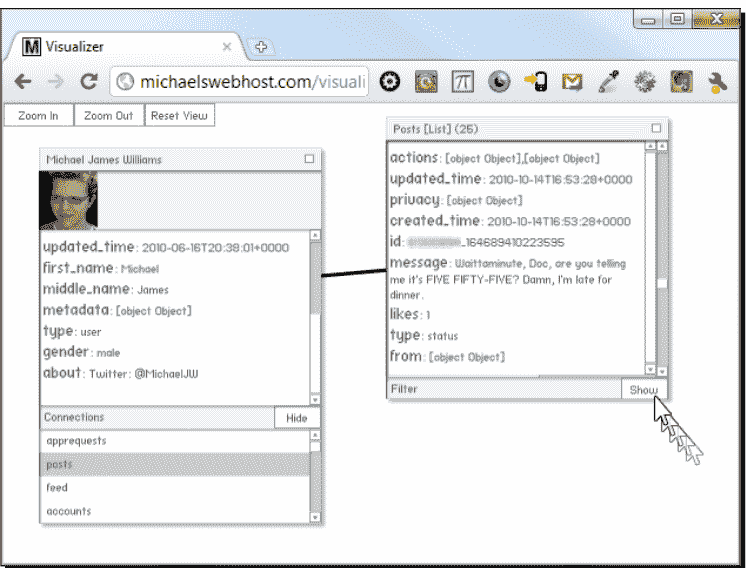
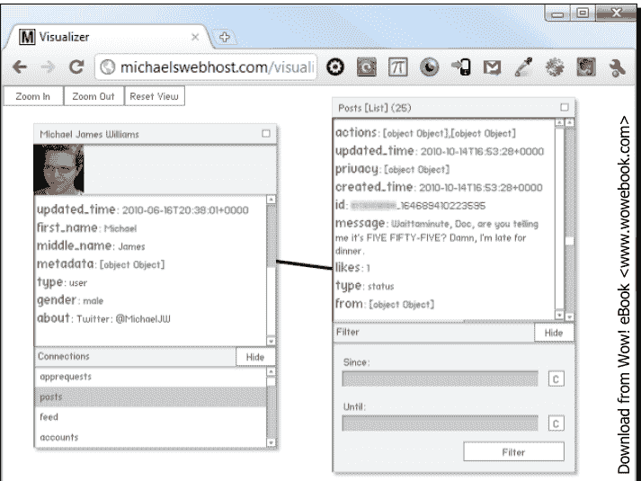
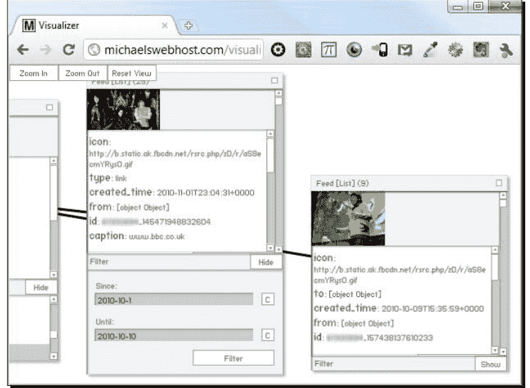
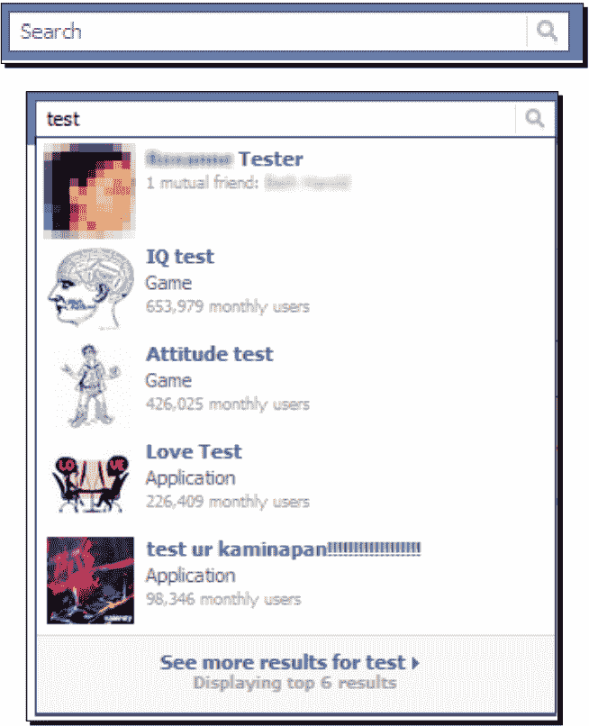
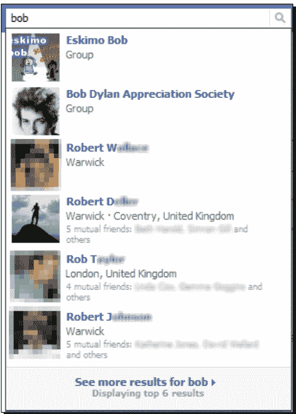

## 深入挖掘图

另外，请注意，“30天或50条帖子”的限制似乎在这里不适用，因为这篇帖子比一年还要老，而此后发布的帖子远不止50条。

不幸的是，这就是使用 Graph URL 分页时的情况，至少目前是这样。有时它按预期工作，但有时它会表现出奇怪而神秘的行为，正如我们所见的。同样，很可能等你读到本文时所有问题都已解决——但以防万一没有，在围绕 Graph URL 分页设计项目时请谨慎。

**在它能正常工作的情况**下，`until` 参数可以接受多种不同的日期格式：

- 31march2009
- May-4th-2010
- 2010-12-25
- Yesterday
- First Monday of September 2009
- 12 days ago
- -7 weekdays

你也可以指定时间：

- 31march2009 15:10
- May-4th-2010 noon
- 2010-12-25T08:00:00
- 12 days ago 8pm
- Today 7:30AM

完整的格式列表可在以下地址找到： http://www.php.net/manual/en/datetime.formats.php。

> **记住：** URL 不喜欢 + 等字符（甚至空格也不行），所以在将 URL 传递给 URLRequest 之前，请务必对其进行编码。你可以使用 AS3 内置的 `escape()` 方法来实现：
>
> ```
> var urlEncodedString:String = escape(unencodedURL);
> ```
>
> 有关更多信息，请查看 escape() 的 LiveDocs 页面：
> http://www.adobe.com/livedocs/flash/9.0/ActionScriptLangRefV3/package.html#escape()。

因此，`until` 参数让我们可以指定按其过滤数据的最新日期和时间；它还有一个姐妹参数让我们可以指定最早的日期：`since`。它以完全相同的方式工作，并允许完全相同的日期和时间格式。

> 要请求 Facebook 页面从 2010 年 4 月 21 日（Graph API 发布的日子）开始的帖子，我们将使用此 URL：
> `https://graph.facebook.com/facebook/photos?since=21april2010T00:00:01&until=21april2010T23:59:59`
>
> 如果当天有超过 25 条帖子，那么我们甚至可以在 `since` 和 `until` 旁边使用 `offset` 和 `limit` 来将该列表拆分为更小的页面。
>
> 该确切的 URL 不会返回任何数据（因为它已超过 30 天），但此示例展示了你必须使用的格式。

好了，让我们将其集成到我们的应用程序中。

### 行动时间 – 为 GraphRequest 实例添加 since 和 until

允许我们对 `GraphRequest` 实例使用 `since-until` 的过程几乎与允许我们使用 `limit-offset` 的过程相同。

1. 按以下代码所示向 `GraphRequest.as` 添加 `since` 和 `until` 字符串属性：

   ```
   package graph
   {
       public class GraphRequest
       {
           public var objectID:String = "";
           public var connectionID:String = "";
           public var limit:int = 25;
           public var offset:int = 0;
           public var since:String = "";
           public var until:String = "";

           public function GraphRequest(a_objectID:String = "",
               a_connectionID:String = "")
           {
               this.objectID = a_objectID;
               this.connectionID = a_connectionID;
           }
       }
   }
   ```

2. 在 `HTTPRequestor.as` 中，根据这些新字符串设置 URLVariables 对象的属性：

   ```
   public function request(a_request:GraphRequest):void
   {
       var loader:URLLoader = new URLLoader();
       var urlRequest:URLRequest = new URLRequest();
       var variables:URLVariables = new URLVariables();

       //We construct a URL from the parameters of the GraphRequest
       urlRequest.url = "https://graph.facebook.com/" +
           a_request.objectID;
       if (a_request.connectionID)
       {
           //remember, this means a connection (and thus a list)
           //was requested
           urlRequest.url += "/" + a_request.connectionID;
       }

       variables.metadata = 1;
       variables.limit = a_request.limit;
       variables.offset = a_request.offset;
       variables.since = a_request.since;
       variables.until = a_request.until;
       if (accessToken != "")
       {
           variables.access_token = accessToken;
       }
       urlRequest.data = variables;

       //this is used to figure out which GraphRequest created the
       //loader later
       _requests[loader] = a_request;

       loader.addEventListener(Event.COMPLETE,
           onGraphDataLoadComplete);
       loader.addEventListener(IOErrorEvent.IO_ERROR, onIOError);
       loader.load(urlRequest);
   }
   ```

3. 修改 `SDKRequestor.as` 中 `request()` 函数内传递给 `Facebook.api()` 方法的第三个参数：

   ```
   public function request(a_request:GraphRequest):void
   {
       this._showListFilters = true;

       _requestor = new HTTPRequestor();
       addEventListenersToRequestor();
       //we must wait for the Requestor to initialise before we can do
       //anything else with it
       _requestor.addEventListener(Event.COMPLETE,
           onRequestorInitialize);

       _requestor.initialize();
   }
   ```

4. 保存、编译并上传你的项目，然后打开任何连接以创建列表渲染器。 （如果结果不多，请删除 `onRequestorInitialize()` 中设置特定 `since-until` 或 `limit-offset` 值的行。）

   

5. 点击上一个屏幕截图中所示的新过滤栏上的显示按钮。

   

6. 此新面板允许你输入用于 `since-until` 过滤的日期。

7. 在框中输入任何日期和时间，或使用 C 按钮调出日历控件以代替使用。

8. 当用户在此面板中点击过滤按钮时，它会调用 `CustomGraphContainerController` 扩展的类中的受保护函数 `listFilterCallback()`，并将输入的日期和列表渲染器所代表的 Graph 对象和连接的 ID 传递给它。

这意味着 `CustomGraphContainerController` 继承了该函数，因此我们可以让它使用这些日期为此 Graph 对象和连接创建一个新的 `GraphRequest`。

9. 因此，打开 `CustomGraphContainerController.as` 并重写该函数：

   ```
   override protected function listFilterCallback(a_objectID:String, a_connectionType:String, a_since:String, a_until:String):void
   {
       super.listFilterCallback(a_objectID, a_connectionType, a_since, a_until);
   }
   ```

继承的函数只是一个存根——它什么也不做。

10. 现在，使用参数中传递的信息创建并使用一个新的 `GraphRequest`：

    ```
    override protected function listFilterCallback(a_objectID:String, a_connectionType:String, a_since:String, a_until:String):void
    {
        super.listFilterCallback(a_objectID, a_connectionType, a_since, a_until);
        var filterRequest:GraphRequest = new GraphRequest(a_objectID, a_connectionType);
        filterRequest.since = a_since;
        filterRequest.until = a_until;
        _requestor.request(filterRequest);
    }
    ```

11. 编译并上传 SWF，然后通过在过滤面板中输入两个日期并点击过滤按钮来测试更改。

### 发生了什么？



```
"picture": "http://photos-c.ak.fbcdn.net/hphotos-ak-snc3/hs185.snc3/19239_307944374458_204603129458_4527791_8102041_s.jpg",
"source": "http://sphotos.ak.fbcdn.net/hphotos-ak-snc3/hs185.snc3/19239_307944374458_204603129458_4527791_8102041_n.jpg",
"height": 666,
"width": 540,
"link": "http://www.facebook.com/photo.php?pid=4527791&id=204603129458",
"icon": "http://static.ak.fbcdn.net/rsrc.php/z2E5Y/hash/8as8iqdm.gif",
"created_time": "2010-02-04T12:40:07+0000",
"updated_time": "2010-03-18T16:08:42+0000"
}
],
"paging": {
"previous": "https://graph.facebook.com/307932939458/photos?limit=25&since=2010-03-18T16%3A00%3A38%2B0000",
"next": "https://graph.facebook.com/307932939458/photos?limit=25&until=2010-02-04T12%3A40%3A06%2B0000"
}
}
```

看到那个名为 `paging` 的节点了吗？它显然包含两个 URL，尽管它们似乎在末尾附加了一些乱码。实际上，这不是乱码；它只是 URL 编码。以下是解码后的上一个 URL 的样子：

```
https://graph.facebook.com/307932939458/photos?limit=25&since=2010-03-18T16:00:38+0000
```

它显然是一个带时间戳的日期，传递给 `since` 参数，就像我们使用的一样。

Facebook 提供这些作为比本章前面探索的基于 offset/limit 的分页更容易的替代方案。基于时间的分页比基于列表中项目位置的分页更有意义（正如我们之前探索的那样），因为项目创建的日期和时间永远不会改变，而项目在列表中的位置会在向该列表添加新项目时发生变化。

确实，项目被删除可能会导致问题：如果我们已经下载了该项目，则可能无法检测到它已消失，导致我们的数据不正确。即使我们进行二次检查并将其删除，它也会留下空白，导致曾经包含它的页面比其他页面更短。这些是否是严重问题取决于应用程序。


由于这些分页链接与 JSON 一起打包，因此与基于 `limit` 和 `offset` 参数自行设计系统相比，它们通常更容易实现。在我们的例子中这并不完全正确，因为我们必须从 `next` 和 `previous` URL 中提取 `since` 和 `until` 参数，然后将它们传递给 `GraphRequest` 对象——提取集合中最早和最晚的 Graph 对象日期并使用它们会更容易。

尽管如此，这在你未来从事的其他项目中可能会派上用场，因此值得一提。

## 一次请求多个 ID

本章前面我们学习了如何检索特定日期范围内的一系列墙贴。如何获取撰写这些帖子的人的基本信息？

根据迄今为止所见，显而易见的答案是遍历所有人的所有 ID，并为每个 ID 请求 User 对象。

这样做是可以的，但有点笨拙，而且我们无法将这些人相互关联。难道不希望我们能一次性在一个列表中全部获取吗？

### 动手时间 – 在 Graph URL 中使用 ids 参数

在浏览器中加载以下 URL：

```
https://graph.facebook.com/?ids=facebook,packtpub
{
  "facebook": {
    "id": "20531316728",
    "name": "Facebook",
    "picture": "http://profile.ak.fbcdn.net/hprofile-ak-snc4/hs624.ash1/27535_20531316728_5553_s.jpg",
    "link": "http://www.facebook.com/facebook",
    "category": "Technology",
    "username": "facebook",
    "founded": "February 4, 2004",
    "company_overview": "«overview»",
    "mission": "Facebook's mission is to give people the power to share and make the world more open and connected.",
    "fan_count": 12672143
  },
  "packtpub": {
    "id": "204603129458",
    "name": "Packt Publishing",
    "picture": "http://profile.ak.fbcdn.net/hprofile-ak-snc4/hs302.ash1/23274_204603129458_7460_s.jpg",
    "link": "http://www.facebook.com/PacktPub",
    "category": "Products_other",
    "username": "PacktPub",
    "company_overview": "«overview»",
    "fan_count": 437
  }
}
```

### 发生了什么？

我们一次性将两个 Page 的 ID 传递给 Graph，使用 ids 参数，它返回了一个包含两者基本信息的 JSON。

所以这是一个列表，对吧？

错了！

好吧，根据我们迄今为止使用的定义，它不是一个列表，因为没有 data 节点。我称之为复合对象。将其与直接请求 Facebook Page 时得到的结果进行比较：

```
https://graph.facebook.com/facebook
{
  "id": "20531316728",
  "name": "Facebook",
  "picture": "http://profile.ak.fbcdn.net/hprofile-ak-snc4/hs624.ash1/27535_20531316728_5553_s.jpg",
  "link": "http://www.facebook.com/facebook",
  "category": "Technology",
  "username": "facebook",
  "founded": "February 4, 2004",
  "company_overview": "«overview»",
  "mission": "Facebook's mission is to give people the power to share and make the world more open and connected.",
  "fan_count": 12672338
}
```

你可以看到，当一次性请求多个 Graph 对象时，这些对象会被挤压成单个对象的子节点，每个节点都以其 ID 标记。

自然地，你不必使用 Page ID；你可以使用 Graph 中任何对象的 ID，包括相册、照片和用户。更重要的是，你可以混合请求 ID 的类型，因此你可以同时请求一个事件、三个用户和十几张照片，它们会以相同的 JSON 返回。

### 试试英雄 – 基于列表结果创建复合对象

重温我们之前看到的内容——查找在你上次生日时在你墙上发帖的人——但这次，请求并渲染一个包含所有这些 User 对象的复合对象。

这是一个很大的挑战：最好的做法不是在 Visualizer 本身内部完成，而是在一个全新的项目内部完成。你能从头创建一个可以做到这一点的项目吗？自然地，你可以重用 Visualizer 中的任何有用类，比如 Requestors 和 ExtendedPermissions 类。

## 总结

分页意味着将长数据集合拆分为多个较小的组件，称为页面。不要将这种类型的页面与 Facebook 页面对象或网页混淆。

- 页面中的记录数可以使用名为 `limit` 的参数设置。`limit` 的默认值是 25。
- `offset` 参数可用于指定应返回的集合中的第一个对象。`offset` 的默认值是 0。
- 页面可以通过组合 `offset` 和 `limit` 参数来定义——尽管在撰写本文时 Graph API 在这一点上有点不稳定。
- `since` 和 `until` 参数将 Graph 列表过滤到指定的日期和时间范围。
- 日期和时间可以用多种格式书写；请参阅 http://www.php.net/manual/en/datetime.formats.php 获取完整列表。
- 四个参数——`limit`、`offset`、`since` 和 `until`——可以同时一起使用。
- 要通过 Graph URL 指定这些参数，只需将它们作为 URL 参数传递，或使用 AS3 `URLVariables` 类的实例。
- 要通过 SDK 指定这些参数，将它们作为对象的属性包含在内，作为传递给 `Facebook.api()` 函数的第三个参数。
- 作为 JSON 对象返回的 Graph 列表有一个名为 `paging` 的属性，其中包含下一页和上一页数据的 URL。这些 URL 使用 `since-until` 分页，而不是 `limit-offset`。
- 可以使用以下格式的 Graph URL 获得 **复合对象**：`https://graph.facebook.com/?ids=id1,id2,id3,...`。它包含多个对象，其 JSON 格式与 Graph 列表类似，但没有 `data` 节点。

我们已经学习了如何深入挖掘 Graph，揭示我们已知其 ID 的 Graph 对象和连接的更多信息，但如果要根据其内容而不是其 ID 来查找 Graph 对象呢？在下一章中，我们将学习如何搜索 Graph 来做到这一点。

## 快速测验

1. 为什么 Facebook 默认将 Graph 列表拆分为页面，而不是在每次请求时一次性提供所有数据？
   a. Facebook 仅在数据银行中保留最近一周的信息
   b. 这是在访问速度和提供的信息量之间的一种折中
   c. 隐私问题
2. 参数 `limit`、`offset`、`since` 和 `until` 有什么作用？
   a. 允许你缩小从集合返回的结果范围
   b. 在特定时间段内限制用户对 Graph 对象的访问
3. 在分页时，为什么使用 Graph 列表 JSON 对象中的“next”和“previous”URL 比使用 `limit` 和 `offset` 构建自己的 URL 更好？
   a. 基于日期的分页可以更精细地控制要请求的帖子
   b. 基于日期的分页意味着 Graph 对象不会在页面之间遗漏
   c. 基于日期的分页意味着如果在分页期间创建或删除 Graph 对象，也不会遗漏

## 动手时间 – 检查快速搜索结果

在浏览器中登录 Facebook，在页面顶部的搜索栏中输入“test”，看看下拉列表中出现了什么：



现在试试一个名字：



### 发生了什么？

Facebook 对名字使用智能搜索；注意当我输入“bob”时，它找到了包含“Bob”、“Rob”和“Robert”的结果。同样，如果你搜索“Jim”，它会找到“James”。

（这可能会让人困惑；我花了很长时间挠头试图弄明白为什么搜索“Liz”会列出我的朋友 Beth——她的名字并不是 Elizabeth 的简称！）

这不是通配符搜索。搜索“obert”不会找到名为“Robert”的人。

从我的结果可以看出，搜索结果包括群组、应用程序和游戏，与其他用户混合在一起。如果我选择了不同的搜索词，搜索也可能找到事件和页面。


