# Search Me

除了智能名称识别搜索外，Facebook 还使用智能排序来排列列表，排名结果以便首先向你展示你最有可能查找的内容：你点赞的页面和群组排名更高，你在宾客名单上的活动排名也更高，以及你添加的应用程序和游戏排名也更高。Facebook 还会检查一些事情来判断你可能在寻找哪些人：

- ◆ 你是否已经是该人的朋友？
- ◆ 你们是否有很多共同朋友？
- ◆ 你们是否生活在同一地区？
- ◆ 你们是否在同一网络中（大学、学校、工作场所）？

这样，大多数情况下，你会在短的下拉结果列表中找到你正在寻找的人或对象。但如果没有，你就需要去进行完整搜索。

## Time for action – Using the Full Search results

在搜索框中输入查询，然后点击放大镜图标或下拉列表底部的“查看更多结果”项目即可进入完整搜索页面：


下一张截图中显示了完整页面：

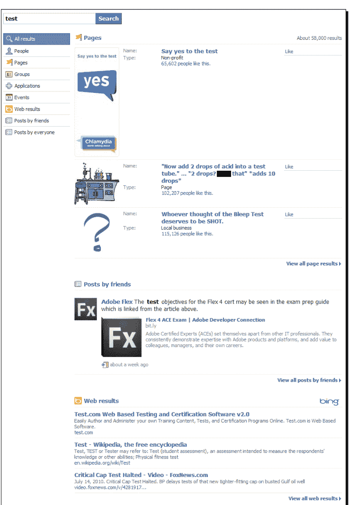

（另外，请注意，这些列表允许你翻页查看结果。）

第四，左侧的选项包括一些在下拉列表中不会出现的对象类型：

- ♦ Web results (powered by Bing) – 本质上是 Facebook 网站内部的搜索引擎前端
- ♦ Posts by friends – 墙帖、笔记、链接、视频、照片和状态
- ♦ Posts by everyone – 仅墙帖、笔记、链接和状态

最后，你可以更改这些搜索的许多子选项：按地区或位置缩小帖子范围；按学校或工作场所筛选人员；查找今天、明天、本周或本月发生的活动，等等。

## What just happened?

这一切都相当直接。这里唯一令人困惑的一点是：为什么完整搜索的顶部结果与快速搜索的不匹配？

（我搜索了“Liz”，快速搜索将我的朋友 Beth 列在首位，我的朋友 Elizabeth 列在第二位；当我进行完整搜索时，在“全部结果”标签中两者都没有出现，只有 Beth 出现在“人物”结果中——Elizabeth 完全不见了！）

当然，不同页面使用不同的搜索算法并不令人意外，但它们差异如此之大就说不通了。由于我们目前只是在查看网站本身，这并不重要——不过，当我们通过 Graph API 进行搜索时，我们会遇到类似的问题，而这正是我们接下来要做的。

## Searching with a Graph URL

你知道它要来了。

我们将首先搜索公众可见的 Graph 对象。

## Time for action – searching without authorization

基本的搜索查询 Graph URL 为：

```
https://graph.facebook.com/search?type=«type»&q=«query»
```

type 参数让你可以选择一个选项（与完整搜索左侧相同），而 q（查询）指定搜索词。

## 教材简析

《祖父的园子》是统编版语文五年级下册第一单元的一篇课文，节选自萧红的自传体小说《呼兰河传》。课文以第一人称叙述，描写了作者童年时代在祖父园子里的快乐生活，展现了祖父的慈爱与宽容，表达了作者对童年生活的怀念和对自由的向往。

## 学情分析

五年级学生已具备一定的阅读理解能力，能够初步把握文章主要内容，体会文章表达的思想感情。但对作者借助具体事物表达情感、运用拟人、排比等修辞手法表情达意的方法还缺乏深入的体会，需要教师引导品读感悟。

## 教学目标

- 1. 认识“蚱、啃”等生字，会写“蝴、蝶”等生字，正确读写“蝴蝶、蜻蜓、蚂蚱”等词语。
- 2. 正确、流利、有感情地朗读课文，了解课文内容。
- 3. 抓住重点语句，体会作者在园子里的快乐与自由，感受祖父的慈爱。
- 4. 学习作者留心观察、借助具体事物表达情感的写作方法。

## 教学重难点

重点：抓住重点语句，体会作者在园子里的快乐与自由，感受祖父的慈爱。
难点：学习作者留心观察、借助具体事物表达情感的写作方法。

## Differences

然而，即使经过身份验证，通过 Graph URL 搜索获得的结果也不总是与完整搜索中看到的结果匹配。当查找人员时尤其如此；默认情况下，所有应用都可以访问经过身份验证用户的朋友姓名和 ID，但其他信息可能被隐藏。

例如，通过在用户搜索中输入电子邮件地址作为查询，我们可以找到拥有该确切电子邮件地址的任何人——除非他们在隐私设置中注明不希望该信息对其他应用可用。（另请参阅“帐户 | 隐私设置 | 应用和网站 | 通过你的朋友可访问的信息”中的选项，如第三章所述。）

有时这会完全排除特定结果；有时会使相同的结果出现，但顺序不同。记住这一点进行测试：如果通过你的应用搜索获得的结果与通过网站搜索获得的结果不同，这并不一定意味着你的应用存在错误。

## Restrictions

与完整搜索相比，通过 Graph URL 搜索时可用的子选项非常有限。我们无法按位置或学校筛选用户，按类型筛选群组，或按日期筛选活动（即使使用 since/until 分页）。

我们也不能将帖子限制为特定语言，这使得它们比可能的情况要没用得多（正如我们在搜索“Packt”，一个常见的德语词时所看到的）。但我们可以做类似的事情。

有一个名为 locale 的参数，它接受诸如“en_US”（美国英语）和“fr_FR”（法语）之类的语言。这可以用两种方式使用。

首先，我们可以用它来转换接收到的信息。例如，这里是 Facebook CTO Bret Taylor 的用户对象：

```
https://graph.facebook.com/btaylor
{
  "id": "220439",
  "name": "Bret Taylor",
  "first_name": "Bret",
  "last_name": "Taylor",
  "link": "http://www.facebook.com/btaylor",
  "gender": "male",
  "locale": "en_US"
}
```

在下一个代码片段中，我们将用户对象的 locale 设置为法语：

```
https://graph.facebook.com/btaylor?locale=fr_FR
{
  "id": "220439",
  "name": "Bret Taylor",
  "first_name": "Bret",
  "last_name": "Taylor",
  "link": "http://www.facebook.com/btaylor",
  "gender": "homme",
  "locale": "en_US"
}
```

几乎没有什么变化——除了 gender 的值，从 male 变成了 homme。这在你需要以不同语言提供基本信息，而无需聘请翻译时很有用。

其次，请注意 Bret 的 locale 设置为 en_US。所有用户都有一个 locale；它可以在“帐户 | 语言”中设置，并定义你查看 Facebook 网站的语言。我们可以使用以下 Graph URL 将帖子搜索结果过滤为仅显示具有特定 locale 的用户的帖子：

```
https://graph.facebook.com/search?type=post&q=test&locale=fr_FR
```

这与按指定语言搜索帖子并不完全相同——因此我们无法消除所有使用“Packt”作为德语句子一部分的结果——但很接近。而这正是我们可以在完整搜索中的帖子搜索中设置的子选项。

完整的本地化列表可在 http://www.facebook.com/translations/FacebookLocales.xml 获取。

示例如下：

```
<?xml version='1.0'?>
<locales>
  <locale>
    <englishName>Catalan</englishName>
    <codes>
      <code>
        <standard>
          <name>FB</name>
          <representation>ca_ES</representation>
        </standard>
      </code>
    </codes>
  </locale>
</locales>
```

其中有一些奇怪的选择，比如英语（倒着写），所以请自行查看。

## Time for action – implementing a Search window in the Visualizer

好吧，现在我们知道了 Graph URL 搜索可以做什么，让我们在应用中使用它。

Visualizer 项目包含一个用于搜索 Graph 的窗口，其中包含 UI 元素。它是隐藏的，但我们可以以与在列表渲染器上启用过滤面板相同的方式启用它。

加载 Visualizer 项目并打开 CustomGraphContainerController.as。在构造函数函数中，将 _canShowSearchUI 属性（继承自 CustomGraphContainerController 扩展的类）设置为 true：

```
public function CustomGraphContainerController
(a_graphControlContainer:GraphControlContainer)
{
    super(a_graphControlContainer);
    this._showListCounts = true;
    this._showListFilters = true;
    this._canShowSearchUI = true;
    _requestor = new HTTPRequestor();
    addEventListenersToRequestor();
    //we must wait for the Requestor to initialise before we can do
    //anything else with it
    _requestor.addEventListener(Event.COMPLETE, onRequestorInitialize);
    _requestor.initialize();
}
```

编译项目，将 SWF 上传到你的网络主机，并使用常规 URL 在浏览器中加载它。结果显示在下一张截图中：

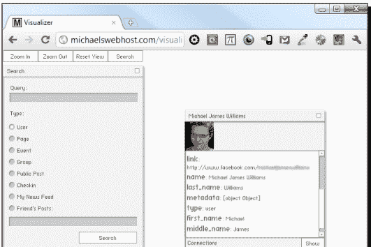


可以看到，左上角新增了一个**搜索**按钮，点击后主舞台区域会显示新的**搜索**窗口。你会注意到前六个单选按钮对应`type`参数的允许值；暂时不用关心**我的动态**或**好友的帖子**。

当点击窗口内的**搜索**按钮时，它会调用`CustomGraphContainerController.as`所继承的类中的`search()`函数，并向其传递三个值：

- 查询
- 类型
- 用户ID（其中包含下方文本框中的值——同样，我们稍后会再讨论）

这个函数完全是空的，所以目前点击该按钮不会执行任何操作；我们需要重写`search()`并让它正常工作！

1. 在`CustomGraphContainerController.as`中，添加以下函数：

```
override public function search(a_query:String = "", a_type:String = "", a_userID:String = ""):void
{

}
```

2. 现在添加实际的搜索代码。我们从HTTP Requestor开始。这个过程与直接请求Graph Object或Graph List非常相似——事实上，它甚至更简单。打开`HTTPRequestor.as`并创建一个新函数，如下所示：

```
public function search(a_query:String = "", a_type:String = ""):void
{
    var loader:URLLoader = new URLLoader();
    var urlRequest:URLRequest = new URLRequest();
    var variables:URLVariables = new URLVariables();

    urlRequest.url = "https://graph.facebook.com/search";

    variables.metadata = 1;
    if (accessToken != "")
    {
        variables.access_token = accessToken;
    }
    variables.q = a_query;    //not variables.query!
    variables.type = a_type;
```

### 刚才发生了什么？

我们的Visualizer现在可以根据你输入的查询条件搜索Graph对象。由于结果以Graph List的形式返回，我们的应用程序将获取这些对象的所有信息——这也意味着我们也能看到它们之间的连接。

### 动手实践——通过SDK进行搜索

通过SDK实现搜索也很容易。先打开SDKRequestor.as，并添加一个名为search()的新函数，就像我们对HTTPRequestor所做的那样：

```
public function search(a_query:String = "", a_type:String = ""):void
{
}
```

与请求时一样，我们向Facebook.api()方法传递三个参数：

1. /search（一个包含Graph URL关键部分的字符串）
2. 回调函数的引用
3. 一个包含参数（q和type——记住不要使用query作为参数名！）的对象

因此，将以下代码中的调用添加到你的search()函数中：

```
public function search(a_query:String = "", a_type:String = ""):void
{
    Facebook.api(
        "/search",
        searchComplete,
        { metadata: 1, q:a_query, type:a_type }
    );
}
```

这次不需要使用柯里化（currying），因为我们无需保持对原始GraphRequest对象的引用。

search()函数就到此为止。不过，我们还需要编写数据加载完成后的回调函数，因此创建一个新的函数searchComplete()，如下列代码所示：

```
private function searchComplete(success:Object, fail:Object):void
{
}
```

与其他SDK回调一样，此函数必须接受两个参数：result和fail。

由于搜索结果以Graph List的形式返回，我们可以复用requestComplete()函数中的大部分代码。如下列代码所示修改searchComplete()：

```
private function searchComplete(result:Object, fail:Object):void
{
    if (result != null)
    {
        var decodedJSON:Object = result;
        var graphList:GraphList = new GraphList();
        var childGraphObject:GraphObject;
        for each (var childObject:Object in decodedJSON)
        {
            childGraphObject = new GraphObject();
            for (var childKey:String in childObject)
            {
                childGraphObject[childKey] = childObject[childKey];
            }
            graphList.addToList(childGraphObject);
        }
        graphList.paging = decodedJSON.paging;

        dispatchEvent(new RequestEvent(RequestEvent.REQUEST_COMPLETED, graphList));
    }
    else
    {
        //was a failure. See contents of 'fail' object.
    }
}
```

与HTTP Requestor一样，如果你想回顾这一切是如何工作的，请查看第2章和第3章。

现在两个Requestor都有了search()方法；我们可以将该方法添加到IRequestor接口中。如下修改IRequestor：

```
package graph.apis.base
{
    import flash.events.IEventDispatcher;
    import graph.GraphRequest;

    public interface IRequestor extends IEventDispatcher
    {
        function request(a_request:GraphRequest):void;
        function attemptToAuthenticate(...permissions):void;
        function initialize():void;
        function search(a_query:String = "", a_type:String = ""):void;
    }
}
```

这意味着我们不再需要在CustomGraphContainerController.search()中将_requestor强制转换为HTTPRequestor，因此打开CustomGraphContainerController.as并修改该方法：

```
override public function search(a_query:String = "", a_type:String = "", a_userID:String = ""):void
{
    _requestor.search(a_query, a_type);
}
```

在测试之前，剩下要做的就是修改构造函数，使_requestor创建为SDKRequestor而不是HTTPRequestor。具体操作如下：

```
public function CustomGraphContainerController(a_graphControlContainer:GraphControlContainer)
{
    super(a_graphControlContainer);
    this._showListCounts = true;
    this._showListFilters = true;
    this._canShowSearchUI = true;

    _requestor = new SDKRequestor();
    addEventListenersToRequestor();
    //we must wait for the Requestor to initialise before we can do anything else with it
    _requestor.addEventListener(Event.COMPLETE, onRequestorInitialize);

    _requestor.initialize();
}
```

### 搜索一下

保存、编译并上传SWF文件。在浏览器中加载它——记得使用sdkindex.html。

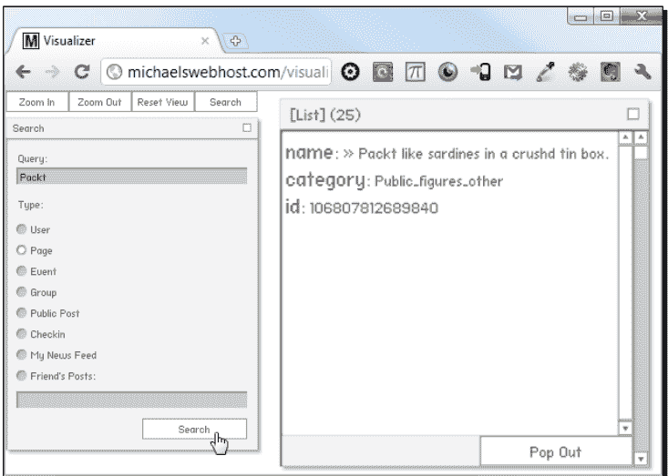

太好了，成功了！

### 刚才发生了什么？

我们刚刚添加了与之前相同的搜索功能，但这次是通过SDK实现的。请记住，这意味着如果用户已通过身份验证，访问令牌会被自动使用。

### 挑战自我——设置语言区域

现在我们可以搜索帖子了，那么将搜索结果限制为具有指定语言区域的用户发布的帖子怎么样？

你可以在search()方法中硬编码要使用的区域设置，或者（如果你对操作XML很熟悉）可以让你的项目从 http://www.facebook.com/translations/FacebookLocales.xml 中随机选择一个区域设置。

## 搜索动态和主页帖子

与Facebook的完整搜索相比，Graph URL搜索可能有所限制，但有两种类型的搜索只能通过Graph API完成：

- 在你的动态中搜索特定项目
- 搜索特定好友发布的内容

### 动手实践——搜索你的动态

你的动态是你登录Facebook网站时看到的列表；包含你的好友（以及你订阅的其他Graph网站，例如你“赞”过的页面）发布的全部状态更新、链接、视频和照片。

我们已经知道，可以通过个人资料的home连接访问该动态：

```
https://graph.facebook.com/me/home?access_token=«access_token»
```

正如你所料，它会返回一个Graph List。

我们可以通过为q参数指定值来在此动态中搜索：

```
https://graph.facebook.com/me/home?q=test&access_token=«access_token»
```

```
"data": [
  {
    "id": "151673724649_415202504649",
    "from": {
      "name": "Activetuts",
      "category": "Products_other",
      "id": "151673724649"
    },
    "message": "Test Your Observation Skills With an AS3 Difference Game \u2013 Active Premium",
    "link": "http://feedproxy.google.com/~r/Flashtuts/~3/i8-bZF-Mvhc/",
    "description": "Today, we have another Active Premium tutorial exclusively available to Premium members. If you want to take your ActionScript skills to the next level, then we have an awesome tutorial for you, courtesy of Stephan Meesters",
    "type": "link",
    "created_time": "2010-07-28T11:07:12+0000",
    "updated_time": "2010-07-28T11:07:12+0000"
  }
],
"paging": {
```


```
"previous": "https://graph.facebook.com/61300894/home?q=test&access_token=«access_token»&limit=25&since=2010-07-28T11%3A07%3A12%2B0000",
"next": "https://graph.facebook.com/61300894/home?q=test&access_token=«access_token»&limit=25&until=2010-07-20T15%3A01%3A01%2B0000"
}
```

## 发生了什么？

或许这更应该被视为一种过滤器，而非搜索。无论如何，最终结果都是来自你新闻 feed 中包含指定查询的帖子的 Graph 列表。

搜索词不必出现在帖子的实际文本中；假设我朋友 Bill 的生日到了。如果我加载：

```
https://graph.facebook.com/me/home?q=Bill&access_token=«access_token»
```

那么我会看到：

- 我在 Bill 墙上发布的帖子，写着“Happy Birthday, Bill!”（因为帖子中包含“Bill”这个词）
- 我朋友 Bob 在 Bill 墙上发布的帖子，写着“Happy Birthday!”（因为接收帖子的对象叫“Bill”——这意味着我的帖子出现在这些结果中有两个原因）
- Bill 发布的一条帖子写着“Thanks for the birthday wishes, everyone!”（因为他的名字是 Bill）

不幸的是，没有办法缩小范围并指定你希望匹配的位置——至少，使用 Graph Search URL 是做不到的。

你可能在想，我们能否用另一个人的 User ID 代替“me”，从而看到他们的新闻 feed 中会出现哪些帖子。我们不能这样做，出于隐私原因，但我们可以做类似的事情。

## 行动时间 – 搜索朋友的墙帖

令人困惑的是，你的新闻 feed 的 Graph URL（登录后可见）是：

```
https://graph.facebook.com/me/home?access_token=«access_token»
```

通往你墙的链接是：

```
https://graph.facebook.com/me/feed?access_token=«access_token»
```

这只是需要记忆的东西，我恐怕。

```
"from": {
    "name": "JohnSmith",
    "id": "«redacted»"
},
"to": {
    "data": [
        {
            "name": "Bill Smith",
            "id": "«redacted»"
        }
    ]
},
"message": "happy birthday bill",
"type": "status",
],
"paging": {
    "previous": "https://graph.facebook.com/502630189/feed?&access_token=«access_token»&limit=25&since=2010-08-01T12%3A09%3A34%2B0000",
    "next": "https://graph.facebook.com/502630189/feed?&access_token=«access_token»&limit=25&until=2010-07-31T08%3A59%3A06%2B0000"
}
```

当我们在同一连接中搜索“birthday”一词时，我们会看到以下输出：

```
https://graph.facebook.com/BillSmith/feed access_token=«access_token»&q=birthday
{
    "data": [
        {
            "id": "«redacted»",
            "from": {
                "name": "Bill Smith",
                "id": "«redacted»",
            },
            "to": {
                "data": [
                    {
                        "name": "JerryJohnson",
                        "id": "«redacted»",
                    }
                ]
            }
```

我的新闻 Feed 搜索使用 /me/home，而朋友的帖子搜索使用 /«username»/feed，其中 «username» 是输入到文本框中的值。

让我们先将我的新闻 Feed 搜索添加到两个 Requestors。唯一需要更改的是请求的 URL；我们不再使用 /search，而是使用 /me/home。搜索窗口在选中我的新闻 Feed 时返回 “home” 作为 type 的值，因此按以下代码所示修改 HTTPRequestor.as 中的 search() 方法：

```
public function search(a_query:String = "", a_type:String = ""):void
{
    var loader:URLLoader = new URLLoader();
    var urlRequest:URLRequest = new URLRequest();
    var variables:URLVariables = new URLVariables();

    if (a_type == "home")
    {
        urlRequest.url = "https://graph.facebook.com/me/home";
    }
    else
    {
        urlRequest.url = "https://graph.facebook.com/search";
    }

    variables.metadata = 1;
    if (accessToken != "")
    {
        variables.access_token = accessToken;
    }
    variables.q = a_query;      //not variables.query!
    variables.type = a_type;
    urlRequest.data = variables;

    loader.addEventListener(Event.COMPLETE, onGraphSearchComplete);
    loader.addEventListener(IOErrorEvent.IO_ERROR, onIOError);
    loader.load(urlRequest);
}
```

同样，对 SDKRequestor.as 中的 search() 方法做以下更改：

```
public function search(a_query:String = "", a_type:String = ""):void
{
    var urlStub:String;
    if (a_type == "home")
    {
        urlStub = "/me/home";
    }
    else
    {
        urlStub = "/search";
```

```
}
Facebook.api(
    urlStub,
    searchComplete,
    { metadata: 1, q:a_query, type:a_type }
);
}
```

我们不需要更改其他任何内容，因为这些搜索仍然会返回一个 Graph 列表。
试试看：

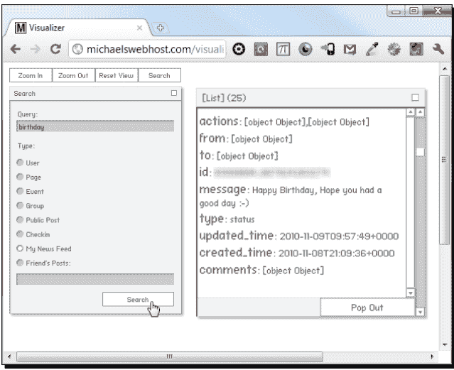

成功。添加朋友的帖子搜索会稍微棘手一些，但也没多少。首先我们必须允许 Requestors 的 search() 函数接受另一个参数：User ID。

打开 IRequester.as 并向函数签名添加此参数：

```
package graph.apis.base
{
    import flash.events.IEventDispatcher;
    import graph.GraphRequest;

    public interface IRequestor extends IEventDispatcher
    {
        function request(a_request:GraphRequest):void;
        function attemptToAuthenticate(...permissions):void;
```

## 搜索我

仅此而已。按下一张截图所示进行测试：

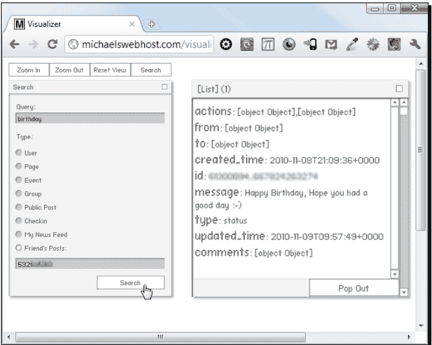

很酷。

## 发生了什么？

你已在应用程序中构建了两种额外的搜索功能：

- ♦ 搜索你的新闻 feed 中的帖子
- ♦ 搜索特定朋友的帖子

由于你的新闻 feed 由朋友（以及你订阅的其他 Graph 对象）的帖子组成，第一种帖子本质上与完整搜索中存在的“朋友的帖子”选项相同，但该选项在搜索 URL 中缺失。

通过 Facebook 网站无法完成按特定朋友发布的帖子进行搜索。恭喜！你的应用程序现在比 Facebook 具有更多功能。

- 没有 access token，某些类型的搜索（如 `user`）无法执行
- 使用 access token 时，搜索结果会根据授权用户进行定制：例如，如果人们住在附近，则在搜索中排名更高
- 某些搜索类型需要在返回任何结果之前授予一定的扩展权限——有关更多详细信息，请参阅 `http://developers.facebook.com/docs/authentication/permissions`
- 你可以使用 locale URL 参数设置 JSON 对象返回的某些属性的语言环境：`https://graph.facebook.com/<id>?locale=fr_FR`
- 你还可以将帖子搜索结果过滤为仅显示使用特定语言环境的人发布的帖子：`https://graph.facebook.com/search?type=post&q=<query>&locale=fr_FR`
- 完整的语言环境列表可在 `http://facebook.com/translations/FacebookLocales.xml` 获取
- 你可以使用此 Graph URL 过滤你的新闻 feed 条目：`https://graph.facebook.com/me/home?access_token=<access_token>&q=<query>`
- 你可以使用此 Graph URL 过滤给定朋友发布的所有内容：`https://graph.facebook.com/<username>/feed?access_token=<access_token>&q=<query>`

## 测验

- 1. 如果你从 Graph URL 搜索获得的结果与网站搜索的结果不匹配，可能出了什么问题？
  a. 向 Graph URL 传递了不正确的参数
  b. 使用了不正确的 Graph URL
  c. 用户的隐私设置不允许应用程序访问其数据
  d. 以上任何一种都有可能
- 2. `https://graph.facebook.com/<username>/feed?q=<query>` 的结果和 `https://graph.facebook.com/<username>/feed` 的结果有什么奇怪之处？
  a. 即使用户的隐私设置调到最高也能获得它们
  b. 第一个不像所有其他 Graph Search URL 那样对第二个起过滤作用
  c. 两个 URL 总是返回完全相同的 JSON


## 添加到图谱

> 我们花费了大量时间观察图谱，既作为匿名外部人员，也作为已认证用户。我们了解不同类型的节点以及它们之间的连接。现在是时候创建一些属于我们自己的了。

在本章中，你将学习：

- 如何使用 Graph API 创建新的 Graph 对象
- 如何从 Graph 中删除现有对象
- Graph API 在添加内容方面的限制，与 Facebook 网站相比如何

让我们开始吧...

## 你好，Facebook！

我通常不是“Hello World”应用的粉丝，但在这里它如此相关，我会破例。我们将从向已登录用户的墙上发布一条消息开始。

### 行动时间 – 发布到用户的动态

我们先从简单开始。只需让用户输入一行文字，并将其发布到他们的墙上。

当用户输入消息并点击发布时，我们希望消息被发布到他们的墙上。目前，代码设置好将包含消息的 AS3 对象传递给 CustomGraphContainerController 扩展的类中的 publish() 方法。就像之前的章节一样，我们将重写此方法并编写新代码来处理 Facebook 集成。

在 CustomGraphContainerController.as 中，添加此函数：

```
override public function publish(a_publishObject:PublishObject):void
{
    super.publish(a_publishObject);
}
```

PublishObject 类包含一个名为 message 的属性，用于保存用户在“发布到墙”窗口中输入的消息。我们需要导入此类：

```
import graph.apis.base.PublishObject;
```

UI 部分就绪。接下来，我们将此对象传递给 Requestor 中的一个方法来处理在 Facebook 上发布帖子。在 IRequestor.as 中添加一个新函数 publish()：

```
package graph.apis.base
{
    import flash.events.IEventDispatcher;
    import graph.GraphRequest;

    public interface IRequestor extends IEventDispatcher
    {
        function request(a_request:GraphRequest):void;
        function attemptToAuthenticate(...permissions):void;
        function initialize():void;
        function search(a_query:String = "", a_type:String = "", a_userID:String = ""):void;
        function publish(a_publishObject:PublishObject):void;
    }
}
```

PublishObject 实例包含我们所需的所有信息，因此它是传递给此方法的唯一参数。

现在在 SDKRequestor.as 和 HTTPRequestor.as 中都添加 stub publish() 函数：

```
public function publish(a_publishObject:PublishObject):void
{
}
```

你还需要在这两个类中导入 PublishObject：

```
import graph.apis.base.PublishObject;
```

我们将像往常一样先编写 HTTPRequestor 的代码，因此更改 CustomGraphContainerController.as 中实例化 _requestor 对象的构造函数函数中的那一行，使其创建 HTTPRequestor：

```
_requestor = new HTTPRequestor();
```

最后，修改 CustomGraphContainerController.as，使其 publish() 方法调用 Requestor 的 publish() 方法：

```
override public function publish(a_publishObject:PublishObject):void
{
    super.publish(a_publishObject);
    _requestor.publish(a_publishObject);
}
```

一切就绪，但我们如何从 Visualizer 将消息发布到实际的 Facebook 墙上呢？

## 请求方法

向用户的墙上发布消息与从中筛选信息并没有更复杂——我们使用 Graph URL，https://graph.facebook.com/me/feed，并传递两个参数：

- 访问令牌，以及
- 要发布的消息

不同之处在于我们如何传递这些参数。我们不能再简单地加载 URL 了。自己试试：浏览 https://graph.facebook.com/me/feed?access_token=«access_token»&message=Hello。它会以 JSON 格式返回你的动态，但不会发布到其中。

我们仍然使用 URLLoader 和 URLRequest，但使用不同的请求方法。

### 什么是请求方法？

HTTP 请求方法是一种告诉 Web 服务器当我们请求页面或其他资源时，我们希望它执行何种操作的方式。

默认情况下，AS3 URLRequest 使用一种名为 GET 的 HTTP 请求方法；这是一种“安全”方法，之所以称为安全，是因为它不要求服务器更改任何信息，只是将其传回——这正是到目前为止本书中我们所需的一切。

发布墙帖显然会引起更改，因此我们应该使用“不安全”方法——在本例中为 POST。这与提交会更改或添加数据的网页表单时使用的相同方法，例如在亚马逊订购书籍时。

> 出于安全原因，Flash Player 10 及以上版本只允许在用户发起加载时使用 POST 方法。这意味着你的应用程序不能自动向 Graph 发布（例如，基于用户登录时间的长短）；相反，你必须始终从例如按钮的 MOUSE_CLICK 事件处理函数中发布。

### 行动时间 – 使用 POST 方法

1. 要指定我们想要使用 POST 方法，我们更改 URLRequest 的 method 属性（毕竟 POST 是一个请求方法）。另一个类 flash.net.URLRequestMethod 包含所有允许值的常量，因此在 HTTPRequestor.as 中导入它：
```
import flash.net.URLRequestMethod;
```
2. 我们以与 request() 和 search() 方法相同的方式设置 URLLoader、URLRequest 和 URLVariables 实例：
```
public function publish(a_publishObject:PublishObject):void
{
    var loader:URLLoader = new URLLoader();
    var urlRequest:URLRequest = new URLRequest();
    var variables:URLVariables = new URLVariables();
}
```
3. 因为我们想要发布到自己的墙上，所以我们使用个人资料的 feed 连接作为 URL——没有单独的发布到墙 URL：
```
public function publish(a_publishObject:PublishObject):void
{
    var loader:URLLoader = new URLLoader();
    var urlRequest:URLRequest = new URLRequest();
    var variables:URLVariables = new URLVariables();

    urlRequest.url = "https://graph.facebook.com/me/feed";
}
```
4. 现在我们使用 URLRequestMethod 类中的 POST 常量来设置请求方法：
```
public function publish(a_publishObject:PublishObject):void
{

```

```
urlRequest.data = variables;

loader.addEventListener(Event.COMPLETE, onPublishComplete);
loader.addEventListener(IOErrorEvent.IO_ERROR, onIOError);
loader.load(urlRequest);
}
```

7. 为 COMPLETE 事件创建事件处理函数：

```
private function onPublishComplete(a_event:Event):void
{
    dispatchEvent(new DialogEvent(DialogEvent.DIALOG,
        "Publish complete!"));
}
```

记住，DialogEvent 可用于在 Visualizer 项目中显示对话框框，包含你想要的任何消息。不过，使用它时你需要导入 events.DialogEvent。

编译、上传并执行 SWF，你会发现……它不起作用。

### 刚才发生了什么？

要找出为什么不起作用，我们可以为 URLLoader 添加一种新的事件监听器——HTTPStatusEvent 监听器。

此类型的事件由服务器返回，并在 IO_ERROR 或 COMPLETE 事件之前分发。其 status 属性包含响应的“HTTP 代码”，这是一种简化的简写来解释响应状态。例如，404 是一个 HTTP 状态代码，表示“未找到”。完整列表可在 http://en.wikipedia.org/wiki/List_of_HTTP_status_codes 查看，但通常你会看到：

- 200：如果没有问题
- 400：如果发送的请求格式错误（最有可能是 URL 变量中的拼写错误）
- 403：如果不允许你访问请求的资源
- 404：如果服务器上找不到你请求的资源
- 500：如果出现其他问题（如权限不足）

（你也可能看到 0，如果 Flash Player 由于其环境中的某些条件而无法检测 HTTP 响应代码。）

这可以提供有用的额外信息来帮助缩小 IO_ERROR 问题范围，或检测不会分发 IO_ERROR 事件的问题。


4. 编译、上传并执行 Visualizer，然后再次尝试在自己的 Wall 上发布。

   它仍然不会工作，但你会看到类似这样的对话框：

   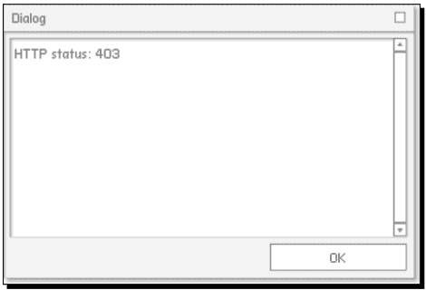

## What just happened?

对话框显示 HTTP 状态：403。正如前面提到的，这意味着我们不被允许访问我们试图访问的资源——也就是说，我们不被允许发布到 Wall。换句话说，我们没有权限……或者更准确地说，我们尚未被授予所需的扩展权限。

> 有可能你会看到 HTTP 状态码响应为 500。这是可以的——这是一个相当通用的错误信息，表示“出现问题”，在这种情况下也是如此。原因很可能仍然是缺少扩展权限。
>
> 当然，如果你在书中更早的时候就已授予你的应用程序所需的权限，你就不会遇到任何问题了！

## Time for action – granting the required permission

1. 在此之前能工作，我们必须授予应用程序 `publish_stream` 扩展权限，因此请在 `CustomGraphContainerController.as` 中的 `onRequestorInitialize()` 函数内进行如下修改：

   ```
   private function onRequestorInitialize(a_event:Event):void
   {
       _requestor.attemptToAuthenticate(
           ExtendedPermissions.READ_STREAM,
           ExtendedPermissions.PUBLISH_STREAM);
   }
   ```

2. 编译、上传并再次尝试。你在加载页面时会看到权限请求弹出：

   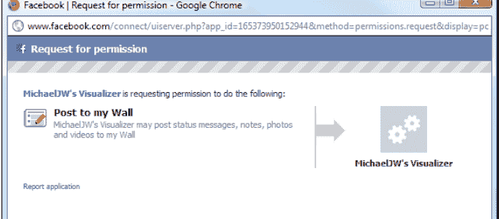

3. 点击 Allow，然后打开你的 Feed List Renderer，并点击 Publish。在框中输入一些文本：

   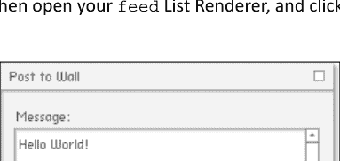

   ...然后点击 Post。检查 Facebook 网站上的你的 Wall：

   

它工作了吗？

在发布时，我们需要传递第四个变量：

- 要使用的 HTTP 请求方法

从我们对 HTTP Requestor 的工作来看，你已经知道这需要是 POST。因此，请修改 `SDKRequestor.as` 中的 `publish()` 方法，如下所示：

```
public function publish(a_publishObject:PublishObject):void
{
    var urlStub:String = "/me/feed";
    Facebook.api(urlStub, publishComplete,
        { message:a_publishObject.message },
        URLRequestMethod.POST
    );
}
```

确保导入 `flash.net.URLRequestMethod`。

接下来，你需要创建 `publishComplete()` 函数作为回调使用：

```
private function publishComplete(result:Object, fail:Object):void
{

}
```

使用 SDK 时我们不需要为 HTTP 状态或安全错误添加事件监听器；只需检查结果是否为 null；如果是，更多细节应位于 fail 对象中：

```
private function publishComplete(result:Object, fail:Object):void
{
    if (result != null)
    {
        dispatchEvent(new DialogEvent(DialogEvent.DIALOG,
            "Publish complete!"));
    }
    else
    {
        dispatchEvent(new DialogEvent(DialogEvent.DIALOG,
            "Publish failed. Details: " + String(fail)));
    }
}
```

如果要使用它，请确保导入 `events.DialogEvent`。

我们首先集中在 `message`、`picture`、`link`、`name`、`caption` 和 `description` 上，并通过发布使用它们的富帖子来了解它们的作用。

Visualizer 可以配置为显示一个包含这六个参数所有输入字段的窗口，而不是仅 `message`。要做到这一点，请在 `CustomGraphContainerController.as` 中找到这一行：

```
this._publishingCapability = PublishingCapabilities.BASIC;
```

...并将其替换为：

```
this._publishingCapability = PublishingCapabilities.COMPLETE;
```

当你在 `feed` List Renderer 上点击 **Publish** 按钮时，你会看到新的窗口：

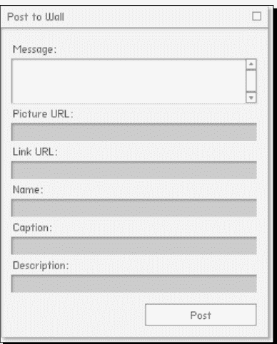

**Post** 按钮仍然将 `PublishObject` 的实例传递给 `CustomGraphContainerController` 扩展的类中的同一个函数 `publish()`。与之前不同的是，`PublishObject` 设置了更多属性。

具体来说，它可以具有以下任何属性：

- `message`
- `pictureURL`: 对应于 `picture`
- `linkURL`: 对应于 `link`

同样，编辑 `SDKRequestor.as` 中的 `publish()` 函数：

```
public function publish(a_publishObject:PublishObject):void
{
    var urlStub:String = "/me/feed";
    Facebook.api(urlStub, publishComplete,
    {
        message:a_publishObject.message,
        picture:a_publishObject.pictureURL,
        link:a_publishObject.linkURL,
        name:a_publishObject.linkName,
        caption:a_publishObject.caption,
        description:a_publishObject.description
    },
    URLRequestMethod.POST
    );
}
```

在你的主机上测试 Visualizer。以下是来自 Wikipedia 和 Wikimedia Commons 的一些测试数据：

- message: Hello Britain!
- picture: http://upload.wikimedia.org/wikipedia/commons/thumb/a/ae/Flag_of_the_United_Kingdom.svg/200px-Flag_of_the_United_Kingdom.svg.png
- link: http://en.wikipedia.org/wiki/Union_Flag
- name: Union Flag
- caption: en.wikipedia.org
- description: The Union Flag, also known as the Union Jack, is the flag of the United Kingdom

结果如下：

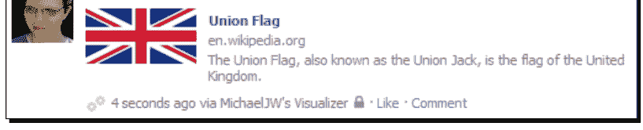


关于图像的说明：帖子中的那个小图像仍然托管在 Wikimedia Commons，但通过托管在 Facebook 服务器上的代理 PHP 访问——本例中为 http://platform.ak.fbcdn.net/。该服务器上的 crossdomain.xml 如下：

```
<cross-domain-policy>
    <site-control permitted-cross-domain-policies="master-only"/>
    <allow-access-from domain="*"/>
</cross-domain-policy>
```

这意味着无论原始图像托管在何处，你的应用程序都可以直接访问图像的 BitmapData，而不会出现任何沙箱安全问题。

实际创建的 Graph Object 看起来像这样：

```
{
  "id": "«redacted»",
  "from": {
    "name": "Michael James Williams",
    "id": "«redacted»"
  },
  "message": "Hello Britain!",
  "picture": "http://platform.ak.fbcdn.net/www/app_full_proxy.php?app=«redacted»&v=1&size=z&cksum=«redacted»&src=http%3A%2F%2Fupload.wikimedia.org%2Fwikipedia%2Fcommons%2Fthumb%2Fa%2Fae%2FFlag_of_the_United_Kingdom.svg%2F200px-Flag_of_the_United_Kingdom.svg.png",
  "link": "http://en.wikipedia.org/wiki/Union_Flag",
  "name": "Union Flag",
  "caption": "en.wikipedia.org",
  "description": "The Union Flag, also known as the Union Jack, is the flag of the United Kingdom.",
  "icon": "http://graph.facebook.com/images/icons/hidden.gif",
  "actions": [
    {
      "name": "Comment",
      "link": "http://www.facebook.com/«redacted»/posts/«redacted»"
    },
    {
      "name": "Like",
      "link": "http://www.facebook.com/«redacted»/posts/«redacted»"
    }
  ],
  "privacy": {
    "description": "Friends only",
```

现在再次查看 Wall 帖子：

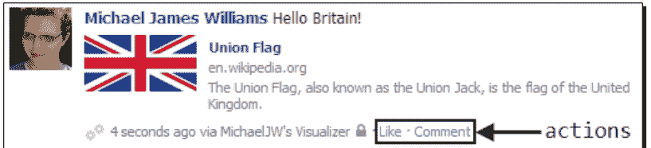

操作是帖子下方其他 Facebook 用户可以点击的链接。

我们可以通过将 JSON 传递给 actions 参数来添加我们自己的用户定义操作，例如“Visit my website”或“Plant some crops”。

## Time for action – literally

1. 打开 `HTTPRequestor.as` 并找到 `publish()` 函数。在函数内创建原生 AS3 对象如下：

   ```
   var actionObj:Object = [ {
       name:"Visit my Twitter Page",
       link:"http://twitter.com/MichaelJW"
   } ];
   ```

   方括号定义一个数组，因此我们也可以将其键入为 Array 而不是 Object，但这并不重要。

2. 接下来，在同一个函数中，使用我们之前使用过的 JSON 库将此对象编码为 JSON 字符串：

   ```
   var actionString:String = JSON.encode(actionObj);
   ```

3. 现在，将此 String 作为 URLVariables 对象的属性添加，称为 `actions`：

   ```
   variables.message = a_publishObject.message;
   variables.picture = a_publishObject.pictureURL;
   variables.link = a_publishObject.linkURL;
   variables.name = a_publishObject.linkName;
   variables.caption = a_publishObject.caption;
   variables.description = a_publishObject.description;
   variables.actions = actionString;
   urlRequest.data = variables;
   ```


4. 在 SDKRequestor.as 中做类似的修改：

```
public function publish(a_publishObject:PublishObject):void
{
    var urlStub:String = "/" + a_publishObject.ownerID + "/feed";
    var actionObj:Object = [ {
        name:"Visit my Twitter Page",
        link:"http://twitter.com/MichaelJW"
    } ];
    var actionString:String = JSON.encode(actionObj);
    Facebook.api(urlStub, publishComplete,
    {
        message:a_publishObject.message,
        picture:a_publishObject.pictureURL,
        link:a_publishObject.linkURL,
        name:a_publishObject.linkName,
        caption:a_publishObject.caption,
        description:a_publishObject.description,
        actions:actionString
    },
        URLRequestMethod.POST
    );
}
```

5. 你需要导入 com.adobe.serialization.json.JSON。测试一下：

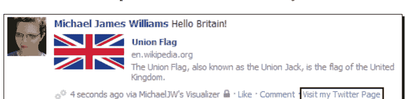

## What just happened?

你已向来自你项目的帖子添加了一个应用特定的操作。每个帖子只能添加一个这样的操作，但当然，它不必对每个帖子都相同。

该操作是一个功能性超链接；点击它会带你到我的 Twitter 页面。不过，Facebook 会在所有此类链接末尾添加一个 URL 参数 ref=nf，因此先测试一下——例如，尝试加载 http://google.com?ref=nf 会得到 404 消息。

3. 在 SDKRequestor.as 中添加类似的代码：

```
public function publish(a_publishObject:PublishObject):void
{
    var urlStub:String = "/" + a_publishObject.ownerID + "/feed";
    var actionObj:Object = [ {
        name:"Visit my Twitter Page",
        link:"http://twitter.com/MichaelJW"
    } ];
    var actionString:String = JSON.encode(actionObj);

    var privacyObj:Object = {
        value:"EVERYONE"
    }
    var privacyString:String = JSON.encode(privacyObj);

    Facebook.api(urlStub, publishComplete,
    {
        message:a_publishObject.message,
        picture:a_publishObject.pictureURL,
        link:a_publishObject.linkURL,
        name:a_publishObject.linkName,
        caption:a_publishObject.caption,
        description:a_publishObject.description,
        actions:actionString,
        privacy:privacyString
    },
        URLRequestMethod.POST
    );
}
```

4. 通过将 value 设置为 EVERYONE，我们将使帖子对任何可以看到你 Wall 的人可见，而不仅仅是你的朋友。

还有哪些其他选项？

好吧，value 可以设置为：

- EVERYONE
- ALL_FRIENDS
- NETWORKS_FRIENDS
- FRIENDS_OF_FRIENDS

这些含义都很明显，除了 NETWORKS_FRIENDS（它允许你的朋友加上你网络中的任何人查看帖子）。

value 的另一个可能设置是：CUSTOM。使用它可以让你为 privacyObj 指定另外两个属性——networks 和 friends。

对于 networks 属性，输入应允许查看你帖子的网络的 ID 的逗号分隔列表，如下所示：

```
var privacyObj:Object = {
    value:"EVERYONE",
    networks:"network1,network2,network3"
}
```

要允许所有网络查看帖子，只需将 1 作为值输入即可。

对于 friends 属性，输入以下其中之一：

- EVERYONE
- NETWORKS_FRIENDS
- FRIENDS_OF_FRIENDS
- ALL_FRIENDS
- SELF
- NO_FRIENDS

同样，很清楚每个的作用是什么。NO_FRIENDS 让你仅允许指定网络中的人查看帖子。

friends 的另一个可能设置是：SOME_FRIENDS。这会为你提供可以为 privacyObj 设置的另一对属性——allow 和 deny。这两个属性都接受用户 ID（混合好友列表 ID）的逗号分隔列表；allow 定义谁可以看到帖子，而 deny 定义谁不能。

因此，你的 privacyObj 可能看起来像这样：

```
var privacyObj:Object = {
    value:"CUSTOM",
    networks:"network1,network2,network3",
    friends:"SOME_FRIENDS",
    allow:"bob.smith,joe.q.faikname",
    deny:"bill.the.jerk"
}
```

## What just happened?

正如你所见，你可以精细控制用户 Wall 上帖子的隐私级别。使用“正确”的设置完全取决于你的应用程序及其受众；只需了解可能实现的功能即可。

> 你无法控制用户在其他用户、页面、活动或群组的 Wall 上发布的帖子的隐私设置；这些帖子始终可以被任何可以看到该 Wall 的人看到。

## Source

`source` 参数据说允许你将小型照片库、Flash 对象（如视频剪辑）和 MP3 音乐嵌入到帖子中，以及自定义键值对，这些键值对（虽然在 Facebook 网站上不可见）稍后可以被你的应用程序或任何其他应用程序读取。

不幸的是，在撰写本文时，该功能与 Graph API 的配合并不正确。请查看 `source` 参数可以实现的功能：http://developers.facebook.com/docs/guides/attachments。希望到你阅读这一段时，该功能能得到完全实现并记录在案。

## Deleting Graph Objects

我们已经掌握了添加帖子的方法，但后来如何删除它们呢？

## Time for action – deleting a Post

Facebook 删除帖子的界面是一个在悬停时出现的 Remove 按钮：

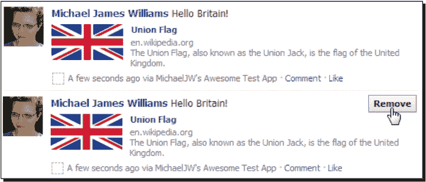

Visualizer 项目也有一个 Delete 按钮；让我们看看如何添加它。

## Time for action – deleting Posts using the Visualizer

1. 我们可以通过使用另一个隐藏选项来启用 Visualizer 的 Delete 按钮。在 CustomGraphContainerController.as 的构造函数中，将 this._showDeleteButtons 设置为 true：

```
public function CustomGraphContainerController(a_graphControlContainer: GraphControlContainer)
{
    super(a_graphControlContainer);
    this._showListCounts = true;
    this._showListFilters = true;
    this._canShowSearchUI = true;
    this._publishingCapability = PublishingCapabilities.COMPLETE;
    this._showDeleteButtons = true;
    _requestor = new SDKRequestor();
    addEventListenersToRequestor();
    //we must wait for the Requestor to initialise before we can do
    // anything else with it
    _requestor.addEventListener(Event.COMPLETE, onRequestorInitialize);
    _requestor.initialize();
}
```

2. 下次加载 SWF 时，你将在 List Renderer 中看到这个新按钮：

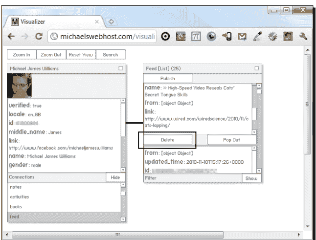

我们将从（像往常一样）HTTPRequestor 的代码开始，因此请确保你的项目设置为将 _requestor 实例化为 HTTPRequestor 而不是 SDKRequestor。我们可以重用 publish() 的大部分代码；按如下方式修改 HTTPRequestor.as 的 deleteObject() 函数：

```
public function deleteObject(a_objectID:String):void
{
    var loader:URLLoader = new URLLoader();
    var urlRequest:URLRequest = new URLRequest();
    var variables:URLVariables = new URLVariables();

    if (this.accessToken != "")
    {
        variables.access_token = this.accessToken;
    }
    urlRequest.data = variables;

    loader.addEventListener(Event.COMPLETE, onDeleteComplete);
    loader.addEventListener(IOErrorEvent.IO_ERROR, onIOError);
    loader.addEventListener(HTTPStatusEvent.HTTP_STATUS, onHTTPStatusReturned);
    loader.addEventListener(SecurityErrorEvent.SECURITY_ERROR, onSecurityError);
    loader.load(urlRequest);
}
```

4. 请注意，与使用 onPublishComplete() 作为 COMPLETE 事件处理函数不同，我们使用的是 onDeleteComplete()，因此请创建该函数：

```
private function onDeleteComplete(a_event:Event):void
{
    dispatchEvent(new DialogEvent(DialogEvent.DIALOG, "Deleted!"));
}
```

我们需要使用哪个 URL？很简单：我们使用要删除的 Graph 对象的 Graph URL。因此：

```
public function deleteObject(a_objectID:String):void
{
    var loader:URLLoader = new URLLoader();
    var urlRequest:URLRequest = new URLRequest();
    var variables:URLVariables = new URLVariables();

    urlRequest.url = "https://graph.facebook.com/";
    urlRequest.url += a_objectID;

    if (this.accessToken != ""


```
{
    variables.access_token = this.accessToken;
}
urlRequest.data = variables;

loader.addEventListener(Event.COMPLETE, onDeleteComplete);
loader.addEventListener(IOErrorEvent.IO_ERROR, onIOError);
loader.addEventListener(HTTPStatusEvent.HTTP_STATUS,
    onHTTPStatusReturned);
loader.addEventListener(SecurityErrorEvent.SECURITY_ERROR,
    onSecurityError);
loader.load(urlRequest);
}
```

5. 那么HTTP请求方法呢？有一种叫做DELETE的方法，它绝对不是“安全”方法，而且正是我们想要的。不幸的是，出于安全考虑，我们只能在AIR中使用它。下面是代码，以防你以后编写AIR应用程序：

```
public function deleteObject(a_objectID:String):void
{
    var loader:URLLoader = new URLLoader();
    var urlRequest:URLRequest = new URLRequest();
    var variables:URLVariables = new URLVariables();

    urlRequest.url = "https://graph.facebook.com/";
    urlRequest.url += a_objectID;
    urlRequest.method = URLRequestMethod.DELETE;

    if (this.accessToken != "")
    {
        variables.access_token = this.accessToken;
    }
    urlRequest.data = variables;

    loader.addEventListener(Event.COMPLETE, onDeleteComplete);
    loader.addEventListener(IOErrorEvent.IO_ERROR, onIOError);
    loader.addEventListener(HTTPStatusEvent.HTTP_STATUS,
        onHTTPStatusReturned);
    loader.addEventListener(SecurityErrorEvent.SECURITY_ERROR,
        onSecurityError);
    loader.load(urlRequest);
}
```

不过，如果你是在制作常规的Flash Player SWF，URLRequestMethod类甚至不会有DELETE常量。

对于基于常规SWF的应用程序，情况并没有复杂多少。我们只有两种请求方法可选——GET和POST。因为GET是安全方法，我们不能用它来删除服务器上的对象，所以必须使用POST：

```
public function deleteObject(a_objectID:String):void
{
var loader:URLLoader = new URLLoader();
var urlRequest:URLRequest = new URLRequest();
var variables:URLVariables = new URLVariables();

urlRequest.url = "https://graph.facebook.com/";
urlRequest.url += a_objectID;
urlRequest.method = URLRequestMethod.POST;

if (this.accessToken != "")
{
    variables.access_token = this.accessToken;
}
urlRequest.data = variables;

loader.addEventListener(Event.COMPLETE, onDeleteComplete);
loader.addEventListener(IOErrorEvent.IO_ERROR, onIOError);
loader.addEventListener(HTTPStatusEvent.HTTP_STATUS, onHTTPStatusReturned);
loader.addEventListener(SecurityErrorEvent.SECURITY_ERROR, onSecurityError);
loader.load(urlRequest);
}
```

……但我们可以轻松地通过传递一个新参数——method=delete——来告诉Facebook将其视为DELETE请求：

```
public function deleteObject(a_objectID:String):void
{
var loader:URLLoader = new URLLoader();
var urlRequest:URLRequest = new URLRequest();
var variables:URLVariables = new URLVariables();

urlRequest.url = "https://graph.facebook.com/";
urlRequest.url += a_objectID;
urlRequest.method = URLRequestMethod.POST;

if (this.accessToken != "")
{
    variables.access_token = this.accessToken;
}
variables.method = "delete";
urlRequest.data = variables;

loader.addEventListener(Event.COMPLETE, onDeleteComplete);
loader.addEventListener(IOErrorEvent.IO_ERROR, onIOError);
loader.addEventListener(HTTPStatusEvent.HTTP_STATUS,
    onHTTPStatusReturned);
loader.addEventListener(SecurityErrorEvent.SECURITY_ERROR,
    onSecurityError);
loader.load(urlRequest);
}
```

这个方法和AIR版本一样有效，而且只多花我们一行代码。

要使用SDK删除对象，我们可以使用`Facebook.api()`，但有一个快捷方法：`Facebook.deleteObject()`。它接受两个参数——要删除的Graph Object的ID和一个回调函数。这使得所需代码非常简单；将其添加到SDKRequestor.as中：

```
public function deleteObject(a_objectID:String):void
{
    Facebook.deleteObject(a_objectID, deleteComplete);
}

private function deleteComplete(result:Object, fail:Object):void
{
    if (result != null)
    {
        dispatchEvent(new DialogEvent(DialogEvent.DIALOG, "Deleted!"));
    }
    else
    {
        dispatchEvent(new DialogEvent(DialogEvent.DIALOG,
            "Deletion failed. Details: " + String(fail)));
    }
}
```

编译、上传，然后通过删除你墙上的一条帖子来测试新的更改。

## 刚才发生了什么？

你应该已经看到一条墙上的帖子从Facebook上被删除了。

> 最新消息：在本书即将出版之前，Facebook似乎改变了Graph API，使得墙上的帖子只能由最初用于发布该帖子的应用程序删除。以前，可以删除已登录用户墙上的任何帖子，也可以删除该用户在他人墙上发布的任何帖子。在撰写本文时，官方Graph API文档并未提及此限制。因此，如果你在删除帖子时遇到问题，请先通过Visualizer创建一个帖子，然后再尝试删除它。

这再次只需要`publish_stream`扩展权限；到目前为止，你应该已经清楚这个权限有多强大了。你可以使用相同的代码删除其他类型的Graph Object，而不仅仅是帖子。如果你的应用程序有权限修改或创建对象，那么它也有权限删除它。

如果你尝试通过Facebook网站删除帖子，它会要求确认：


这是个好主意，值得在你自己的项目界面中使用。Visualizer不会要求确认，而且即使删除后也不会从List Renderer中移除帖子——尽管这确实让你看到如果尝试删除一个已经被删除的帖子会发生什么……

## 发布其他类型的Graph Object

所有可以创建的Graph Object类型都可以按照与墙帖子相同的基本步骤来创建：

- 使用`POST HTTP`请求方法
- 使用`URLVariables`对象设置参数
- 确保你拥有访问令牌和所需的权限

Graph List Renderer的Publish按钮总是会创建一个窗口，其中的输入与正在渲染的Graph List相对应，而这个窗口又总是将其值传递给`CustomGraphContainerController`的`publish()`函数（在一个`PublishObject`实例内部），因此你可以试验不同的类型。

每当有人评论该帖子时，用户还会收到电子邮件和通知。这就像一个微型订阅，也是一种认可的标志。

请求的URL是：

```
https://graph.facebook.com/<post_id>/likes
```

没有任何参数。

点赞需要`publish_stream`权限。

## 那么“点赞”其他Graph Object呢？

在第2章中，我们了解了“点赞”连接如何将人们与电视节目、电影、音乐、兴趣和活动联系起来；“点赞”连接构成了Graph Web中的许多分支。然而，Graph API不允许我们“点赞”帖子以外的任何东西（即使尝试点赞评论也会导致HTTP状态码500）。

Facebook表示，他们不打算允许开发者为其他任何东西创建“点赞”。他们的目标似乎是确保任何用户都不会点击非官方的“点赞”按钮（或者至少，不会在Facebook未批准的环境中点击“点赞”按钮；Yelp.com有自己设计的“点赞”按钮，因为他们是Facebook的合作伙伴网站）。

所以，遗憾的是，无法通过Graph API修改用户的电视节目、电影、兴趣或活动。

## 删除点赞

点赞没有自己的ID，所以我们不能通过尝试删除 https://graph.facebook.com/<like_id> 来删除点赞。相反，我们必须使用这个URL：https://graph.facebook.com/<graph_object_id>/likes。

如你所知，这是连接的Graph URL，如果我们试图在浏览器中加载它，它会返回一个Graph List。然而，当我们尝试使用“删除Graph Objects”一节中描述的过程删除该URL时，它会使授权用户“取消赞”该Graph Object。


## 笔记

笔记就像微型博客文章：

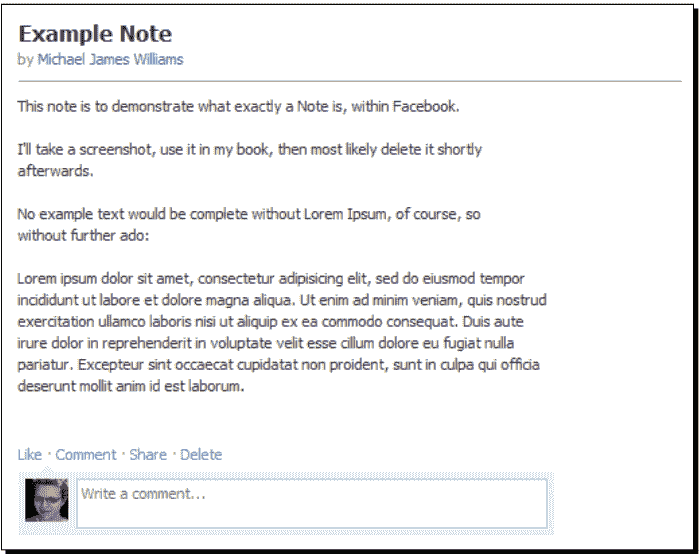

要请求的 URL 是：https://graph.facebook.com/<id>/notes。

该 ID 只能是当前用户的 ID，或者是用户管理的主页的 ID。

尽管笔记通常比墙贴更长，并且能够支持图片、链接和格式化文本，但只需要两个参数：

- message：这是一个 HTML 字符串（这就解释了为什么能添加图片和格式化内容）
- subject：笔记的标题

要发布笔记，你的应用程序需要 publish_stream 权限。

## 活动

活动看起来像这样：

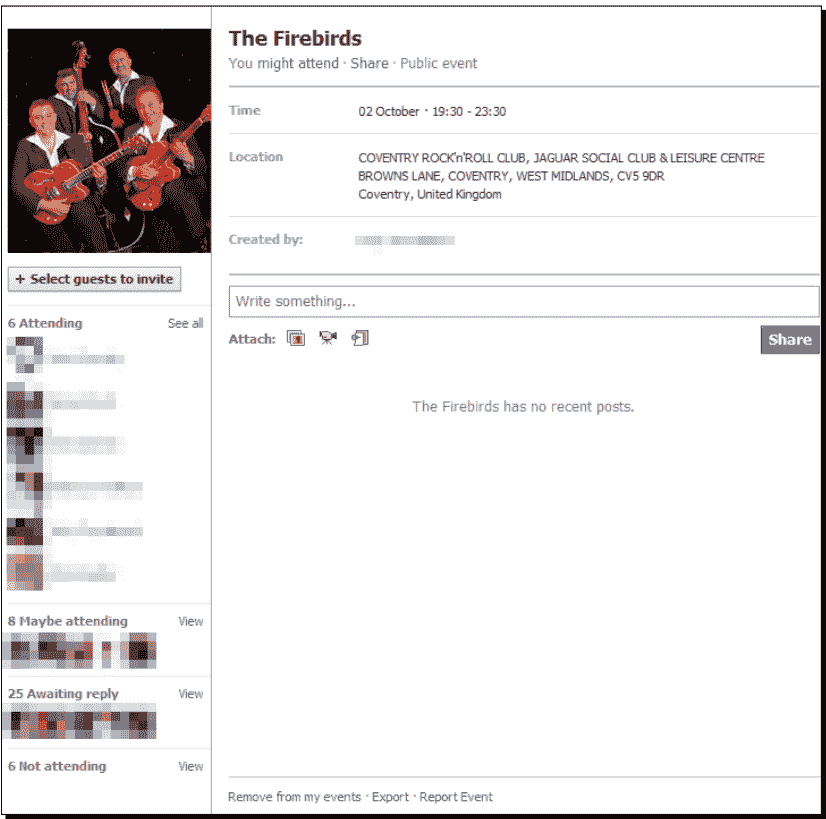

与主页一样，活动也有一个留言墙，可以使用 /«event_id»/feed 这个 URL 路径前缀向其发布内容。活动也有成员列表，但成员分为四个类别：

- ♦ 参加：/«event_id»/attending
- ♦ 可能参加：/«event_id»/maybe
- ♦ 不参加：/«event_id»/declined
- ♦ 等待回复：/«event_id»/noreply

用户可以收到邀请，并可以用前三个类别中的任意一个进行 RSVP；这让日程安排变得简单一些。

另一个连接，/«event_id»/invited，包含了所有被邀请到该活动的人员列表，无论他们是否回复。

要创建活动，请向此 URL 发送 POST 请求：https://graph.facebook.com/«id»/events。

（与笔记一样，该 ID 只能是当前用户的 ID，或者是用户管理的主页的 ID。）

需要三个参数：

- `name`：活动的标题
- `start_time`：活动开始的时间和日期
- `end_time`：活动结束的时间和日期

两个日期都必须以 **ISO 8601** 格式输入。维基百科关于 ISO 8601 的信息比你需要的还要多（http://en.wikipedia.org/wiki/ISO_8601）；简单总结一下，**2010年11月8日 UTC 下午1:25** 表示为 `2010-11-08T13:25Z`。如果你让用户手动输入时间，请确保将其调整到 UTC 时区！

要创建活动，你的应用程序需要 `create_event` 权限。

## 活动回复（RSVP）

Facebook 没有使用一个单一的 URL 来提交 RSVP 并在参数中设置 RSVP 类型，而是使用了三个独立的 URL：

- https://graph.facebook.com/«event_id»/attending：参加
- https://graph.facebook.com/«event_id»/maybe：可能参加
- https://graph.facebook.com/«event_id»/declined：不参加

当用户通过网站界面进行 RSVP 时，Facebook 会询问用户是否附上（可选的）备注（例如，“抱歉我那天去不了”或“非常期待！”）。然而，上述三个 URL 不接受任何参数；如果你想让用户发布 RSVP 备注，只需将其作为一条帖子发布到 `/feed` 连接即可。

RSVP 并非一成不变；用户之后可以改变主意。在设计与此相关的应用时请记住这一点！不要因为用户已经有 RSVP 状态就阻止他们再次设置。

要进行 RSVP，你的应用程序需要 `rsvp_event` 权限。

```
loader.addEventListener(HTTPStatusEvent.HTTP_STATUS,
    onHTTPStatusReturned);
loader.addEventListener(SecurityErrorEvent.SECURITY_ERROR,
    onSecurityError);
loader.load(urlRequest);
```

……我们必须这样做：

```
variables.message = a_publishObject.message;
variables.source = a_publishObject.source;
urlRequest.data = variables;
a_publishObject.source.addEventListener(
    DataEvent.UPLOAD_COMPLETE_DATA, onPublishComplete);
a_publishObject.source.addEventListener(IOErrorEvent.IO_ERROR,
    onIOError);
a_publishObject.source.addEventListener(HTTPStatusEvent.HTTP_STATUS,
    onHTTPStatusReturned);
a_publishObject.source.addEventListener(
    SecurityErrorEvent.SECURITY_ERROR, onSecurityError);
a_publishObject.source.upload(urlRequest);
```

SDK Requestor 不需要真正的修改；它使用 FileReference 并封装了上传过程。这意味着我们可以像往常一样直接调用 Facebook.api()：

```
Facebook.api(urlStub, publishComplete,
{
    message:a_publishObject.message,
    source:a_publishObject.source
},
URLRequestMethod.POST
);
```

在每种情况下，记得将 URL 路径前缀改为 /«album_id»/photos。

将照片上传到相册需要 publish_stream 权限。与相册类似，你可能还想授予 `user_photos` 权限。

不出所料，要向相册添加照片，用户必须要么拥有该相册，要么管理拥有该相册的主页。

## 签到

**签到**由 Facebook 地点（Places）使用，允许用户发布他们当前的位置以及关于该地点的消息。

要创建签到，请向此 URL 发送 POST 请求：https://graph.facebook.com/«user_id»/checkins。

唯一允许的 ID 是已认证用户的 ID（所以你可以改用 me）。

支持三个参数：

- `coordinates`
- `place`
- `message`

`coordinates` 参数必须是一个包含两个属性（纬度和经度）的 JSON 字符串。使用本章前面提到的 JSON.encode() 方法将原生 AS3 对象转换为 JSON 字符串。

`place` 参数应该是与用户当前所在位置对应的地点（Place）的 ID。在第5章中，我们看到了如何搜索给定位置附近的地点（Places）并获取其 ID。

`message` 参数是可选的——它是用户对自己正在做什么的简单评论。例如，“刚在奥尔顿塔玩了激流勇进。”

创建签到需要 `publish_checkins` 权限。你可能还想授予 `user_checkins` 权限，以允许用户查看他们的其他签到。

## 其他功能呢？

有很多操作你可以通过 Facebook 网站界面完成，但无法通过 Graph API 完成。我们已经看到了“赞”功能的限制；还有哪些缺失的功能？

## 发送站内信

可以读取站内信（如第5章所述），但不能创建和发送这些消息。Facebook 曾计划允许应用创建站内信，但这一计划似乎已被废弃。这项功能有可能会作为新消息功能的一部分被纳入；更多相关信息请参见第8章。

## 创建主页、群组、应用和视频

无法通过 Graph API 创建这些类型的任何 Graph 对象。

这有点令人惊讶——群组与活动并没有太大不同，而主页反过来也与群组没有太大不同。无法创建视频的功能甚至更奇怪，因为这意味着无法创建能够直接将视频上传到 Facebook 的移动应用。

不过，不能通过其他应用创建应用倒是可以理解的！

## 更改个人资料信息

你的应用程序无法更改用户的感情状态、当前所在地、最喜欢的语录、教育背景，或任何类似信息。由于 Graph API 不允许对除墙贴之外的任何内容进行“赞/取消赞”，这意味着用户的整个信息栏都“只能看，不能碰”。

## 添加好友

应用无法向其他用户发送好友请求，也无法将某人从当前用户的好友列表中移除。（尽管你可以向其他用户发送足够多的无礼消息，鼓励他们将当前用户从其好友列表中移除。）

## 邀请好友参加活动

你可以创建活动，但无法邀请任何人参加。真有意思。

## 快速测验

- 1. 为什么我们突然需要使用不同的 HTTP 请求方法？
  a. 我们自始至终都应该使用 POST
  b. Graph API 自你阅读上一章以来已经改变了
  c. 在更改数据时，HTTP 要求我们使用“不安全”的方法
- 2. 为什么要费心监听不同类型的 HTTP 状态码？
  a. 既然我们现在使用的是不同的 HTTP 请求方法，我们就需要这样做
  b. 这些代码可以为我们提供关于发布尝试失败原因的额外信息


3. 没有访问令牌，我们可以发布什么？

a. 什么都不能
b. 只能发布状态消息
c. 只能点赞
d. 什么都可以

## 总结

现在，你已经学会了如何创建多种不同类型的图谱对象：帖子、评论、活动等等。你还学会了在需要时如何删除它们。

对于图谱 API 无法做到的事情，你是否感到惊讶？

在下一章中，我们将重新审视图谱，但我们将使用一个强大的新工具——Facebook 查询语言。

要点回顾：

- 要通过 HTTP 发布，照常使用 URLRequest/URLLoader/URLVariables 设置，并在 URLVariables 实例中随访问令牌一起包含新图谱对象的参数。
- 使用的 URL 是 https://graph.facebook.com/«id»/«connection»。务必使用 flash.net.URLRequestMethod.POST。
- 要通过 SDK 发布，调用 Facebook.api("«id»/«connection»", «callback», {parameter1:"value1", parameter2:"value2"}, URLRequestMethod.POST)。
- 上传照片需要 FileReference。使用 FileReference.browse() 让用户从硬盘中选择图片。
- 要通过 HTTP 上传：使用 FileReference.upload() 而不是 URLLoader.load()。
- 要通过 SDK 上传：只需将 FileReference 作为 URLVariables 实例中 source 参数的值传入，然后照常调用 Facebook.api() 即可。
- 通过图谱 API，你只能“赞”帖子，不能“赞”其他内容。这意味着我们无法修改用户的兴趣或最喜欢的电视节目。
- 在编写本书时，我们只能删除使用同一应用程序创建的帖子。
- 要通过 HTTP 删除，只需使用 URLRequestMethod.POST 将 `method=delete` 传递给 `https://graph.facebook.com/<id>`。
- 如果使用 AIR，你可以直接用 `URLRequestMethod.DELETE` 加载 `https://graph.facebook.com/<id>`。
- 要通过 SDK 删除，调用 `Facebook.deleteObject("<id>", "<callback>")`。
- 例外情况是删除“赞”；在这种情况下，要删除的 URL 路径是 `<id>/likes`。
- 发布所需的完整参数和权限列表可在 `http://developers.facebook.com/docs/reference/api` 查看。
- 出于安全原因，Flash Player 10 及以上版本不允许你的应用程序通过 `HTTP POST` 方法发布任何内容，除非该操作是由用户发起的（例如，通过点击按钮）。

## 7
