## FQL 相关问题

> 图谱是访问 Facebook 数据的一种极佳模型；它能够处理网站上海量的信息，并让访问变得简单易行。

> 然而，有时我们希望获得额外的控制力和更强大的能力。这时就要用到 FQL 了。它是一种专为搜索 Facebook 数据库而设计的编程语言——而且它不使用图谱。

在本章中，我们将：

- 回顾不同的数据表示和可视化模型
- 通过使用 FQL 获取一些 Facebook 数据来熟悉它
- 学习如何使用 FQL 来完成（几乎）所有图谱能做的事情
- 发现图谱比 FQL 更擅长的方面
- 找出如何检测已授予哪些扩展权限
- 了解一些高级 FQL 特性

那么，让我们开始吧……

## 什么是 FQL？

FQL（按首字母缩写读作“eff-cue-ell”）是 Facebook 版本的数据库语言 SQL。不知道 SQL 是什么？别担心，你不需要知道。在本章中，我会假设你对 FQL、SQL 或数据库一无所知。所以在深入探讨 FQL 是什么之前，让我们先退一步，看看数据库。

## 但如果我已经会 SQL 了呢？

即使你懂 SQL，也值得读一读本章，以复习一些概念，并了解 FQL 与常规 SQL 之间的差异。特别是，可以参考“限制”部分。
如果你有 SQL 经验，你可能会惊讶于 FQL 缺少多少功能。最明显的是，它没有 INSERT、DELETE 或 UPDATE 子句。此外，缺少 JOIN、GROUP BY 和 LIKE；你必须指定要返回的字段集，而不能输入 SELECT *，而且在 FROM 子句中只能指定一个表。


## 理解 FQL 接口

我们一直把 Facebook 数据看作第 2 章中列出的图谱格式来查看，但实际上，这仅仅是一种数据模型；图谱 API 就像是一个包装器，让数据看起来像是按那种方式组织的。其实并非如此。

数据的组织方式重要吗？对于我们的目的来说并不重要。重要的是我们用来访问数据的接口。到目前为止，这个接口一直是图谱 API；我们通过图谱 URL 获取了所有数据，并用 AS3 进行处理。

但还有另一种查看数据的方式，它类似于传统的数据库结构。在这种情况下，所有数据都保存在表中，按列、行和字段组织。用一个例子来解释更容易：

| user |  |  |  |  |  |  |
|---|---|---|---|---|---|---|
| uid | first_name | middle_name | last_name | name | sex | username |
| 123456 | Michael | James | Williams | Michael James Williams | male | michael_james_williams |
| 789012 | Joe | Quincy | Faikname | Joe Q Faikname | male | joe_q_faikname |

为了简洁起见，省略了部分列。

这是一张数据表。具体来说，它是 user 表，你可以从下面的标题看出来：

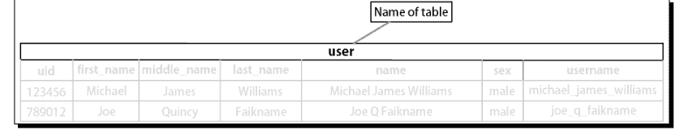

每一**列**代表数据的一个属性：

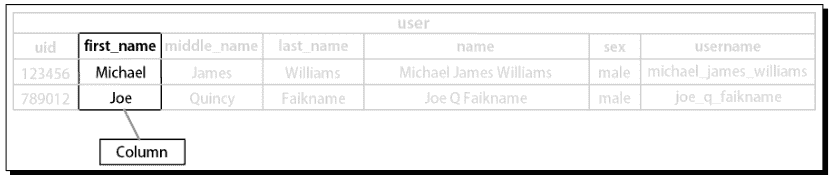

每一**行**对应一个对象，包含其所有属性：

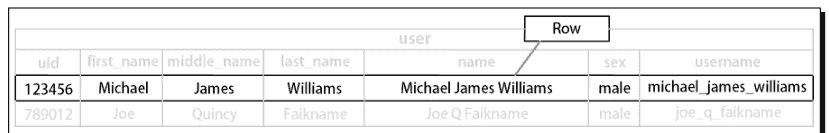

行和列的交点——即某个对象的某个属性——称为一个**字段**：

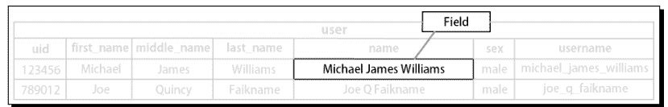

你也可以把这种结构想象成电子表格；这是以网格形式存储数据的一种简单而自然的方式。（当然，如果你熟悉关系数据库，你也可以直接把它想象成关系数据库中的一张表！）

## 数据模型

现在我们有了三种不同的模型可以用来思考 Facebook 数据：

1. AS3 面向对象模型：我们有一些包含特定属性的类，以及这些类的实例，实例中包含关于特定项目的信息。例如，我们可以创建一个名为 User 的类，它包含某些属性，并定义该类的一个实例：

```
class User
{
    public var uid:int;
```

让我们看一个例子，从 page 表中获取一些信息：

| page |
|------|
| page_id |
| name |
| website |
| type |
| location |

其中每一项——page_id、name、website、type 和 location——都是列，就像 uid、first_name、middle_name、last_name、name、sex 和 username 是 user 表的列一样。

## 动手实践——从 Page 表检索信息

那么我们如何使用它呢？当然，我们不能请求对象，因为我们不是在使用对象模型——但我们甚至也不请求行（行与对象是近似的对应物）。我们请求的是特定字段。如果我们只对页面关联网站的 URL 感兴趣，我们只需请求“website”列中的结果：

```
SELECT website
```

接下来，我们必须指定我们感兴趣的表。在本例中，就是“page”：

```
SELECT website
FROM page
```

现在我们指定一个条件来缩小搜索范围：

```
SELECT website
FROM page
WHERE name = "Facebook"
```

（请注意，在检查这个条件时，我们使用 = 而不是 ==，这与 AS3 不同。）

这三个元素构成一个“查询”。当我们运行这个查询时——类似于编译 AS3——我们将收到 http://www.facebook.com/，因为这是 page 表中 name 为 Facebook 的那一行的 website 列字段的值。


> 通常会看到 FQL 关键字全部大写，如 SELECT、FROM 和 WHERE，但这并不是硬性要求。不过，这确实有助于提高可读性。


```
"username": "facebook",
"founded": "February 4, 2004",
"company_overview": "Millions of people use Facebook everyday to keep up with friends, upload an unlimited number of photos, share links and videos, and learn more about the people they meet.\n\n\"Like\" this page for ongoing updates on new products, announcements and stories. \n\nOther ways to connect with us:\nVisit the Facebook Blog at http://blog.facebook.com\nFollow us on Twitter: @facebook\nSubscribe to more video at http://www.youtube.com/facebook\n",
"mission": "Facebook's mission is to give people the power to share and make the world more open and connected.",
"fan_count": 17565186
}
```

然后，ID 为 107885072567744 的页面：

https://graph.facebook.com/107885072567744

```
{
  "id": "107885072567744",
  "name": "Facebook",
  "link": "http://www.facebook.com/pages/Facebook/107885072567744",
  "category": "Interest",
  "is_community_page": true,
  "description": "<p><b>Facebook</b> is a <a href=\"/pages/w/107511275938278\">social networking</a> website launched in February 2004 that is operated and privately owned by Facebook, Inc., with more than 500 million active users in July 2010.</p>",
  "fan_count": 299474
}
```

啊哈！第二个是一个社区主页——一个由 Facebook 用户创建并拥有的、关于 Facebook 的页面，而不是 Facebook 自身创建的。如果你在浏览器中加载这个主页（使用 link 属性中的 URL），你会看到“网站”字段没有任何内容，这就是为什么我们第一次查询得到的第二个结果是空白的。谜团解开了。

## 动手实践——创建 FQL 查询构建器

创建一个 Flash 应用程序，允许你输入 FQL 查询，运行它，并显示结果。你需要使用某个东西，就像我们在第 2 章中所做的那样。这将使你在本章其余部分测试查询时容易得多！

## 连接呢？

所以这本质上是从单个 Graph 对象获取数据的 FQL 等价物。但获取 Graph 对象的连接又等价于什么呢？

理解数据库模型中连接的形成方式，比使用 Graph API 模型更难掌握。（如果这是 Graph API 背后的主要动机之一，我也不会感到惊讶。）在某种意义上，你必须反向思考。

让我们以装满照片的相册为例。首先，想象我们创建了一个名为“迈克尔超棒的假期照片”的空相册。在数据库模型中，它看起来像这样：

| album |
|---|---|---|
| aid | owner | name |
| «自动» | «我的用户ID» | 迈克尔超棒的假期照片 |

`album` 表有一个 `cover_pid` 字段，它被设置为我想设为封面照片的那张图片的 ID。那么假设我拍了一张机场的照片并上传为封面照片；它会被自动分配一个 ID。

现在我们可以将机场照片的 ID 作为 `album` 表的 `cover_pid` 字段的值：

| album |
|---|---| 
| aid | owner | name | cover_pid |
| «自动» | «我的用户ID» | 迈克尔超棒的假期照片 | «机场照片的ID» |

我们可以这样说明：

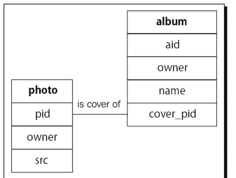

好了，这解释了一张照片如何连接到一个相册。我们可以用以下 FQL 查询找出哪个相册以某张照片作为封面：

```
SELECT aid
FROM album
WHERE cover_pid = «specific photo's ID»
```

反过来，我们可以用这个查询找出哪个照片是某个相册的封面：

```
SELECT pid
FROM photo
WHERE pid = «album's cover_pid»
```

……实际上，我们可以用一个非常相似的查询找出某个相册中有哪些照片：

```
SELECT pid
FROM photo
WHERE aid = «album's ID»
```

与 Graph 模型相比，这可以被认为是“反向”的，因为在 Graph 中，你获取相册对象并请求所有相关的照片：`album/photos`；而在数据库模型中，你获取照片表并请求所有属于某个相册的行：`FROM photo WHERE aid = «album id»`。

## 照片、相册及其所有者

你注意到了吗？photo 和 album 表都有一个名为 “owner” 的字段，包含所有者的用户 ID？现在，我们当然可以把它们连接起来。第一次尝试可能看起来像这样：

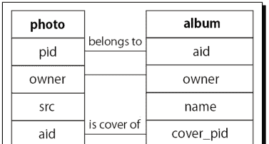

那条线上方该放什么词？聪明的猜测是“是”，因为所有者相同——小心，这是一个陷阱。

这些“实体关系”线并不连接数据库表中的*字段*；它们连接整个表，*使用*字段作为“键”。记住从左到右阅读动词的规则。如果我们使用“是”作为动词，它就会变成“照片是指定的相册”，这显然是错误的。

我们不能直接连接这两张表，因为它们的关系是通过另一个实体建立的。让我来展示一下我的意思：

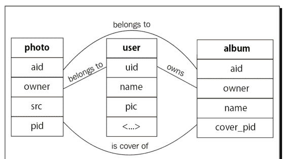

现在我们有了三张表（photo、album、user）和四个关系：

- 照片属于指定的相册
- 照片是指定相册的封面
- 照片属于指定的用户
- 用户拥有指定的相册

所以我们可以用这个查询获取某个用户所有照片的 URL：

```
SELECT src
FROM photo
WHERE owner = «user's ID»
```

## 动手实践——获取用户的相册

看看你能否写出一个等效的查询，用于获取某个用户所有相册的 URL。你需要使用的表和列名都在上面的图中，但你可以在 http://developers.facebook.com/docs/reference/fql/ 找到更多信息。

记住，你总是可以通过 API URL 调用来检查你的查询。

## 主键

你注意到了吗？关系线的一端总是指向表的主 ID？

- `photo.pid`
- `user.uid`
- `album.aid`

这些字段中的每一个都被称为该表的**主键**。这意味着任何给定的行都可以用该字段（且仅用该字段）来标识；每一行在其主键字段中都有一个值，并且没有两行具有相同的主键值。

通过用粗体书写主键的名称，我们可以更容易地理解表之间的关系。

我们也有一个名称，用于指向其他表主键的字段，比如：

- `photo.owner`（链接到 `user.uid`）
- `photo.aid`（链接到 `album.aid`）
- `album.cover_pid`（链接到 `photo.pid`）

我们称这些为**外键**，并且倾向于在任何图中用斜体书写它们。

我们之前关于 **photo**、**user** 和 **album** 表的图可以重新绘制，如下一张截图所示：

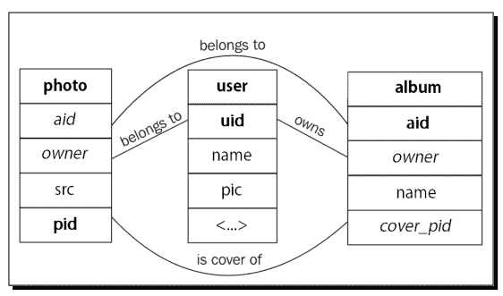

## 乌鸦脚

所以我们有两条线连接 album 表和 photo 表。

对于给定的相册，这两个查询的结果有什么不同？

```
SELECT pid
FROM photo
WHERE aid = «album ID»
```

和

```
SELECT pid
FROM photo
WHERE pid = «album's cover_pid»
```

答案是，第一个可能返回多个照片的 ID，而第二个只会返回一个。我们可以在关系语句的措辞中明确这一点，像这样：

> 相册包含**零个或多个**照片

> 相册的封面是**一个且仅一个**照片

注意，我必须反转句子，以“相册”而不是“照片”开头，这样才有意义。

我们也可以在图中表示这一点；我们使用所谓的**乌鸦脚标记法**：

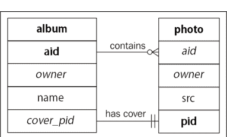

顶部线右侧的三个叉（“**乌鸦脚**”）表示“多”，圆形表示“零”，所以这读作“零到多”或“零或多个”。底部线右侧的一对横线表示“一个且仅一个”。

不过，这并没有说明全部情况。并非所有照片都是相册的封面照片。我们需要反转句子来用语言解释：

> “照片属于一个且仅一个相册”

> “照片是零个或一个相册的封面”

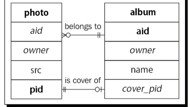

这里，顶部线上的一对横线再次表示“一个且仅一个”，而圆和横线表示“零或一个”。我保留了线上的其他标记，但由于表现在调换了方向，它们位于左侧而不是右侧。

一开始阅读这些图有点棘手；最好的方法是将它们分解成我们在这里所做的成对句子。你最终会掌握的。

## 动手实践——绘制你自己的乌鸦脚

学习使用乌鸦脚标记法的另一种方法是绘制你自己的图。重新绘制连接 photo、user 和 album 表的图，并在每条线的每一侧添加适当的标记。记住从成对的关系语句开始，弄清楚你需要表达什么！

你可以用铅笔和纸来完成，但如果你想进一步为所有表绘制图，可以考虑使用像 DbSchema 这样的软件：http://www.dbschema.com/。记住，表和列的列表可在 http://developers.facebook.com/docs/reference/fql/ 获取。

## 链接表

我们如何在朋友之间创建同样的链接？嗯，这必须是 user 表与其自身之间的关系，所以一个不错的初步猜测是：

> “一个用户与零个或多个用户是好友”


……反过来写的句子也完全相同。到目前为止，一切顺利。不过，当我们尝试把它画出来时，事情就变得棘手了。下面这两种方式可行吗？

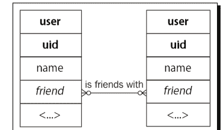

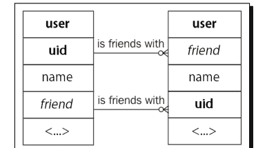

不行。这是数据库模型的一条基本规则：表之间不能存在“多对多”关系。这里我们尝试的是两张表相同的情况，但即使表不同，这条规则也同样适用。

我想那我们最好放弃吧。当然，其实并非如此。相反，我们使用一种称为“链接表”的东西：

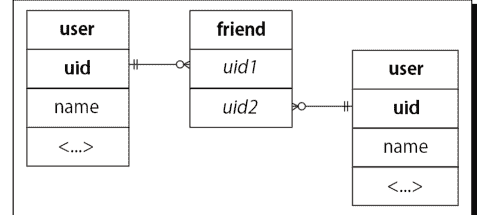

这些关系的标签很棘手；由于链接表不是实实在在的东西，合适的标签必须像是“被分配给”，这没什么帮助。实际上，链接表本身就表达了这种关系，所以你通常可以完全省略标签。或者，也可以像它们通过链接表连接那样来标注，比如“是……的好友”。

这使得查找用户的好友比查找他们的照片要困难一些。不过，我们可以像这样获取好友 ID 的列表：

```
SELECT uid2
FROM friend
WHERE uid1 = «user's ID»
```

## 刚才发生了什么？

该查询将获得与指定用户为好友的所有用户的 ID 列表。别担心，每一行都会以 ID 顺序调换的方式重复存储；如果有一行是“uid1 = 123”和“uid2 = 456”，那么就会有另一行是“uid1 = 456”和“uid2 = 123”。这意味着如果你只查询 uid2 的值，也不会漏掉任何人。

获取用户好友姓名的列表则更难一些。让我们考虑一下如何借助 AS3 来实现。

## 动手实践 – 使用 AS3 获取用户好友的姓名

我们可以从使用上面的查询获取用户好友的 ID 列表开始：

```
SELECT uid2
FROM friend
WHERE uid1 = «user's ID»
```

从本章前面的内容可知，我们可以调用这个 API URL 来获取该列表：

```
https://api.facebook.com/method/fql.query?access_token=«access_token»&format=json&query=SELECT%20page_id%20FROM%20page%20WHERE%20name%20=%20%22Facebook%22
```

不过，实际上这样是行不通的。就像使用 Graph API 访问私人信息一样，你需要使用访问令牌。（关于如何生成访问令牌，可参阅第 3 章。）

那么，正确的 API URL 是：

```
https://api.facebook.com/method/fql.query?access_token=ACCESS_TOKEN&format=json&query=SELECT%20page_id%20FROM%20page%20WHERE%20name%20=%20%22Facebook%22
```

有了用户的 ID，我们可以使用以下查询获取他们的姓名：

```
SELECT name
FROM user
WHERE uid = «user's ID»
```

## 权限

仅仅因为你不是通过 Graph 访问数据，并不意味着你可以随意获取任何你想要的信息。你仍然受到与之前相同的身份验证要求的约束。例如，你需要一个访问令牌才能运行此查询：

```
SELECT uid
FROM user
WHERE name="Michael James Williams"
```

在使用 FQL 时，扩展权限仍然适用。如果你在没有任何权限的情况下尝试查询 `mailbox_folder` 表，你将收到一个 `error 612`，提示你 **邮箱需要 read_mailbox 扩展权限。**

在撰写本文时，文档中还没有指南说明访问特定表（或字段）需要哪些扩展权限。最接近的是这个页面，它从 Graph 的角度进行了描述：http://developers.facebook.com/docs/authentication/permissions。

## 检查现有权限

数据库模型提供而 Graph 不具备的一个很棒的功能，是能够获取当前用户被授予的扩展权限列表。

这是通过 `permissions` 表实现的，该表有很多列：

|  |  |
|---|---|
| `uid`（整数）– 用户 ID（必须是当前用户）或主页 ID |  |
| `publish_stream`（布尔值）– 如果用户或主页拥有 `publish_stream` 权限，则返回 1，否则返回 0 |  |
| `create_event`（布尔值）– 如果用户或主页拥有 `create_event` 权限，则返回 1，否则返回 0 |  |
| `rsvp_event`（布尔值）– 如果用户或主页拥有 `rsvp_event` 权限，则返回 1，否则返回 0 |  |

等等。表中每一个可能的权限都对应一列；每种情况下，值都为 1 或 0。

因此，如果当前用户的 ID 是 123456，我们可以使用以下 FQL 查询来了解他们是否已向我们的应用授予 `publish_stream` 权限：

```
SELECT publish_stream
FROM permissions
WHERE uid=123456
```

> 请注意，此限制仅要求查询字段中*至少有一个*是可索引的。`SELECT` 子句中指定的字段可以是 `FROM` 子句指定表中的任意字段。在本章后面，你将看到如何在一个 `WHERE` 子句中同时查询多个字段，其中只需有一个字段可索引。

## 这在实践中有影响吗？

一般来说，你在搜索查询中实际需要使用的字段都是可索引的；你很少会想根据用户头像的 URL 来搜索用户。不过，也有一些例外需要留意。例如，在 `event` 表中，只有 `eid` 字段（主键）是可索引的，这意味着你不能跨数据库中的所有活动进行搜索，以找到在指定地点举行或名称中包含指定词条的活动。

## 高级 FQL

到目前为止，我们所介绍的内容已经足够涵盖使用 Graph 调用所能完成的大部分操作，甚至更多。让我们来看看 FQL 更高级的特性。

## 运算符

与 AS3 中的 `if` 语句一样，FQL 的 `WHERE` 子句既可以使用逻辑运算符，也可以使用比较运算符。

## 比较

我们可以使用数学比较运算符 =、<、>、<=、>= 和 !=。（!= 的另一种写法是 <>，你可能会在网上的示例中看到。）

除了 = 之外，这些运算符的用法与 AS3 中相同。= 类似于 AS3 中的 ==，用于检查相等性而非赋值。

使用这些运算符最有用的场景，是当你想要过滤掉超过某个年龄的对象时。

## 逻辑

`AND`、`OR` 和 `NOT` 对你来说应该很熟悉，尽管在 AS3 中我们分别将它们写成 `&&`、`||` 和 `!`。

我们在本章前面已经介绍过 `IN`；它允许我们检查给定项是否存在于给定列表中。

## 牛刀小试 – 根据地点获取你的活动列表

在本章前面我们了解到，我们不能运行以下查询：

```
SELECT eid
FROM event
WHERE location = 'london'
```

这是因为 event 中唯一可索引的字段是 eid。

这里有一种绕过它的巧妙方法：

```
SELECT eid
FROM event
WHERE eid != -1 AND location = 'london'
```

不幸的是，这行不通。Facebook 会告诉你“你的语句不可索引。”唉，算了。

所以，请设计一个查询，搜索当前用户已知道的、在伦敦举行的活动——为此，你需要使用 event_member 表和 IN 运算符创建一个子查询。

（event_member 表是一个链接表，有两个可索引字段：uid，对应用户；eid，对应活动。）

## 牛刀小试 – 找出不速之客

想要更大的挑战吗？

选择一个拍摄了大量照片的活动。使用 FQL 和 AS3，编写一段代码，接收一个活动 ID 和该活动相册的 ID 列表，并输出在相册中被标记但未被邀请参加该活动的人的姓名列表。

## 排序

ORDER BY 子句允许我们按特定字段对结果进行排序。例如，你可以像下面几行代码所示，获取你自己的好友列表：

```
# SELECT name
# FROM user
# WHERE uid IN (
    * SELECT uid2
    * FROM friend
    * WHERE uid1 = « your User ID »
```

你可以添加以下新子句，按字母顺序显示它们：

```
SELECT name
FROM user
WHERE uid IN (
    SELECT uid2
    FROM friend
    WHERE uid1 = «your User ID»
)
ORDER BY name
```

编写 ORDER BY name DESC 可按降序排序，或编写 ORDER BY name ASC 按升序排序。默认值为 ASC。

当在 Flash 中检索需要按特定顺序显示的数据时，这非常有用；所有工作都可以在服务器端完成，而不必获取所有数据并用 AS3 排序。这一点是 Graph 调用无法做到的。

## 分页

与 Graph 一样，分页主要有两种方式：按日期或按数字。

按日期分页使用比较运算符：

```
SELECT aid
FROM album
WHERE owner = «your User ID» AND created < «latest date» AND created > «earliest date»
```

你还可以使用算术运算符（+、-、/、*）来让日期比较更易于阅读：

```
SELECT aid
FROM album
WHERE owner = «your User ID» AND created < «certain date» AND created > «certain date» - 10
```

按数字分页使用 LIMIT 和 OFFSET，就像 Graph 调用一样：

```
SELECT aid
FROM album
WHERE owner = «your User ID»
LIMIT 15
OFFSET 30
```

更多关于分页的信息，请参阅第 4 章。


## 一次调用多个查询

如果你知道需要调用不止一个查询，并且这些查询的调用顺序并不重要，你可以通过一个 API URL 将它们全部调用来提高性能。所有结果将一次性返回。

语法是：

```
https://api.facebook.com/method/fql.multiquery?queries=["SELECT x FROM a WHERE c", "SELECT y FROM b WHERE d"]&access_token=«access_token»
```

尽管在这个示例中我只使用了非常简单的查询，但你并不限于这些。

## 小测验

+   1. 何时使用 FQL 而不是 Graph API 才有意义？
+      a. 当发布信息到 Facebook 时
+      b. 当尝试检索特定字段列表时
+      c. 当尝试了解用户的扩展权限时
+   2. 何时使用 Graph API 而不是 FQL 才有意义？
+      a. 当发布信息到 Facebook 时
+      b. 当尝试检索特定字段列表时
+      c. 当尝试了解用户的扩展权限时
+   3. 数据库表中的列和行与 AS3 模型中的对象和属性如何对应？
+      a. 列像属性，行像对象
+      b. 列像对象，行像属性

## 总结

在本章中，你从对 FQL 一无所知，到能够使用它进行比 Graph API 更高级的搜索查询。你还了解了一些 Graph API 不支持的技术，例如如何获取当前用户被授予的扩展权限列表。

要点如下：

+   - 数据库将数据安排成表、列、行和字段
+   - FQL 代表 Facebook Query Language
+   - 提交 FQL 查询的 API URL 为 https://api.facebook.com/method/fql.query?access_token=ACCESS_TOKEN&format=FORMAT&query=FQL_QUERY — FORMAT 可以是 json 或 xml
+   - FQL 查询必须查询可索引字段
+   - 通过将两张表的名称（不是列！）与线前的动词组合起来阅读实体关系线
+   - 可以查询权限表以了解经过身份验证的用户被授予了哪些扩展权限
+   - 表及其列的列表（附带哪些字段可索引的指南）可以在 http://developers.facebook.com/docs/reference/fql/ 找到

在下一章中，我们将总结本书中迄今为止学到的所有内容，并完成你的应用程序的整体构建。

## 在 Facebook 上

截至撰写时，有三种方式让用户从 Facebook 网站内访问你的应用程序：在 IFrame 中，通过 FBML，以及在 Page Tab 中。我们将依次介绍这些是什么，以及如何使用它们。

## IFrame

还记得 frames 吗？它们回来了...

在九十年代，每隔一个网站都使用 HTML <frame> 标签来布局页面。这种时尚最终被更干净、更适合书签的方法所取代，并且从未被怀念。

但现在 frames 又在普遍使用——或者更确切地说，它们的姐妹标签 <iframe>。

IFrame，或“内联框架”，允许你将一个完整的网页完全嵌入到另一个网页中，即使这两个页面位于不同的服务器和域中。如果你查看例如 FarmVille 应用程序页面（http://apps.facebook.com/onthefarm/）的源代码，你会看到情况确实如此，如下一张截图所示：

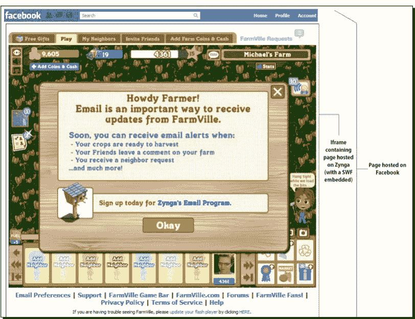

Facebook 站点上的页面称为 Canvas（不要与 HTML5 的 canvas 混淆）。

现在，我们已经有一个托管在外部主机上的页面（嵌入了 SWF）：http://host.com/visualizer/index.html。我们不需要对该页面做任何更改即可将其加载到 Facebook 上的 IFrame 中；设置全部在 Facebook 开发者应用程序中。

## 动手时间 – 设置一个 IFrame 应用程序

浏览到 http://www.facebook.com/developers/apps.php 并在列表中找到你的应用程序。选择它，然后点击 Edit settings。从左侧菜单中选择 Facebook Integration。

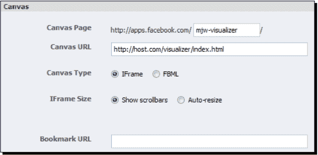

设置可以在上一张截图中看到。以下是它们的含义，以及应如何设置：

+   ♦ Canvas Page：这是用户将在 Facebook 内浏览以加载你的应用程序的 URL。正如我们上面看到的，FarmVille 使用 http://apps.facebook.com/onthefarm。输入一个简短且描述性的名称；它不必太巧妙，因为用户更可能通过 Facebook 书签到达该页面，而不是通过输入 URL。你以后可以更改此 URL。
+   ♦ Canvas URL：这是被加载到位于 Canvas 页面内的 IFrame 中的页面的 URL。你的应用程序可以包含用户可以在其间导航的多个 HTML 页面；Canvas URL 是将被加载的第一页。将其设置为你的应用程序的 URL，即 http://host.com/visualizer/index.html。
+   ♦ Canvas Type：IFrame 或 FBML。我们目前使用 IFrame；我们将在本章后面介绍 FBML。

## 动手时间 – 将应用程序添加到 Page 标签

要将你的应用程序作为你在管理的 Page 上的标签添加，你必须首先将其标记为可以嵌入到标签中。打开应用程序的设置，并导航到 Facebook Integration 部分。在 Page Tabs 子部分中，输入以下内容：

+   - **Tab Name**：要在标签上显示的名称（保持简短）
+   - **Tab URL**：应用程序网页的文件名，相对于 Canvas URL
+   - **Edit URL**：留空

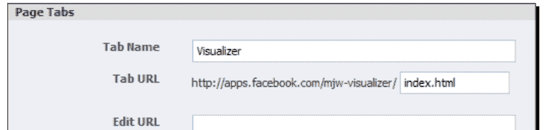

接下来，从开发者仪表板浏览到应用程序的 Application Profile Page，并从左侧菜单点击 Add To My Page：

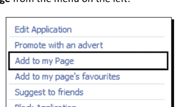

> 将添加到我的页面的收藏夹会将应用程序的个人资料链接到你的 Page，而不是应用程序本身。

你会得到一个你控制的 Pages 列表；如果你没有 Page，可以按照 http://www.facebook.com/FacebookPages 上的说明学习如何创建一个。

但让我们看看当你能够创建它们时，你需要了解有关标签的知识。

从技术角度来看，最重要的点是标签的宽度只有 520 像素，因此在布局你的应用程序及其标签页面时请记住这一点。你甚至可能希望创建一个单独的网页来容纳 SWF——甚至是单独的 SWF——用于标签内使用。

如果你为一家公司制作了一个广告游戏，并集成了 Facebook 以在游戏中使用玩家自己的名字并让他们将分数发布到他们的 Wall 上，你可以将游戏放在该公司 Facebook 页面的标签上，而不是仅使用独立的应用程序页面。

Adobe 就采用了这种方法，使用他们的 Flex 测验游戏 Cube Builder：

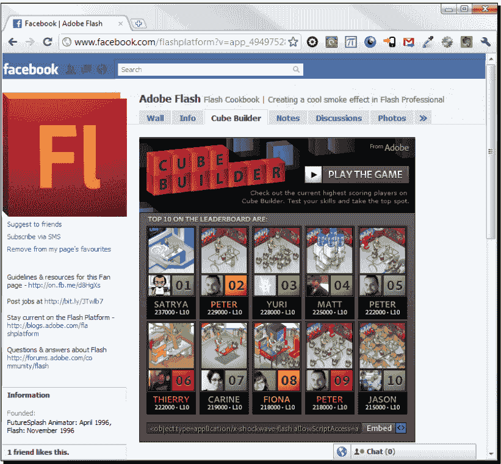

门户可能会阻止 SWF 从外部站点加载数据，这意味着访问即使是公共 Graph 数据也会变得棘手或不可能。这不太可能——如果完全阻止外部资源，游戏内广告如何工作？——但值得留意。

真正的难题在于身份验证。这有两个原因：

+   ♦ 为了获得访问令牌，我们在 SWF 嵌入的页面内调用一个 JavaScript 函数。但 Flash 游戏门户不让我们访问网页的源代码，因此我们无法插入此 JavaScript 函数以运行。此外，门户很可能会阻止 SWF 使用 `ExternalInterface` 调用 JavaScript 函数，因为它们可能构成安全风险。
+   
+   ♦ 在第 3 章中，我们了解到我们必须将 Site URL 设置为与应用程序主机的基本域名相匹配。如果它们不匹配——比如说，如果你的应用程序位于 `http://portal.com/games/awesomegame.html` 但 Site URL 设置为 `http://host.com/~` Facebook 将不允许用户进行身份验证。这意味着我们不能允许托管在不同门户上的游戏通过同一个 Facebook 应用程序进行身份验证。

因此，很遗憾，Facebook 并未为可以从不同站点运行的 SWF 设计其应用程序模型。一个可能的变通方法是导入一个托管在你自己的服务器上的单独 SWF 到主游戏 SWF 中，并让该单独的 SWF 处理身份验证……但实现这一点超出了本书的范围。

不过，你不必自己做所有这些工作！如果你不需要访问整个 Graph API，而只想能够在用户的 Wall 上发布消息、检索他们的个人资料信息并获取他们的 Facebook 好友列表，那么你可以使用 Mochi Social Platform。

这是一个由 Mochi Media 提供的免费 ActionScript API，它与 Facebook、Twitter 和 MySpace API 集成，允许你发布到并访问这三个社交网络的数据。它还允许你存储关于玩家的任意数据并将其链接到他们的社交网络个人资料。这意味着你可以存储他们的最高分数、其他统计数据，甚至他们构建的整个自定义关卡。

更多信息，请访问 `http://www.mochimedia.com/developers/social.html`。

## 作为桌面 AIR 应用程序

尽管我们编写的大部分 `HTTPRequestor` 代码在桌面 AIR 应用程序中无需任何更改即可工作，但有一个障碍：身份验证。由于在使用 AIR 时，我们没有嵌入在 HTML 页面中的 SWF，我们如何显示 Facebook 授权页面、获取访问令牌并将其传递给 AS3 函数？


## 行动时间 – 通过 AIR 使用 HTTP 进行授权

与其将我们的应用程序放在 HTML 页面中，我们必须将 HTML 页面放在我们的应用程序中。为此，我们可以使用 `HTMLLoader`。

`flash.html.HTMLLoader` 类，仅在 AIR 中可访问，是一种 `DisplayObject` 类型，它充当 HTML 内容的容器。我们用它来加载应用程序的 Facebook 登录页面，就像我们在第 3 章中使用弹出窗口所做的那样。在那一章中，一旦用户登录，弹出窗口就会重定向到另一个页面，将访问令牌作为哈希的一部分传递，而该页面的源代码中的 JavaScript 会提取哈希并将其传递给 SWF。在 AIR 中，我们的应用程序将使用事件侦听器来检测此重定向，并直接提取哈希。

以下是其分解方式。这些是通用说明，而不是针对 Visualizer，因此请根据项目需要进行实现：

1. 首先，导入 `HTMLLoader`。

   ```
   import flash.html.HTMLLoader;
   ```

2. 接下来，创建此类的一个实例，并添加事件侦听器以在内容被重定向时触发。

   ```
   var htmlLoader:HTMLLoader = new HTMLLoader();
   htmlLoader.addEventListener(Event.LOCATION_CHANGE, onRedirect);
   ```

   （不要忘记 `import flash.events.Event`。）

3. `HTMLLoader` 默认的宽度和高度为零，这没有用，因为我们需要用户在其中点击按钮！因此，请调整其大小。

   ```
   var htmlLoader:HTMLLoader = new HTMLLoader();
   htmlLoader.addEventListener(Event.LOCATION_CHANGE, onRedirect);
   htmlLoader.width = 640;
   htmlLoader.height = 480;
   ```

4. 将其添加到显示列表中以便可见。

   ```
   var htmlLoader:HTMLLoader = new HTMLLoader();
   htmlLoader.addEventListener(Event.LOCATION_CHANGE, onRedirect);
   htmlLoader.width = 640;
   htmlLoader.height = 480;
   addChild(htmlLoader);
   ```

5. 加载 Facebook 授权 URL：

   ```
   var stageWebView:StageWebView = new StageWebView();
   stageWebView.stage = this.stage;
   stageWebView.viewPort = new Rectangle(0, 0, stage.stageWidth, stage.stageHeight);
   stageWebView.addEventListener(LocationChangeEvent.LOCATION_CHANGE, onRedirect);
   var authURL:String = "https://graph.facebook.com/oauth/authorize?client_id=<application_id>&type=user_agent&redirect_uri=<redirect_url>";
   stageWebView.loadURL(authURL);
   ```

6. 请注意，`StageWebView.loadURL()` 方法不需要 `URLRequest`，而是需要一个 `String`。

7. 以与之前相同的方式从哈希中提取访问令牌：

   ```
   private function onRedirect(a_event:LocationChangeEvent):void
   {
       var stageWebView:StageWebView = a_event.target as StageWebView;
       if (stageWebView.location.indexOf("#") != -1)
       {
           var hash:String = stageWebView.location.substr(stageWebView.location.indexOf("#") + 1);
           setAccessToken(hash);
       }
   }
   ```

8. 你不能使用 `removeChild()` 来移除 `StageWebView`，因此使用此方法：

   ```
   private function onRedirect(a_event:LocationChangeEvent):void
   {
       var stageWebView:StageWebView = a_event.target as StageWebView;
       if (stageWebView.location.indexOf("#") != -1)
       {
           var hash:String = stageWebView.location.substr(stageWebView.location.indexOf("#") + 1);
           setAccessToken(hash);
           stageWebView.stage.nativeWindow.close();
       }
   }
   ```

这样就可以工作了！我们只需要做一个小小的调整。在 Android 上，StageWebView 使用 Android 操作系统系统网络控件（在桌面 AIR 中，使用内部 AIR WebKit 引擎）。由于我们无法完全控制它，因此我们需要确保它不会做任何意外的操作，例如打开浏览器应用程序。

9. 为此，只要 StageWebView 实例分派 `LOCATION_CHANGING` 事件，就阻止其默认操作（该事件在位置更改前立即分派）：

   ```
   var stageWebView:StageWebView = new StageWebView();
   stageWebView.stage = this.stage;
   stageWebView.viewPort = new Rectangle(0, 0, stage.stageWidth, stage.stageHeight);
   stageWebView.addEventListener(LocationChangeEvent.LOCATION_CHANGE, onRedirect);
   stageWebView.addEventListener(LocationChangeEvent.LOCATION_CHANGING, onRedirecting);
   var authURL:String = "https://graph.facebook.com/oauth/authorize?client_id=<application_id>&type=user_agent&redirect_uri=<redirect_url>";
   stageWebView.loadURL(authURL);

   private function onRedirecting(a_event:LocationChangeEvent):void
   {
       var stageWebView:StageWebView = a_event.target;
       a_event.preventDefault();  //stop any unexpected default behavior
       stageWebView.loadURL(a_event.location);
       //...but continue loading the URL
   }
   ```

## 发生了什么？

使用 StageWebView，你已通过 AIR for Android 应用程序使用 Facebook 对用户进行了身份验证。由于 URLLoader 实例可以在 AIR for Android 中与在常规 SWF 中相同的方式使用，这意味着你现在可以使用 Flash 创建完全集成 Facebook 的 Android 应用程序。

## 试试英雄 – 修改 SDK 以用于 Android

截至撰写本文时，SDK 使用 `HTMLLoader` 进行 AIR 身份验证，并使用 JavaScript 进行 SWF 身份验证，因此无法用于对 Android 应用程序进行身份验证。如果你真的想在 Android 项目中使用 SDK，你就必须自己做一些更改。

为 SDK 添加基于 StageWebView 的登录功能。不要修改现有的 SDK 类文件，而是创建扩展现有类的新类文件——这样，如果你将来更新 SDK，它们就不会丢失。

这是一个棘手的挑战，因为你将修改他人的代码，但如果你想使用 SDK，这也是值得的。

## 选择应用程序的 Facebook 设置

应用程序的设置不仅仅是 Canvas URL。以下是一些更有趣的选项：

- **Advanced | Deauthorize Callback**：在这里你可以指定一个 URL，每当用户移除你的应用程序时就会调用该 URL；用户的 ID 将传递给此 URL。为了对该 ID 做些什么，你需要使用服务器端脚本语言——请参阅本章后面的“下一步？”。有关解码信息的更多信息，请访问这里：http://developers.facebook.com/docs/authentication/
- **About | Developers**：允许你将其他用户设为应用程序的开发者，从而让他们访问应用程序设置。
- **Advanced | Sandbox Mode**：非常适合测试，这将只允许列为该应用程序开发者的用户登录你的应用程序。
- **Facebook Integration | Bookmark URL**：在 Facebook 主页的左侧，你可以看到你使用过的应用程序和游戏列表。这些被称为 **Bookmarks**；设置 Bookmark URL 可让你选择这些链接指向的位置。Bookmark 右侧的数字称为 **Counter**，可让用户了解应用程序内的通知和更改。阅读有关 Counters 的更多信息：http://developers.facebook.com/docs/guides/canvas/#bookmarks。
- **About | Icon and About | Logo**：图标出现在 Bookmarks 旁边以及通过你的应用创建的墙贴下方，而徽标则出现在授权页面和搜索结果中。

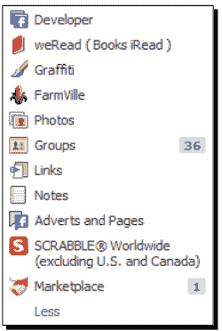

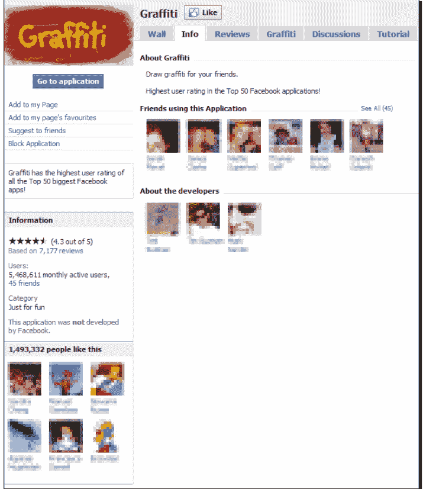

缩略图图像使用 Graffiti 绘制，给出了它可以做什么的快速示例。关于段落简洁地概括了应用程序的目的，而描述则增加了一些社会认同：“很多人喜欢这个，所以你可能也会喜欢！”

实际上，页面的很大一部分都是关于社会认同（对于社交网络上的社交应用来说也许并不奇怪）：

- 显示使用该应用程序的朋友
- 平均用户评分（4.3 分之 5）
- 大量的评论


+   - 数百万月活跃用户
+   - 大量点击过那个**赞**按钮的用户

显然，你对这些没有任何直接控制权！但它们确实在很大程度上影响着人们对你应用或游戏的看法，所以请记住这一点。

## 动手实践——创建你的应用资料页

在 Developers 应用中浏览到你的应用列表，从列表中选择你的应用，然后点击**应用资料页**。


**开始使用**标签页将引导你完成头像、状态更新和基本信息的设置。记住，你的主要目标是让人们点击**前往应用**按钮！

## 类风湿性关节炎

类风湿性关节炎是一种以关节滑膜慢性炎症为特征的自身免疫性疾病。常表现为对称性多关节炎，可导致关节软骨和骨破坏。

**临床表现**：多见于女性。早期表现为晨僵、关节肿痛，常累及近端指间关节、掌指关节和腕关节；晚期可出现关节畸形。

- 关节外表现：类风湿结节、间质性肺病、血管炎。
- 实验室检查：类风湿因子阳性、抗CCP抗体阳性、血沉增快、CRP升高。

**诊断**：主要依据临床表现、实验室检查和影像学检查。

| 药物 | 用法 |
| --- | --- |
| 甲氨蝶呤 | 7.5-25 mg，每周1次 |
| 柳氮磺吡啶 | 0.75-3 g/d |
| 羟氯喹 | 0.2-0.4 g/d |

**治疗**：应尽早使用改善病情抗风湿药，同时注意监测药物不良反应。

> > 早期诊断和规范治疗是改善类风湿性关节炎预后的关键。

## 测试用户

Facebook 政策禁止任何人创建多个用户帐户。不过，现在可以使用 Graph API 创建最多 50 个专门用于测试应用的用户帐户。

更多信息，请参阅 http://developers.facebook.com/docs/test_users。

## 新版消息

2010年11月，Facebook 宣布推出备受期待的“Gmail 杀手”——新版消息。该功能允许用户将消息、短信、聊天和电子邮件整合到同一个会话线程中，实现跨平台通信。

Graph API 和 FQL 将可通过名为 `/thread/` 的新连接来访问这些消息。

更多信息，请参阅 http://developers.facebook.com/docs/reference/api/thread 上的文档。

## Facebook 开发者资源

这里有一些非常适合加入浏览器书签和 RSS 阅读器的优秀网站。

## Facebook 官方资源

- ♦ 所有 Facebook 开发者的核心信息来源是 http://developers.facebook.com/。在这里，你可以访问涵盖 API 各个方面的海量文档，以及（非常活跃的）开发者论坛，在那里可以与他人讨论应用开发。
- ♦ 你还可以通过平台实时状态页面 http://developers.facebook.com/live_status 查看 Facebook 平台的当前状态。如果你的应用出现问题，而你在自己这边找不到原因，可以查看此页面，了解问题是否出在 Facebook 一方。
- ♦ 你还应该了解 Facebook 平台缺陷跟踪系统：http://bugs.developers.facebook.net/。由于平台变更非常频繁，偶尔会出现一些缺陷。这个缺陷跟踪系统可帮助你向 Facebook 管理员反馈缺陷；它也可以用来确认你遇到的问题是否是常见缺陷。

## 其他优秀网站

整个 InsideNetwork（http://www.insidenetwork.com/）对 Facebook 开发者来说具有极高的阅读价值。它包括：

- Inside Facebook：http://www.insidefacebook.com/ – 关于 Facebook 和 Facebook 平台的新闻
- AppData：http://www.appdata.com/ – Facebook 应用的指标和流量趋势分析
- PageData：http://pagedata.insidefacebook.com/ – 与 AppData 类似，但针对的是 Facebook 主页而非应用
- Inside Virtual Goods：http://www.insidevirtualgoods.com/ – 关于虚拟商品的研究、数据和分析（一旦 Facebook Credits 公开推出，这将尤其相关）
- Inside Social Games：http://www.insidesocialgames.com/ – 关于不断增长的社交游戏市场（包括 Facebook 游戏）的新闻与分析

另一个关于 Facebook 游戏开发的优秀博客是 Facebook Indie Games：http://fbindie.posterous.com/。

随着你阅读越来越多的此类网站，你会遇到各种可能不认识的术语和缩写，例如 DAU、MAU 和 K 因子。Wavedash.net 提供了一个有用的参考，说明其中许多术语的含义：http://www.wavedash.net/2010/04/the-secret-glossary-of-social-games-analytics/。

博客“Cognition.ca”中关于 Facebook 开发的帖子不多，但其中有两篇我觉得非常有用：

- http://www.cognition.ca/2007/11/using-ssh-tunnels-to-develop-facebook-applications.html
- http://www.cognition.ca/2008/02/facebook-application-development-how-to-11-tips-you-dont-want-to-miss.html

也请看看后一篇文章的评论。虽然其中有些信息已经过时，但确实有一些很好的建议，比如设置应用测试版本，以免将未经测试的更改推送到线上版本。

在第6章中，我提到过 Facebook 不允许你通过官方 Facebook 赞按钮以外的任何方式给 Graph 对象（帖子除外）“点赞”。嗯，这不完全正确——Hook 团队似乎已经攻克了这个问题。详情请参阅这篇博文（但请记住，Facebook 不希望你这样做，所以无法保证这个方法永远有效）：http://labs.byhook.com/2010/08/03/facebook-like-button-in-flash/。

## 我，我，我

我的网站是 http://michaeljameswilliams.com/。在那里，你可以找到我的 Flash 游戏开发教程博客，如果你有任何问题或想雇用我，也可以与我联系。我在 Twitter 上的账号是 @MichaelJW。

我也是 http://active.tutsplus.com/ 的编辑，该网站发布包括 Facebook 应用开发在内的 Flash 教程。

是的，我在 Facebook 上，但恐怕我不会加你好友——抱歉！我喜欢把好友列表精简为仅限于现实中认识的人。（这是不是有点讽刺？）不过，你可以通过我的公共主页与我联系：http://www.facebook.com/pages/Michael-James-Williams/16957343058884– 给我留言，告诉我你对这本书的看法！

## 跟上扎克伯格们的节奏

Facebook 一直在更改和改进其服务。事情总是在变化；作为开发者，你必须应对这一点。

更重要的是，你必须接受这一点。每当 Facebook 宣布新功能、移除旧功能或更改现有功能时，开发者们就会群起抱怨，说这将使他们的应用瘫痪，使他们的进度大幅倒退，并让他们失去大量收入和用户。

大声表达不满没问题，但在某个节点上，这就变成了否认现实。只要你使用 Facebook 网站一段时间，你就会知道，他们乐于进行大规模、彻底的更改——例如推出动态消息（News Feed），移除用户主页上的标签页和框（Tabs and Boxes）——并且不顾用户抱怨而坚持到底。而且通常，他们对如何让网站变得更好的直觉是正确的。

因此，API 领域也是如此，这并不奇怪。也许这对开发者不公平，但这不太可能会改变。所以请记住，在构建项目时，如果它过度依赖 Graph API 的某一个单一特性（或 Facebook 界面，或可用数据），那么你就有被釜底抽薪的危险。请记住与客户商定好定价结构，这样几个月后当他们的项目中的 Facebook 集成代码需要更改时，你不会因为合同而被要求免费来做。

幸运的是，你对 Graph API 的了解基于核心概念，而非具体实现。你理解 Graph 本身，而不仅仅是知道如何复制粘贴与 Facebook 相关的 AS3 代码片段。这意味着你将能够应对任何新事物。

## 应对变化

请留意以下两个页面：

- Facebook 开发者博客：http://developers.facebook.com/blog/
- Facebook 开发者路线图：http://developers.facebook.com/roadmap

该博客会宣布与开发者相关的更改，而路线图则简要总结这些即将到来的更改。

通常，新更改会在实施前几周甚至几个月就公布。通常情况下，你可以在迁移被强制执行之前的某段时间内在应用中启用这些更改，这对测试你需要对代码进行的改动很有用。

现在就去阅读该博客自 2010年11月（本书完成之时）以来的存档，然后订阅它以定期获取更新。这样，你就能保持与时俱进。

## 小结

在本章中，我们探讨了如何从技术问题转向实际问题，以及接下来该何去何从。剩下的就是你去大展身手，创建一些精彩的 Facebook 应用了！

祝你在开发工作中一帆风顺。我和参与本书的所有人都感谢你的阅读！希望这本书对你有用。如果你开发了任何 Facebook 应用或游戏，请告诉我——我很想看看它们。


## 第5章

| 问题 | 答案 | 解释 |
| --- | --- | --- |
| 1 | d | 可能是以上任何一种 |
| 2 | b | 第一个不会作为第二个的过滤器，这与所有其他 Graph Search URL 不同 |
| 3 | a, d | 结果是个性化的，因此更相关的结果排名更高<br>可以使用更多类型的搜索（如用户） |

## 第6章

| 问题 | 答案 | 解释 |
| --- | --- | --- |
| 1 | c | HTTP 要求我们在更改数据时使用“不安全”的方法 |
| 2 | b | 这些代码可以为我们提供关于发布尝试失败原因的额外信息 |
| 3 | a | 没有 |

## 第7章

| 问题 | 答案 | 解释 |
| --- | --- | --- |
| 1 | b, c | 当尝试检索特定的字段列表时<br>当试图查明用户的扩展权限时 |
| 2 | a | 当向 Facebook 发布信息时 |
| 3 | a | 列类似于属性，行类似于对象 |

### F

- Facebook API
  - 约 290
  - Facebook Chat API、JavaScript SDK 291
  - Insights API、JavaScript SDK 290
  - Internationalization API、JavaScript SDK 291
  - JavaScript SDK 290
- Facebook 应用目录 288, 289
- Facebook Chat API 291
- Facebook Developer
  - URL 72
- Facebook Developer Blog
  - URL 296
- Facebook 开发者资源
  - 官方 Facebook 资源 293
  - 其他网站 294
- Facebook Developer Roadmap
  - URL 296
- Facebook 功能
  - Facebook 信用 292
  - 新消息 293
  - 测试用户 293
- Facebook.login() 方法 114
- Facebook 页面
  - 加载 24
- Facebook.postData() 方法 199
- Facebook 查询语言。参见 FQL
- FBML 270
- 信息流
  - 搜索 171
  - 通过可视化工具搜索 175-181
- 字段 237
- FileZilla
  - URL 13
- 筛选按钮 138
- flash.display.Loader 类 36
- Flash 游戏门户 274, 275
- 用于 Firebug 的 Flash Tracer 19
- FQL
  - 关于 235
  - 数据模型 237
  - 数据表示 238
  - 重新创建现有 Graph API 调用 254
  - 字段 237
  - 接口 236, 237
- FQL 高级
  - 关于 258
  - 比较运算符 258
  - 逻辑运算符 258
  - 调用多个查询 262
  - 运算符 258
- FQL 查询构建器
  - 创建 242
- friends_interests 扩展权限 102
- friends 属性 213
- 好友的墙贴
  - 搜索 172
- FROM 子句 258
- from 属性 61
- FTP（Media Temple 的说明）
  - URL 13
- 函数，FQL
  - lower(string) 261
  - me() 261
  - now() 261
  - rand() 261
  - strip_tags(field) 261
  - strlen(string) 261
  - strpos(string, term) 261
  - substr(string, startpos, length) 261
  - upper(string) 261

### G

- Graph
  - 作为层 254
  - 遍历 61, 62
- Graph API
  - 关于 21, 69
  - 通过 AS3 访问 27-30
  - 通过浏览器访问 24
- graph.GraphList 类 41
- graph.GraphObject 33
- GraphList 类 41
- GraphList 实例 43
- GraphList 实例 121
- Graph List 渲染器 41
- 图形模型 238
- GraphObject.as 类 33
- GraphObject 类 41
- GraphObject 实例 41
- Graph Object 渲染器 35
- graph 对象
  - 相册 227
  - 签到 230
  - 评论 222
  - 删除 214
  - 活动 RSVP 226
  - 活动 225, 226
  - 点赞 223
  - 删除点赞 223
  - 笔记 224
  - 照片 228, 229
  - 删除帖子 214
  - 使用可视化工具删除帖子 215-220
  - 发布 221
- GraphRequest 138
- GraphRequest 类 49
- GraphRequest 实例 63, 130, 135
- GraphRequest 实例
  - 添加 since 133-135
  - 添加 until 133-135
- GraphRequest 对象 167
- Graph URL
  - 关于 26
  - 使用 ids 参数 142, 143
  - 使用 ids 参数 141
  - 带授权搜索 158-160
  - 无授权搜索 153-157
- 群组
  - 创建 231

### H

- header（字符串）256
- HTTP
  - 用于通过 AIR 进行授权 276-278
- HTTP POST 方法 233
- HTTPRequestor 类 48
- HTTPRequestor() 构造函数 97, 98
- HTTPRequestor.request() 96
- HTTPStatusEvent 监听器 192

### I

- ids 参数
  - 用于 Graph URL 142, 143
- if 块 42
- IFrame
  - 关于 266, 267
  - 设置应用程序 267-270
- 收件箱消息
  - 发送 230
- 信息
  - 可视化 33-36
- 信息
  - 从页面表检索 239-242
- initComplete() 函数 108
- initialize() 函数 119
- Inside Facebook
  - URL 294
- InsideNetwork
  - URL 294
- Inside Social Games
  - URL 294
- Inside Virtual Goods
  - URL 294
- Insights API 290
- Internationalization API 291
- IOErrorEvent 监听器 85
- IO_ERROR 事件监听器 54
- IRequestor.as 接口 119
- IRequestor 接口 89, 168

### J

- JavaScript SDK
  - Facebook Chat API 291
  - Insights API 290
  - Internationalization API 291
- JSON.decode() 方法 32
- JSON.encode() 方法 230
- JSON（JavaScript 对象表示法）30
- JSON 对象
  - 反序列化 32, 33

### K

- Komodo Edit
  - URL 13

### L

- length 属性 121
- 点赞 222
- 限制
  - 添加到 GraphRequest 128, 129
  - 用于其他连接 128
- limit 参数 127
- listFilterCallback() 函数 137

### P

- 主键
  - 关于 247
  - album.cover_pid 247
  - photo.aid 247
  - photo.owner 247
- 隐私
  - 设置帖子隐私设置 211-213
- privacy 参数 208
- 个人资料页面，应用程序
  - 创建 286
  - 编辑 284, 285
- 公共个人资料 24
- 发布按钮 216
- publishComplete() 函数 198
- publish() 函数 188, 202, 221
- publish() 方法 188, 189, 207, 228
- PublishObject 222
- PublishObject 类 188
- PublishObject 实例 188, 221
- PublishObject 参数 191
- publish_stream（布尔值）255
- publish_stream 权限 223, 224

### Q

- q 参数 171

### R

- rand() 函数 261
- 实时更新 292
- redirect_uri 参数 94
- 关系数据库模型 238
- renderGraphList() 方法 41
- renderGraphObject() 方法 33
- requestComplete() 回调 111
- requestComplete() 函数 110, 168
- request() 函数 110, 113, 134
- request 方法
  - 关于 189, 190
  - 监听错误 193, 195
  - 使用 POST 方法 190-192
  - 授予所需权限 195-197
  - 通过 SDK 发布 197-199
- request() 方法 190
- 请求者
  - 关于 48
  - 创建 HTTP 请求者 48, 52, 53
- 限制，FQL
  - 关于 256
  - 使用可索引字段进行搜索 257
- result 参数 111
- 富互联网应用程序 (RIA) 8
- 富帖子
  - 发布 200-203
- rsvp_event（布尔值）255

### S

- scope 参数 101, 103
- SDK
  - 通过 AIR 授权 278, 279
  - 为 Android 修改 282
  - 通过其搜索 167-170
- SDKRequestor.attemptToAuthenticate() 方法 114
- SDKRequestor() 构造函数 108
- 搜索
  - 搜索信息流 171
  - 通过可视化工具搜索信息流 175-181
  - 搜索好友的墙贴 172
  - 使用完整搜索结果 150-153
  - 设置区域设置 170
  - 搜索新闻源 171, 172
  - 检查快速搜索结果 148-150
  - 限制 161, 162
  - 通过 SDK 搜索 170
  - 在可视化工具中实现搜索窗口 163-166
  - 通过 SDK 167-170
  - 搜索墙贴 171
  - 使用网站搜索框 147
  - 带授权 158-160
  - 无授权 153-156
- searchComplete() 168
- search() 函数 166, 167
- search() 方法 166, 168, 190
- 搜索结果
  - 检查 148-150
  - 使用完整搜索结果 150-153
- 搜索窗口
  - 在可视化工具中实现 163-166
- setAccessToken() 94, 97
- setAccessToken() 函数 94, 95, 97
- 显示按钮 47
- since 参数 158
- SOS max 19
- 源代码 15
- source 参数 208, 214
- 状态消息 199
- status 属性 192
- strip_tags(field) 函数 261
- strlen(string) 函数 261
- strpos(string, term) 函数 261
- substr() 函数 261
- substr(string, startpos, length) 函数 261
- success 参数 111
- summary（字符串）256

### T

- 表
  - 链接 249, 250
- TextMate
  - URL 13
- this.accessToken 96
- time 属性 82
- type 参数 153, 181

### U

- uid（整数）255
- until 参数 133, 158
- upper(string) 函数 261
- URLLoader 请求 48
- URL 参数 191
- URLRequestMethod 类 190
- URLRequest 对象 28, 114
- URLVariables 对象 90, 200
- URLVariables 参数 197
- 用户代理流程 81
- 用户/应用程序授权 70, 71
- user_checkins 权限 230
- 用户信息流
  - 发布到 185-189
- user_interests 扩展权限 102

### V

- 视频
  - 创建 231
- 可视化工具
  - 关于 15
  - 通过其搜索信息流 175-181
  - 在其中实现搜索窗口 163-166
- Vizzy Flash Tracer 19

### W

- 墙
  - 使用可视化工具发布到墙 207, 208
- 墙贴
  - 搜索 171
- 网络主机
  - 关于 11
  - 必要性 12
  - 选择方法 12
  - 软件要求 13
- website 属性 241
- window.open() 93

### Z

- 放大按钮 35


## 感谢您购买《使用 Flash 进行 Facebook Graph API 开发：初学者指南》

## 关于 Packt Publishing

Packt，发音为“packed”，于 2004 年 4 月出版了第一本书《Mastering phpMyAdmin for Effective MySQL Management》，此后一直专注于出版关于特定技术和解决方案的高度聚焦的书籍。

我们的书籍和出版物分享了您的 IT 同行在改编和定制当今系统、应用程序和框架方面的经验。我们基于解决方案的书籍为您提供定制软件和技术以完成工作的知识和能力。Packt 的书籍比您过去看到的 IT 书籍更具体、更少泛泛而谈。我们独特的商业模式使我们能够为您带来更集中的信息，让您获得更多需要知道的内容，减少不需要的内容。

Packt 是一家现代而独特的出版公司，专注于为开发者、管理员和新手社区制作高质量的前沿书籍。如需更多信息，请访问我们的网站：www.PacktPub.com。

## 为 Packt 撰稿

我们欢迎所有对写作感兴趣的人士垂询。书籍提案应发送至 author@packtpub.com。如果您的书的想法还处于早期阶段，并且您希望在撰写正式图书提案之前先进行讨论，请与我们联系；我们的一位策划编辑将与您联系。

我们不仅仅在寻找已出版过作品的作者；如果您有很强的技术技能但没有写作经验，我们经验丰富的编辑可以帮助您发展写作生涯，或者仅仅为您的专业知识获得一些额外奖励。


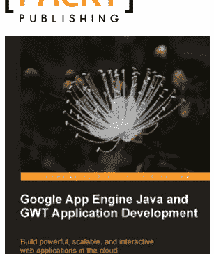

## Google App Engine Java and GWT Application Development

ISBN: 978-1-849690-44-7      Paperback:480 pages

Build powerful, scalable, and interactive web applications in the cloud

- 1. Comprehensive coverage of building scalable, modular, and maintainable applications with GWT and GAE using Java
- 2. Leverage the Google App Engine services and enhance your app functionality and performance
- 3. Integrate your application with Google Accounts, Facebook, and Twitter
- 4. Safely deploy, monitor, and maintain your GAE applications


## XNA 4.0 Game Development by Example: Beginner's Guide

ISBN: 978-1-849690-66-9      Paperback: 428 pages

Create your own exciting games with Microsoft XNA 4.0

- 1. Dive headfirst into game creation with XNA
- 2. Four different styles of games comprising a puzzler, a space shooter, a multi-axis shoot 'em up, and a jump-and-run platformer
- 3. Games that gradually increase in complexity to cover a wide variety of game development techniques
- 4. Focuses entirely on developing games with the free version of XNA

