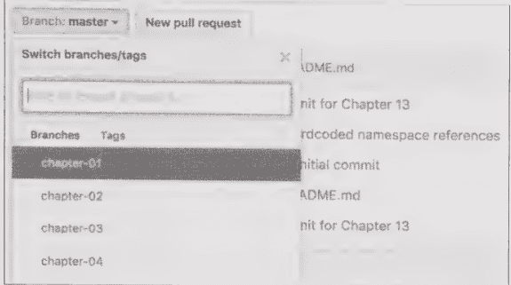
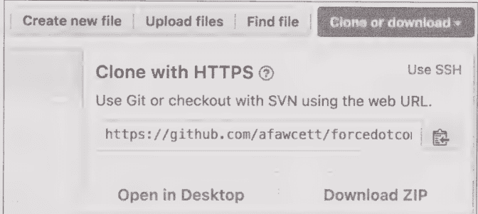

# Force.com 企业架构：架构并交付满足企业业务需求的打包Force.com应用程序 第2版


## 致谢

- **作者**
  Andrew Fawcett

- **项目协调员**
  Vaidehi Sawant

- **审稿人**
  Zarna Chintan Naik
  John M. Daniels
  Peter Knolle
  John Leen
  Aaron Slettehaugh
  Avrom Roy-Faderman

- **校对**
  Safis Editing

- **索引编制**
  Mariammal Chettiyar

- **图形**
  Jason Monteiro

- **委托编辑**
  Aaron Lazar

- **制作协调员**
  Shraddha Falebhai

- **获取编辑**
  Nitin Dasan

- **封面设计**
  Shraddha Falebhai

- **内容开发编辑**
  Rohit Kumar Singh

- **技术编辑**
  Pavan Ramchandani
  Kunal Chaudhari

- **文案编辑**
  Sonia Mathur
  Pranjali Chury

## 前言

作为 Salesforce.com 的开发者布道师，我一直看到对 Andrew 用这本书带来的这类材料的需求与日俱增。虽然我经常有幸向开发者展示 Force.com 上即将推出的新功能，但我也经常被问及如何利用这些功能并在企业开发者团队所需的生态系统中实施解决方案时的日常挑战。本书将在为这些特定顾虑提供新参考材料方面大有裨益。

2007 年，我开始在 Salesforce.com 上进行开发，当时的面貌与今天大不相同。那时没有 Visualforce。Apex 刚刚推出，缺少许多现在拥有的接口，例如 batchable 和 schedulable。大多数自定义界面是通过在 S-Controls 中嵌入大量 JavaScript 来实现的，S-Controls 是平台不再支持的部分。与平台的通信可以通过使用 AJAX 工具包的 SOAP API 完成。如果你想在服务器端拥有真正精细的业务逻辑，可以通过在 Apex 中自定义 SOAP 端点来公开它。

2014 年，平台的功能已远超那些旧日时光。借助标准控制器，Visualforce 开箱即用，无需额外代码即可提供基本业务逻辑。对于自定义处理，开发者不再局限于单一选项，而是有多种途径，从扩展 Visualforce 组件库到直接将 Apex 方法暴露给 JavaScript——这提供了旧 AJAX 工具包的灵活性，而无需访问平台 API 的范围。Apex 可以被调度，可以在后台处理记录，也可以用于创建完全自定义的 REST 端点。开发者现在可以使用 Streaming 和 Analytics 等强大的新 API，以及工业级身份服务。

平台仍在不断发展。每年在 Dreamforce 上，我们都会向平台宣布新工具、新功能和新特性。去年是 Salesforce1，随附一个新的移动应用程序，使将界面部署到智能手机变得简单且集成。即将到来的十月，我们将推出具有变革意义的创新。

技术演进的这种步伐，加上 Force.com 在企业应用中日益广泛的采用，为开发者带来了一个特定的挑战：不断地将平台视为各种用例的解决方案之外的东西，而是将其视为高效使用平台的完整生态系统。仅仅认为某个应用在平台上运行已不再足够；开发者需要考虑他们的应用程序是否以一种利用正确功能并能高效、良好共存的方式进行设计。需要有能力从高层次并带有清晰方向地审视平台的局限性。

当我们开始讨论 Andrew 基于 Martin Fowler 的关注点分离（Separation of Concerns）编写的一系列新文章，以及这些设计模式如何用于为企业解决方案开发 Apex 时，我知道 Andrew 正是具备这种能力的架构师。七年前，以这种抽象层次思考 Apex 当然是可能的——只不过并非真正必要。如今，Force.com 开发者手握所有潜在的工具和功能，而不考虑这些概念，无疑是在为未来埋下维护债务的隐患。

对熟悉其公司工作的人来说，Andrew 有条件撰写这本书并不令人惊讶。FinancialForce.com 创建了我在 Force.com 上见过的最强大的应用程序之一，作为首席技术官，Andrew 一直处于使其成功的前沿。

因此，我很高兴看到 Andrew 撰写这本书，并且从其核心来看，我们可以看到他之前设计模式文章的扩展版本。实际上，仅仅印刷那些文章的副本也不会成为架构师图书馆中不好的补充，但在这里，我们还看到了一个更完整的愿景，即开发者在构建平台上的应用程序之前应该了解的内容，这一愿景从更高阶的考虑（例如将 Apex 类相互接口）一直延伸到具体任务（例如正确利用 Force.com 的源代码控制软件）。

很高兴看到这本书在我的书架上，希望也在你的书架上——它将帮助你不仅规划这一代 Force.com 应用程序，还能为未来的应用程序向前发展。

Joshua Birk
Salesforce 开发者布道师

## 关于作者

**Andrew Fawcett** 拥有超过 25 年的经验，多年来曾担任多个软件开发相关职位，越来越专注于与主要国际会计和 ERP 软件供应商的企业级产品架构，并承担越来越大的责任。他精通在各种技术平台、框架、行业设计模式和方法论中执行和管理软件开发生命周期的各个方面，最近主要涉及 Salesforce 的 Force.com 和 Heroku。

他目前是由 UNIT4 和 Salesforce.com 资助的初创公司 FinancialForce.com 内的首席技术官、Salesforce MVP 和 Salesforce 认证高级开发人员。他负责在产品套件中推动平台采用、关系和技术策略。他是一位热衷于写博客的人、开源贡献者和项目负责人，也是在各种 Salesforce 和 FinancialForce.com 活动上经验丰富的演讲者。

他喜欢看电影、观看 Formula 1 赛车运动，并构建云控制的乐高机器人！你可以在 Twitter 上找到他，账号为 @andyinthecloud，他的乐高机器人 Twitter 账号和网站是 @brickinthecloud。

你可以访问他的 LinkedIn 个人资料 https://www.linkedin.com/in/andyfawcett 和他的网站 https://andyinthecloud.com/。


## 致谢

首先，我要感谢我的妻子 Sarah，感谢她在书写本书期间给予支持，放弃周末陪伴，并给予鼓励。此外，在需要时还源源不断地提供茶和饼干！

我要向 Salesforce 社区表示感谢，感谢他们在本书使用的众多开源框架方面所做出的杰出贡献、反馈和鼓励。谢谢大家，请继续保持！

最后，我要感谢 FinancialForce.com，它通过公共 GitHub 仓库共享代码，展现了对 Salesforce 社区的承诺，其中许多仓库在本书中被介绍和使用。没有贡献者，开源就毫无意义；这些仓库持续受益于 FinancialForce.com 内外部开发者过去和现在所做出的贡献。因此，我也要向这些贡献者致以衷心的感谢！

## 关于审校人

**Zarna Chintan Naik** 是 YES CRM Consultants 的创始人，这是一家位于孟买的 Salesforce.com 咨询公司。YES CRM Consultants 主要专注于为全球客户提供 Salesforce.com 咨询、管理和培训服务。

Zarna 及其团队在多个 AppExchange 产品方面也具有专业知识，包括 Conga Merge、Clicktools、Rollup Helper 和 Drawloop。

Zarna 本人持有多项认证：Salesforce.com 认证管理员、开发人员、Sales & Service Cloud 顾问。此前，她曾在美国一家领先的 Salesforce.com 合作伙伴公司工作。她还审校过《Learning Force.com Application Development》（Packt Publishing 出版）。想了解更多关于 Zarna 和 YES CRM Consultants 的信息，请访问 www.yescrm.org 或访问她的 LinkedIn 个人资料 https://in.linkedin.com/in/zarnadesai。

> 我要感谢我的父母、公婆/岳父母、丈夫、姐妹、朋友和家人对我工作的持续支持。

**John M. Daniel** 在技术领域工作超过 20 年。在此期间，他接触过各种技术和项目角色。目前，他在 Morgan & Morgan Law Firm 担任首席 Salesforce 平台架构师。他目前持有 Salesforce.com 的多项认证，包括平台开发人员 I & II 认证以及大多数技术架构设计师认证。他目前正在追求获得认证技术架构师认证。他喜欢与家人共度时光、在海边游泳，并参与各种开源项目，例如 ApexDocs 和 ApexUML。他共同领导当地的 Salesforce 开发者用户组，可以在 Twitter 上找到他 @ImJohnMDaniel。

John 曾担任以下图书的技术审校人员：

- Force.com Enterprise Architecture (ISBN: 9781782172994)，由 Andrew Fawcett 著
- Learning Apex Programming (ISBN: 9781782173977)，由 Matt Kaufman 和 Michael Wicherski 著
- Apex Design Patterns (ISBN: 9781782173656)，由 Jitendra Zaa 和 Anshul Verma 著

> 我要感谢我的妻子 Allison，她总是给我自由去追求自己的兴趣。

**Peter Knolle** 是 Trifecta Technologies 的解决方案架构师，也是 Salesforce MVP，拥有软件工程硕士学位和众多 Salesforce 认证。Peter 在 Salesforce 平台上开发各种解决方案方面拥有多年经验。不工作时，他喜欢读好书，并与儿子 Tyler 和 Jack 共度时光。

**John Leen** 是 Salesforce.com 的软件工程师，拥有超过十年的企业软件开发经验。作为 Apex 工程团队的负责人，John 设计了 Apex Stub API，并乐于构建帮助 Apex 开发者编写优秀代码的功能。在加入 Salesforce 之前，John 曾在 Google 和微软担任工程师。

**Aaron Slettehaugh** 是 Salesforce 平台产品管理高级总监。他推出过多个深受 Salesforce 开发者喜爱的产品，包括自定义元数据类型和 Apex 元数据 API。

在加入 Salesforce 之前，Aaron 帮助推动了一家非洲非政府组织的全球运营，领导了一家领先的 IaaS 创新公司的产品团队，并创办了一家云计算公司，最终被 Citrix 收购。他拥有斯坦福大学的 MBA 学位和工程学士学位。

## 电子书、折扣优惠等

你知道吗？Packt 为每本出版图书提供电子书版本，可下载 PDF 和 ePub 文件。您可以在 www.PacktPub.com 升级到电子书版本，作为印刷书客户，您有权享受电子书副本的折扣。如需了解更多详情，请通过 customercare@packtpub.com 联系我们。

在 www.PacktPub.com，您还可以阅读一系列免费技术文章，订阅多种免费时事通讯，并获取 Packt 图书和电子书的专属折扣和优惠。


https://www.packtpub.com/mapt

通过 Mapt 获取最抢手的软件技能。Mapt 让您完全访问所有 Packt 图书和视频课程，以及行业领先的工具，帮助您规划个人发展并推进职业生涯。

## 为什么订阅？

- 可对 Packt 出版的每本书进行全文检索
- 复制粘贴、打印和收藏内容
- 按需访问，可通过网页浏览器使用

## Packt 新书即时更新

获取通知！通过在 Twitter 上关注 @PacktEnterprise 或访问 Packt Enterprise Facebook 页面，了解新书发布时间。

## 客户反馈

感谢您购买这本 Packt 图书。在 Packt，质量是我们编辑流程的核心。为了帮助我们改进，请在此书的 Amazon 页面上留下诚实的评论 https://www.amazon.com/dp/1786463687。

如果您想加入我们的常驻评论团队，可以发送邮件至 customerreviews@packtpub.com。我们会向常驻评论员赠送免费电子书和视频，以回报他们宝贵的反馈。帮助我们不断改进产品！

## 前言

企业组织拥有通常跨越世界多个地点的复杂流程和集成需求。他们寻找一流的应用程序，这些应用程序不仅支持当前的需求，还支持未来的需求。

将应用程序适应其实践、术语以及与其他现有应用程序或流程集成的能力对他们至关重要。他们在你的应用程序上的投资，与他们在你作为能够提供将与他们共同成长的应用程序策略的供应商上的投资一样多。

在本书中，你将学习如何通过探索如何识别架构需求并基于行业标准模式设计解决方案，使用 Salesforce 为企业客户构建和支持持久的应用程序。

大规模应用程序需要仔细的编码实践以保持代码库的可扩展性。你将学习基于行业标准企业模式的高级编码模式，并为 Force.com 重新构思它们，使你能够充分利用平台，并在项目开始时就构建最佳实践。

随着开发团队的扩大，使用更强大的应用程序生命周期工具管理开发周期以及采用持续集成等方法变得越来越重要。在 Force.com 上构建解决方案有多种方式；本书从头到尾为构建打包解决方案的步骤和注意事项划出了一条逻辑路径，涵盖从工程到将产品交到客户手中及更远的所有方面，确保他们从你的 Force.com 应用程序中获得尽可能大的价值。

## 本书内容

第 1 章 构建、发布和支持你的应用程序，将使用包、AppExchange 和订阅者支持将你的应用程序推向潜在客户和客户。

第 2 章 利用平台功能，确保你的应用程序与平台功能对齐并在可能时使用它们，这在构建应用程序时有助于提高生产力，但——或许更重要的是——它确保你的客户也能够进一步扩展和集成到你的应用程序中。

第 3 章 应用程序存储，教你如何建模应用程序的数据以有效利用存储空间，这可能会对你的客户的持续成本以及在选择你的应用程序时的初始决策产生重大影响。

第 4 章 Apex 执行和关注点分离，解释平台如何处理请求以及在什么时候调用 Apex 代码。这对于理解如何设计代码以实现最大重用性和耐久性非常重要。

第 5 章 应用程序服务层，专注于理解你的应用程序的真正核心：如何设计它，使其耐久，并使用 Martin Fowler 的服务模式作为模板，围绕快速发展的平台进行未来防护。

第 6 章 应用程序领域层，将通常锁定在 Apex 触发器中的 Apex 代码对齐到更符合对象功能目的和行为的类中，使用面向对象编程 (OOP) 来增加重用性并精简代码，并利用 Martin Fowler 的领域模式作为模板。

第 7 章 应用程序选择器层，利用 SOQL 充分发挥查询引擎的作用，这可能会使查询变得复杂。使用 Martin Fowler 的映射模式作为模板，本章说明了一种封装查询的方法，使其更易于访问和重用，并使其结果在整个代码库中更加可预测和可靠。

第 8 章 用户界面，涵盖了企业应用程序用户界面在翻译、本地化和定制方面的关注点，以及平台中各种 UI 选项的优缺点。

第 9 章 Lightning，解释了这个现代框架的架构，用于提供丰富的客户端设备无关的用户体验，从基本应用程序到使用组件方法来扩展 Lightning Experience 和 Salesforce1 Mobile。

第 10 章 提供集成和扩展性，解释企业级应用程序要求你仔细考虑与现有应用程序和业务需求的集成，同时通过在设计应用程序时考虑扩展性来着眼于未来。

第 11 章 异步处理和大数据量，展示了设计一个交互式或异步处理大量数据的应用程序需要考虑了解客户的数据量要求，并利用最新的平台工具和功能，例如了解查询优化器以及何时创建索引。

第 12 章 单元测试，探讨了单元测试与系统测试的区别和优势。这旨在帮助你理解如何应用依赖注入和模拟技术来编写覆盖更多代码场景且运行更快的单元测试。你还将学习利用 Apex Stub API 和 ApexMocks 开源库的实际示例。

第 13 章 源代码控制和持续集成，表明在规模应用程序中保持一致的代码库需要仔细考虑源代码控制，并在应用程序开发和实施过程中采取计划的集成方法。

## 本书所需内容

为了遵循本书中的实际示例，你需要安装 Salesforce Force.com IDE、Apache Ant v1.9 或更高版本以及 Java v1.8 或更高版本，并通过 developer.salesforce.com 访问 Salesforce 开发者版组织。

本书所需软件要求列表如下：

- Salesforce 开发者版组织
- Java v1.8（或更高版本）
- Apache Ant v1.9（或更高版本）
- GitHub 客户端（可选）
- Salesforce Force.com IDE
- Salesforce 开发者控制台（可选）


## 此书适合的读者

本书面向希望超越 Force.com 基础、学习如何真正挖掘其潜力的 Force.com 开发者。如果你希望扩展开发打包 ISV 软件以及适用于 Salesforce 平台的企业级复杂、可扩展应用程序的知识，你会发现这本书非常实用。本书将使你熟悉 Force.com 的非编程功能以及 Apex，并帮助你学习如何为企业级需求架构强大的解决方案。如果你在其他企业软件生态系统中拥有开发背景，你会发现本书是采用 Force.com 的宝贵资源。

## 约定

在本书中，你会发现许多用于区分不同类型信息的文本样式。以下是这些样式的一些示例及其含义说明。

正文中的代码词、数据库表名、文件夹名、文件名、文件扩展名、路径名、虚拟 URL、用户输入和 Twitter 账号显示如下："The Database.merge and merge DML statements support merging of accounts, leads, and contact records."

代码块按以下方式设置：

```
public class ContestantService{

    public class RaceRetirement{
        public Id contestantId;
        public String reason;
    }
}
```

当我们希望将你的注意力引向代码块的特定部分时，相关行或项目将以粗体显示：

```
public class ProvisionalResult{
    public Integer racePosition {get; set;}
    public Id contestantId {get; set;}
    public String contestantName {get; private set;}
}
```

任何命令行输入或输出均按以下方式编写：

```
ant package.installdemo
```

**新术语**和**重要词汇**以粗体显示。你在屏幕上看到的词，例如在菜单或对话框中，会在文本中以这样的形式出现："你可以在 **设置** 下的 **自定义设置** 页面中查看当前存储使用情况。"

警告或重要说明会出现在这样的方框中。

技巧和窍门会以这样的形式出现。

## 读者反馈

我们始终欢迎来自读者的反馈。告诉我们你对这本书的看法——你喜欢什么或不喜欢什么。读者反馈对我们很重要，因为它能帮助我们开发出你能真正受益的书籍。

要发送一般反馈，只需发送电子邮件至 feedback@packtpub.com，并在邮件主题中注明本书标题。

如果你在某个主题上有专长，并且有兴趣编写或参与编写书籍，请参阅我们的作者指南 www.packtpub.com/authors。

## 客户支持

既然你是 Packt 图书的自豪拥有者，我们有许多资源可以帮助你充分利用你的购买。

## 下载示例代码

你可以在 http://www.packtpub.com 的账户中下载本书的示例代码文件。如果你在其他地方购买了本书，可以访问 http://www.packtpub.com/support 并注册以直接将文件发送到你的邮箱。

你可以按照以下步骤下载代码文件：

- 1. 使用你的电子邮件地址和密码登录或注册我们的网站。
- 2. 将鼠标指针悬停在顶部的 SUPPORT 选项卡上。
- 3. 单击 Code Downloads & Errata。
- 4. 在搜索框中输入书名。
- 5. 选择你要下载代码文件的书籍。
- 6. 从下拉菜单中选择你购买本书的渠道。
- 7. 单击 Code Download。

你也可以通过单击 Packt Publishing 网站上本书网页的 Code Files 按钮来下载代码文件。该页面可以通过在搜索框中输入书名来访问。请注意，你需要登录到你的 Packt 账户。

文件下载完成后，请确保你使用最新版本的以下工具解压或提取文件夹：

- - WinRAR / 7-Zip for Windows
- - Zipeg / iZip / UnRarX for Mac
- - 7-Zip / PeaZip for Linux

贯穿本书构建的应用程序的集体源代码可在 main 分支中找到。对于每个章节，都提供了一个分支，其中包含该章节构建过程中添加的代码（基于前一章），例如，分支 chapter-02 将包含来自 chapter-01 的代码。

本书的仓库可以在 https://github.com/afawcett/forcedotcom-enterprise-architecture 处找到。

下载源代码的另一种方法是在浏览器中导航到 www.github.com，使用前一部分中给出的链接，找到你想要下载的仓库和分支（无论是 main 分支还是特定章节分支），然后单击右侧边栏中的 Download Zip 按钮。



或者，你可以下载上述列出的 GitHub 桌面客户端，并单击 Clone in Desktop 按钮。



当然，如果你熟悉 Git，你可以自由选择使用任何工具。

### 部署源代码

为所选章节下载源代码后，你应该运行 Ant 构建脚本将代码部署到你选择的 Salesforce Developer Edition 组织中（如第 1 章 构建、发布和支持你的应用程序中所述）。

打开命令行，导航到下载源代码的根文件夹（这应该是包含 build.xml 文件的文件夹）。要部署代码，请执行以下命令，全部在一行上：

```
### ant deploy
   -Dsf.username=myapp@packaging.andyinthecloud.com
   -Dsf.password=mypasswordmytoken
```

请记住，密码和令牌是串联在一起的。

请记住，每个章节分支都是从上一个分支递增构建的，并且会覆盖新文件以及更改到你选择的 DE 组织中。因此，每个分支可能会覆盖你在探索该章节时对现有文件所做的更改。如果你担心此事，最好使用前面列出的桌面开发工具之一，并在运行前面的命令之前，从服务器下载代码以安全保存。

### 下载本书的彩色图片

我们还为你提供了一个 PDF 文件，其中包含本书中使用的屏幕截图/图表的彩色图片。彩色图片将帮助你更好地理解输出中的变化。你可以从 https://www.packtpub.com/sites/default/files/downloads/ ForcedotcomEnterpriseArchitectureSecondEdition_ColorImages.pdf 下载此文件。

### 勘误

虽然我们已尽一切努力确保内容的准确性，但错误总会发生。如果你在我们的某本书中发现错误——也许是文本或代码中的错误——如果你能向我们报告，我们将不胜感激。这样做，你可以帮助其他读者避免沮丧，并帮助我们改进本书的后续版本。如果你发现任何勘误，请访问 http://www.packtpub.com/submit-errata，选择你的书，单击 Errata Submission Form 链接，并输入你的勘误详细信息。一旦你的勘误得到验证，你的提交将被接受，勘误将上传到我们的网站或添加到该标题下的 Errata 部分中的现有勘误列表中。

要查看之前提交的勘误，请访问 https://www.packtpub.com/books/content/support，并在搜索字段中输入书名。所需信息将出现在 Errata 部分下。

## 盗版

互联网上受版权保护材料的盗版是跨所有媒体的持续问题。在 Packt，我们非常认真地对待我们的版权和许可的保护。如果你在互联网上以任何形式发现我们的非法副本，请立即向我们提供位置地址或网站名称，以便我们可以寻求补救。

请使用链接向 copyright@packtpub.com 联系我们，提供涉嫌盗版材料的链接。

我们感谢你在保护我们的作者以及我们向你提供有价值内容方面的帮助。

## 问题

如果你对本书的任何方面有问题，可以联系 questions@packtpub.com，我们将尽力解决问题。


