# 构建、发布和支持您的应用程序

将想法变为现实的关键在于执行。从构想一个想法到将其实现为应用程序并交到用户手中，是一段激动人心的旅程，也是一段在您与用户之间不断发展和演变的旅程。在Force.com上开发的一大好处是，在生产流程的核心工程阶段之外，您可以获得平台的支持。

在本章中，我们将使用平台的声明式方面快速构建一个应用程序的初始版本，我们将在本书中一直使用该应用程序，这将使您有机会亲身体验一些将应用程序发布给订阅者所需的打包和安装功能。我们还将了解通过Salesforce AppExchange（相当于Apple的App Store）发布应用程序的可用设施，最后提供最终用户支持。

我们将把此应用程序作为基础，在本书的各章中逐步发布新版本的应用程序，在我们对企业应用程序开发的理解基础上构建。以下主题概述了我们将在本章中完成的内容：

- 所需组织
- 介绍本书的示例应用程序
- 包类型和优势
- 创建您的第一个托管包
- 包依赖项和上传
- AppExchange简介和创建列表
- 安装和测试您的包
- 成为Salesforce合作伙伴及其优势
- 许可
- 支持您的应用程序
- 客户指标
- Trialforce和Test Drive

## 所需组织

开发、打包和测试您的应用程序需要多个Salesforce组织。您可以在https://developer.salesforce.com/注册这些组织。不过，随着时间的推移，当您与Salesforce的关系变得更加正式时，您将有机会访问其**合作伙伴门户**网站来创建不同类型和功能的组织。我们将在稍后更详细地讨论这一点。

最好采用某种命名约定来跟踪不同的组织和登录。请使用以下表格作为指南，并通过https://developer.salesforce.com/创建以下组织。如前所述，这些组织将仅用于本书中的学习和探索：

| 用户名 | 用途 | 目的 |
|---|---|---|
| myapp@packaging.my.com | 打包 | 虽然我们将在此组织中执行初始工作，但它最终将仅用于组装和上传发布版本。 |
| myapp@testing.my.com | 测试 | 在此组织中，我们将安装应用程序并测试升级。在实际操作中，您可以通过本章稍后描述的Partner Portal网站创建多个此类组织。 |
| myapp@dev.my.com | 开发 | 在后续章节中，我们将把应用程序的开发转移到此组织中，让打包组织专注于打包。 |

> 您需要将myapp和my.com（或许可以复用您的公司域名以避免命名冲突）替换为您自己的值。您应该花时间熟悉andyapp@packaging.andyinthecloud.com。

以下是您最终需要的其他组织类型，以便管理应用程序的发布和许可。然而，它们对于完成本书中的章节并非必需：

| 用途 | 目的 |
|---|---|
| 生产/CRM组织 | 您的组织可能已经在使用此组织来管理联系人、线索、机会、案例和其他CRM对象。请确保您拥有对此组织进行更改（如果有）的完整权限，因为这是您开展业务的地方。如果您没有此类组织，可以通过本章稍后描述的合作伙伴计划网站请求一个（通过创建案例）CRM ISV组织。即使您选择不完全采用Salesforce来处理业务的这一部分，在利用平台的许可方面时，仍需要此类组织。 |
| AppExchange发布组织（APO） | 此组织用于管理您对AppExchange的使用。我们将在本章稍后讨论此问题。此组织实际上就是您指定为生产组织的同一Salesforce组织，也是您开展销售和支持活动的地方。 |
| 许可管理组织（LMO） | 在此组织中，您可以跟踪谁安装了您的应用程序（作为线索）、您授予他们的许可证以及许可时长。建议此组织与前面描述的APO相同。 |
| Trialforce管理组织（TMO）和Trialforce源组织（TSO） | Trialforce是一种向组织提供预配置应用程序数据的方式，以便潜在客户在购买前试用您的应用程序。这将在本章稍后讨论。 |

通常，LMO和APO可以与您的主Salesforce生产组织相同，这样可以让您在同一位置跟踪所有线索和未来的机会。这导致APO = LMO = 生产组织的规则。尽管两者都不应该是您的实际开发或测试组织，但您可以与Salesforce支持和您的Salesforce客户经理合作，规划和分配这些组织。

## 介绍本书的示例应用程序

对于本书，我们将使用**一级方程式（Formula 1）**赛车领域作为基础，来构建我们将共同打造的打包应用程序。对我来说，一级方程式相当于企业应用程序软件，因为它的规模和复杂性。这也是我关注的一项运动。我对这两个领域的知识在构建我们将使用的示例时帮助很大。

在本书中，我们将把我们的应用程序称为**FormulaForce**，不过请牢记Salesforce的品牌政策，在为您自己的应用程序命名时，因为它们禁止在公司或产品标题中使用"Force"一词。

此应用程序将专注于赛事、车手及其众多统计数据的数据收集方面，利用平台功能在历史和当前环境中对这些数据进行结构化、可视化和处理。

在本章中，我们将按照以下表格详细说明创建一些初始**自定义对象**和字段。暂时无需担心创建任何自定义标签。您可以使用自己偏好的方法创建这些初始对象。请确保您已登录到您的**打包组织**（本书后续章节将使用开发组织）。

| 对象 | 字段名称和类型 |
| :--- | :--- |
| Season__c | Name（文本） |
| Race__c | Name（文本）<br>Season（与Season的主从详细信息查找） |
| Driver__c | Name（文本） |
| Contestant__c | Name（自动编号CONTEST-{00000000}）<br>Race（与Race的主从详细信息查找）<br>Driver（与Driver的查找） |

以下截图显示了可在**设置**菜单下使用的Schema Builder工具中的上述对象：

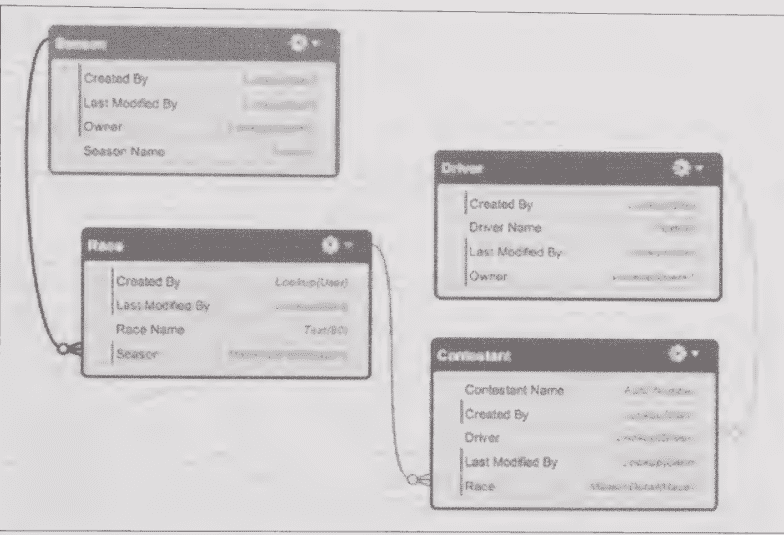

## 包类型和优势

**包**是一个容器，用于存放您的应用程序组件，例如自定义对象、Apex代码、Apex触发器、Visualforce页面、Lightning组件等等。这些组件构成了您的应用程序。虽然还有其他方法可以在Salesforce组织之间移动组件，但包提供了一个容器，您可以用它来容纳整个应用程序，或通过利用所谓的**扩展包**来提供可选功能。

包有两种类型——**托管包**和**非托管包**。非托管包会导致组件从一个组织转移到另一个组织；然而，结果就好像这些组件最初是在目标组织中创建的一样，这意味着该组织的管理员可以随意修改甚至删除它们。此外，它们不可升级，并且从支持角度来看并不特别理想。而且，您编写的Apex代码对所有人都可见，因此您的知识产权面临风险。


未托管的包可用于共享旨在由订阅者更改的模板组件。如果您没有使用 GitHub 和 GitHub Salesforce 部署工具（https://github.com/afawcett/githubsfdeploy），它们也可为开发者提供一种共享开源库的手段。

## 托管包的功能与优势

本书仅关注托管包。托管包具有以下功能，非常适合分发您的应用程序。安装您应用程序包的组织称为**订阅者组织**，因为该组织的用户正在订阅您的应用程序所提供的服务：

- **知识产权（IP）保护：**订阅者组织中的用户无法查看您的 Apex 源代码，尽管他们可以查看您的 Visualforce 页面代码和静态资源。虽然 Apex 代码是隐藏的，但 JavaScript 代码不是，因此您可以考虑使用压缩过程来部分隐藏此类代码。

- **命名空间范围：**您的组件名称在整个命名空间使用过程中对您的包是唯一的。这意味着，即使您的应用程序中有对象 X，而订阅者有同名的对象，它们仍然是不同的。您将在本章后面定义命名空间。

- **总督范围：**您的应用程序中的代码在其自身的总督限制范围内执行（例如，需通过 Salesforce 安全审查的 DML 和 SOQL 总督），且不受订阅者组织中其他应用程序或代码的影响。请注意，某些总督（如 CPU 时间总督）由整个执行上下文共享（将在后续章节中讨论），无论命名空间如何。

- **升级与版本控制：**一旦订阅者开始使用您的应用程序、创建数据、进行配置等等，您将希望提供带有新版本的应用程序的升级和补丁。

托管包还有其他优势，但这些优势只有在成为 Salesforce 合作伙伴并完成安全审查流程后才能访问；这些优势将在本章后面描述。Salesforce 提供了 ISVforce Guide（也称为 Packaging Guide），其中深入讨论了这些主题——请立即收藏！ISVforce Guide 可在 http://login.salesforce.com/help/pdfs/en/salesforce_packaging_guide.pdf 上找到。

## 创建您的第一个托管包

包在您的打包组织中创建。您的打包组织中只能有一个正在开发的托管包（虽然支持其他未托管的包，但不建议将打包组织与它们混用）。您还可以安装其他依赖的托管包，并从您的应用程序中引用它们的组件。要执行的步骤将在以下部分中讨论：

- 设置您的包命名空间
- 创建包并将其分配给命名空间
- 将组件添加到包中

## 设置您的包命名空间

创建托管包时的一个重要决策是命名空间；这是应用于您所有组件（自定义对象、Visualforce 页面、Lightning 组件等）的前缀，订阅者组织中的开发人员使用它来唯一地区分您的打包组件和其他组件（即使是其他包中的组件）。命名空间前缀是应用程序品牌的重要组成部分，因为它会隐式附加到您包中包含的任何 Apex 代码或其他组件。

最多可包含 15 个字符，但我个人建议保持少于这个数量，因为如果过于复杂，会难以记住并导致令人沮丧的拼写错误。我还会避免使用下划线字符。如果您未来可能会创建更多托管包（在不同的打包组织中），制定命名约定是个好主意。以下是示例命名约定的格式：

```
[company acronym - 1 to 4 characters][package prefix 1 to 4 characters]
```

例如，ACME 公司的 Road Runner 应用程序可能被命名为 acmerr。

当未设置命名空间时，**软件包** 页面（在 **设置** 菜单下的 **创建** 子菜单中访问）指示只能创建未托管的包。单击 **编辑** 按钮以启动一个小型向导来输入所需的命名空间。这只能进行一次，并且必须全局唯一（意味着它不能在任何其他组织中设置），很像网站域名。

## 分配命名空间

为了便于跟随本书学习，请随意创建任何您想要的命名空间，例如 `fforce{yourinitials}`。不要使用您未来可能计划使用的命名空间，因为一旦分配，就无法更改或重用。

以下屏幕截图显示了 **软件包** 页面：

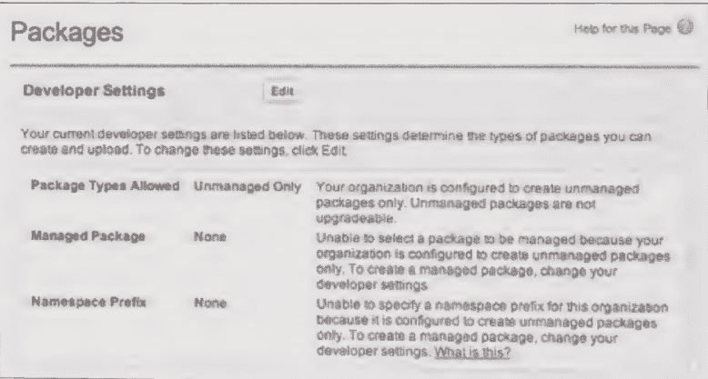

设置命名空间后，前一页应如下图所示，区别在于它现在显示您使用的命名空间前缀，并且现在也可以创建托管包。您现在已准备好创建托管包并将其分配给命名空间。

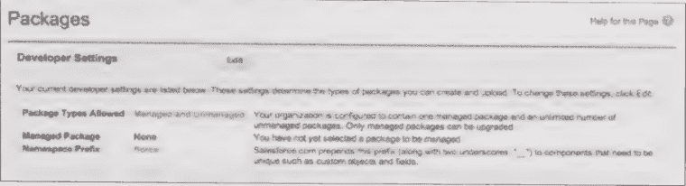

## 创建包并将其分配给命名空间

在软件包页面上单击 New 按钮，为您的包命名（稍后可以更改）。确保同时勾选 Managed 复选框。单击 Save 并返回软件包页面，该页面现在应如下图所示：

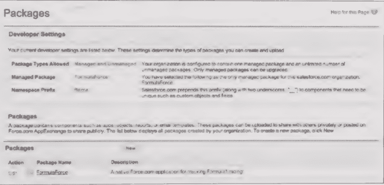

## 将组件添加到包中

在软件包页面上，单击您的包的链接以查看其详细信息。从此页面，您可以管理包的内容并上传它。单击 Add 按钮以添加本章早些时候创建的自定义对象。请注意，您无需添加任何自定义字段——这些字段会自动添加。

以下屏幕截图大致显示了此时您的包详细信息页面的样子：

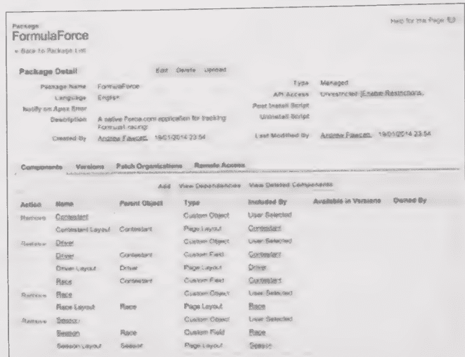

当您查看添加到包中的组件时，会发现有些组件可以移除，而其他组件无法移除。这是因为平台会隐式为您添加某些组件，因为它们是依赖项。随着本书的推进，添加不同的组件类型，在某些情况下，您会看到此列表自动增长，而在其他情况下，我们必须显式添加它们。

## 扩展包

顾名思义，扩展包扩展或添加其所基于的现有包所提供的功能，尽管它们不能更改基础包的内容。它们可以扩展一个或多个基础包，您甚至可以有多个层级的扩展包，尽管您可能希望关注使用此功能的范围，因为管理跨包依赖关系可能变得相当复杂，尤其是在开发过程中。

扩展包的创建方式与您刚刚完成的过程几乎相同（包括需要其自己的打包组织），不同之处在于打包组织中还必须安装依赖包。

扩展包中包含的代码和 Visualforce 页面会引用基础包中存在的其他自定义对象、字段、Apex 代码和 Visualforce 页面，平台会跟踪这些依赖关系以及引用作时基础包的版本。

安装扩展包时，此依赖信息确保在允许安装完成之前，订阅者组织中已安装正确版本（最低版本）的基础包。

您还可以通过适用组件的 **版本** 选项卡或 XML 元数据自行管理扩展包和基础包之间的依赖关系（我们将在讨论 API 集成的后续章节中重新探讨 Apex 中的版本控制）。

## 包依赖关系与上传

包可能依赖于平台功能和/或其他包。您可以使用包详细信息页面以及这里描述的动态编码约定来审查和管理这些依赖关系。

虽然 Salesforce 的一些功能是通用的，但客户可以根据自己的需求购买不同的版本和功能。开发者版组织可以免费访问其中的大多数功能。这意味着，在开发应用程序时，了解何时以及何时不应使用这些功能非常重要（这样做是为了避免可能阻止或阻碍您的应用程序采用的不必要的依赖关系）。

默认情况下，当引用某个标准对象、字段或组件类型时，您会在包上生成一个先决依赖项，您的客户在完成安装之前需要先拥有它。某些 Salesforce 功能，例如多货币或 Chatter，会对您的用户产生配置或（在某些情况下）成本影响（不同组织版本）。请仔细考虑您的包依赖于哪些功能。

大多数功能依赖关系（但并非全部）可通过包详细信息页面上的 View Dependencies 按钮查看（此信息也可在上传页面上查看，允许您进行最终检查）。将此检查添加到打包流程中是良好的做法，以确保没有不想要的依赖关系混入。单击本章中迄今构建的包的此按钮，可确认没有依赖关系。


对于未显示的依赖项，最好确保针对测试组织启用的功能清晰明确，因此任何其他依赖项都会在安装或进一步测试期间显示。

```
Show Dependencies
No Dependency Information for Package FormulaForce
<< Back to Package: FormulaForce
There are no dependencies.
```

本书后面将讨论 Lightning 组件。如果你要打包这些组件，那么你实际上是在要求客户必须使用 Salesforce My Domain 功能。这一点在安装时并未强制执行，因此是可选依赖项。但是，用户在先启用并配置 My Domain 之前，将无法使用你打包的 Lightning 组件。

## 上传发布包和测试包

检查完依赖项后，单击 Upload 按钮。系统会提示你为包指定名称和版本。后续版本将为你管理版本。包可以上传为两种状态之一：测试版或发布版，如下文所述。

我们将通过在“发布类型”字段中选择“托管 - 发布”选项来执行发布上传，因此请确保你对本章前一节中创建的对象感到满意，因为此后这些对象将不易更改。

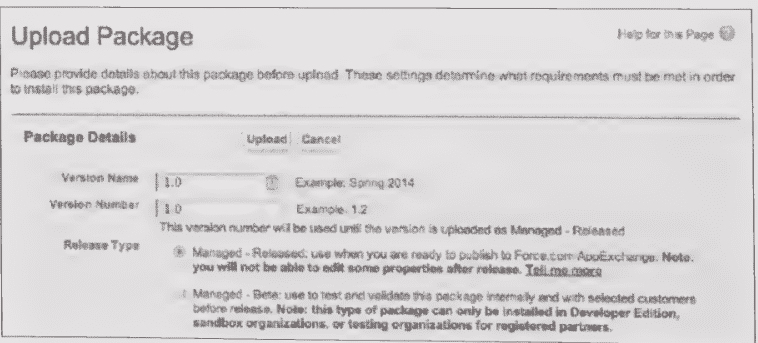

确认屏幕上的信息无误后，再次单击 **Upload** 按钮以开始打包过程。上传过程完成后，你将看到如下的确认页面：

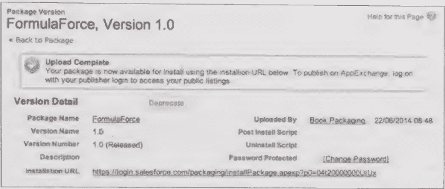

包可以上传为以下两种状态之一：

- **发布：** 发布包可以安装到订阅者生产组织中，并可以提供从以前版本的升级路径。缺点是你无法删除之前发布的组件，也无法更改某些内容，例如字段的类型。对标记为 **global** 的组件（例如 Apex 代码和 Visualforce 组件）的更改也受到限制。尽管 Salesforce 正在逐步增强平台以提供修改某些已发布方面的功能，但在选择此选项之前，你需要确保你的应用程序版本稳定。

- **测试版：** 测试包不能安装到订阅者生产组织中；你只能安装到开发者版（例如你的测试组织）、**沙箱**或合作伙伴门户创建的组织中。此外，测试包一旦安装后就无法升级；这就是 Salesforce 不允许其安装到生产组织中的原因。主要好处是能够继续更改版本中的新组件，以解决与用户反馈相关的错误和功能。

> 在编写本书时，删除之前发布的组件（在发布包中上传）的功能处于试点阶段。可以通过向 Salesforce 支持部门提交支持案例来启用。在你充分了解其全部影响后，他们将启用该功能。

到了本书的这个阶段，我们只是添加了一些自定义对象，因此上传应该能相对较快地完成。请注意，你实际上是上传到 AppExchange，这将在接下来的章节中介绍。

> 如果要保护你的包，可以提供一个密码（此后可以更改）。执行安装的用户将在安装过程中被提示输入密码。

## 可选包依赖项

可以将某些 Salesforce 功能和/或基础包组件引用（自定义对象和字段）设置为应用程序的可选方面。根据功能类型的不同，有两种方法可以实现这一点。

### 动态绑定

例如，多币种功能会向标准对象和自定义对象添加 CurrencyIsoCode 字段。如果你显式引用该字段（例如，在你的 Apex、Visualforce 页面或 Lightning 页面或组件中），则会对包产生硬依赖。如果你想避免这种情况，并将其作为应用程序中的配置选项（例如），则可以利用动态 Apex 和 Visualforce。Lightning 值绑定本质上是动态的，尽管 `aura:attribute` 元素类型引用会对指定对象形成编译时引用。

### 扩展包

如果你想打包仅在某些版本的订阅者组织中可用的组件类型，可以选择将这些组件包含在扩展包中。例如，你可能希望支持不支持记录类型的专业版。在这种情况下，为你的应用程序功能创建一个企业版扩展包，该扩展包利用该版本的功能。

> 请注意，对于你以这种方式使用的每个功能组合，你都需要多个测试组织，以便有效测试应用程序所需的配置选项或安装选项。

## 成为 Salesforce 合作伙伴及其优势

Salesforce 合作伙伴计划有许多优势。首先要访问的地方是 https://partners.salesforce.com/。你需要关注与成为独立软件供应商（ISV）合作伙伴相关的网站区域。从此处，你可以单击 Join Now。加入是免费的，但你当然要仔细阅读各种协议。

一旦你希望开始列出包并向用户收费，你就需要安排计费详细信息，以便 Salesforce 收取各项费用。虽然本书无法深入探讨细节，但请务必仔细关注包中使用的标准对象，因为这将决定用户所需的许可证类型以及他们将承担的总成本（不包括你的收费）。

显然，Salesforce 更希望你的应用程序尽可能多地使用 CRM 应用程序的功能，这对你来说也可能是有益的，因为它作为你的应用程序的一个功能，是一个有吸引力的即时集成，其他平台上不存在此类集成，例如能够立即与账户和联系人集成。

如果你计划使用标准对象，并且对费用（因类型不同而异）有疑问，可以申请与 Salesforce 进行交谈以讨论此事；这是在早期阶段需要牢记的事情。

确保在将 Salesforce 用户与合作伙伴社区关联时，你使用的是每日使用的用户（称为合作伙伴业务组织用户），而不是来自开发或测试组织的用户。完成注册流程后，你将获得访问合作伙伴社区的权限。以下屏幕截图显示了当前合作伙伴社区主页的样子。从此处，你可以访问许多有用的服务：


这是你与 Salesforce 沟通并访问与 ISV 相关的其他材料和公告的主要场所，因此请务必经常查看。你可以提交案例，并为组织中的其他用户提供额外的登录权限，例如可能希望报告问题或提出问题的其他开发人员。

## 安全审查及其优势

以下功能要求已完成的包版本经过名为 **安全审查** 的 Salesforce 驱动流程，该流程通过登录 AppExchange 时的列表启动。除非你计划免费提供包，否则将包放入此流程中会涉及费用。

但是，审查是可选的。没有什么能阻止你直接分发包安装 URL。但是，你将无法从将新应用程序列在 AppExchange 上供他人查看和审查的功能中受益。更重要的是，你也将无法访问以下功能来帮助你部署、授权和支持应用程序。包通过安全审查后，你将获得以下优势列表：

- **绕过订阅者组织设置限制**：将绕过标签页数量和自定义对象数量等限制。这意味着，即使订阅者组织已达到自定义对象的最大数量，你的包仍然可以安装。此功能有时称为 **Aloha**。如果没有此功能，你的包安装可能会失败。你可以通过 LMA 应用程序附带的 **订阅者概览** 页面来确定是否启用了 Aloha，这将在下一节中讨论。

- **许可**：你可以在你的 LMO 中使用 Salesforce 提供的许可证管理应用程序 (LMA)。

- **订阅者支持**：使用此功能，订阅者组织中的用户可以在特定时间段内启用一种方式，让你登录到他们的组织（无需交换密码），复现问题，并启用更详细的调试信息，例如 Apex 堆栈跟踪。在此模式下，你还可以查看你在包中声明为受保护的自定义设置，这对于启用其他调试或高级功能非常有用。

- **推送升级**：使用此功能，你可以在无需订阅者手动干预的情况下自动向他们应用升级，可以由你直接执行，也可以按计划执行。你可以使用此功能来应用不影响自定义对象或 API 的较小错误修复，或者部署完整升级。后者需要与订阅者进行仔细的协调和规划，以确保更改和新功能得到妥善采用。


Salesforce 要求您通过网页 (http://security.force.com/security/tools/forcecom/scanner) 对软件执行自动化安全扫描。此服务的速度可能相当慢，具体取决于队列中有多少个扫描任务。另一个选项是从实际供应商 CheckMarx 获取 Eclipse 插件，网址为 http://www.checkmarx.com，它运行相同的扫描，但允许您在本地控制。最后，为在开发应用程序时获得终极信心，Salesforce 可以提供许可证，以将其集成到您的持续集成 (CI) 构建系统中。CI 在本书的最后一章中有介绍。

本书专注于构建完全原生的应用程序，因此不考虑与所谓的“混合”应用程序（例如，应用程序的部分已在您自己的服务器上实现）相关的额外工作。但是，请记住，如果您对外部服务进行任何调用，Salesforce 很可能还会要求您和/或服务提供商运行 BURP 扫描器，以检查安全漏洞。

请确保规划合理的时间（根据我的经验，至少两到三周）来完成安全审核流程；首先列出您的软件包至关重要。不过，如果这成为问题，您可以选择直接将软件包安装 URL 发送给初始客户和早期采用者。

## 充分利用合作伙伴社区

花些时间回顾合作伙伴社区中的内容和设施是值得的。以下是值得查看的几个关键区域：

- 教育和 Trailhead：这允许您监控组织中其他用户在 Trailhead 上的进度。Trailhead 是 Salesforce 的“边做边学”方式。用户阅读关于新技术或开发方法的内容，然后被要求完成一些挑战以验证其理解。作为游戏化系统的一部分，他们会获得徽章。使用此选项卡，您可以看到谁拥有最多的徽章！

- 精选群组：此页面位于“更多”下，可让您快速访问多个 Salesforce 管理的 Chatter 群组。一个关键群组是合作伙伴警报群组，我强烈建议您为此群组设置电子邮件摘要。只有 Salesforce 会向此群组发帖，因此每帖摘要级别是可以接受的，并且可以让您了解情况，而无需登录社区。

- 支持：当然，这是您与 Salesforce 提交案例的地方。在提交案例时，UI 会自动尝试搜索已知问题或可能帮助回答您问题的支持文章。您也可以在此处报告和筛选未决案例。

- **发布**：此页面允许您将创建的内容列在 Salesforce AppExchange 网站上。本章后面的部分将更详细地介绍此内容。

- **合作伙伴警报**：合作伙伴警报对于及时了解可能影响您的开发过程和/或客户的服务变更至关重要。这些变更可能包括关键修复、安全改进或您需要做好准备的行为变更。虽然罕见，但您可能会被要求在特定截止日期前对解决方案进行更改，以确保用户不受影响。


合作伙伴社区的“精选群组”页面上显示了许多 Chatter 群组。请全部查看并设置电子邮件摘要，这样可以帮助您了解情况，而无需每次手动登录并查看此页面。

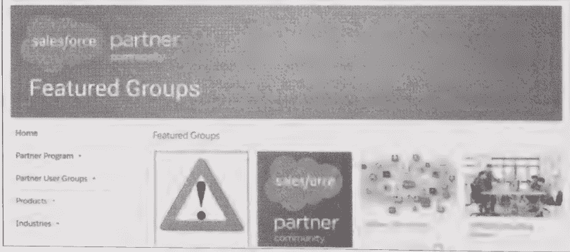

## 通过 Environment Hub 创建测试和开发组织

合作伙伴可以使用 Environment Hub 创建用于开发和测试的组织。您也可以在此处链接组织并管理登录。与您可以从 Salesforce 开发者网站获得的组织不同，这些组织拥有额外的用户许可证。您还可以链接 TSO 并基于您定义的模板创建组织，从而进一步优化基础组织配置，以适应您自己的开发和测试流程。有关更多信息，请查看合作伙伴社区中关于 Environment Hub 的页面 (https://partners.salesforce.com/s/education/general/Environment_Hub)。

## AppExchange 和列表简介

Salesforce 提供了一个名为 **AppExchange** 的网站，让潜在客户可以查找、试用和安装使用 Force.com 构建的应用程序。此处列出的应用程序也可以收到评分和反馈。您还可以在此网站上列出移动应用程序。

> 在本节中，我将使用我已拥有的一个 AppExchange 软件包。该软件包已经经历了该过程，以帮助说明所涉及的步骤。因此，您不需要在本书的这个阶段执行这些步骤；在您准备好开始推广应用程序后，可以在开发的后期阶段再次查看这些步骤。

一旦您的软件包为 AppExchange 所知，每次您单击已发布软件包上的 **上传** 按钮（如前面所述），您实际上就创建了一个私有列表。私有列表在您决定公开之前对公众不可见。这为您提供了机会，在最终测试完成时准备任何相关的营销详细信息和定价信息。请注意，您仍然可以将软件包分发给其他 Salesforce 用户，甚至早期的测试版或试点客户，而无需使列表公开。

要开始构建列表，您需要登录合作伙伴社区，然后单击标题中的 **发布** 选项卡。这将向您显示发布控制台。在这里，您可以链接和管理包含您的软件包的组织，创建列表并查看有关列表访问频率的分析数据。

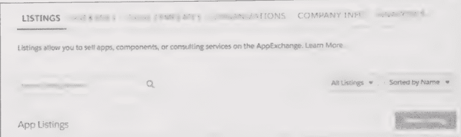

从菜单中选择发布控制台选项，然后单击创建新列表按钮，并完成向导中显示的步骤，以将打包组织与 AppExchange 关联；完成后，您应该能看到它已列出。

至关重要的是，您应始终使用 APO 用户凭据登录 AppExchange。Salesforce 会允许您使用其他用户登录。为了便于确认，请考虑将用户的显示名称更改为类似 MyCompany Packaging 的内容。

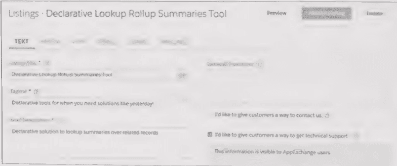

完成列表步骤并非强制性要求，除非您想亲自尝试该流程以了解所需的信息类型。在本书完成后，您可以删除创建的任何私有列表。

## 下载示例代码

您可以从 http://www.packtpub.com 的帐户中下载已购买的所有 Packt 图书的示例代码文件。如果您在其他地方购买了本书，可以访问 http://www.packtpub.com/support 并注册，以便文件直接通过电子邮件发送给您。


## 安装和测试您的软件包

在本章前面上传软件包后，您将收到一封包含安装软件包链接的电子邮件。如果没有收到，请查看打包组织中软件包详情页面上的版本选项卡。确保您已注销，然后单击链接。出现提示时，请登录您的测试组织。安装过程将开始。以下屏幕截图显示了初始安装页面的缩减版本；单击继续按钮，并遵循默认安装提示完成安装：

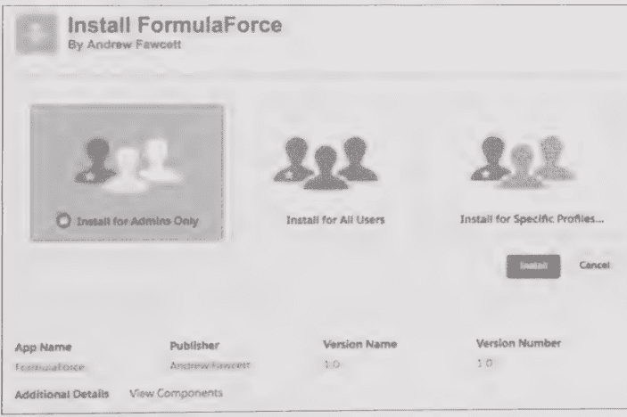

软件包安装涵盖以下方面（用户输入软件包密码后，如果设置了密码的话）：

- **软件包概述：**平台会向用户提供将要添加或更新（如果是升级）的组件概览。请注意，由于分配给您的软件包的命名空间，这些组件不会覆盖订户在订阅者组织中创建的现有组件。

- **连接应用和远程访问：**如果软件包包含代表连接到 Salesforce 服务之外的服务的组件，则系统会提示用户批准这些组件。

- **批准软件包 API 访问：**如果软件包包含使用客户端 API（例如 JavaScript 代码）的组件，则系统会提示用户确认和/或配置这些组件。此类组件通常不会被频繁调用；更倾向于使用 **JavaScript Remoting** 等功能，它们利用安装后配置的 Apex 运行时安全性。

- **安全配置：**在此步骤中，您可以确定正在安装的组件（对象、页面等）的初始可见性，选择仅限管理员，或选择要更新的配置文件。此选项早于 **权限集** 的引入，权限集允许安装后进行配置。

> 如果您在应用程序中打包配置文件，用户需要记住按照步骤 2 将这些配置文件映射到订阅者组织中的现有配置文件。这是一次性选项，因为软件包中的配置文件不会实际安装，只会合并。我建议您使用 **权限集** 为应用程序提供安全配置。这些权限集会被安装，并且粒度更细。

安装完成后，请在 **设置** 菜单下导航到 **已安装的软件包** 菜单选项。在这里，您可以看到部分软件包详细信息的确认，例如命名空间和版本，以及任何许可详细信息，这些内容将在本章后面讨论。


也可以为您的包提供一个 **配置** 链接，该链接将在包安装并在订阅者组织上的 **已安装的包** 页面列出时显示在包旁边。在这里，您可以提供一个 Visualforce 页面来访问配置选项和流程，例如。如果您已启用 **基于座位的许可**，还会有一个 **管理许可** 链接，用于确定订阅者组织中的哪些用户可以访问您的包组件，例如选项卡、对象和 Visualforce 页面。关于许可，本章后面将更详细地讨论。

### 自动化包安装

可以使用 **Salesforce 元数据 API** 和相关工具（例如 **Salesforce 迁移工具包**，可从 **设置** 下的 **工具** 菜单中获取）来自动化某些流程，这些工具可以从流行的 Apache Ant 脚本环境中运行。如果您想要自动化将包部署到客户或测试组织，这会很有用。在本书的最后一章中，我们将更详细地研究 Ant 脚本。

自动化不涵盖需要用户响应的选项，例如安全配置。但是，支持受密码保护的托管包。您可以在 Salesforce 元数据 API 的在线帮助中查找已安装包组件，以了解此方面的更多详细信息，网址为 `https://www.salesforce.com/us/developer/docs/api_meta/`。

为了帮助从 Ant 执行此操作，可在与此章相关的示例代码中找到一个自定义 Ant 任务（参见 `/lib/antsalesforce.xml`）。以下是一个 `/build.xml` Ant 脚本（也包含在章节代码中），用于卸载和重新安装包。请注意，如果包已安装，安装还会升级包。以下是 Ant 脚本：

```
<project name="FormulaForce"
    xmlns:sf="antlib:com.salesforce" basedir=".">

<!-- Downloaded from Salesforce Tools page under Setup -->
<typedef
    uri="antlib:com.salesforce"
    resource="com/salesforce/antlib.xml"
    classpath="${basedir}/lib/ant-salesforce.jar"/>

<!-- Import macros to install/uninstall packages -->
<import file="${basedir}/lib/ant-salesforce.xml"/>

<target name="package.installdemo">

<uninstallPackage
    namespace="yournamespace"
    username="${sf.username}"
    password="${sf.password}"/ >
<installPackage
    namespace="yournamespace"
    version="1.0"
    username="${sf.username}"
    password="${sf.password}"/ >
</target>
</project>
```

您可以使用测试组织尝试前面的示例，方法是将 namespace 属性值替换为本章前面输入的 namespace。从包含 build.xml 文件的文件夹中输入以下命令，全部在一行上：

```
ant package.installdemo
-Dsf.username=testorgusername
-Dsf.password=testorgpasswordtestorgtoken
```

> 您还可以使用 Salesforce 元数据 API 列出组织中安装的包，例如，如果您想要在发送安装请求之前确定是否需要安装或升级依赖包。最后，如果您愿意，也可以卸载包。

## 许可

完成安全审核后，您可以通过 **合作伙伴门户** 提交支持案例来请求访问 **LMA**。Salesforce 提供此权限后，请使用安装 URL 将其像安装任何其他包一样安装到您的 **LMO** 中。

如果您已请求 ISV 的 CRM 组织（通过 **合作伙伴门户** 中提交的案例），您可能会发现 **LMA** 已安装。

以下屏幕截图显示了安装后 **许可管理应用程序** 的主选项卡：

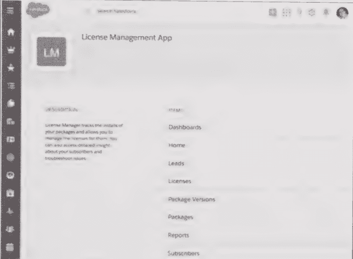

在本节中，我将使用一个我已拥有且已经完成该流程的包来帮助说明所涉及的步骤。因此，您无需执行这些步骤。

完成安装后，返回 **AppExchange** 并登录。然后，在 **发布者控制台** 的 **已上传的包** 下找到您的列表。在您的包旁边，将有一个 **管理许可** 链接。第一次单击此链接后，系统会要求您将包连接到 **LMO** 组织。完成此操作后，您将能够定义包的许可要求。

以下示例显示了免费包的许可，该许可对订阅者组织中的所有用户立即生效：

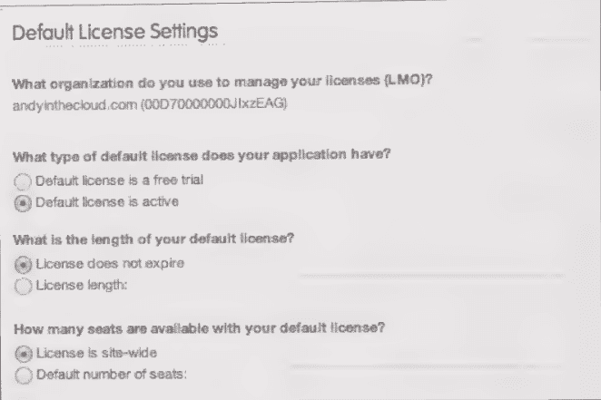

在大多数您打算收费的包的情况下，您会提供免费试用，而不是将许可默认设置为立即激活。对于付费包，请选择许可时长，除非是一次性收费，然后选择不过期的许可。最后，如果您提供试用许可，则需要仔细考虑默认座位数（用户）；用户可能需要能够在您的应用程序中为自己分配不同的角色，以获得完整体验。

> 目前，许可在包级别表达，但 Salesforce 很可能会在未来围绕包中的模块或功能提供更精细的许可。这很可能会由权限集功能驱动。因此，请记住在权限集设计中采取功能导向。

如果您针对许可配置了若干座位数，则 **已安装的包** 页面上的您的包旁边将显示 **管理许可** 链接。订阅者组织中的管理员可以使用此页面将适用用户分配到您的包。以下屏幕截图显示了当包启用许可时，管理员看到的已安装包的外观：

| 操作 | 包名称 | 发布者 | 版本号 | 命名空间前缀 | 状态 | 允许的许可 |
|---|---|---|---|---|---|---|
| 卸载 | 管理许可 | Declarative Lookup Rollup Summaries Tool | Home | 1.4 | dlra | Active | 3 |

请注意，您无需为每个上传的版本重新应用许可要求；您定义的最后详细信息将被带入包的新版本，直到您更改它们。无论如何，这些详细信息也可以在 **LMA** 应用程序的 **许可** 页面上完全覆盖。

您可能希望为扩展或插件包应用站点范围（组织范围）的活动许可。这至少可以让您跟踪谁安装了此类包，即使您不打算围绕它们管理任何许可，因为您是在主包上处理许可。

### 许可选项卡和管理客户许可

**许可** 选项卡提供用户将您的包安装到其组织时自动生成的单个许可记录列表。Salesforce 捕获此操作并创建相关详细信息，包括线索信息。这还包含执行安装的组织和人员的联系信息，如以下屏幕截图所示：


从每个记录中，您可以修改当前许可详细信息以延长到期时间或完全禁用应用程序。如果您这样做，包将保持安装并包含所有数据。但是，没有任何用户能够访问对象、Apex 代码或页面，即使是管理员也不行。您也可以随时重新启用许可。以下屏幕截图显示了 **许可编辑** 部分：

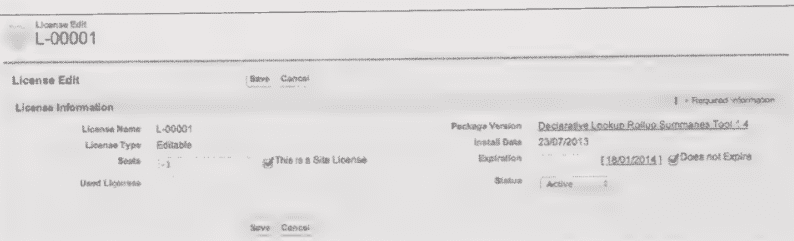

## 订阅者选项卡

**订阅者** 选项卡列出所有安装了您包的客户或订阅者（显示其公司个人资料中的组织名称，仅限通过 **AppExchange** 链接的那些）。这包括其组织 ID、版本（Developer、Enterprise 或其他）以及实例类型（沙箱或生产环境）。

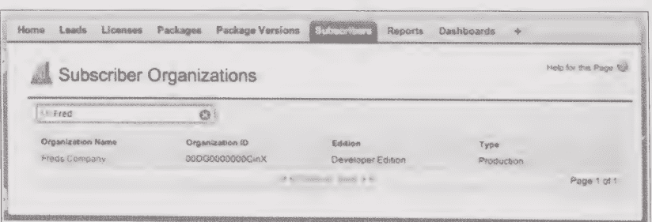

### 订阅者概览页面

当您单击本选项卡列表中的组织名称时，将进入 **订阅者概览** 页面。此页面有时称为 **合作伙伴黑色选项卡**。此页面包含大量有用信息，例如联系信息（也可通过 **线索** 选项卡查看）以及可能已授予的登录访问权限（我们将在下一节中更详细地讨论），以及他们安装了哪些包、当前许可状态以及安装时间。以下是 **订阅者概览** 页面的屏幕截图：

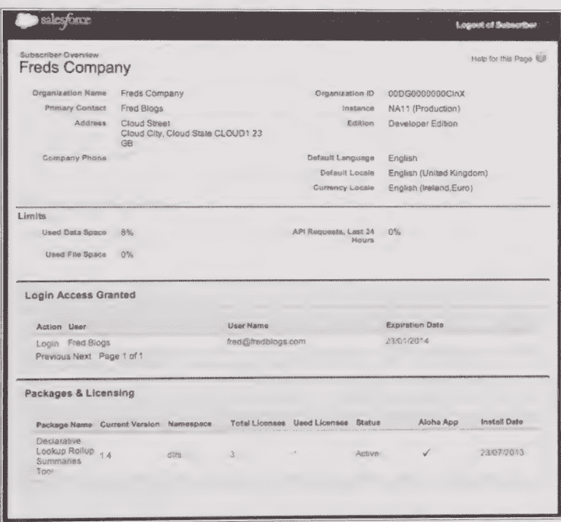


## 许可在订阅组织中的强制执行方式

许可的强制执行有两种方式，具体取决于您的打包自定义对象、字段和 Apex 代码被访问时的执行上下文。

第一种上下文是：用户通过用户界面或 Salesforce API（合作伙伴 API 和企业 API）直接与您的对象、字段、选项卡和页面进行交互。如果用户或组织未获得您的包许可，这些内容将被隐藏；在 API 的情况下，将返回错误。请注意，管理员仍可在 **设置** 菜单下查看打包的组件。

第二种上下文是：来自 Apex 代码（例如客户自己编写或来自另一个包中的 Apex 触发器或控制器）的访问类型。如果许可是站点级（或组织级）或组织中至少有一个用户被分配了座位，则允许以这种间接方式访问您的包组件。

这种情况意味着，即使当前用户未被分配座位（通过 **管理许可** 链接），他们仍然可以访问您应用程序的对象和代码，尽管是间接访问，例如，通过客户特定的实用工具页面或 Apex 触发器，用于自动创建某些记录或为您的包中的字段设置默认值。

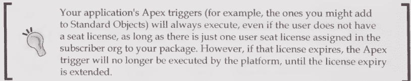

## 提供支持

一旦您的包完成安全审查，将启用用于支持客户的额外功能。具体而言，这包括能够安全登录（无需交换密码）到客户的环境并调试您的应用程序。以这种方式登录后，您可以看到用户看到的所有内容，此外还可以查看扩展调试日志，这些日志包含的详细程度与在开发者组织中相同。

首先，您的客户通过 **授予账户登录** 页面启用访问权限。不过这一次，您的组织（请注意，这是打包组织中 **公司配置文件** 下定义的 **公司名称**）将作为 Salesforce Support 之外的可用选项之一列出。以下屏幕截图显示了 **授予账户登录** 页面：

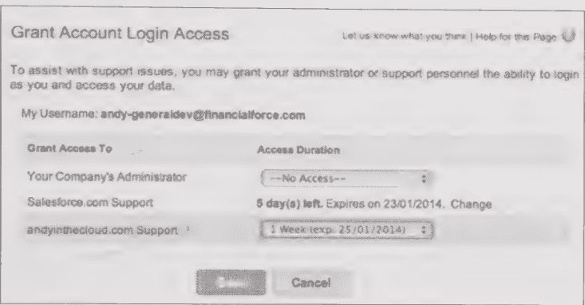

接下来，您登录到您的 LMO 并像前面所述导航到 **订阅者** 选项卡。为客户打开 **订阅者概览**，您现在应该能看到以该用户身份 **登录** 的链接。从此点开始，您可以遵循客户提供的步骤，并利用标准 **调试日志** 和 **开发者控制台** 工具来捕获所需的调试信息。以下屏幕截图显示了一个通过您的包被授予登录其组织权限的用户：

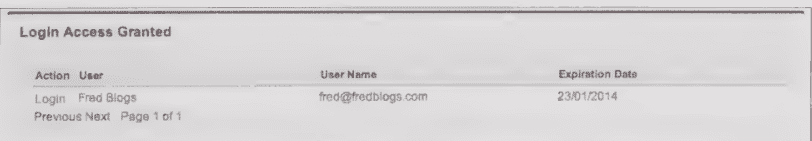

> 这种访问模式还允许您查看受保护的自定义设置（如果您将它们包含在您的包中）。如果您以前没有遇到过这些设置，那么研究一下是非常值得的，因为它们提供了一种理想的方式来启用和禁用您不希望客户通常看到的调试、诊断或高级配置。

## 客户指标

自平台 Spring '14 版本起，Salesforce 已开始公开有关订阅者组织中您的包组件使用情况的信息。这使您可以报告客户正在使用哪些自定义对象和 Visualforce 页面，更重要的是，他们没有使用哪些。此信息由 Salesforce 提供，客户无法选择退出。

此功能需要 Salesforce Support 启用。启用后，`MetricsDataFile` 对象在您的生产组织中可用，并会定期接收包含指标记录的数据文件。可以通过在 AppExchange 上搜索找到 **使用情况指标可视化** 应用程序，该应用可帮助可视化此信息。

## Trailforce 和 Test Drive

大型企业应用程序通常需要在初始包安装后与客户进行一些咨询，以根据其需求进行调整和定制。如果您希望为您的应用程序提供试用版，Salesforce 提供了一种方法来拍摄此安装和设置过程的快照，包括示例数据。

然后，您可以允许访问您的 AppExchange 列表或网站的潜在用户注册，以基于您制作的快照获取 Salesforce 组织的个性化实例。潜在客户随后可以使用该实例在有限时间内完全探索应用程序，直到他们注册成为付费客户。此类组织最终会在创建的组织的 Salesforce 试用期结束时过期（通常为 14 天）。因此，在设置包许可的默认过期时间时，您应该牢记这一点。

标准方法是提供一个网页表单，供潜在用户填写以获取试用版。有关更多信息，请查看 ISVforce Guide 中的 *在您的网站上提供免费试用* 和 *在 AppExchange 上提供免费试用* 章节。

您也可以考虑使用 Signup Request API，这使您能够更好地控制流程的启动方式并能够监控它，这样您就可以自己创建线索记录。有关更多信息，请参阅 ISVforce Guide 中的 *使用 API 创建注册* 章节。作为更高级的选项，如果您是拥有现有应用程序的 ISV，并希望使用 Salesforce.com 作为后端服务，则可以使用此 API 完全代表他们创建和管理组织。有关更多信息，请查看 ISVforce Guide 中的 *为 OAuth 创建代理注册* 和 *API 访问* 章节。

或者，如果潜在用户希望在其沙箱环境中试用您的包，例如，您可以允许他们直接从 AppExchange 或您的网站安装包。在这种情况下，请确保如前所述已在您的包许可上定义了默认过期时间。在此场景中，您或潜在用户将在安装后执行设置步骤。

最后，还有一个名为 Test Drive 的第三个选项，它不会按请求为潜在用户创建新组织，但确实要求您设置一个带有您的应用程序的组织、对其进行预配置，然后通过 AppExchange 将其链接到您的列表。用户不需要完成注册页面，而是单击 AppExchange 列表上的 Test Drive 按钮。这会将他们登录到您的测试驱动组织，作为只读用户。由于这是共享组织，您可以为用户提供的用户体验和功能仅限于主要读取信息的功能。我建议您考虑使用 Trailforce 而非此选项，除非有非常充分的理由使用它。

> 在 AppExchange 上定义您的列表时，线索选项卡可用于配置为列表上的试用版、试驾和其他活动创建线索记录。启用此功能后，在用户访问列表上的这些功能之前，将向其显示一个表单。例如，如果您通过网站上的注册表单提供试用版访问权限，则不会捕获线索信息。

## 分发 Salesforce 连接应用

如果您计划构建任何类型的平台集成（例如专用移动应用程序），使用 Salesforce API 或使用 Apex 构建的任何 API，则需要创建并打包所谓的连接应用。这允许您作为 ISV 设置 OAuth 配置，以便这些集成的用户能够连接到 Salesforce，从而连接到在平台上运行的您的逻辑和对象。您实际上不需要打包此配置，但建议您这样做，因为它将允许您的客户控制和监控他们如何使用您的解决方案。

## 摘要

本章通过将包安装到另一个 Salesforce 组织，为您提供了初始包创建过程的实用概述。虽然讨论的一些功能在接近首个发布阶段之前无法完全使用，但您现在可以开始开发，并充分理解早期决策（例如引用标准对象）对您的许可和成本决策至关重要。

同样重要的是要记住，虽然 Trailforce 等工具有助于自动化设置，但这不适用于安装和配置客户环境。因此，在设计中做出有关配置和默认值的选择时，请牢记实施周期中对客户的成本。

请确保在发布周期中规划安全审查流程（免费在线版本带宽有限），并尽早将其集成到您的 CI 构建系统（付费功能）中，因为该工具不仅监控安全漏洞，还有助于报告违反最佳实践的情况，例如缺少测试断言以及循环中的 SOQL 或 DML 语句。

在接下来的章节中，我们将开始探索构建企业应用程序的工程方面，通过构建本章创建的包的升级，使我们能够更好地探索平台如何支持您的应用程序的渐进式增长。

> 当您回顾本章涵盖的工具时，请务必参考 http://www.salesforce.com/us/developer/docs/packagingGuide/index.htm 上出色的 ISVforce Guide，以获取有关如何访问、配置和使用这些功能的最新详细步骤和说明。


