# 利用平台功能

在本章中，我们将探索 Force.com 平台的一些关键功能，这些功能既能帮助开发者更快速地构建应用程序，也能为应用程序的最终用户提供关键功能。以平衡的方式使用这些功能，是确保你和你的用户不仅能当下充分发挥平台优势，而且随着平台发展，未来也能继续如此的关键。

企业应用程序的一个关键要求是能够定制和扩展其功能，因为企业客户的业务各异且复杂。你也应该牢记，随着你的生态系统增长，你应该确保合作伙伴关系能够通过正确的集成选项获得赋能，并且合作伙伴需要将他们的解决方案与你的解决方案进行对接；平台在此方面也起着关键作用。

随着我们扩展 FormulaForce 包，我们将探索以下内容，以更好地理解围绕平台对齐的一些决策：

- 打包和可升级组件
- 自定义字段功能
- 安全功能
- 平台 API
- 本地化和翻译
- 构建可定制的用户界面
- 使用电子邮件模板进行电子邮件定制
- 工作流和流程
- 社交功能和移动端

## 打包和可升级组件

安装你的应用程序并为客户准备好上线使用所需的时间，是客户关系中的一个关键阶段。他们显然渴望尽快获得你更新和改进的发布版本。仔细规划并意识到你正在使用的哪些组件是可打包和可升级的，对于监控此阶段所涉及的工作量非常重要。

在探索可用的各种平台功能时，检查相关组件类型是否可以打包非常重要。有关可打包组件的完整列表，请在上一章中引用的 ISVforce 指南中搜索“可用组件”部分。

```
https://developer.salesforce.com/docs/atlas.en-us.packagingGuide.meta/packagingGuide/
```

> 如果你希望使用的功能相关的组件类型无法打包，这不一定意味着它对你或你的用户没有用处，因为它可能是你可以通过咨询团队推广的内容，让最终用户管理员在安装后加以利用。不过请记住，你推荐此操作的频率越高，尤其是如果它开始成为必需的安装后任务，就会增加你的用户在你的应用程序上线所需的时间。

另一个需要考虑的方面是组件类型是否可升级，也就是说，如果你定义并包含你的包的一个版本，然后在后续版本中对其进行修改，它将在订阅者（客户）组织中更新。ISVforce 指南中“可用组件”部分的表格也将为你提供有关此的最新信息。一些不可升级的组件类型如下：

- 布局
- 电子邮件模板
- 报表
- 列表视图

这些功能是你应用程序设计的关键，将在本章后面部分更详细地介绍。同样重要的是，最终用户可以自定义这些功能；因此，Salesforce 允许对它们进行编辑。不幸的是，这意味着它们不可升级，也就是说，以布局为例，任何你添加到自定义对象的新字段在用户可用升级后不会默认出现。但是，你的包的新安装将接收你的包中这些组件的最新版本。

这也适用于先前引用的表格中标记为可升级的组件的某些属性，但具有随后不可升级的某些属性。有关此的最新详细信息，请参阅 ISVforce 指南中的“安装后编辑组件和属性”部分。一些可打包但不可升级，因此最终用户可修改的常见属性如下：

- 自定义字段：选择列表值
- 验证规则：活动
- 自定义对象：操作重写

> 验证规则的活动状态是一个相当令人惊讶的点；虽然用户无法修改你的打包验证规则，但他们可以禁用它。对于大多数目的，这意味着该平台功能成为安装后的可选活动，留给最终用户在希望实施其独有规则时执行。对于你希望在 Apex 中实施的验证，你可以利用受保护的自定义设置来控制激活（如需要）（这些设置仅通过订阅者支持对你的支持团队可见）。

## 自定义字段 – 选择列表值

自定义字段不可升级属性中，可能最令人惊讶的就是选择列表值列表。这些值可以完全由最终用户修改；他们可以添加、修改或删除。这意味着你需要非常小心如何在 Apex 代码中引用这些值，因此，你需要向最终用户提供关于升级后编辑和应用更改的指南。

> Salesforce 翻译工作台工具位于设置菜单下，可以通过编辑用户当前的语言来有效地重新标记选择列表值，而无需在字段定义上重命名其值。最终用户管理员在安装该工具后可以执行此操作。

另外，请记住，平台大多数情况下将选择列表字段视为文本字段；因此，你可以用任何喜欢的值查询甚至更新选择列表字段。此外，请记住，你可以通过 Apex 安装后脚本升级客户数据（如果你更改或删除选择列表值）。

## 全局选择列表

在字段级别定义选择列表的替代方案是全局选择列表。位于设置菜单下，它们允许你定义和打包独立于字段的选择列表，因此可以跨多个字段共享。

以这种方式定义的选择列表有两个显著区别：

- 最终用户无法在订阅者组织中修改它们
- 如果用户或代码尝试用无效的选择列表值更新字段，平台会对其进行验证

如果你需要字段上的选择列表可自定义，或者不介意它们被修改，那么你可以在字段级别定义选择列表。否则，全局选择列表是在你的数据模型需要具有固定值的字段的情况下使用的更自然、更安全的默认选项，即使字段之间没有重复使用。请记住，无论你选择哪种路线，用户仍然可以通过 Salesforce 翻译工作台修改全局选择列表项的标签。

## 使用 Salesforce Metadata API 自动化升级

Salesforce 一直非常擅长提供 API；Metadata API 也不例外，因为它涵盖了设置菜单下大多数可操作内容的非常广泛的范围。这意味着可以考虑开发升级工具来协助升级组件，例如布局或选择列表值。此类工具将需要处理合并和与用户确认更改的逻辑，例如，提供一种方法将新字段合并到布局中，用户可以通过 UI 提示选择。

目前，Metadata API 无法直接从 Apex 访问（尽管我仍然希望它将来可以访问）。但是，它可以通过 Apex HTTP 调用进行调用，因为它作为 SOAP API 可用。

Apex Metadata API 库在 https://github.com/financialforcedev/apex-mdapi 提供了一个 Apex 封装器，以便于使用。以下 Apex 代码展示了如何使用该库以编程方式更新布局以添加新的自定义按钮。此代码可以作为你随应用程序提供的工具的一部分，或由你的顾问单独使用。有关更多信息，你可以参考 GitHub 仓库中的 README 文件。

```
// Read the layout
MetadataService.Layout layout =
    (MetadataService.Layout) service.readMetadata(
```


```
'Layout', new String''
" 'Test__c-Test Layout' ).getRecords()'0';

// Add a button to the layout
layout.customButtons.add('anewbutton');

// Update the layout
List<MetadataService.SaveResult> result =
service.updateMetadata(
 new MetadataService.Metadata'' " layout " );
```

> 可以考虑从安装后脚本中调用此逻辑是可行的。但是，Salesforce 目前要求您定义远程站点才能授权调用，即使是调用其自身的服务器也是如此。由于此 API 的端点因订阅者组织的 Salesforce 实例而异，因此难以预先定义，也难以将此配置作为包的一部分预先安装。因此，除非您确信升级前已设置好远程站点，否则最好引导用户前往 Visualforce 页面（或许可通过安装后脚本发送的电子邮件），在那里您可以提示用户。

## 了解自定义字段功能

自定义字段包含比您想象的更多功能；它们远比其他平台上常见的简单字段定义要复杂得多。深入理解自定义字段是减少需要编写的代码量、改善应用程序数据的用户体验和报告的关键。

## 默认字段值

为字段添加默认值可以提高应用程序的可用性，并减少屏幕上所需的字段数量，因为用户可以从布局中移除具有可接受默认值的字段。

自定义字段上定义的默认值适用于原生用户界面和 Visualforce 界面（前提是使用了 apex:inputField 组件），在某些情况下也适用于 API。您可以基于公式定义默认值，该公式可使用文字值和/或变量，如 $User、$Organization 和 $Setup。

让我们试一下。按照以下截图在 Season 对象上创建一个 Year 文本字段。请确保选择 External ID 复选框，因为在本章末尾包上传后，该字段无法再更改。这在下一章中将变得重要。

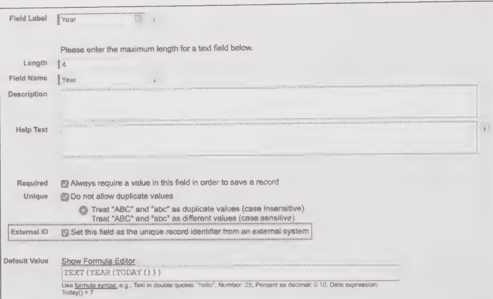

> 您定义的默认值不能通过订阅者组织中的自定义来覆盖，但是，您可以使用 $Setup 引用在默认值公式中引用自定义设置（仅限层级类型）。这允许通过在组织、配置文件或单个用户级别编辑自定义设置来进行一定程度的自定义。

要在 Season 对象中创建记录，我们首先需要为其创建一个选项卡。在包组织中执行以下步骤来尝试此过程：

- 1. 为 Season 对象创建选项卡。
- 2. 转到 Season 选项卡并单击 New。
- 3. 这将在 **Year** 字段中显示当前年份，如下一张截图所示：

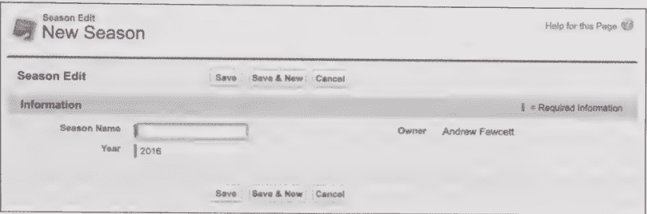

上一张截图显示了当用户使用 Salesforce Classic 时 Salesforce 显示的用户界面。Salesforce Classic 是其最新用户界面技术 Lightning Experience 的前身。两者都是用户可选的选项，并且在用户和应用程序迁移之前，这两者都可能长期并存。本书在各章中也包含有关 Lightning 的信息，以及专门的第 10 章 Lightning。

不幸的是，默认情况下，当您通过 `new Season();` 直接构建 SObject 时，Apex 代码不会应用默认值；但是，如果您使用 `SObjectType.newSObject` 方法，可以按如下方式请求应用默认值：

```
Season__c season = (Season__c)
Season__c.SObjectType.newSObject(null, true);
System.assertEquals('2016', season.Year__c);
```

### 加密字段

无论您觉得数据被盗的可能性有多小，都有一些市场和政府法规要求使用加密字段。Salesforce 提供了两种方法来帮助确保您的应用程序数据以加密形式存储在其数据中心中。对于加密静止字段值（即物理存储在永久存储介质上的记录），有两个选项可供考虑。

- 经典加密：加密字段使用 128 位主密钥，并采用高级加密标准（AES）算法来存储值；它们使用字符掩码显示（当前不可由开发者定义）。此类字段可打包，但仅适用于文本字段。
- 平台加密：购买了 Salesforce Shield 插件的客户可以为其选择的某些标准字段和自定义字段启用 256 位 AES 加密。它可以应用于 E-mail、Phone、Text、Text Area、URL、Date 和 Date/Time 字段。虽然加密级别更高，但此功能也带来了一些重大限制，这些限制将在下一节中介绍。

加密字段值对拥有 **View Encrypted Data** 权限的用户可见，这是一项您的要求可能无法容忍的功能。这也包括您授予登录权限的用户，例如通过订阅者支持。您打包的 Apex、Visualforce 页面、Lightning 组件和验证规则逻辑可以看到未加密的值，因此如果您希望掩码字段值，开发者需要格外小心。如果您的唯一关注点是遵守静态加密合规性，这对您来说可能不是问题。

### 平台加密的特殊注意事项

Salesforce 建议仅在您所在市场的政府法规要求时才考虑此功能。在开发打包解决方案时，您的主要考虑是：如果订阅者希望在您解决方案中引用的标准字段或您打包的某个字段上启用此功能，会发生什么情况。

> > 对于希望通过其 AppExchange 列表宣传支持此功能的用户，Salesforce 可以将一个指示器应用于您的列表，以向潜在客户展示您支持平台加密。

在实现平台加密使用的 256 位加密时，Salesforce 选择了概率加密而非确定性加密。由于加密不是确定性的（每次加密后的值都不同），因此无法为应用了此级别加密的字段建立索引。这会导致围绕查询该字段，对开发者和平台功能施加最重大的限制。

如果没有索引，平台就无法提供高效的方式来允许代码在查询中按加密字段进行过滤、分组或排序。如果代码在运行时尝试这样做，将发生异常。如果包安装检测到 Apex 代码中存在不兼容此限制的查询，您的包安装可能会被阻止。反之，包安装后如果用户尝试启用加密，此操作可能会失败。Salesforce 在两种情况下都会提供报告，以告知用户哪些字段有问题。

可以在特定条件下绕过这些限制，方法是使用动态 SOQL 来允许在未启用加密时在运行时构建并执行受影响的查询。在启用加密的情况下，您可以在 Apex 和/或通过 Salesforce 对象搜索语言（SOSL）中执行过滤、分组和排序。不过，这两种选项都应谨慎考虑，因为它们各有限制，且可能不是性能最好的方案。在某些情况下，您可能需要接受有必要在解决方案中有选择地隐藏功能。这个决定需要您与用户共同做出，权衡这种妥协是否可以接受。

> 无论您是否计划支持平台加密，对于需要您的应用程序与其他 Salesforce 产品和其他合作伙伴解决方案共存的企业客户来说，这可能仍然是一个重要需求。我建议您提前准备一份声明，说明您提供哪些级别的支持，例如支持哪些标准字段和包字段。确保您的潜在客户能够做出明智的决定，否则他们可能会不必要地将您的应用程序从候选名单中剔除。

我强烈建议您利用合作伙伴成功社区中的教育部分。在“更多资源”部分下，您将找到一个专门的页面，其中包含专门针对 ISV 的视频和其他资源。

## 查找选项、筛选器和布局

Salesforce 的标准查找 UI 可以进行配置，使用户更容易识别要选择的正确记录，筛选掉不相关的记录，并在必要时阻止他们删除在应用程序其他位置正在使用的记录，这一切都无需编写任何代码。

在包组织中执行以下步骤来尝试此过程：

- 1. 为 Driver 和 Race 对象创建选项卡。
- 2. 向 Driver 自定义对象添加 Active 复选框字段；确保默认值已勾选。
- 3. 创建驱动程序记录，例如 Lewis Hamilton。
- 4. 从上一节中创建的 Season 记录，创建一条 Race 记录，例如 Spa。
- 5. 通过 Contestants 关系将 Lewis Hamilton 与 Spa 比赛关联起来。


首先，确保如果驱动程序与参赛者记录相关联（即他们拥有或正在参加比赛），则无法删除驱动程序。编辑**参赛者**对象上的**驱动程序**字段，并启用“不允许删除作为查找关系一部分的查找记录”。这类似于在其他数据库平台中表达引用完整性规则。

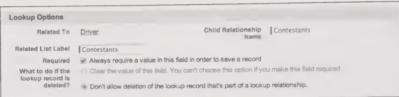

现在，如果您尝试删除刘易斯·汉密尔顿，应该会收到以下屏幕截图中显示的消息。如果您尝试通过 Apex DML 或 Salesforce API 进行删除，也适用此规则。


您刚刚节省了一些 Apex 触发器代码，并使用了平台功能。

让我们来看看另一个查找功能，即查找过滤器。一级方程式车手来来去去；让我们确保在通过参赛者记录上的**驱动程序**查找选择参赛车手时，仅显示活跃车手，并且仅允许直接输入活跃车手。

在打包组织中执行以下步骤以试用此流程：

- 1. 创建一个**驱动程序**记录，例如 Rubens Barrichello，并确保“Active”字段未勾选。
- 2. 编辑**参赛者**对象上的**驱动程序**字段，并按照以下屏幕截图完成“查找过滤器”部分，在“如果不匹配，保存时显示此错误消息”和“将此信息消息添加到查找窗口”字段中输入建议的消息，然后单击“保存”：

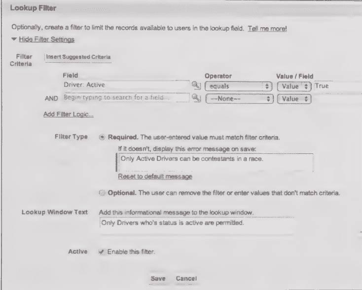

每个对象最多可以拥有五个活跃的查找过滤器。这不是由您的包命名空间设置的限制。因此，请谨慎使用，以便为最终用户留出创建其自己查找过滤器的空间。如果您没有强烈的过滤需求，请考虑将其实现为 Apex 触发器验证。

通过尝试为 `Spa` 记录创建 `Contestant` 子记录来测试过滤器。首先，使用查找对话框，您将看到先前输入的信息消息，并且无法选择 `Rubens Barrichello`，如以下屏幕截图所示：

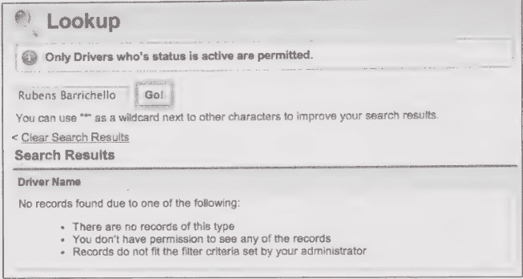

如果您尝试直接输入非活跃车手的姓名，同样会被阻止，如以下屏幕截图所示：

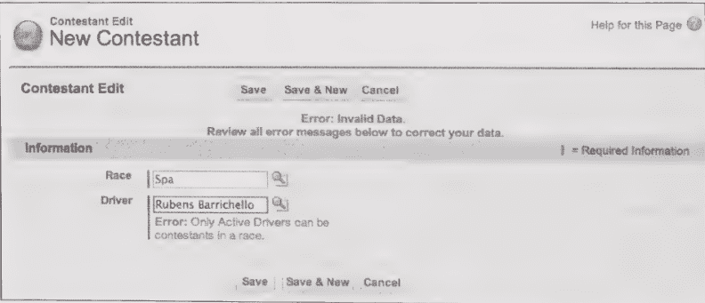

此验证也通过 Apex DML 和 Salesforce API 强制执行。与验证规则不同，最终用户无法禁用此验证。但是，平台允许与记录相关的更改，例如随后将驱动程序设为非活跃。在这种情况下，下次编辑 `Contestant` 记录时，将出现前面屏幕截图中给出的错误。

最后，您还可以在查找对话框中显示其他列，这些列可帮助用户根据其他字段识别正确的记录。以下步骤介绍了如何执行此操作：

- 1. 向 **驱动程序** 对象添加 **选择列表** 类型的 **国籍** 字段，并输入以下值：`British`、`Spanish`、`Brazilian`、`Finnish` 和 `Mexican`。
- 2. 编辑现有的 **驱动程序** 记录，并在 **国籍** 字段中设置适当的值。
- 3. 找到 **驱动程序** 对象的 **搜索布局** 部分，编辑 **查找对话框** 布局，添加步骤 1 中创建的 **国籍** 字段，并保存布局。选择驱动程序时，查找现在应显示此其他字段，如下所示：

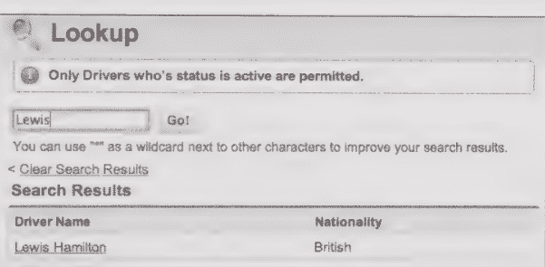

查找是平台非常强大的声明式功能；它们不仅用于表达应用程序数据模型关系，实际上还强制执行数据完整性，从而大大简化了用户的数据录入工作。

## 汇总字段和限制

说到对数据进行计算，平台提供了多种选项：报表、Analytics API、仪表板、Apex 触发器、Visualforce 和汇总字段。汇总字段选项提供了一种无需代码的解决方案，并能够应用一些条件过滤。汇总字段随后还可以引用并与公式字段和验证规则等其他功能结合使用。

关键要求是，被汇总的明细记录与添加汇总字段的主记录之间必须存在主从关系，例如 **比赛** 与 **参赛者** 之间的关系。以下示例将统计未完成特定比赛（即一级方程式中的 DNF）的竞争者总数。

在包组织中执行以下步骤以试用此流程：

- 1. 在 **参赛者** 对象上使用 **复选框** 字段类型创建 **DNF** 字段。
- 2. 为 *夏尔·皮克* 创建一个 **驱动程序** 记录，并通过 **参赛者** 对象将他添加到 *Spa* 比赛中，勾选 **DNF** 字段。
- 3. 在 **比赛** 对象上使用 **汇总字段** 字段类型创建 Total DNFs 字段。从 **汇总对象** 下拉列表中选择 **参赛者** 对象，将 **汇总类型** 设置为 **计数**，并按以下屏幕截图所示应用 **筛选条件** 字段，以仅选择 **DNF** 字段已勾选的 `Contestant` 记录：

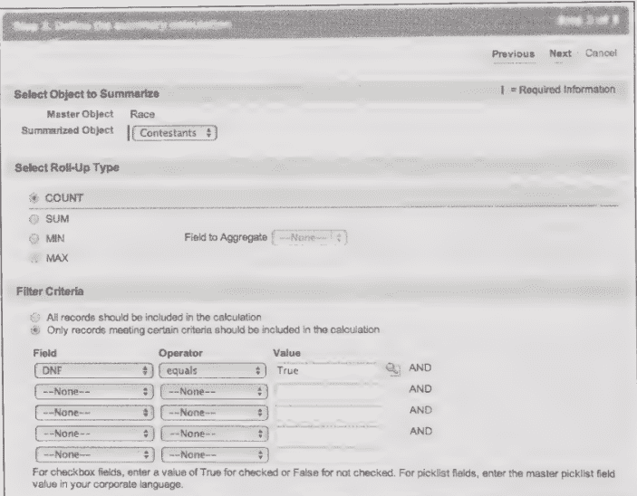

导航到 Spa 记录，并注意 Total DNFs 显示值为 1。通过更改 Driver 记录上 DNF 字段的状态来进行实验，查看值重新计算。

配置后，汇总字段提供实时计算。但是，在创建或更改汇总字段时，Salesforce 指出可能需要长达 30 分钟。您可以在文档中搜索“关于汇总字段”以阅读更多内容，并查看知识库文章“汇总字段技术概览”，网址为 http://help.salesforce.com/apex/HTViewSolution?id=000004281。

> 您可以在 Apex 触发器逻辑中结合使用汇总字段，例如，可以在 `Race` 对象触发器的 `after` 阶段中添加 Apex 逻辑来检查 DNF 数量。您的用户还可以在引用其汇总字段的 `Race` 对象上应用验证规则。任何导致此验证规则失效的 `Contestant` 明细记录更改都将阻止对相关 `Contestant` 记录的更新。

您可以想象，计算汇总字段对 Salesforce 服务器来说可能是一项相当繁重的工作。因此，Salesforce 将每个对象的汇总字段总数限制为 10 个，不过在拥有有效业务理由的情况下，通过联系 Salesforce 支持可将其增加到 25 个。请记住，作为打包应用程序提供商，此限制不受您的命名空间限制（不同于其他限制）。这意味着，如果您用完了全部 10 个，最终用户将无法在安装后添加自己的汇总字段。同样，如果他们在安装后创建了自己的汇总字段，而升级导致超出限制，则安装将失败。

> 虽然这是一个功能强大的特性，但请仔细考虑上一段中列出的其他汇总选项，以及您的用户是否真的需要这些信息是实时的或可从公式和验证规则访问。如果不是，一个很好的折中方案是 Visualforce 页面，可以内联添加到 `Page Layout` 对象中。Visualforce 页面可以使用 `readonly=true` 属性，其中 Apex 控制器逻辑可以利用聚合 SOQL 查询来聚合多达 500 万条记录（受适当索引和标准超时容差限制）。当用户在 UI 中查看记录时，即可显示此页面，从而按需计算。有关使用 Visualforce 增强 Salesforce 标准页面的详细信息将在本章后面讨论。

## 了解可用的安全功能

平台提供安全控件，用于管理应用程序中功能的可访问性，以及其创建的各个记录的可见性。作为应用程序提供商，您的代码有责任强制执行安全规则，并提供有助于管理员轻松配置安全性的集成。本节并非旨在深入探讨平台的安全功能，而是旨在帮助了解选项、最佳实践以及打包影响。


前一章中描述的安全审查流程进行的关键检查之一，是扫描代码以确保其使用适当的 Apex 规范来强制执行应用程序管理员配置的安全规则，因为并非所有安全检查都会自动为你执行。

本章讨论平台提供的以下两类安全性：

- 功能安全：适用于应用程序对象、某些代码入口点（提供 API）以及交付应用程序功能的 Visualforce 页面的安全性，在此称为功能安全
- 数据安全：与应用程序创建和维护的单个记录数据上应用的安全性相对，此类安全性称为数据安全

## 功能安全

配置文件和权限集都可以在应用程序中创建和打包，以帮助应用程序管理员控制对对象、字段、选项卡和页面的访问。从根本上说，配置文件在历史上被用来预打包您设想用户在应用程序中使用的角色，例如车队负责人。相比之下，权限集可用于表达应用程序中的功能，例如将车手分配给比赛的能力。

到目前为止，大多数人都熟悉配置配置文件以控制安全性。问题是，这最终可能导致配置文件的激增；当用户之间的需求出现微小差异时，配置文件会被克隆，从而增加执行常见更改时的管理开销。为了管理这一点，Salesforce 创建了权限集，这是一种表达安全控制的更细粒度的方式。

从应用程序的角度来看，您可以打包权限集，甚至可以让它们随着应用程序中新增或更新的功能而自动升级。您还可以在安装后分配它们，而配置文件仅在安装期间可分配。与配置文件不同，管理员无法编辑权限集，但如果需要可以克隆它们（在 Salesforce 的 Professional 和 Group 版本中无法做到这一点）。由于这些好处，建议在打包应用程序的安全信息时使用权限集，而不是配置文件。

从一开始就规划权限集的使用非常重要，以便您的开发团队保持其更新，并且其使用始终保持一致。在设计权限集策略时，请考虑以下几点：

- **思考功能而非角色**：不要被诱惑回到表达您设想应用程序用户被分配的角色上。企业组织庞大而复杂；很少有一种尺寸适合所有人。例如，**车队负责人**在一次安装到另一次安装中可能在您的应用程序中承担许多不同的职责。如果您做错了，管理员将被迫克隆权限集，导致未托管的权限集开始激增，这些权限集不会随着软件包升级而跟踪新增或更改的功能。
- **粒度**：在设计应用程序功能时，会定义模块（您可以使用 **设置** 下的 **应用** 来指示这些），在这些对象、选项卡或页面中，每个都有不同的操作。例如，参赛者对象可能描述指示车手已退出比赛并更新相应 DNF 字段的功能，即 **更新 DNF 状态**。例如，此权限可能会分配给比赛控制员用户。相比之下，您可能有一个较不细粒度的名为 **比赛管理** 的权限集，它涵盖 **更新 DNF 状态** 权限加上其他权限。采用这种方法设计权限集意味着管理员分配给用户的工作更少，同时，如果他们愿意，也拥有更具选择性的能力。
- **命名约定**：当管理员在 Salesforce UI 中查看您的权限集时，请确保它们根据应用程序的功能方面进行分组，可以考虑采用命名约定，例如 `FormulaForce - Race Management` 和 `FormulaForce - Race Management - Update DNF Status`。

前一章中描述的 **许可证管理应用程序 (LMA)** 的局限性之一是其粒度不够；您只能将用户许可证有效地授予整个软件包，而不能授予其中的模块或关键功能。随着权限集许可证的引入，Salesforce 似乎正在朝着提供一种定义与权限集相关的许可证要求的途径迈进。在编写本文时，开发人员不支持创建自己的权限集许可证；这似乎是下一个显而易见的步骤。在设计用作许可证控制的权限集时，这是需要考虑的事项，例如，有一天您可能能够使用此方法来强制实施与 **比赛管理** 权限相关的高价许可证的定价模型。

在软件包组织中执行以下步骤来试用此流程：

1. 创建比赛管理自定义应用程序（在“设置 | 创建”下），并将之前创建的车手、赛季和比赛选项卡添加到其中；将比赛选项卡设为默认。
2. 创建比赛分析自定义应用程序，并将比赛和报告选项卡添加到其中；将报告选项卡设为默认。
3. 按照下表所示创建 FormulaForce 应用程序的权限集。将用户许可证字段保留为“无”。
4. 最后，将以下权限集添加到 FormulaForce 软件包中。

| 权限集 | 权限 |
|---|---|
| FormulaForce - 比赛管理 | 比赛管理 (自定义应用程序) 比赛分析 (自定义应用程序) 赛季选项卡 (自定义选项卡) 比赛选项卡 (自定义选项卡) 车手选项卡 (自定义选项卡) 对象 (自定义对象, 完全访问权限) 比赛对象 (自定义对象, 完全访问权限) 车手对象 (自定义对象, 完全访问权限) 参赛者对象 (自定义对象, 完全访问权限) |
| FormulaForce - 比赛管理 - 更新 DNF 状态 | 参赛者对象 (自定义对象, 读取, 编辑) DNF (自定义字段, 读取, 编辑) |
| FormulaForce - 比赛分析 | 比赛分析 (自定义应用程序) 比赛对象 (自定义对象, 只读, 读取 DNF) |

此处，完全访问权限意味着它授予对所有自定义字段的读取、创建、编辑和删除访问权限。另外，在编写本文时，权限集中的自定义应用程序和自定义选项卡组件不可打包。在它们变得可打包之前，建议您仍在权限集中维护此信息。

## 您的代码和安全审查注意事项

您编写的并非所有代码都会自动通过用户分配的权限集或配置文件定义的对象级和字段级安全性，由平台强制执行。虽然某些 Visualforce 组件（例如 `apex:inputField` 和 `apex:outputField`）会强制执行安全性，但获取或向用户显示信息的其他方式则不会强制执行安全性，例如 `apex:inputText` 和 `apex:outputText`。这些差异将在后面的章节中详细讨论。

当您的代码在控制器中对字段执行计算或转换时，请通过控制器上的 Apex 绑定或远程操作方法间接公开此数据；为此，您需要自行添加其他检查。这也适用于面向客户的任何 Apex 代码，例如您构建的 `global` 方法或 Apex REST API。

在这些情况下，您可以使用 **Apex Describe** 功能专门检查用户的配置文件或权限集分配以获取访问权限，并通过返回错误或抛出异常来防止进一步执行。实现此功能的正式参考信息可以在以下两篇 Salesforce 文章中找到：

- **强制执行 CRUD 和 FLS:** https://developer.salesforce.com/page/Enforcing_CRUD_and_FLS
- **测试 CRUD 和 FLS 强制执行:** https://developer.salesforce.com/page/Testing_CRUD_and_FLS_Enforcement

Salesforce 安全审查扫描器和团队坚持要求您检查自定义对象级安全性（CRUD 安全性的简称），并包括检查访问的每个字段（**字段级安全性 (FLS）**）。

实现检查两者的代码需要仔细考虑、规划和监控。实现 FLS 特别复杂，多个用例和上下文在代码库中应用不同的使用模式。对于某些功能，您可能希望应用程序代表用户访问某些对象和/或字段而不检查安全性；请好好记录这些情况，因为您可能需要向 Salesforce 演示它们。


实现CRUD安全是我们将在后面章节中重新审视的内容，这些章节将涉及Apex代码的Domain和Selector层，其中用于支持这些模式的库内已提供了一些自动化支持。

> 最好是审查并记录你的方法，并将CRUD和FLS检查作为定义编码规范的一部分；如果有疑问，请与你的Salesforce技术客户经理（TAM）讨论，或在Partner Portal中提交支持案例。这样，在向安全审查团队提供投入和背景时，你也会有一些可供参考的决策和对话。与此同时，包括我自己在内的Salesforce社区正在探索创建通用方式来强制执行CRUD和FLS，而无需在代码库中看到硬编码检查。

请注意，将`with sharing`关键字应用于Apex类并不会自动强制执行CRUD或FLS安全，这是一个常见的误解，但实际上不会。此关键字仅控制查询对象时返回的记录，因此实际上仅与数据安全相关。

## 数据安全

无论最终用户通过其配置文件或权限集分配可以访问哪些自定义对象或字段，仍可能存在筛选特定用户可见记录的要求，例如，比赛期间及之后的某些赛事数据仅对拥有的团队可见。

Salesforce允许通过每条记录上的**所有者**字段以及可选的名为共享的设施来控制这种安全级别。这是在FormulaForce应用程序的打包组织中通过**共享设置**页面（位于**安全控制 | 设置**）定义的。该页面在以下截图中显示：

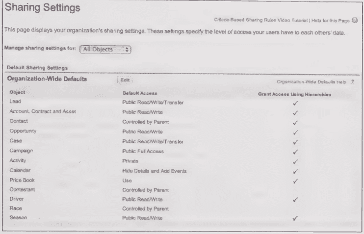

你可以在此处看到列出的标准对象以及我们迄今创建的自定义对象。当你单击“编辑”时，默认访问显示访问选项会因对象是标准对象还是自定义对象而有所不同，因为Salesforce对某些标准对象（如价格簿）有特殊的访问模式。

> 请注意，当对象与父记录存在子关系时（例如Race和Session），无法控制该对象的安全性。因此，在设计应用程序对象架构时，请确保考虑你或你的用户是否需要在此对象上使用共享；如果是，最好考虑使用标准查找关系。

对于作为FormulaForce应用程序一部分存在的自定义对象，你可以定义公共读/写、公共只读和私有。默认值始终为公共读/写。

默认访问定义了平台使用所有者字段和对象的共享规则确定给定记录可见性的起始位置。换句话说，如果对象具有公共读或公共读/写默认访问权限，你无法使用这些功能向给定用户隐藏记录。

虽然此设置随自定义对象打包，但在订户组织中可编辑，因此不可升级。如果你决定在以后的版本中更改此设置，这将需要作为安装后任务手动完成。

如果你设置了私有默认访问权限且不执行任何操作，所有者字段将决定记录的可见性。默认情况下，所有者是创建记录的用户。因此，用户只能看到他们创建的记录或角色层次结构中低于他们的其他用户创建的记录（如果已启用）。记录所有者可以是用户或组（在API中称为队列），例如特定赛车团队的成员。用户还可以选择将他们拥有的记录手动共享给其他用户或组。

有时，需要更复杂和动态的逻辑；在这种情况下，可以添加共享规则，并且可以声明式（从共享设置页面）或以编程方式创建它们。无论使用哪种方法，平台都会创建一个共享对象（例如，对于RaceData__c对象，它将是RaceData__Share），该对象包含评估共享规则所得的记录；这些记录可以像任何其他对象一样查询，有助于调试。

为实现最大灵活性，你可以在Apex触发器或计划作业中编写逻辑，以直接创建、更新或删除共享记录，例如在RaceData__Share对象中。在这种情况下，共享记录的标准可以是你能在代码中表达的几乎任何内容。你首先针对适用的自定义对象定义共享原因，它将自动包含在你的包中。这用作你的应用程序代码创建的共享记录与通过订户组织中定义的共享规则创建的共享记录之间的一种标记。还要注意，如果平台检测到共享设置页面上列出的给定对象的共享对象引用，它将阻止订户组织管理员将默认访问权限从私有更改为公共。

## 你的代码和安全审查注意事项

当用户尝试在Salesforce UI中直接导航到记录时，平台将强制执行记录可见性，包括他们运行的报告以及使用第三方应用程序时通过Salesforce API提供的访问。

但是，请记住，你的Apex代码默认在系统级别运行；因此，需要注意`with sharing`或`without sharing`关键字的使用（针对代码的所有关键入口点）。这也是安全审查扫描器会查找的内容。你或许会问何时使用`without sharing`关键字有意义；这种用例可能是当你明确希望系统级逻辑代表用户执行的操作或验证查看所有记录时。

## 平台API

Salesforce提供许多API来访问和操作属于CRM等应用程序的其自身对象中的记录；这些API也扩展以支持由管理员创建或由安装在订户组织中的包提供的自定义对象。Salesforce投入了大量自身和社区驱动的文档资源，你可以在向合作伙伴和客户开发人员教授这些API的使用时参考这些资源。因此，确保你的应用程序与这些API良好协作非常重要。

平台API已为企业版及以上组织启用，尽管如果你需要在专业版或群组版组织中消费它们，Salesforce可以提供合作伙伴API令牌（在安全审查完成后）以启用其使用；这专属于你的应用程序，因此不提供对除你的代码以外的代码的访问。

通常，除非你正在开发伴随应用程序的非平台实用程序或集成，否则你的应用程序可能根本不会消费这些API，尽管以下项目符号中突出显示了一些你可能希望考虑的API。但是，请记住，如果你这样做，除了合作伙伴API令牌外，还将消耗订户组织的每日API限额；因此，请确保你的使用尽可能网络优化。

企业级客户通常在平台内外都有复杂的集成要求；通常，Salesforce利用SOAP和REST技术将这些API提供给任何数量的平台和语言，例如Java和Microsoft .NET。在*第9章，提供集成和可扩展性*中，我们将讨论如何使用你自己的更多应用程序进程导向API来扩展平台数据导向API的功能。

> 请注意，并非所有平台API都有可以直接调用的Apex变体，但这不一定意味着它们无法使用。
> Apex支持通过WSDL或通过直接创建和解析所需请求或响应来发出出站HTTP调用。一个很好的示例是Metadata API，它可以用于开发Visualforce向导以通过Apex自动化常见设置任务，如本章稍后所示的Apex示例（可稍后删除）。

以下列表详细介绍了企业级客户在围绕你的应用程序开发解决方案时可能有用的一些主要API：

- **企业API**：此SOAP API根据订户组织中当时存在的对象动态生成，这意味着任何消耗它的工具（例如数据映射工具）或开发人员都会发现所暴露的信息更加熟悉且更易于访问。然而，一个缺点是，使用此API可能会非常庞大，因为企业客户组织通常包含数百个对象和字段。
- **合作伙伴API**：这也是一个SOAP API；与企业API不同，它提供更通用的基于CRUD的API来访问订户组织中的记录。其名称可能有些误导，因为非合作伙伴也可以使用它，并且由于它比企业API更轻量，因此通常是首选。
- **REST API**：这提供另一种CRUD风格的API，类似于合作伙伴API，但在此基于更流行的REST技术标准。在构建移动应用程序时通常更倾向于使用它，并且它也正在迅速成为Java和.NET的默认API。
- **元数据API和工具API**：这些SOAP API提供了一种手段来自动化在**设置**菜单下执行的许多任务，以及开发人员在编辑代码时执行的任务。虽然这些对与你的应用程序集成的人员可能不是直接感兴趣，因为许多任务最初只执行一次，然后很少执行，但你可能希望考虑在要提供的工具中使用它们，以保持你的应用程序的实施时间较短。


## 与 OK 平台 API 协同工作的注意事项

以下是一些注意事项，用于确保您的应用程序对象能够很好地与 OK 平台 API 协同工作：

- Streaming API：该 API 使用一种称为 Bayeux 协议的 HTTP 长轮询协议，允许调用方近乎实时地监控并记录 Salesforce 中的活动。该 API 可用于页面上，在赛事数据到达时进行监控，并以近乎实时的方式向用户显示。

- Replication API：有时无法或不希望通过自定义对象将所有数据迁移到 Salesforce。在某些情况下，此迁移过于复杂或成本过高。此 REST 和 Apex API 允许复制解决方案确定在给定时间段内，给定对象的哪些记录已被创建、更新或删除。

- Bulk API：此基于 REST 的 API 允许以 CSV 或 XML 格式导入和导出大量记录，每个批量作业的大小可达 10 MB。

- 命名自定义对象和字段：在命名自定义对象和字段时，请注意 API 名称（有时也称为开发者名称）。这是在前一节提到的 API 和 Apex 代码中引用对象或字段时使用的名称。就我个人而言，我更喜欢移除 Salesforce 设置 UI 在您从“标签”字段移出时自动放置在默认 API 名称中的下划线字符，因为这样做可以使 API 名称更短、更易于输入，并且下划线字符更少。最终结果将反映大多数 API 使用的驼峰命名法，例如，RaceData_c 而不是 Race_Data__c。

- 标签和 API 名称一致性：虽然在应用程序的不同版本之间可以重命名自定义字段的标签，但无法重命名 API 名称。尽量避免这样做，因为字段标签与 API 名称之间的不一致会使业务用户和开发人员更难协作并定位正确的字段。

- 命名关系：每当您定义主详细关系或查询关系时，平台都会使用对象的复数标签值来形成关系 API 名称。在作为子查询一部分查询相关记录时会使用此 API 名称，例如，select Id, Name, (select Id, Name from Races) from Season__c。创建关系字段时，请注意子关系名称字段中输入的默认值（如需可移除下划线），并检查名称是否合理。

例如，如果您在 Race__c 对象上创建一个名为“Fastest Lap By”的指向 Driver__c 对象的查询字段，默认的关系 API 名称将是 Races。在子查询上下文中使用此名称时，它将类似于 select Id, Name, (select Id, Name from Races) from Race__c。但是，如果将关系命名为 FastestLaps，则会生成更具自描述性的查询：select Id, Name, (select Id, Name from FastestLaps) from Race__c。

- Apex 触发器批量化和性能：测试 Apex 触发器时，请确保能够容纳多达 200 条记录；这是 Salesforce 在使用其批量 API 时推荐的默认块大小。这验证了围绕批量化最佳实践的标准准则；虽然可以配置更小的块大小，但这通常会缩短整个过程的执行时间。与执行时间相关的还有 Apex 触发器代码中花费的时间，当用户仅更新在订阅组织中添加的字段时。在这种情况下，执行 Apex 触发器逻辑大多是多余的，因为该逻辑关心的字段都不会发生变化。因此，请鼓励优化 Apex 触发器逻辑，仅在打包字段发生更改时才执行昂贵操作（例如执行 SOQL）。

## 本地化与翻译

从一开始就考虑本地化和翻译非常重要，因为稍后应用起来可能会变得困难且成本高昂。幸运的是，平台可以为您完成大量工作。

### 本地化

使用原生用户界面时，它会根据用户配置文件中的 **区域设置** 字段自动格式化数值和日期字段的值。使用 `apex:outputField` 和 `apex:inputField` 组件的 **Visualforce** 页面将自动格式化值，以任何其他方式输出区域敏感值则需要在 Apex 控制器代码或 JavaScript 代码中手动处理。

> 如前一章所述，并非总是可以使用 Visualforce apex:inputField 和 apex:outputField 标记。例如，如果您显示的信息不包含在自定义对象字段中，而是包含在 Apex 控制器中的某些计算视图状态中。Date、DateTime 和 Decimal 等各种类型类上的格式方法可以用于生成格式化的字符串值，您可以在页面上将其绑定。您还可以通过 UserInfo.getLocale() 确定用户的 ISO 区域设置代码。

### 翻译

在定义自定义对象、字段和布局等组件时输入的文本会自动提供给 Salesforce **翻译工作台** 工具。但是，Apex 代码和 Visualforce 页面中使用的文本需要开发人员通过使用自定义标签来特别关注。

在向最终用户构建消息时，重要的是要避免拼接自定义标签值，因为这会使翻译人员更难理解消息的上下文，并在需要时为其他语言重新排序消息的上下文。例如，考虑消息 `The driver XYZ was disqualified`。不良做法是：

```
String message =
    Label.TheDriver + driverName + Label.WasDisqualified;
```

良好做法如下：

```
String message = String.format(
    Label.DriverDisqualified, new String[]{driverName});
```

将按以下方式定义 `DriverDisqualified` 自定义标签：

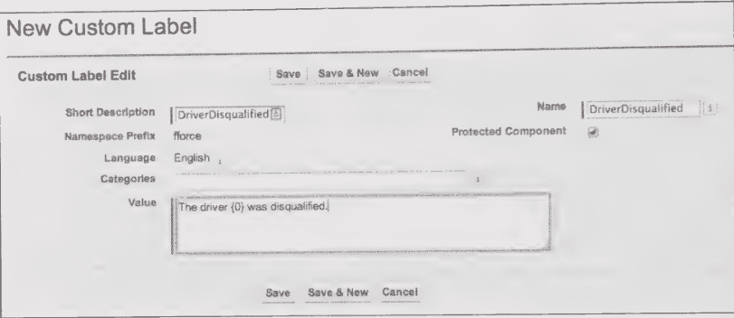

> 创建自定义标签时，请务必注意 **受保护** 复选框。如果取消选中它，最终用户可以引用您的标签，如果您希望他们重复使用您的消息（例如在自定义 **电子邮件模板** 或 **Visualforce** 页面中），则可能需要考虑这一点。但是，缺点是此类标签无法（目前）从您的包中删除，因为您的功能会发生变化。

最后，请记住，在 Visualforce 中可以在 `apex:pageBlockSection` 内使用 `apex:outputField`，字段标签将自动呈现在页面上的字段旁边。

### 构建可定制的用户界面

您的应用程序交付的用户界面中最可定制的方面是 Salesforce 通过其高度可定制的布局编辑器提供的界面，该编辑器提供了自定义用于列出、创建、编辑和删除记录的标准用户界面页面（包括当前通过移动客户端 Salesforce1 交付的页面）的功能。

Lightning Experience 是面向桌面用户提供的最新用户界面体验。Salesforce Classic 或 Aloha 是现有用户界面的名称。它在外观和技术上都截然不同。幸运的是，您在布局和 Visualforce 方面的现有投资仍然兼容。然而，Lightning 带来了更多以组件驱动的方面，并随附允许对整体用户体验进行更大程度自定义的新工具。

请记住，任何未利用标准用户界面的交付用户体验通常都需要开发人员付出额外努力，通常利用自定义设置和字段集来提供定制功能。可以使用 Visualforce 页面或 Lightning 组件来自定义标准用户界面的部分内容或完全替换它。第 8 章“用户界面”中将更详细地介绍此内容。

> > 值得注意的是，订阅组织管理员可以修改在您的自定义对象上定义和打包的页面覆盖，以重新启用 Salesforce 标准用户界面，而不是使用您打包的 Visualforce 页面。因此，请记住对所有自定义对象布局给予一些美观方面的关注。另外，请注意，操作覆盖和布局组件不会被升级。

### 布局

以下是超出标准部分和字段顺序之外的可定制功能的简要摘要。这些功能允许您添加图表和自定义 UI，以帮助将布局定制与 Visualforce 的灵活性和强大功能相结合：

- **Visualforce**：布局部分允许您使用标准控制器嵌入 Visualforce 页面。虽然这仅在标准视图页面上受支持，但您可以在 Visualforce 页面本身上执行任何操作。

- **报表图表**：最近，平台添加了将报表图表嵌入布局的功能。这是一个强大的功能，可使用参数化报表来增强提供给用户的信息。

- **操作**：这允许您以声明式或编程方式描述超出标准平台操作的其他操作。仅当您为对象启用了 Chatter 时，这些操作才适用。

- **自定义按钮**：类似于操作，这允许在详细信息和列表视图页面上添加其他按钮以调用应用程序特定功能。第 8 章“用户界面”中介绍了创建自定义按钮并将其连接到 Apex 代码的方法。


## Visualforce

在考虑构建专用或甚至嵌入式（在布局中）Visualforce 页面时，始终要考虑那些希望使用自己的自定义字段扩展页面布局和/或表格的最终用户。字段集是实现这一点的最佳方式；后面的章节将更详细地介绍这一点。

## Lightning App Builder 和组件

Lightning App Builder（可在“设置”菜单下使用）可由订户组织中的用户用于自定义 Salesforce Mobile 和 Lightning Experience 的用户体验。该工具允许用户使用拖放工具构建全新页面，以及自定义 Salesforce 提供的现有 Lightning Experience 页面，例如主页和记录详细信息页面。

> 记录详细信息组件利用通过现有布局编辑器定义的现有布局来确定显示记录时字段的布局。

Lightning 组件是确定 Salesforce Mobile 和 Lightning Experience 用户体验中可用的信息和功能的基本构建块。Salesforce 提供一些标准组件，其他开发者也可以构建组件，并将其包含在您的包中以暴露您的功能。在后面的章节中，我们将深入探讨 Lightning 的架构及其如何影响您在应用程序中交付功能的方式。

## 使用电子邮件模板自定义电子邮件

使用 Apex，您可以编写代码使用 Messaging API 发送电子邮件。这允许您动态生成要发送的电子邮件的所有属性，包括发件和收件地址、主题标题和正文。但是，请记住，最终用户很可能希望向这些电子邮件添加自己的徽标和消息，即使这些电子邮件只是面向其内部用户的通知。

与在代码中硬编码电子邮件结构相比，请考虑使用电子邮件模板（在 **设置** 菜单下）。此功能允许订户组织中的管理员使用替换参数创建自己的电子邮件，以注入您对象定义的记录中的动态值。例如，使用自定义设置，您可以要求他们配置电子邮件模板的 `DeveloperName` 以便在您的代码中引用。您可以将电子邮件模板打包作为进一步自定义的起点，但请记住，它们不可升级。

> 如果要包含在电子邮件中的数据不是作为自定义对象记录上的字段或公式字段存储的，请考虑在您的包中提供一些可在 Visualforce 电子邮件模板中使用的 Visualforce 自定义组件。这些组件可用于从电子邮件模板调用 Apex 代码，以查询信息和/或执行计算或重新格式化信息。

## 流程构建器、工作流和流

Salesforce 提供多种声明式工具来实现业务流程和自定义用户体验流。最终用户操作（例如为记录创建、更新或启动审批流程）可以通过名为 **工作流和流程构建器** 的两个工具进行自定义。当您需要实现提供向导或访谈式用户体验的 UI 流时，可以使用 **可视化流** 工具。该工具可用于定义需要读取和更新记录的更复杂的条件业务流程。自动化流（有时称为“无头流”）是不与用户交互的可视化流，可以在 Apex 代码以及流程构建器中引用。

流程构建器是工作流的继任者。它提供与工作流相同的功能，此外还具有用于更新子记录等附加功能以及面向开发者的可扩展性。它还具有更现代的图形布局，使最终用户更容易构建和可视化更复杂的流程。虽然您可以互换使用两者，但最好专注于其中一种，以便更轻松地定位和维护自定义。

作为应用程序开发者，这些可以作为您的应用程序的一部分创建和打包。此类组件可升级（前提是它们被标记为 **受保护**）。但是，通常包开发者倾向于将这些功能的使用留给顾问和订户组织管理员，而优先使用 Apex 和/或 Visualforce，因为在这些工具中可以创建更复杂的逻辑和用户体验。

正如管理员可以使用这些工具来自定义他们的组织一样。您可以考虑通过可调用方法公开您的 Apex 驱动的应用程序业务流程，以有效扩展管理员通过这些工具可用的功能。换句话说，这允许流程构建器和可视化流工具的用户通过点击而非代码来调用您的应用程序功能。我们将在第 10 章“提供集成和可扩展性”中再次探讨这一点。

## 社交功能和移动端

Chatter 是平台的关键社交功能；它可以让您的应用程序的用户围绕应用程序中的记录进行协作和上下文通信，并可选择使用 Chatter Communities 功能邀请他们的客户也这样做。这是平台的一个强大方面，但介绍其细节超出了本书的范围。

您可以在“设置”下的 Chatter 设置页面启用 Chatter，之后可以为您的自定义对象启用信息源跟踪（也在“设置”下）。此设置可打包，但不可升级，并且可以由订户组织管理员禁用。在打包对 Chatter 的此类引用以及包含对各种 Chatter 相关对象的引用时要小心，因为这会在您的包中放置打包安装依赖项，要求所有客户也启用此功能。

通过在自定义对象上创建操作，您可以为用户提供在记录上执行常见活动的快速方式，例如，将参赛者的状态更新为 DNF。这些操作也可以通过 Salesforce1 Mobile 应用程序查看，因此与标准记录编辑相比，它们进一步提高了移动用户的生产力。

在打包组织中执行以下步骤以试用此过程：

- 1. 如前所述，为 Race、Driver 和 Contest 自定义对象启用信息源跟踪；正在跟踪的字段对以下步骤不重要，但您可以全部选择它们，以便更好地了解 Chatter 生成的通知类型。还要从 Chatter 设置页面启用发布者操作。

- 2. 导航到参赛者对象定义，找到“按钮、链接和操作”部分。创建一个新操作，并按如下所示完成屏幕：

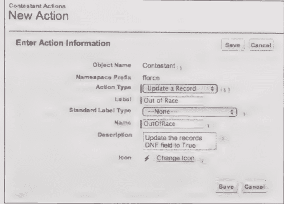

- 3. 当系统提示设计操作布局时，接受显示的默认布局并单击保存。在显示的参赛者操作页面上，单击新建以添加新的预定义字段值选项，以将 TRUE 分配给 DNF 字段，作为更新记录操作的一部分：

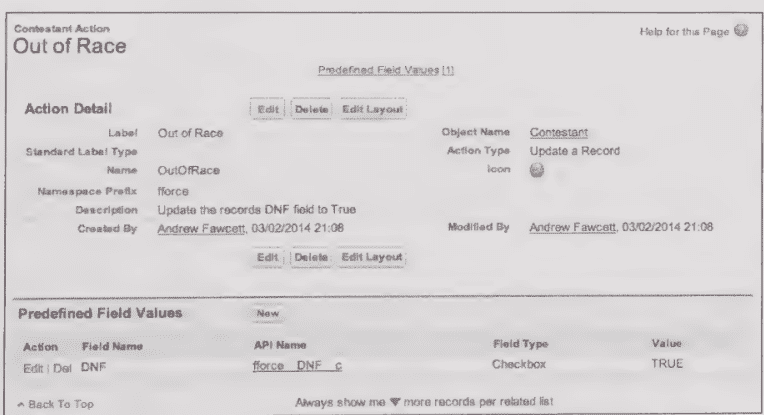

- 4. 最后，编辑 **参赛者** 布局，并将 **退出比赛** 操作拖到布局上（在执行此操作之前，您可能需要在布局编辑器中单击 **覆盖全局发布者布局** 链接）。

- 5. 执行这些步骤后，您将在 UI 中看到显示的 **退出比赛** 操作，如以下屏幕截图所示。如果您在 Salesforce Classic UI 中查看参赛者记录，则该操作从页面 Chatter UI 区域的下拉菜单中访问，外观如下。


如果您在 Lightning Experience UI 中查看参赛者记录，它将如下所示：


请注意，Lightning Experience 将操作“退出比赛”按钮从 Salesforce Classic 的 Chatter UI 重新定位，以将其与其他与记录相关的按钮（右上角）并列显示。还使用了模态弹出窗口样式。这是 Salesforce 为您定义的现有功能采用不同 UX 设计的众多示例之一。

您可以在“设置”菜单下为用户启用 Lightning Experience UI，并按照屏幕上的说明启用它。启用后，您可以在两种 UI 类型之间切换。

如果您通过 Salesforce1 Mobile 应用程序查看记录，它看起来像这样：


完成本章中的步骤后，请花时间查看包的内容，然后再次上传并测试在测试组织中对包进行升级。安装升级时，您应该会看到类似下图所示的确认页面，其中显示正在安装新的或已更改的组件：

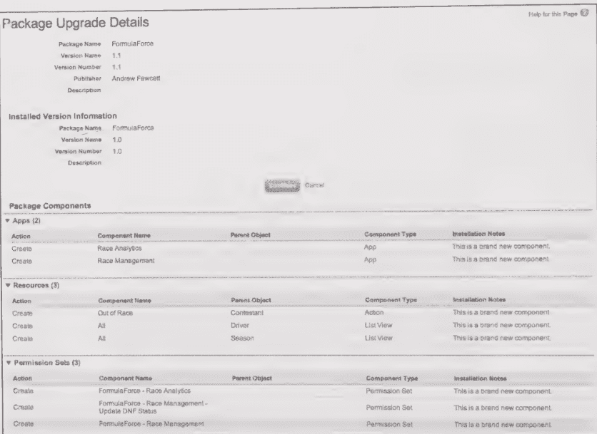

尽管只显示了截图的一部分，但您可以看到它显示了本章添加的自定义应用程序、操作和权限集组件。在更下方，升级后的确认页面显示了更新的自定义对象和新的自定义字段，如下图所示：

| 操作 | 组件名称 | 父对象 | 组件类型 | 安装说明 |
| :--- | :--- | :--- | :--- | :--- |
| 更新 | Contestant | | 自定义对象 | 这是一个升级的组件。它将被更新到新版本。 |
| 更新 | Driver | | 自定义对象 | 这是一个升级的组件。它将被更新到新版本。 |

| 操作 | 组件名称 | 父对象 | 组件类型 | 安装说明 |
| :--- | :--- | :--- | :--- | :--- |
| 创建 | Active | Driver | 自定义字段 | 这是一个全新的组件。 |
| 创建 | DNF | Contestant | 自定义字段 | 这是一个全新的组件。 |
| 创建 | Nationality | Driver | 自定义字段 | 这是一个全新的组件。 |
| 更新 | Driver | Contestant | 自定义字段 | 这是一个升级的组件。它将被更新到新版本。 |
| 创建 | Total DNFs | Race | 自定义字段 | 这是一个全新的组件。 |
| 创建 | Fastest Lap By | Race | 自定义字段 | 这是一个全新的组件。 |
| 创建 | Driver and Race | Contestant | 自定义字段 | 这是一个全新的组件。 |
| 创建 | Year | Season | 自定义字段 | 这是一个全新的组件。 |

> > 请注意，一旦在测试组织中升级了该包，Season、Driver 和 Race 的页面布局将不包含此版本包中添加的新字段。这是因为页面布局不会被升级。

## 摘要

本章中，您了解了许多平台功能，这些功能可直接帮助您在不编写任何代码的情况下构建应用程序的关键结构和功能方面，进而使您的客户能够扩展和定制其应用程序。本章还着重于优化顾问和管理员执行安装和配置应用程序的任务。最后，您了解了订阅组织中施加的限制、避免这些限制的方法，以及在打包时需要注意这些限制。

继续审查和发展您的应用程序，首先寻找采用这些及其他平台功能的机会，您将确保您与客户与当前和未来平台功能的紧密契合不断增长。在下一章中，我们将深入探讨围绕平台上数据存储的选项和功能。

> > 请务必参考 Salesforce Limits Quick Reference Guide PDF，该文档描述了本章及其他章节中讨论的功能的最新限制，网址为 http://login.salesforce.com/help/pdfs/en/salesforce_app_limits_cheatsheet.pdf。
