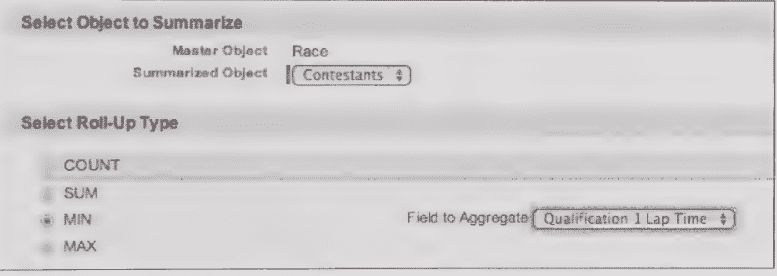
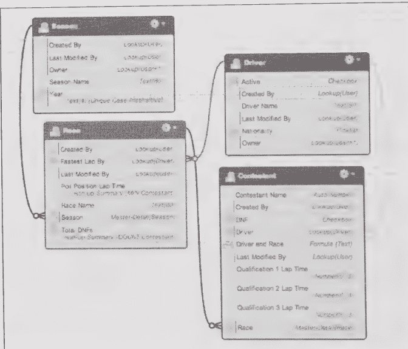
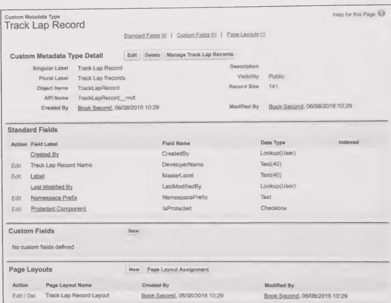
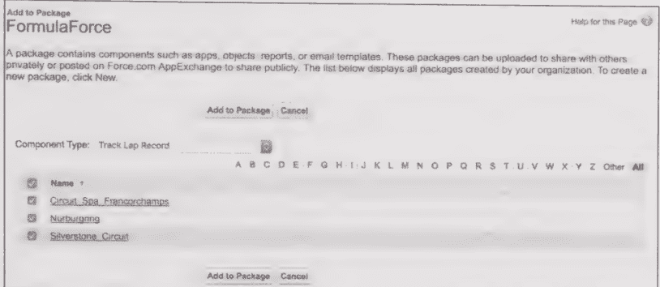
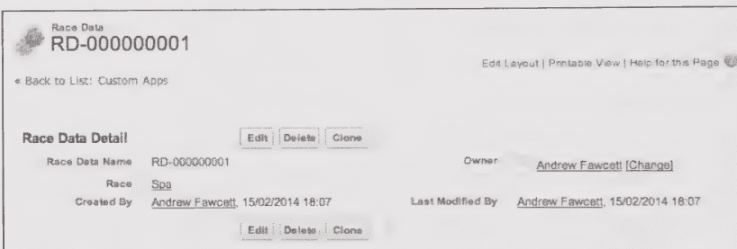
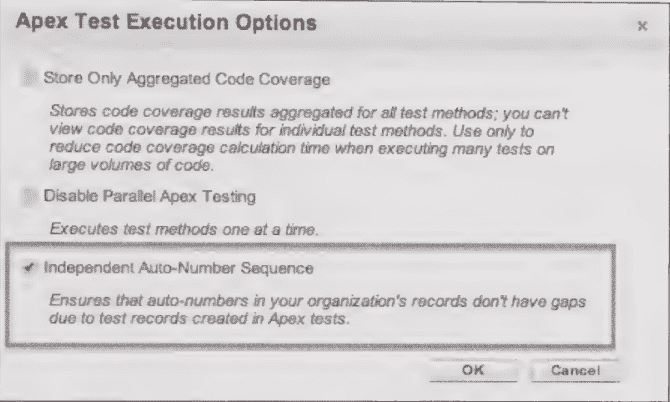
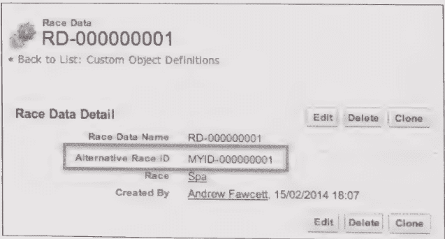
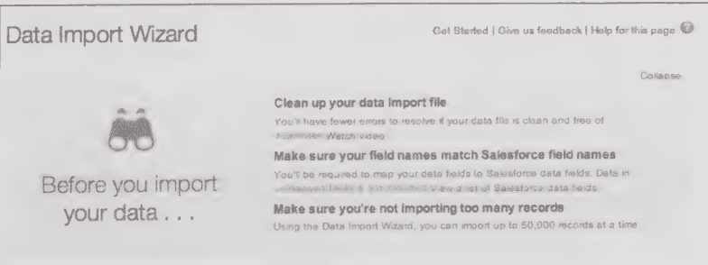
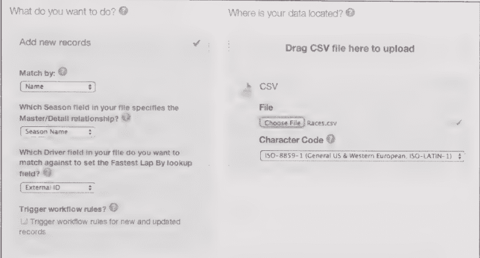
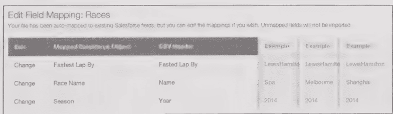

# 应用程序存储

在应用程序设计阶段早期，考虑客户围绕其数据创建和消费模式的存储需求和用例非常重要。这样可确保您的对象架构在处理大数据量、数据迁移过程（入站和出站）以及存储成本方面是最优的。在本章中，我们将扩展 FormulaForce 应用程序中的自定义对象，同时探索平台如何存储和管理数据。我们还将探讨应用程序的操作数据与配置数据之间的差异，以及使用自定义元数据类型进行配置管理和部署的好处。

您将很好地了解所提供的存储类型以及如何计算每种存储的相关成本。同样重要的是，要了解在重用或尝试镜像标准对象（如 Account、Opportunity 或 Product）时可用的选项，这将讨论进一步扩展到许可成本考虑因素。您还将了解应用程序数据上的标准索引和自定义索引选项，这将引出后面一整章中将要介绍的处理大数据量的主题。最后，我们将深入了解平台内用于消耗外部数据存储的新平台功能。

在本章中，我们将介绍以下主题：

- 规划最终用户存储需求
- 了解不同的存储类型
- 记录标识、唯一性和自动编号
- 记录关系
- 重用现有的标准对象
- 应用外部 ID 和唯一字段
- 导入和导出应用程序数据
- 数据复制和归档选项
- 外部数据源

## 规划最终用户存储需求

在应用程序的初始需求和设计阶段，最佳实践是创建称为角色的用户分类。角色会考虑用户的典型技能、需求和目标。基于这些信息，您还应该开始推断其数据需求，例如他们负责创建的数据（直接或间接地，通过运行流程），以及他们需要消耗的数据（报告）。完成此操作后，尝试估算他们每月将创建和/或消耗的记录数量。

> 与您的高级赞助商、市场研究人员、早期采用者以及最终的整个开发团队共享这些角色及其数据需求，以便他们在开发应用程序时牢记这些内容并针对其进行测试。

例如，在我们的 FormulaForce 应用程序中，**经理**可能会创建和消耗数据，而**赛事策略师**则主要消耗大量数据。**管理员**也会想要管理您应用程序的配置数据。最后，应用程序中很可能有一个后台流程，会生成大量数据，例如记录排位赛和正赛期间赛车和车手赛事数据的流程，例如扇区（赛道的指定部分）时间。

> 您可能希望将关于角色和数据需求的结论记录在电子表格中，并附上一些有助于预测数据存储需求（本章后面将讨论）的公式。在未来与 Salesforce 讨论应用程序的 AppExchange 列表过程中，这将有所帮助，在销售周期中，当潜在客户希望了解如何为已安装您的应用程序的存储成本制定预算时，这也是一个有用的工具。

## 了解不同的存储类型

您的应用程序记录所使用的存储占用了平台整体数据存储分配中最重要的部分。平台上还有一种用于上传或创建文件的存储类型。从设置菜单下的存储使用情况页面，您可以查看已用记录的摘要，包括驻留在 Salesforce 标准对象中的记录。

本章稍后，我们将创建一个自定义元数据类型对象来存储配置数据。此类对象消耗的存储不会显示在存储使用情况页面上，而是以不同的方式进行管理和限制。

## 存储使用情况

您组织的存储用量如下所示。

| 存储类型 | 限制 | 已用 | 使用百分比 |
| :--- | :--- | :--- | :--- |
| 数据存储 | 256.0 MB | 284 KB | 0% |
| 文件存储 | 902.0 MB | 13 KB | 0% |

## 当前数据存储用量

| 记录类型 | 记录计数 | 存储 | 百分比 |
| :--- | :--- | :--- | :--- |
| Opportunities | 31 | 62 KB | 22% |
| Cases | 26 | 52 KB | 18% |
| Leads | 22 | 44 KB | 15% |
| Contacts | 20 | 40 KB | 14% |
| Campaigns | 4 | 32 KB | 11% |
| Accounts | 12 | 24 KB | 8% |
| Solutions | 10 | 20 KB | 7% |
| Drivers | 2 | 4 KB | 1% |
| Races | 1 | 2 KB | 1% |
| Seasons | 1 | 2 KB | 1% |
| Contestants | 1 | 2 KB | 1% |
| Tasks | 0 | 0 B | 0% |
| Photos | 2 | 0 B | 0% |


> 前一页还显示了哪些用户使用了最多的存储空间。除了个人的 **用户详细信息** 页面外，您还可以找到 **已用数据空间** 和 **已用文件空间** 字段；在这些字段旁边有查看用户数据和文件存储使用情况的链接。

每个显示的限制均基于以下计算：根据组织类型分配的最小数据存储量，或用户数乘以特定的 MB 数量（此数量也取决于组织类型）；两者中较大者即为限制。有关完整详情，请点击页面上显示的 **本页面帮助** 链接。

## 数据存储

与其他数据库平台不同，Salesforce 通常在其存储使用量计算中使用每条记录固定 2 KB 的大小，而不考虑每条记录中实际的字段数量或字段内数据的大小。此规则有一些例外，例如 **市场活动** 占用 8 KB，而存储的 **电子邮件消息** 占用所包含电子邮件的大小，不过所有自定义对象记录均占用 2 KB。请注意，即使自定义对象使用大型文本区域字段，此记录大小也适用。

> Salesforce **大型对象** 提供一种不同的存储解决方案，这些对象专为存储数十亿条记录而设计，用于接收设备输入，例如在 **物联网 (IoT)** 场景中。信息通过批量加载大量写入，随后频繁读取，换句话说，即写入少、读取多。虽然 Salesforce 未披露，但预期这些对象的存储成本将比在自定义对象中存储的等效记录更低。本章后面介绍的 Race Data 对象可被视为此类对象在 FormulaForce 应用程序中的良好候选对象，因为此信息在赛后批量上传并用于分析比赛。

## 列与行

鉴于前一节中的计算，您可能需要考虑您的数据模型中是否存在具有已知最大值的多条数据。在这种情况下，请考虑创建多个列（或多组列）的选项，而不是创建会占用额外存储空间的新对象。目前，企业版组织每个对象最多支持 500 个字段。例如，在 Formula 1 赛车比赛中，众所周知，比赛前只有三轮排位赛以确定起跑位置，每位车手都在争夺最快圈速。这可以建模为 Contestant 对象的 Qualification Lap 子对象；然而，在这种情况下，它每个参赛者最多只有三条记录。更优的数据存储设计是在 Contestant 对象中创建一组新字段。

在打包组织中执行以下步骤以试用此过程：

- 1. 在 Contestant 对象上创建三个 Number (6, 3) 类型的字段，例如 Qualification 1 Lap Time（Qualification1LapTime__c）。创建这些字段时，请确保未选中 Required 复选框，因为并非所有车手都能进入最终排位赛轮次。
- 请注意，此处我们使用数字而不是单词，例如 QualificationOneLapTime__c，因为这在动态 Apex 遍历字段的场景中很有帮助。
- 2. 在 Race 对象上创建汇总摘要字段 Pole Position Lap Time，选择 Roll-Up Type 时使用 MIN 选项，并在 Field to Aggregate 中选择 Qualification 1 Lap Time 字段，如下方截图所示：



- 3. 最后，更新权限集，在 Race Management 权限集中授予新添加字段的读写权限，并在 Race Analytics 权限集中授予读取权限。

请记住，您还可以使用公式字段为存储在列中的数据添加或应用进一步的逻辑，模拟对等效行进行筛选或聚合查询的效果。采用此方法的另一个好处是，可以减少代码需要执行的 SOQL 和 DML 操作数量。

## 可视化您的对象模型

构建对象模型的实体关系图（ERD）是一个重要的理念；这不仅是您和您团队的良好资源，还可以帮助您的客户了解他们创建的数据存储在哪里，并帮助他们构建报表和集成解决方案。Salesforce 提供了一个名为架构生成器的交互式工具（可通过设置下的对象页面中的按钮访问）来提供帮助；它还可用于创建新对象和字段。在本书的这个阶段，FormulaForce 应用程序数据模型应类似于此：



### 配置数据注意事项

大多数应用程序都需要提供某种方式来配置其功能，以便管理员和用户可以根据自身需求进行定制。如第 2 章“利用平台功能”中所示，Salesforce 为您和您的用户提供了大量这方面的设施。但是，如果您希望为其提供配置的应用程序部分是特定于您的应用领域的，例如每个赛道的官方最快圈速列表，该怎么办呢。

在我们的情况中，假设我们希望作为包的一部分向客户提供每个赛道当前批准的最快圈速列表，这样他们就无需自行查找并手动输入。但是，您仍希望允许用户管理应用程序未知赛道的最快圈速。

在考虑自定义对象之前，自定义设置和自定义元数据类型是两个值得考虑的平台功能，用于存储和管理应用程序的配置。自定义元数据在许多方面都是这两种替代方案的后继者，但目前仍有一些功能可能会促使您考虑使用其他选项。

下表可帮助您根据配置要求决定使用哪种对象类型：

| 配置对象要求 | 自定义对象 | 自定义设置对象 | 自定义元数据类型对象 |
| :--- | :--- | :--- | :--- |
| 对象可以对组织管理员隐藏 | 否 | 是 | 是 |
| 记录可以包含在您的包中 | 否 | 否 | 是 |
| 打包的记录可防止用户编辑并可升级 | N/A | N/A | 是 |
| 可以控制对打包记录字段的编辑 | N/A | N/A | 是 |
| 标准 Salesforce UI 布局可以定义并打包 | 是 | 否 | 是 |
| 支持对象关系以进行更复杂的配置 | 是 | 否 | 是 |
| Apex 访问 | CRUD | CRUD | 读取 ** |
| 记录可以在组织、用户或配置文件级别定义 | 否 | 是 | 否 |
| 记录可以通过验证规则和/或 Apex 触发器应用自定义验证 | 是 | 否 | 否 |
| 减少配置管理开销 | 重新录入或使用数据加载器 | 重新录入或使用数据加载器 | 默认安装，也可使用原生变更集和包来管理客户特定配置 |
| 合作伙伴和其他开发人员构建包装特定形式配置的扩展包的能力 | 否 | 否 | 记录也可以包含在扩展包中 |


> 读取自定义元数据类型记录时，可以使用 SOQL，且不计入 SOQL 查询限制，不过 50k 行限制仍然适用。自定义元数据类型记录可以使用 Salesforce SOAP Metadata API CRUD 操作进行操作。
>
> 尽管可以通过 Apex 调用 Metadata SOAP API，但 HTTP 调用相关的限制仍然适用。围绕 HTTP 调用频率及可进行调用时间的限制，使得在扩展到 200 条记录以上时，这种方法不太理想。此外，调用之间不支持维护引用完整性，因为 API 调用周围没有数据库事务范围。在撰写本文时，Salesforce 已宣布原生支持 Metadata API 正在开发中，尽管其声明中没有交付承诺。

在我们的情况中，将圈速配置记录打包并允许其升级的需求与自定义元数据类型非常契合。此外，无需从 Apex 以编程方式更新此配置信息，只需读取它。

当前无法更新自定义元数据类型记录，如果您希望为配置构建自定义 UI，这可能会成为问题；在我们的情况中，标准 Salesforce UI 已足够。

## 自定义元数据类型存储

从设置中的自定义元数据类型页面，您既可以创建自定义元数据类型对象，也可以管理其包含的记录。您创建的任何记录都可以包含在您的包中，因此在安装包后即可立即供您的 Apex 逻辑使用。

执行以下步骤以创建圈速记录 MDT 对象。

- 1. 单击 New 创建一个圈速记录自定义元数据类型，并将 `TrackLapRecords` 输入为 API 名称。
- 2. 从 Visibility 字段中选择 **所有 Apex 代码和 API 都可以使用此类型**，并且在设置中可见。之所以这样做，是因为我们希望管理员除了我们包含的记录外，还能记录自己的最快圈速。如果此对象中的所有记录仅供您的应用程序逻辑使用（例如用于内部配置），则应选择 **仅同一托管包中的 Apex 代码可以看到此类型** 选项。
- 3. 描述新自定义元数据类型对象的页面与自定义对象使用的页面非常相似。如上一表所述，您无法定义验证规则和自定义按钮等某些功能，不过与自定义设置相比，您可以定义自己的布局。此外还有更多字段类型可用。



请注意，自定义元数据类型对象的 API 名称以 _mdt 结尾，并且具有不同的标准字段。我们将使用 DeveloperName 字段作为实现圈速的赛道的唯一名称。稍后，我们将此对象中的记录包含到包中。isProtected 字段用于确定记录的数据是否可以由包的管理员编辑。

按照以下步骤在对象上创建一些字段。

- 1. 按照下表创建以下字段。接受 Field Manageability 字段中显示的默认值。
- 2. 将圈速记录自定义元数据类型对象添加到包中。

| 对象 | 字段名称和类型 |
| :--- | :--- |
| TrackLapRecords__mdt | DriverName__c Text(60) |
| | Time__c Number(5,3) |
| | Year__c Text(4) |

您在创建上述字段时可能已注意到以下选项：

| 字段可管理性 | 通过托管包安装记录后，谁可以更改字段值？ |
| :--- | :--- |
| | 仅包开发者（通过包升级） |
| | 具有自定义应用程序权限的任何用户（包升级不会覆盖该值） |
| | 无人 |

此选项仅适用于包中包含的记录。它确定包管理员可以更改这些记录的哪些字段。例如，您可能希望向对象添加一个管理员可以编辑的 Notes 文本字段，但保护所有其他字段。对于我们在此处添加的字段，默认值很重要，因为我们希望包更新更新应用程序已知赛道上的新圈速记录的更改。

| 操作 | 字段标签 | API 名称 | 数据类型 | 字段可管理性 | 已编制索引 | 控制字段 | 修改者 |
| :--- | :--- | :--- | :--- | :--- | :--- | :--- | :--- |
| 编辑 | 删除 | 驱动程序名称 | DriverName__c | Text(60) | Upgradable | | App Developer, 06/08/2016 13:26 |
| 编辑 | 删除 | 时间 | Time__c | Number(5, 3) | Upgradable | | App Developer, 06/08/2016 13:27 |
| 编辑 | 删除 | 年份 | Year__c | Text(4) | Upgradable | | App Developer, 06/08/2016 13:28 |

输入以下示例数据。从对象定义页面单击管理圈速记录开始输入配置数据。添加记录时，取消选中受保护复选框。

**保护：** 这决定记录在客户组织中是否可见。受保护的记录对用户隐藏，但您自己的打包 Apex 代码仍可查询它们。对内部配置使用受保护的记录。

### 圈速记录

| 操作 | 标签 | 圈速记录名称 | 命名空间前缀 | 受保护组件 | 时间 | 驱动程序名称 | 年份 |
| :--- | :--- | :--- | :--- | :--- | :--- | :--- | :--- |
| 编辑 | Circuit Spa-Francorchamps | Circuit_Spa_Francorchamps | ff2 | | 105.108 | Kimi Räikkönen | 2004 |
| 编辑 | Nürburgring | Nurburgring | ff2 | | 84.468 | Michael Schumacher | 2004 |
| 编辑 | Silverstone Circuit | Silverstone_Circuit | ff2 | | 90.874 | Fernando Alonso | 2010 |

您还可以定义 **列表视图**，以便在打包组织中更轻松地管理自定义元数据类型记录。最初无法编辑默认的 **全部** 视图，但您可以创建同名视图；单击 **创建新视图**。此列表视图不会打包。

自定义元数据类型记录使用的存储空间不会在 **存储使用量** 页面上显示。使用的计算基于字段大小的最大记录大小，而不是自定义对象使用的标准 2 KB。用户创建的记录总计可达 10 MB。您的打包记录也有自己的 10 MB 限制。您可以通过查看 **自定义元数据类型** 页面上显示的记录大小来计算使用的存储空间。

## 所有自定义元数据类型

自定义元数据类型使您能够创建自己的设置对象，其记录是元数据而非数据。这些通常用于定义需要从一个环境迁移到另一个环境，或打包并安装的应用程序配置。与其从自定义对象或自定义设置中的数据记录构建应用，不如创建自定义元数据类型并添加元数据记录，享受元数据带来的所有可管理性：打包、部署和升级。查询自定义元数据记录不计入 SOQL 限制。

### 新建自定义元数据类型

| 操作 | 标签 | 命名空间前缀 | 可见性 | API 名称 | 记录大小 | 描述 |
| :--- | :--- | :--- | :--- | :--- | :--- | :--- |
| 删除 | 管理记录 | Track Lap Record | | 公开 | TrackLapRecord__mdt | 213 |

要将记录添加到包中，请执行以下步骤：

- 1. 从 **包详细信息** 页面单击 **添加组件**。
- 2. 从下拉列表中选择 **圈速记录**，并选择所有记录。

完成步骤 2 时，添加到包页面将如下所示：



> 小知识：在试点阶段，自定义元数据类型功能称为“平台即平台”。后来品牌发生了变化，但当时 Salesforce 认为这描述了这项技术的一个潜力：开始构建您自己的平台包，向平台添加新的元数据类型。如前所述的注意事项表所示，其他人打包您的自定义元数据类型记录的能力是这一愿景的实现。

## 自定义设置存储

自定义设置在数据存储限制方面与自定义对象略有不同，因为它们不存在于同一存储区域。自定义设置非常适合经常读取但很少写入的数据。Salesforce 将这些对象中的数据缓存在其所谓的应用程序缓存中，并提供一种快速查询的方式，而不应用查询限制。但是，与自定义对象不同，它们不支持 Apex 触发器或验证规则。

每个组织、每个命名空间对自定义设置可消耗的存储空间有限制。这意味着，如果您创建自定义设置并将其添加到托管包中，它将拥有自己的存储限制。自定义设置的存储限制从完全许可用户的 1 MB 开始，最高可达 10 MB。您可以从设置中的自定义设置页面查看当前的存储使用情况。


## File storage

Salesforce 用于存储基于文件的数据的方式日益增多，从历史悠久的 Document 标签页，到更复杂的 Content 标签页，再到使用 Files 标签页，更不用说如果启用了附件（Attachments），还可以将其应用于自定义对象记录。每种方式都有其自身的优缺点，文件大小限制在 Salesforce 文档中有明确定义。未来 Salesforce 将仅支持 Files，因此建议使用此方式而非其他文件存储选项。例如，只有 Files 标签页在 Lightning Experience 中受支持。

从应用程序开发的角度来看，与数据存储一样，要意识到您的应用程序代表用户生成了多少数据，并为用户提供控制和删除这些信息的方式。在某些情况下，请考虑最终用户是否希望有按需重新创建文件的选项（例如作为 PDF），而不是始终由应用程序存储文件。

## 记录标识、唯一性和自动编号

Salesforce 中的每个记录都有一个 Id 字段，除少数例外外，还有一个 Name 字段，或者用于自定义元数据类型对象的 DeveloperName。Id 字段是唯一的，但不可读，这意味着它无法手动输入，或者，对于地球上大多数人来说，也不容易记住！

> Database.merge 和 merge DML 语句支持合并账户、线索和联系人记录。

### 唯一字段和外部 ID 字段

添加字段时，可以指示其中存储的值为 **唯一** 和/或 **外部标识符**。对于唯一字段，平台会自动强制执行此规则，无论记录如何创建或更新，都会拒绝没有唯一值的记录。通过利用指定为外部 ID 字段的字段，可以简化用户的数据加载过程；本章后面将更详细地讨论此内容。这两个字段修饰符都会创建自定义索引，有助于优化查询性能。

> 您可以通过确保前一章中所述的其他标识字段（如这些字段）也添加到 **查找布局** 中，来帮助用户避免创建同名的重复记录。

让我们添加一个 **唯一** 和 **外部 ID** 字段来记录车手的 Twitter 账号。在打包组织中执行以下步骤来尝试：

- 1. 在 **Driver** 对象上创建一个新的 **文本** 字段，**Twitter Handle** (`TwitterHandle__c`)，长度为 **15**，并选中 **唯一** 和 **外部 ID** 复选框。
- 2. 使用上一章中输入的 **Driver** 记录来更新字段，并确认系统防止重复的 Twitter 账号。Lewis Hamilton 的 Twitter 账号是 LewisHamilton 和 Ruben 的是 rubarrichello。
- 3. 将拥有新字段读写权限的权限集更新为 **赛事管理**，将只读权限更新为 **赛事分析**。

### 自动编号字段

平台支持自动序列字段类型，可在对象创建期间和之后将其应用于 **名称** 字段（前提是该对象之前未作为先前包版本上传的一部分包含在内）。它也可以应用于全新字段。平台处理序列递增并确保没有重复项。

在 FormulaForce 应用程序中应用 **自动编号**，为 **Race Data** 记录在插入时提供唯一的自动递增标识符。在打包组织中执行以下步骤来尝试：

- 1. 创建一个新的 **Race Data** (`RaceData__c`) 对象；对于 **记录名称**，输入 `Race Data Id`，并从 **数据类型** 字段中选择 **自动编号**。
- 2. 在 **显示格式** 字段中输入 `RDID-{00000000}`，在 **起始编号** 中输入 `1`。最后，选中 **允许报表** 字段。
- 3. 添加一个名为 `Race` (`Race__c`) 的 **查找** 字段，以将此对象中的记录与现有的 `Race` 对象关联。选择 **不允许删除属于查找关系一部分的查找记录** 选项，以防在存在赛事数据时删除赛事记录。我们将在后续章节中为此对象添加更多字段。
- 4. 为刚刚创建的 **Race Data** 对象创建一个标签页，并将该标签页添加到 **赛事管理** 和 **赛事分析** 应用程序中。这样做，标签页和对象将自动添加到包中，为下一次上传做好准备。
- 5. 创建一个测试记录以观察 **Race Data 名称** 字段值。



- 6. 使用新对象和字段更新权限集，将读写权限授予 **赛事管理**，将只读权限授予 **赛事分析**。

虽然可以向已打包并发布给客户的对象添加新自定义字段，但目前无法向已打包的对象（例如 **Driver** 对象）添加新的 **自动编号** 字段。

创建使用自动编号字段的测试记录的 Apex 测试可以通过组织设置进行配置，以在测试之外不递增序列号，从而从最终用户的角度创建序列中的间隙。在订阅组织中，通过 Setup 下的 Apex Test Execution 页面上的 Options... 按钮访问此设置，如下所示：



显示格式决定格式，但不决定最大序列号。例如，如果使用 SEQ{0000} 格式，且下一个创建的序列号为 10,000，平台将显示为 SEQ10000，忽略格式数字。Auto Number 字段的最大值在 Salesforce 文档中说明为最大长度 30 个字符，其中 10 个字符保留用于前缀字符。它还指出最大起始号必须小于 1,000,000,000。

平台不保证自动编号序列字段中不会有间隙。在创建记录时出现的错误可能会造成间隙，因为插入过程中分配的编号不会被重用。因此，在使用此功能时，请相应地与用户设定预期。

创建无中断序列的一个变通方法是创建一个使用自动编号字段类型的名称字段的自定义对象，例如 Job References。然后，在此对象与需要应用序列的对象记录之间创建关系，例如 Jobs。然后，编写一个 Apex 计划作业，为当前没有 Job Reference 关系的每个 Jobs 记录每天向 Job References 对象插入记录。然后，对 Job References 对象运行报表。为了确保没有删除 Job 记录，从而造成间隙，还可以启用后续章节中描述的查找参照完整性功能。

### 订阅者自定义自动编号显示格式

请注意，一旦打包并安装到订阅组织中，显示格式将无法自定义。但是，可以在订阅组织中创建自定义公式字段，以从名称字段值中删除前缀并重新应用所需的任何前缀。例如，以下公式将隔离名称字段值的数字部分，并应用公式中指定的新前缀（这也可以由公式中的自定义设置或条件逻辑驱动）：

```
'MYID-' + MID(Name, 4, LEN(Name) + 4)
```

当将此公式字段应用于自动编号为 RD-000000001 的记录时，公式将显示如下：




## 记录关系

当从一个对象向另一个对象创建**查找**字段时，就会形成一种关系，这通常被称为父子关系。Salesforce 中有两种类型的关系：**主从关系**和**查找关系**。

> 自定义元数据类型对象仅支持与其他自定义元数据类型对象或其他自定义对象/自定义字段元数据之间的查找关系。本节中描述的一些功能仅适用于自定义对象，例如查找过滤器和参照完整性。自定义设置对象不支持任何形式的记录关系。

在某些方面，它们在使用 SOQL 和 Apex 时的引用方式以及通过用户界面输入的方式上有相似之处（例如前一章中描述的**查找过滤器**）。但是，关于**限制**和**参照完整性**功能存在差异，具体如下：

- 使用主从关系形式可以提供一种强大的方式来建模包含关系，其中一个父对象记录充当其他子记录的容器；在我们的示例中，一场比赛包含**参赛者**。
  - 删除父记录时，平台会自动级联删除子记录，并且在创建子记录时还会强制要求父引用。
  - 默认情况下，平台会阻止用户通过编辑关系字段将子记录移动到另一个父记录。但是，您可以通过选择**子记录在创建后可以重新关联到其他父记录**选项来禁用此验证并允许此操作。
  - 使用**汇总摘要**字段后，还可以基于子记录字段的值构建计算字段。
  - 但是，Salesforce 建议这种父子关系不要超过 10,000 个子记录；否则，平台将不支持级联删除子记录。
  - 您可以定义最多三级主从关系。

- 使用**查找**类型的关系可以让您对相关记录之间的可选连接进行建模，这些连接可能还具有与其父记录不一定涉及所有权或包含关系的其他关系。使用查找字段定义关系时，请牢记以下几点：
  - 删除父记录不会导致相关子记录级联删除；这可以通过 Salesforce 支持启用，但该设置不会被打包。
  - 与主从关系不同，您可以在创建字段时选择让平台强制实施参照完整性，方法是使用**不允许删除属于查找关系一部分的查找记录**选项。
  - 目前，使用查找关系时不支持**汇总摘要**字段。

两种类型的查找字段都会由平台自动编入索引，在某些情况下可使查询更快。我们将在后续章节中更多地关注索引。每个对象的关系字段最大数量为 40。

> 虽然可以向已打包并发布给客户的对象添加新自定义字段，但不能向已打包的对象添加新的主从关系。

## 重用现有标准对象

在设计对象模型时，深入了解现有的**标准对象**及其功能是了解何时引用、何时不引用它们的关键。在考虑使用标准对象时，请牢记以下几点：

- **从数据存储角度来看：** 如果您的最终用户作为现有 Salesforce 客户已经在使用类似的标准对象，那么忽略标准对象会为他们带来潜在的数据重复和集成工作量。请记住，通过您的包向标准对象添加额外的自定义字段不会增加这些对象的数据存储消耗。

从许可成本角度来看：相反，引用某些标准对象可能会给用户带来额外的许可成本，因为并非所有标准对象都可以在没有 Salesforce 额外许可的情况下供用户使用。请确保您了解 Salesforce (CRM) 许可和 Salesforce Platform 许可在可用标准对象方面的差异。目前，Salesforce Platform 许可提供账户和联系人；但是，要使用机会或产品对象，用户需要 Salesforce (CRM) 许可。请参阅 Salesforce 文档以获取有关这些的最新详细信息。

使用您的用户角色来定义您的用户使用哪些标准对象，并相应地通过查找、Apex 代码和 Visualforce 引用它们。您可以使用扩展包和/或动态 Apex 和 SOQL 使这类引用成为可选。由于开发者版组织拥有所有这些许可和对象（尽管数量有限），请在每次单击上传按钮之前检查包依赖项，以检查是否有无意的引用。

## 导入和导出数据

Salesforce 提供了一些用于导入和导出数据的自有工具，以及一些基于 Salesforce API 的第三方选项；这些选项均列在 AppExchange 上。在导入带有其他记录关系的记录时，无法预测并包含相关记录的 ID（例如导入比赛记录时的赛季记录 ID）；本节将介绍解决此问题的方法。

Salesforce 提供了数据导入向导，可在设置菜单下找到：



导入包含比赛赛季列表的 CSV 文件非常简单，因为这是一个顶级对象且没有其他对象依赖。但是，要导入比赛信息（这是赛季的相关子对象），需要赛季和最快圈速由记录 ID，而这些 ID 通常默认不会出现在比赛导入 CSV 文件中。请注意，ID 在整个平台上是唯一的，不能在组织之间共享。

如果您需要回顾这些对象的结构，请参阅第 2 章“利用平台功能”中显示的 Schema Builder 截图。

外部 ID 字段有助于解决此问题，它允许 Salesforce 使用此类字段的现有值作为关联需要引用父记录或相关记录的导入记录的辅助方式。所需的只是在导入数据文件中包含相关记录的名称或（理想情况下）唯一外部 ID。

Races.csv 文件包含在本章的示例代码的 /data 文件夹中。此 CSV 文件包含三列：年份、名称和最快圈速由（该比赛中跑出最快圈速的车手，由其 Twitter 句柄指示）。您可能记得，驾驶员记录也可以通过此方式标识，因为该字段已定义为外部 ID 字段：

| 年份 | 名称 | 最快圈速由 |
|---|---|---|
| 2014 | Melbourne | LewisHamilton |
| 2014 | Shanghai | LewisHamilton |
| 2014 | Monte Carlo | LewisHamilton |
| 2014 | Budapest | LewisHamilton |

您的打包组织中应该已经存在 2014 **赛季**记录和 `Lewis Hamilton 驾驶员`记录。如果不存在，请参阅前一章来创建这些记录。现在，运行**数据导入向导**并按照以下截图完成设置：



接下来，按照以下截图完成字段映射：



单击**开始导入**，然后单击**确定**，在数据导入完成后查看结果。您应该发现，在 `2014 赛季` 下已创建了四个新的**比赛**记录，并且**最快圈速由**字段已正确关联到 `Lewis Hamilton 驾驶员`记录。


请注意，这些工具也会对您的 **Apex 触发器** 代码进行压力测试，因为它们通常启用批量模式并以每批200条记录的大小插入记录。因此，建议您将触发器的测试至少达到此级别的记录量。后续章节将介绍编码模式，以帮助确保代码支持批量模式。

## 复制和归档数据的选项

企业客户通常拥有仍在使用或未来希望逐步淘汰的旧版和/或外部系统。因此，他们可能需要将Salesforce平台中存储的数据的某些方面复制到另一系统。同样，为了将不需要的数据移出平台并管理数据存储成本，存在归档数据的需求。

以下列出了一些平台和API设施，可帮助您和/或您的客户构建用于复制或归档数据的解决方案。当然，下面列出了若干 **AppExchange** 解决方案，它们提供已使用这些API的应用程序：

- **Replication API**：此API同时以Web服务SOAP和Apex形式存在。它允许您开发定时进程，在给定时间段内为特定对象查询平台上的任何新记录、更新记录或已删除记录。`getUpdated` 和 `getDeleted` API方法仅返回记录的ID，要求您使用常规Salesforce API查询剩余数据以进行复制。调用此API的频率对于避免缺口非常重要。有关更多详细信息，请参阅Salesforce文档。

- **Outbound Messaging**：此功能提供了比复制API更具实时性的替代方案。外部消息事件可以使用平台的标准工作流功能进行配置。一旦针对给定对象配置了此事件，它将提供一个 **Web服务定义语言（WSDL）** 文件，该文件描述了在创建和更新记录时要调用的Web服务端点。Web服务开发人员有责任根据此定义创建端点。请注意，此选项不提供删除功能。

- Bulk API：此API提供了一种手段，每滚动24小时可移动最多5000个Salesforce数据块（每个块最多10 MB或10,000条记录）。Salesforce和第三方数据加载器工具（包括Salesforce Data Loader工具）将其作为选项提供。它还可用于删除记录而无需将其放入回收站。此API非常适合构建用于归档数据的解决方案。

Heroku Connect 是 Salesforce 与 Heroku Postgres 之间无缝的数据同步解决方案。有关更多信息，请参见 https://www.heroku.com/connect。

## 外部数据源

在归档用例中将数据移出平台，或无法将数据复制到平台上的一个缺点是，最终用户必须在应用程序和登录之间切换才能查看数据；由于进程和数据未连接，这会造成开销。

Salesforce Connect（以前称为Lightning Connect）是平台的一项付费附加功能，可通过设置中的所谓外部对象和外部数据源配置，在Salesforce用户界面中公开外部数据。它们提供与自定义对象类似的功能，例如列表视图、页面布局和自定义按钮。目前，不支持报表和仪表板，尽管可以通过Apex、Visualforce或Lightning组件构建自定义报表解决方案。

外部数据源可以连接到现有的基于OData的端点，并通过OAuth或基本身份验证进行保护。或者，Apex提供Connector API，开发人员可以实现适配器以连接到其他基于HTTP的API。根据关联外部数据源的功能，使用该数据源访问外部对象的用户可以通过Salesforce移动端和桌面界面等标准Salesforce UI读取甚至更新记录。

## 总结

本章进一步探讨了在平台上开发应用程序的声明式方面，这些方面适用于应用程序的存储方式，以及通过使用查找字段删除约束和应用唯一字段来强制执行关系数据完整性的方式。主细关系允许您在数据模型中建模封装概念。我们还考虑了跨列而非跨行扩展架构的数据存储影响，以及这对最终用户存储成本的好处。

将 `FormulaForce` 包的最新版本上传并安装到您的测试组织中。新组件和升级组件的安装过程中的摘要页面应类似于以下屏幕截图。请注意，权限集在安装期间会被升级。

### 选项卡 (1)

| 操作 | 组件名称 | 父对象 | 组件类型 | 安装备注 |
|---|---|---|---|---|
| 创建 | Race Data | | 选项卡 | 这是一个全新组件 |

### 资源 (3)

| 操作 | 组件名称 | 父对象 | 组件类型 | 安装备注 |
|---|---|---|---|---|
| 创建 | All | RaceData__c | 列表视图 | 这是一个全新组件 |
| 创建 | Race Data Layout | RaceData__c | 页面布局 | 这是一个全新组件 |
| 创建 | Track Lap Record Layout | TrackLapRecord__mdt | 页面布局 | 这是一个全新组件 |

### 对象 (2)

| 操作 | 组件名称 | 父对象 | 组件类型 | 安装备注 |
|---|---|---|---|---|
| 创建 | Race Data | | 自定义对象 | 这是一个全新组件 |
| 创建 | Track Lap Record | | 自定义元数据类型 | 这是一个全新组件 |

### 权限集 (3)

| 操作 | 组件名称 | 父对象 | 组件类型 | 安装备注 |
|---|---|---|---|---|

### 字段 (9)

| 操作 | 组件名称 | 父对象 | 组件类型 | 安装备注 |
|---|---|---|---|---|
| 创建 | Twitter Handle | Driver__c | 自定义字段 | 这是一个全新组件 |
| 创建 | Race | RaceData__c | 自定义字段 | 这是一个全新组件 |
| 创建 | Qualification 3 Lap Time | Contestant | 自定义字段 | 这是一个全新组件 |
| 创建 | Driver Name | TrackLapRecord__mdt | 自定义字段 | 这是一个全新组件 |
| 创建 | Qualification 1 Lap Time | Contestant | 自定义字段 | 这是一个全新组件 |
| 创建 | Year | TrackLapRecord__mdt | 自定义字段 | 这是一个全新组件 |
| 创建 | Time | TrackLapRecord__mdt | 自定义字段 | 这是一个全新组件 |
| 创建 | Qualification 2 Lap Time | Contestant | 自定义字段 | 这是一个全新组件 |
| 创建 | Pole Position Lap Time | Race | 自定义字段 | 这是一个全新组件 |

| 操作 | 组件名称 | 父对象 | 组件类型 | 安装备注 |
|---|---|---|---|---|
| 创建 | Circuit Spa-Francorchamps | | Track Lap Record [R2] | 这是一个全新组件 |
| 创建 | Silverstone Circuit | | Track Lap Record [R2] | 这是一个全新组件 |
| 创建 | Nürburgring | | Track Lap Record [R2] | 这是一个全新组件 |

将包安装到测试组织中后，请在 **设置** 下访问 **自定义元数据类型** 页面，并单击对象旁边的 **管理记录**。您将看到记录显示为托管且无法删除。单击其中一条记录，您将看到字段值本身也无法编辑。这是在定义字段时 **字段可管理性** 复选框的效果。


显示的 **命名空间前缀** 值将与您的不同。

尝试在打包组织中更改或添加 **Track Lap Time** 记录，例如更新现有记录上的圈速时间。再次上传包，然后升级您的测试组织。您将看到记录会自动更新。相反，您在测试组织中创建的任何记录将在升级之间保留。

本章，我们现已介绍了平台的一些主要方面，涉及打包、平台对齐以及应用程序数据的存储方式，以及应用程序架构的关键方面。本章使用了自定义元数据来阐释配置数据的用例。本书将在即将到来的章节中进一步介绍此灵活平台功能的更多用例。

在本书的接下来几章中，我们将开始探讨 **企业编码模式** 以及有效地设计您的应用程序代码，使其与平台功能协同工作，并随着您的需求和平台一起增长。


