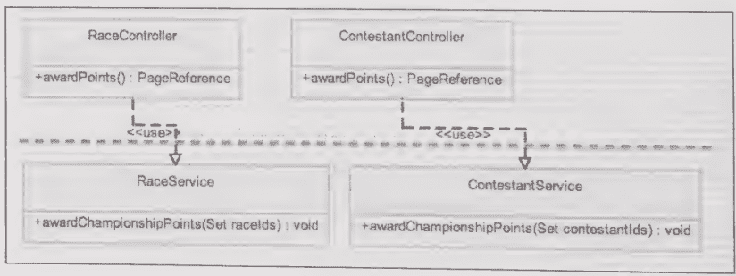
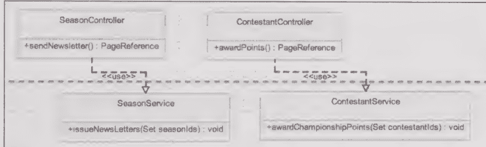
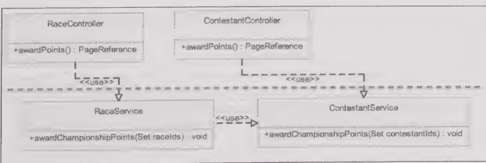
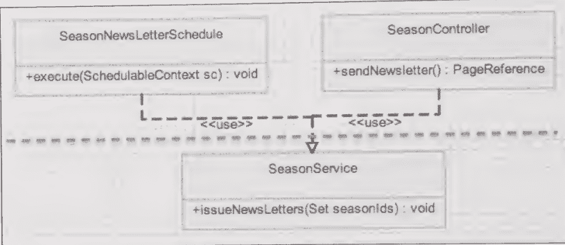

# Apex 执行与关注点分离

开始编写 Apex 时，很容易想直接从 Apex 触发器或 Apex 控制器类入手，并在其中放置所需逻辑来实现所需功能。本章将探索一种不同的起点，使开发者能够专注于以独立于调用上下文的方式编写应用程序业务逻辑（即应用程序的核心逻辑）。它还将解释这种方式在复用性、代码可维护性和灵活性方面带来的益处，尤其是在将代码应用到平台的不同区域时。

我们将探讨 Apex 代码的调用方式、这些上下文的要求与益处、它们的共同点与差异，以及共享的最佳实践。我们将这些提炼为一种分层的代码编写方式，从一开始就在代码库中教授和嵌入关注点分离（SOC）。我们还将介绍一种命名约定，以帮助代码导航并进一步强制执行 SOC。

本章结束时，我们将编写一些初始代码，搭建支持 SOC 的框架，并为接下来三章中更详细地探讨一些知名企业应用架构模式奠定基础。最后，我们将对这段代码进行打包，并安装到测试组织中。

本章将涵盖以下主题：

- Apex 执行上下文
- Apex 限额和命名空间
- Apex 用于何处？
- 关注点分离
- 企业应用架构模式
- 单元测试与系统测试
- 打包代码

## 执行上下文

平台上的执行上下文有开始和结束；它由用户或系统动作或事件启动，例如按钮点击或计划后台作业的一部分，通常是短暂的；结束前只有几秒或几分钟，而不是几小时。在多租户架构中尤其重要，因为每个上下文都有自己关于查询、数据库操作、日志和执行时长的一组限制。

在后台作业（**批量 Apex**）的情况下，平台不会为整个作业提供一个执行上下文，而是将正在处理的信息拆分，并以串行方式通过多个执行上下文传回。例如，如果用户要求作业处理 1000 条记录，而批次大小（即 Batch Apex 术语中的作用域大小）为 200（这是默认值），则会产生五个不同的执行上下文，一个接一个地执行。这样做是为了让平台能够根据服务当时的负载，对作业的执行进行节流控制，或在需要时在作用域之间暂停它们。

你可能会认为执行上下文是从你的 Apex 代码开始并以它结束，但这是错误的。本章稍后将介绍一些 Apex 代码；我们将使用调试日志来了解平台如何调用 Apex 代码。

## 探索执行上下文

对于接下来的两个示例，假设已为 **参赛者** 对象创建了 Apex 触发器，并编写了一个 Apex 类来实现一些逻辑，以便在比赛结束时根据参赛者的名次更新其锦标赛积分。

在第一个示例中，**参赛者** 记录直接从 UI 更新，并捕获了下一个屏幕截图中显示的 **Apex 调试** 日志。

请注意 **执行开始** 和 **执行结束** 行；它们显示了 Salesforce 服务器上请求的实际开始和结束。**代码单元启动** 行显示了平台调用 Apex 代码的位置。另外，请注意行号显示 **外部**，表示平台的内部代码调用了 Apex 代码。为简洁起见，屏幕截图中其余的代码执行部分已折叠。

| 文本 | 类别 | 行 |
|---|---|---|
| 执行开始 | 执行开始 | |
| 触发器 | 代码单元启动 | [外部] |
| flforces.ContestantsTrigger 在参赛者触发器事件 BeforeUpdate 上针对 [a03b00000006wVph] | 代码单元启动 | [外部] |
| flforces.ContestantsTrigger 在参赛者触发器事件 AfterUpdate 上针对 [a03b00000006wVph] | 代码单元启动 | [外部] |
| 执行结束 | 执行结束 | |

在第二个示例中，假设执行了一些 Apex 代码来在比赛结束时计算参赛者的锦标赛积分。在这种情况下，代码是从“执行匿名”提示中执行的（虽然在应用程序中，这将是一个按钮）；同样，捕获了 Apex 调试日志，如下一个屏幕截图所示。

同样，你可以看到 EXECUTION_STARTED 和 EXECUTION_FINISHED 条目，以及三个 CODE_UNIT_STARTED 条目：一个用于从“执行匿名”提示中调用的 RaceService.awardChampionshipPoints Apex 方法，另外两个用于 Apex 触发器代码。

```
Log
Text Category Line
EXECUTION_STARTED EXECUTION_STARTED
> execute_anonymous_apex CODE_UNIT_STARTED [EXTERNAL]
< <>entry(Trigger) SYSTEM_CONSTRUCTOR_ENTRY [1]
< RaceService.RaceService() METHOD_ENTRY [1]
< flforces.RaceService.awardChampionshipPoints(Set<Id>) METHOD_ENTRY [1]
< fl_IdtoOpptyIDMap METHOD_ENTRY [54]
< SYSTEM_CONSTRUCTOR_ENTRY [9]
< <init>(<VST>Schema.SObjectType>) [9]
< Aggregations_1.select (...) SOQL_EXECUTE_BEGIN [94]
< QueryLocatorIterator (...) SYSTEM_METHOD_ENTRY [97]
< flforces.RaceService.awardChampionshipPoints.registerDML(SObjects) METHOD_ENTRY [201]
< flforces.RaceService.$constructDMLWork.registerDML(SObjects) METHOD_ENTRY [271]
< flforces.RaceService.constructDMLWork.commitWork() METHOD_ENTRY [281]
> Savepoint_set SAVEPOINT_SET [156]
< ... DML_ENTRY [174]
< ... DML_BEGIN [177]
> flforces.ContestantsTrigger on Contestant trigger event BeforeUpdate ... CODE_UNIT_STARTED [EXTERNAL]
> flforces.ContestantsTrigger on Contestant trigger event AfterUpdate ... CODE_UNIT_STARTED [EXTERNAL]
< CUMULATIVE_LIMIT_USAGE CUMULATIVE_LIMIT_USAGE
< (default) LIMIT_USAGE_FOR_NS NS
< ... LIMIT_USAGE_FOR_NS NS
< CUMULATIVE_LIMIT_USAGE_END CUMULATIVE_LIMIT_USAGE_END
< EXECUTION_FINISHED EXECUTION_FINISHED
```

与第一个示例不同的是，如你从“行”列中所见，执行转换显示了正在执行的 Apex 代码行和外部。当在 Apex 中执行 DML 语句以更新参赛者记录时，Apex 代码执行会暂停，而平台代码接管以更新记录。在此期间，平台最终会调用 Apex 触发器，执行流程再次回到 Apex 代码中。

基本上，执行上下文用于封装对 Salesforce 服务器的请求；它可以是 Apex 代码、验证规则、工作流规则、触发器代码和其他逻辑执行的混合体。平台会为你处理这种整体编排。Salesforce **开发者控制台** 工具提供了关于在这些各个区域花费时间的绝佳额外洞察。

| 销售订单 ID | 单元 | 时间线 | 执行单元 |
|---|---|---|---|
| 类别 | APEX | 92.17% | 09:56:000 |
| APEX_CODE | 0.010 | 02.17% | |
| WF FLOW | 0.00 | 00.87% | |
| FS | -ve | 4.59% | |
| VALIDATION | 0.00 | 00.06% | |
| CALL | 0.00 | 00.00% | |
| VALIDATION | 0.00 | 00.00% | |
| SYSTEM | 0.00 | 00.00% | |
| SYSTEM | 4.0 | 37.1% | |
| 行 | --- | --- | --- |
| | | | |
| | | | |
| | | | |

如果订阅组织已向你的对象添加了 Apex 触发器，则它们在同一个执行上下文中执行。如果这些 Apex 代码单元中的任何一个抛出未处理的异常，则整个执行上下文将停止，并回滚已执行的所有数据库更新，本章稍后将更详细地讨论这一点。

## 执行上下文和状态

执行上下文中创建的 Apex 变量所使用的服务器内存存储可以被视为执行上下文的状态；在 Apex 中，这称为 **堆**。总体而言，用于维护执行上下文状态的服务器内存资源在结束时会被释放；因此，在具有短暂执行上下文的系统中，资源可以得到更好的管理。通过使用 CPU 和堆限额，平台强制执行执行上下文的最大持续时间和 Apex 堆大小，以确保服务的平稳运行；这些内容将在本章稍后更详细地描述。

**状态管理** 是编程实践，用于管理用户或作业在执行工作过程中（例如基于向导的 UI 或汇总信息的作业）调用的独立执行上下文（对服务器的请求）之间所需的信息。当然，用户并不真正理解执行上下文和状态；他们通过用户界面查看任务，或根据他们提供的字段输入和条件启动作业。并不总是需要考虑状态管理，因为某些用户任务可以在一个执行上下文中完成；从架构角度来看，这通常更可取，因为管理状态存在开销。虽然平台提供了一些有助于状态管理的功能，但使用它们需要仔细考虑和规划，尤其是从数据量角度来看。


在其他编程平台（例如 Java 或 Microsoft .NET）中，静态变量用于跨执行上下文维护状态，通常缓存信息以减少后续执行上下文的处理，或存储常见的应用程序配置。Apex 中 `static` 关键字的实现方式不同；其作用域仅适用于当前执行上下文，不再延伸。因此，Apex 静态变量的值在执行上下文之间不会被保留，尽管它们在多个 Apex 代码单元之间被保留（如上一节所示）。因此，在递归 Apex Trigger 场景中，允许共享静态变量以控制递归。

> Custom Settings 可能在 Apex 中提供一种潜在的替代方案，而其他编程语言使用静态变量来存储或缓存某些应用程序信息。此类信息可以配置为 org、用户或 profile 作用域，并且从 Apex 读取的成本很低。但是，如果您需要缓存可能具有一定生命周期或过期时间的信息，例如用户会话或跨多个用户的信息，则可能需要考虑 Platform Cache。Platform Cache 还为您的客户在购买额外存储方面提供了更大的灵活性（Custom Settings 每个包限制为 10 MB）。

## 平台缓存

缓存信息并非新概念，在许多其他平台上都可用，例如 **MemCache** 是一个流行的开源框架，用于提供缓存设施。考虑缓存的主要动机是性能。

如前所述，状态在请求之间不会被保留。您可能会发现常见信息需要不断查询或计算。如果此类信息更改的可能性较低，可以考虑使用缓存以获得性能优势。从 Apex 执行（CPU Governor）和/或数据库查询（SOQL 和 Row Governors）的成本必须低于从缓存中检索它的成本。

> Salesforce 建议使用 `System.currentTimeMillis` 方法在代码和/或查询周围输出调试语句，以确定潜在的收益。不要依赖调试日志时间戳。

Platform Cache 允许您在请求范围之外保留状态，org 级缓存最长可达 48 小时，会话级缓存最长可达 8 小时。会话级缓存仅适用于交互式上下文，在异步 Apex 中不可用。如果用户更改了缓存信息所依赖的信息，您的代码可以在这些过期时间之前清除缓存信息。Apex 在 `Cache` 命名空间下提供 API，用于从任一缓存中存储（putting）、检索（getting）和清除信息。还有一个 `$Cache` 变量，可用于在 Visualforce 页面中从会话缓存检索信息。不幸的是，在撰写本文时，Lightning 组件标记目前没有 `$Cache` 访问，因此必须使用 Apex 控制器。

> 您可以在用户详细信息页面上启用缓存诊断。启用后，您可以单击缓存分区旁边的 **诊断** 链接（本节稍后将详细介绍）。这将提供有关缓存中条目大小及其使用频率的有用信息。在测试期间这可能很有用。Salesforce 建议谨慎使用此页面，因为生成信息的代价很高。

仔细考虑放入缓存中的信息的生命周期。一旦放入，其整个要点就是尽可能长时间地保留在缓存中，因此大多数时候都能获得性能优势。如果您不断更改它或清除缓存，收益将会降低。同样，如果您没有正确考虑应用程序中需要使缓存失效（清除）的位置，信息可能会变得过时和陈旧。此考量可能变得相当复杂，具体取决于您在缓存中存储的内容，例如，如果信息是涉及多个记录和对象的计算结果。

> 陈旧的缓存信息可能会影响您的验证和用户体验，如果不仔细考虑，还可能导致数据完整性问题。如果您正在将信息存储在多个用户的 org 级缓存中，请确保您没有间接地暴露其他用户无法通过其共享规则、对象或字段级安全性访问的信息。

可用缓存的数量取决于客户的 org 类型，Enterprise Edition org 目前默认获得 10 MB，而 Unlimited 和 Performance Edition org 获得 30 MB。您无法打包存储，但客户可以购买更多。要在 Developer Edition org 中测试平台缓存的优势，可以从 **设置** 下的 **平台缓存** 页面向 Salesforce 申请试用分配。Salesforce 使用 **最近最少使用 (LRU)** 算法来管理缓存项目。

可用缓存的数量可以分区（拆分），类似于硬盘上的存储分区。这允许管理员保证分配的一部分仅用于特定应用程序，并在需要时根据性能需求进行调整。作为包开发者，您可以按名称动态引用本地分区（由管理员创建）。您还可以打包一个分区名，供您的应用程序独占使用，并在代码中引用它。这确保在管理员在您的包安装后分配给您的分区的任何分配都保证由您的应用程序使用。例如，如果您的代码共享一个分区，您可能不希望其他应用程序不断将您的缓存条目挤出去。

> 打包的分区不能被客户 org 中的其他代码或其他包访问，只能由相应包命名空间中的代码访问。您可能希望通过自定义设置为管理员提供选项，以配置您的应用程序引用本地分区，或许允许管理员在应用程序之间汇总用量。在向缓存添加条目时，请考虑使用 Cache.Visibility.NAMESPACE 枚举，以避免包外的代码访问条目。这可能是一个重要的安全考量，具体取决于您正在缓存的内容。

> Salesforce 本身在内部使用 MemCache 来管理平台。平台缓存可能是一个封装器，将这些内部部分暴露给 Apex 开发者。请参阅博文“Salesforce 架构 - 他们每天如何处理 13 亿笔交易”，网址为 http://highscalability.com/blog/2013/9/23/salesforce-architecture-how-they-handle-13-billion-transacti.html

Salesforce Apex 开发者指南包含一个平台缓存子部分，进一步详细介绍了本节涵盖的主题，包括更多最佳实践和使用指南。您可以参考该指南：https://developer.salesforce.com/docs/atlas.en-us.apexcode.meta/apexcode/apex_cache_namespace_overview.htm。

## 执行上下文和安全性

如上一章所述，平台提供安全功能，允许订阅者或管理员管理您的对象上的 CRUD 操作以及单个字段级安全性 (FLS)，理想情况下是通过分配您在包中包含的一些经过仔细考虑的权限集来实现，此外还提供定义共享规则的功能，以控制记录可见性和编辑。

在 Apex 执行上下文中，了解由谁（平台还是开发者）负责强制执行这些安全功能非常重要。关于共享规则，存在一个默认的安全上下文，它要么由平台设置，要么可以使用 Apex 代码中的特定关键字来指定。以下项目符号详细描述了这两种安全类型：

- **共享安全性**：在应用于 Apex 类声明时，通过使用 `with sharing` 关键字，Apex 运行时提供支持，自动筛选出不满足当前用户上下文共享规则的 SOQL 查询返回的记录。如果未指定，则此设置将继承自控制执行的最外层 Apex 类。相反，可以使用 `without sharing` 关键字来明确启用返回所有满足查询的记录，而不考虑共享规则。在实施参照完整性时，这很有用，例如，代码需要查看所有可用记录，而不考虑当前用户的共享规则。

- **CRUD 和 FLS 安全性**：如上一章所述，Apex 开发者有责任使用适当的编程方法来强制执行此类安全性。在 Visualforce 页面中，CRUD 和 FLS 仅通过使用适当的 Visualforce 组件（例如 `apex:inputField` 和 `apex:outputField`）来强制执行。执行上下文中的 Apex 代码在 CRUD 和 FLS 可访问性方面以系统模式运行，这意味着，除非您的代码检查允许的访问权限，否则平台将始终允许访问。请注意，这与是否使用 `with sharing` 关键字无关，该关键字仅影响对您的代码可见的记录。

总之，两者分别单独控制和实现，如下所示：

- 行级安全性仅适用于 `with sharing` 的使用
- CRUD 安全性和 FLS 需要单独的编码考量

在本书的后续章节中，我们将看到一些放置此逻辑的位置，以使其更易于管理，并对其余代码的侵入性更小。

## 执行上下文事务管理

在 Apex 中处理数据库事务比其他平台更简单。默认情况下，事务范围涵盖整个执行上下文。这意味着，如果执行上下文成功完成，任何记录数据都将提交。如果发生未处理的异常或错误，执行上下文将中止，所有记录数据都将回滚。


未处理的 Apex 异常、调控器异常或验证规则可能导致执行上下文中止。但是，在某些情况下，仅执行部分回滚可能是可取的。对于这些情况，平台提供了 **保存点**，可用于在执行上下文中放置标记，以记录在创建保存点时写入了哪些数据。之后，保存点可在执行中用作回滚位置，以响应错误处理或导致替代代码路径并导致数据库不同更新的条件，从而恢复进一步处理。

> 需要注意的是，使用 Apex `try` 和 `catch` 关键字捕获异常（例如，在 Visualforce 控制器方法中）会导致平台提交异常发生前写入的任何数据。这可能导致执行上下文中正在更新的对象之间出现部分更新的数据，从而给您的应用程序带来数据完整性问题。保存点可以通过在 `catch` 代码块中使用回滚来避免这种情况。但是，每次这样做对开发人员来说都会带来相当大的样板代码开销。本书后面将更详细地审查此做法，并介绍一种称为 **工作单元** 的模式，以帮助自动化此过程。

## Apex 调控器和命名空间

平台调控器防止任何单个执行上下文在服务上消耗过多资源，这可能对其用户有害。总体而言，执行上下文不能超过 10 分钟，尽管在实践中，在执行上下文内，其他限制可能会在此之前达到。

例如，在执行上下文中执行的 Apex 代码单元只能总共执行最多 10 或 60 秒，具体取决于上下文。多年来，Salesforce 一直致力于整合曾经令人困惑的一系列调控器，这些调控器也因多种 Apex 代码上下文而异。幸运的是，如今调控器更容易遵循，并且仅根据上下文是交互式还是批处理（异步）而有所不同。

## 命名空间和调控器作用域

对于打包解决方案，一个重要的考虑因素是调控器的作用域。换句话说，它是仅适用于打包代码，还是适用于在执行上下文中执行的所有代码？请记住，执行上下文可能包含订户组织中其他开发者或其他安装的打包解决方案的代码。

您的包命名空间充当一些调控器的容器，保护您的代码免受执行上下文中运行的其他打包代码（例如触发器）消耗限制。平台支持在一个执行上下文中拥有无限数量的命名空间作用域。对于未作为托管包一部分部署的代码（例如直接在订户组织中开发的代码），有一个默认命名空间。

在命名空间中运行的代码不能超过由命名空间限定的调控器（本章后面将重点介绍）。虽然执行上下文可以运行来自无限数量命名空间的代码，但会强制执行跨命名空间累积限制。这是每个命名空间特定限制的 11 倍。例如，在任何数量的命名空间中最多允许 1650 条 DML 语句（每个命名空间 150 条）。更多示例请参阅 Apex 开发者指南中“Execution Governors and Limits”页面下名为“Per-Transaction Certified Manage Package Limits”的子部分。

> 实际上，在我看来，150 对于单个命名空间来说是一个相当大的 DML 数量。如果您正在观察批量化，这将需要您在一个请求中更新 150 个不同的对象！如果是这种情况并且您正在遵循 DML 批量化，您可能需要审查对象模型设计，看看是否可以进一步反规范化。虽然未记录，但我怀疑 11 的累积乘数可能基于历史上 10 个命名空间限制加上默认命名空间。

当您在打包组织中观察调试日志时，可以看到命名空间发挥作用的证据。在每个 Apex 代码单元完成之前，请注意调试日志的 LIMIT_USAGE_FOR_NS 部分针对默认和 force 命名空间（您的命名空间将不同）重复出现，如下所示，允许您在整个执行上下文中审查调控器的增量用法：

```
13:47:43.712 (412396000)|CUMULATIVE_LIMIT_USAGE
13:47:43.712|LIMIT_USAGE_FOR_NS|(default)|
Number of SOQL queries: 0 out of 100
Number of query rows: 0 out of 50000
Number of SOSL queries: 0 out of 20
Number of DML statements: 0 out of 150
Number of DML rows: 0 out of 10000
Number of code statements: 0 out of 200000
Maximum CPU time: 0 out of 10000
Maximum heap size: 0 out of 6000000
Number of callouts: 0 out of 10
Number of Email Invocations: 0 out of 10
Number of fields describes: 0 out of 100
Number of record type describes: 0 out of 100
Number of child relationships describes: 0 out of 100
Number of picklist describes: 0 out of 100
Number of future calls: 0 out of 10
13:47:43.712|LIMIT_USAGE_FOR_NS|force|
Number of SOQL queries: 1 out of 100
Number of query rows: 1 out of 50000
Number of SOSL queries: 0 out of 20
Number of DML statements: 2 out of 150
Number of DML rows: 3 out of 10000
Number of code statements: 85 out of 200000
Maximum CPU time: 0 out of 10000
Maximum heap size: 0 out of 6000000
Number of callouts: 0 out of 10
Number of Email Invocations: 0 out of 10
Number of fields describes: 0 out of 100
Number of record type describes: 0 out of 100
Number of child relationships describes: 0 out of 100
Number of picklist describes: 0 out of 100
Number of future calls: 0 out of 10
13:47:43.712|CUMULATIVE_LIMIT_USAGE_END
13:47:43.412|CODE_UNIT_FINISHED|execute_anonymous_apex
```

请注意，无论作用域如何，汇总中都会显示所有调控器；例如，CPU 时间调控器是执行作用域调控器。这使您可以跟踪来自所有命名空间的 Apex 代码单元中 Apex CPU 时间的消耗情况。开发者控制台选项提供了一些出色的工具来分析调控器的消耗情况。

## 确定性和非确定性调控器

从测试和支持的角度考虑调控器时，您应该了解哪些调控器是确定性的，哪些不是。例如，在分析您的应用程序时，这是指能够从反复运行完全相同的测试的调试日志中获得完全相同的结果（例如前面的结果）。以下列出了两种类型调控器的示例：

- 确定性调控器的示例是 SOQL 和 DML 调控器。如果您重复相同的测试场景（在您的开发或打包组织中），您始终会得到相同的数据库查询和更新使用情况；因此，您可以可靠地确定这些方面的任何变化是否需要调查。

- 非确定性调控器的示例是 CPU 时间调控器。每次执行之间使用的时间量将根据 Salesforce 服务器在任何给定时间的负载而有所不同。因此，难以准确确定您的应用程序中的更改是否真的影响了这一点。话虽如此，它可以作为一个有用的指标，具体取决于您在软件构建之间看到的差异。但是，请记住，您捕获的基线信息会随着时间的推移变得越来越不准确，例如，在平台发布之间。

在 CPU 调控器中，平台将执行上下文允许花费在执行 Apex 代码上的时间限制为交互式上下文 10 秒，异步上下文 60 秒（例如，Batch Apex），尽管在实践中，平台似乎表现出一定的容忍度。相比之下，应用于一致测试场景时，SOQL 查询数或 DML 语句数始终是恒定的。

由于 CPU 调控器是非确定性的，测试时只应将其用作准则。我的建议是不要将 `Limits.getCPUlimit()` 方法用作应用程序中交互式和批处理处理之间的分支机制。如果您需要这种类型的分支，请专注于使用应用程序的某些方面，例如选择条件、选定的行数或订户组织中的某些其他可配置设置（可能通过自定义设置）。

您可能希望考虑在 Apex 测试上下文中测试某些调控器，以监控查询或 DML 消耗量的变化。此类测试可以为您提供效率低下已悄悄进入代码的早期警告。使用 `Limits` 类方法来捕获 SOQL 和/或 DML 调控器的前后状态。然后，应用预期使用情况的严格比较（例如，测试执行后预期 10 个查询）或加减容差以允许代码演进。

## Apex 包开发人员的关键调控器

下表是关键调控器、其作用域及其是否为确定性的摘要。请注意，Salesforce 不断监控其服务的使用情况并调整其调控器。请始终查看 *Apex 开发者指南* 中有关调控器的最新信息。

| 调控器 | 作用域 | 确定性 |
|---|---|---|
| 执行上下文超时 | 执行上下文 | 否 |
| Apex CPU 调控器 | 执行上下文 | 否 |
| SOQL 查询 | 命名空间 | 是 |
| DML 语句 | 命名空间 | 是 |
| 查询行数 | 命名空间 | 是 |


## Apex 在哪里使用？

下表列出了 Apex 代码可运行的执行上下文类型，以及与安全性和状态管理相关的注意事项。虽然实现每种上下文的方法超出了本书的范围，但某些方面（例如批处理 Apex）将在后续章节中讨论数据量时进行更详细的介绍。

| 执行上下文 | 安全性 | 状态管理 |
|---|---|---|
| 匿名 Apex | 默认强制执行共享，除非通过在封装类上应用 `without sharing` 关键字禁用。<br><br>默认强制执行 CRUD 和 FLS，但仅针对直接输入到 **执行匿名代码** 窗口中的代码。如果用户无权访问引用的对象或字段，代码将无法编译。<br><br>请注意，检查仅在编译时由平台执行；如果代码调用预先存在的 Apex 类，则该类及其调用的任何其他类中均无强制执行。 | 参见注释 2。 |
| Apex 控制器操作方法<br><br>**注意：** 仅由 Visualforce 页面使用 | 默认不强制执行共享；开发人员需要在封装类上应用 `with sharing` 关键字。<br><br>默认不强制执行 CRUD 和 FLS；开发人员需要在代码中强制执行此功能。 | Apex 控制器中声明的任何非静态或未标记 `transient` 关键字的成员变量都将包含在 **视图状态** 中。<br><br>Visualforce 会在页面交互之间自动维护此状态。请谨慎使用，因为大型视图状态大小可能导致页面性能下降。<br><br>**开发者控制台** 拥有出色的视图状态浏览器工具。 |
| Apex 控制器远程操作和 Aura 操作<br><br>**注意：** 远程操作方法由 Visualforce 使用，Aura 操作方法由 Lightning 组件使用 | 默认不强制执行共享；开发人员需要在封装类上应用 `with sharing` 关键字。这是 Salesforce 安全审查所必需的。<br><br>默认不强制执行 CRUD 和 FLS；开发人员需要在代码中检查此功能。 | 如前所述，远程操作和 Aura 操作 Apex 方法已经是静态的；任何静态数据在 Apex 中都不会保留。因此，客户端 JavaScript 发出的远程操作调用之间不保留任何状态。通常，在这些情况下，用户正在执行的任务的状态通过页面本身的客户端状态来维护。由于开发人员无需管理状态，因此此类方法比前一节中描述的操作方法要快得多。 |
| Apex 触发器 | 默认不强制执行共享；开发人员需要在最外层的 Apex 类中应用 `with sharing` 关键字（如果存在，例如 Apex 控制器）。<br><br>通过 Salesforce UI 或 API 调用的触发器默认以无共享模式运行；如果需要应用 with sharing，请将触发器代码移至 Apex 类，并从触发器代码中调用该类。<br><br>默认不强制执行 CRUD 和 FLS；开发人员需要在代码中强制执行此功能。 | 静态变量在执行上下文中的 Apex 触发器调用之间共享。这允许在需要时实现常用信息的缓存和/或递归触发器保护。 |
| 批处理 Apex | 默认不强制执行共享；开发人员需要在封装类上应用 with sharing 关键字。默认不强制执行 CRUD 和 FLS；开发人员需要在代码中强制执行此功能。 | 批处理 Apex 将工作拆分为不同的执行上下文，由将数据拆分为作用域（通常为 200）驱动。如果实现了 Database.Stateful 接口，则实现的 Apex 类的类成员变量值将在每次调用之间保留。transient 关键字也适用于此。final 关键字可用于在作业执行期间保留初始成员变量值。 |
| Queueable | 参见注释 1。 | 参见注释 2。 |
| Apex 调度器 | 参见注释 1。 | 参见注释 2。 |
| 入站消息 | 参见注释 1。 | 参见注释 2。 |
| 可调用方法 | 参见注释 1。 | 参见注释 2。 |
| Apex REST API | 参见注释 1。 | 参见注释 2。 |
| Apex Web Service | 参见注释 1。 | 参见注释 2。 |

- 注释 1：除非前面的表格中另有说明，关于安全性的默认立场如下：
  - 默认不强制执行共享；开发人员需要在封装类上应用 with sharing 关键字
  - 默认不强制执行 CRUD 和 FLS；开发人员需要在代码中检查此功能
- 注释 2：对于状态管理，除非前面的表格中另有说明，默认立场如下：
  - 在执行上下文之间，Apex 类方法的调用之间不会保留任何静态或成员变量值

## 关注点分离

如您所见，有许多地方会由各种平台功能调用 Apex 代码。这些地方代表了有价值的代码可能隐藏的区域。之所以隐藏，是因为通常不易或不适合重用此类逻辑，因为前面表格中提到的每个区域在安全性、状态管理、事务以及其他方面（例如错误处理，如捕获和传达错误）以及各种批量化需求方面都有其自身的微妙考量。

在本章的其余部分，我们将审查这些要求，并将其归纳为关注点分离，以便在用于与这些平台功能集成的 Apex 代码与实现应用程序业务逻辑的代码之间划清职责界限，从而使代码能够更容易地在当前及未来的平台功能之间共享。Wikipedia 描述了关注点分离的好处，如下所示：

> "关注点分离的价值在于简化计算机程序的开发和维护。当关注点分离良好时，各个部分可以独立开发和更新。特别有价值的是能够稍后改进或修改一个代码部分，而无需了解其他部分的详细信息，也无需对这些部分做出相应更改。"

### Apex 代码演进

Apex 触发器可能导致更传统的 if/then/else 风格编码，产生难以维护和遵循的非常过程化的逻辑。这部分是因为它们不是类，因此不鼓励将代码拆分为方法和单独的类。正如我们在前面的表格中所见，Apex 触发器现在不再是 Apex 唯一的执行上下文；其他上下文支持 Apex 类和面向对象编程（OOP）风格，通常利用系统定义的 Apex 接口来允许开发人员与平台集成，例如批处理 Apex。

自 Apex 早期作为在 Apex 触发器中编写更复杂验证规则的手段引入以来，已经取得了长足进步。如今，社区的普遍共识是尽可能少地直接在 Apex 触发器中编写代码，而是将逻辑委托给单独的 Apex 类。对于打包应用程序，每个对象最多有一个 Apex 触发器并无真正令人信服的理由。实际上，Salesforce 安全审查已知即使代码经过条件控制以独立运行，也会对此提出标记。

将 Apex 触发器代码移至 Apex 类的一个关键动机是为了获得 Apex 语言更强大的语义，例如 OOP，使开发人员能够将代码结构更贴近应用程序的功能，并获得更好的代码复用性和可见性。

## 在 Apex 中分离关注点

每个执行上下文都有其自身的代码要求，例如实现系统接口、注解或控制器绑定。在这些代码中，还有关于如何工程化应用程序代码的进一步编码要求，这导致了一组常见的架构关注层，例如加载记录、应用验证和执行业务逻辑。

了解这些层可以让我们发现一种不同的编写应用程序代码的方式，而不仅仅是将所有代码写在单个 Apex 类中，这样会使代码与执行上下文紧密耦合，从而在未来变得不够灵活。

为了管理代码中的这些关注层，请创建单独的类——那些绑定到特定执行上下文（例如批处理 Apex、调度器、Apex REST 和入站消息）的类，以及包含为用户执行实际任务的应用程序业务逻辑的类。

下面的 UML 图显示了实现执行上下文要求（或关注点）的 Apex 类和执行应用程序业务逻辑的 Apex 类。虚线表示 UI 控制器类（这些可能是 Visualforce 或 Lightning 控制器）与实现应用程序业务逻辑的类之间的关注点分离。




## Lightning Component JavaScript 中的关注点分离

与 Visualforce 使用的模型-视图-控制器（MVC）类似，Lightning Components 也按照关注点分离（SOC）的思想，将组件的实现拆分为多个各自负责不同关注点的独立文件。由于 Lightning Components 大多在客户端实现，这些文件代表了一种在你编写的 JavaScript 代码中实现关注点分离的方式。

在 Salesforce 开发者控制台中创建 Lightning Component 时，会出现以下侧边栏，列出了构成你组件的不同文件：

| 快捷键 | 类型 | 操作 |
| :--- | :--- | :--- |
| Ctrl + Shift + 1 | COMPONENT | |
| Ctrl + Shift + 2 | CONTROLLER | 创建 |
| Ctrl + Shift + 3 | HELPER | 创建 |
| Ctrl + Shift + 4 | STYLE | 创建 |
| Ctrl + Shift + 5 | DOCUMENTATION | 创建 |
| Ctrl + Shift + 6 | RENDERER | 创建 |
| Ctrl + Shift + 7 | DESIGN | 创建 |
| Ctrl + Shift + 8 | SVG | 创建 |

我们将在第 9 章“Lightning”中详细介绍这些内容，现在先来看看 CONTROLLER、HELPER 和 RENDERER 文件。

- 1. CONTROLLER：此文件中的代码负责实现与组件视觉方面的绑定。通过 COMPONENT 文件中定义的标记来定义。与 Visualforce 控制器不同，它仅包含提供 UI 绑定的逻辑。你组件的客户端状态通过控制器来访问。

- 2. HELPER：此文件中的代码负责组件行为、按钮点击及其他交互背后的逻辑，这些逻辑会导致访问后端 Apex 控制器，并组合输入和输出以与用户和后端进行交互。helper 上的方法接受控制器实例来操作状态和 UI。

- 3. RENDERER：此文件中的代码仅在更高级的场景中需要，当你想要使用 COMPONENT 文件中表达的标记来覆盖或修改 Lightning Framework 本身创建的 HTML DOM 时。它专注于组件在浏览器中的呈现。

Lightning Components 的客户端控制器可以通过 @AuraMethod 注解与 Apex Controller 类进行通信，从而访问实现共享应用程序业务逻辑的类，如上图所示。

本书后面我们将构建一个 Lightning Component 以打包到我们的 FormulaForce 应用程序中。

## 执行上下文逻辑与应用程序逻辑关注点

在本节中，我们将回顾执行上下文的需求/关注点，以及每个需求如何导致应用程序业务逻辑的共同要求。这有助于定义编写应用程序业务逻辑的准则，从而使其在平台和应用程序中更加合理且可复用：

- 错误处理：在错误通信方面，传统上开发者有两种选择：让错误由执行上下文捕获，或者捕获异常以某种形式显示。在 Visualforce Apex 控制器上下文中，通常是捕获异常并通过 ApexPage.addMessage 方法将其路由，以通过 apex:pageMessages 标签向用户显示消息。与 Batch Apex 不同，让平台知道作业已失败涉及允许平台捕获和处理异常，而不是你的代码。例如，Apex REST 类会自动在 REST 响应中输出异常。

- 应用程序业务代码含义：这里的要点是，每个执行上下文在错误处理方面都有不同的关注点。因此，应用程序业务逻辑不应通过调用代码来规定如何处理错误，这一点很重要。

- **事务管理**：如前所述，平台会在执行上下文周围管理一个默认事务。在考虑错误处理关注点时这一点很重要，特别是在捕获错误时，因为平台会提交异常发生前写入数据库的任何记录，这可能不可取且难以追踪。

- **应用程序业务代码含义**：理解事务范围很重要，尤其是在编写会抛出异常的应用程序业务逻辑时。调用者（特别是捕获异常的调用者）不应需要担心创建 `Database.Savepoint` 来回滚数据库状态，如果抛出异常的话。

- **记录数量**：有些上下文处理单个数据库记录，例如 Visualforce 标准控制器，而其他上下文则处理多个记录，例如 Visualforce 标准集控制器或 Batch Apex。无论执行上下文的类型如何，平台本身都会在与正在处理的记录数量相关的数据库操作周围施加 governor 限制。每个执行上下文都期望代码进行 bulkify（最小化查询和 DML 语句）。

- **应用程序业务代码含义**：虽然有些执行上下文似乎一次只处理一条记录，但实际上与数据库相关的 governor 适用于所有执行上下文类型，因此最佳实践是假设应用程序代码无论何时都应考虑 bulkification。这也有助于使应用程序代码在未来从不同的上下文中更加可复用。

- **状态管理**：Force.com 上的执行上下文通常是无状态的；尽管如前所述，平台提供了一些设施来在执行上下文之间存储状态。

- **应用程序业务代码含义**：由于状态管理解决方案并不总是可用，并且实现方式也不同，应用程序代码不应试图直接处理此关注点，而应使其本质上保持无状态。如果需要，提供可用于与调用执行上下文代码交换状态的自定义 Apex 类型，例如控制器类。

- 安全性：可以说，执行上下文应该是负责强制执行这一点的，因为它最接近最终用户。在控制器执行上下文中，Salesforce 建议放置 `with sharing` 关键字，这一点确实如此。但是，在 CRUD 和 FLS 安全方面，从维护角度来看，在执行上下文入口处强制执行会变得更加困难，因为检查用户权限的代码将需要随着底层应用程序业务代码的需求持续维护（并可能重复）。

- 应用程序业务代码含义：这里的含义是，执行上下文和应用程序业务逻辑都负责强制执行用户权限。但是，在共享的情况下，主要应尊重初始 Apex 调用者。随着我们在后续章节中深入探讨工程应用程序业务逻辑，我们将多次回顾安全性。

> 向管理员或支持团队稍后审查的错误日志记录的传统方法是使用日志表。虽然在 Force.com 中可以在某种程度上实现这一点，但请记住，如果你不捕获异常并让平台处理，某些执行上下文会与平台功能更有效地协同工作。例如，Apex Jobs 页面将正确报告失败的批处理，以及最后一个异常的摘要。如果你实现日志解决方案并捕获这些异常，失败的批处理作业的可见性将对管理员隐藏。请确定哪种方法最适合你的用户。如果你决定实现自己的日志记录，请记住，这需要对 Apex 数据库事务进行特殊处理，并提供应用程序功能以允许用户清理旧日志。

## 改进增量代码复用

通过执行上下文直接调用的代码与应用程序内的应用程序业务逻辑代码之间存在关注点分离。了解这一点很重要，以确保你可以轻松、逐步且以最小努力有效复用应用程序逻辑。开发者有责任通过遵循本书章节中概述以及你自己作为编码准则一部分制定的模式和指南来维护这种关注点分离。


复用需求可能并不总是一目了然。然而，通过遵循关注点分离和本书中的设计模式，当随着您的应用程序发展和/或添加新平台功能时，如果出现此类需求，该过程会更加自然，无需重构，更不用说复制粘贴代码了！

为了说明复用场景，请想象在FormulaForce应用程序的第一个迭代中，向参赛选手授予积分是由用户通过每个参赛选手详情页面上的“Award Points”按钮完成的。此外，每月还需要手动点击赛季详情页面上的“Send News Letter”按钮来访问通讯功能。

下一个图显示了第一个迭代的类图。请注意，您已经可以看到Apex控制器逻辑与应用程序业务逻辑（后者包含在以Service结尾的类中）之间的关注点分离初步雏形。Service层将在本章后面部分详细讨论。



现在，请想象在应用程序的第二个迭代中，用户反馈请求将授予积分的功能也扩展到赛事级别，并通过Race详情页面上的一个按钮一次性为所有参赛选手应用。在下一个类图中，您可以看到ContestService类现在被RaceService类复用，以实现RaceController.awardPoints服务方法：



还提出了一项额外的增强请求，以允许通讯功能使用平台调度程序自动发送通讯。下图显示，SeasonService类现在同时被SeasonNewsLetterSchedule类和SeasonController类复用：



前面的示例表明，第一个迭代中的代码可以从新的应用程序业务逻辑中复用，也可以在调度程序的情况下从新的执行上下文中复用。在下一章中，我们将进一步探讨Service层，包括使这种复用成为可能的设计指南。
