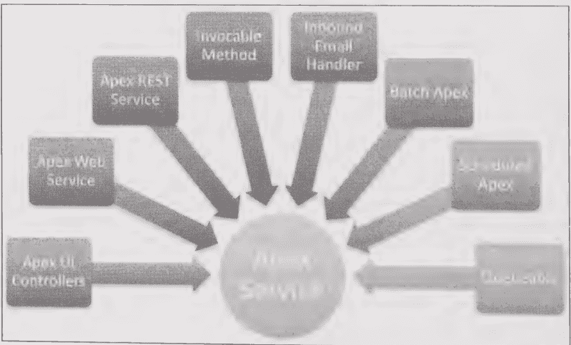
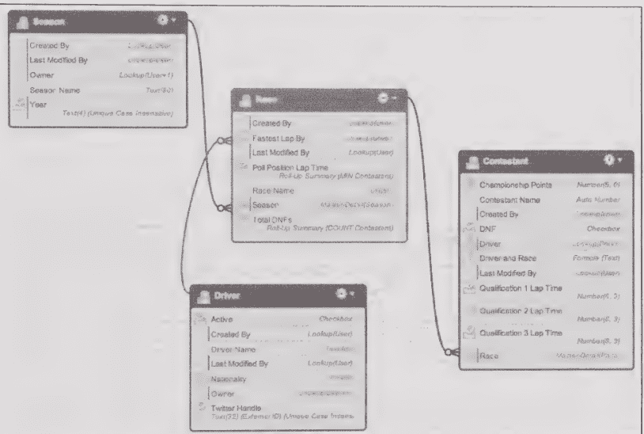
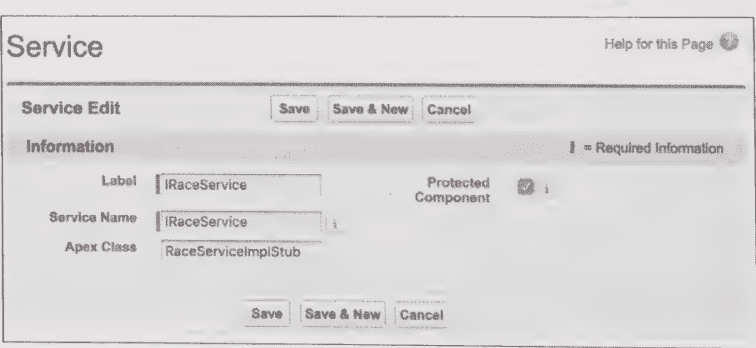

# 应用程序服务层

如果将您的应用程序视为一个生物体，Service 层将是其跳动的心脏。无论环境及其交互的事物随时间如何变化，它都必须保持强大并能够适应。在本章中，我们将以三种编码模式——Service、Domain 和 Selector——开始我们的旅程，这些模式在第 4 章“Apex 执行与关注点分离”中已介绍。

在本章中，我们将回顾马丁·福勒阐述的该模式，然后回顾它在 Force.com 平台上的 Apex 中如何应用，描述源自我们在上一章中定义的关注点分离的设计准则。

本层的一个关注点是与数据库交互；后续章节将更详细地介绍查询。本章将侧重于更新数据库，并引入一种新模式——工作单元（Unit Of Work），它有助于使您的代码更精简并支持批量处理。

在本章末尾，我们将扩展 FormulaForce 应用程序，以提供计算车手锦标赛积分和发送通讯的方法。在 Service 层中开发的代码将从自定义按钮和 Apex Scheduler 调用。后续章节还将介绍 Service 层的更多用法。

本章将介绍 Service 层的以下方面：

- 介绍 Service 层模式
- 实现设计准则
- 使用工作单元处理 DML
- 服务调用服务
- 契约驱动开发
- 测试服务
- 调用服务

## 介绍 Service 层模式

以下是马丁·福勒对 Service 层的定义（http://martinfowler.com/eaaCatalog/serviceLayer.html）：

> "使用服务层定义应用程序的边界，建立一组可用操作，并协调应用程序在每个操作中的响应。"

马丁定义中使用“边界”一词很有趣，因为它从字面上代表了 Service 层中的应用程序业务逻辑关注点与执行上下文或调用者（无论是 Visualforce 或 Lightning Component 控制器类还是 Batch Apex 类）之间的分离点或边界，如前一章所示的 UML 图所插图。

以下插图展示了 Apex Service 层设计用于支持的一些调用者类型。通过遵循下一个图中给出的设计准则，您可以确保 Service 层代码未来可以从这些功能中的任何一个以及其他功能中调用：



本书将在若干这些领域中说明 Service 层的使用。

马丁定义中对边界的引用也是封装应用程序真正业务逻辑的一个重要方面。您必须谨慎对待这种封装，因为没有它，Service 层无法协调应用程序的行为。本书中的模式有助于促进关于封装的更好思考。然而，不存在像 Java 等其他语言可能使用 `package` 和 `protected` 关键字那样表达 Apex 代码之间依赖关系的方式。因此，我们必须确保对它们有坚实的认识和遵循意愿。

> 代码审查是任何开发过程不可或缺的一部分。一个容易表明您的应用程序业务逻辑可能正在泄露到 Service 层之外的迹象是，调用类（例如 Visualforce 或 Lightning Component 控制器，或 Batch Apex 类）中的代码量在不断增加。请记住，这些类也有自己的关注点，例如处理和报告错误以及展示 Service 层或自定义对象所需的信息。不过，一般来说，如果代码看起来在做的事情超出了这些范围，这可能意味着有些代码本应被提取到 Service 方法中。困难的部分往往是基于这一观察未能通过代码审查，特别是如果作者声称目前没有复用案例。虽然这可能是事实，但最初忽略它并让它保留会增加技术债务，限制复用（下一位开发人员会有时间重构吗？），并增加整个应用程序中行为不一致的风险。

最后，请记住，与 Service 层交换的信息不一定针对特定用例或调用者要求。将所选客户端用户界面与 Service 层界面之间进行转换的责任在于调用代码，例如 Visualforce 或 Lightning Component 控制器，甚至是订阅组织开发人员编写的代码。

在第 10 章，*提供集成与扩展性*中，我们还将探讨将 Service 层作为 API 对外公开。出于这些原因，Service 层必须对任何特定调用者保持中立或无偏见。


## 设计准则的实现

在学习了上一章中的关注点分离（Separation of Concerns）并回顾前文示例后，以下设计准则有助于确保 Service 层对调用方无感知、易于定位，并鼓励采用一些 Force.com 最佳实践，例如批量化处理。请注意，批量化处理不仅是 Apex Trigger 的概念；你应用程序中的所有逻辑都必须高效利用受管资源。

## 命名规范

我的一位同事在谈论命名时曾引用过以下内容：

> "计算机科学中只有两件难事：缓存失效和命名事物。"
> 
> - Phil Karlton

迄今为止，我在职业生涯中逐渐认识到，这句话并非没有道理。命名规范在 Force.com 上从未像现在这样重要，因为目前没有一种方法可以对代码文件进行分组或结构化（例如使用目录结构）。相反，所有类实际上都位于名为 /classes 的一个根文件夹中。

因此，关键在于使用命名规范来帮助明确目的（供新旧开发人员在代码库中工作时参考）以及类属于架构中的哪一层。但是，命名并不仅限于类名；枚举、方法甚至参数名称都很重要。

与参与应用程序设计和文档编写的人员合作，建立并达成一致的应用程序术语词汇表，这是个好主意。这不仅是最终用户了解应用程序的有用参考，还有助于在整个用户界面中保持一致性，并且还可用于其实现中，一直到所使用的方法和类名。特别是当你计划将 Service 层公开为公共 API 时，这非常有用（我非常喜欢清晰的自文档化 API）。

以下要点列出了 Service 层的一些具体准则，尽管其中一些也适用于整个应用程序代码：

- **避免使用首字母缩写**：一般来说，尽量避免使用首字母缩写（在可能的情况下）。虽然这些缩写对熟悉该应用程序的有经验开发人员可能有意义，但新人在学习应用程序功能和代码库时，会发现更难导航代码。如果你将 Service 层用作 API，这一点尤其适用。虽然从输入角度来看很诱人，但一个带有自动补全功能的好的编辑器应该能很好地解决这个问题。广泛使用和理解的缩写（如 ID）是合理的。

- **类名**：将类名以 `Service` 后缀结尾，可让开发人员轻松筛选并找到应用程序代码库中这些关键类。服务的实际名称可以随你喜好定义，通常是应用程序中的一个主要模块或重要对象。不过，请确保它是应用程序术语表中的内容。如果你的应用程序设计结构良好，服务类名称应大致划分为应用程序模块的分组；也就是说，Service 层的命名应该是应用程序架构的副产品，而不是在创建类时临时想出来的东西。

  - 不良示例包括 `UtilService`、`RaceHelper`、`BatchApexService` 和 `CalcRacePointsService`。这些示例要么使用带有平台功能偏见的缩写，要么可能过于特定于某个上下文。名称中包含 `Helper` 的类通常暗示开发人员不真正理解代码应该放置在何处；请注意此类类。

  - 良好示例包括 `CommonService`、`RaceService` 和 `SeasonService`。这些示例清楚地概述了应用程序的一些主要方面，并且足够通用，可以随着应用程序的增长来封装相关操作。

- **方法名称**：公共或全局方法名称本质上是服务公开的业务操作。这些名称还应理想地与应用程序最终用户词汇表中表达的术语相关或使用这些术语，例如，应像为最终用户设计标签或按钮一样考虑它们。避免以与调用方绑定的方式命名它们；请记住，Service 层不关心也不需要知道调用方类型。

  - 不良示例包括 RaceService.recalcPointsOnSave、SeasonService.handleScheduler 和 SeasonService.issueWarnings。这些示例要么偏向最初调用方的用例，要么偏向调用上下文。而且 handleScheduler 方法名称也未真正充分表达该方法实际将执行的操作。

  - 良好示例包括 RaceService.awardChampionshipPoints、SeasonService.issueNewsLetter 和 DriverService.issueWarnings。这些示例根据其功能命名、位置正确，并且不偏向调用方。

- **参数名称和类型**：与方法名和类名一样，应专注于它们所代表的数据，并尽量使用一致的术语。请记住，参数的类型也可以构成参数含义的一部分，并且在某些情况下可能有助于服务方法的实现。例如，如果参数旨在接收 ID 列表，请考虑使用 Set 而不是 List，因为通常列表中不需要重复的 ID。对于 Map 参数，我在命名时始终尝试使用 somethingABBySomethingB 约定，以便至少清晰地表明 Map 是按什么键控的。一般而言，我实际上会将这些约定应用于所有变量，无论它们是否为方法参数。

  - 不良示例包括 `List<String> driverList` 和 `Map<String, DriverPerformance> mapOfPerformance`。这些示例要么没有使用正确的数据类型，要么对于列表或 Map 的内容使用了不明确的数据类型；此外还存在命名冗余。

  - 良好示例包括 `Set<Id> driverIds` 和 `Map<String, DriverPerformance> driverPerformanceByName`。这些示例使用了正确的类型，并有助于记录如何正确使用 Map 参数；读者现在知道 String 键是名称。另一种命名方法可能是 somethingsToName，例如。此外，Map 参数名称不再指明它是 Map，因为参数类型本身已经足够清楚地表达这一点。

- **内部类名称**：虽然 Apex 类没有典型的目录设施（或 Java 中的包结构）形式的正式结构，但 Apex 确实支持一级内部类的概念。这些类有时可用于定义仅与服务方法相关的参数数据类。由于内部类始终由父类名称限定，因此无需重复它。

  - 不良示例包括 SeasonService.SeasonSummary 和 DriverService.DriverRaceData。这些示例重复了父类名称。

  - 良好示例包括 SeasonService.Summary 和 DriverService.RaceDetails。这些示例更短，因为它们由外部类限定。

这些准则不仅应帮助你确保 Service 层对其调用方保持更加中立，从而现在和未来都更易于使用，还应帮助你遵循平台的一些最佳实践。最后，正如我们将在第 9 章“提供集成和可扩展性”中讨论的那样，遵循这些准则可以使事物处于良好状态，以便在需要时公开为实际 API。

> 如果在命名达成一致方面遇到困难，可以尝试以下几种方法。首先，尝试将名称和/或方法签名展示给不太熟悉该应用程序或功能的人，看看他们如何理解。这种方法可被视为与一种流行的用户体验验收测试方法（fly-by reviews）相似。显然，他们可能无法准确告知你实际意图，但他们理解得多么接近，在决定命名时可能非常有用。其次，尝试编写伪代码，展示调用代码可能的样子；这有助于发现命名中的冗余。例如，SeasonService.issueSeasonNewsLetter(Set<Id> seasonIdList) 可以简化为 SeasonService.issueNewsLetters(Set<Id>seasonIds)，因为 SeasonService 方法内的方法范围不需要再次包含 Season，并且参数名称也可以缩短，因为其类型已经推断出这是一个列表。

## 批量化

众所周知，Apex 的最佳实践是在 Apex Trigger 中实现批量化处理，主要是因为它们可以接收和处理同一类型的许多记录。这也适用于使用 StandardSetController 类或 Batch Apex 等情况。


正如我们在上一章中所识别的，处理批量记录集是一个常见需求。事实上，它存在于您的代码路径中，因为代码中任何层级循环内的 DML 或 SOQL 都有触及 governor 限制的风险。

因此，在设计 Service 层的方法时，默认考虑列表参数是合适的。这鼓励在方法中开发批量化代码，并避免调用者在循环中调用 Service 方法。

以下是非批量化代码的示例：

```
RaceService.awardChampionShipPoints(Id raceId)
```

以下是另一个非批量化代码的示例：

```
RaceService.awardChampionShipPoints(Set<Id> raceIds)
```

例如，带有多个参数的非批量化方法可能如下所示：

```
RaceService.retireFromRace(Id raceId, String reason)
```

前述方法签名的批量化版本可以利用前文所述的 Apex 内部类，如 *_定义和传递数据_* 小节中的以下示例所示。

> 有时，实现服务方法的批量化版本所需的成本和复杂性可能高于调用者实际需要的程度，因此这不应被视为固定准则，但至少应始终予以考虑。

## 共享规则强制执行

如前章所讨论，默认情况下 Apex 代码在系统模式下运行，意味着不强制执行共享规则。但是，业务逻辑行为一般应当遵守共享规则。为避免共享用户无权访问的信息，共享规则强制执行必须是 Service 层关注的问题。

Salesforce 安全审查要求 Apex 控制器类入口点遵守此规则，尽管您的 Service 层将由这些类调用，从而可能继承此上下文。请记住，您的 Service 层实际上是其他访问点和集成的入口点（我们将在后续章节和全书中探讨）。

因此，Service 层的默认关注点应当是强制执行共享规则。在 Service 层内实现或由其调用的代码应当继承此行为。只有在需要时，代码才应提升到运行在忽略共享规则的上下文中，否则称为 `without sharing` 上下文。这种情况发生在服务代表用户处理记录时。例如，服务可能会计算或汇总一些赛事数据，但某些原始赛事数据记录（来自其他赛事）可能对用户不可见。

要在 Service 层内默认强制执行共享规则，需在类定义中使用 with sharing 关键字，如下所示：

```
public with sharing class RaceService
```

您创建的其他 Apex 类，包括我们将讨论的 Selector 和 Domain 模式相关的类，应将其留空（未指定），以便它们继承上下文。这样可以让它们更轻松地在任一上下文中复用。

如果需要 without sharing 上下文，可以使用如下示例所示的私有内部类方法，临时提升执行上下文以在此模式下处理查询或 DML 操作：

```
// Class used by the Service layer
public class SomeOtherClass {

// Work in this method inherits with sharing context from
Service
public static void someMethod {
// Do some work in inherited context
// ...

// Need to do some queries or updates in elevated context
new ElevatedContext().restOfTheWork(workToDo);
}

private void restOfTheWork(List<SomeWork> workToDo) {
// Additional work performed by this class
// ...
}

private without sharing class ElevatedContext {
public void restOfTheWork(List<SomeWork> workToDo) {
// Do some work in a elevated (without sharing) context
SomeOtherClass.restOfTheWork(workToDo);
}
}
}
```

请注意，如果您认为某些调用者会想要禁用此强制执行，可以考虑将运行逻辑的能力作为 Service 层的参数。在本例中，上述代码示例可以改为直接或通过 ElevatedContext 内部类有条件地执行 restOfWork 方法。

> 在决定何时强制执行和何时不执行时，对象级和字段级安全也是一个重要考量。后续聚焦于 Domain 和 Selector 模式的章节将进一步讨论此话题。

## 定义和传递数据

在定义 Service 层与其调用者之间交换的数据时，请牢记 Service 层的职责是对调用者保持中立。除非您明确为这些数据格式开发功能，否则应避免通过 JSON 或 XML 字符串返回信息；请让调用者（例如，JavaScript remoting 控制器）处理此类数据编组要求。

根据指南，使用内部类是表达和限定服务方法所用数据结构的好方法。以下代码还说明了前一节中所示的多参数非批量化方法的批量化版本。

> 以这种方式思考使用内部类，也是解决原始类型痴迷（primitive obsession）症状的一个好方法（http://c2.com/cgi/wiki?PrimitiveObsession）。

请查看以下代码：

```
public class ContestantService {

    public class RaceRetirement {
        public Id contestantId;
        public String reason;
    }

    public static void retireFromRace(List<RaceRetirement> retirements) {
        // Process race retirements...
    }
}
```

尝试通过在服务之间复用内部类来避免过多的服务耦合。如果开始出现这种情况，这可能表明您可能需要一个新的共享或通用服务。

请始终牢记，服务方法实际上只需要完成其工作所需的最少信息，并通过方法签名和相关类型来表达这一点，以便调用者能清晰地看出只需要或仅返回该信息。这避免了调用代码中的疑虑和混淆，从而防止传递过少或冗余的信息。

前一个示例在 RaceRetirement 类中使用了读写成员变量，表明两者都是必需的。RaceRetirement 类的内部类仅用作此方法的输入参数。在将内部类同时用作输入和输出类型之前，请予以考虑，因为在此类类中，哪些成员变量应针对输入用例填充、哪些会在输出情况下填充并不总是清晰明了。

但是，如果您发现有这样的需求，即同一 Apex 类型既用作输出参数又用作输入参数，且某些信息在输入时并非必需，您可以考虑通过将属性设为只读来使用 Apex 属性语法来指示这一点。这可防止调用者不必要地填充成员字段的值。例如，请考虑 RaceService 中的以下服务方法：

```
public static Map<Id, List<ProvisionalResult>> calculateProvisionalResults(Set<Id> raceIds)
{
 // Implementation
}
```

```
public static void applyRaceResults(Map<Id, List<ProvisionalResult>> provisionalResultsByRaceId)
{
 //Implementation
}
```

```
public class ProvisionalResult {
 public Integer racePosition {get; set;}
 public Id contestantId {get; set;}
 public String contestantName {get; private set;}
}
```

在调用 calculateProvisionalResults 方法时，contestantName 字段作为便利项被返回，但被标记为只读，因为在 applyRaceResults 方法的上下文中不需要它。

## 在 Service 层接口中使用 SObject 时的注意事项

在以下示例中，Service 方法看起来将 Race 记录作为输入，这要求调用者查询对象并决定查询哪些字段。这是 Service 方法与调用者之间的宽松契约定义：

```
RaceService.awardChampionShipPoints(List<Race__c> races)
```

对调用者而言，更好的契约是只索要所需内容，在以下示例中即为 ID：

```
RaceService.awardChampionShipPoints(Set<Id> raceIds)
```

尽管可能会传递与不同对象类型记录相关的 ID（有人可能会考虑执行一些参数验证来拒绝此类列表），但这是一个更具表达性的契约，聚焦于服务真正需要的内容。调用者现在知道只会使用 ID。

在第一个示例中，当使用 Race__c SObject 类型作为参数类型时，不清楚调用者需要填充哪些字段，这可能使代码变得脆弱，因为这无法在接口定义中表达。此外，服务代码中所需的字段可能会更改，并要求调用者逻辑进行重构。这也可能是 Service 层内业务逻辑未能妥善处理封装问题的一个示例。

可以说，这种设计方法会带来额外的开销，尤其是当调用者已为展示目的查询了 Race 记录，而服务随后必须重新查询信息时。但是，在这种情况下，保持封装和复用问题可能是更有说服力的理由。仔细监控此注意事项可以使服务接口更清晰、封装性更好，最终更加健壮。


## 事务管理

调用服务层方法时，调用方的一个简单预期是：如果通过异常发生失败，则在服务层中直到该点为止的所有工作都将被回滚。这一点很重要，因为它允许调用方处理异常，而无需担心部分数据被写入数据库。如果没有异常，那么服务方法修改的数据仍然可以被回滚，但前提是整个执行上下文本身失败，否则数据将被提交。

可以使用 try/catch 块配合 Database.Savepoint 和回滚方法来实现，如下所示：

```
public static void awardChampionshipPoints(Set<Id> raceIds) {
    // Mark the state of the database
    Savepoint serviceSavePoint = Database.setSavePoint();
    try{
        // Do some work
    } catch (Exception e){
        // Rollback any data written before the exception
        Database.rollback(serviceSavePoint);
        // Pass the exception on for the caller to handle
        throw e;
    }
}
```

本章后面将介绍 Unit Of Work 模式，它能以更优雅的方式管理服务层的事务管理，而无需在每个服务方法中重复前述的样板代码。

## 复合服务

随着服务层的发展，调用方可能会发现自己需要一次性调用多个服务方法，这种情况应当避免。

为了解释这一点，请考虑一个新的应用程序需求：通过一个自定义按钮更新锦标赛中的车手排名（其在整个赛季中的位置），并附带发布新赛季通讯的功能。

Apex 控制器操作方法背后的代码可能如下所示：

```
try {
    Set<Id> seasons = new Set<Id> { seasonId };
    SeasonService.updateStandings(seasons);
    SeasonService.issueNewsLetters(seasons);
}
catch (Exception e) {
    ApexPages.addMessage(e);
}
```

前述代码的问题在于，它通过将功能放在控制器中，侵蚀了封装性并因此重复使用了应用程序服务层，同时也破坏了事务性封装。

例如，如果在发布通讯时发生错误，排名仍然会被更新（因为控制器处理异常），因此，如果用户再次点击按钮，锦标赛中的车手排名将被更新两次！

应对这种情况时，最佳方式是创建一个新的复合服务，将功能合并为一个新的服务方法调用。以下示例还使用内部类来传递赛季 ID 并提供发布通讯选项：

```
try {
    SeasonService.UpdateStandings updateStandings = new SeasonService.UpdateStandings();
    updateStandings.seasonId = seasonId;
    updateStandings.issueNewsletter = true;

    SeasonService.updateStandings(new List<SeasonService.UpdateStandings> { updateStandings })
}
catch (Exception e) {
    ApexPages.addMessage(e);
}
```

在不一定总是需要这种合并行为的情况下，保留第一个示例中使用的原始服务方法可能也是可取的。

本章后面将展示前述新服务方法的实现将如何重用原始方法，从而引入现有服务方法相互链接的能力。

## 快速指南检查清单

以下是一个有用的表格，总结了前述指南：

| 考虑... | 指南为... |
| :--- | :--- |
| 命名约定 | • 类名以 Service 结尾<br>• 坚持使用应用程序词汇<br>• 避免缩写<br>• 类、方法和参数名称很重要<br>• 避免名称中的冗余<br>• 利用内部类按服务作用域 |
| 共享规则 | • 在服务类上使用 `with sharing` 关键字<br>• 仅在需要时且尽可能短时间内提升为 without sharing |
| 批量化 | • 在服务方法中，使用列表参数而非单个参数，以鼓励为批量调用者编写优化的服务代码<br>• 当构建批量化实现成本过高且功能收益甚微时，可以使用单实例参数 |
| 定义和传递数据 | • 保持数据对调用方中立<br>• 利用内部类限定数据作用域<br>• 仅传递所需内容 |
| 事务管理 | • 调用方可以假设，如果服务方法引发异常，工作将被回滚，因此他们可以安全地自行处理异常<br>• 使用 `SavePoint` 包装服务方法代码 |
| 复合服务 | • 通过监控一个执行上下文中多次调用服务方法，来维护服务层的功能封装性<br>• 根据需要创建新服务方法来包装现有方法或合并现有方法 |

## 使用 Unit Of Work 模式处理 DML

数据库使用记录 ID 维护记录之间的关系。记录 ID 仅在记录插入后才可用。这意味着相关记录（例如子对象记录）需要按特定的依赖顺序插入。应先插入父记录，然后使用父记录 ID 填充子记录对象上的关系（查找）字段，之后才能插入子记录。

常见的模式是使用 `List` 或 `Map` 关键字来管理父级插入的记录，以便在构建子记录之前提供查找父 ID 的手段。这样做的另一个理由是批量化；在复杂代码路径中尽量减少 DML 语句的数量对于避免触及 DML 语句数量的 governor 限制至关重要，因此更倾向于使用此类列表，而不是为每条记录执行单独的 DML 语句。

过分关注将数据插入对象的这两个方面，往往会背离实际所需的业务逻辑，导致代码难以维护且难以阅读。下一节将介绍 Martin Fowler 的另一种模式——Unit Of Work，它有助于解决这一问题，同时也提供了一种替代方案，用于替代前文所述的使用 SavePoint 进行的样板事务管理。

以下是 Martin Fowler 对 Unit Of Work 的定义（`http://martinfowler.com/eaaCatalog/unitOfWork.html`）：

> "维护受业务事务影响的对象列表，并协调更改的写出以及并发问题的解决。"

在给定网页的摘录中，他还进一步提出了以下观点：

> "可以在每次更改对象模型时更改数据库，但这可能导致大量非常小的数据库调用，最终速度会非常慢。"

> "Unit of Work 会跟踪业务事务期间可能影响数据库的所有操作。完成后，它会计算出由于你的工作而需要更改数据库的所有内容。"

虽然这些说法似乎与 Force.com 无关，但在多个 DML 语句的开销方面存在相似之处，无论是 governor 限制还是一般性能。还有关于业务（或服务）级别事务管理的论述，这适用于服务层的职责。

为了最好地说明这些优势，让我们回顾一个服务的实现，该服务将一些历史数据加载到 Season、Race、Driver 和 Contest 对象中。这些对象中的每个都有多个关系，如下图所示：



请考虑用于向应用程序导入数据的以下示例 JSON 格式：

```
{
 "drivers": [
 {
 "name": "Lewis Hamilton",
 "nationality": "British",
 "driverId": "44",
 "twitterHandle": "lewistwitter"
 }],
 "seasons": [
 {
 "year": "2013",
 "races": [
 {
 "round": 1,
```


"name": "Spain",
"contestants": [
{
"driverId": "44",
"championshipPoints": 44,
"dnf": false,
"qualification1LapTime": 123,
"qualification2LapTime": 124,
"qualification3LapTime": 125
}]}
}]
}
}

## 不使用工作单元

本示例展示了一种使用 `Map` 和 `List` 导入数据的传统方法，遵循批量化处理并按依赖顺序插入数据。以下代码中高亮显示的关键逻辑将导入数据结构中的数据复制到对象中；其余部分纯粹用于管理事务范围和插入依赖关系：

```
public static void importSeasons(String jsonData) {
Savepoint serviceSavePoint = Database.setSavePoint();
try{
// Parse JSON data
SeasonsData seasonsData =
(SeasonsData) JSON.deserializeStrict(jsonData,
SeasonService.SeasonsData.class);
// Insert Drivers
Map<String, Driver__c> driversById =
new Map<String, Driver__c>();
for (DriverData driverData : seasonsData.drivers)
driversById.put(driverData.driverId, new Driver__c(
Name = driverData.name,
DriverId__c = driverData.driverId,
Nationality__c = driverData.nationality,
TwitterHandle__c = driverData.twitterHandle));
insert driversById.values();
// Insert Seasons
Map<String, Season__c> seasonsByYear =
new Map<String, Season__c>();
for(SeasonData seasonData : seasonsData.seasons)
seasonsByYear.put(seasonData.year,
new Season__c(
Name = seasonData.year, Year__c = seasonData.year));
insert seasonsByYear.values();

// Insert Races
Map<String, Race__c> racesByYearAndRound =
new Map<String, Race__c>();
for(SeasonData seasonData : seasonsData.seasons)
for(RaceData raceData : seasonData.races)
racesByYearAndRound.put(seasonData.Year + raceData.round,
new Race__c(
Season__c = seasonsByYear.get(seasonData.year).Id,
Name = raceData.name));
insert racesByYearAndRound.values();

// Insert Contestants
List<Contestant__c> contestants =
new List<Contestant__c>();
for(SeasonData seasonData : seasonsData.seasons)
for(RaceData raceData : seasonData.races)
for(ContestantData contestantData
: raceData.contestants)
contestants.add(
new Contestant__c(
Race__c = racesByYearAndRound.get(
seasonData.Year + raceData.round).Id,
Driver__c = driversById.get(
contestantData.driverId).Id,
ChampionshipPoints__c =
contestantData.championshipPoints,
DNF__c = contestantData.dnf,
Qualification1LapTime__c =
contestantData.qualification1LapTime,
Qualification2LapTime__c =
contestantData.qualification2LapTime,
Qualification3LapTime__c =
contestantData.qualification3LapTime
));
insert contestants;
} catch (Exception e) {
// Rollback any data written before the exception
Database.rollback(serviceSavePoint);
// Pass the exception on
throw e;
}
```

> 如前章所述，此数据导入需求本可以通过使用 Salesforce Data Loaders 和外部字段引用来实现。您选择这种方法的一个原因是，可以从您自己的 UI 提供一个更易用的选项，供没有管理员权限的普通用户使用。

## 使用工作单元

在深入了解 FinancialForce Apex Enterprise Pattern 库如何帮助我们实现此模式之前，让我们先看看前面所示代码的修订示例。此代码使用了一个名为 Application 的新 Apex 类。该类公开一个静态属性和方法，用于创建工作单元的实例。

> 本章的源代码包括 FinancialForce Apex Enterprise Pattern 库以及其依赖的 FinancialForce Apex Mocks 库。Apex Mocks 库将在后续章节中成为重点，届时我们将专注于为本书介绍的每种模式编写单元测试。

fflib_ISObjectUnitOfWork Apex 接口用于公开工作单元模式的功能，以便在创建记录时捕获数据库工作，因此其余逻辑更加聚焦，避免了先前示例中对 Map 和 List 以及对导入数据进行重复迭代。它还为调用方在内部批量化了工作（DML）。最后，commitWork 方法调用会在应用事务管理的同时，按正确的依赖顺序执行实际的 DML 工作。

请参考以下代码：

```
// Construct a Unit Of Work to capture the following working
fflib_ISObjectUnitOfWork uow = Application.UnitOfWork.newInstance();
// Create Driver__c records
Map<String, Driver__c> driversById =
new Map<String, Driver__c>();
for(DriverData driverData : seasonsData.drivers) {
    Driver__c driver = new Driver__c(
        Name = driverData.name,
        DriverId__c = driverData.driverId,
        Nationality__c = driverData.nationality,
        TwitterHandle__c = driverData.twitterHandle);
    uow.registerNew(driver);
    driversById.put(driver.DriverId__c, driver);
}

for(SeasonData seasonData : seasonsData.seasons) {
    // Create Season__c record
    Season__c season = new Season__c(
        Name = seasonData.year,
        Year__c = seasonData.year);
    uow.registerNew(season);

    for(RaceData raceData : seasonData.races) {
        // Create Race__c record
        Race__c race = new Race__c(Name = raceData.name);
        uow.registerNew(race, Race__c.Season__c, season);
        for(ContestantData contestantData : raceData.contestants) {
            // Create Contestant__c record
            Contestant__c contestant = new Contestant__c(
                ChampionshipPoints__c = contestantData.championshipPoints,
                DNF__c = contestantData.dnf,
                Qualification1LapTime__c = contestantData.qualification1LapTime,
                Qualification2LapTime__c = contestantData.qualification2LapTime,
                Qualification3LapTime__c = contestantData.qualification3LapTime);
            uow.registerNew(contestant, Contestant__c.Race__c, race);
            uow.registerRelationship(contestant,
                Contestant__c.Driver__c,
                driversById.get(contestantData.driverId));
        }
    }
}

// Insert records registered with uow above
uow.commitWork();
```

以下是 Application 类和 UnitOfWork 静态属性的实现。它利用一个简单的工厂类，通过 newInstance 方法动态创建 fflib_SObjectUnitOfWork 类的实例：

```
public class Application
{
    // Configure and create the UnitOfWorkFactory for
    // this Application
    public static final fflib_Application.UnitOfWorkFactory
        UnitOfWork = new fflib_Application.UnitOfWorkFactory(
        new List<SObjectType> {
            Driver__c.SObjectType,
            Season__c.SObjectType,
            Race__c.SObjectType,
            Contestant__c.SObjectType
        });
}
```

fflib_Application.UnitOfWorkFactory 类公开了 newInstance 方法，该方法在内部创建一个新的 fflib_SObjectUnitOfWork 实例。这不会直接暴露给调用方，而是返回 fflib_ISObjectUnitOfWork 接口（这种设计有助于我们将在后续章节中讨论的模拟支持）。此接口的目的是提供前面代码中用于注册记录以执行插入、更新或删除的方法，并实现 commitWork 方法。

我建议您创建一个像之前所示的单一应用程序 Apex 类，在其中维护应用程序使用的所有对象及其依赖顺序的完整列表；随着应用程序对象数量的增长，维护将变得更加容易。

fflib_ISObjectUnitOfWork 接口包含以下方法。前面的示例使用 registerNew 和 registerRelationship 方法来插入记录，并确保填充适当的关系字段。有关更多详细信息，请查看代码中这些方法的文档。以下屏幕截图显示了方法摘要：

```
fflib_ISObjectUnitOfWork
^ registerNew(SObject) : void
^ registerNew(List<SObject>) : void
^ registerNew(SObject, SObjectField, SObject) : void
^ registerRelationship(SObject, SObjectField, SObject) : void
^ registerDirty(SObject) : void
^ registerDirty(List<SObject>) : void
^ registerDeleted(SObject) : void
^ registerDeleted(List<SObject>) : void
^ commitWork() : void
^ registerWork(IDoWork) : void
^ registerEmail(Email) : void
```

调用 `registerDirty` 方法并传入要更新的 `SObject` 记录，调用 `registerDeleted` 方法来删除给定的 `SObject` 记录。您也可以组合调用 `registerNew`、`registerDirty` 和 `registerDeleted` 方法。

## 工作单元范围

为了充分利用工作单元协调数据库更新和事务管理的能力，请在服务方法的范围内维护一个工作单元实例，如上一节所示。

如果您需要调用其他也执行数据库工作的类，请务必将相同的工作单元实例传递给它们，而不是允许它们创建自己的实例。我们将在本章后面稍作探讨。

> 维护工作单元的静态实例可能很诱人，这样您可以轻松引用它而无需到处传递。这种方法的缺点是，范围会比服务层执行范围更广，因为 Apex 可以在执行上下文中多次调用。使用静态执行范围工作单元注册记录的代码，依赖外部 Apex 代码单元来提交工作。它还会造成一种错误印象，即在执行提交后工作单元仍可用。


## 工作单元的特殊注意事项

根据您的要求和用例，工作单元的标准方法可能不合适。以下是一些默认未处理并可能需要注册自定义工作回调的用例列表：

- **自引用和递归引用：** 同一对象中相互具有查找关系的记录当前不受支持，例如，账户层次结构。
- **更细粒度的 DML 操作：** Database 类方法允许在其他记录失败时允许某些记录被处理。工作单元中执行的 DML 语句默认为全部或不执行。
- **发送电子邮件：** 发送电子邮件被视为当前事务的一部分；如果您想将此类工作注册到工作单元中，可以通过 registerEmail 方法实现。多次注册将自动批量化。

以下是使用工作单元注册自定义工作回调处理程序的模板。这将在其创建的事务范围内的 commitWork 方法期间被调用。这意味着，如果在此工作回调中工作失败，它也将回滚通过工作单元以标准方式注册的其他工作。请查看代码：

```
public class CustomAccountWork implements
    fflib_SObjectUnitOfWork.IDoWork {

private List<Account> accounts;

public CustomAccountWork (List<Account> accounts) {
    this.accounts = accounts;
}

public void doWork() {
    // Do some custom account work e.g. hierarchies
}
}
```

然后，按照以下示例注册自定义工作：

```
uow.registerNew...
uow.registerDirty...
uow.registerDeleted...
uow.registerWork(new CustomAccountWork(accounts));
uow.commitWork();
```

## 服务调用服务

在上一章中，我描述了一个围绕 FormulaForce 应用程序功能的重用用例，该功能向参赛者颁发冠军积分。我们想象应用程序的第一个版本仅在参赛者详细信息页面提供自定义按钮，而第二个版本也在比赛详细信息页面提供相同的按钮。

在本章的这一部分中，我们将实现相应的服务方法，模拟此开发周期，并反过来演示服务层方法之间相互调用的方法，正确传递工作单元。

首先，让我们来看看参赛者详细信息页面按钮的初始要求；ContestantService 类中的方法如下所示：

```
public static void awardChampionshipPoints(Set<Id> contestantIds) {
    fflib_SObjectUnitOfWork uow =
    Application.UnitOfWork.newInstance();

    // Apply championship points to given contestants
    Map<Integer, ChampionshipPoint__mdt> pointsByTrackPosition =
    new ChampionshipPointsSelector().selectAllByTrackPosition();
    for (Contestant__c contestant :
    new ContestantsSelector().selectById(contestantIds)) {
    // Determine points to award for the given position
    ChampionshipPoint__mdt pointsForPosition =
    pointsByTrackPosition.get(
    Integer.valueOf(contestant.RacePosition__c));
    if (pointsForPosition != null) {
    // Apply points and register for update with uow
    contestant.ChampionshipPoints__c =
    pointsForPosition.PointsAwarded__c;
    uow.registerDirty(contestant);
    }
    }
}
```

此方法利用 Selector 模式查询数据库；这将在本书后面的专门章节中描述。该方法还使用一个受保护的自定义元数据类型对象 **Championship Points**，用于查找参赛者在比赛中获得的每个名次的官方冠军积分。此自定义元数据类型对象及其记录随本章源代码一起提供：

| 操作 | 标签 | 名次 | 冠军积分名称 | 授予积分 |
| :--- | :--- | :--- | :--- | :--- |
| 编辑 | 删除 | 第 1 名 | TrackPosition1 | 25 |
| 编辑 | 删除 | 第 2 名 | TrackPosition2 | 18 |
| 编辑 | 删除 | 第 3 名 | TrackPosition3 | 15 |
| 编辑 | 删除 | 第 4 名 | TrackPosition4 | 12 |
| 编辑 | 删除 | 第 5 名 | TrackPosition5 | 10 |
| 编辑 | 删除 | 第 6 名 | TrackPosition6 | 8 |
| 编辑 | 删除 | 第 7 名 | TrackPosition7 | 6 |
| 编辑 | 删除 | 第 8 名 | TrackPosition8 | 4 |
| 编辑 | 删除 | 第 9 名 | TrackPosition9 | 2 |
| 编辑 | 删除 | 第 10 名 | TrackPosition10 | 1 |


自定义元数据记录可以与 FormulaForce 应用程序一起打包和安装，客户无需进行任何进一步配置。由于它们属于受保护的自定义元数据类型对象，用户将看不到也无法编辑它们。确实，这些信息受国际汽车联合会（FIA）严格控制，并且至少每年更新一次。以这种形式，可以使用设置中的自定义元数据类型页面下的“管理记录”链接轻松编辑它们，然后在客户安装最新版本的包或您将包推送给他们时进行升级。虽然这些信息本可以在 Apex 代码中硬编码，但以这种形式更易于管理和更新，并展示了如何使用自定义元数据类型和记录对内部配置进行编码。

该服务从 ContestantController 操作方法调用，该方法绑定到参赛者详细信息页面上的按钮（通过 Visualforce 页面），如下所示：

```
public PageReference awardPoints() {
 try {
 ContestantService.awardChampionshipPoints(
 new Set<Id> { standardController.getId() } });
 } catch (Exception e) {
```

```
ApexPages.addMessages(e);
}
return null;
}
```

在下一个版本中，RaceController 方法也需要相同的行为，以便在比赛页面上对所有参赛者应用逻辑。控制器方法如下所示：

```
public PageReference awardPoints() {
try {
RaceService.awardChampionshipPoints(
new Set<Id> { standardController.getId() });
}
catch (Exception e) {
ApexPages.addMessages(e);
}
return null;
}
```

为了提供向后兼容性，参赛者详细信息页面上的原始自定义按钮以及控制器使用的服务方法将予以保留。由于原始方法最初就考虑到了批量化，因此从新的 RaceService 方法重用 ContestantService 逻辑成为可能。

以下是 RaceService.awardChampionshipPoints 方法的样子。同样，使用 Selector 类在单个查询中查询 Race 记录和 Contestant 子记录，这样子记录也可用：

```
public static void awardChampionshipPoints(Set<Id> raceIds) {
fflib_SObjectUnitOfWork uow =
Application.UnitOfWork.newInstance();

// Query Races and Contestants, bulkify contestants
List<Contestant__c> contestants = new List<Contestant__c>();
for (Race__c race :
new RacesSelector().selectByIdWithContestants(raceIds)) {
contestants.addAll(race.Contestants__r);
}

// Delegate to contestant service
ContestantService.awardChampionshipPoints(uow, contestants);
// Commit work
uow.commitWork();
}
```

通过使用方法重载，添加了现有 ContestantService.awardChampionshipPoints 方法的新版本，以实现上述代码而不影响其他调用者。重载方法将工作单元（在 RaceService 中创建）作为其第一个参数，然后是参赛者列表。

> 此额外方法的问题是，它无意中将服务的一个实现细节暴露给了潜在的非服务调用代码。理想情况下，Apex 应支持其他语言中存在的 protected 关键字概念，从而隐藏 Service 层外代码访问该方法的权限。解决方案很简单，只需确保开发人员理解此类方法重载仅供其他 Service 层调用者使用。

以下是生成的代码，显示 ContestantService 方法现在同时支持新的 RaceService 调用者和原始的 ContestantController 调用者。此外，无论哪条代码路径中，只有一个工作单元实例，并且在完成所有工作后调用 commitWork 方法：

```
public static void awardChampionshipPoints(Set<Id> contestantIds)
{
    fflib_ISObjectUnitOfWork uow =
    Application.UnitOfWork.newInstance();

    // Apply championship points to selected contestants
    awardChampionshipPoints(uow,
    new ContestantsSelector().selectById(contestantIds));

    uow.commitWork();
}
```

```
public static void awardChampionshipPoints(
fflib_ISObjectUnitOfWork uow, List<Contestant__c> contestants)
{
    // Apply championship points to given contestants
    Map<Integer, ChampionshipPoint__mdt> pointsByTrackPosition =
    new ChampionshipPointsSelector().selectAllByTrackPosition();
    for (Contestant__c contestant : contestants) {
    // Determine points to award for the given position
    ChampionshipPoint__mdt pointsForPosition =
    pointsByTrackPosition.get(
    Integer.valueOf(contestant.RacePosition__c));
    if (pointsForPosition != null) {
```


```
// Apply points and register for update with uow
contestant.ChampionshipPoints_c =
    pointsForPosition.PointsAwarded_c;
uow.registerDirty(contestant);
}
}
}
}
```

## 合同驱动开发

如果您需要开发一大块功能，包含复杂的 Service 层和用户界面客户端逻辑，解耦这两条开发活动流可能是有利的，这样开发人员可以继续并行工作，并在未来某个时间汇合以合并工作。

这种方法有时被称为合同驱动开发。即在两条开发流各自开始开发之前，双方就一个合同（或服务定义）达成一致。当然，合同可以随着时间的推移进行调整，但拥有一个坚实的起点将带来更顺畅的并行开发活动。

这种开发类型可以通过在 Service 层类中实现一个小型工厂模式来应用。服务类上的主要方法按常规定义，但其内部实现可以路由到各自的内部类，以提供服务的初始虚拟实现（例如，供客户端开发人员使用），以及另一个生产实现，可由服务开发人员独立开发。

> 因为实际暴露给调用者的静态 Service 方法并不暴露此工厂实现，因此在开发周期后期可以轻松将其移除。

以 FormulaForce 应用程序中的一个需求为例：提供一个 Visualforce 页面，用于在比赛结束后预览车手的最终完赛排名（即临时排名）。需要尽快为该功能启动用户界面开发，但 Service 层代码尚未编写。客户端和 Service 层开发人员坐下来商定所需内容，并共同定义 Service 层中的骨架方法。

他们在服务类中首先要做的是创建一个描述服务方法的 Apex 接口，这就是合同。该接口上的方法遵循本章前面描述的相同设计准则。

以下代码显示了 IRaceService Apex 接口的定义：

```
public interface IRaceService {
    Map<Id, List<RaceService.ProvisionalResult>>
    calculateProvisionResults(Set<Id>raceIds);
    void applyRaceResults(Map<Id,
    List<RaceService.ProvisionalResult>>
    provisionalResultsByRaceId);
    void awardChampionshipPoints(Set<Id>raceIds);
}
```

接下来，为该服务的虚拟（有时称为 Stub）客户端实现创建了此接口的一个实现 RaceServiceImplStub，以及另一个类 RaceServiceImpl，供服务开发人员在客户端开发人员进行工作时继续独立开发。

请参阅以下代码：

```
public class RaceServiceImplStub implements IRaceService {
    public Map<Id, List<RaceService.ProvisionalResult>>
    calculateProvisionResults(Set<Id>raceIds) {
    // Dummy behavior to allow callers of the service be developed
    // independent of the main service implementation
    Id raceId = new List<Id>(raceIds)[0];
    RaceService.ProvisionalResult hamilton =
    new RaceService.ProvisionalResult();
    hamilton.racePosition = 1;
    hamilton.contestantName = 'Lewis Hamilton';
    hamilton.contestantId = 'a03b0000006WVph';
    RaceService.ProvisionalResult rubens =
    new RaceService.ProvisionalResult();
    rubens.racePosition = 2;
    rubens.contestantName = 'Rubens Barrichello';
    rubens.contestantId = 'a03b00000072xxS';
    return new Map<Id, List<RaceService.ProvisionalResult>> {
    new List<Id>(raceIds)[0] =>
    new List<RaceService.ProvisionalResult>
    { hamilton, rubens }};
    }
    public void applyRaceResults(Map<Id,
    List<RaceService.ProvisionalResult>>
    provisionalResultsByRaceId) {
    throw new RaceService.RaceServiceException('Not implemented');
    }
    public void awardChampionshipPoints(Set<Id>raceIds) {
    throw new RaceService.RaceServiceException('Not implemented');
    }
}
```

```
public class RaceServiceImpl implements IRaceService {
public Map<Id, List<RaceService.ProvisionalResult>>
calculateProvisionResults(Set<Id>raceIds) {
    throw new RaceService.RaceServiceException('Not implemented');
}

public void applyRaceResults(Map<Id, List<RaceService.ProvisionalResult>> provisionalResultsByRaceId) {
    throw new RaceService.RaceServiceException('Not implemented');
}

public void awardChampionshipPoints(Set<Id>raceIds) {
fflib_ISObjectUnitOfWork uow =
    Application.UnitOfWork.newInstance();
// Query Races and contestants and bulkify list of all
contestants
List<Contestant__c> contestants = new List<Contestant__c>();
for(Race__c race :
    new RacesSelector().selectByIdWithContestants(raceIds)) {
    contestants.addAll(race.Contestants__r);
}
// Delegate to contestant service
ContestantService.awardChampionshipPoints(uow, contestants);
// Commit work
uow.commitWork();
}
}
```

最后，添加标准服务方法，但通过服务方法来实现，该方法用于解析要使用的服务方法的正确实现。以下服务方法利用前面接口的适当实现：

```
public with sharing class RaceService {

public static Map<Id, List<ProvisionalResult>>
calculateProvisionResults(Set<Id>raceIds) {
   return service().calculateProvisionResults(raceIds);
}

public static void applyRaceResults(
   Map<Id, List<ProvisionalResult>>
   provisionalResultsByRaceId ) {
   service().applyRaceResults(provisionalResultsByRaceId);
}

public static void awardChampionshipPoints(Set<Id>raceIds) {
   service().awardChampionshipPoints(raceIds);
}

private static IRaceService service() {
   return (IRaceService)
   Application.Service.newInstance(IRaceService.class);
}

public class RaceServiceException extends Exception {}

public class ProvisionalResult {
   public Integer racePosition {get; set;}
   public Id contestantId {get; set;}
   public String contestantName {get; set;}
   }
}
```

服务方法再次利用 Application 类；这一次使用了 Service 工厂，以允许 IRaceService 接口的实际实现在运行时变化。这使开发人员可以根据需求控制应用程序使用上述两种实现中的哪一种。默认情况下使用 RaceServiceImpl 类，但可以通过在 Services 自定义元数据类型对象中插入记录来覆盖此设置。关于这一点将在后文中详细介绍。

通过 Application 类中的 Service 字段暴露的工厂扩展了 fflib_Application.ServiceFactory 类，该类实例化传递给工厂的 Map 中提供的配置类。此工厂还支持模拟服务实现；这将在后续章节中更详细地讨论。

该工厂已扩展为通过名为 Services 的受保护（因此对最终用户隐藏）自定义元数据对象查找配置的替代服务实现类，该对象包含在本章的源代码中。

您可以看到以下查询示例：

```
public class Application {
    //Configure and create the ServiceFactory for this Application
    public static final fflib_Application.ServiceFactory Service = 
        new Application.ServiceFactory (
            new Map<Type, Type> {
                IRaceService.class => RaceServiceImpl.class });

    // Customised Service factory overrides via Custom Metadata
    private class ServiceFactory extends
        fflib_Application.ServiceFactory {

        private Map<String, String> servicesByClassName = 
            new Map<String, String>();

        public ServiceFactory(Map<Type, Type>
            serviceInterfaceTypeByServiceImplType) {

        super(serviceInterfaceTypeByServiceImplType);

        // Map of overridden services defined by the developer
        for(Service__mdt serviceOverride : [select DeveloperName,
            NamespacePrefix, ApexClass__c from Service__mdt]) {
            servicesByClassName.put(
            serviceOverride.NamespacePrefix + '.' +
            serviceOverride.DeveloperName,
            serviceOverride.ApexClass__c);
        }
    }
}
```


```
public override Object newInstance(
    Type serviceInterfaceType) {

    // Has the developer overridden the Service impl?
    if (!Test.isRunningTest() && servicesByClassName.containsKey(
            serviceInterfaceType.getName())) {
        String overriddenServiceImpl = servicesByClassName.get(
                serviceInterfaceType.getName());
        return Type.forName(overriddenServiceImpl).newInstance();
    }

    // Base factory returns mocked or registered impl
    return super.newInstance(serviceInterfaceType);
}
```

> 查询自定义元数据记录不会占用 SOQL 限制；但是，返回的记录会占用最大 50k 记录限制。

通过创建以下自定义元数据记录，客户端开发者可以配置应用程序使用存根实现，而无需进行任何代码更改。



通过将自定义元数据类型对象设为公共并允许客户或合作伙伴覆盖您服务的打包实现，这种方法可用于在应用程序中提供自定义扩展功能。不过，请谨慎使用此方法，并且仅在其为客户或合作伙伴增加价值时才使用。

### 测试服务层

很容易让人倾向于通过围绕调用代码（例如 Visualforce 控制器测试）进行的测试来对服务层进行测试。但是，仅依赖这种测试会使服务层逻辑面临其他可能未由控制器逻辑严格覆盖的用例。例如，使用 StandardController 的自定义控制器只会传入单条记录而非多条记录。请确保在开发功能时针对服务层开发特定的 Apex 测试。

### 模拟服务层

有时，服务层的数据设置要求会使为控制器或其他调用者（例如 Batch Apex）编写 Apex 测试变得相当复杂，因此成本高昂，不仅体现在测试运行的服务器时间上（由于每个测试方法的数据设置），还体现在准备完整测试数据集所需的开发人员时间上。

虽然您仍然需要测试代码的完整堆栈，但有一种称为模拟的方法，可以与先前提到的工厂模式配合使用，这将允许给定服务调用者的测试上下文实现其自己的服务测试实现，该实现模拟（使用硬编码测试响应）控制器期望从服务方法获得的不同行为。这在制定测试时允许控制器测试更加多样和集中。同样，这种模拟方法必须与真正执行所有所需代码的完整堆栈测试结合使用。第 12 章 Apex Mocks 将更详细地介绍模拟服务层。

### 调用服务层

前面的示例已展示了从 Visualforce 控制器方法使用服务类方法的情况。让我们更仔细地看看这里正在发生什么、所做的假设，以及一个 Apex 调度器示例。服务方法在操作中的其他示例，例如来自 Lightning 组件的示例，将在后续章节中介绍。

以下代码代表了一个控制器类中的代码，该类使用 StandardController 为与 Race 对象上的自定义按钮关联的 Visualforce 页面提供支持。请注意它如何将记录 ID 包装在 Set 中，以遵循批量化的方法签名：

```
public PageReference awardPoints() {
    try {
        RaceService.awardChampionshipPoints(
            new Set<Id> { standardController.getId() });
    } catch (Exception e) {
        ApexPages.addMessages(e);
    }
    return null;
}
```

这些控制器的构造函数未显示，但它本质上将 StandardController 或 StandardSetController 存储在成员变量中，以供控制器方法稍后引用。

以下代码概述了一个类似版本，可在使用 StandardSetController 时使用，例如在对象的列表视图上需要自定义按钮的情况下：

```
public PageReference awardPointsToRaces() {
    try {
        RaceService.awardChampionshipPoints(
            new Map<Id, SObject>(
                standardSetController.getRecords()).keySet());
    } catch (Exception e) {
        ApexPages.addMessages(e);
    }
    return null;
}
```

Apex 中的 Map 构造函数将获取 SObject 列表，并根据传入的 SObject 的 ID 自动构建映射。将此与 keySet 方法结合，可快速将 StandardSetController 中包含的记录列表转换为服务方法所需的 ID 列表。

在这两种情况下，任何异常都会通过调用 `ApexPages.addMessages` 方法（将异常传入）来路由到页面上的 `apex:pageMessages` 组件（这应该是您在页面中首先考虑添加的内容之一）。

请注意，控制器代码无需回滚在服务中可能已对对象记录所做的更改（直至抛出异常），因为控制器可以安全地假设服务方法已确保此情况。双方之间的这种安排本质上就是关注点分离的体现！

最后，让我们看看 `SeasonNewsletterScheduler` 类中的一个示例。与控制器示例一样，它自己处理异常，在此情况下，会就任何失败向用户发送电子邮件。请考虑以下代码：

```
global void execute(ScheduleableContext sc) {
    try {
        SeasonService.issueNewsLetterCurrentSeason();
    } catch (Exception e) {
        Messaging.SingleEmailMessage mail = new Messaging.SingleEmailMessage();
        mail.setTargetObjectId(UserInfo.getUserId());
        mail.setSenderDisplayName(UserInfo.getUserName());
        mail.setSubject('Failed to send Season Newsletter');
        mail.setHtmlBody(e.getMessage());
        mail.setSaveAsActivity(false);
        Messaging.sendEmail(new Messaging.SingleEmailMessage[] { mail });
    }
}
```

## 更新 FormulaForce 包

最后，部署本章包含的代码，并确保将任何新的 Apex 类（尤其是测试类）添加到包中并执行发布上传。您可能需要花些时间进一步审查本章提供的代码，因为并非所有代码都在本章中介绍。`Contestant` 和 `Season` 对象中也添加了一些新字段，这些字段会自动添加到包中。已添加两个新的元数据对象 `Championship Points` 和 `Services`。`Championship Point` 记录也必须添加到包中。不要打包任何 `Service` 记录。

## 摘要

在本章中，我们迈出了开发健壮编码规范的第一步，以管理和构建企业应用程序的编码复杂性。这一第一层以一种与平台无关的方式封装了应用程序的业务流程逻辑，使其可以轻松跨多个 Apex 入口点使用，包括当前应用程序所需的入口点，以及平台发展过程中未来出现的入口点。

我们还了解了如何使用 工作单元模式 来帮助批量化 DML 语句、管理记录关系并实现数据库事务，从而使您的服务层逻辑能够更专注于实现业务逻辑这一关键职责。在即将到来的章节中，我们将看到它如何迅速成为应用程序的支柱。仔细遵守围绕服务层的准则将确保其保持强大且易于扩展。

在下一章中，我们将探讨域层，这是一种将自定义对象的数据与与该数据相关的自定义对象行为适用逻辑相结合的模式。这包括传统放置在 Apex 触发器中的逻辑，但也可以选择进一步分发和分层在服务层中执行的代码。
