# 应用程序域层

应用程序使用的对象代表其域。与其他数据库平台不同，在其他平台上记录数据默认对最终用户隐藏，而 Force.com 平台通过标准 Salesforce UI、报告、仪表板和 Salesforce1 移动应用程序显示记录数据。通过公开对象和字段的标签和关系，您直接将它们提供给最终用户。从创建第一个对象的那一刻起，您就开始定义应用程序的域，就像 Salesforce 标准对象代表 CRM 应用程序域一样。

马丁·福勒的 *企业应用架构模式* 也将此概念视为一种代码封装手段，用于将每个对象表达的数据与影响或与该数据交互的代码中编写的行为相结合。这可能是提供默认值和验证的 Apex 触发器代码，也可能是向参赛者记录授予冠军积分或检查规则合规性的代码。

本章将使用域层模式扩展 FormulaForce 应用程序的功能，同时重点介绍特定关注点、准则和最佳实践，以及它如何与 Apex 触发器和应用程序的服务层代码集成。

本章将涵盖以下方面：

- 介绍域层模式
- 实现设计准则
- 域类模板
- 实现域触发器逻辑
- 实现自定义域逻辑
- 面向对象编程
- 测试域层
- 调用域层


## 引入领域层模式

下面是 Martin Fowler 对领域层的定义（http://martinfowler.com/eeaCatalog/domainModel.html）：

> "既包含行为又包含数据的领域对象模型"。

与服务层一样，此模式进一步增加了关注点分离和应用程序代码的模块化，有助于随着代码库的增长对其进行管理和扩展。

> "在最糟糕的情况下，业务逻辑可能非常复杂。规则和逻辑描述了许多不同的行为案例和侧面，正是这种复杂性是对象设计用来处理的。领域模型创建了一个相互关联的对象网络，其中每个对象代表某个有意义的个体，无论是像公司这样庞大的实体，还是订单表上的一行。"

马丁在前面引文中对对象的引用，主要针对的是由在面向对象编程语言（如 Java 或 .NET）中编写的类实例化而创建的对象。在这些平台中，此类类作为底层数据库表关系的逻辑表示。这种方法通常称为对象关系映射（ORM）。

相比之下，Force.com 开发者读到 "object" 这个术语时，往往首先想到的是标准对象或自定义对象，而不是类实例化的结果。这是因为 Salesforce 通过其对象的声明式定义，将数据与行为绑定得非常出色，而众所周知，这远不止字段那么简单。它具有公式、过滤器、参照完整性以及我们在前面章节中讨论的许多其他功能，且无需编写任何代码即可使用。

考虑到这些声明式功能本质上是实现某些行为的手段，Force.com 的自定义对象或标准对象已经满足了领域层模式的一些封装关注点。

### 在代码中封装对象的行为

Apex 触发器提供了一种方式，用于为自定义对象（或标准对象）编写代码以实现附加行为。它们提供了一个位置，用于实现与数据库事件相关的更复杂行为，例如 **创建**、**更新** 和 **删除**。

但是，由于 Apex 触发器不能包含 `public` 方法，因此它不提供一种方式来编写逻辑上属于对象但不一定与数据库事件关联的代码。一个示例是计算 **参赛者** 锦标赛积分的逻辑，或者检查是否符合众多 *Formula1 规则和规定*，我们将在本章后面讨论这一点。此外，它们没有提供利用 **面向对象编程**（OOP）方法的机会，这也将在本章后面讨论。

因此，开发者往往最终将此逻辑放在其他地方，有时放在某种控制器或帮助器类中。因此，实现给定对象行为的代码变得分散，并且 *关注点分离* 遭到破坏。

将 Apex 触发器代码从触发器主体中提取出来并放入 **Apex 类**（例如基于对象名称按照某种约定命名，如 `RaceTriggerManager` 或 `RaceTriggerHandler`），是缓解这种分散性的一个良好开端。使用此类方法，随后可以创建其他方法并进一步拆分代码。这些方法只是在寻求对本章所述领域模型概念的更完整诠释方面的一个起点。

使用 `Manager` 或 `Handler` 方法往往会吸引与 Apex 触发器事件模型相关的逻辑，而不包含其他内容，使得其他与对象相关的逻辑在代码库中找不到明显的位置。

### 在 Force.com 中解释领域层

在本章中，我们将探讨 Force.com 对领域层模式的诠释，该诠释确保通过 Apex 触发器事件和通过直接 Apex 方法调用（来自服务层和其他领域类）所调用的行为都得到考虑。

可以创建一个单一的领域类来封装所有行为，并开始利用 OOP 原则（例如接口）来进一步丰富代码以实现复用和关注点分离，我们将在本章后面探讨这一点。

下图说明了领域层类的两个消费者——来自服务层的代码，以及导致 Apex 触发器事件的与对象的直接交互，这些交互也将路由到同一个领域层类：

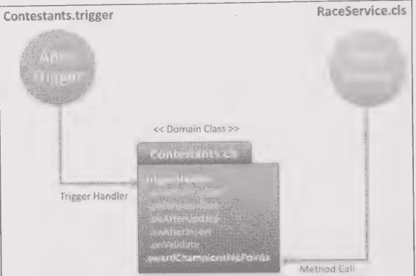

## 与其他平台相比，Apex 中的领域类

如前面章节所示，标准对象或自定义对象在 Apex 运行时中作为具体类型公开，可以实例化以填充记录字段用于数据库插入，或确定用于返回从中查询的记录的类型。

考虑领域模式时，最初的想法可能是通过 Apex 继承（使用 extends 关键字）来扩展适用的 SObject，例如 Account 或 Race__c。不幸的是，Apex 编译器不支持此方法。即使支持，鉴于批量化的最佳实践，一次处理单个记录实例的代码会很快导致 governor 限制问题。

相反，此处介绍的领域类实现使用组合方法来组合记录数据和行为。这有时被称为包装器类方法；之所以这样命名，是因为它将相关数据作为类成员变量进行包装。

Apex 中包装器类的实现并无不同，只是我们选择包装记录列表以强制执行逻辑内的 **批量化实现**。以下伪代码说明了 **Apex 领域类** 的实例化：

```
Race__c raceRecords =
    [select Id, Name from Races__c where Id in :raceIds];

Races races = new Races(raceRecords);
```

与其他平台（例如 Java 和 .NET）相比，另一个实现差异是创建访问器方法以获取相关的父记录和子记录。虽然可以编写此类方法，但不推荐，例如 Contestants.getRaces 或 Races.getContestants。

此实现避免编写此类访问器，因为 Apex 中的 SObject 对象已经提供了一种在需要时（如果已查询）遍历关系的方法。Apex 领域类的批量特性也使得此类方法不太有用，更适合调用者在需要时使用选择器类查询所需的记录，而不是作为调用访问器方法的结果。

总结一下，本章所述的 Apex 领域类专注于包装记录列表以及封装对象行为的方法，并避免为查询相关记录提供访问器方法。

## 实现设计指南

与前一章一样，本节提供了围绕为给定对象设计领域层类的一些常规设计和最佳实践指南。请注意，其中一些约定由服务层共享，因为它也会调用领域层，原因是诸如批量化之类的约定也适用于此处编写的逻辑。

## 命名约定

领域层模式的关键原则是以一种方式组织代码，使其映射到应用程序的业务域。在 Force.com 应用程序中，这通常由自定义对象支持。因此，明确指出哪个领域层类与哪个标准对象或自定义对象相关非常重要：

- **避免缩写**：与前一章一样，尽量避免使用缩写，除非它们会使类名过长而无法使用。
- 类名：使用自定义对象的复数名称作为领域类的名称。这为类处理的记录范围定调，正如下一小节所述，明确表明该范围是批量化的。
  - 不良示例：Race.cls 和 RaceDomain.cls
  - 良好示例：Races.cls 和 Teams.cls
- 方法名：与数据库操作或事件相关的逻辑方法应遵循 onEventName 约定。其他方法名应具有描述性，并避免在名称中重复类名。
  - 不良示例：Races.checkInserts 和 Races.startRace
  - 良好示例：Races.onBeforeInsert 和 Races.start
- 参数名称和类型：前一章所述的大部分内容也适用于此。虽然将记录列表传递给领域类方法不是必须的，但这作为类成员变量可供所有领域类方法使用，如本章后面所示。
  - 不良示例：
    ```
    Races.onBeforeInsert(
        List<Race__c> racesBeingInserted)
    Races.start(
        List<Id> raceIds)
    ```
  - 良好示例：
    ```
    Races.onBeforeInsert()
    Races.start()
    ```
- 内部类和接口：前一章所述的大部分内容也适用于此。由于所管理的数据以实际自定义对象本身的术语表示，并且该信息作为类成员变量可用，因此通常不需要内部类来表示传入和传出领域类的数据。


下图展示了本章中使用的 Domain 类如何映射到各自的自定义对象。每个 Domain 类在其构造函数中接收其方法所作用的记录。Domain 类中显示的方法将在本章后续部分详细描述。

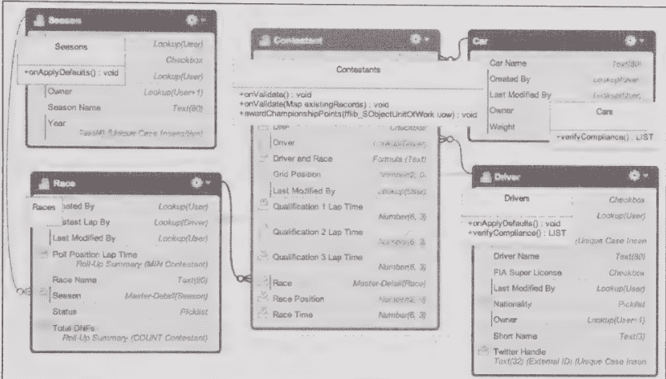

## 批量化

与 Service 层一样，编写 Domain 层代码时被鼓励以批量上下文思考记录。当 Domain 类方法从 Apex Trigger 上下文和 Service 层代码中调用时，这一点至关重要，两者都有相同的批量化要求。

与 Service 层不同，这里不是通过传递参数并确保参数类型已批量化来强制实施批量化，而是 Domain 类逻辑所作用且由其成员变量（这些成员变量已批量化）驱动的信息。在此情况下，Records 类属性返回一个 `List<SObject>` 对象：

```
public void onValidate() {
    for(Contestant__c race : (List<Contestant__c>) Records) {
    }
}
```

## 定义和传递数据

Domain 类上的大多数方法已通过 `Records` 属性（即构建 Domain 类时的状态）获得所需的信息。因此，几乎不需要在方法本身中传递数据信息。但是，对于某些自定义行为方法（即不反映 Apex Trigger 逻辑的方法），您可能希望将其他域对象和/或 **工作单元** 作为额外参数传递。本章后面的示例将有助于说明这一点。

## 事务管理

对于执行数据库操作的 Domain 类方法，有两项设计准则：使用作为参数传递给方法的事务上下文（工作单元），或为 Domain 类方法执行的范围创建一个。

## Domain 类模板

本章的 Domain 类实现使用了 **FinancialForce.com Apex 企业模式** 库，该库是开源的，并包含在本章的示例代码中。在此库中，提供了 Apex 基类 `fflib_SObjectDomain`，以帮助实现 Domain 层模式。

下面的代码片段展示了利用此基类的 Domain 类的基本模板：

```
public class Races extends fflib_SObjectDomain {
    public Races(List<Race__c> races) {
        super(races);
    }
}

public class Constructor
    implements fflib_SObjectDomain.IConstructable {
    public fflib_SObjectDomain construct(
        List<SObject> sObjectList) {
        return new Races(sObjectList);
    }
}
```

首先需要注意的是，此类的 **构造函数** 接收一个 `Race__c` 记录列表，符合之前描述的准则。在域类中实现的代码是以批量化为宗旨编写的。基类构造函数初始化 `Records` 基类属性。

内部类 Constructor 存在是为了允许在 Apex Trigger 上下文中动态创建 Domain 类。这实际上是在绕过 Apex 语言中缺乏完全反射（即动态引用类构造函数的能力）的问题。此内部类的名称必须始终为 Constructor。

通过扩展 fflib_SObjectDomain 类，Domain 类继承了可用于实现其自身方法的属性和方法，例如 Records 属性，该属性提供对实际记录数据的访问。还提供了虚拟方法，以简化 Apex Trigger 行为的实现，以及一些专门的事件，如 onValidate 和 onApplyDefaults。下面的类概述说明了 Domain 类可重写的基类中一些关键方法：

```
fflib_SObjectDomain(List<SObject>, SObjectType)
v onApplyDefaults() : void
v onValidate() : void
v onValidate(Map<Id, SObject>) : void
v onBeforeInsert() : void
v onBeforeUpdate(Map<Id, SObject>) : void
v onBeforeDelete() : void
v onAfterInsert() : void
v onAfterUpdate(Map<Id, SObject>) : void
v onAfterDelete() : void
v onAfterUndelete() : void
v handleBeforeInsert() : void
v handleBeforeUpdate(Map<Id, SObject>) : void
v handleBeforeDelete() : void
v handleAfterInsert() : void
v handleAfterUpdate(Map<Id, SObject>) : void
v handleAfterDelete() : void
v handleAfterUndelete() : void
```

## 实现 Domain Trigger 逻辑

Domain 类最常见的初始用例是封装 Apex Trigger 逻辑。为此，需要一个小型 Apex Trigger 来调用 triggerHandler 方法。这将把各种 Trigger 事件路由到 Domain 类中的相应方法（如前面的屏幕截图所示），从而避免围绕 Trigger.isXXX 变量使用常规 if/else 逻辑。

此 trigger 的名称可以是任意的，不过最好将其与相应的 Domain 类名称匹配。设置好后，您可以忽略它，专注于按如下方式实现 Domain 类方法：

```
trigger Seasons on Season__c (
  after delete, after insert, after update,
  before delete, before insert, before update) {
    fflib_SObjectDomain.triggerHandler(Seasons.class);
}
```

## 将 Trigger 事件路由到 Domain 类方法

下图展示了从 Apex Trigger 到 Domain 类，再到 triggerHandler，最后到各个方法的执行流程：

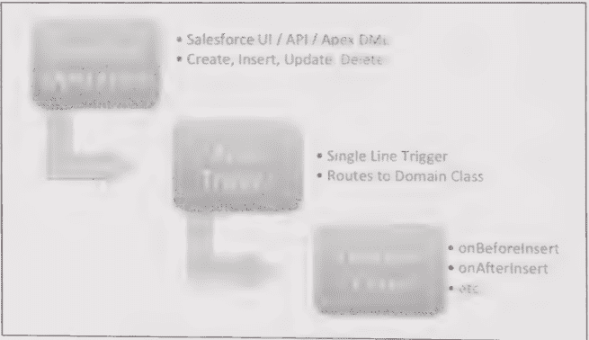

为帮助您理解传统 Apex Trigger 事件如何映射到基类中的各种虚拟方法，下表描述了从调用基类的 fflib_SObjectDomain.triggerHandler 方法开始，到可由 Domain 类重写的特定事件方法的代码路径：

| 触发器上下文 | 基类 Records 属性值 | 基类调用的 handle 方法（请参阅以下注释） | 基类调用的事件方法（请参阅以下注释） |
| :--- | :--- | :--- | :--- |
| Trigger.isBefore | | | |
| Trigger.isInsert | Trigger.new | handleBeforeInsert() | onApplyDefaults()<br>onBeforeInsert() |
| Trigger.isUpdate | Trigger.new | handleBeforeUpdate(Map<Id, SObject> existingRecords) | onBeforeUpdate(Map<Id, SObject> existingRecords) |
| Trigger.isDelete | Trigger.oldMap | handleBeforeDelete() | onBeforeDelete() |
| Trigger.isAfter | | | |
| Trigger.isInsert | Trigger.new | handleAfterInsert() | onValidate()<br>onAfterInsert() |
| Trigger.isUpdate | Trigger.new | handleAfterUpdate(Map<Id, SObject> existingRecords) | onValidate(Map<Id, SObject> existingRecords)<br>onAfterUpdate(Map<Id, SObject> existingRecords) |
| Trigger.isDelete | Trigger.oldMap | handleAfterDelete() | onAfterDelete() |

注释：如果您希望实现自己的处理逻辑，也可以重写 Handle 方法。existingRecords 参数表示 Trigger.oldMap 的值。

基类使用模板方法模式（http://en.wikipedia.org/wiki/Template_method_pattern）。这确保在重写基类中的 onXXX 方法时，您不需要担心调用基类版本的方法，这是在 OOP 中重写方法时的典型开发者要求。

## 强制执行对象安全性

Salesforce 要求开发者使用 SObjectDescribe 和 SObjectFieldDescribe Apex 运行时类型上的方法来实现对象 CRUD（创建、读取、更新和删除）安全性以及字段级安全性检查。

默认情况下，本章中使用的 fflib_SObjectDomain 基类中的前面 handle 方法会自动代表开发者的 Domain 类逻辑执行对象 CRUD 安全性。

请注意，目前基类仍将实现字段级安全性留给开发者实现。

基类提供的开发者控制的配置选项允许每个 Domain 类控制是否启用此默认行为。例如，由应用程序代码代表用户进行典型维护的对象可能不希望强制执行此检查，例如锦标赛积分的授予。这种访问有时被称为系统级访问，因为系统代表用户执行操作。因此，若接受默认的强制检查，将要求授予用户在应用程序其他位置不适当的访问权限。不利用默认强制执行的另一个动机是，更希望在控制器逻辑中更显式地编码这些检查。请仔细考虑每种情况下默认强制执行是否是您所需。

## 默认行为

处理程序方法在调用前面的事件方法之前会检查所需的安全性，如果用户没有所需的访问权限，则会抛出 DomainException 异常（强制整个 Trigger 上下文停止）。例如，调用 handleAfterInsert 方法时，将使用 SObjectDescribe.isCreatable 方法。


## 重写默认行为

为了更轻松地在整个应用程序中配置 fflib_SObjectDomain 类，并提供建立共享或通用 Domain 逻辑代码的手段，新建了以下基类。

```
/**
 * Application specific Domain base class,
 * customise fflib_SObjectDomain and add common behavior
 **/
public abstract class ApplicationDomain extends
	fflib_SObjectDomain {
	public ApplicationDomain(List<SObject> records) {
		super(records);
		// Disable CRUD security enforcement at the Domain class level
		Configuration.disableTriggerCRUDSecurity();
	}
}
```

因此，该应用程序中的 Domain 类改为扩展此类。

```
public class Contestants extends ApplicationDomain {
	public Contestants(List<Contestant__c> contestants) {
		super(contestants);
	}
}
```

注意，这种方法要求开发者独自承担实现对象 CRUD 安全检查的全部责任。

## Apex 触发器事件处理

即将介绍的章节将举例说明与 FormulaForce 应用程序相关的一些 Apex 触发器示例。它们使用本章示例代码中包含的 Drivers 和 Contestants Domain 类，以及以下新字段：

- 在 Driver__c 对象中，已创建名为 ShortName__c 的新文本类型字段，最大长度为 3 个字符。
- 在 Race__c 对象中，有一个名为 Status__c 的新选择列表类型字段，包含 Scheduled、In Progress、Red Flagged 和 Finished 值。默认值为 scheduled，方法是勾选“Use first value as default value”复选框。

## 插入时设置字段默认值

虽然可以重写 onInsertBefore 方法来实现记录插入时设置默认值的逻辑，但添加到 Contestants Domain 类中的以下代码选择重写 onApplyDefaults 方法。之所以使用此方法，是因为它更明确，并允许默认值代码与记录插入代码之间实现关注点分离，尽管两者都在插入阶段触发：

```
public override void onApplyDefaults() {
    for(Driver__c driver : (List<Driver__c>) Records) {
        if(driver.ShortName__c == null) {
            // Upper case first three letters of drivers last name
            String lastName = driver.Name.substringAfterLast(' ');
            driver.ShortName__c = lastName.left(3).toUpperCase();
        }
    }
}
```

前面的代码尝试填充驱动程序的短姓名，通常由其姓氏的前三个字符（大写）组成，因此 Lewis Hamilton 将变为 HAM。

## 插入时验证

以下验证逻辑在记录创建期间应用。它已添加到 Contestants Domain 类中，并确保只有在比赛处于 Scheduled 状态时才能添加参赛者。

它还演示了如何使用 Selector 模式类批量加载 Race__c 自定义对象的记录，该模式将在下一章中详细介绍：

```
public override void onValidate() {
    // Bulk load the associated races
    Set<Id> raceIds = new Set<Id>();
    for(Contestant__c contestant : (List<Contestant__c>) Records) {
        raceIds.add(contestant.Race__c);
    }
    Map<Id, Race__c> associatedRaces =
        new Map<Id, Race__c>(
        new RacesSelector().selectById(raceIds));
    // Only new contestants to be added to Scheduled races
    for(Contestant__c contestant :
        (List<Contestant__c>) Records) {
        Race__c race = associatedRaces.get(contestant.Race__c);
        if(race.Status__c != 'Scheduled') {
            contestant.addError(
            'Contestants can only be added to scheduled races');
        }
    }
}
```

通过重写 onValidate 方法，逻辑始终调用 Apex 触发器的 after 阶段。由于无法再对记录字段进行进一步编辑，因此这是执行逻辑的最安全位置。请始终牢记，您的 Apex 触发器可能不是分配给该对象的唯一触发器。例如，一旦您的软件包安装在订阅组织中，订阅者在您的对象上创建的自定义触发器可能会在您的触发器之前触发（触发器调用顺序不确定）并尝试修改字段。因此，对于托管软件包触发器，强烈建议在 after 阶段执行验证，以确保完全的信心和安全性，因为验证后数据不会再被修改。

## 更新时验证

提供了一种替代方法，即重写，用于实现适用于记录更新的验证逻辑。它是前面示例中所示 onValidate 方法的重载，用于在需要时传入数据库中的当前记录以供比较：

```
public override void onValidate(
    Map<Id, SObject> existingRecords) {
    // Bulk load the associated races
    Map<Id, Race__c> associatedRaces = queryAssociatedRaces();
    // Can only change drivers in scheduled races
    for(Contestant__c contestant : (List<Contestant__c>) Records) {
        Race__c contestantRace =
            associatedRaces.get(contestant.Race__c);
        Contestant__c oldContestant =
            (Contestant__c) existingRecords.get(contestant.Id);
        if(contestantRace.Status__c != 'Scheduled' &&
            contestant.Driver__c != oldContestant.Driver__c) {
            contestant.Driver__c.addError(
            'You can only change drivers for scheduled races');
        }
    }
}
```

前面的代码利用了一个新的自定义 Domain 类方法，用于共享加载关联 **比赛** 记录给 **参赛者** 的代码，这些代码用于前一示例所示的 onValidate 方法。该方法还使用 Records 属性来确定范围内的 **参赛者**：

```
private Map<Id, Race__c> queryAssociatedRaces() {
    // Bulk load the associated races
    Set<Id> raceIds = new Set<Id>();
    for(Contestant__c contestant : (List<Contestant__c>) Records) {
        raceIds.add(contestant.Race__c);
    }
    return new Map<Id, Race__c>(
        new RacesSelector().selectById(raceIds)
    );
}
```

> 前一个方法被标记为 private，因为目前无需将此功能暴露给其他类。最初，以这种方式限制方法通常被视为最佳实践，并允许在将来进行更轻松的内部重构或改进。如果出现需要访问此功能的需求，该方法可以设为 public。

## 实现自定义 Domain 逻辑

Domain 类不应将自身局限于仅包含与 Apex 触发器相关的逻辑。在以下示例中，上一章中介绍的用于计算锦标赛积分的代码已重构到 Contestants Domain 类中。这是一个更合适的位置，因为它直接适用于 Contestant 记录数据，并可以轻松在其他 Domain 和 Service 层代码之间共享（我们将在本章后面介绍）：

```
public void awardChampionshipPoints(fflib_ISObjectUnitOfWork uow) {
    // Apply championship points to given contestants
    Map<Integer, ChampionshipPoint__mdt> pointsByTrackPosition =
        new ChampionshipPointsSelector().selectAllByTrackPosition();
    for(Contestant__c contestant : (List<Contestant__c>) Records) {
        // Determine points to award for the given position
        ChampionshipPoint__mdt pointsForPosition =
            pointsByTrackPosition.get(
            Integer.valueOf(contestant.RacePosition__c));
        if (pointsForPosition != null) {
            // Apply points and register for update with uow
            contestant.ChampionshipPoints__c =
                pointsForPosition.PointsAwarded__c;
            uow.registerDirty(contestant);
        }
    }
}
```

请注意，**工作单元** 作为参数传递到这里，以便该方法可以将工作（记录更新）注册到负责提交工作的调用 Service 层方法。再次，与前面的 Domain 类方法一样，使用 `Records` 属性来访问要处理的 **参赛者** 记录。

## 面向对象编程

使用 Apex 类的一大优势是能够利用 OOP 的强大功能。OOP 允许您观察对象间数据或行为的共同点，以共享代码或在不同对象之间应用通用处理。

赛车世界中这种共同点的一个示例是规则；体育运动的每个方面都有一套需要遵守的规则和规定，例如 **驾驶员** 拥有 FIA **超级驾驶执照**、他们驾驶的赛车重量应至少高于规定的最小值，以及确保 **车队** 在测试赛车时未超过最大测试距离。此类合规性检查会定期进行，无论是赛前还是赛后。

## 创建合规性应用程序框架

在我们的 FormulaForce 应用程序中，我们希望创建一个合规性框架，用于检查不同对象中的这些法规，同时为最终用户提供一致的用户界面体验来验证合规性。初始要求是在所有适用对象的 **详细信息页面** 上放置一个 **验证合规性** 按钮。

执行验证过程的 **Visualforce 控制器** 和 **服务代码** 应该是通用的，并可在这些对象之间重复使用，而与每个对象关联的实际合规性检查逻辑将是特定的。通过使用 **Apex 接口**，我们可以为适用的 Domain 类定义此共同要求以供实现。

在本节中，我们将使用 Apex 接口和一个通用服务来实现此要求，该服务可以接收应用程序中不同 Domain 对象的记录 ID。创建此类服务可以避免代码重复，无需在每个 Domain 类的代码中重复处理结果的逻辑，并为控制器提供一个集中式服务来消费，无论范围内的对象类型如何。


通过使用 Apex 接口和通用服务，我们按如下方式分离合规功能实现的功能关注点：

- 服务层代码仅关注通过接口执行合规检查过程
- 控制器代码负责调用服务类方法执行合规检查，然后以一致的方式向用户呈现结果
- 实现该接口的领域层类仅专注于根据对象类型，验证记录数据是否符合适用规则

有了这种关注点分离，就可以轻松显著修改或扩展检查的调用方式和向用户呈现的方式，而无需重新访问每个领域层类；或者，可以修改某个对象的合规逻辑，而不会影响整个应用程序的总体实现。

## Apex 接口示例

接口有助于表达不同领域类之间的共同属性或行为。在本节中，我们将使用 Apex 接口来帮助暴露每个适用领域类中封装的合规检查逻辑。

为了练习和实现合规框架，FormulaForce 应用程序增加了一些额外的字段和对象。这些对象、附加类和 Visualforce 页面均包含在本章的代码示例中。

总结一下，为实现合规框架要求，已采取以下步骤。您可以跟随这些步骤操作，也可以直接参考本章的示例代码：

- 1. 创建新的 Car 对象和选项卡。
- 2. 在 Car 对象上创建类型为 Number、长度为 6 的新 Weight 字段。
- 3. 向 Driver 对象添加新的 FIA Super License 字段。
- 4. 创建新的 Cars 领域类和 CarsSelector 选择器类。
- 5. 创建新的 ComplianceService 类和 ICompliant 接口。
- 6. 创建新的 Cars 和 Drivers 领域类并实现 ICompliant 接口。
- 7. 更新 Application 类以实现领域类工厂
- 8. 创建利用领域工厂的新 ComplianceService.verify 方法。
- 9. 创建用户界面以从实现该接口的各种对象访问服务。

> 最后一步将创建两个用户界面，一个用于 Salesforce Classic，另一个用于 Lightning Experience。ComplianceController 类为每个对象的每个特定 Visualforce 页面提供通用控制器类。此外，ComplianceChecker 包提供了一个名为 Compliance Checker 的通用 Lightning 组件，可以放置在任何对象页面上。

以下各部分将从步骤 5 开始更详细地描述 Apex 代码。

## 第 5 步 – 定义通用服务

目标是开发一个通用服务来处理整个应用程序中的所有合规验证。因此，创建了一个带有 verify 方法的新 ComplianceService 类，该方法能够接收来自各种对象的 ID。如果有任何验证错误，它们将作为异常的一部分抛出。如果该方法在不抛出异常的情况下返回，则给定的记录是合规的。以下代码片段展示了带有 verify 方法的新 ComplianceService 类的创建：

```
public class ComplianceService {
/**
 * Provides general support to verify compliance in the
 * application
 * @throws ComplianceException for any failures
 */
public static void verify(Set<Id> recordIds) {
// Query the given records and delegate to the
// corresponding Domain class to check compliance
// and report failures via ComplianceException
}
```

在深入了解如何实现此服务方法之前，请先看看新的 `ICompliant` 接口以及将由 Drivers 和 Cars 领域类实现的 `verifyCompliance` 方法：

```
public class ComplianceService {
/**
 * Interface used to execute compliance checking logic
 * in each domain class
 */
public interface ICompliant {
List<VerifyResult> verifyCompliance();
}

/**
 * Results of a compliance verification for a given record
 */
public class VerifyResult {
public Id recordId;
public String complianceCode;
public Boolean passed;
public String failureReason;
}
}
```

## 第 6 步 – 实现领域类接口

`Drivers` 领域类按如下方式实现该接口（仅显示部分类）。它检查 FIA Super License 字段是否已选中，如果未选中，则报告相应的合规代码和失败消息：

```
public class Drivers extends ApplicationDomain
implements ComplianceService.ICompliant {
public List<ComplianceService.VerifyResult> verifyCompliance() {
List<ComplianceService.VerifyResult> compliances =
new List<ComplianceService.VerifyResult>();
for(Driver__c driver : (List<Driver__c>) Records) {
ComplianceService.VerifyResult license =
new ComplianceService.VerifyResult();
license.ComplianceCode = '4.1';
license.RecordId = driver.Id;
license.passed = driver.FIASuperLicense__c;
license.failureReason =
license.passed ? null :
'Driver must have a FIA Super License.';
compliances.add(license);
}
return compliances;
}
}
```

Cars 领域类（仅显示部分类）按如下方式实现 verifyCompliance 方法，检查汽车是否超过指定重量：

```
public class Cars extends ApplicationDomain
    implements ComplianceService.ICompliant {
public List<ComplianceService.VerifyResult> verifyCompliance() {
    List<ComplianceService.VerifyResult> compliances =
        new List<ComplianceService.VerifyResult>();
    for(Car__c car : (List<Car__c>) Records) {
        // Check weight compliance
        ComplianceService.VerifyResult license =
            new ComplianceService.VerifyResult();
        license.ComplianceCode = '4.1';
        license.RecordId = car.Id;
        license.passed =
            car.Weight__c !=null && car.Weight__c>= 691;
        license.failureReason = license.passed ? null :
            'Car must not be less than 691kg.';
        compliances.add(license);
    }
    return compliances;
}
}
```

## 第 7 步 – 领域类工厂模式

下一步是根据传入 `ComplianceService.verify` 方法的记录 ID，动态构建关联的领域类。实现的这一部分使用了领域类的工厂模式实现。

> 关于工厂模式的 Wikipedia 参考可在 http://en.wikipedia.org/wiki/Factory_method_pattern 上找到。

实现使用 Apex 运行时 `Id.getSObjectType` 方法来确定 `SObjectType`，然后通过以下代码所示的 `Maps`，确定要使用的适用领域类和选择器类（以查询记录）。

然后使用 Apex 运行时 `Type.newInstance` 方法来构建领域类和选择器类的实例。通过调用 `Application.Domain.newInstance` 方法来调用工厂功能。Application 类上的 `Domain` 字段使用 `fflib_Application.DomainFactory` 类按如下方式实现：

```
public class Application {
  public static final fflib_Application.DomainFactory Domain =
    new fflib_Application.DomainFactory(
      Application.Selector,
      // Map SObjectType to Domain Class Constructors
      new Map<SObjectType, Type> {
        Race__c.SObjectType => Races.Constructor.class,
        Car__c.SObjectType => Cars.Constructor.class,
        Driver__c.SObjectType => Drivers.Constructor.class
      });
}
```

> 作为开发人员，您当然可以直接实例化特定的领域类。但是，这种领域类工厂方法允许根据传递给 newInstance 方法的 ID 关联的 SObjectType 在运行时选择特定的领域类。这是实现下一步所示的通用服务入口点的关键。领域类工厂的前面初始化还传入了 Application.Selector；这是另一个与能够查询数据库的类相关的工厂。下一章将更详细地介绍选择器模式和选择器工厂。

## 第 8 步 – 实现通用服务

以下代码中使用的 `Application.Domain.newInstance` 方法用于访问上一步中定义的领域类实例工厂。

该方法返回 `fflib_ISObjectDomain`，因为这是所有领域类的共同基接口。然后，使用 `instanceof` 运算符，它确定是否实现了 `ICompliant` 接口，如果是，则调用 `verifyCompliance` 方法。以下代码展示了通用服务的实现：

```
public class ComplianceService {
  public static void verify(Set<Id> recordIds) {
    // Dynamically create Domain instance for these records
    fflib_ISObjectDomain domain =
      Application.Domain.newInstance(recordIds);
    if (domain instanceof ICompliant) {
      // Ask the domain class to verify its compliance
      ICompliant compliantDomain = (ICompliant) domain;
```


List<VerifyResult> verifyResults =
compliantDomain.verifyCompliance();
if (verifyResults != null) {
    // Check for failed compliances
    List<VerifyResult> failedCompliances =
    new List<VerifyResult>();
    for (VerifyResult verifyResult : verifyResults) {
    if (!verifyResult.passed) {
        failedCompliances.add(verifyResult);
    }
    }
    if (failedCompliances.size() > 0) {
    throw new ComplianceException(
        'Compliance failures found.', failedCompliances);
    return;
    }
    }
throw new ComplianceException(
    'Unable to verify compliance.', null);
}
}

> 请注意，如果将对象的 ID 传递给 verify 方法，但该对象没有相应的 Domain 类，则工厂会抛出异常。但是，如果找到了 domain 类但未实现该接口，则前面的代码会直接在不报错的情况下返回，不过开发者在这种情况下该做什么由他们决定。

## 第 9 步 – 从通用控制器使用通用服务

在本步骤中，我们将从 Visualforce 控制器和 Lightning 组件控制器使用相同的 ComplianceService.verify 方法。这些用户界面也具有高度通用性，因此更易于应用于未来版本中的新对象。

## 使用 Visualforce 的通用合规验证 UI

已创建一个名为 ComplianceController 的通用 Visualforce 控制器，其中包含调用服务的 verify 操作方法。请注意，我们从未提及过特定的自定义对象或 Domain 类，确保此控制器和服务具有通用性，能够处理不同类型的对象。以下代码展示了如何从 ComplianceController.verify 方法调用通用的 ComplianceService.verify 方法：

```
public PageReference verify() {
    try {
        // Pass the record to the compliance service
        ComplianceService.verify(
            new Set<Id> { standardController.getId() });
        // Passed!
        ApexPages.addMessage(
            new ApexPages.Message(
                ApexPages.Severity.Info, 'Compliance passed'));
    }
    catch (Exception e) {
        // Report message as normal via apex:pageMessages
        ApexPages.addMessages(e);
        // Display additional compliance failure messages?
        if (e instanceof ComplianceService.ComplianceException)
        {
            ComplianceService.ComplianceException ce =
                (ComplianceService.ComplianceException) e;
            for (ComplianceService.VerifyResult verifyResult :
                ce.failures) {
                ApexPages.addMessage(new ApexPages.Message(
                    ApexPages.Severity.Error,
                    String.format('{0} ({1})', new List<String> {
                        verifyResult.failureReason,
                        verifyResult.complianceCode })));
            }
        }
    }
    return null;
}
```

然后创建 Visualforce 页面，将此通用控制器绑定到 Driver 和 Car 详细信息页面上的自定义按钮。这是唯一针对实现 ComplianceService.ICompliant 接口的对象的特定引用，并且仅用于在 Salesforce Classic 中创建自定义按钮。以下针对 Driver 对象的页面定义了一个使用通用 ComplianceController.verify 方法的按钮：

```
<apex:page standardController="Driver__c"
    extensions="ComplianceController" action="{!verify}">
<apex:pageMessages/>
<apex:form>
<apex:commandButton value="Cancel" action="{!cancel}"/>
</apex:form>
</apex:page>
```

## 使用 Lightning 组件的通用合规验证 UI

本节描述的组件可以无需任何进一步配置即可放置在任何对象的 Lightning Experience 或 Salesforce1 Mobile 记录页面上。该组件使用与先前的 Visualforce 示例相同的服务，以动态调用适当的 Domain 类并应用相关的验证流程。

> Lightning 组件将在后续章节中详细介绍。此组件演示了组件可用于扩展 Lightning Experience 和平台其他方面的众多位置之一。

以下代码展示了组件的 Apex 控制器：

```
public with sharing class ComplianceCheckerComponent {

    @AuraEnabled
    public static List<String> verify(Id recordId) {
        try {
            // Verify the given record for compliance
            ComplianceService.verify(new Set<Id> { recordId });
            // Success, all good!
            return null;
        } catch (Exception e) {
            // Report message as normal via apex:pageMessages
            List<String> messages = new List<String> { e.getMessage() };
            // Display additional compliance failure messages?
            if (e instanceof ComplianceService.ComplianceException) {
                ComplianceService.ComplianceException ce =
                    (ComplianceService.ComplianceException) e;
                for (ComplianceService.VerifyResult verifyResult : ce.failures) {
                    messages.add(String.format('{0} ({1})',
                        new List<String> {
                            verifyResult.failureReason,
                            verifyResult.complianceCode })));
                }
            }
            return messages;
        }
    }
}
```

以下代码展示了组件标记、JavaScript 控制器和 helper：

### ComplianceChecker.cmp:

```
<aura:component implements="force:hasRecordId,flexipage:availableForRecordHome" controller="ComplianceCheckerComponent" access="global">
<aura:dependency resource="markup://force:editRecord"
 type="EVENT" />
<aura:attribute name="category" type="String"
 default="success" />
<aura:attribute name="messages" type="String[]" />
<aura:handler name="init" value="{!this}"
 action="{!c.onInit}"/>
<aura:handler event="force:refreshView"
 action="{!c.onRefreshView}"/>
<div class="{!'slds-box slds-theme--' + v.category}">
<aura:iteration items="{!v.messages}" var="message">
<p><ui:outputText value="{!message}"/></p>
</aura:iteration>
</div>
</aura:component>
```

> 前面的代码处理了 Lightning Experience 框架在用户编辑记录时发送的 force:refreshView 事件。由于指定了 flexipage:availableForRecordHome 接口，因此该组件只能放置在记录页面上。

```
ComplianceCheckerController.js:

({
  onInit : function(component, event, helper) {
    helper.verifyCompliance(component, event, helper);
  },
  onRefreshView : function(component, event, helper) {
    helper.verifyCompliance(component, event, helper);
  }
})

ComplianceCheckerHelper.js:

({

  verifyCompliance : function(component) {

    var action = component.get("c.verify");
    action.setParams({ "recordId" :
      component.get("v.recordId") });
    action.setCallback(this, function(response) {
      if(response.getState() == 'SUCCESS') {
        var messages = response.getReturnValue();
        if(messages!=null) {
          component.set("v.category", "error");
          component.set("v.messages", messages);
        } else {
          component.set("v.category", "success");
          component.set("v.messages", ["Verified compliance" ]);
        }
      }
    });

    $A.enqueueAction(action);

  }
})

```

与 Visualforce 页面不同，此处未对任何对象做特定引用，因此该组件可用于任何页面。

> 如果你希望在 Lightning App Builder 工具中限制组件的可见性（用户在该工具中自定义 Lightning Experience 和 Salesforce1 Mobile），可以在 .design 文件中使用 sfdc:objects 标签。

```
<sfdc:objects>
<sfdc:object>Driver__c</sfdc:object>
<sfdc:object>Car__c</sfdc:object>
</sfdc:objects>
```

## 总结合规框架实现

通过使用 Apex 接口和工厂模式，应用程序中已建立一个框架，以确保合规逻辑得到一致实现。这只是实现 Domain 类接口并创建 Visualforce 页面或使用通用 Lightning 组件的简单问题，以便在未来为其他适用对象启用该功能。

> 由于此功能已作为服务实现，因此也可以轻松地从 Batch Apex 或 Scheduled 上下文中重用。

以下屏幕截图展示了 Driver 对象上的 Verify Compliance 按钮。在按下按钮之前，请确保 FIA Super License 字段未被选中。

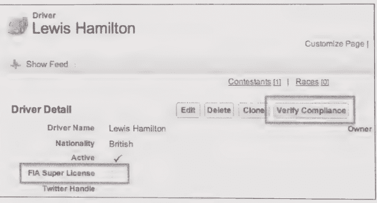


应显示以下错误：

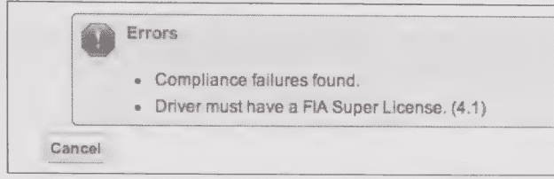

以下屏幕截图显示了 Car 对象上的 Verify Compliance 按钮：

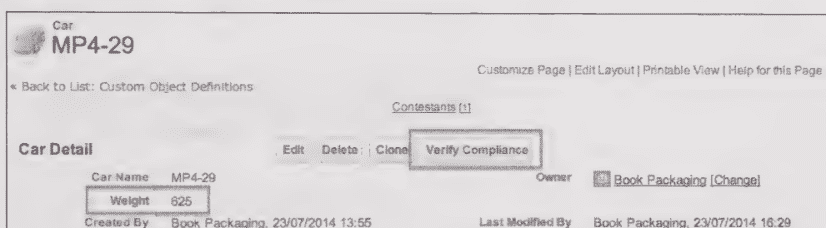

以前定义/创建的通用控制器显示了以下错误：

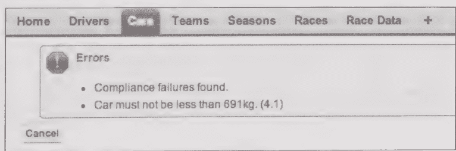

以下显示了在 Lightning App Builder 工具中将 Compliance Checker Lightning 组件放置在 Driver 页面上：

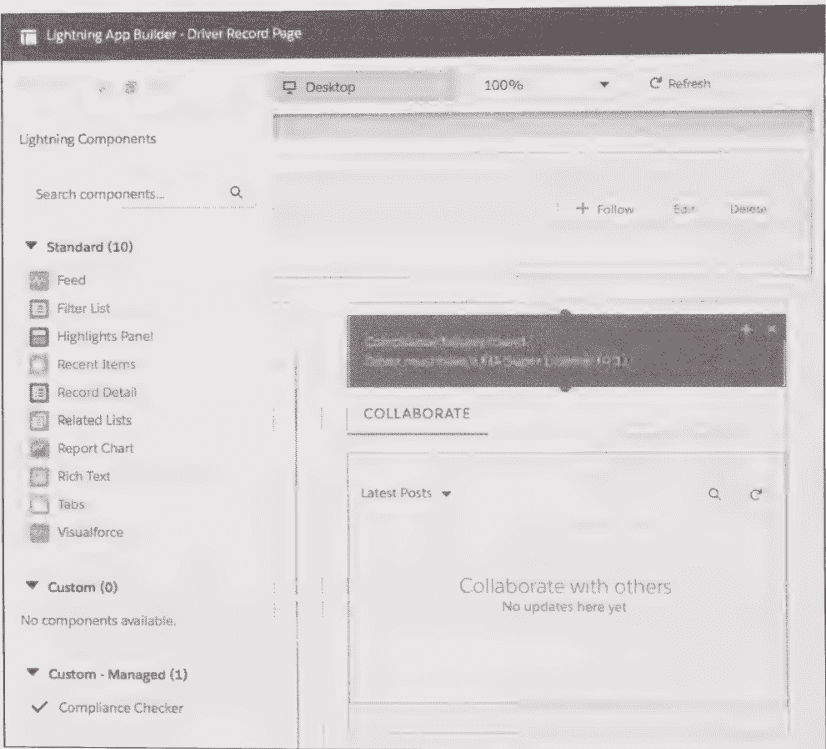

以下显示了 **合规检查器** 组件已就位于 **驱动程序** 页面上。在 Lightning Experience 中，没有按钮，组件嵌入在页面中，并对用户所做的字段更新做出反应。因此，验证会立即执行。

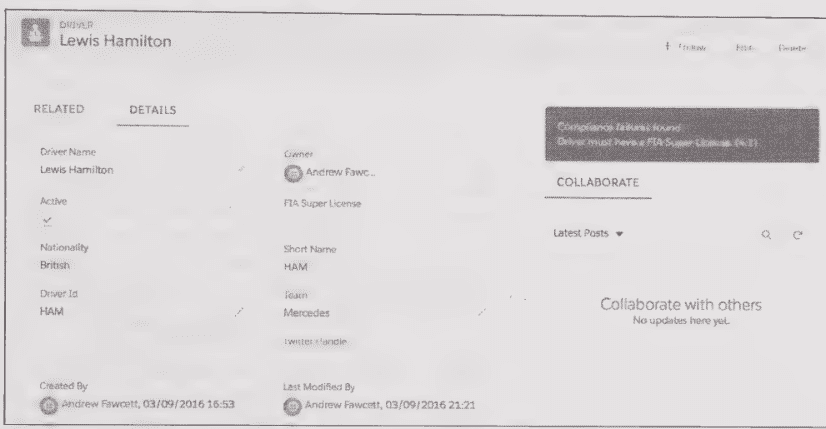

## 测试 Domain 层

测试您的 Domain 代码可以采用标准的 Force.com 方式完成。通常，测试类的命名方式是在 Domain 类名末尾加上 `Test` 后缀，例如 `RacesTest`。测试方法可以选择直接或间接测试 Domain 类代码功能。

间接测试是通过仅针对适用的自定义对象使用 DML 和 SOQL 逻辑，并断言这些操作产生的数据和字段错误来完成的。在此，测试代码中完全不引用您的 Domain 类。

然而，这只测试了 Apex 触发器 Domain 类方法。对于表示自定义 domain 行为的测试方法，必须创建 Domain 类的实例。本节将说明间接和直接测试方法的示例。

## 单元测试

虽然围绕 Service 层及其相关调用者（控制器、批处理等）开发测试也会调用 Domain 层逻辑，但尽可能针对 Domain 层测试尽可能多的场景非常重要，传入不同配置的记录数据以测试成功和失败代码路径，并确保您的 Domain 层逻辑尽可能健壮。Wikipedia 对 **单元测试** 的定义描述如下 (`http://en.wikipedia.org/wiki/Unit_testing`)：

> 在计算机编程中，单元测试是一种方法，用于测试单个源代码单元、一组或多个计算机程序模块以及相关的控制数据、使用过程和操作过程，以确定它们是否适用。直观地看，可以将单元视为应用程序中最小的可测试部分。在过程化编程中，单元可以是整个模块，但更常见的是单个函数或过程。在面向对象编程中，单元通常是整个接口，如类，但也可能是单个方法。单元测试是程序员或偶尔由白盒测试人员在开发过程中创建的简短代码片段。

对 Domain 层的测试符合此定义。以下部分将说明通过使用 DML 设置测试数据并执行代码来测试 Domain 类代码的传统且仍然非常有效的方法。在后续章节中，我们将回顾一个 Apex 模拟框架（类似于 Java 中的 **Mockito**），它提供了一种更精简、更有针对性的方法来测试您的 Domain 代码。

## 使用 DML 和 SOQL 的测试方法

要测试 Domain 类的 Apex 触发器方法，可以将传统的 DML 和 SOQL 用法与 Apex 运行时 `DMLException` 方法结合使用，不仅断言错误消息，还断言其他详细信息。以下 Apex 测试方法说明了如何做到这一点：

```
@IsTest
private static void testAddContestantNoneScheduled() {
    // Test data
    Season__c season =
        new Season__c(Name = '2014', Year__c = '2014');
    insert season;

    Driver__c driver =
        new Driver__c(
            Name = 'Lewis Hamilton', DriverId__c = '42');
    insert driver;
    Race__c race =
        new Race__c(Name = 'Spa',
            Status__c = 'In Progress',
            Season__c = season.Id);
    insert race;

    Test.startTest();
    try {
        // Insert Contestant to In Progress race
        Contestant__c contestant =
            new Contestant__c(
                Driver__c = driver.Id,
                Race__c = race.Id);
        insert contestant;
        System.assert(false, 'Expected exception');
    }
    catch (DmlException e) {
        System.assertEquals(1, e.getNumDml());
        System.assertEquals(
            'Contestants can only be added to Scheduled Races.',
            e.getDmlMessage(0));
        System.assertEquals(
            StatusCode.FIELD_CUSTOM_VALIDATION_EXCEPTION,
            e.getDmlType(0));
    }
    Test.stopTest();
}
```

前面的错误是记录级错误；DMLException 类还允许您针对字段级错误断言字段级信息。以下代码显示了此类测试断言；未显示数据设置代码：

```
Test.startTest();
try {
    contestant.Driver__c = anotherDriver.Id;
    update contestant;
    System.assert(false, 'Expected exception');
}
catch (DmlException e) {
    System.assertEquals(1, e.getNumDml());
    System.assertEquals(
        'You can only change drivers for scheduled races',
        e.getDmlMessage(0));
    System.assertEquals(Contestant__c.Driver__c,
        e.getDmlFields(0)[0]);
    System.assertEquals(
        StatusCode.FIELD_CUSTOM_VALIDATION_EXCEPTION,
        e.getDmlType(0));
}
Test.stopTest();
```

## 使用 Domain 类方法的测试方法

为了测试自定义 Domain 类方法，应在测试方法中创建 Domain 类的实例，使用之前测试中所示已插入数据库的内存中创建或查询的测试记录。

以下示例展示了正在测试的 `Contestants.awardChampionshipPoints` 方法。请注意，测试创建了一个临时 Unit Of Work 但不提交工作。严格来说，这并不是断言记录更改所必需的，因为可以使用 `Records` 属性来访问更改并断言已分配的正确值：

```
@IsTest
private static void testAddChampionshipPoints() {
    // Test data
    ChampionshipPoints__c championShipPoints =
        new ChampionshipPoints__c(
        Name = '1', PointsAwarded__c = 25);
    insert championShipPoints;
    Season__c season =
        new Season__c(Name = '2014', Year__c = '2014');
    insert season;
    Driver__c driver =
        new Driver__c(
        Name = 'Lewis Hamilton', DriverId__c = '42');
    insert driver;
    Race__c race =
        new Race__c(
        Name = 'Spa', Status__c = 'Scheduled',
        Season__c = season.Id);
    insert race;
    Contestant__c contestant =
        new Contestant__c(
        Driver__c = driver.Id, Race__c = race.Id);
    insert contestant;
    race.Status__c = 'Finished';
    update race;
    contestant.RacePosition__c = 1;
    update contestant;

    Test.startTest();
    Contestants contestants =
        new Contestants(new List<Contestant__c> { contestant });
    contestants.awardChampionshipPoints();
    Application.UnitOfWork.newInstance();
    System.assertEquals(25, (Contestant__c)
        contestants.Records[0].ChampionshipPoints__c);
    Test.stopTest();
}
```

在测试中执行 SOQL 和 DML 会消耗大量 CPU 时间，并增加执行所有应用程序测试所需的总时间，一旦开始考虑持续集成（将在后续章节中介绍），这一点就变得很重要。例如，是否总是需要提交 Domain 层的数据更新，因为 Service 层测试也可能执行此类操作并断言结果。

## 调用 Domain 层

Domain 层在可见性和依赖性方面位于 Service 层之下。在实践中，这意味着不应直接从执行上下文代码（如 Visualforce 控制器、Lightning 组件控制器或 Batch Apex）调用 Domain 类，因为 Service 层有责任作为业务流程应用程序逻辑的唯一入口。

也就是说，我们了解到 Domain 层还通过将 Apex 触发器事件绑定到 Domain 类上的方法来封装对象的行为，因为记录是通过这种方式操作的。因此，Apex 触发器从技术上构成另一个调用点。

最后，Domain 层的第三种调用者类型是另一个 Domain 类。仅将 Domain 类的调用者限制在以下上下文中：

- **Apex 触发器**: 这通过 `fflib_SObjectDomain.handleTrigger` 方法调用。
- **Service 层**: 该层直接通过 new 运算符或通过本章前面所述的 Domain 工厂方法创建 Domain 类的实例。通常，在此上下文中调用 Domain 类的自定义方法。
- **Domain 层**: 其他 Domain 类可以调用其他 Domain 类，例如，`Races` Domain 类可以具有其实现的某些功能，这些功能还需要使用 `Contestants` Domain 类上的方法。


> 请注意，完全可以有一个 Domain 类没有任何 Service 类代码引用它，例如在 Domain 类仅为 Apex Trigger 上下文实现代码且不包含任何自定义 Domain 方法的情况下。那么，对 Domain 类的唯一调用将通过 trigger 上下文间接进行。

## Service 层交互

在本章前面实现合规性框架时，我们了解到 Domain 类可以在通用服务方法中动态创建。通常，Domain 类是直接创建的。在本节中，我们将看到几个这样的示例。

以下代码展示了从 Selector 类传递记录给 Domain 类构造函数，该 Selector 类为了本章目的返回 `List<Contestant__c>`。请注意，工作单元被创建并传递给 Domain 类的自定义方法，以便该方法也可以注册自己的工作，以便稍后提交到数据库：

```
public class ContestantService {
    public static void awardChampionshipPoints(
        Set<Id> contestantIds) {
        fflib_SObjectUnitOfWork uow =
            Application.UnitOfWork.newInstance();

        // Apply championship points to given contestants
        Contestants contestants =
            new Contestants(
                new ContestantsSelector().selectById(contestantIds));
        contestants.awardChampionshipPoints(uow);

        uow.commitWork();
    }
}
```

您可能已经注意到，这个示例通过重构代码并将计算点移至更接近代码直接适用的对象的位置（基本上是将原始代码移至 Domain 类），重新编写了上一章中的 Service 示例。

下面的第二个示例也重新编写了上一章中的代码以利用 Domain 层。在这种情况下，RaceService 类也实现了一个 awardChampionshipPoints 方法。这也可以受益于 Contestants Domain 类方法。请注意 Service 层和 Domain 层之间重用方法是多么容易，因为两者都确保它们的方法和交互是批量化的。

```
public class RaceService {
    public void awardChampionshipPoints(Set<Id> raceIds) {
        fflib_SObjectUnitOfWork uow =
        Application.UnitOfWork.newInstance();

        List<Contestant__c> contestants =
        new List<Contestant__c>();
        for(Race__c race :
        new RacesSelector().selectByIdWithContestants(raceIds)) {
            contestants.addAll(race.Contestants__r);
        }

        // Delegate to Contestant Domain class
        new Contestants(contestants).awardChampionshipPoints(uow);

        // Commit work
        uow.commitWork();
    }
}
```

## Domain 层交互

在下面的示例中（也包含在本章的示例代码中），创建了一个新的自定义对象来表示参赛车队。Driver 对象新增了一个名为 Team 的查找字段，以将车手与其车队关联。

利用之前构建的合规性框架，还为 Team 记录添加了一个“验证合规性”按钮，用于检查车队的某些合规方面（例如赛车在测试期间可以行驶的最大距离）以及该车队的所有车手是否仍然合规（重用现有代码）。

> 这将通过在新的 Teams Domain 类调用中添加合规性验证代码，并委托给 Drivers Domain 类方法来实现车队中车手的相同操作。

为支持此示例，已向应用程序添加了以下组件：

- 新的 **车队** 对象和标签页
- **车队** 对象上带有长度 6 的新 **测试距离** 数值字段
- **车手** 对象上的新 **车队** 查找字段
- 新的 Teams Domain 类

> 如果您不打算覆盖任何 Apex Trigger 事件处理程序方法，则不必总是创建调用 `fflib_SObjectDomain.triggerHandler` 方法的 Apex Trigger。

能够在 Domain 层类之间调用，使得车手合规性检查代码可以继续在 **车手** 级别以及从 **车队** 级别重用。这个 Domain 类示例展示了 Teams Domain 类调用 Drivers Domain 类：

```
public class Teams extends fflib_SObjectDomain
implements ComplianceService.ICompliant {
  public List<ComplianceService.VerifyResult> verifyCompliance() {
    // Verify Team compliance
    List<ComplianceService.VerifyResult> teamVerifyResults =
    new List<ComplianceService.VerifyResult>();
    for(Team__c team : (List<Team__c>) Records) {
    ComplianceService.VerifyResult testingDistance =
    new ComplianceService.VerifyResult();
    testingDistance.ComplianceCode = '22.5';
    testingDistance.RecordId = team.Id;
    testingDistance.passed = team.TestingDistance__c != null ?
    team.TestingDistance__c <= 15000 : true;
    testingDistance.failureReason = testingDistance.passed ?
    null : 'Testing exceeded 15,000km';
    teamVerifyResults.add(testingDistance);
    }

    // Verify associated Drivers compliance
    teamVerifyResults.addAll(
    new Drivers(
    new DriversSelector().selectDriversByTeam(
    new Map<Id, SObject>(Records).keySet()))
    .verifyCompliance());
    return teamVerifyResults;
  }
}
```

> 前面的代码利用了应用于 Domain 层的批量化准则，因为 Drivers Domain 类的逻辑直接从 Teams Domain 类重用，未做任何更改。还要注意，Drivers Domain 类的实现过去和现在都不知道车手按车队拆分的情况。

以下屏幕截图显示了使用 Lightning App Builder 添加到车队页面的新车队对象和合规性检查器组件。车队记录和相关车手记录存在合规性问题。对于车队记录，测试距离值大于 15,000 km 无效。显示的 Lewis Hamilton 车手记录上的 FIA Super License 字段未勾选，未显示。

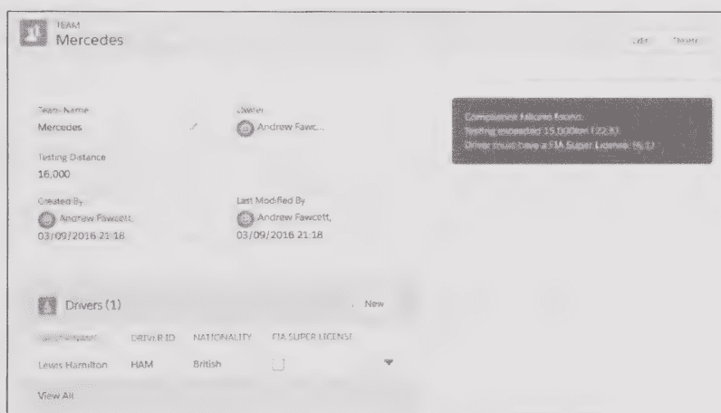

## 更新 FormulaForce 包

与之前一样，使用本章提供的源代码更新您的打包组织并上传新版本的包。请确保检查任何未自动添加到包的组件，例如 Apex 类、对象、标签页和 Lightning Components 标签页。

在打包之前，删除通过 Lightning App Builder 添加到页面上的任何 Lightning Components。如果您打包带有组件的 Lightning Pages，这将要求用户启用 My Domain 功能，从而可能限制您的包可以安装的客户数量。这对于尚未完全采用 Lightning Experience 的客户尤其如此。

请注意，自上一章中包的上一个版本发布以来，新的“验证合规性”按钮已添加到车手布局中。但是，由于布局是不可升级的组件，升级时需要在测试组织中安装后手动添加此按钮，本章添加的任何新自定义字段也是如此。您通常会通过升级和安装指南通知用户这些步骤。您还需要确保用户了解解决方案中包含的任何 Lightning Components。如前所述，打包 Lightning Pages 会创建对客户已启用 My Domain 功能的依赖。

## 摘要

在本章中，您了解了一种新的业务逻辑拆分方式，它超越了将逻辑封装在 Service 层中——通过适当命名的 Domain 类，将验证更改和对象数据的解释与逻辑对齐。与 Service 层一样，这种方法使得新老开发人员在代码库中工作时能够轻松找到此类代码。

Domain 类结合了传统的 Apex Trigger 逻辑和自定义 Domain 逻辑，例如为参赛者计算锦标赛积分或验证针对赛车、车手和车队的合规性规则。


利用 Apex 类，即可开始发挥面向对象编程（OOP）实践的能力，使用接口和工厂方法在应用程序中实现功能子系统，不仅能够交付实现速度、一致性和复用性，还能帮助支持一致的用户体验。域类在需要时可以相互调用，以涵盖相关子组件的行为，例如团队中的车手。

最后，在测试域层时，请记住单元测试的最佳实践是尽可能在隔离状态下，结合多种用例和数据组合来测试代码，尽管其他测试（例如来自服务层的测试）和其他调用者也会执行这些代码路径，但变化可能较少。

在下一章中，我们将深入探讨选择器模式，从而完善 Martin Fowler 提出的三种模式。在本章中，我们在从应用程序使用的各种自定义对象读取数据时，已经多次使用了此模式。

## 应用程序选择器层

Apex 是一种非常富有表现力的语言，用于执行用户输入的数据或从自定义对象读取的记录的计算和转换。然而，SOQL 本身也包含大量表现力，可用于选择、过滤和聚合信息，而无需使用 Apex。SOQL 也是一种在单个语句中遍历关系（最多五个级别）的强大方式，而对于其他平台上的开发人员来说，否则需要执行多个查询。

在应用程序的不同执行上下文和业务逻辑场景中，通常需要相同或类似的 SOQL 语句。在需要时内联执行这些查询，随着对象架构、字段和关系的扩展和调整，很快就会成为一项维护难题。

本章介绍了一种新的 Apex 类类型，即选择器（Selector），它基于 Martin Fowler 的 Mapper 模式，旨在封装 SOQL 查询逻辑，从而在整个应用程序中轻松访问、维护和重用此类逻辑。

本章将涵盖以下方面：

- 介绍选择器层模式
- 实现设计指南
- 选择器类模板
- 实现标准查询逻辑
- 实现自定义查询逻辑
- 介绍选择器工厂

## 介绍选择器层模式

以下是 Martin Fowler 对数据映射器层的定义，选择器层模式基于此定义（http://martinfowler.com/eaaCatalog/dataMapper.html）：

> “映射器（473）层在对象和数据库之间移动数据，同时保持彼此之间以及与映射器本身的独立性。”

在 Martin 的定义中，他所指的对象是在 Java 或 Apex 等面向对象语言中通过类实例化而生成的对象。当然，在 Force.com 世界中，这有点歧义，但更常被认为是存放记录数据的标准对象或自定义对象。

Apex 语言的一个出色特性是，它会自动将与您定义的自定义对象定义相对应的对象类型注入到语言中。这些所谓的 SObject 在代码和数据库架构之间创建了类型安全的绑定，不过，如果需要，您也可以使用动态 Apex 和动态 SOQL 在运行时更改这些引用。

本质上，SObject 是从数据库读取的数据的原生内存表示。因此，在 Apex 中，要公开记录字段数据并不严格要求采用传统的普通旧 Java 对象（POJO）方法。此外，通过 Race__c.Drivers__r 等关系字段，可以访问相关记录，而无需使用常规的 POJO 关系访问器方法或属性。

因此，本章中描述的表示选择器层代码的 Apex 类的角色，更侧重于封装应用程序的 SOQL 查询，促进重用和数据一致性，而不是将数据库中的信息映射到内存中。

> 有人可能会将域类视为围绕 SObject 的数据包装器，因为它们包含 SObject 列表。然而，这并非本意；域类方法纯粹公开行为方法。Records 属性公开 SObject 列表，以便调用者可以以常规方式访问字段数据。

下图展示了实现选择器层的 Apex 类在服务层和域层以及其他执行上下文（例如**批量 Apex**）中的交互和复用位置。大体而言，它是一个概念上位于服务层之下（服务边界下方）的层，尽管它可以从执行数据库查询的执行上下文（例如批量 Apex 和控制器）中复用。

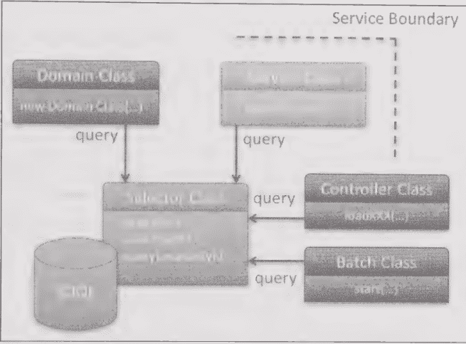

## 实现设计指南

选择器类中的方法封装了应用程序的常见 SOQL 查询，例如 `selectById`，以及更多与业务相关的方法，例如 `selectByTeam`。这有助于使用选择器类的开发人员识别出满足业务需求所需的正确方法，并避免在整个应用程序中复制 SOQL 查询。

每个方法还具有某些标准特征，例如无论调用哪个方法，查询所执行的 `SObject` 字段。总体目标是让调用者专注于返回的记录数据，而非数据如何从数据库读取。

## 命名约定

到现在为止，您对命名约定应该已经有所了解。选择器类和方法从其他层借鉴了指南，并进行了一些小调整。编写选择器代码时，请考虑以下命名约定：

- 类名称：命名选择器类时，通常遵循与域类相同的约定，采用与其关联对象的复数名称并在末尾追加单词 Selector；不过，您可以将常见的跨对象查询分组到单个模块作用域类中：
  - 不良示例：RaceSQLHelper 和 SQLHelper
  - 良好示例：RacesSelector、DriversSelector 和 RacingAnalyticsSelector

- 方法名称：select 前缀是表达选择器方法共同目的的好方法，随后跟上所使用的主要条件和/或关系的描述。与服务和域方法一样，避免重复类名中已使用的术语：
  - 不良示例：getRecords、getDrivers、loadDrivers、selectDriversById 和 selectRacesAndContestants。
  - 良好示例：selectById、selectByTeam、selectByIdWithContestants 和 selectByIdWithContestantsAndDrivers。

- 方法签名：选择器方法通常返回 Map、List 或 QueryLocator，公开生成的 SObject，从而支持平台以及其他层（例如域类构造函数和批量 Apex）的批量化需求。方法参数反映 WHERE 子句的参数化方面；同样，在适用的情况下，这些参数也应批量化：
  - 不良示例：
    ```
    selectById(Id recordId)
    DriverSelector.select(Set<Id> teamIds)
    Database.QueryLocator queryForBatch(Set<Id> ids)
    ```
  - 良好示例：
    ```
    selectById(Set<Id> raceIds)
    selectByTeam(Set<Id> teamIds)
    ```

## 批量化

如您所见，基于方法命名和签名约定示例，与服务层和域层一样，重要的是要考虑到在大多数情况下，调用者都会希望遵循批量化最佳实践。请确保方法返回类型和参数类型是列表类型——例如 `Set`、`List`、`Map`、`QueryLocator` 或 `Iterator` 都可以使用。

## 记录顺序一致性

编写 SOQL 查询时，经常会忽略 `order by` 子句，这可能导致客户端/控制器开发人员自行实现排序。平台的默认顺序是非确定性的，尽管有时看起来反映插入顺序，因此缺少 `order by` 子句在测试中往往会被忽略。通过使用选择器，您可以对所有选择器方法应用默认排序。

> 返回 `Map<Id, SObject>` 而不是 `List<SObject>` 可能似乎有助于调用者处理信息。Apex 中的 Map 具有可预测的迭代器顺序，但文档中不清楚这是否是将项添加到映射时的顺序。如果您担心此问题，请记住，如果在选择器中使用 Map，则 `order by` 子句的结果可能会受到影响。鉴于通过将列表传递给 Map 构造函数即可轻松按 SObject ID 创建映射，因此通常最好将是否包装返回列表的选项留给调用代码。

## 一致查询字段

在同一个 Apex 执行中，尽可能避免多次重新查询相同的记录，这是一种良好做法。与其仅为了查询不同字段而为同一记录重复执行查询，不如对代码进行重构，以便将查询到的数据作为参数从一个方法传递到另一个方法，例如从服务方法传递到域方法。

然而，此做法可能会变得有问题，因为在使用 SOQL 时，开发人员必须在执行语句时明确列出所需的字段，通常只声明最近代码路径所需的字段。

后来，随着代码的演进，SObject 数据在方法之间传递，尤其是共享代码。如果尝试读取最初未包含在 SOQL 中的字段，可能会发生运行时异常。结果是相同的代码在一种场景下成功执行，但在另一种场景下失败，原因是针对相同数据的 SOQL 语句表达不一致。


例如，假设 Contestants.awardChampionshipPoint 域类方法已更新为同时使用 RaceTime__c 字段和 RacePosition__c 字段。此方法由 ContestantService 和 RaceService 类调用。暂不考虑 Selector 概念，对 ContestantService 进行如下更改即可完美满足此新需求：

```
Contestants contestants =
    new Contestants(
        [select Id, RacePosition__c, RaceTime__c
            from Contestant__c order by RacePosition__c]);
contestants.awardChampionshipPoints(uow);
```

但是，如果保持不变，RaceService 类中的以下代码会导致同一方法失败，并出现异常：SObject 行是通过未查询请求的字段的 SOQL 检索到的：Contestant__c.RaceTime__c：

```
List<Contestant__c> contestants = new List<Contestant__c>() ;
for(Race__c race :
    [select Id,
        (Select RacePosition__c from Contestants__r)
        from Race__c where Id in :ids])
contestants.addAll(race.Contestants__r);
new Contestants(contestants).awardChampionshipPoints(uow);
```

还要注意，此示例中缺少 order by 子句，而在上一个示例中已指定，因此在此情况下返回的记录顺序是非确定性的。最后两个示例说明，传递给共享域类 Contestants 的记录顺序可能因调用者而异。如果域类逻辑依赖于顺序，这可能会导致意外行为。

修复这些不一致性有两种可能的方法，但都不理想：

- 更新 awardChampionshipPoints 方法，使其执行自己的 SOQL 查询，并确保它始终能获取所需信息，而不论最初传递给域类构造函数的是什么。虽然这可能更具封装性，但在 SOQL 查询和性能方面却是浪费的。

- 在应用程序代码中搜索 SOQL 语句，并更新每个区域中的相应 SOQL 逻辑（包括关系子查询）。

当然，确保两个区域都有充足的单元测试和集成测试也能在一定程度上降低风险，但都无法真正提升性能或鼓励 SOQL 复用。Selector 模式的一个好处是封装一组常用字段列表，使 Selector 上的所有方法都返回填充了一组一致字段的 sObject，只要使用 Selector 来查询记录，这些字段就可以在整个应用程序代码中依赖。


> 在单个执行上下文中查询大量记录时，查询更多字段通常与保持低 **堆** 和/或 **视图状态大小** 的愿望背道而驰，尤其是当 Selector 返回要在 Visualforce 页面上显示的查询数据时。在本章后面的章节中，我们将看到如何使用 Apex 数据类仅表示查询的字段数据。

## Selector 类模板

Selector 类（与 Domain 类类似）利用继承来获取一些标准功能；在此情况下，基类是通过 **FinancialForce.com 企业 Apex 模式**库提供的，即 `fflib_SObjectSelector`。

基本示例如下：

```apex
public class RacesSelector extends fflib_SObjectSelector {
  public List<Schema.SObjectField> getSObjectFieldList() {
    return new List<Schema.SObjectField> {
      Race__c.Id,
      Race__c.Name,
      Race__c.Status__c,
      Race__c.Season__c,
      Race__c.FastestLapBy__c,
      Race__c.PollPositionLapTime__c,
      Race__c.TotalDNFs__c };
  }
  public Schema.SObjectType getSObjectType() {
    return Race__c.SObjectType;
  }
}
```

基类使用动态 SOQL 来实现本章中描述的功能。这可能带来的一个潜在缺点是，对字段的引用是在 Apex 编译器不知情的情况下进行的，因此，当您尝试删除或重命名字段时，不会收到给定字段已被引用的警告。为了避免这种情况，使用了对字段的 SObjectField 引用，它是通过写出 SObject 名称，后跟句点和字段名称来获得的。这有点像 SObject 类型上的静态属性。这种方法确保平台知道该类正在引用这些字段，即使它们是在动态 SOQL 上下文中使用。

使用这个最小示例，可以通过利用 `selectSObjectsById` 基类方法来执行以下标准查询。该方法获取前面方法提供的信息，动态构建 SOQL 查询，并通过 `Database.executeQuery` 执行：

```
List<Race__c> races = (List<Race__c>)
new RacesSelector().selectSObjectsById(raceIds);
```

请注意，`fflib_SObjectSelector.selectSObjectsById` 基类方法执行许多功能，将在本章后面描述。另请注意，创建了 Selector 实例但并未实际存储；使用实例可以继承基类行为。使用 Selector 实例的更多好处将在本章后面介绍，届时我们将讨论 **Selector 工厂**和测试。

前面的 Selector 方法示例动态创建了以下 SOQL。随着本章的深入，如何做到这一点将变得更加清晰：

```
SELECT
 Name, TotalDNFs__c, Status__c, Season__c, Id,
 PollPositionLapTime__c, FastestLapBy__c
FROM Race__c
WHERE id in :idSet ORDER BY Name
```

下表显示了 `fflib_SObjectSelector` 类的一些关键基类方法，这些方法可供 Selector 方法使用，也可以被重写。请注意，`getSObjectType` 和 `getSObjectFieldList` 方法是抽象的，因此至少必须按前面示例所示实现。

| 方法 | 修饰符 | 用途 |
| :--- | :--- | :--- |
| `getSObjectType` | abstract | 告知基类正在描述哪个 SObject |
| `getSObjectFieldList` | abstract | 返回构建此选择器类中使用的查询时使用的通用字段列表 |
| `selectSObjectsById` | public | 执行动态生成的 SOQL 查询，选择 `getSObjectFieldList` 方法指定的字段。 |
| `getOrderBy` | virtual | 可选择重写此项，以更改基类生成或执行的查询所应用的默认 order by。 |
| `getSObjectFieldSetList` | Virtual | 可选择提供字段集列表，供基类查询生成器在生成要查询的字段列表时考虑。 |
| `newQueryFactory` | public | 在执行之前，提供一种面向对象的方式来进一步自定义基类生成的查询。 |

以下章节将详细介绍这些方法。还请花一些时间探索基类代码中的其他方法和相关代码注释。

## 实现标准查询逻辑

之前的 Selector 使用示例要求将返回的列表强制转换为 `Race__c` 对象列表，这并不理想。为改进这一点，您可以轻松地向类添加一个新方法，以提供基类方法的更具体版本，如下所示：

```java
public List<Race__c> selectById(Set<Id> raceIds) {
	return (List<Race__c>) selectSObjectsById(raceIds);
}
```

因此，使用代码现在如下所示：

```
List<Race__c> races =
    new RacesSelector().selectById(raceIds);
```

## Selector 基类的标准功能

fflib_SObjectSelector 基类包含其他功能，以提供更多查询一致性和平台集成。这些功能适用于前述的 selectSObjectsById 方法以及您自己的方法。以下各部分将介绍这些功能中的每一项。

> 当然，您可以进一步扩展此基类的标准功能。也许您希望所有查询都要考虑某些内容，或者架构设计中有通用字段或方面，或者大多数 Selector 都有共同功能。在这种情况下，请创建自己的基类，并让 Selector 继承它，如下所示。

```
public abstract class ApplicationSelector
    extends fflib_SObjectSelector
{
    // Add your common methods here
}
public class RacesSelector
    extends ApplicationSelector
{
    // Methods using methods from both base classes
}
```

## 强制执行对象和字段安全性

Salesforce 要求开发人员在查询时实现对象读取安全性和字段级读取安全性检查。通常使用 SObjectDescribe 和 SObjectFieldDescribe Apex 运行时类型上的方法。以下各部分将介绍 fflib_SObjectSelector 基类在这方面的支持。

## 默认行为

默认情况下，fflib_SObjectSelector 基类中的基类方法会自动执行对象读取安全性。基类强制执行字段级读取安全性的功能也可用，但默认不强制执行。


在两种情况下，如果启用了强制执行，且未为 `getSObjectType` 和 `getSObjectFieldSetList` 方法中引用的对象或字段授予用户对象或字段级读取权限，则会抛出异常。

## 覆盖默认行为

在应用程序代码代表用户读取对象的情况下，您可能希望禁用上述默认强制执行。例如，代表用户读取赛事数据以更新应用程序的其他区域。此类访问通常称为系统级访问。在这些情况下，您可能不希望强制执行此检查。

在某些情况下允许此强制执行检查执行可能并不可取，因为如前示例所示，这会要求用户获得底层赛事数据对象的访问权限，才能使用读取但不向用户显示赛事数据的应用程序方面。禁用选择器默认行为的另一动机是，您希望在控制器逻辑中更显式地对这些检查进行编码。

SObjectSelector 类提供的构造函数参数允许每个 Selector 类控制是否启用安全强制执行。这也适用于任何实例化 Selector 类的代码，从而允许按用例为基础做出此决定，例如，当选择器在 Controller 类中使用时。

为了更轻松地在整个应用程序中配置 fflib_SObjectSelector 类，以及为建立共享或通用 Selector 逻辑代码的位置提供手段，可以按如下创建一个新基类：

```
public abstract class ApplicationSelector extends fflib_SObjectSelector {

    public ApplicationSelector() {
        this(false);
    }

    public ApplicationSelector(Boolean includeFieldSetFields) {
        // Disable the default base class read security checking
        // in preference to explicit checking elsewhere
        this(includeFieldSetFields, false, false);
    }

    public ApplicationSelector(
        Boolean includeFieldSetFields,
        Boolean enforceCRUD,
        Boolean enforceFLS) {
        // Disable sorting of selected fields to aid debugging
        // (performance optimisation)
        super(
            includeFieldSetFields, enforceCRUD, enforceFLS, false);
    }
}
```

前面的示例还利用了 `fflib_SObjectSelector` 基类的另一个配置参数，即 `sortSelectFields` 参数。此参数已添加，以便在构建 SOQL 查询时允许禁用字段名的排序。虽然这有助于调试，但确实会带来性能开销。出于向后兼容性考虑，基类保留此行为，但允许可选地禁用它。

因此，此应用程序中的 Selector 类改为扩展此类：

```
public class RacesSelector extends ApplicationSelector {
```

请注意，此方法要求开发人员独自承担实现对象和字段级安全检查的全部责任。这将在后面的章节中详细讨论。

## 排序

如前文所提及，为记录设置默认顺序对于避免平台 SOQL 引擎的随机非确定性行为非常重要。`selectSObjectById` 基类方法调用 `getOrderBy` 方法来确定用于对选择器返回的记录进行排序的字段。

默认行为是使用 `Name` 字段（如果可用，否则使用 `CreatedByDate`）。因此，之前的用法已经按 `Name` 排序，无需进一步编码。如果您希望更改此行为，请按如下所示覆盖该方法。此示例由 `ContestantsSelector` 类使用，以确保参赛者始终按赛季、赛事及其赛事名次的顺序查询：

```
public override String getOrderBy() {
    return 'Race__r.Season__r.Name, Race__r.Name, RacePosition__c';
}
```

在本章后面，您将看到如何构建自定义选择器方法；这些方法可以选择使用 `getOrderBy` 方法。这样，如果您希望，某些方法可以使用不同于默认值的 `order by` 子句。

## 字段集

如前一章所讨论，利用字段集平台功能是确保您的应用程序与应用程序用户期望的自定义能力高度一致的关键。但是，您可能会想知道这与查询数据有什么关系？嗯，尽管我们围绕此功能的大部分讨论将集中在 UI 环境中的使用，但订户组织中添加的其他自定义字段仍然需要被查询才能显示；否则，就会发生异常，就像您未能查询打包字段一样。

要使用此功能，您需要覆盖 `getSObjectFieldSetList` 方法，并使用 `includeFieldSetFields` 参数构建选择器。默认构造函数将此参数设置为 false，因此通常情况下，**字段集**字段不包括在内。以下示例假设 **Race** 对象上有一个名为 `SeasonOverview` 的字段集（包含在本章代码中）：

| 操作 | 字段标签 | API 名称 | 使用位置 |
| :--- | :--- | :--- | :--- |
| 编辑 | 删除 | 赛季概览 | fflib__SeasonOverview | 用于在赛季概览页面显示 Race 详细信息时。 |

以下代码说明了此功能的配置（请注意，基类中的逻辑还确保，如果订户将您自己的打包字段添加到字段集中，则此类字段仅添加到 SOQL 语句字段列表一次）：

```
public RacesSelector() {
    super();
}
```

```
public RacesSelector(Boolean includeFieldSetFields) {
    super(includeFieldSetFields);
}
```

```
public override List<Schema.FieldSet> getSObjectFieldSetList() {
    return new List<Schema.FieldSet>
    { SObjectType.Race__c.FieldSets.SeasonOverview };
}
```

### 多货币

如第 2 章“利用平台功能”中所述，启用和引用某些平台功能可能会在您的包中创建依赖项，要求您的客户在安装前也启用这些功能，这可能并不总是可取的。多货币就是其中一项功能。启用后，每个对象都会获得 CurrencyISOCode 字段；该字段随后也会出现在页面布局、报表等位置。Salesforce 确保订户在启用前充分了解其影响。

如果您想在应用程序中利用该功能（但不认为这会是所有客户都需要的功能），您可以使用动态 Apex 和动态 SOQL 引用此字段。正是在此方面，fflib_SObjectSelector 基类提供了一些帮助。

> 使用个人账户时，您可能希望考虑在此处描述的方法，因为只有在启用此功能的情况下，Account 对象上的某些字段才会存在。

如果您在 getSObjectFieldList 方法中明确列出了 CurrencyISOCode 字段，那么您将把代码及其所在的包绑定到此平台功能。相反，基类所做的是使用 UserInfo.isMultiCurrencyOrganization 方法动态地将此字段包含在其执行的 SOQL 查询中。请注意，您仍然需要使用动态 Apex 来检索字段值，如以下代码所示：

```
List<Team__c> teams = (List<Team__c>)
new TeamsSelector().selectSObjectsById(teamIds);
for(Team__c team : teams) {
  String teamCurrency =
    UserInfo.isMultiCurrencyOrganization() ?
    (String) team.get('CurrencyIsoCode') :
    UserInfo.getDefaultCurrency();
}
```

对于域逻辑，您可能希望在自己的域基类（例如上一章中描述的 ApplicationDomain 类）中放置一个通用方法。这样，您可以将前述三元运算符封装为单个方法。本章的示例代码包含 ApplicationDomain.getCurrencyCodes 方法，可按如下方式使用：

```
public override onBeforeInsert() {
    Map<Id, String> currencies = getCurrencyCodes();
    for(Team__c team : (List<Team__c>) Records) {
        String teamCurrency = currencies.get(team.Id);
    }
}
```

### 实现自定义查询逻辑

如果我们查看本章迄今一直使用的 selectSObjectById 基类方法的实现，则以下显示的 buildQuerySObjectById 方法代码说明了我们如何实现自定义选择器方法；它还突出了 newQueryFactory 基类方法的用法：

```
public List<SObject> selectsObjectsById(Set<Id> idSet) {
    return Database.query(buildQuerySObjectById());
}
private String buildQuerySObjectById() {
    return newQueryFactory().
        setCondition('id in :idSet').
        toSOQL();
}
```

newQueryFactory 方法暴露了一种面向对象的替代方式来表达 SOQL 查询。它遵循流畅设计模型，其方法使配置不那么冗长。有关此方法的更多信息，请参见 https://en.wikipedia.org/wiki/Fluent_interface。

由此方法返回的 fflib_QueryFactory 实例已预先配置为通过先前讨论的选择器方法表达的对象、字段、排序和任何字段集字段。如前所述，它还将强制启用安全性。因此，通常您只需通过 setCondition 方法提供 SOQL where 子句，如上一段代码所示。最后，toSOQL 方法返回传递给标准 Database.query 方法的实际 SOQL 查询字符串。


> fflib_QueryFactory 类方法提供了构建动态 SOQL 查询时使用标准字符串拼接或 String.format 方法的替代方案。fflib_QueryFactory 类的原始作者 Chris Peterson 创建它的动力在于，避免基于字符串的方法可能带来的脆弱性，并提供一种更易读的方式来理解此类代码的作用。此外，由于该类支持使用 SObjectField 引用，而非字符串中的字段名引用，因此此类代码不易受到 SOQL 注入漏洞的影响。

## 自定义 Selector 方法的基本示例

首先，我们来看一个基本示例，该示例根据分配给 Driver__c 的团队进行查询。按照指南，参数已批量化，如果需要，允许你查询多个团队中的驱动程序。

```
public List<Driver__c> selectByTeam(Set<Id> teamIds) {
    return (List<Driver__c>)
    Database.query(
    newQueryFactory().
    setCondition('Team__c in :teamIds').
    toSOQL();
    }
```

通过使用 newQueryFactory 方法，fflib_QueryFactory 实例已预先填充了选择器指定的字段列表、对象名称和 order by 子句的知识。因此，此 Selector 方法在已填充字段和返回记录的顺序方面表现一致。

## 带有子查询的自定义 Selector 方法

在以下示例中，查询使用子查询来包含子记录（在此示例中，Race 中的 Contestants）。关键点在于，RacesSelector 方法（如以下代码所示）重用 ContestantsSelector 类的实例来访问其字段列表并执行安全检查：

```
public List<Race__c> selectByIdWithContestants(Set<Id> raceIds) {
    fflib_QueryFactory racesQueryFactory = newQueryFactory();
    fflib_QueryFactory contestantsSubQueryFactory =
    new ContestantsSelector().
    addQueryFactorySubselect(racesQueryFactory);
    return (List<Race__c>) Database.query(
    racesQueryFactory.setCondition('Id in :raceIds').toSOQL();
}
```

前面的代码使用 fflib_SObjectSelector 方法 addQueryFactorySubselect。该方法创建一个新的 fflib_QueryFactory 实例，并将其传递给传入方法的查询工厂（在此示例中为 racesQueryFactory）。在外部查询工厂上调用 toSOQL 方法时，它会自动为任何包含的查询工厂生成子查询。

通过重用 ContestantsSelector 的实例，确保无论如何查询 Contestant__c 记录列表（直接查询或作为子查询的一部分），字段都能一致地填充。ContestantSelector 上的 getOrderBy 方法也被使用，以确保即使记录作为子查询的一部分返回，Contestant 记录的默认顺序也能保持不变。

让我们再看一下之前使用的示例，以说明此模式如何避免了不一致查询的风险。虽然 Contestant__c 记录来自两个不同的选择器（RacesSelector 和 ContestantsSelector），但由于前面的实现中重用了 ContestantsSelector 类，因此在已填充字段方面结果相同。

以下示例显示标准 selectById 方法被用于查询 Contestants，以便将其传递给 Contestants 域类构造函数，这是服务层实现中颁发冠军积分的一部分：

```
List<Contestant__c> contestants =
    new ContestantsSelector().selectById(contestantIds);
new Contestants(contestants).awardChampionshipPoints(uow);
```

以下替代示例显示 RaceSelector 上的自定义 selectByIdWithContestants 方法被用于查询 Races 和 Contestants，以便将其传递给 Contestants 域类构造函数以实现相同的结果：

```
List<Contestant__c> contestants = new List<Contestant__c>();
for(Race__c race :
    new RacesSelector().selectByIdWithContestants(raceIds)) {
    contestants.addAll(race.Contestants__r);
}
new Contestants(contestants).awardChampionshipPoints(uow);
```

在这两个示例中，无论记录是作为直接查询还是子查询来查询，字段和记录排序都是一致的。这让开发者更有信心使用最佳方法来查询当时所需的记录。

selectByIdWithContestants 方法生成以下 SOQL：

```
select
Name, TotalDNFs__c, Status__c, Season__c, Id,
PollPositionLapTime__c, FastestLapBy__c,
(select
Qualification1LapTime__c, ChampionshipPoints__c,
Driver__c, GridPosition__c, Qualification3LapTime__c,
RacePosition__c, Name, DNF__c, RaceTime__c,
Id, DriverRace__c, Qualification2LapTime__c, Race__c
from Contestants__r
order by Race__r.Season__r.Name, Race__r.Name,
RacePosition__c)
from Race__c where id in :raceIds order by Name
```

## 带有关联字段的自定义 Selector 方法

除查询子记录外，还可以使用 SOQL 字段点表示法来查询关联记录。这提供了一种额外的方式来优化查询其他记录信息，而无需进行额外查询。

以下是 ContestantsSelector 类的自定义 Selector 方法示例，其中查询 Contestant 记录及其关联 Driver 记录字段。生成的 Contestant__c 对象会公开 Driver__r 字段，该字段提供一个填充了 DriversSelector 中指定的 Driver__c 字段的 Driver__c 实例：

```
public List<Contestant__c> selectByIdWithDriver(Set<Id> driverIds) {
    fflib_QueryFactory contestantFactory = newQueryFactory();
    new DriversSelector().
    configureQueryFactoryFields(
    contestantFactory,
    Contestant__c.Driver__c.getDescribe().getRelationshipName());
    return Database.query(
    contestantFactory.setCondition('Id in :driverIds').toSOQL());
}
```

> fflib_SObjectSelector.configureQueryFactoryFields 方法将选择器字段添加到作为第一个参数传递的查询工厂中，使用第二个参数中指定的关系前缀。

由于上述代码中 ContestantsSelector 类方法重用了 DriversSelector，以下示例返回一致填充的 Driver__c 记录。这对于域类 Drivers.verifyCompliance 方法中包含的逻辑非常重要。这种灵活性允许以最佳方式查询 Driver__c 记录，并更安全地重用域类方法，而不考虑记录是如何查询的。

第一个示例使用 DriversSelector 类上的标准 selectById 方法的结果来构建 Drivers 域类：

```
List<Driver__c> drivers = new DriversSelector().selectById(driverIds);
List<ComplianceService.VerifyResult> results = new Drivers(drivers).verifyCompliance();
```

第二个示例实现相同结果，但通过 ContestantsSelector 类上的自定义 Selector 方法 selectByIdWithDriver 查询 Drivers 记录：

```
List<Driver__c> drivers = new List<Driver__c>();
List<Contestant__c> contestants = new ContestantsSelector().selectByIdWithDriver(contIds);
for(Contestant__c contestant : contestants)
    drivers.add(contestant.Driver__r);
List<ComplianceService.VerifyResult> results = new Drivers(drivers).verifyCompliance();
```

再次，这两个示例都表明，即使在 SOQL 中使用关联字段，生成的记录也可以与选择器表达的所需字段保持一致。selectByIdWithDriver 方法生成以下 SOQL：

```
SELECT Qualification1LapTime__c, ChampionshipPoints__c, Driver__c,
	GridPosition__c, Qualification3LapTime__c, RacePosition__c,
	Name, DNF__c, RaceTime__c, Id, DriverRace__c,
	Qualification2LapTime__c, Race__c,
	Driver__r.FIASuperLicense__c, Driver__r.Name,
	Driver__r.Id, Driver__r.Team__c
FROM Contestant__c
WHERE Id in :driverIds
ORDER BY Name
```


## 带有自定义数据集的自定义 Selector 方法

SOQL 拥有非常丰富的点号表示法，可在单个查询中遍历关系（查找）字段以访问相关记录上的其他字段。要以表格形式获取以下信息，需要遍历 FormulaForce 应用程序对象模式中许多对象上的关系：

- 赛季名称
- 赛事名称
- 赛车位置
- 车手姓名
- 车辆名称

首先，让我们考虑以下 SOQL，然后看看如何将它及其返回的数据封装在 ContestantsSelector 类方法中。请注意，此处也应用了常见的 order by 子句，就像前一个示例中一样：

```
select
    Race__r.Season__r.Name,
    Race__r.Name,RacePosition__c,
    Driver__r.Name,
    Driver__r.Team__r.Name,
    Car__r.Name
from
    Contestant__c
where
    Race__c in :raceIds
order by
    Race__r.Season__r.Name, Race__r.Name, RacePosition__c
```

此查询将导致部分填充的 Contestant__c 对象，不仅如此，关系字段还将公开部分填充的 Season__c、Car__c 和 Driver__c 记录。因此，这些只是简单返回到调用代码路径中的高度专业化记录实例。

以下代码展示了使用新 ContestantsSelector 方法的替代查询。与之前的方法最大的区别在于，它返回的是自定义 Apex 数据类型，而不是 Contestant__c 对象。您还可以看到，哪些信息可用、哪些不可用，要容易得多：

```
List<ContestantsSelector.Summary> summaries =
    new ContestantsSelector().
    selectByRaceIdWithContestantSummary(raceIds).values();
for (ContestantsSelector.Summary summary : summaries) {
    System.debug(
        summary.Season + ' ' +
        summary.Race + ' ' +
        summary.Position + ' ' +
        summary.Driver + ' ' +
        summary.Team + ' ' +
        summary.Car);
}
```

根据您的数据，这将输出类似于以下调试信息：

```
USER_DEBUG|[26]|DEBUG|2016 Spa 1 Lewis Hamilton Mercedes MP4-29
USER_DEBUG|[26]|DEBUG|2016 Spa 2 Rubens Barrichello Williams FW36
```

Selector 方法返回一个新的 Apex 内部类，该类使用 Apex 属性明确公开仅查询的字段信息，从而在 Selector 方法和调用者之间建立更清晰的契约。

现在不可能引用未查询的信息，当代码尝试引用未查询的字段时会导致运行时错误。以下显示了 Selector 使用的 Apex 内部类，用于明确公开自定义 Selector 方法查询的信息：

```
public class Summary {
    private Contestant__c contestant;
    public String Season {
        get { return contestant.Race__r.Season__r.Name; } }
    public String Race {
        get { return contestant.Race__r.Name; } }
    public Decimal Position {
        get { return contestant.RacePosition__c; } }
    public String Driver {
        get { return contestant.Driver__r.Name; } }
    public String Team {
        get { return contestant.Driver__r.Team__r.Name; } }
    public String Car {
        get { return contestant.Car__r.Name; } }

    private Summary(Contestant__c contestant) {
        this.contestant = contestant;
    }
}
```

Summary 类私有地包含查询数据的一个实例，因此不会占用额外的堆内存。它将信息公开为只读，并将构造函数设为私有，表明仅可通过 ContestantsSelector 类获得此类实例。

以下代码显示了执行实际查询的 Selector 方法：

```
public Map<Id, List<Summary>>
selectByRaceIdWithContestantSummary(Set<Id> raceIds) {

Map<Id, List<Summary>> summariesByRaceId =
new Map<Id, List<Summary>>();

for(Contestant__c contestant :
Database.query(
newQueryFactory(false).
selectField(Contestant__c.RacePosition__c).
selectField('Race__r.Name').
selectField('Race__r.Season__r.Name').
selectField('Driver__r.Name').
selectField('Driver__r.Team__r.Name').
selectField('Car__r.Name').
setCondition('Race__c in :raceIds').
toSOQL()))) {

List<Summary> summaries =
summariesByRaceId.get(contestant.Race__c);
if(summaries==null) {
summariesByRaceId.put(
contestant.Race__c, summaries = new List<Summary>());
summaries.add(new Summary(contestant));
}
}

return summariesByRaceId;
}
```

> 您可以利用 Apex Describe API 在前面的关系引用中添加编译时检查和引用完整性。例如，不要硬编码 Race__r.Name，而是可以使用以下内容：
> 
> Contestant__c.Race__c.getDescribe().
> getRelationshipName() + '.' + Race__c.Name

前面的代码显示 newQueryFactory 方法传入了 false。这指示基类不要用选择器字段配置返回的查询工厂。这使调用者可以使用 selectField 方法根据需要指定特定字段。

> 如果您正在实现一个引用本节中所述使用自定义数据集的自定义 Selector 方法的 Apex 接口，则应考虑将该类创建为顶级类。这可以避免接口和 Selector 类之间出现潜在的循环依赖。

## 将 Apex 数据类型与 SObject 类型相结合

可以在 Selector 方法的响应中将 Apex 数据类型与 SObject 数据类型相结合。只要返回 SObject 数据类型时，它们是根据相应 Selector 指示的字段填充的即可。

例如，假设我们想返回与 Contestant 对象关联的完整 Driver__c 记录，而不仅仅是 Driver 名称。对 Summary Apex 类的更改将是公开查询的 Driver__c 记录，这是安全的，因为它已根据 DriversSelector 填充。以下代码展示了如何修改 Summary 类以公开自定义 Selector 方法中查询的 Driver__c 记录：

```
public class Summary {
    public Driver__c Driver {
    get { return contestant.Driver__r; } }
    
    ... 
}
```

在此示例中，使用 DriversSelector 实例获取字段列表，并将其连同其他特定字段一起注入查询工厂：

```
fflib_QueryFactory contestantQueryFactory =
    newQueryFactory(false).
    selectField(Contestant__c.RacePosition__c).
    selectField('Race__r.Name').
    selectField('Race__r.Season__r.Name').
    selectField('Car__r.Name').
    setCondition('Race__c in :raceIds');

new DriversSelector().
configureQueryFactoryFields(
    contestantQueryFactory,
    Contestant__c.Driver__c.getDescribe().getRelationshipName());

Map<Id, List<Summary>> summariesByRaceId =
    new Map<Id, List<Summary>>();
for (Contestant__c contestant :
    Database.query(contestantQueryFactory.toSOQL())) {
```

## SOSL 和聚合 SOQL 查询

从数据库查询信息并非只有 SOQL 一种方式。Force.com 还提供了一个强大的 Salesforce 对象搜索语言（SOSL）设施。与 SOQL 类似，它也返回 SObjects。虽然本章没有深入介绍此变体，但使用封装 SOSL 的 Selector 方法是恰当的，实际上它为调用者提供了良好的抽象，允许 Selector 开发者在未来使用 SOQL 或 SOSL 而不影响调用者。

同样，聚合 SOQL 查询也是封装在 Selector 方法中的良好候选。然而，在这些情况下，请考虑使用 Apex 原生数据类型（例如，值列表）或自定义 Apex 数据类型列表来公开聚合信息。


> 本书的汇总源代码可在 GitHub 仓库的 master 分支中找到，其中包含 RaceDataSelector 类。在该类中，有一个名为 selectAnalysisGroupByRaceName 的自定义 Selector 方法，演示了 SOQL 聚合查询的用法。


## 介绍 Selector 工厂

上一章介绍了 **Domain 工厂** 的概念，它用于动态构建实现通用 **Apex 接口** 的 Domain 类实例，以实现合规框架。

以下代码用于 ComplianceService.verify 方法的实现中，完全不引用 Selector 类来查询构建适用 Domain 类所需的记录：

```
fflib_SObjectDomain domain =
Application.Domain.newInstance(recordIds);
```

那么，Domain 工厂是如何检索记录以将其传递给底层 Domain 类构造函数的呢？答案是它在内部使用了另一个名为 **Selector 工厂** 的工厂实现。

与 Domain 工厂类似，Selector 工厂作为 Application 类中的静态实例存在，通过 Selector 静态类成员公开，如下所示：

```
public class Application
{
    // Configure and create the SelectorFactory for this Application
    public static final fflib_Application.SelectorFactory Selector =
        new fflib_Application.SelectorFactory(
            new Map<SObjectType, Type> {
                Team__c.SObjectType =>TeamsSelector.class,
                Race__c.SObjectType =>RacesSelector.class,
                Car__c.SObjectType =>CarsSelector.class,
                Driver__c.SObjectType =>DriversSelector.class,
                Contestant__c.SObjectType => ContestantsSelector.class }});

    // Configure and create the DomainFactory for this Application
    public static final fflib_Application.DomainFactory Domain =
        new fflib_Application.DomainFactory(
            Application.Selector,
            // Map SObjectType to Domain Class Constructors
            new Map<SObjectType, Type> {
                Team__c.SObjectType =>Teams.Constructor.class,
                Race__c.SObjectType =>Races.Constructor.class,
                Car__c.SObjectType =>Cars.Constructor.class,
                Driver__c.SObjectType =>Drivers.Constructor.class,
                Contestant__c.SObjectType =>
                Contestants.Constructor.class}});
}
```

请注意，在前面的示例中，Selector 工厂被传递给了 Domain 工厂。以下各节概述了工厂上的方法及相关用例。

### SelectorFactory 方法

SelectorFactory 类有两个方法：newInstance 和 selectById。以下代码通过给出两个等效的用法示例来说明这两种方法，用于根据一组 ID 检索记录：

```
List<Contestant__c> contestants =
Application.Selector.selectById(contestantIds);
```

```
List<Contestant__c> contestants =
Application.Selector.newInstance(Contestant__c.SObjectType)
.selectSObjectsById(contestantIds);
```

如你从前面的代码中所见，selectById 方法提供了一种快捷方式，用于访问 fflib_IObjectSelector 接口中的通用 selectSObjectById 方法，如前面章节所示，该方法由 fflib_SObjectSelector 基类实现。因此，所有 Selector 类都保证提供该方法。它提供了一种更清晰的方式，以标准方式查询记录，而无需了解 Selector 的 Apex 类名称。这就是 Domain 工厂能够代表开发人员动态实例化加载了记录的 Domain 类实例的方式。

该方法在内部使用 Id.getSObjectType（针对传入的第一个 ID）通过先前定义的映射查找 Selector 类并将其实例化（通过 Type.newInstance）。

当你编写处理不同类型对象的通用代码时，会使用 newInstance 方法，而不是直接在 Selector 类中通过 new 运算符进行实例化。在其他情况下，你可以继续使用 new 运算符以正常方式实例化 Selector 类。

## 编写测试和 Selector 层

在专门为 Selector 类方法编写测试时，流程几乎与标准 Apex 测试准则一致；插入支持查询所需的数据，调用 Selector 方法，并断言返回的结果。你可以查看本章包含的一些 Selector 测试。

> 如果你已实现返回 QueryLocator 实例（供 Batch Apex 调用者使用）的 Selector 方法，你仍然可以断言这些方法的结果。使用 iterator 方法获取 QueryLocatorIterator，然后调用 next 和 hasNext 方法以返回结果传递给你的断言语句。

当然，围绕控制器、Batch Apex、Domain 和 Service 层的其他 Apex 测试也可能间接调用 Selector 方法，从而提供代码覆盖率，但不一定测试 Selector 类的每个方面。

> 请尽量确保你的 Apex 测试尽可能隔离地测试应用程序的各层和功能组件，以确保现有和未来的调用者不会遇到问题。

如前文所述，通常编写更隔离的 Apex 测试会变得更加困难，因为被测试的代码往往需要在数据库中设置记录。通过利用前文描述的 Selector 工厂选项，可以对 Selector 方法采用模拟方法，这有助于使编写更隔离且更丰富的组件或类级别测试变得更容易。我们将在后续章节中重新讨论此主题。

## 更新 FormulaForce 包

查看本章提供的更新代码并更新你的打包组织。执行另一次上传，并在测试组织中安装该包。安装期间，你应该会观察到本章添加的新字段集组件显示为升级中包含的新组件之一。

## 摘要

Selector 模式为应用程序中某些关键逻辑提供了一个强大的封装层。它有助于强制执行安全方面的最佳实践，并为处理 `SObject` 数据的代码提供更一致、更可靠的基础。

Selector 还可以承担平台功能（如 **多币种** 和 **字段集**）的职责和关注点。最终，这允许调用者——无论是 Service、Domain，甚至是 Apex 控制器或 Batch Apex——专注于其职责和关注点，从而产生更清晰、更易于维护和演进的代码。

随着 Selector 工厂的引入，我们提供了一种以 `Application.Selector.selectById` 和 `Application.Selector.newInstance` 方法形式访问该层的快捷方式，为更动态的场景（如上一章突出显示的合规框架）打开了潜力。

我希望用一张简单而生动的图表来结束本章系列，该图表展示了在 Domain 和 Selector 层的帮助下，Service 层代码如何协同工作。Force.com 上的这三种模式通过一致性为开发人员增加价值，并支持批量化和代码复用方面的最佳实践。


虽然这是最后一章，专注于 Martin Fowler 企业应用架构模式的 Force.com 实现，但我们将在后续章节中重新讨论 Selector 的角色，关注 Batch Apex，并继续在讨论应用程序集成的后续章节中利用我们的 Service 层。
