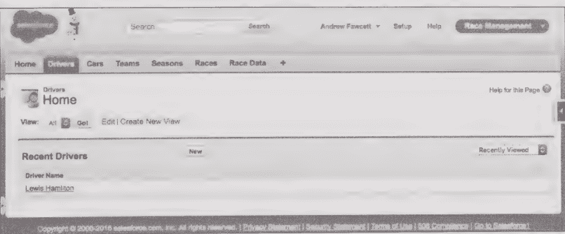
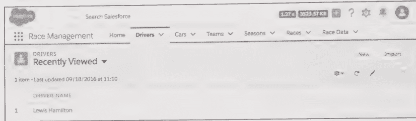
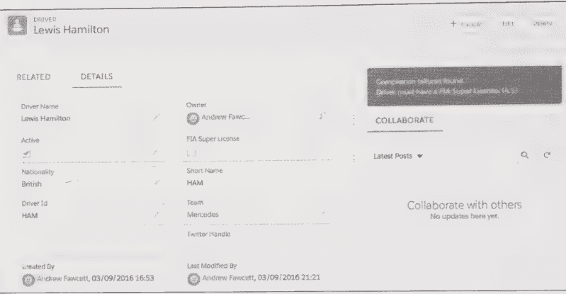
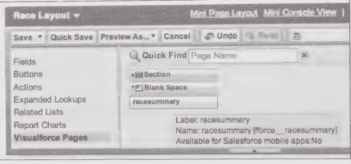
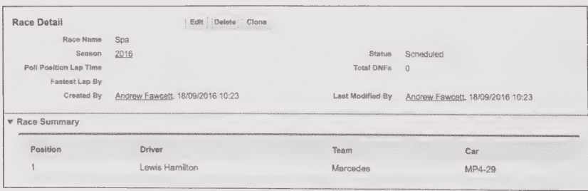
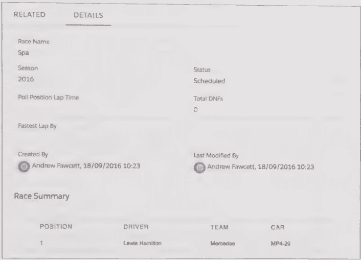
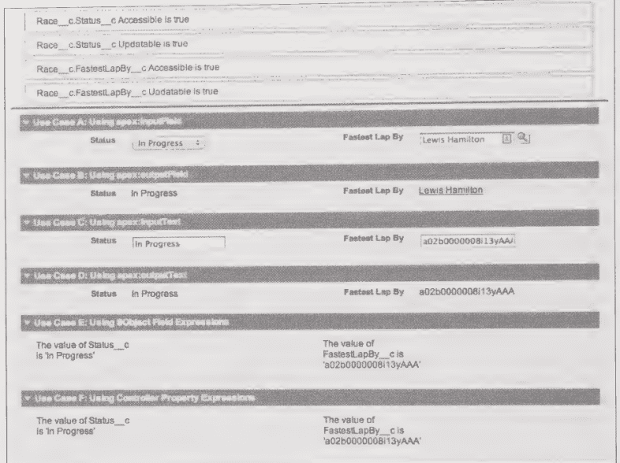
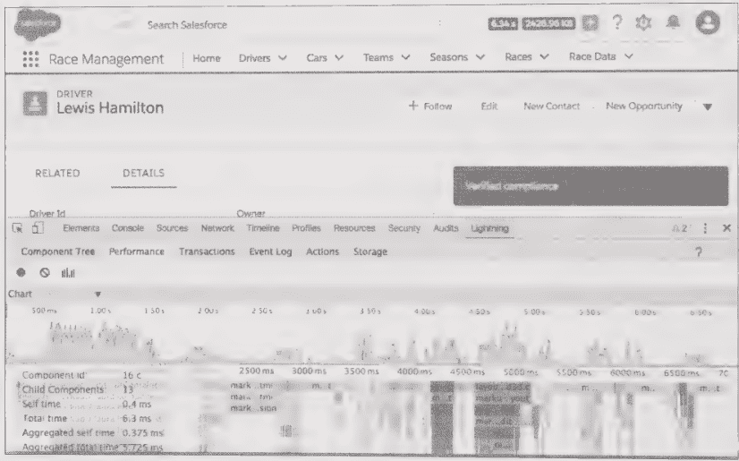

# 8 用户界面

如果要列举我职业生涯中出现又消失、周而复始的所有技术，我会说，那些影响最终用户体验的技术无疑是其中之一。做 UI 技术开发者是一份艰难的工作；从桌面端到 Web 端，再到移动端，乃至设备无关化的转变，让行业剧烈动荡，且这一局面仍在继续！这意味着，你对应用程序架构中这部分的投资至关重要，你在其中投入的逻辑也同样重要。如果在客户端层放入了不恰当的逻辑，可能会导致行为不一致，最糟糕的情况是，如果你未来决定更换客户端技术，将面临昂贵的重构工作。

本章讨论了为基于 Force.com 的应用程序交付用户界面的各个方面，如何充分利用 Salesforce 标准 UI，以及使用 Lightning 与 Visualforce 构建自定义 UI。它还讨论了使用第三方富客户端框架，对比其架构在平台功能和性能方面的优缺点。本章还介绍了如何使用 **Service 层** 和 **Domain 层** 模式，以确保无论采用哪种用户界面方式，你的用户与应用程序的交互都保持一致。本章将涵盖以下主题：

- 你应该针对哪些设备？
- 利用 Salesforce 标准 UI
- 生成可下载和可打印的内容
- 翻译和本地化
- 客户端与服务器通信
- 管理限制
- 对象级和字段级安全性
- 管理和监控 UI 响应时间
- 使用第三方 JavaScript 库的注意事项


- 为社区创建网站和面向外部的页面
- 移动应用程序
- 自定义报表和分析 API

## 应针对哪些设备？

在开发基于 Web 的应用程序时，历史上首先要问的问题之一是 _我们应支持哪些桌面浏览器和版本？_ 如今，你不应过多考虑用户笔记本电脑和台式机上安装的软件，而应考虑他们拥有的设备。

答案很可能仍然包含笔记本电脑或台式机，但不再是安全的假设，即这些是用户与你的应用程序交互的主要设备。手机、平板电脑、手表，或者 Alexa 等语音识别设备的技能，都可能被使用；或者，取决于你的目标市场，甚至可能是汽车或自动售货机等更大的设备！因此，请务必开阔思路，了解你的客户及其客户可能希望与你的应用程序交互的所有设备类型。

> 对于与你的 Force.com 应用程序交互的桌面和笔记本电脑用户，其使用的是标准 Salesforce UI 以及你可能使用 HTML 和 JavaScript 构建的任何自定义 UI 的组合。鉴于此，将支持的浏览器矩阵以 Salesforce 支持的浏览器为基础是个好主意。你可以通过在 Google 中搜索 _Salesforce supported browsers_ 来找到此信息。在撰写本文时，列出受支持浏览器的 PDF 可在 https://help.salesforce.com/apex/HTViewHelpDoc?id=getstart_browser_overview.htm&language=en 处找到。

针对多种设备开发可能成本高昂，不仅在于开发解决方案，还在于在多种设备上进行测试。在本章中，我们将探讨一系列选项，从 Salesforce 无需额外开发成本即可提供的选项，到使用 Visualforce、Lightning 和其他技术构建完全自定义的用户界面。

## 介绍 Salesforce 标准用户界面和 Lightning

选择有时是一件好事，但有时选择并不十分明确，尤其是在新技术出现并与现有技术重叠时。在本章和下一章中，我们将探讨帮助你在 Salesforce 提供的标准 UI、构建自己的自定义 UI，或者实际上平衡两者的使用之间做出选择的功能。随着 Salesforce 新 Lightning 技术的出现，决定为特定自定义 UI 使用什么技术需要一些考量。

Salesforce 历史上一直将 Visualforce 作为构建自定义 UI 的推荐技术。对一些开发人员来说，它类似于 Java Server Pages 或 .NET Active Server Pages，并且非常强大且稳定。它们还提供了大量方法，使用 Visualforce 构建的自定义 UI 来扩展其标准 UI，使你能够根据对特定用户角色最有效的方法，在更细粒度的功能级别上做出选择。

为了进一步使事情复杂化，Salesforce 的标准 UI 现在有不同的变体供用户选择。有 Salesforce1 应用程序，适用于移动设备，现在还有两个面向桌面用户的选项。Salesforce 的两个桌面 UI 现在分别称为 Salesforce Classic 和 Salesforce Lightning Experience。

FormulaForce 应用程序在 Salesforce Classic 标准 UI 中显示如下：



这是它在 Salesforce Lightning Experience 标准 UI 中的显示方式：



> 在 Lightning Experience 中，有更多选项可以为你的应用程序添加品牌标识。我们将在下一章进一步介绍这一点。

Lightning Experience（或简称 LEX）带来了一个完全新的客户端架构，这与它的前身（Salesforce Classic）和 Visualforce 所提供的服务器端渲染不同。为了向后兼容，Visualforce UI 仍可在 Lightning Experience 中使用，尽管在 LEX 中使用 Visualforce 不会提供使用 Lightning 框架构建的自定义 UI 所具有的可扩展性或视觉吸引力。

> LEX 为开发人员提供了更多扩展标准 UI 的集成点，减少了从头开始构建完全替代页面的需求。本章和下一章将更详细地探讨如何使用 Lightning 组件扩展 LEX 功能，从而降低你的开发成本，并让你的客户从 Salesforce 标准 UI 和定制工具中获得更多价值。

首次，开发人员现在可以使用 Salesforce 用于构建其基于 LEX 的应用程序的相同技术和主题，即 Lightning 框架。Salesforce 还选择将其 Lightning 使用的样式框架开源，即 Lightning Design System (LDS)。这已内置于平台中，如果你想在 Visualforce 或外部使用，它作为一组 CSS 文件可用（https://www.lightningdesignsystem.com/）。

## 为何还要考虑 Visualforce 而非 Lightning 框架？

那么，Visualforce 为何仍值得考虑？在撰写本书时，Lightning 框架在提供 Visualforce 已经具备的相同设施和组件方面正在迈出巨大步伐。但它还没有完全达到；有一些差距需要注意。

如果你是在 Lightning 出现之前就已经开发了 Force.com 应用程序，那么你仍然非常有兴趣利用 Visualforce，直到可以进行迁移。在这种情况下，你无疑也会有兴趣了解如何结合两种技术，以便你或许可以开始在 Lightning 框架中开发新功能。

在下一章中，我们将更详细地介绍如何平衡两种技术。目前，并且很可能在未来一两年内，随着采用率的提升，Salesforce Classic 和 Lightning Experience 将会共存。

## 利用 Salesforce 标准用户界面

Salesforce 在其桌面和移动端用户界面上投入了大量精力。这些声明式 UI 是首先看到进步的界面，例如能够嵌入报告图表。这些标准用户界面也是你的订阅者自定义你的应用程序外观的主要方法。此外，UI 将随着 Salesforce 的频繁更新而演变。在某些情况下，即使你没有更新你的应用程序，新功能也会对你的用户可用。


> 一般来说，在 Salesforce Classic 中已经利用了标准 UI 的应用程序方面，在 Lightning Experience 中无需更改即可正常工作，并且还会自动采用新的外观和感觉。但是，如果你已广泛使用 Visualforce，和/或使用了不支持的功能（例如 JavaScript 自定义按钮），则你将需要进行一些更改。仔细在 Lightning Experience 中测试和探索你的应用程序，以了解你需要做出哪些更改。在下一章中，我们将探讨这一过渡的关键方面以及平衡两种技术。

一般来说，你应该确保对于应用程序中的所有对象，你都能充分利用标准 UI，确保你的打包布局经过高度打磨，并充分利用每一项声明式功能。即使是那些可能通常通过 Visualforce 或基于 Lightning 的自定义 UI 访问的对象，也值得考虑这种做法。

将标准 UI 视为一种主要或默认 UI，还可以确保你的 Domain 类中的验证是完整的，这确保了无论数据以何种方式输入——自定义 UI、标准 UI 或 API——都不可能输入无效数据。

确保将你在自定义 UI 上执行的相同 UI 审查流程应用于标准 UI 布局。仔细审查字段标签、节、按钮名称和通用布局，同时寻找通过报告图表或嵌入自定义 UI（如本章后面所述）添加更多相关信息的选项。另外，考虑使用记录类型和不同的布局来帮助减少用户需要输入的字段数量。

> 请记住，打包在你的应用程序中的 Salesforce 布局不可升级，因为它们可以由订阅者编辑。因此，无论你在后续版本中对布局做出什么改进，这些改进都仅适用于新客户，而不适用于那些正在升级到应用程序较新版本的客户。布局的新方面通常在你的安装/升级文档中说明。

## 替换标准 Salesforce UI 操作

你可以使用自己的 Visualforce 页面替换对象的以下 Salesforce 标准 UI 操作：**接受**、**选项卡**、**克隆**、**删除**、**编辑**、**列表**、**新建**和**查看**，从而完全取代标准 UI 页面。这也会出现在 LEX 中。

> 替换查看操作时，还可以通过 **Lightning 应用构建器** 工具（在 **设置** 下）指定 Lightning 页面（也称为 FlexiPage）。在这种情况下，你分配的 Visualforce 页面仅在 Salesforce Classic 中显示，而 Lightning 页面将在 LEX 中显示。

请注意，如果你选择此选项，你不仅要承担确保添加到你的应用程序的新字段添加到这些页面的责任，还要承担随着 Salesforce 平台的发展，标准 UI 的新平台功能出现在你的页面中的责任。因此，在决定为适用操作打包和替换之前，请务必审查标准 UI 页面功能，并考虑下一小节中描述的混合方法。

如果你决定构建自定义 UI，保持一致性的最佳方法是使用 Salesforce 提供的标准 UI 组件。在 Visualforce 中，这些组件在 `apex` 命名空间中可用。在 Lightning 中，你可以利用 `lightning` 命名空间中的组件。无论哪种情况，你都可以使用 Lightning 设计系统来为自定义 UI HTML 元素设置样式。


使用 Salesforce 提供的组件并非完整解决方案；例如，除非开发者启用，否则 Chatter 不会自动出现在页面上。另一个重要注意事项是，添加到您对象中的自定义字段或相关列表（由订阅者添加的）在页面代码中需要特别考虑，以确保这些内容得以显示，例如通过使用字段集和 apex:relatedList 组件。

最后，请注意，虽然自定义对象操作覆盖（由您定义）可以打包，但它们不可升级，因此更改不会应用于现有订阅者。另外，如果订阅者希望通过标准 UI 访问自定义对象，他们可以在安装后移除这些覆盖，因此这是另一个理由，确保您将所有对象的标准 UI 视为标准实践。

作为覆盖现有标准操作的替代方案，请考虑创建自定义按钮，将其放置在对象的详细信息页面和/或列表视图布局上，并将按钮命名为类似“增强编辑”或“增强新建”的名称。自定义按钮在 Salesforce Classic 和 LEX 标准 UI 中均可用，用于调用 Visualforce 页面。但是，它们不支持您构建的基于 Lightning 的自定义 UI。要从 LEX 中的标准 UI 调用 Lightning 组件，您可以将其嵌入到 Lightning 记录页面布局中（如第 6 章“应用程序域层”所示），或使用 Lightning 组件操作（在第 9 章“Lightning”中讨论）。

## 将标准 UI 与自定义 UI 相结合

除非您的用户体验与标准 UI 提供的体验完全不同，否则请始终尽可能保留标准 UI。平台提供了多种方法来实现这一点，我们将在本章和下一章中探讨这些方法。在本节中，我们将探讨在标准 UI 的特定区域嵌入自定义 UI 部分以及反之亦然的方法。

## 在标准 UI 中嵌入自定义 UI

在第 6 章“应用程序域层”中，我们研究了一个可以放置在 Lightning 记录页面布局上的 Lightning 组件。此方法仅适用于 LEX，并且还提供一些额外优势，例如能够监听用户内联编辑记录详细信息时 LEX 触发的事件。此方法目前仅适用于查看记录详细信息的情况。

以下截图提醒您，**合规性验证**组件放置在 LEX 标准 UI 上时的外观：



现在让我们看看如何自定义同时适用于 Salesforce Classic 和 LEX 的标准 UI 的示例。通过在 Race 对象的详细信息页面布局中嵌入 Visualforce 页面（如以下截图所示）来实现。页面布局在 Salesforce Classic 和 LEX 中均可用。

以下 Visualforce 页面使用 `$User.UIThemeDisplayed` **全局变量**来相应地设置页面样式。它重复使用了上一章中的**扩展控制器**：

```apex
<apex:page standardController="Race__c" extensions="RaceSummaryController"
 action="{!loadSummary}">
<apex:slds/>
<apex:outputPanel
 rendered="{!$User.UIThemeDisplayed == 'Theme3'}">
<apex:pageBlock>
<apex:pageBlockTable value="{!Summary}" var="summaryRow">
<apex:column value="{!summaryRow.Position}">
<apex:facet name="header">Position</apex:facet>
</apex:column>
<apex:column value="{!summaryRow.Driver}">
<apex:facet name="header">Driver</apex:facet>
</apex:column>
<apex:column value="{!summaryRow.Team}">
<apex:facet name="header">Team</apex:facet>
</apex:column>
<apex:column value="{!summaryRow.Car}" >
<apex:facet name="header">Car</apex:facet>
</apex:column>
</apex:pageBlockTable>
</apex:pageBlock>
</apex:outputPanel>
<apex:outputPanel
rendered="{!$User.UIThemeDisplayed == 'Theme4d'}" >
<div class="slds">
<table
class="slds-table slds-table--bordered
slds-table--cell-buffer">
<thead>
<tr class="slds-text-title--caps">
<th scope="col">
<div
class="slds-truncate"title="Position">Position</div>
</th>
<th scope="col">
<div class="slds-truncate"title="Driver">Driver</div>
</th>
<th scope="col">
<div class="slds-truncate"title="Team">Team</div>
</th>
<th scope="col">
<div class="slds-truncate"title="Car">Car</div>
</th>
</tr>
</thead>
<tbody>
<apex:repeat value="{!Summary}" var="summaryRow" >
<tr>
<th scope="row"data-label="Position" >
<div
class="slds-truncate">{!summaryRow.Position}</div>
</th>
<td data-label="Driver" >
<div class="slds-truncate">{!summaryRow.Driver}</div>
</td>
<td data-label="Team" >
<div class="slds-truncate">{!summaryRow.Team}</div>
</td>
<td data-label="Car" >
<div class="slds-truncate">{!summaryRow.Car}</div>
</td>
</tr>
</apex:repeat>
</tbody>
</table>
</div>
</apex:outputPanel>
</apex:page>
```

由于该页面使用 StandardController，它会出现在布局编辑器中，并可以放置在布局上：



然后，您可以将其拖放到布局上的现有或新部分中。结果在 Salesforce Classic 中将类似于以下截图：



在 Salesforce LEX 中，页面如下截图所示：



在 Salesforce Classic 中，此方法仅适用于用户查看记录时的布局。但是，您可以通过此类 Visualforce 页面为用户提供编辑信息的途径，即使它们呈现在记录的查看页面上。但是，这样做时无法刷新主页面。虽然 Visualforce 页面的宽度会自动调整，但高度是固定的，因此请务必根据常见数据量进行相应设置。与 Salesforce Classic 不同，Salesforce LEX 中的用户在创建和编辑记录以及查看记录时，都会在布局中看到嵌入的 Visualforce 页面。请确保您的页面在 LEX 中预期这些场景，例如，在记录创建场景中，StandardController.getId 方法将返回 null，您的代码应相应地处理此情况。

## 在自定义 UI 中嵌入标准 UI

根据您使用的自定义 UI 技术，有不同的选项可以嵌入标准 UI 页面布局。请注意，执行此操作时，任何嵌入的 Visualforce 页面也会一同包含。

对于 Salesforce Classic，可以在 Visualforce 页面上使用 `apex:detail` 标签来呈现标准 UI 的大部分外观和感觉；请注意，当页面在 LEX 中显示时，它不会自动重新设置样式。该组件的粒度不够细；例如，您无法在其呈现的标准按钮旁边添加自己的按钮。这意味着您的页面按钮需要在页面的其他位置呈现，从而使 UI 看起来不一致且令人困惑。此外，该组件仅呈现记录布局的只读视图。在大多数情况下，本章前面描述的混合方法为大多数此类需求提供了更好的解决方案。

对于 Salesforce LEX，`force:recordEdit` 和 `force:recordView` 组件支持在使用 Lightning 组件构建的自定义 UI 中进行记录编辑和查看。与 Visualforce 中的 `apex:detail` 组件不同，不会呈现操作按钮。开发者负责通过触发 `recordSave` **Lightning 事件**来通知组件何时保存详细信息。当记录保存成功时，组件会响应 `onSaveSuccess` 事件。

## 扩展 Salesforce 标准 UI

前面的部分描述了一种在标准 UI 内嵌入自定义 UI 的方法，以便使用您自己的应用程序功能扩展 Salesforce UI。以下部分分别概述了 Salesforce Classic 和 LEX 中可用的进一步选项。某些功能在两者中都存在，而其他功能则在 LEX 中通过从不同区域嵌入和调用 Lightning 组件的能力进行了重新构思。

## Visualforce 页面

Visualforce 不仅是为您的应用程序创建全新页面的强大方式，而且还在多个位置增强了 Salesforce 用户界面。如我们迄今所见，您可以使用它来扩展标准 UI 布局和自定义按钮。以下是接受 Visualforce 页面的平台区域列表：

- 布局部分
- 自定义按钮
- 自定义选项卡
- 自定义选项卡闪屏页面
- Chatter 自定义发布操作
- 侧边栏组件
- 仪表板组件
- Force.com 网站


配置集和权限集也引用 Visualforce 页面；用户必须先获得页面访问权限，然后才能从这些区域使用它。

## 闪电组件

以下是接受闪电组件的平台区域列表：

- 记录页面
- 主页
- 闪电选项卡和页面
- 闪电组件操作
- Lightning Experience 工具栏
- Lightning 应用生成器
- Lightning 社区和社区生成器
- 面向 Visualforce 的 Lightning Out
- 面向任何应用的 Lightning Out

在第 6 章"应用程序域层"中，我们探索了将验证合规性闪电组件添加到记录页面。在下一章中，我们将构建一些新的闪电组件，以便更仔细地查看前面列表中的其他区域。您还应参阅 Lightning 开发者指南以获取完整详情。

## 生成可下载内容

contentType 属性允许您控制浏览器如何解释页面输出。使用该属性，例如，可以输出 CSV、JSON 或 XML 内容。使用控制器绑定，这可以是动态生成的输出。这对于生成要下载的内容非常有用。对 FormulaForce 应用程序所做的以下更改已包含在本章代码中：

- 向 RaceService 添加了新方法 generateSummaryAsCSV
- 向 RaceSummaryController 添加了新方法 getCSVContent
- 添加了新的 racesummary.aspx Visualforce 页面
- 向 Race 布局添加了新的自定义按钮"下载摘要"

新方法已添加到现有的 RaceSummaryController 类中，但仅由新页面使用。请随时查看新的服务方法；请注意，它还使用了前一章中引入的 ContestantsSelector.selectByRaceIdWithContestantSummary 方法。以下是调用该方法的新控制器方法：

```
public String getCSVContent() {
    return RaceService.generateSummaryAsCSV(
        new Set<Id> { standardController.getId() } );
}
```

> RaceService 类包含生成 CSV 文件的逻辑，而非控制器类。虽然乍一看您可能会认为这是控制器逻辑，但若从通用数据导出的角度考虑，未来也可能存在供外部开发者用于自动化 CSV 导出流程的 API 需求；因此，将此逻辑放置在服务层中有助于实现此目标。

新的 Visualforce 页面使用 contentType 属性，如下所示：

```
<apex:page
    standardController="Race__c"
    extensions="RaceSummaryController"
    contentType="application/csv#{!Race__c.Name} Race Summary">{!CSVContent}
</apex:page>
```

由于此页面使用标准控制器，因此可以创建自定义按钮；单击后，页面不会打开，浏览器会提示您下载文件：


按下"下载摘要"按钮会出现以下提示，以下载生成的 CSV 文件：


> 您可能注意到，在前面的 Visualforce 代码中，apex:page 的 contentType 属性包含 "#" 和一些文本。在内容类型后放置 # 符号后，您可以在文件下载时为用户指定默认文件名。还要注意，Visualforce 公式也可用于属性值，Race 名称正是以这种方式出现在文件名中。如果需要，这还允许您动态更改 contentType。

> 虽然此示例很好地说明了 contentType 属性，但应注意，平台报表引擎也支持 CSV 导出。因此，如果您正在考虑 CSV 导出功能，值得首先考虑让用户使用报表；这样，他们对输出拥有更多控制自由。

## 生成可打印内容

Salesforce 拥有内置的 PDF 生成引擎，可将您的 HTML 标记转换为 PDF。这是一项非常有用的功能，可用于生成发票或采购订单等更正式的文档。

您可以在 Visualforce 页面的 apex:page 元素上使用 renderAs 属性访问该功能，并将其设置为 pdf。请注意，通常应为此目的专门设置一个特定的 Visualforce 页面，而不是尝试在用于其他目的的页面上使用此属性。

> 请尽可能多地使用原生 HTML 和 CSS；Visualforce 标准组件在此模式下不一定能呈现良好。出于此原因，使用 standardStylesheets 属性禁用 Salesforce CSS 也很有用。

您还可以通过使用 PageReference.getContentAsPDF 方法并将生成的 PDF 附加到记录中以供将来使用，以编程方式访问此功能。如果您希望不使用 Visualforce 页面来生成 PDF 内容，可以以编程方式生成 HTML 并利用 Blob.toPDF 方法。第 2 章"利用平台功能"中已介绍翻译和本地化主题，因此我们不会在此处详细回顾。只需再次强调，从一开始就考虑翻译和本地化要求非常重要，因为事后添加这些功能可能代价高昂。另外，请注意，在前面的示例中，Visualforce 页面中使用了 $ObjectType 全局变量来访问列标题的 **自定义字段** 标签。确保您利用此类方法将减少需要创建的 **自定义标签** 数量，并最终降低翻译成本。

> > 闪电组件目前不支持 $ObjectType；作为替代方法，您可以使用 Apex Describe 通过 Apex 控制器公开此内容。

在 Visualforce 中，您可以使用 `apex:inputField` 和 `apex:outputField` 组件来呈现和接收用户输入，这些组件对区域设置敏感。在 Lightning 中，请使用 `lightning:formattedNumber` 和 `lightning:formattedDateTime` 组件。

## 替代页面语言

默认情况下，Visualforce 页面将通过用户的区域设置查找您在页面或 Apex 代码中引用的自定义字段标签和自定义标签的翻译文本。但是，如果您希望替代此设置，可以指定 `<apex:page language` 属性；例如，如果您希望使用 Visualforce 页面以不同语言生成简报，并在发送前预览它们，则非常有用。

> > 闪电组件没有等效功能；它们始终使用用户的语言。

这不适用于 `Name` 等描述性字段值或您添加到对象中的任何自定义描述字段。要为用户输入的数据提供翻译，您必须自行开发此类功能。平台不提供对此的支持。

## 客户端-服务器通信

从根本上讲，用户所选设备（客户端）与 Salesforce 服务器上可用的数据和逻辑之间的任何通信都使用 HTTP 协议进行。作为 Force.com 开发者，您很少会涉及向服务器形成正确的 HTTP POST 或 HTTP GET 请求并解析响应的底层工作。

例如，Visualforce 的 `apex:commandButton` 和 `apex:actionFunction` (AJAX) 组件非常出色地为您处理此问题，因此您只需使用这些组件，就可以以很少的努力调用 Apex 代码。Salesforce 还会为您处理安全方面的问题，确保用户已登录并拥有用于向服务器发出请求的有效会话。对于闪电组件，没有通过组件标记的直接等效组件。相反，可以从组件的客户端控制器方法调用 `$A.enqueueAction` JavaScript 方法来访问 Apex 代码。

取决于客户端代码运行的上下文，Force.com 提供了多种通信选项，用于对标准或自定义对象执行 CRUD 操作，以及/或调用您的应用程序的 Apex 代码以执行更复杂的任务。

重要的是，您应将逻辑正确地放置在域层和服务层中，以确保无论客户端通信选项如何，您的应用程序后端都能保持一致的行为，并且每个客户端都可使用相同级别的功能。本章的各个部分将展示如何确保，无论采用何种通信方法，这些层都能被有效重用并统一访问。

## 客户端通信选项

尽管即将到来的各个部分将更详细地讨论各种通信，但对其进行完整演练超出了本书的范围。Salesforce 文档和开发者网站提供了大量关于其使用的示例。

本章的目的是了解使用它们背后的架构决策、相关限制，以及每个选项如何与前几章中介绍的 Apex 代码层进行交互。


| 通信选项 | Visualforce页面 (1) | Lightning组件 | 自定义按钮或链接 | 网站 | 原生设备 UI (3) | API 限制 |
| :--- | :--- | :--- | :--- | :--- | :--- | :--- |
| Visualforce组件 (apex:commandButton, apex:actionFunction) | 是 | 否 | 否 | 是 (1) | 否 | 否 |
| Visualforce JavaScript Remoting (Apex代码) | 是 | 否 | 否 | 是 (1) | 否 | 否 |
| Visualforce JavaScript Remote Objects (CRUD操作) | 是 | 否 | 否 | 是 (1) | 否 | 否 |
| Salesforce REST / SOAP API (CRUD API、API SOAP和REST API、Analytics) | 是 | 否 (5) | 否 | 是 (2) | 是 | 是 |
| Salesforce 流式 API (对标准和自定义对象的读访问) | 是 | 否 (5) | 否 | 是 (2) | 是 | 是 |
| AJAX Toolkit (4) | 是 | 否 | 是 | 是 (2) | 否 | 是 |
| Lightning服务器端操作 @ AuraEnabled | 否 | 是 | 否 | 否 (6) | 否 | 否 |
| Lightning Data Services (CRUD访问) | 否 | 是 | 否 | 否 (6) | 否 | 否 |

以下注释适用于前面的表格：

- 1. 由于Visualforce页面本质上是由Salesforce服务器动态渲染的HTML页面，因此它们也可用于构建面向公众的网站，以及适应各种设备（如手机和平板电脑，前提是开发者进行了适当编码）的页面。Salesforce 流式API目前仅可通过JavaScript访问。

- 2. 使用传统的非平台语言（如.NET、Java、Ruby或PHP）构建的网站，必须仅通过REST/SOAP和流式API访问Salesforce。

- 3. 客户端是使用特定于设备的平台和UI技术构建的，例如使用Xcode、Java构建的原生移动应用程序，或原生包装的HTML5应用程序。

- 4. AJAX Toolkit是一个JavaScript库，用于从Visualforce或HTML页面访问Salesforce SOAP API。它是从JavaScript访问Salesforce对象和Apex Web服务的最古老方式。虽然可以从自定义按钮和Visualforce页面使用它，但我建议使用较新的Visualforce通信选项之一（通过将Visualforce页面与自定义按钮关联，而不是使用JavaScript）。Salesforce仅支持此库的最新版本，这也从侧面说明了他们对该库的承诺程度。

- 5. Lightning利用**W3C**推荐的`Content-Security-Policy` HTTP标头。这控制资源如何（使用HTTPS）以及从何处（仅Lightning域）从服务器加载。由于Salesforce API从不同域提供，因此无法直接从Lightning组件内的JavaScript代码调用它们。相反，必须从组件的Apex控制器在服务器端调用这些API。

- 6. **Lightning Out**是一项技术，允许将Lightning组件托管在外部网站上。在Lightning Out中运行的组件仍然可以使用Lightning服务器端操作和Lightning Data Services与后端通信。请注意，编写本文时，Lightning Data Services仅处于开发者预览阶段。

## API限制器和可用性

如前表所示，对于某些通信方法，Salesforce当前限制了在滚动24小时内可发出的API请求数量（尽管可以通过Salesforce支持进行扩展）。这可以在**设置**下的**公司信息**页面上的**API请求，过去24小时**和**流式API事件，过去24小时**字段中查看。

请注意，这些不像其他限制器（如SOQL和DML限制器）那样受你的应用程序命名空间限制。因此，访问订阅者组织的其他客户端应用程序可以消耗，并因此与你的应用程序争夺此资源。如果可能，请使用前表中列出的不消耗API限制的通信方法。如果无法避免，请确保监控客户端发出的请求数量，并在可能的情况下使用关系查询和/或Apex调用对其进行聚合。

> 如果你计划面向专业版，请务必与你的合作伙伴客户经理讨论API使用情况。在使用Salesforce SOAP/REST API、流式API和AJAX Toolkit等API时，此版本Salesforce中的可用性与其他版本不同。如需最新信息，还可以查阅ISVforce指南中“组和专业版的API访问”部分，网址为 https://na1.salesforce.com/help/pdfs/en/salesforce_packaging_guide.pdf。

## 数据库事务范围和客户端调用

如第4章“Apex执行和关注点分离”中所述，事务上下文涵盖从客户端向Salesforce服务器发出请求的执行上下文。使用JavaScript编写客户端代码时，使用基于CRUD的通信选项（如Visualforce JavaScript Remote Objects、Lightning Data Service和Salesforce API）时要小心，因为客户端的执行范围不会转化为服务器上的单个执行范围。

客户端执行的每个CRUD操作都在其自身执行范围（因此也是其自身事务）中进行。这意味着，如果客户端代码在用户交互过程中中途出错，则对数据库的先前更改不会回滚。要将多个CRUD操作封装在单个数据库事务中，请在Apex中实现逻辑，并通过之前提到的任一方式调用它，例如Visualforce JavaScript Remote Actions或Lightning服务器端操作。请注意，从面向服务的应用程序设计角度来看，这通常也是一种良好的实践。

## 离线支持

Visualforce apex:page元素上的manifest属性是HTML5标准的一部分，用于支持离线网页。尽管其用法的完整讨论超出了本书范围，但需要牢记一点是，你在浏览器本地离线存储中存储的任何信息都不安全。该属性要求使用docType属性来指示页面输出符合HTML5标准。

但是，Salesforce引入此功能主要是为了支持**混合**移动应用程序，旨在在支持离线模式的原生移动应用程序容器中使用Visualforce页面。在任何其他上下文中均不受支持。在此情况下，离线内容存储在移动应用程序自身的私有存储区中。

在Salesforce Mobile SDK的上下文中，混合移动应用程序是指使用一个在移动设备上托管移动浏览器的小型原生应用程序，然后利用Salesforce的登录页面和Visualforce页面来交付应用程序。通常，这需要网络连接；然而，借助manifest属性，可以实现离线支持。

> Lightning组件目前无法控制此属性，因为它们不拥有页面。实现此属性的责任在于Salesforce1和Salesforce LEX标准UI。Salesforce1 Mobile在记录编辑方面确实支持一些离线功能；然而，目前对基于Visualforce或Lightning的自定义UI不支持。

## 管理限制

通常，在单个控制器执行上下文中检索的记录总数为50,000条（所有执行的SOQL查询总计）。此外，诸如`apex:dataTable`和`apex:repeat`之类的Visualforce组件只能迭代1000个项目，之后将引发运行时异常。

编写本文时，`readonly`属性（在`apex:page`组件上指定）将此更改为页面中Visualforce组件内100万条记录和10,000次迭代（有关最新更新，请参阅Salesforce文档）。顾名思义，数据库不能发生任何更新，基本上意味着根本不允许DML操作。请注意，查询仍受超时限制。

> 如果需要更精细地提高SOQL查询行限制器，可以将@ReadOnly Apex属性应用于控制器中的JavaScript Remoting方法，而不像之前描述的那样应用于页面级别。同样，此方法无法使用DML操作更新数据库，但你将能够查询更高数量的查询行。请注意，在此上下文中不适用迭代器限制增加，因为JavaScript Remoting和Visualforce迭代器组件不能一起使用。


编写本文档时，Lightning 组件不提供对此功能的访问权限。通过 @AuraEnabled 方法公开的 Apex 控制器方法受标准 Apex 查询限制的约束。

## 对象和字段级安全

公开 SObject 信息的 Visualforce 页面（无论是通过标准、自定义还是扩展控制器）在使用直接引用 SObject 字段的组件或表达式时，可以利用内置的 **字段级安全强制执行**；此类用法将遵守用户的字段级安全。但是，通过控制器属性引用 SObject 字段的 Visualforce 表达式不受影响，因为 Visualforce 引擎无法判断控制器属性是否反过来引用 SObject 字段。

Lightning 目前不提供对对象级和字段级安全敏感的组件。相反，您必须通过 Lightning 服务器端操作将权限通知客户端控制器，该操作利用 **Apex 描述** 获取正在访问的信息。然而，**Lightning 数据服务** 组件（编写本文档时为开发者预览版）不仅支持对象和字段安全，还支持共享规则。*开发者预览版*状态意味着无法打包使用它的组件。

## 在 Visualforce 中强制执行安全

使用 Visualforce `apex:inputField` 和 `apex:outputField` 组件时，字段（包括标签，如果存在）将相应地隐藏或设置为只读。一个不太为人知的事实是，直接的 SObject 字段表达式也受字段级安全的影响；例如，如果用户对 `Status__c` 字段没有读取权限，`{!Race__c.Status__c}` 不会被求值（页面上不会输出任何内容）。此行为特别微妙，文档中也未详细说明。

文档指出，使用 `apex:inputText` 和 `apex:outputText` 等组件时，这些组件不会强制执行字段安全。虽然这是正确的，但安全始终也应用于 SObject 字段表达式。因此，如果字段不可见（而不仅仅是只读），即使是 `apex:outputText` 组件也不会显示值。但是，如果字段是只读且与 `apex:inputText`（例如）一起使用，它将呈现为可编辑字段。因此，这里的一般准则是，如果您有 SObject 字段表达式，请使用推荐的 `apex:inputField` 和 `apex:outputField` 组件。

一个常见的混淆点是在关联控制器上使用 `with sharing` 和 `without sharing` 关键字。这些关键字对字段级安全的强制执行完全没有影响；它们纯粹确定记录可见性，因此仅影响控制器内部以及由该控制器调用的其他执行 SOQL 查询的 Apex 类中所做的 SOQL 查询。

除了在控制器代码中使用 Apex 之外，您还可以使用 `$ObjectType` 全局变量直接确定字段的可访问性。例如，您可以使用以下表达式根据给定字段的安全性隐藏整个节。`{!$ObjectType.Race__c.fields.Status__c.Accessible}`。

以下 Visualforce 页面及其关联的自定义控制器说明了字段级安全。在所示用例中，使用了两个用户，一个具有完全访问权限，另一个已通过其配置文件获得以下权限：

- 对 `Status__c` 字段具有只读访问权限
- 对 `FastestLapBy__c` 字段完全无访问权限

首先，查看 Visualforce 页面；每个部分显示以下用例：

- 用例 A 展示 `apex:inputField` 的使用
- 用例 B 展示 `apex:outputField` 的使用
- 用例 C 展示 `apex:inputText` 的使用
- 用例 D 展示 `apex:outputText` 的使用
- 用例 E 展示 SObject 字段表达式的使用
- 用例 F 展示控制器属性表达式的使用

为了方便比较，页面上会显示消息以确认字段访问级别。FLSDemoController 包含在本章的示例代码中；它仅读取您组织中的第一个 Race__c 记录。它公开两个字符串属性，间接公开 Status__c 和 FastestLapBy__c 字段值。以下显示了用于说明针对当前用户权限使用不同 Visualforce 绑定和组件的效果的 Visualforce 页面：

```
<apex:page controller="FLSDemoController" tabStyle="Race__c">
<apex:form>

<apex:pageMessage summary="Race__c.Status__c Accessible is
{!$ObjectType.Race__c.fields.Status__c.Accessible}"
severity="info"/>
<apex:pageMessage summary="Race__c.Status__c Updatable is
{!$ObjectType.Race__c.fields.Status__c.Updateable}"
severity="info"/>
<apex:pageMessage
summary="Race__c.FastestLapBy__c Accessible is
{!$ObjectType.Race__c.fields.
FastestLapBy__c.Accessible}"
severity="info"/>
<apex:pageMessage
summary="Race__c.FastestLapBy__c Updatable is
{!$ObjectType.Race__c.fields.
FastestLapBy__c.Updateable}"
severity="info"/>
<apex:pageBlock>

<apex:pageBlockSection
title="Use Case A: Using apex:inputField">
<apex:inputField value="{!Race.Status__c}"/>
<apex:inputField value="{!Race.FastestLapBy__c}"/>
</apex:pageBlockSection>

<apex:pageBlockSection
title="Use Case B: Using apex:outputField">
<apex:outputField value="{!Race.Status__c}"/>
<apex:outputField value="{!Race.FastestLapBy__c}"/>
</apex:pageBlockSection>

<apex:pageBlockSection
title="Use Case C: Using apex:inputText">
<apex:inputText value="{!Race.Status__c}"/>
<apex:inputText value="{!Race.FastestLapBy__c}"/>
</apex:pageBlockSection>
```

```
<apex:pageBlockSection
 title="Use Case D: Using apex:outputText">
<apex:outputText value="{!Race.Status__c}"/>
<apex:outputText value="{!Race.FastestLapBy__c}"/>
</apex:pageBlockSection>
```

```
<apex:pageBlockSection title="Use Case E: Using SObject Field Expressions">
The value of Status__c is '{!Race.Status__c}',
The value of FastestLapBy__c is '{!Race.FastestLapBy__c}',
</apex:pageBlockSection>
```

```
<apex:pageBlockSection title="Use Case F: Using Controller Property Expressions">
The value of Status__c is '{!Status}',
The value of FastestLapBy__c is '{!FastestLapBy}'
</apex:pageBlockSection>
</apex:pageBlock>
</apex:form>
</apex:page>
```

对于具有完全访问权限的用户，该页面显示如下：



以下屏幕截图和说明确认了页面对权限有限用户的反应和显示方式；该页面显示某些信息按预期隐藏或只读，但并非全部，例外是用例 C 和用例 F：

- 对于用例 C，该字段是只读的，因此其值可访问并放置在输入字段中。由于它是 `apex:inputText` 字段，它不遵守字段的字段级安全状态，并且在不应该可编辑时该字段是可编辑的。

- 对于用例 F，将显示 FastestLapBy__c 字段值，因为它没有使用 SObject 字段绑定；它使用的是控制器属性绑定，该绑定间接公开了字段值。在这种情况下，责任在于开发人员在控制器代码中检查字段级安全。

| 项目 | 详情 |
| :--- | :--- |
| Race__c.Status__c Accessible | 为 true |
| Race__c.Status__c Updatable | 为 false |
| Race__c.FastestLapBy__c Accessible | 为 false |
| Race__c.FastestLapBy__c Updatable | 为 false |
| 用例 A: 使用 apex:inputField | 状态：进行中 |
| 用例 B: 使用 apex:outputField | 状态：进行中 |
| 用例 C: 使用 apex:inputText | 状态：进行中 |
| 用例 D: 使用 apex:outputText | 状态：进行中 |
| 用例 E: 使用 SObject 字段表达式 | Status__c 的值为“进行中” |
| 用例 F: 使用控制器属性表达式 | Status__c 的值为“进行中” |

## 管理性能和响应时间

解决方案中的响应时间会对应用程序的可用性产生很大影响。本节提供有关如何监控和管理 Lightning 和 Visualforce 中响应时间的信息。


## 监控大小和响应时间的 Lightning 工具

在 Lightning 中，监控组件层次结构的复杂性非常重要。虽然出于关注点分离的原因进行组件化是件好事，但过度组件化会导致组件树过于臃肿，进而造成性能不佳。Salesforce 提供了一款名为 Lightning Inspector 的优秀工具，可让你深入了解组件层次结构以及每个组件的渲染时间。你可以从 Google Chrome 应用商店下载并安装此工具。

下面展示了 FormulaForce 应用程序的示例截图：



你可能还注意到，LEX 在页眉中显示页面大小和响应时间：


## Visualforce 视图状态大小

《Visualforce 开发者指南》中有一个名为“改进 Visualforce 性能的最佳实践”的章节，其中介绍了确保页面保持响应的几种优秀方法。我强烈建议你花时间通读。不过，该主题中有一个点我想在本节进一步阐述：

> "如果你的视图状态受到大型组件树的影响，请尝试减少页面依赖的组件数量。"

这种情况会导致响应时间变差，即使在文档中描述的其他方面都已正确优化的页面也是如此。其原因在于 Salesforce Visualforce 组件的内部开销，即内部视图状态，当页面上存在许多此类组件（通常出现在表格或 apex:repeat 场景中）时，该开销会增加。

取决于你的 Visualforce 页面设计，它通常所占比例可能超过开发者通过控制器属性和成员变量显式放入视图状态的数据。两者共同导致达到 145 KB 的视图状态大小限制，不过在达到此限值之前，较大的视图状态也可能影响响应时间。

## 管理大型组件树的注意事项

在设计包含原生 Visualforce 组件的表格或重复部分的 Visualforce 页面时，需考虑以下几点：

- 仅当页面中包含 `apex:form` 标签时才会生成视图状态；如果不需要，则应将其删除，例如在仅查看的页面上。
- 考虑是否需要使用 `apex:outputField` 等 Visualforce 组件，或者直接使用带有 Visualforce 表达式的 HTML 元素是否足够。HTML 元素不消耗视图状态。不过在这样做时，需谨慎考虑标准组件提供的本地化功能，例如日期和数字格式化；你可能需要在 Apex 代码中执行此操作，并绑定到格式化后的值。
- 避免包含 Visualforce 组件的嵌套 `apex:repeat` 标签。如果可能，请在控制器的 Apex 逻辑中展平嵌套结构，并暴露一个单一的可迭代列表属性，以产生相同的输出。
- 考虑转向如下一节所述的无状态控制器模式。
- 考虑在页面中实现分页。

> 如需进一步分析，请在 http://salesforce.stackexchange.com/ 上搜索 'How to reduce a large internal view state / what is in the internal view state?'

## 使用 Service 层和数据库访问

与你在前面章节中看到的 Visualforce Apex 控制器操作方法一样，Service 层也设计为可从 Visualforce JavaScript Remoting 方法调用，如下所示：

```apex
public with sharing class RaceResultsController {
    @RemoteAction
    public static List<RaceService.ProvisionalResult>
    loadProvisionalResults(Id raceId) {
        return RaceService.calculateProvisionResults(
            new Set<Id>{ raceId }).get(raceId);
    }
}
```

要让 Lightning 组件控制器对 Apex 进行服务器端调用，请使用 @AuraEnabled 注解方法：

```apex
public with sharing class RaceResultsController {
    @AuraEnabled
    public static List<RaceService.ProvisionalResult>
    loadProvisionalResults(Id raceId) {
        return RaceService.calculateProvisionResults(
            new Set<Id>{ raceId }).get(raceId);
    }
}
```

```apex
public class ProvisionalResult {
    @AuraEnabled
    public Integer racePosition {get; set;}
    @AuraEnabled
    public Integer contestantId {get; set;}
    @AuraEnabled
    public String contestantName {get; set;}
}
```

不过，在这两种情况下，都没有 try/catch 块，因为错误处理由客户端代码负责渲染消息。当抛出异常时，平台会负责捕获异常并将其传回给调用的 JavaScript 代码，以便相应地显示。简而言之，无需自行发明错误消息处理系统；只需让平台将其传回给客户端 JavaScript 代码即可。不过请记住，你仍需在客户端 JavaScript 逻辑中处理错误消息；Visualforce 不会为你完成此操作。

## 客户端逻辑和 Service 层逻辑的注意事项

通过 JavaScript 在客户端添加更复杂的逻辑时，需要更加关注关注点分离。以下几点提供了相关指导：

- 每个远程方法调用一个服务方法：在控制器上开发远程方法时，仍应遵循单个 Service 层方法调用规则。如果正在调用多个 Service 层方法，这表明应创建并调用一个新的聚合 Service 层方法，而不是直接调用多个。
- 避免远程客户端偏见：不要仅为了迎合 JavaScript Remoting 控制器方法的需求（即 JavaScript 客户端的需求）而设计 Service 层。始终将 Service 层视为与客户端无关；如果你以后还想将 Service 层作为 API 暴露给应用程序，这一点尤为重要。
- Apex 枚举类型：如果你在 Service 层设计中使用 Enum 类型（老实说，为什么不使用呢？），它们非常具表现力且自文档化！不过，不幸的是，目前 JavaScript Remoting JSON 反序列化器不支持它们，这意味着你可以返回包含它们的 Apex 数据结构，但无法从客户端接收它们（会发生平台异常）。

解决方法是：要么不使用枚举，改用字符串数据类型；要么在控制器类中创建 Apex 类数据类型，并在这些类型与 Service 类型之间执行自己的封送处理（利用 `Enum.name()` 方法将枚举映射到字符串值）。选择取决于你是否希望保护 Service 层中对枚举的使用（尤其是如果它是面向公众的 API），以及所涉及的工作量。希望 Salesforce 将来能够修复此问题。

## 何时应使用 JavaScript 进行数据库访问？

JavaScript Remote Objects 和 Lightning Data Service 旨在暴露一个类似 "SOQL 和 DML" 的 API，供 Visualforce 页面或 Lightning 组件中嵌入的 JavaScript 代码使用。这提供了一种查询和更新数据库的方式，无需经过传统的 AJAX Toolkit 或会计入每日 API 限额的 Salesforce REST API。

《Visualforce 开发者指南》中有一个出色的主题，介绍了使用此功能的最佳实践，标题为“使用 Remote Objects 的最佳实践”，我强烈建议你通读并全面消化。《Lightning 组件开发者指南》中也有描述 Lightning Data Service 的示例。本节中我想强调的主要方面是与保持良好的关注点分离密切相关的事务边界。

切勿在单个 JavaScript 代码块中调用多个数据库操作，因为每个操作都将在其自身的 Salesforce 执行上下文中执行，从而在各自的事务中运行。这意味着，如果 JavaScript 代码中发生错误，先前的操作不会被回滚。

如果你发现自己处于这种情况，那么很可能应该将此类代码放置在应用程序的 Service 层中，并使用 JavaScript Remoting 调用该 Service 层方法，这样操作就会在单个事务范围内发生。


话说回来，如果您的用例会导致单个数据库操作，那么您当然可以考虑使用此功能，放心地确信您的 Apex Trigger 和 Domain 层代码将继续强制执行您的数据验证和完整性。

最后，请注意，从 JavaScript 查询记录不会调用您的 Selector 代码。因此，客户端上生成的 SObject 记录中查询和填充的字段在 JavaScript 代码的所有情况下并不总是相同的。

## 使用 JavaScript 库的注意事项

如已讨论，您越是朝着无状态控制器和 JavaScript Remoting 客户端架构发展，就越需要投资提供或获取 Salesforce 当前未提供的客户端组件。

请按具体情况仔细考虑此决定（并非您应用程序的所有 UI 都必须采用相同方法），并确保您理解所放弃的平台功能的价值。请预期要调整对客户端开发人员速度的预期，使其与其他平台开发人员更加一致。

例如 jQuery 之类的库提供了大量的便利性、灵活性以及社区中可用的组件，可以作为 Visualforce 组件的一些替代和改进，此外还有网格和树等较大组件。更进一步，Sencha ExtJS 之类的较大商业库也可在 Visualforce 页面中使用，包括 jQuery Mobile 和 Sencha Touch 等移动变体。

> Lightning 在您的组件周围实现了一个名为 Locker Service 的安全层。它会阻止 eval，强制使用严格模式，并限制访问组件自身边界之外的 DOM。请检查您打算在 Lightning 组件中使用的第三方库是否与此类安全上下文兼容。

所有这些库都需要相当多的 JavaScript 编程知识，包括其 OOP 编程风格。有些还提供 Model View Controller (MVC) 框架，例如 AngularJS。如果您在 Google 上搜索 Salesforce 和例如 AngularJS，您将找到社区和 Salesforce Developer Evangelists 团队的许多示例和文章。以下是使用此类库开发时应考虑的一些方面：

- **开发者流程**：将客户端代码存储在源代码控制中、将其推送到组织进行开发、编辑代码、调试代码，然后将其推回源代码控制的流程是什么？同样，在打包方面，请考虑是否应压缩 JavaScript。开发者流程必须快速；编辑 JavaScript 文件、重新构建 zip 文件和上传新的静态资源并不快。请考虑是否可以为客户端开发人员支持松散文件开发流程，例如为每个文件使用 Visualforce 组件、页面或静态资源（**MavensMate** 对此有很好的支持），然后将这些合并为单个静态资源用于打包和部署。

- **安全**：Salesforce 对其 Visualforce 和 Lightning 组件非常谨慎，以确保组件显示转义值，从而防止 HTML 注入等攻击。请检查组件从数据库记录注入到 DOM 中的转义值，否则您可能会暴露于攻击之下，并且通过 Salesforce 安全审核会出现延迟。

- **测试框架**：测试富客户端有多种方法，从要求开发人员编写 JavaScript 代码的单元测试框架，到实际驱动 Web 浏览器并断言页面状态的商业应用程序测试。请确保根据应用程序包含的 JavaScript 代码量进行投资。

## 自定义发布者操作

在上一章中，我们创建了一个 **发布者操作** 以便从 Chatter 源中轻松将 **参赛者** 标记为 **未完赛**（Did not Finish，DNF）对象。这利用了基于创建或更新相关记录来创建发布者操作的声明式方法。如果您的用例不适合此类操作，则可以使用 Lightning 组件开发自定义发布者操作。

## 创建网站和社区

Salesforce 提供了以下两种方式来创建面向公众的 Web 内容：

- **Force.com**：这提供了一种使用 Visualforce 页面创建面向公众的经过身份验证或公共网站的方式。因此，它可以使用本章中描述的方法访问标准对象和自定义对象，并根据需要重用应用程序中的组件和服务。Force.com 站点配置无法打包，但您创建的用于支持它们的页面和控制器可以打包。此功能可在 Enterprise 和 Developer Edition 组织中使用。可以通过 Lightning Out 在 Visualforce 页面中使用 Lightning 组件。

- **Sites.com**：这是一个面向非技术用户的声明式网站产品。虽然 Visualforce 页面不能直接与 Sites.com 一起使用，但 Sites.com 中可用的组件可以访问您应用程序的自定义对象，从而会调用您的 Apex Trigger 以及因此的 Domain 逻辑代码。可以通过 Community Builder 在 Sites.com 中使用 Lightning 组件。

## 移动应用策略

过去几年来，使用 Salesforce 进行移动应用开发一直是一个热门话题，起点是使用各种知名的移动框架（例如 jQuery Mobile、AngularJS）以及 Salesforce 自己的 API（包括用于身份验证的 oAuth，以及用于访问标准和自定义对象记录的 Salesforce REST API），最终发展到围绕最新 Salesforce1 移动应用程序的当前开发。

有趣的是，它的演变方式与浏览器 UI 不同，浏览器 UI 起源于标准的声明式 UI，然后可以通过 Visualforce 等更具开发者驱动的解决方案进行增强。至于移动 UI，直到 Salesforce1 发布之前，我们只有与开发人员一起构建东西这一种选择。

截至目前，我们在构建移动 UI 时同时拥有这两种选择。因此，请务必首先了解 Salesforce1 移动应用程序的功能及其通过标准 UI 公开您的对象的能力。发布者操作是增强应用程序在 Chatter 源中存在感的绝佳方式，还可以将相同操作添加到用户的 Salesforce1 体验中。

Salesforce1 的用户界面模型并非适合所有人；与浏览器 UI 一样，如果您希望为非常特定的移动应用程序公开更精细定制的流程驱动用户体验，它大多以数据为中心。如果您觉得有此需求，可以查看 Salesforce Mobile Packs 以选择最适合您需求的架构和 API（https://developer.salesforce.com/mobile）。

## 自定义报告和 Analytics API

有时，Salesforce 报表引擎的标准输出并不是您用户所需要的。他们需要 Salesforce 不支持的格式或布局，但他们定义报表的方式对他们很有吸引力。

Salesforce Analytics API 允许您构建 Visualforce 页面或移动应用程序，这些页面或应用程序可以执行给定的表格、汇总或矩阵报表，并将其数据返回到客户端代码中以相应渲染。该 API 可直接供 Apex 开发人员使用，也可作为原生移动应用程序的 REST API 使用。

> 您可以考虑使用报表来推动应用程序中额外流程的替代记录选择方法，方法是利用 Report Designer 的灵活性作为一种记录选择 UI。

## 更新 FormulaForce 包

将本章中包含的代码应用到您的包组织中。除了 RaceResultsController Apex 类之外，本章示例代码中提供的所有组件都会自动包含在包中，因为它们是已打包组件的补充或引用。


## 摘要

Salesforce 提供了出色的标准 UI 体验，可高度定制，并能适应平台的新功能，而无需您不断发布应用程序的新版本。其核心是以数据为中心的用户体验，这意味着大多数任务都归结为创建、编辑或删除某种记录。强烈关注您的 Domain 层代码，可确保其保护应用程序的数据完整性。

如果您想表达更复杂的进程或一系列任务，Visualforce 和 Lightning 允许您使用组件或其他 HTML 库来创建手头任务所需的用户体验，从而更具表现力。虽然这非常强大，但务必始终考虑标准 UI，并且在可能的情况下，使用 Visualforce 页面和/或 Lightning 组件来增强或补充它，而不是将其作为与应用程序交互的唯一方式。

同样重要的是，在为性能和安全性构建自定义 UI 时要遵循最佳实践。仔细考虑并明智地选择偏离标准 UI 和/或标准组件的程度，因为您离这些越远，作为开发人员就要承担更多责任并处理更多复杂性。寻找创建标准 UI 和自定义 UI 混合组合的机会，以兼得两者之长。

对用户而言，报告往往是个人化的事情；Salesforce Analytics API 允许您利用 Salesforce 报表设计器和引擎的强大功能，以更具针对性的方式呈现返回的报告数据。

目前，有许多技术和方法组合可用为用户构建移动用户体验。与浏览器中的标准 UI 一样，先从 Salesforce 作为标准开箱即用为您和用户提供的内容开始。Salesforce1 Mobile 应用程序实际上是一项平台功能，用户期望能够像使用其他任何对象一样，将其与您的应用程序对象一起使用。

在 Salesforce1 Mobile 中构建用于使用的自定义 UI，最好使用 Lightning Components 来完成。但是，如果您选择构建自己的移动应用程序，可以选择使用 Salesforce 的某个移动 SDK 作为起点进行开发；或者，如果您具备相关技能和经验，可以将其作为指南，了解如何调用各种 Salesforce API。
