# Lightning

Lightning 是一个丰富的客户端框架，用于开发与设备无关且响应式的用户体验，并支持移动设备、平板电脑和桌面。与 Visualforce 不同，它是从零开始构建的，旨在满足当今多设备丰富客户端的需求。Salesforce 自身正在使用它，并且开发者也可以使用它来构建自己的独立或平台集成 UI。使用 Lightning Out，开发者还可以将使用 Lightning 构建的 UI 集成到外部站点和应用程序中。对组件化的强调是其架构的核心，并在提供实现复用、关注点分离和可扩展性的手段方面发挥着关键作用。

本章概述了 Lightning 组件架构，并将其与前身 Visualforce 进行对比。名为 Race Calendar、Race Results、Race Standings 和 Race Setup 的新 Lightning 组件将使我们能够探索使用 Lightning Design System 进行开发和样式设计的过程。

使用这些新组件，我们将探索将组件集成到 Lightning Experience、Salesforce1 Mobile、Lightning Communities 以及现有 Visualforce 页面中的选项和优势。针对 Visualforce 的 Lightning Out 允许现有解决方案在向 Lightning 迁移的同时，继续支持 Salesforce Classic。

本章将涵盖以下主题：

- Lightning 组件框架概述
- 了解各种组件容器
- 构建最终用户可自定义的组件
- 使用组件扩展 Lightning Experience 和 Salesforce1 Mobile
- 了解如何编写安全的 JavaScript 代码
- 为您的 Lightning UI 设置样式

## 构建基本的 Lightning 用户界面

在深入研究 FormulaForce 应用程序示例代码中包含的更复杂组件之前，让我们先创建一个简单的 **Lightning Application** 来更好地了解 Lightning 的架构。将 Lightning Application 视为 UI 的 **容器**，本质上就是您的 HTML 标记。容器实际上是您可以在浏览器中导航到的内容，它们会根据您为其赋予的名称获得自己的 URL。

如我们在本章后面将探讨的那样，**Lightning Experience** 和 **Salesforce1 Mobile** 也是由 Salesforce 以与以下示例相同的方式构建的容器。

如果您想跟随接下来的几个步骤操作，请确保已安装支持 Lightning Components 的 Force.com IDE。我们将在本章后面更深入地了解 Force.com IDE 围绕 Lightning 的功能。

按照以下步骤创建您的第一个 Lightning Application：

- 确保您使用的是启用了 **My Domain** 的 **Developer Edition** 组织。可以在 **Setup** 菜单下搜索 **My Domain** 来启用它。确保您已完成所有 My Domain 步骤。
- 从 **New** 菜单中选择 **Force.com Project**，为您的组织创建 Force.com IDE 项目。
- 项目创建完成后，在 **Package Explorer** 中右键单击项目，选择 **Force.com** 子菜单，然后选择 **Work Online**。这样可确保保存文件时自动上传到 Salesforce。
- 从 **File** 菜单的 **New** 子菜单中选择 **Lightning Bundle**。
- 在 **Create new Lightning Component** 对话框中，从 **Type** 字段选择 **Lightning Application**。
- 为您的应用程序命名 `myapp`，然后单击 **Finish**。
- 源形式的 Lightning Bundle 是一个文件夹，包含一个或多个文件，具体取决于类型。在此示例中，您将拥有一个 `.app` 文件、一个 `.css` 文件和三个 `.js` 文件。打开 `myapp.app` 文件并输入以下标记，然后保存文件。

```
<aura:application>
<h2>Success your first Lightning App</h2>
</aura:application>
```

如前所述的代码所示，容器本质上是您可以使用浏览器导航到的页面。这些页面在 Salesforce 的标准 UI 之外工作，但仍需要您登录。登录到您的 Developer Edition 组织，并在 Setup 菜单下启用 Lightning Experience（如果尚未启用）。

切换到 Lightning Experience 并记下浏览器中的 URL。对于 Lightning Experience 容器，URL 可能类似于以下内容（https://yourdomain.lightning.force.com/one/one.app）。

要启动您的第一个 Lightning Application，请按以下方式修改 URL，将 yourdomain 替换为您组织的域（https://yourdomain.lightning.force.com/c/myapp.app）。

> 前面 URL 中的 c 代表您组织的默认命名空间。如果您的组织有命名空间，或者您正尝试从带有命名空间 coolapps 的已安装包启动 Lightning Application，例如，请将其替换为命名空间 /coolapps/myapp.app。

您应该在浏览器中看到以下消息：

## 您的第一个 Lightning App 成功

这种 Lightning Application 在 Lightning Components 开发者指南中正式称为独立 Lightning App（您可以参考 https://developer.salesforce.com/docs/atlas.en-us.lightning.meta/lightning/intro_framework.htm）。

## Lightning Design System 简介

Lightning 随附一个丰富而精巧的 CSS 库，用于设置 HTML 的外观和感觉。此库之前称为 Salesforce Lightning Design System (LDS)。虽然您可以将其 CSS 作为静态资源包含在应用程序中，但对于本章中介绍的此类原生 Lightning UI，则不需要这样做。

通过在以下代码中使用 extends 属性，我们可以要求框架始终包含最新平台版本，并开始使用其 CSS 类来美化我们的输出：

```
<aura:application extends="force:slds">
<div class="slds-notify_container">
<div class="slds-notify slds-notify--alert slds-theme--success
slds-theme--alert-texture" role="alert">
<span class="slds-assistive-text">Success</span>


<h2>成功！您的第一个 Lightning 应用</h2>
</div>
</div>
</aura:application>

> 请注意前面代码中 role 属性和 slds-assistive-text 类的使用。虽然这些在技术上并非必需，但它们旨在确保与需要屏幕阅读协助的用户兼容。Lightning 包含并鼓励对 HTML5 标准中关于 **无障碍访问** 的支持。我们将在本章后面进一步讨论这一点。

如果您刷新浏览器，现在将看到以下屏幕截图中所示的内容。前面的 HTML 代码基于 LDS 网站提供的代码：

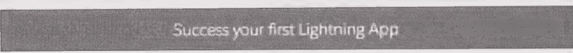

Lightning Design System (https://www.lightningdesignsystem.com) 网站包含大量精彩的示例 HTML 标记，供您探索、设计和静态测试您希望 UI 呈现的效果。使用类似前面的简单 Lightning 应用程序，您可以继续复制粘贴示例来尝试不同的组合。

> 但是，请牢记作为开发者要保持高效。您真正需要的是一个组件库，其中的组件封装了前面的 HTML 代码，以便您可以定义一次并复用，而不是反复复制粘贴 HTML。如我们将在后面看到的，您可以构建自己的组件，并在其中利用 SLDS。幸运的是，对于更简单、更基础的组件需求，平台提供了越来越多已经使用 SLDS 样式设计的基本组件，称为 **Lightning Base Components**。我们将在本章后面探讨这些组件 (https://developer.salesforce.com/blogs/developer-relations/2017/01/base-lightning-components.html)。

## 构建您的第一个组件

最后，让我们创建一个 Lightning 组件来封装我们的成功消息，该组件例如可以作为更通用信息消息的可重用组件的基础：

- 1. 在 Force.com IDE 中，导航到 File | New | Lightning Bundle。
- 2. 在创建新的 Lightning 组件对话框中，从 Type 字段中选择 Lightning Component。
- 3. 为您的组件命名为 mycomponent，然后单击 Finish。
- 4. 将 myapp.app 文件中 aura:application 标签内包含的标记复制到新 mycomponent.cmp 文件中如下所示的新 aura:component 标签，同时修改消息：

```
<aura:component>
    <div class="slds-notify_container">
        <div class="slds-notify slds-notify--alert
            slds-theme--success
            slds-theme--alert-texture" role="alert">
            <span class="slds-assistive-text">Success</span>
            <h2>Success your first Lightning Component</h2>
        </div>
    </div>
</aura:component>
```

- 5. 最后修改 myapp.app 文件以使用您的新组件：

```
<aura:application extends="force:slds">
    <c:mycomponent />
</aura:application>
```

刷新浏览器，您将看到以下内容：

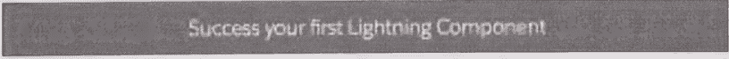

前面的代码是 Lightning 开发的基本介绍，旨在帮助您了解 Lightning 的高层架构及其如何适应互联网使用的标准 HTML 页面模型，同时还介绍了被称为 Salesforce Lightning Design System 的样式和设计框架。

## Lightning 与其他 UI 框架有何不同？

如果您之前使用过其他 UI 框架（例如 Salesforce 自身的 Visualforce 或 Java Server Pages (JSP)、ASP.NET 等），那么到目前为止，这些内容可能感觉相当熟悉。我们已经定义了一些标记，使用了 CSS，并了解了如何封装可重用的 HTML 部分。当用户导航到 URL 时，Lightning 平台服务器端代码会提供适当的 HTML 来启动指定的应用程序并呈现引用的组件。如果您是 Visualforce 开发者，可能会觉得这与使用 Visualforce 页面和 Visualforce 组件并没有太大区别。

虽然与其他框架还有其他相似之处，例如使用表达式，但与这些技术最大的区别在于页面本身的生命周期。服务器端架构通常要求在用户执行操作时刷新整个页面。页面上的信息（即页面状态）会在用户每次执行操作时在客户端和服务器之间来回传输。服务器端控制器代码控制验证、数据加载和 UI 的条件显示。

越来越多的用户界面设计生成的 HTML 页面代表用户打开并保持打开的单一应用程序或工作区。用户在其中访问不同的模块并执行各种操作。这通常称为单页应用程序 (SPA) 架构。传统的服务器端页面刷新模型不够灵敏，无法满足这些需求，例如仅需要更新页面一部分的情况。即使部署了传统的异步 JavaScript 和 XML (AJAX) 方法，通常也需要将整个页面状态传回服务器端控制器。服务器端 UI 框架也不适合开发在临时离线场景中容忍缺乏连接性的用户体验。

相比之下，Lightning 应用程序在浏览器中长期存在，并依赖 JavaScript 代码来操作页面的 DOM 以加载新内容和功能。用户正在执行的操作的状态存储在浏览器中，只有在服务器需要检索和更新数据库时才会传输。

## Lightning 架构

在本节中，我们将讨论 Lightning 架构的关键层，这将使您在深入学习时拥有更好的理解框架。

最初让我感到惊讶的一个关键方面是需要使用 JavaScript 编写 **客户端控制器**。如果您是 Visualforce 开发者，起初这可能特别令人困惑，但这是成为 Lightning 开发者的重要组成部分，反映了其客户端架构。如前一章所见，Apex 服务器端控制器仍然发挥作用，但主要用于访问后端 Apex 服务和选择器。

一般来说，Lightning 开发更加组件化。就 UI 的设计方式和代码的组织方式而言，两者更加一致，使代码更易于维护和导航。这也更加强调 UI 层内的关注点分离。

### 容器

如前一节所示，我们使用独立的 Lightning 应用程序创建了一个名为 `myapp` 的基本容器。它包含我们 `mycomponent` 组件的单个实例。虽然看起来可能不多，但 `<aura:application>` 为其组件和您作为开发者提供了许多服务。

- • 它构建了页面 `<HTML>` 标签并加载了适当的 JavaScript、CSS 资源，例如 SLDS 和 Lightning JavaScript 运行时，这使得您的组件可以通过客户端控制器代码对用户交互做出反应。

> `extends` 属性允许从其他基于 `<aura:application>` 的应用程序继承。前面的示例扩展了平台的 `force:slds` 应用程序，以注入 SLDS 的 CSS。

- • 它加载了其主体中的组件，即 `mycomponent` 组件，同时页面中存在的任何 HTML 标记也会被注入到页面中。每个组件在容器中启动自己的生命周期。就像 Apex 中的对象一样，它会被构建、初始化、跟踪，并可以被销毁。

> 组件管理是一项重要的服务，因为它有助于避免开发富客户端应用程序时的常见陷阱，即资源管理。每个 HTML 标记及其关联数据都会占用浏览器内存，如果不妥善管理，在页面的整个生命周期内很容易攀升并引起问题。

- URL 参数会自动映射到 aura:application 主体中指定的 aura:attribute 组件。例如：
- /c/myapp.app?myparam=myvalue

```
<aura:application extends="force:slds">
<aura:attribute name="myparam" type="String"/>
<h2>The value of myparam is '{!v.myparam}'</h2>
</aura:application>
```

在浏览器中显示以下文本：

myparam 的值为 'myvalue'

- URL 为中心的导航是用户体验的一个重要方面，当用户将 Web 应用程序中的记录或某些页面加入书签或共享链接时，这是一种预期行为。由于应用程序设计为长期存在，且更改 URL 会导致整个页面重新加载，因此需要一种替代方案。

修改 URL 的书签部分不会重新加载页面。因此，Lightning 应用程序利用这一点为用户存储的链接添加更多上下文，并在应用程序自身的导航中使用它。

在浏览 Lightning Experience 时，您可以亲眼看到这一点。该框架提供 aura:locationChange 事件，您的客户端逻辑可以监听该事件以确定何时发生更改。

下面是使用的 URL 约定的简单示例：/c/myapp.app#showraceresults-2016

您可以在 Lightning 组件开发指南中阅读有关 aura:application 属性的更多内容。这些服务是否全部相关取决于您使用的容器。但是，即使您只使用 Salesforce 容器，了解事物的工作原理也是好的。


## 介绍 Racing Overview Lightning 应用

Racing Overview Lightning 独立应用包含在本章的示例代码中。可以通过 /c/RacingOverview 访问。以下截图展示了其外观，并初步展示了本章后续将详细介绍的 Lightning 组件：

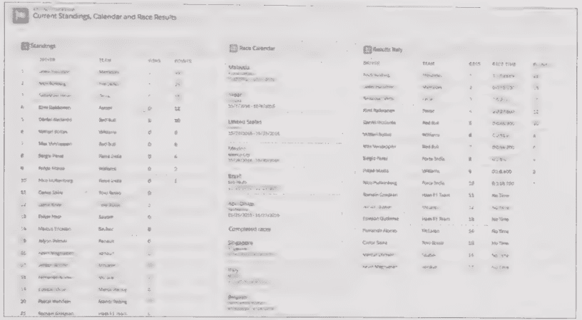

前一张截图中显示的示例记录数据，可以通过在开发者控制台（Developer Console）或 Force.com IDE 的“执行匿名代码”（Execute Anonymous）中运行以下脚本，注入到您的开发者组织中：

```
PageReference sampleData =
new PageReference('/resource/sampledata');
String sampleDataJSON =
sampleData.getContent().toString();
String orgNameSpace =
SObjectDataLoader.class.toString().
removeEnd('SObjectDataLoader').removeEnd('.');
SObjectDataLoader.deserialize(
sampleDataJSON.replace('ns__', orgNameSpace+'__'));

```

## Lightning Experience 和 Salesforce1

Salesforce 通过 Lightning 应用容器（即 Lightning Experience 和 Salesforce1 Mobile）为其自身产品及合作伙伴应用程序创建了标准 UI 容器。两者均通过 /one/ one.app URL 提供：

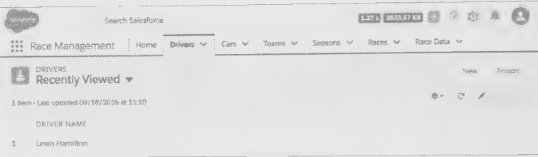

如前几章所示，Salesforce 不会限制在这些容器中加载其自身组件。它们为开发者提供了多种方式，用于加载自行编写的组件，以便针对特定应用对象和流程集成和扩展标准用户体验。

Salesforce 还允许开发者利用为外部开发者消费构建和测试过的某些组件。例如，force:recordView 用于显示记录。force:showToast 组件可用于显示弹出式通知。我们将在后面介绍这两个组件以及 Salesforce 容器的各种使用和扩展方式。

## 组件

在 Lightning 中，页面级设计不再是重点；您应采用组件优先的思维方式。但这并不意味着不需要良好的用户体验设计。相反，它涉及 UX 设计师与开发者之间更紧密的协作。

不建议创建一个巨大的组件来满足所有需求，这种做法也无法以用户期望的方式拥抱 Salesforce UI 自定义功能。从编码角度来看，这样的组件难以维护且不可复用，因为它可能无法满足所有人的需求。

更好的方法是与 UX 设计师合作制作原型，并思考如何将 UI 拆分为可复用或独立的元素。本章后面，我将介绍在设计 FormulaForce 应用程序组件时，我是如何运用这种思维的。

> 在设计用户体验时，熟悉 Salesforce UI 中的扩展点也非常重要。标准 UI 可能已提供大部分所需的用户体验，开发者只需专注于一两个用于补充剩余体验的单独组件。

## 关注点分离

Lightning 组件从设计之初就贯彻了关注点分离的理念。请注意 **Lightning 包** 的使用，以及目前为止我们所知的内容被拆分为单独的文件，即 **标记**（视图）和 **JavaScript** 代码（控制器）。它们都归并在一个子文件夹下。这是 Salesforce 想要我们真正思考如何构建 Lightning 代码以及组件如何交互的一种巧妙方式。

如同工程中的大多数事物，仅凭使用技术本身并不能自动实现关注点分离。某些方面会强制执行，而其他方面则遵循指南和良好的组件设计。如果做得正确，您不仅会在自己的应用 UI 中获得可复用、健壮且持久的 UI 组件，还会在不断演进的 Salesforce 容器、日益增多的移动设备中获得此类组件，并在需要时与第三方网站集成。

牢记关注点分离的原则在开发富客户端应用时与在构建应用程序后端业务逻辑时同样至关重要。

## 开发过程中的封装

组件实现的一个重要方面是封装。其防止实现影响页面上其他组件运作的能力，是容器模型得以工作的关键方面——尤其是因为实际上，所有组件都占用同一个页面 HTML DOM。

如前所述，**Lightning 包**（也称为 **Aura 定义包**）用于收集实现 Lightning 工件各个特定方面所需的源文件。以下截图显示本书中包含的 **合规性检查器** 组件，如在 Force.com IDE 中所示：

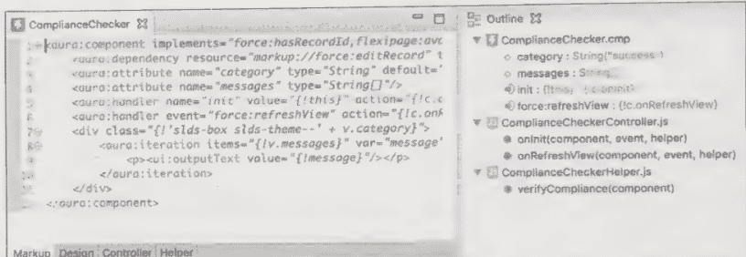

> 另请参阅 *Metadata API 开发者指南*（https://developer.salesforce.com/docs/atlas.en-us.api_meta.meta/api_meta/meta_auradefinitionbundle.htm）中的 Aura 定义包 类型。

以下各节将讨论 Lightning 组件包的内容。

### 组件标记 (.cmp)

组件标记包含组件外观的 **XHTML 标记**。其根元素是 `aura:component`。它可以引用有效的 HTML 元素和/或其他组件，如我们之前在 `mycomponent` 示例中所见。

在标记中，您还可以为组件的动态方面（如表或字段值）指定 **属性绑定**。与 Visualforce 不同，这些不是绑定到 Apex 类属性的。绑定是指通过 `aura:attribute` 组件（通常位于文件顶部）或平台提供的属性。

框架确保当属性值发生变化（通过 JavaScript 控制器代码）时，任何通过绑定表达式引用该属性的标记都会刷新。这是一个非常强大的功能，避免了围绕页面 DOM 进行大量编码的需求。事实上，除高级场景（如自定义组件渲染或使用第三方库）外，通常不鼓励这样做。

### 组件控制器 (...Controller.js)

`Controller.js` 是一个 JavaScript 文件，包含组件的 **客户端控制器** 代码。您必须有一个这样的文件，才能在组件中定义动态行为，包括任何动态初始化。调用 **Apex 控制器** 中代码的唯一方式是从客户端控制器代码进行；与 Visualforce 不同，无法直接从标记中这样做。

定义的函数与 `.cmp` 文件中的相应 **操作绑定** 或 `aura:handler` 引用相关联。操作是指在浏览器中发生的事件，例如单击按钮、悬停在元素上、滚动，或来自容器或另一个组件的事件。我们将在后面介绍 **事件**。

虽然未强制执行，但建议仅包含与 `.cmp` 文件中引用的操作相关的函数。更多控制器代码和实用函数应放在如下所述的 `Helper.js` 文件中。这种关注点分离的另一个动机是，框架会为组件的每个实例复制控制器，但助手始终只有一个实例。

以下是在 `.cmp` 文件中使用 `c` 值提供程序（通过表达式引用客户端控制器函数）的简单按钮标记：

```
<lightning:button label="Add Drivers"
 onclick="{!c.onAddDrivers}"/>
```

框架会自动为您设置 HTML 事件监听器并将其路由到指定的控制器方法。`component`、`event` 和 `helper` 参数始终由框架注入：

```
onAddDrivers :function(component, event, helper) {


```
helper.addDrivers(component, event);
}
```

> c 值提供程序（控制器提供程序）也可以在 JavaScript 中使用，以获取客户端代码希望调用的 Apex 控制器方法的引用。我们将在本章后面回顾这种场景的示例。

## 组件辅助程序 (...Helper.js)

一个 JavaScript 文件，用于定义 Controller.js 和 Renderer.js（如下文所述）文件所使用的函数。框架会创建这些方法的单个实例，该实例在所有组件实例之间共享。因此，建议您不要存储任何状态，而是使用组件属性。

此示例展示了一个操作绑定，由 aura:handler 引用，指定在组件初始化期间触发的平台事件。在此情况下，它允许组件动态从服务器加载数据：

```
<aura:handler
 name="init" value="{!this}"
 action="{!c.onInit}"/>
```

控制器函数触发并委托给辅助程序类：

```
onInit : function(component, event, helper) {
 helper.getCalendar(component, event);
}
```

辅助程序函数会向 .cmp 文件中 controller 属性指定的 Apex 控制器进行服务器端调用。此处再次使用 c 值提供程序，但这次是用于访问服务器端控制器方法：

```
getCalendar : function(component, event ) {
 var action = component.get("c.getRaceCalendar");
 action.setCallback(this,
 function(response) {
 if(response.getState() == 'SUCCESS') {
 component.set("v.calendar", response.getReturnValue());
 }
 });
 $A.enqueueAction(action);
}
```

前面代码中使用的 $A 变量可用于访问 Lightning JavaScript API。

## 组件 CSS (.css)

在为组件设置样式时，您应该利用 Lightning 设计系统提供的设计和 CSS，如先前的 mycomponent 示例所示。这将确保您的 UI 继续与其所在的 Salesforce 容器保持一致，同时也符合对新设备和布局类型支持的任何进一步改进。

> 使用 lightning 命名空间中的 Salesforce 基础组件，例如 lightning:button、lightning:input 和 lightning:tabSet，可自动确保您使用的是 SLDS。

但是，如果您确实需要定义自己的样式，请通过添加到组件 .css 文件中的自定义 CSS 类来完成。框架将确保这些样式被封装在组件内，不会影响页面上的其他组件。

> 您不应尝试修改元素的 .style 属性。如果您需要控制此项，可能需要实现一个组件渲染程序。框架提供 $A.util.addClass 和 $A.util.removeClass 方法，以安全地动态操作组件标记的样式。

组件 CSS 中的 THIS 标识符必须用于将 CSS 作用域限定在您的组件中。以下示例用于 **Race Calendar** 组件，以便在用户单击某场比赛时对其进行高亮显示：

```
.THIS .selectedRace{
    background-color:token(colorBackgroundHighlight);
}
```

相应的组件标记使用条件表达式来应用 CSS 类（除了 SLDS 样式之外）。控制器方法只是更新来自赛事绑定的 .Selected 属性的值：

```
<li class="{!'slds-item ' + (race.Selected ? 'selectedRace' : '')}" onclick="{!c.onRaceClicked}">
```

令牌是 Lightning 框架的一项功能，允许您在自己的样式中重用 Salesforce 表示的颜色和字体值。前面的示例重用了 SLDS 中的一个令牌，该令牌定义选定项目的颜色。要将标准 SLDS 令牌包含在组件中以供使用，必须创建一个名为 `defaultTokens` 的 `aura:tokens` Lightning Bundle。此令牌已包含在本章的示例代码中。在此中，您还可以通过 `aura:token` 元素定义自己的令牌。

## 组件渲染程序 (...Renderer.js)

在大多数情况下，利用组件标记、属性和绑定来操作组件外观是开发组件的预期方式。您也不应在辅助程序或控制器方法中操作 DOM，因为当框架响应属性更改时会覆盖更改。但是，在某些情况下，例如使用第三方 JavaScript 库时，您可能希望直接控制 DOM。在这些情况下，请使用组件渲染程序。有关此功能的更多信息，请参阅 *Lightning Components Developer Guide*。

## 组件设计 (.design) 和组件 SVG (.svg)

这些基于 XML 的文件允许您在通过 **Lightning App Builder** 和 **Lightning Community Builder** 工具公开组件时自定义其外观，例如配置用于在边栏中标识它的图标，允许您的用户使用这些拖放工具来配置 Salesforce UI，并在引入打包组件时使用。有关此功能的进一步讨论和示例，请参见本章后面的 *Making components customizable*。

## 组件文档 (.auradoc)

Lightning 提供自己的文档框架，该框架根据组织中的组件（包括来自 Salesforce 的组件）动态构建。如果您计划允许其他开发人员使用您的打包组件，可以使用此文件来放置描述组件目的和功能的文档。

您还应该利用 `aura:component`、`aura:attribute`、`aura:method`、`aura:event`、`aura:interface` 和 `aura:registerEvent` 上可用的 `description` 属性。

开发人员可以通过 URL https://<myDomain>.lightning.force.com/auradocs/reference.app 访问以这种方式表达的文档。有关如何将组件公开供包外使用的示例和更多讨论，请参见本章后面的 *Making components customizable*。

## 在运行时强制实施封装和安全性

页面上的 JavaScript 代码可以通过 HTML DOM API 遍历整个页面内容，获取信息或修改页面的其他方面。这会在运行时打破封装，也违反了 Lightning 等容器架构的安全最佳实践。假设您是一名管理员，安装了一个放置在主页上的组件，它获取了重要数据并将其传输回另一台服务器。

此类组件不太可能通过 Salesforce 安全审查并发布到 AppExchange。在 Lightning 中不允许此类组件的还有一个原因。Salesforce 创建了 Lightning Locker Service，这是一项旨在在运行时物理阻止此类逻辑（无论是故意还是无意）执行的服务。您可能会无意中编写被视为不安全的代码，即使用了不符合行业标准内容安全策略 (CSP) 的功能。在 Locker Service 创建的安全上下文中，也不支持使用 eval 和访问 window 对象等功能。

> Locker Service 可能会在您的组织或客户的组织中默认启用。因此，我们强烈建议在开发和测试组织中未启用的情况下，也应在启用状态下开发和测试代码。还有一个名为 Salesforce Lightning CLI 的命令行实用程序，可扫描代码中的安全漏洞。这非常值得研究，如果您有持续集成流程，建议将其集成进去。

## 表达行为

既然我们知道 Lightning 如何允许我们封装实现。请务必牢记，组件背后的愿景是共享和可重用性，不仅限于您自己的应用程序，还包括应用程序的其他消费者。如同公开 API 的 Apex 类一样，仔细管理组件消费者被允许以何种方式与其交互非常重要。

## 访问控制

Apex 使用可见性关键字来控制在类范围内、包内以及包外可见的类、属性和方法。


为你定义的 Lightning 工件提供相同级别的控制，例如 `aura:application`、`aura:component`、`aura:attribute`、`aura:method`、`aura:event` 和 `aura:interface`。所有情况下的默认访问级别均为 `public`，可提升至 `global`。对于属性，还可以使用 `private`。

> 与 Apex 一样，除非有充分理由提高访问级别，否则将某内容标记为最低访问级别实际上是最佳实践。因此本书中的示例大多使用 `private` 属性，因为这些属性代表组件的内部状态，甚至不应对任何其他组件（包括包内的组件）可访问。与通用 Apex 编码一样，这一最佳实践有助于管理耦合并允许更大的重构自由度。

控制器、helper 和 renderer 文件中的 JavaScript 函数均为私有。不过，你可以在组件标记中使用 `aura:method` 来公开控制器函数。下一节将详细介绍方法、事件和接口的使用。

> 与 Apex 类一样，在指定 `global` 访问控制时，请仔细考虑对组件在包版本之间演进的影响。为了支持升级之间的向后兼容性，更改仅限于应用了此访问控制的工件。

## 方法、事件和接口

在 Lightning 中，方法和接口概念与 Apex 中的等效概念相似，但适用于在客户端定义的组件。与 Apex 不同，接口不表达方法，仅表达组件要实现的属性和事件。

> 与 Apex 和 Java 一样，没有属性或事件的接口称为标记接口，我们将在本章后面发现这一点。该平台大量使用标记接口，例如 `force:hasRecordId`，你可以将其应用于组件，以让 Salesforce 容器知道你的组件已准备好在各种上下文中使用。

有时很难决定何时使用方法代替事件或反之亦然，两者都提供了组件之间通信的方式：

- 事件在 Lightning 中可能是一个被过度使用的术语；它可以指从浏览器中的 HTML 元素发送的内容，也可以指发生在组件生命周期中的内容，例如 `init` 事件。这些分别称为浏览器级事件和系统级事件。

- 作为组件作者，你还可以定义自己的组件事件和应用程序事件。组件事件只能在组件及其子组件中触发和处理，而应用程序事件遵循发布订阅模型，允许组件向页面上任何想要监听（订阅）该事件的组件广播事件。有关考虑所有者组件与容器时的事件处理的更多信息，请参阅 [开发者指南](https://developer.salesforce.com/docs/atlas.en-us.lightning.meta/lightning/events_application_handling_phases.htm)。

- 方法虽然更容易实现，但倾向于在组件之间创建更紧密的耦合，因此应谨慎使用，例如用于优化子组件的设置或配置。

## 平台命名空间

Lightning 利用命名空间来隔离层和功能。命名空间的使用方式与平台的其他部分相同，即在你希望引用的工件（如组件或接口）前加上前缀。下表列出了平台提供的一些核心命名空间。

| 命名空间 | 用途 |
| --- | --- |
| aura | 基于用于构建 Lightning 的核心框架 Aura。Aura 仍然是由 Salesforce 管理的开源框架。核心组件和标记在此命名空间中定义。该命名空间的某些方面设计为与托管平台无关。如果你愿意，可以在 Java 堆栈上运行 Aura！ |
| force | 包含与 Force.com 平台相关的方面，例如对 SObjects 的了解以及在 Lightning 中复制自定义对象布局 UI 的组件。force:inputField 和 force:outputField 组件模拟了 apex 命名空间下 Visualforce 中的组件。它包含在集成到 Lightning Experience 和 Salesforce1 移动容器时使用的接口。本章中的示例组件实现了这些接口。 |
| forceCommunity | 表示用于将组件集成到 Lightning Community 容器中的接口。 |
| ui | 包含用于基本表单式用户体验的可重用 UI 组件。这些组件早于 SLDS，因此默认未使用 SLDS 样式，但你可以自己应用 SLDS 样式。在路线图方面，Salesforce 将重点关注 lightning 命名空间。 |
| lightning | 也称为基础 Lightning 组件，将在下一节中详细讨论。 |

**Aura 文档**页面的以下屏幕截图说明了一种发现所有受支持命名空间及其中的接口、组件和 API 的好方法，包括在组织中安装的包中公开的内容：

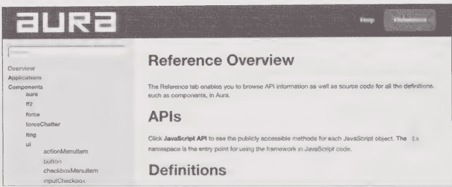

## 基础组件

Salesforce 推荐 `lightning` 命名空间中的组件，因为它们使用 SLDS 提供功能丰富且样式化的 UI 组件。Salesforce 已表示，随着 SLDS 的发展，它们将继续接收更新。因此，建议使用它们以确保组件与平台其余部分的外观和感觉保持一致。

在撰写本文时，它们尚未完全取代 `ui` 命名空间中的组件。然而，Salesforce 已表示，它们将在每个版本中继续扩展这些组件。与此同时，请继续先检查 `lightning` 命名空间，再检查 `ui` 命名空间，在构建自己的组件之前检查两者。

## 数据服务

在撰写本文时，Lightning 数据服务处于开发者预览阶段，这意味着它们在完全发布用于生产使用时可能会发生变化。如前一章所述，这些服务可以作为编写 Apex 控制器的替代方案，用于仅希望创建、读取、更新或删除记录的场景。你可以将其视为 Visualforce 中标准控制器的角色，但它们位于客户端层，并由客户端控制器中的代码与之交互。

请注意，不要允许此类客户端设施将业务逻辑泄露到客户端层。除最简单的情况外，你可能仍然希望将业务逻辑委托给 Apex 服务来执行。还要牢记事务范围；客户端的多个更新可能各自都有自己的事务。

## 面向对象编程

Lightning 组件在许多方面与 Apex、Java 和 C# 等传统面向对象编程语言中使用的类和对象相似。使用组件来利用 OOP 技术有许多好处。

关于继承，请考虑以下几点：

- 我们已经通过 myapp Lightning 应用程序上的 `extends` 属性看到一个继承示例，它扩展了 `force:SLDS`（本身是 `aura:application`）以将 SLDS 注入应用程序。

- 本章示例代码中用于导入 SLDS 令牌的 `defaultTokens` 令牌组件扩展了 `force:base` 组件（本身是 `aura:tokens` 的一个实例）。

- 你不必仅利用平台提供的基础组件；你可以定义自己的组件，并通过 `aura:component` 元素上的 `extensible` 属性将其标记为可扩展。

接口还为我们的组件与 Salesforce 容器集成提供了手段。**竞赛结果** 组件实现了以下接口，以便可以在 Lightning Experience **主页**和**记录**页面上使用：

```
<aura:component controller="RaceResultsComponentController"
implements="force:hasRecordId,
flexipage:availableForAllPageTypes"
access="global">
```


## 对象级别和字段级别安全性

开发人员有责任在 Lightning 中强制执行对象和字段安全性。这可以在 Apex 控制器中使用传统的 Apex Describe 方法来完成。强制执行应在服务器端进行，否则未经授权的数据可能会被传输到客户端，用户可以使用浏览器调试工具检查从服务器发送的 JSON 负载。

UI 如何向用户展示取决于开发人员。这可能只是显示一条消息，指示用户需要更多权限，或者您可以选择动态隐藏（这应包括从服务器响应中省略值）或禁止编辑某些字段或表格行，例如。

您可能期望 ui:inputField 和 ui:outputField 组件尊重字段级别安全性，就像它们的 Visualforce 对应物一样。情况并非如此，由于上述原因，强制执行必须在服务器端进行。

> 预期 Lightning Data Services 将遵守对象和字段级别安全性。

## FormulaForce Lightning 组件

在为本书中包含的 FormulaForce 示例应用程序设计 Lightning 组件时，我希望尝试演示 Salesforce UI 中的一些关键集成点，同时确保用例与应用程序领域相符。

我专注于 Lightning Experience 和 Salesforce1 Mobile。在着手进行任何大规模开发之前，优先考虑平台也是一种良好的实践。我从以下用例开始，然后制定了一组组件来提供功能。

- 赛事概览：虽然我们之前研究过的独立 Lightning 应用程序是开始使用组件的好方法，但它不是 Salesforce 集成解决方案。我想要做的是通过 Lightning App Builder 自定义工具集成 Lightning Experience 主页。不仅要显示总排名（排行榜），还要允许用户通过赛事日历筛选信息，以显示每场已完成赛事的结果。

- 赛事日历可访问性：当使用应用程序的其他部分时，用户可能希望随时掌握赛事日历这一关键信息。Lightning Experience 实用工具栏（或页脚）特定于您的应用程序，并包含您希望始终可访问的组件。

- 赛事设置协助：Race 记录和 Drivers 之间存在一个名为 Contestants 的连接对象。从用户体验角度来看，这可能会使设置赛事变得过于复杂。因此，我想利用 Lightning 组件操作提供一个自定义 UI 以将驱动程序添加到赛事中。

- 赛事结果概览。赛事结果是 Contestants、Driver、Team 和 Car 对象信息的综合结果。我想要通过 Lightning App Builder 自定义工具，从主页和赛事记录页面提供一种轻松且上下文相关的查看赛事结果的方式。

让我们仔细看看我提出的组件。

## RaceStandings 组件

以下屏幕截图显示了 c:RaceStandings 组件的顶部部分：

| | 车手 | 车队 | 胜场 | 积分 |
|---|---|---|---|---|
| 1 | Lewis Hamilton | Mercedes | 1 | 43 |
| 2 | Nico Rosberg | Mercedes | 1 | 25 |
| 3 | Sebastian Vettel | Ferrari | 0 | 15 |
| 4 | Kimi Raikkonen | Ferrari | 0 | 12 |
| 5 | Daniel Ricciardo | Red Bull | 0 | 10 |
| 6 | Valtteri Bottas | Williams | 0 | 8 |
| 7 | Max Verstappen | Red Bull | 0 | 6 |
| 8 | Sergio Perez | Force India | 0 | 4 |
| 9 | Felipe Massa | Williams | 0 | 2 |
| 10 | Nico Hulkenberg | Force India | 0 | 1 |

以下组件标记是使用 SLDS 样式化的简化 HTML `<table>`：

```
<aura:component controller="RaceStandingsComponentController" implements="flexipage:availableForAllPageTypes" access="global" >
    <!-- Attributes -->
    <aura:attribute name="standings" type="Object[]" access="private"/>
    <!-- Event handlers -->
    <aura:handler name="init" value="{!this}" action="{!c.onInit}"/>
    <!-- Component markup -->
    <lightning:card>
        <aura:set attribute="title">
            <lightning:icon iconName="standard:reward" size="small"/>
            &nbsp;Standings
        </aura:set>
        <table class="slds-table slds-table--bordered slds-table--cell-buffer">
            <thead>
                <tr class="slds-text-title--caps">
                    <th scope="col"></th>
                    <th scope="col">Driver</th>
                    <th scope="col">Team</th>
                    <th scope="col">Wins</th>
                    <th scope="col">Points</th>
                </tr>
            </thead>
            <tbody>
                <aura:iteration items="{!v.standings}" var="standing">
                    <tr>
                        <th scope="row" data-label="Position">{!standing.Position}</th>
                        <td data-label="Driver">{!standing.Driver}</td>
                        <td data-label="Team">{!standing.Team}</td>
                        <td data-label="Wins">{!standing.Wins}</td>
                        <td data-label="Points">{!standing.Points}</td>
                    </tr>
                </aura:iteration>
            </tbody>
        </table>
    </lightning:card>
</aura:component>
```

## RaceStandings 组件的其他值得注意的方面是：

- 它实现了 flexipage:availableForAllPageTypes 接口，允许将组件拖放到 Lightning Experience 主页或由 Lightning App Builder 编辑的任何其他页面上。

- aura:iteration 类似于 Visualforce apex:repeat 组件，因为它将遍历绑定的列表并重复其中定义的标记。

- 它使用两个基础 Lightning 组件，lightning:card 和 lightning:icon，SLDS 样式由这些组件实现。

- 客户端控制器函数 onInit 调用一个辅助函数，该函数调用 Apex 控制器以从服务器加载信息。响应会更新 standings 属性，进而导致框架使用记录刷新 HTML 表格：

```
getStandings : function(component, event ) {
 var action = component.get("c.getStandings");
 action.setCallback(this, function(response) {
 if(response.getState() == 'SUCCESS') {
 component.set("v.standings",
 response.getReturnValue());
 }
 });
 $A.enqueueAction(action);
}
```

- Apex 控制器方法使用 ContestantsSelector 类。在以下示例中，Selector 类 ContestantsSelector.Standing 的成员不支持 @AuraEnabled 属性，因此此类未直接用于响应。备用 RaceStanding 类允许对客户端的响应更侧重于客户端代码的需求：

```
public with sharing class RaceStandingsComponentController {
 @AuraEnabled
 public static List<RaceStanding> getStandings() {
 List<RaceStanding> raceStandings =
 new List<RaceStanding>();
 for(ContestsSelector.Standing standing :
 newContestsSelector().
 selectStandingsForCurrentSeason()) {
 RaceStanding raceStanding = newRaceStanding();
 raceStanding.Position = standing.Position;
 raceStanding.Driver = standing.Driver;
 raceStanding.Team = standing.Team;
 raceStanding.Wins = standing.Wins;
 raceStanding.Points = standing.Points;
 raceStandings.add(raceStanding);
 }
 return raceStandings;
 }

 public class RaceStanding {
   @AuraEnabled
   public Integer Position;
   @AuraEnabled
   public String Driver;
   @AuraEnabled
   public String Team;
   @AuraEnabled
   public Integer Wins;
   @AuraEnabled
   public Integer Points;
 }
 }
```

> @AuraEnabled 注解与在 Visualforce 中使用的 @RemoteAction 注解类似。两者都要求方法为静态且无状态。它们也可以在同一方法上一起使用，从而有助于从 Visualforce 迁移到 Lightning。

## RaceCalendar 组件

以下显示了 c:RaceCalendar 组件的顶部部分：

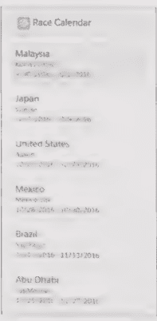


当用户点击某个比赛时，选中的比赛会被高亮显示，并触发一个组件应用事件 c:RaceSelected。该事件稍后将由 c:RaceResults 组件接收。该事件定义如下：

```
<aura:event type="APPLICATION"
description="Fired when the user selects a race" access="global">
 <aura:attribute name="raceId" type="string"/>
 <aura:attribute name="raceName" type="string"/>
</aura:event>
```

以下组件标记使用 HTML 无序列表 <ul>。列表和项使用 SLDS 进行样式设置，以按照 SLDS 设计指南显示一个磁贴列表：

```
<aura:component controller="RaceCalendarComponentController" implements="flexipage:availableForAllPageTypes" access="global">
 <!-- Attributes -->
 <aura:attribute name="calendar" type="Object" access="private"/>
 <!-- Event handlers -->
 <aura:handler name="init" value="{!this}" action="{!c.onInit}"/>
 <!-- Component markup -->
 <lightning:card>
 <aura:set attribute="title">
 <lightning:icon iconName="standard:campaign" size="small"/>
 &nbsp;Race Calendar
 </aura:set>
 </lightning:card>
 <div class="slds-p-around--small">
 <ul class="slds-has-dividers--around-space">
 <aura:iteration items="{!v.calendar.Remaining}" var="race">
 <li class="{! 'slds-item ' + (race.Selected ? 'selectedRace' : '')}" onclick="{!c.onRaceClicked}" data-raceid="{!race.Id}" data-racename="{!race.Name}">
 <div class="slds-tile slds-tile--board">
 <h4 class="slds-text-heading--small">{!race.Name}</h4>
 <div class="slds-tile__details slds-text-body--small">
 <p>{!race.Location}</p>
 <p>{!race.RaceDate}</p>
 </div>
 </div>
 </li>
 </aura:iteration>
 <li class="slds-p-around--small">
 <div class="slds-text-heading--small">Completed races</div>
 </li>
 <aura:iteration items="{!v.calendar.Completed}" var="race">
 <li class="{!'slds-item ' + (race.Selected ? 'selectedRace' : '')}" onclick="{!c.onRaceClicked}" data-raceid="{!race.Id}" data-racename="{!race.Name}">
 <div class="slds-tile slds-tile--board">
 <h4 class="slds-text-heading--small">{!race.Name}</h4>
 <div class="slds-tile__details slds-text-body--small">
 <p>{!race.Location}</p>
 <p>{!race.RaceDate}</p>
 </div>
 </div>
 </li>
 </aura:iteration>
 </ul>
 </div>
 </aura:component>
```

此组件的其他新特性和值得注意的方面如下：

- `<li>` 元素的 CSS 类由一个表达式驱动，该表达式评估来自比赛绑定的 `Selected` 属性值。这指示用户当前选择了哪个比赛。

- **HTML5 数据属性** `data-raceid` 和 `data-racename` 用于为 `<li>` 元素分配有用信息。这些信息可以由以下控制器代码稍后引用。

- `<li>` 元素上的 `onclick` 属性会调用 `c.onRaceClicked` 方法。将调用 helper 中的 `selectRace` 函数，并使用 HTML5 data attributes 来确定用户点击的比赛的 Salesforce 记录 ID。一个实用方法会更新 `calendar` 属性中保存的项目上的 `Selected` 属性。此更新反过来会刷新 `<li>` 元素上的 `class` 属性，从而显示选中的比赛项。最后，触发 `c:RaceSelected` 事件，以便其他组件可以相应响应：

```
selectRace : function(component, event ) {
  // Establish the selected race via HTML5 data attributes
  var selectedRaceId =
  event.currentTarget.dataset.raceid;
  var selectedRaceName =
  event.currentTarget.dataset.racename;

  // Mark the race as selected and deselect any selected
  var calendar = component.get('v.calendar');
  this.updateSelectedRace(calendar.Remaining, selectedRaceId);
  this.updateSelectedRace(calendar.Completed, selectedRaceId);
  component.set("v.calendar", calendar);

  // Fire the RaceSelected event
  var compEvent = $A.get("e.c:RaceSelected");
  compEvent.setParams({"raceId" :selectedRaceId } );
  compEvent.setParams({"raceName" :selectedRaceName } );
  compEvent.fire();
}
```

- 加载比赛日历的 Apex 控制器方法（未显示）将比赛拆分并正确排序为两个列表（基于比赛是否已完成），然后将其发送到组件。这减少了控制器和 helper 文件中所需的 JavaScript 数量。

## RaceResults 组件

以下显示 c:RaceResults 组件的最上部：

| 驾驶员 | 车队 | 排位 | 比赛时间 | 积分 |
|---|---|---|---|---|
| Nico Rosberg | Mercedes | 1 | 1:17:28.89 | 25 |
| Lewis Hamilton | Mercedes | 2 | 0:0:15.100 | 18 |
| Sebastian Vettel | Ferrari | 3 | 0:0:21.0 | 15 |
| Kimi Raikkonen | Ferrari | 4 | 0:0:27.600 | 12 |
| Daniel Ricciardo | Red Bull | 5 | 0:0:45.300 | 10 |
| Valtteri Bottas | Williams | 6 | 0:0:51.0 | 8 |
| Max Verstappen | Red Bull | 7 | 0:0:54.200 | 6 |
| Sergio Perez | Force India | 8 | 0:1:5.0 | 4 |
| Felipe Massa | Williams | 9 | 0:1:5.600 | 2 |
| Nico Hulkenberg | Force India | 10 | 0:1:18.700 | 1 |

c:RaceResults 组件与 c:RaceStandings 组件遵循类似的实现方法，因此此处不显示完整源代码。您可以通过本章关联的示例代码查看完整代码：

```
<aura:component controller="RaceResultsComponentController" implements="force:hasRecordId,flexipage:availableForAllPageTypes" access="global">
<!-- Attributes -->
<aura:attribute name="recordName" type="String" access="private"/>
<aura:attribute name="results" type="Object[]" access="private"/>
<!-- Event handlers -->
<aura:handler name="init" value="{!this}" action="{!c.onInit}"/>
<aura:handler event="c:RaceSelected"
action="{!c.handleRaceSelectedEvent}"/>
```

此组件中值得注意的代码片段如下：

- flexipage:availableForRecordHome 接口声明，该组件可通过 Lightning App Builder 拖放到 **记录页面**。

- flexipage:availableForAllPageTypes 接口声明，该组件可通过 Lightning App Builder 拖放到 **主页**。

- force:hasRecordId 接口可让容器（Lightning Experience 或 Salesforce1）知道组件想要获取记录 ID。当组件放置在记录页面上时，容器会在 recordId 属性（由该接口添加）中放置此值。

- c.onInit 方法会检查 recordId 属性的值；如果不为 null，它将加载适用的比赛结果并显示它们。由于组件可以放置在主页上，在该上下文中此值可能为 null：

```
onInit :function(component, event, helper) {
// If we have a recordId context load the race results
var recordId = component.get('v.recordId');
if(recordId!=null) {
helper.getRaceResults(component, event);
}
}
```

当触发 c:RaceSelected 事件时，会调用 c.handleRaceSelected。该方法从事件参数中提取 raceId 和 raceName，并刷新比赛结果。这种方法允许组件既存在于记录页面，也存在于主页上，同时仍保持上下文：

```
handleRaceSelectedEvent :function(component, event, helper) {
// Update race record Id and Name attributes from Event
component.set('v.recordId', event.getParam('raceId'));
component.set('v.recordName',event.getParam('raceName'));
// Retrieve race results
helper.getRaceResults(component, event);
}
```

## RaceSetup 组件

以下显示 c:RaceSetup 组件：

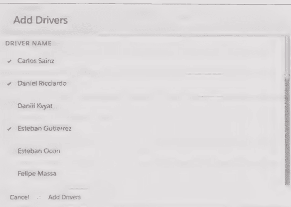

此组件利用 HTML 表格来显示驾驶员列表表格。lightning:input 组件用于将复选框绑定到列表项。未显示完整标记；以下代码片段值得注意：

```
<aura:component controller="RaceSetupComponentController" implements="force:lightningQuickActionWithoutHeader, force:hasRecordId" access="global">
```

```
<lightning:input
value="{!driver.Selected}" type="checkbox"
```


```
checked="{!driver.Selected}" label="{!driver.Name}" />
<lightning:button label="Cancel" onclick="{!c.onCancel}"/>
<lightning:button label="Add Drivers"
onclick="{!c.onAddDrivers}"/>
```

组件中的以下代码片段值得注意：

- force:lightningQuickActionWithoutHeader 用于指示此组件可在对象定义上创建 **操作** 时使用。当用户调用该操作时，组件将在不带默认标题和取消按钮的弹出窗口中显示，这正是此处所偏好的，因为组件正在呈现其自身按钮。否则，组件将实现 force:lightningQuickAction。

- c.onCancel 函数发送 force:closeQuickAction 事件以指示容器通过执行以下代码关闭弹出窗口：`$A.get("e.force:closeQuickAction").fire();`

- c.onAddDrivers 函数调用一个 helper 函数。helper 函数将驱动程序列表传回服务器。列表包含选定的驱动程序。Lightning 框架会自动保持 lightning:input 组件的选中状态与列表项中绑定的 .Selected 属性同步。Apex 控制器调用 RaceService.addDrivers 方法。在收到成功响应后，客户端控制器代码会触发 force:showToast 事件（如以下所示）以显示通知，并触发 force:closeQuickAction 事件以关闭弹出窗口：

```
addDrivers :function(component, event ) {
var action = component.get("c.addDrivers");
action.setParam('raceId', component.get('v.recordId'));
action.setParam('driversToAdd',
component.get('v.drivers'));
action.setCallback(this, function(response) {
if(response.getState() === 'SUCCESS') {
// Refresh the view to show the recently added drivers
$A.get('e.force:refreshView').fire();
// Display Toast message to confirm drivers
var resultsToast = $A.get("e.force:showToast");
resultsToast.setParams({
"title": "Add Drivers",
"message": " Added " + response.getReturnValue() +
" drivers. "});
resultsToast.fire();
// Close the action panel
$A.get("e.force:closeQuickAction").fire();
}};
$A.enqueueAction(action);
}
```

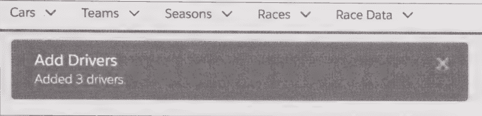

> 在上述示例中，使用了文本。最佳实践是使用 **自定义标签**。在这种情况下，消息文本将类似于 Add {0} drivers。客户端控制器代码将使用 $A.util.format 函数来格式化消息。

## 使组件可自定义

本章中包含的组件将出现在 Lightning App Builder 中，因此开发人员和包的使用者可以将它们拖放到页面上。因为它们是 `global`，所以也可以在其自身组件代码中使用它们：

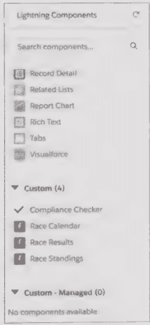

这是由于以下方面：

- 组件上的 `access` 属性设置为 global。
- 它们实现适用的 `flexipage` 和 `force` 接口。
- 虽然不是必需的，但 `.design` 文件指定了组件标签：
  ```
  <design:component label="Race Calendar">
  </design:component>
  ```
- `c:CheckCompliance` 组件的 `.svg` 文件定义了一个自定义图标，该图标显示在 Lightning App Builder 中的组件旁边。
- 虽然不是必需的，**赛事结果**组件还包含额外的标记，以向 Lightning App Builder 指示该组件仅与 `Race__c` 自定义对象相关：
  ```
  <design:component label="Race Results">
  <sfdc:objects>
  <sfdc:object>Race__c</sfdc:object>
  </sfdc:objects>
  </design:component>
  ```

> 组件还可以声明显示在 Lightning App Builder 设计画布右侧配置面板中的属性。这些属性使用 `.design` 文件中的 `design:attribute` 元素表示。这些属性必须与组件标记中表达的属性匹配。以这种方式暴露的任何属性也必须具有 global 访问级别。

## 与 Lightning Experience 集成

以下屏幕截图突出了组件现已与 Lightning Experience 集成的各个点。这些组件仍可用于我们在本章开头使用的 Race Overview 独立应用程序，尽管通过 Lightning App Builder，其他接口和事件现在支持更高级的容器。

此屏幕截图显示了主页上的“赛事结果”和“赛事排名”组件，通过工具栏可访问“赛事日历”组件。当用户从“赛事日历”选择赛事时，赛事结果将更新：

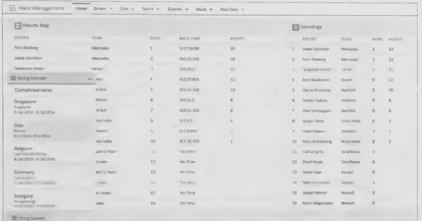

工具栏是使用 Lightning 页面（在元数据形式中称为 FlexiPage）定义的。本章的示例代码中包含 /flexipages 文件夹中的一个名为 RaceManagementUtilityBar 的页面。此页面在 Race Management 应用程序元数据（/apps 文件夹中）中引用。

此屏幕截图显示了**赛事设置**组件，它是用户在 Race 记录页上点击 **添加驱动程序** 操作后出现的结果。Lightning 组件操作在 **设置** 下的 **Race** 对象定义页的 **操作** 下配置：

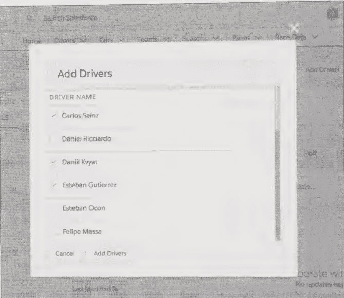

此最终屏幕截图再次显示了**赛事结果**组件，但这次位于 Race 记录页上。使用 Lightning App Builder 添加了一个名为“赛事结果”的新选项卡，并将“赛事结果”选项卡拖放到其中。这说明组件可以支持 Lightning Experience 中的多个位置：

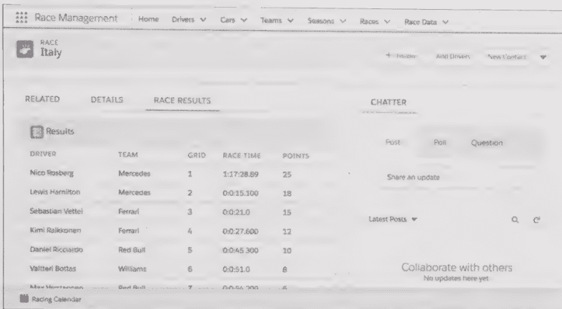

## 在 Lightning 页面和选项卡上使用组件

Lightning 页面（或 FlexiPage）本质上是使用 Lightning App Builder 工具从空白页面创建的布局。因此，您或您的客户可以将上述组件及其他任何组件拖放到其中以创建新页面。与 Visualforce 页面不同，它们没有用于访问它们的 URL。显示 Lightning 页面的唯一方法是为其创建 Lightning 选项卡。这可以在设置菜单下的选项卡中访问。Lightning 选项卡在 Lightning Experience 和 Salesforce1 Mobile 中工作。

> 还可以为组件实现 force:appHostable。这允许创建 Lightning 组件选项卡。这一历史设施不如使用 Lightning App Builder 构建 Lightning 页面灵活，后者允许用户在页面上放置多个组件。

## Lightning Out 和 Visualforce

**闪电输出** 是一个 JavaScript 库，可以导入到常规 HTML 页面中，例如 Visualforce 页面和其他网站或其他容器（如 Google Apps）。导入后，它会公开一个 API，允许页面开发人员实例化 Lightning 组件并将其注入到该页面上的给定 HTML 元素中。主机页面必须提供 Salesforce Session 或 OAuth 令牌，以便以安全方式实现此操作。

使用 **适用于 Visualforce 的闪电输出** 页面的过程通过在页面上使用 `apex:includeLightning` 组件来简化，该组件加载 JavaScript 库并处理身份验证。调用 `$Lightning.use` 全局方法以开始加载组件到页面的引导过程：

> 在 Visualforce 页面上使用 Lightning 组件确实允许您考虑使用 Lightning 开发解决方案的新区域，同时仍然为仍然需要它的客户提供 Salesforce Classic 用户体验。

有关配置 Lightning Out 的更多信息，请参阅 *Lightning 开发人员指南*（https://developer.salesforce.com/docs/atlas.en-us.lightning.meta/lightning/lightning_out.htm）中的相关部分。

## 与社区集成

Lightning Community 是 Lightning 组件的另一个容器；因此，现有组件可能已经足够接近能够在其中和 **闪电社区生成器** 工具中存在。最基本的要求是您的组件实现 `forceCommunity:availableForAllPageTypes` 接口。

如前一部分所述，指定组件 `.design` 文件的相同注意事项也适用，以便组件在 Lightning Community Builder 工具中正确显示，特别是要将组件访问级别设为 `global`。

还可以通过实现提供自定义主题布局、配置文件标题、搜索和帖子发布者组件以及内容布局的接口的组件来自定义 Lightning Community 容器。有关更多详细信息，请查阅 `forceCommunity` 命名空间中的接口。


## 测试

编写本文时，Salesforce 尚未为 Lightning 组件提供像 Apex 那样的测试框架。Salesforce 尚未官方评论，但很可能他们会在 Force.com 平台的未来版本中包含当前开源项目中存在的 Aura 测试框架（http://documentation.auraframework.org/test/runner.app）。

同时，我建议您审查现有的浏览器测试工具。

## 更新 FormulaForce 包

与前几章一样，检查所有新组件是否已添加到 FormulaForce 包并上传。由于包含了实用工具栏，该包现在要求在 orgs 中配置 My Domain 才能完成安装。虽然 My Domain 为客户提供了一些增强的安全性优势，但它确实带来了需要仔细考虑的影响。在对您的包建立此依赖项之前，请先与您的客户群进行咨询。

## 摘要

在本章中，您已了解 Lightning 框架的高级架构，无论是从独立页面的角度，还是将 Lightning 组件集成到 Lightning Experience 和 Salesforce1 Mobile 中的角度。

Lightning Experience 现在比原始的 Salesforce Classic 用户界面更具可扩展性。在决定唯一选择是从零开始构建全新的页面级体验之前，有更多选项需要考虑。在考虑用户体验需求的同时，思考这些集成能力，以及开发人员和 UX 设计师之间组件思维的一致性，是拥抱这种在 Salesforce 上构建应用程序新方式的关键。

关注点分离和良好的编码实践在客户端层与后端同样重要。同样重要的是监控您的架构，确保业务逻辑的封装和包含。这应仍然牢固地保留在后端，以便不同类型的客户端可以访问它。

最后，很明显 Lightning 正在拥抱 JavaScript 在行业中的持续采用，因此如果您需要提升 JavaScript 技能，现在正是开始的时候！

在下一章中，我们将探讨平台功能、工具和最佳实践，为您的应用程序客户和合作伙伴提供集成机会。
