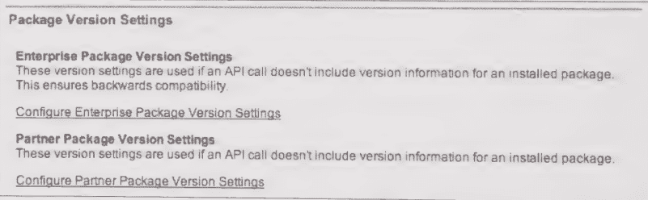
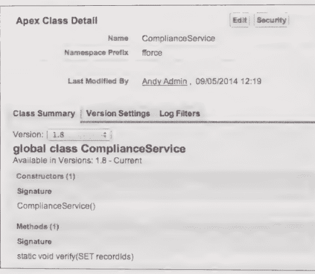
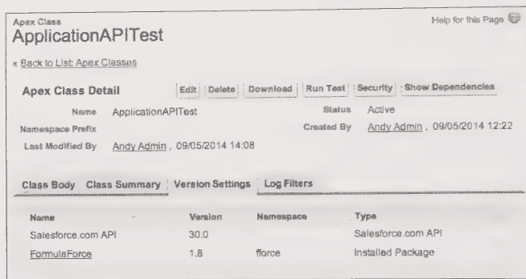
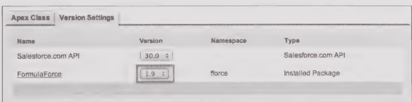
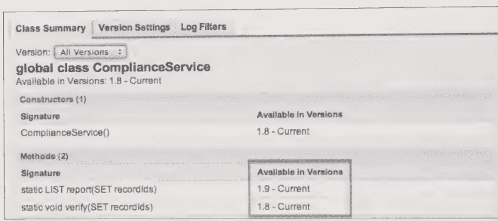
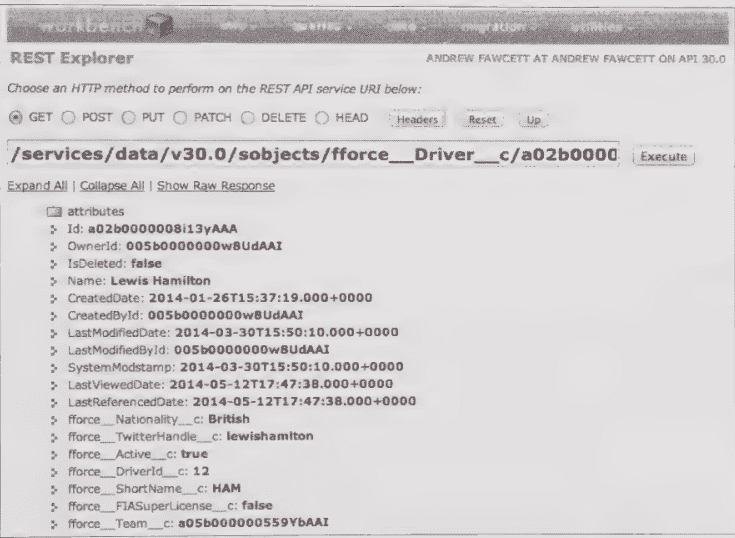
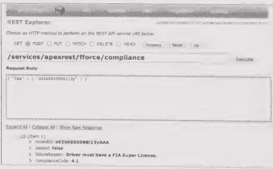
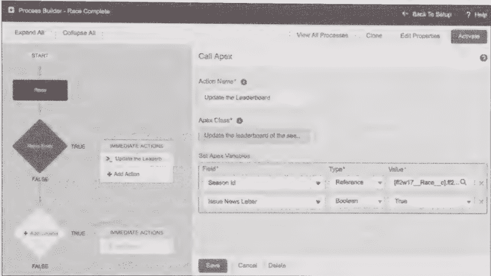
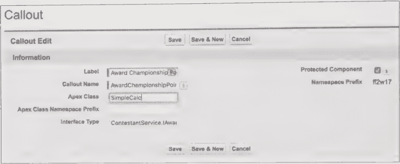

# 10 提供集成和可扩展性

企业业务涉及许多人类、设备，日益增加的机器交互，通常分布在全球各地。要让它们以高效且安全的方式协同工作并非易事，因此，通过互联网使用基于云的软件变得如此流行也就不足为奇了。在选择新应用程序时，高级别的安全性、可扩展性和可用性排在检查清单的高位，其后通常是 API 需求以及定制能力。

通过在 Force.com 平台上开发，您的应用程序已经有了良好的开端。http://trust.salesforce.com/ 网站提供了广泛的行业级、合规性和加密标准，同样适用于您的应用程序。与此随附的是以 SOAP 和 REST 形式提供的一组标准 API，以及创建您自己的应用程序 API 的能力。依我看，目前没有比 Force.com 更具备集成就绪能力的云平台了。

在本章中，我们将审查平台标准提供的集成和可扩展性选项，以及您的应用程序如何从中获益最大，此外还将介绍开发自定义应用程序 API。应用企业模式将再次发挥作用，支持 API 和 UI 具有强功能等效性的需求，通过使用前几章中描述的域层和服务层来实现。

本章将涵盖以下主题：

- 审查集成和可扩展性需求
- 用于集成的 Force.com 平台 API
- 应用程序特定 API
- 与 Force.com 可扩展性功能对齐
- 使用 Apex 接口扩展应用程序逻辑

### 审查您的集成和可扩展性需求

在深入探讨为集成或扩展您的应用程序的人员提供 API 的不同方式之前，让我们通过开发者 X 的眼睛来审查这些需求。这是我赋予一个代表您的 API 以及一般集成和可扩展性需求的消费者角色的名称。就像在设计用户界面时一样，我们可以使用角色概念来对 API 的设计和解释进行合理性检查。

### 定义开发者 X 角色

要求一些人（项目内部和外部人员）代表这个角色是非常值得做的，这让他们能够为您的应用程序 API 策略的功能和特性提供用例和反馈，因为设计一个您认为合理但其他对应用程序了解较少的人不易理解的 API 实在太容易了。围绕您的 API 开发开发者社区的一个好方法是发布设计以供反馈。为开发者 X 设计 API 时，请牢记以下几点：

- 如今，开发者 X 精通许多平台和编程语言，这些平台语言不一定总是 Force.com。日益，开发者 X 还在围绕您的 API 创建移动、JavaScript 和 Heroku 应用程序。
- 随着**物联网（IoT）**的不断扩展，还出现了从手表、冰箱、汽车和喷气发动机等消费设备向设备集成转变的趋势。因此，既能在平台上又能在平台外良好工作的 API 是必不可少的。
- 开发者 X 可能不深入了解应用程序域（其功能概念），因此他们能够与了解这些概念的人进行沟通至关重要，这意味着您的 API 设计和应用程序功能术语必须保持良好对齐。

接下来的章节概述了提供集成 API 和应用程序功能一般可扩展性的一般考虑因素和需求。

### 版本控制

随着您产品功能的增长，管理其对已经在您的应用程序早期版本中采用您的 API 的开发人员和合作伙伴的影响非常重要，除非必要，否则不要强迫他们进行代码更改。尽可能地，保持向后兼容性，这样即使在订户组织中升级了您的应用程序后，现有的集成和扩展也能继续在不进行修改的情况下工作（订户组织中不存储您的应用程序代码的多个版本）。

如果没有向后兼容性，您可能会在客户群中阻碍应用程序的升级，因为开发者 X 花在解决 API 问题上的时间可能会延迟升级并带来高昂成本。一些订户可能已经使用了咨询服务来完成原始工作，或依赖于您的某个合作伙伴来使用您的 API 构建附加解决方案。

版本控制分为两类：版本控制定义（或确定数据输入和输出的契约）以及每个 API 所代表的功能（或行为）。

### 版本控制定义

一旦您发布了特定版本的 API，请勿更改其定义，例如自定义对象、字段、Apex 类、方法或成员，或等效的 REST 或 SOAP 构造。尽管平台将帮助避免某些更改，但添加可能被视为破坏性更改，特别是新的必填字段。任何更改 API 定义或签名的内容都可以被视为潜在的破坏性更改。

开发者 X 应该能够修改和重新部署其现有的集成或扩展，而无需使用您的 API 重新编写或调整其代码，并且不必强迫他们升级到您的 API 的最新版本，除非，当然，他们希望访问仅通过完成新字段才能访问的新功能。请注意，这与在订户组织中升级包本身不同，后者必须允许发生。

当开发者 X 与您的自定义对象和应用程序 API 交互时，标准 Salesforce API 和平台有助于提供版本控制。版本控制的实现方式如下：

- 在 Apex 代码上下文中，平台保留开发者 X 首次编写 Apex 代码时安装的包的版本，然后仅确保此打包版本中可见的 Apex 类、方法、成员、自定义对象和字段对该代码可见。我们将在本章后面详细探讨此功能。


在 SOAP 和 REST API 的情况下，默认情况下可见您的自定义对象的最新版本。使用 SOAP API 时，可以在调用中传递标头值以锁定特定的包版本（如有需要，请在 Apex 开发者指南中搜索 PackageVersionHeader）。或者，这些 API 使用的打包版本可以在组织配置级别设置。

## 通过 Salesforce API 对应用程序访问进行版本控制

在设置菜单下，搜索 API。您将找到一个设置页面，允许您下载众多 Salesforce SOAP API 之一的 WSDL。下一节中有一些版本控制设置，用于确定在与打包对象交互时应假设哪个已安装的包版本。

例如，在通过 Salesforce 企业或合作伙伴 API 执行 describeSObject Web 服务操作时，这些 API 将根据添加新字段的时间返回不同的自定义字段，因为包的新版本已随时间发布。默认行为将返回所有字段，因为默认值是当前包版本。

如果在使用这些 Salesforce API 时，这对于开发者 X 或第三方解决方案很重要，订阅管理员可以指定一个明确的早期版本。如果执行此操作，除非更改此设置，否则未来包版本中可用的新字段将不可用。以下屏幕截图显示了如何在设置下的 API 页面上访问这些设置：




## 对 API 功能进行版本控制

通过 UI 向用户提供应用程序的新版本时，用户将访问新功能——要么通过配置使用新页面或按钮加入功能，要么有时只是无缝地访问，例如新类型的计算、优化或对现有行为的改进，并带来附加好处。

由于 API 只是进入应用程序逻辑的另一种方式，您应该从概念上以相同的方式考虑通过 API 启用这些新功能。如果它通过 UI 对用户无缝可用，那么无论 API 版本如何，它在 API 中也会变得无缝可用，因此，围绕您的应用程序 API 构建的解决方案也将自动受益，而无需更改集成或扩展代码。但是，如果 UI 中需要新字段或按钮，则需要新的 API 参数或操作来启用新功能。将此内容公开在 API 定义的新版本中是合理的。因此，开发者 X 将不得不修改现有代码、测试它并部署它，然后解决方案才能利用它。

试图在代码中过于复杂，以向 API 的旧调用者提供完全相同的行为，这将取决于 Service 和 Domain 层是否理解 API 与 UI 上下文以及包版本控制的概念，这将迅速变得复杂，难以开发、测试、支持和记录。

> 与您的客户和合作伙伴明确商定并沟通您将支持多少个 API 版本，并提前警告弃用。始终务必在不同版本下测试您的 API，以确保包中稍后出现但旧调用者未提供的字段缺失不会在这种情况下导致错误或不想要的行为。尽量避免在没有提供默认值的方式的情况下向应用程序添加新的必填字段。
>
> 如果在对旧 API 版本进行回归测试时，您注意到由于限制导致数据吞吐量减少，则可以接受有条件地使用较新的逻辑（例如检查较新的字段）。同样，请小心在代码库中频繁植入此类条件逻辑。

## 翻译和本地化

与 Service 层周围的准则类似（稍后在本章中可以将其用作形成应用程序 API 的一种手段），您应确保任何错误或状态消息都根据对自定义标签的使用进行翻译，如第 2 章“利用平台功能”中所述（Apex 运行时将确保用户区域设置决定使用的翻译）。

> > 无法通过 Apex 覆盖用于查找适当自定义标签的默认组织语言。但是，如果 API 从使用第 8 章中所述 language 属性的 Visualforce 页面调用，您的 API 代码也将遵循此设置。

一些 API 公开错误代码，以便以编程方式以语言中立的方式识别某个错误用例（在翻译环境中解析消息文本不可靠）。因此，一种方法是使用 Apex 枚举和自定义 Apex 异常类，该类同时捕获翻译后的错误消息和异常代码。以下枚举和异常类型定义在本章示例代码包含的 Application 类中。请注意 Apex 中 global 关键字的使用；本章稍后将更详细地讨论此问题：

```apex
global Application {
	enum ExceptionCode {
		ComplianceFailure,
		UnableToVerifyCompliance
	}
}

global virtual class ApplicationException extends Exception {
	global ExceptionCode ExceptionCode {get; private set;}

	public ApplicationException(
		ExceptionCode exceptionCode, String message) {
		this(message);
		this.exceptionCode = exceptionCode;
	}
}
```

```apex
global class ComplianceException
	extends Application.ApplicationException {
	global List<VerifyResult> failures {get; private set;}

	public ComplianceException(
		Application.ExceptionCode exceptionCode,
		String message, List<VerifyResult> failures) {
		super(exceptionCode, message);
		this.failures = failures;
	}
}
```

然后，此代码可以按如下方式引发指定与消息相关的枚举值的异常：

```apex
throw new ComplianceException(
    Application.ExceptionCode.ComplianceFailure,
    Label.ComplianceFailuresFound,
    failedCompliances);
```

```apex
throw new ComplianceException(
    Application.ExceptionCode.UnableToVerifyCompliance,
    Label.UnableToVerifyCompliance,
    null);
```

与 Service 层准则一样，API 应该与客户端无关，因此您不能假设接受或返回的数据值是否应该格式化。因此，最好为日期、日期/时间和数字使用本机 Apex 类型，并允许调用者决定是否格式化这些值。返回格式化后的值对 UI 调用者很有用，但对于无头或自动化解决方案，这并不理想。

## 术语和平台对齐

如果在定义类、方法、参数和接口时遵循 Service 层的准则（本章稍后将讨论），那么基于此层的任何 API 应该已经反映应用程序中使用的功能术语。与应用程序术语保持良好的一致性可使您的 API 更易于映射到应用程序中的功能概念，从而方便开发者 X 导航、理解以及与更深入了解应用程序功能的人员讨论。

此外，与 Service 层一样，您的 API 应支持批量化等平台问题，不应妨碍开发者 X 以批量化方式调用您的 API，以充分利用平台资源。这还包括开发者 X 使用 Apex DML 语句，因此也凸显了批量化 Domain 层逻辑和批量化 Service 层逻辑的重要性。

## 您的应用程序的集成需求是什么？

通常，集成需求源于控制进程或应用程序，该进程或应用程序使用您的应用程序的功能，实际上代表用户自动调用应用程序中的功能，或作为事件或计划后台进程的一部分。标准 Salesforce API 和您创建的任何其他应用程序 API 都可以支持这一需求。以下图示显示了控制系统如何通过标准 Salesforce API 和/或您作为托管包一部分提供的应用程序 API 来驱动您的应用程序：


尽管当所有应用程序都基于同一平台构建时集成要容易得多，但最好制定一项 API 策略来涵盖开发者 X 的平台上和平台外场景，理想情况下以一致的方式公开相同的功能。

### 开发者 X 在平台上调用您的 API

Force.com Apex 开发者可以通过 Apex DML 语句操作应用程序中存储的数据。您可以将 Apex DML 视为通往应用程序数据的免费 Apex API，因为这种方法避免了构建自己的应用程序 API 来纯粹管理记录数据的需求，特别是对于那些已通过标准 Salesforce UI 公开的自定义对象。


可以通过 Salesforce Schema Builder 浏览自定义对象模式，这对这些开发人员来说是一个有用的辅助工具，就像本书前面所强调的那样。尽量避免字段标签（Field Labels）与字段 API 名称（Field API names）之间的不一致（尽管 Schema Builder 允许切换这些），因为这会使开发人员和提出需求的人更难以协作。

仅仅因为使用了 Apex，并不意味着开发人员 X（Developer X）可以绕过你托管 Apex 触发器（managed Apex Triggers）中的逻辑。但是，请注意，他们也可以编写自己的 Apex 触发器，这些触发器可能会在你的触发器之前执行（因为 Apex 触发器的执行顺序是不确定的）。为避免开发人员 X 的触发器对记录数据做出无效更改，请在编写验证逻辑时遵循最佳实践，将其放置在应用程序触发器的 after 阶段中。如前一章所讨论，使用 Domain 模式将确保这一点。

本章稍后我们将讨论应用程序 API，这些 API 暴露的功能与直接操作自定义对象记录不直接相关，而是更多与业务逻辑相关，例如暴露 ComplianceService.verify 方法。在这种情况下，通过将 Service 类和方法设为 global 而不是 public，你可以向开发人员 X 提供相同的方法。作为 Apex API 策略的扩展，允许他们以与你在应用程序中相同的方式使用它。

本章将进一步描述这种方法背后的动机，即确保随着应用程序的发展，最大限度的应用程序功能可通过你的 API 获得。但是，如果你不希望将完整的 Service 层直接作为应用程序 API 暴露，可以选择创建单独的 Apex 类来定义你的 API，这些类委托给 Service 层，或者选择性地将 global 关键字应用于你的 Service 方法。

## 开发人员 X 在平台外调用你的 API

开发人员 X 使用 Java、.NET、NodeJS 或 Ruby 等语言使用 HTTP 协议在两个平台之间进行连接。Salesforce 提供 API 供你登录和授权访问，以及用于操作自定义对象中数据的 API，其方式类似于使用 Apex DML。Salesforce 目前选择公开其基于 HTTP 的 API 的 SOAP 变体和 REST 变体。因此，同样，你无需为这种类型的数据集成开发自己的 API。

> 许多第三方 Salesforce 集成应用程序利用平台 API，因此也可以与你的应用程序数据一起工作；这一事实是对你和开发人员 X 的一个关键平台优势。

说到公开应用程序 API，为了支持 SOAP 和 REST，你需要为想要公开的每个 API 分别开发独立的 Apex 类。这是因为这些类型的定义和设计不同，尽管你公开的功能相同。我们将在本章稍后进一步讨论这一点。

### SOAP 与 REST

如果你一直关注 SOAP 与 REST 的辩论，或者简单地在 Google 上搜索一下，你就会知道目前普遍倾向于 REST。因为在移动端和基于 JavaScript 的场景中更容易编码和使用，大多数主要云服务（如 Facebook 和 LinkedIn）仅提供其 API 的 REST 版本。出于易用性和更具自我描述性的能力，我也更倾向于 REST。

### 你的应用程序有哪些可扩展性需求？

到目前为止，我们一直在讨论围绕你的应用程序构建自定义解决方案的设施，这是一种集成类型。另一种是提供扩展其现有业务逻辑的方式。在可扩展性用例中，开发人员 X 或管理员乐于让你的用户直接使用你的应用程序 UI 和功能，但希望以某种方式对其进行扩展，以添加其他功能或对其他自定义对象进行更新。你可能希望考虑的扩展类型示例如下：

- 将订阅者创建的自定义字段添加到 Visualforce 页面和字段集是实现此目的的简单方法
- 通过电子邮件模板提供硬编码电子邮件消息的替代方案
- 用订阅者编写的 Apex 逻辑扩展应用程序 Apex 代码逻辑；我称之为 Application Callouts

在本章中，我们将进一步探讨 Application Callouts。下图显示了应用程序代码中的进程如何利用这种方法来执行由 *开发人员 X* 编写的 **代码**。本章稍后我们将看到如何通过使用 Apex 接口和自定义元数据记录来实现这一点的示例。


### 用于集成的 Force.com 平台 API

*第 2 章，利用平台功能*，对那些从 Force.com 平台外部（例如 Java、.NET、PHP 和 Ruby 环境）集成到你的应用程序的人可用的众多平台 API 提供了很好的概述。它还提供了最佳实践，以确保你的应用程序以及使用这些 API 的开发人员拥有最佳体验。

如该章所述，这些 API 主要集中在记录数据操作和查询上，通常称为 CRUD。利用 Salesforce API 意味着希望学习如何集成到你的应用程序对象的开发人员可以利用标准 Salesforce API 文档以及 https://developer.salesforce.com/ 等网站。

尽管 Enterprise API 为 Java 或 .NET 开发人员提供了强类型 SOAP API，但其体积较大，加载到开发环境中可能会出现问题（因为它包含组织中存在的所有自定义对象和字段）。因此，更通用的 Partner API 通常是向开发人员 X 推荐的更好选择。大多数开发人员习惯于通用数据访问层，例如 JDBC 和 ADO，本质上，对他们来说，Partner API 类似且更小巧，便于嵌入到他们的应用程序中。但是，如果你要为移动端或 JavaScript 集成推荐 API，Salesforce REST API 则更轻量，但开发人员承担了额外的责任，即在没有通过 SOAP API 的 WSDL 提供的生成类类型的帮助下解析和构建正确的 JSON 响应和请求。通常，偏好更强类型编程原则的语言更倾向于 SOAP 变体而不是 REST 变体。

对于 Java 开发人员，Salesforce 提供了一个出色的 Web 服务连接器（WSC）框架，它提供了一种无需任何其他 Web 服务堆栈即可使用 SOAP 和 REST API 的高效方式。他们提供了流行的 Partner API 和 Metadata API 的编译版本，网上有大量示例。如果你熟悉它，下载并开始使用此 API 的最简单方法是使用 Apache Maven（https://mvnrepository.com/artifact/com.force.api/force-wsc）。你也可以从 https://github.com/forcedotcom/wsc 下载 WSC：

> "Force.com Web 服务连接器（WSC）是使用流式解析器实现的高性能 Web 服务客户端堆栈。WSC 还使使用 Force.com API（Web 服务/SOAP 或异步/BULK API）变得容易得多。"

对于 .NET 开发人员，Salesforce 发起了一项开源计划，以构建预编译程序集来提供对其 API 的访问，其精神与前面描述的 WSC Java 库类似。你可以从 https://github.com/developerforce/Force.com-Toolkit-for-NET 下载 .NET 工具包：

> "Force.com .NET 工具包为 .NET 开发人员提供了一种使用本机库与 Force.com 和 Chatter REST API 进行交互的简便方法。"

对于 NodeJS 开发人员，Kevin O'Hara 为社区贡献了一个名为 nforce 的库。你可以从 https://github.com/kevinohara80/nforce 下载此 NodeJS 工具包：

> "nforce 是 force.com、database.com 和 salesforce.com 的 node.js REST API 包装器。"

### 应用程序集成 API

本节描述了你可以向外暴露 Service 层中封装的应用程序业务逻辑功能的方式。

> 在某些情况下，*开发人员 X* 能够通过标准 Salesforce API 实现此类功能。但是，具体取决于需求，调用一个暴露应用程序中现有业务逻辑的 API 可能更容易且更安全。你可以出于与创建自定义 UI 而不是期望最终用户仅使用标准 UI 相同的理由决定这样做（因为直接使用你的对象要求他们更详细地了解应用程序对象模式）。

### 提供 Apex 应用程序 API

如果你的 Service 层按照前一章讨论的准则尽可能健壮地开发和测试，那么值得考虑通过简单地更新类、方法、成员、属性以及任何自定义 Apex 类型（例如 `global`）来将其暴露给 *开发人员 X*。本章这部分更详细地讨论了这种方法，尽管它也可以应用于专门构建用于暴露委托给 Service 层类的 API 的独立 Apex 类：

```
global class ComplianceService
{
    global static void verify(Set<Id> recordIds)
    {

```

> 请务必谨慎应用 global 修饰符，因为在你的包发布后不容易弃用它。另外，请务必仅将 `global` 应用于 Service 层的部分，避免暴露 Domain 或 Selector 层类或类型。如果你需要暴露这些类中的行为，请编写一个 Service 层方法来实现。还要注意，`ComplianceService.ICompliant` 接口没有应用 global 修饰符，因为这是服务的内部方面。

如前一章所示，我们还将 `global` 修饰符应用于 `ComplianceService` 类中定义的 Apex 异常类。

要试用此新应用程序 API，我们将执行以下步骤并在你的测试开发组织中执行下面介绍的示例 Apex 测试代码：

- 将本章的示例代码应用到你的打包组织中。
- 注释掉 `ComplianceService.report` 方法（我们将在执行另一次上传前不久取消注释此方法）。


- 3. 上传包的发布版本，并在测试开发组织中安装它。

- 4. 打开开发者控制台，创建一个名为 ApplicationAPITest 的 Apex 类。

如果在设置菜单的 Apex 类页面中检查测试开发组织中的 `ComplianceService` 类，您可以看到刚刚公开的新 API 方法和类型现在已可见（不显示代码）。这为开发者 X 了解您的 API 提供了一种基本方式，此外还有您提供的任何文档。`ComplianceService` 的部分外观在以下屏幕截图中显示。

您还可以看到一个版本下拉框，它允许开发者 X 浏览 API 定义的不同版本。请注意，显示的版本可能与您的不同，具体取决于到目前为止在本书中上传了多少次包：



在订户组织的类列表中，所有 `global` Apex 类旁边也会显示安全链接。这样，订户组织管理员就可以通过配置文件控制 API 执行的权限。请注意，这仅适用于开发者 X 调用的全局控制器方法、自定义或扩展控制器，或 Web Service 调用。您还可以通过适当的权限集（如前一章所述）授予访问权限。这意味着，如果用户被分配了授予其访问应用程序特定功能集的权限集，那么通过 API 访问这些功能也包括在内。

如果要单独控制 API 权限，请创建功能范围独立的权限集：

| 操作 | 名称 | 命名空间前缀 |
| :--- | :--- | :--- |
| 编辑 | Security Application | fforce |
| 编辑 | Cars | fforce |
| 编辑 | CarsSelector | fforce |
| 编辑 | ComplianceController | fforce |
| 编辑 | Security ComplianceService | fforce |

## 从 Apex 调用应用程序 API

本节使用的代码采用 Apex 测试方法（未包含在 FormulaForce 应用程序中）。作为运行 API 代码示例的简便方法，我们将使用 Apex 测试来说明本章包含的示例代码中 Apex API 的用法。我们将查看的两个测试方法会在调用季节 API 创建一些测试数据（当然，这些数据仅在测试执行范围内的数据库中存在）后调用合规 API。

在以下示例中，由 SeasonService.createTestSeason API 创建的 Driver 记录未指明驾驶员持有 FIA 超级驾照。因此，预期 ComplianceService.verify 方法会抛出一个报告此问题的异常。以下示例测试代码仅为了本章说明目的而断言此行为：

```
@IsTest
private class ApplicationAPITest {
    @IsTest
    private static void demoComplianceVerifyAPI() {
        // Create some test data via the SeasonService
        fforce.SeasonService.createTestSeason();

        // Query Drivers to test compliance against
        Map<Id, fforce__Driver__c> driversById =
            new Map<Id, fforce__Driver__c>(
            [select Id from fforce__Driver__c]);

        try {
            // Invoke the compliance engine for the drivers
            fforce.ComplianceService.verify(
                driversById.keySet());
            System.assert(false, 'Expected failures');
        }
        catch (fforce.ComplianceService.ComplianceException e) {
// Check the results
System.assertEquals(
    '4.1', e.failures[0].complianceCode);
System.assertEquals(
    'Driver must have a FIA Super License.',
    e.failures[0].failureReason);
}
}
}
```

本示例中使用的命名空间是 fforce。您的命名空间会有所不同。替换命名空间以使代码示例能够编译（您也可以在本章的示例代码中找到此类）。

运行测试以确认 API 是否按预期工作。

由于您使用了应用程序其余部分所用的相同 Service 层方法，您围绕此类的现有单元测试和集成测试应该足以让您对此作为应用程序 API 的健壮性充满信心。如果不是，改进围绕 Service 层的测试将同样有利于外部和内部调用者。

请注意，当您在 ApplicationAPITest 类中单击显示依赖项按钮时，它会显示从包中引用的 API 和自定义对象：

显示依赖项

Apex 类 ApplicationAPITest 的依赖项信息

<< 返回 Apex 类: ApplicationAPITest

当一个组件引用另一个组件、权限或下方项目时，就会创建依赖关系。此外，对象级操作范围（即数据操作）也已列出。要查看操作范围的字段级详细信息，请单击对象名称旁边的字段。

对象操作范围

Driver (已安装包: FormulaForce) [字段]

Apex 类、触发器和页面引用

ComplianceService (已安装包: FormulaForce)

SeasonService (已安装包: FormulaForce)

## 修改和弃用应用程序 API

当一个 `global` 类方法或成员通过包含在已发布的包中而发布后，将无法将其删除或更改。例如，尝试将 `ComplianceService.verify` 方法重命名为 `verification`（例如）。当您尝试保存类时，将收到以下错误：

```
(ComplianceService) Global/WebService identifiers cannot be removed from managed application: Method: void verify(SET<Id>) (Line: 1)
```

> 如果您想在保留更改新 API 的能力的同时进行一些测试或分发您的包，请将您的包作为 Beta 上传，直到您对 API 定义满意为止。请注意，您当然可以随时更改 API 的行为（由其背后的 Apex 代码决定），但这必须谨慎进行。

`@Deprecated` 注解可用于有效地从后续包版本消费者的角度删除应用了 `global` 的类、接口、方法或成员的可见性。`Developer X` 仍可以通过类版本设置（在 **版本设置** 选项卡中显示，如以下各节中详细所述）引用包的早期版本来访问已弃用的项目。

> 在编写本文时，`@Deprecated` 标志无法在未托管的开发者组织中使用。在后续章节中，我们将讨论一种团队开发模型，该模型允许通过在源代码控制系统中管理代码并为每位开发者单独管理开发者组织来开发您的应用程序。尽管这种开发风格有许多好处，但它排除了使用 `@Deprecated` 标志，因为此类组织实际上是未托管的。

## 对 Apex API 定义进行版本控制

保存时，`ApplicationAPITest` 类、**版本设置** 选项卡和 **依赖项** 页面会反映类中的代码正在引用 FormulaForce 包中的 `ComplianceService` 和 `SeasonService` 类。

在以下屏幕截图中，版本显示为 v1.8，因为这是首次创建 Apex 类时包的当前版本（在您的情况中可能不同，具体取决于您迄今上传了多少次包）：



在以下步骤中，我们将发布包含新合规 API 的新版本包，以探索平台如何提供 Apex API 版本控制：

- 1. 在打包组织中，取消注释 `ComplianceService.report` 方法。此方法的工作方式与 verify 方法类似，但不会抛出异常；相反，它将返回包含合规通过和失败的完整结果列表。
- 2. 上传包的新发布版本并将其安装到测试开发组织中。
- 3. 在测试开发组织中，打开 Apex 类 `ApplicationAPITest`。

尝试添加以下新测试方法并保存类：

```
@IsTest
private static void demoComplianceReportAPI() {
    // Create some test data via the SeasonService
    fforce.SeasonService.createTestSeason();

    // Query Drivers to test compliance against
    Map<Id, fforce__Driver__c> driversById = new Map<Id, fforce__Driver__c>(
        [select Id from fforce__Driver__c]);

    // Update the licenses for the drivers
    for(fforce__Driver__c driver : driversById.values())
```


```
driver.fforce_FIASuperLicense__c = true;
update driversById.values();

// Invoke the compliance engine to verify the drivers
List<fforce.ComplianceService.VerifyResult>
reportResults =
    fforce.ComplianceService.report(
    driversById.keySet());

// Check the results
System.assertEquals('4.1',
    reportResults[0].complianceCode);
System.assertEquals(true, reportResults[0].passed);
System.assertEquals(null,
    reportResults[0].failureReason);
}
```

你应该会收到一个错误，指示该方法不存在：

编译错误：包可见性：方法不可见：fforce.ComplianceService.report(Set<Id>) 在第 21 行第 13 列

这是因为测试类的 Apex 类元数据中的包版本信息仍引用最初编写代码时安装的包版本。升级包不会更改此情况。打开“版本设置”选项卡，并更改为你刚刚安装的版本，以修复此编译问题



前面的步骤已说明 Apex 运行时如何管理你从包中公开的 Apex API 的版本控制。因此，之前描述的 API 定义版本控制要求已由平台为你提供。您无需自行管理此事，但需要了解其工作原理。

最后，从测试开发组织中重新访问 `ComplianceService` Apex 类页面，并注意该类的可用版本也已增加，包含刚刚上传的版本。在它们之间切换；你可以看到我们刚刚执行的最后两个包版本之间 API 定义所经历的更改。

选择 **所有版本** 以获取哪些方法在哪个包版本中可用的完整摘要。你可以在以下截图中看到，`verify` 方法首次在 v1.8 中可用，而 `report` 方法在 v1.9 中可用；同样，你的版本号可能不同：



## 对 Apex API 行为进行版本控制

API 定义不是版本之间可能发生变化的唯一方面。即使定义保持不变，其背后的代码也可能更改 API 的行为。Apex 运行时为打包代码提供了一种手段，以确定由 *开发者 X* 编写的调用代码期望哪个版本。可以通过调用 `System.requestVersion` 方法获得此信息。有了这些信息，你的打包代码可以根据调用代码的期望修改其行为。

随着你发布更多包版本且功能增长，这种代码的管理会变得更加复杂。还要注意，此功能仅适用于位于打包组织或特定托管代码中的代码。在标准开发组织中，此方法将抛出运行时异常。基本上，如果你计划将代码重新定位到打包组织之外（例如，按照本书最后一章讨论的团队开发模型），则此方法不可用。

版本控制行为的另一种方法是考虑应用程序逻辑的变化是 *开发者 X* 希望选择加入的内容，还是在包升级后立即对其现有代码可用。修复错误或改进信息处理方式的小改进可能是你希望无论 API 版本如何都可用的内容。但是，其他更改（例如值的计算方式或添加显著新处理）可能会证明需要新的 API 方法或参数，以便 *开发者 X* 修改其代码来使用。与 UI 中一样，你会选择添加新选项卡、页面或按钮。

通过考虑何时对 API 行为进行版本控制，你已将何时接受新 API 行为的选择交到 *开发者 X* 手中。关键的是，通过考虑向后兼容性，你不会因集成失败而阻止升级到你的包的最新版本。发现由行为更改引起的向后兼容性回归问题，随着你发布的版本越多、客户群中支持的版本越多，就会变得越困难。因此，确保你拥有强大的 API 测试策略变得至关重要。

## 提供 RESTful 应用程序 API

迄今为止，我们一直关注 *开发者 X* 作为平台内 Apex 开发者，以及你可以通过 Apex 提供应用程序 API 的方式。但是，*开发者 X* 也可能在平台外进行编码，需要从 Java 或 Microsoft .NET 或移动应用程序调用你的应用程序 API。也许他们想要编写一个小型专用移动应用程序，用于检查团队、司机或汽车的合规性。

本章的这一部分将重点介绍公开前面合规性 API 的 REST API，供与你的应用程序编写集成的平台外开发者使用。请记住，与平台内场景一样，Salesforce 通过 SOAP 和 REST 提供许多标准 Salesforce API，平台外编码的 *开发者 X* 可以使用这些 API 来创建、读取、更新和删除存储在你的应用程序自定义对象中的记录。

Apex 提供支持，通过在 Apex 类中放置 `webservice` 关键字来通过 Web 服务（SOAP）公开应用程序逻辑。如果你想要公开 SOAP API，则在将此关键字应用于服务类上的方法后，平台可以生成相应的 WSDL。本书中设计的服务恰好与 Web 服务的一般要求相当吻合。

请注意，上述 `@Deprecated` 属性不能以这种方式用于公开的 Apex 代码。不过，需要考虑的一点是，生成的 WSDL 不是版本化的；它们仅基于你的包已安装版本的代码生成。*开发者 X* 无法从以前的包版本生成其历史版本。虽然使用 `webservice` 关键字的 Apex 方法受与 `global` 相同的限制，但你不能通过版本来排除 Web 服务中的新方法或字段。

Apex 还提供支持，用于创建你自己的 REST API，并在 *Apex 开发者指南* 中提供了一些优秀的参考文档。但是，它未涵盖 REST API 设计注意事项，通常称为 RESTful。

在不先理解什么是 RESTful 的情况下公开 REST API 会犯很多错误。在深入使用你的服务层来提供 REST API 之前，让我们先了解更多关于 RESTful 的内容。

## RESTful 的关键方面

对 RESTful API 设计的完整讨论和概述很容易占用整个章节。以下是关键 RESTful 设计目标的摘要，以及它们如何应用于通过 Apex 交付的 REST API（平台会为你处理一些指导原则）。随着我们进一步讨论此主题，术语 *操作* 表示应用程序服务层类中的方法。这将用于帮助公开应用程序的 REST API，但不应指导其设计。

没有单一的指导原则列表，有些原则可供解释。但是，如果你在 Google 中输入 *设计 RESTful API*，你肯定会找到一些有用的阅读材料。我建议你专注于那些提供洞察的文章，说明 Facebook、LinkedIn 和 Salesforce 等较大服务本身如何解释 RESTful，例如 http://www.apigee.com/。

## 你的应用程序资源是什么？

在 RESTful 世界中，你的操作与通过统一资源标识符 (URI) 表示的资源关联。资源可以是应用程序中的实体（例如自定义对象），也可以是概念性实体。这与之前研究过的 Apex API 所基于的服务层设计不同，在该设计中，操作是通过将它们分组在应用程序的功能区域下来表示的，然后由针对每个操作的 Apex 服务类和方法来表示。

Salesforce REST API 使用自定义对象来定义 REST URI 使用的物理资源，允许你构建 URI 并使用各种 HTTP 方法执行创建、读取、更新和删除操作。例如，要检索记录，可以通过开发者工作台工具发出以下请求：



在公开更多面向业务流程或任务而非以数据为中心的操作的情况下，很难确定资源名称实际上应该是什么？因此，花时间与整个产品团队规划并达成一致，确定应用程序中的关键 REST 资源并坚持使用它们，是值得的。


我们 FormulaForce 包中属于此类别的一个操作是合规性报告。该操作针对多个不同的自定义对象记录来报告合规性，例如驱动程序、汽车和车队。我们是应该定义一个针对这些物理资源各自单独应用的 URI，还是创建一个新的逻辑合规性资源？

在本章中，我选择了后者，因为这样做感觉更具扩展性，同时还利用了应用程序中的合规性服务，该服务已经支持向合规性检查器添加新的对象类型。因此，REST API 将支持新的对象类型，而无需对 API 进行未来更改，因为它们已添加到合规性检查器中。

Salesforce 规定用于定义资源的 URI 的初始部分，其余部分由开发人员定义。对于合规性 REST API，我们将使用此 URI：

/services/apexrest/compliance

一旦你打包实现此 REST API 的 Apex 代码，你会发现前面的 URI 需要由你的包命名空间限定，因此从开发人员 X 的角度来看，它将采用如下所示的格式，其中 fforce 是我的命名空间。我们将在本章后面测试合规性 REST API 时使用这种 URI 格式：

/services/apexrest/fforce/compliance

## 将 HTTP 方法映射

针对给定资源 URI 的应用程序操作应映射到 REST 基于的标准 HTTP 方法之一：GET、POST、PUT、PATCH 和 DELETE。在整个 REST API 中选择使用哪种方法并保持一致至关重要。同样，互联网上有许多资源详细讨论了此主题。以下是我对这些阅读材料的解读的简要总结：

- GET：此方法通常用于查询数据库的操作，其参数可以轻松地在 URI 结构中表达，或其参数与该方法非常匹配。

- PUT 与 POST：这些方法通常用于创建、更新或查询数据库的操作，且参数更为复杂，例如无法反映在 URI 参数中的列表或信息结构。还有一个关于 **幂等** 术语的考虑（有关此术语的完整定义，请查看 Wikipedia），它涉及请求是否可以重复多次，并在数据库中产生相同的状态。随着你深入研究 RESTful 设计准则，该术语通常决定了使用 PUT 还是 POST。

- PATCH：此方法通常用于仅更新现有信息的操作，例如某条记录或跨越多条记录的某些其他复杂数据集。

- DELETE：此方法当然用于删除 URI 中表达的现有信息。

我们将使用 `POST` HTTP 方法和 `/services/apexrest/compliance` 资源 URI 来实现合规性验证操作的 REST API，将要验证的记录列表作为 HTTP 请求体的一部分，使用 JSON 数据格式传递。

## 提供 Apex REST 应用程序 API

以下 Apex 类遵循以 `[ResourceName]Resource` 作为类名的命名约定，然后定义适当的方法（在这种情况下方法名称不那么重要），并将其相应地映射到 URL 映射的 HTTP 方法。这已包含在本章的示例代码中：

```
@RestResource(urlMapping='/compliance')
global with sharing class ComplianceResource {
  @HttpPost
  global static List<ComplianceService.VerifyResult>
  report(List<Id> Ids) {
    return ComplianceService.report(new Set<Id>(Ids));
  }
}
```

关于前面的示例，以及一般来说关于将 Service 层方法包装在 Apex REST 方法中以创建 REST API，有几点需要注意：

- 前面的示例使用 ComplianceService 中的 VerifyResult 类。你可能希望在 ComplianceResource 类范围内创建自己的类，以进一步隔离。

- 此类中的方法应根据一般 Service 层调用准则，委托给 Service 类中一个且仅一个适用的方法，以维护事务范围并关注点分离。

- 不建议将 Apex 资源类仅映射到特定的 Service 类，因为你较早的 RESTful API 设计可能与你的 Service 类设计不匹配，尽管它仍应委托给该类。

- 将这些类视为 UI 控制器来处理，仅根据需要包含封送和错误处理逻辑。

- 通常你不需要捕获来自 Service 层的异常（与 Visualforce 控制器操作方法调用者不同），因为 Apex REST 运行时会捕获异常并返回相应的 REST API 错误代码和消息。避免实现你自己的 REST API 错误处理。

- 仍然需要 `global` 修饰符。请记住，对这些方法的更改适用相同的打包限制。

- 开发人员 X 的 Apex 开发人员可以从 Apex 调用这些方法，因为它们是 `global`。但是，这不应被鼓励，因为这些方法可能引用未在标准 Apex 上下文中初始化的 REST API 上下文变量。

- `Set` Apex 数据类型不受 Apex REST 方法支持。与 Service 类方法已建立的标准不同，`Set` Apex 数据类型不受 Apex REST 方法支持。因此，你需要将 `List<Id>` REST 方法参数转换为 `Set<Id>` 集合，以供你的 Service 方法调用。

- `ComplianceService.verify` 方法会抛出包含特定合规性失败附加信息的异常。但是，自定义 Apex 异常中的信息不会由平台自动序列化——仅包含错误消息。在这种情况下，需要自定义响应来捕获异常并返回信息。

## 调用你的 Apex REST 应用程序 API

可以使用 Salesforce Developer Workbench 来调用前面的 REST API。找到未选择 FIA 超级驾驶执照字段的 Driver 记录，并使用以下 ID。请注意，以下屏幕截图中显示的 URI 包含包命名空间 fforce。要尝试此操作，你需要将此替换为你选择的包命名空间：



## 对 Apex REST 应用程序 API 进行版本控制

对 REST API 进行版本控制的公认方式是将版本包含在 URI 中。请注意，前面显示的标准 Salesforce REST API 示例中包含了 v30.0（Salesforce 平台版本），但公开合规性报告操作的 REST API 的 URI 中未包含版本。平台不提供以与其自身 API 相同的方式对 Apex REST API 进行版本控制的功能。

### 行为版本控制

Salesforce REST API 和任何公开的 Apex REST API 都可以从新的 HTTP 头中接收，例如 x-sfdc-packageVersion-fforce: 1.10。在 Apex REST API 的情况下，可以使用此头来允许打包的 API 代码实现行为版本控制。这可以用于设置本章前面所述的 System.requestVersion 返回的版本。

此头是可选的；如果没有它，则假设为当前安装的包版本。我之前关于行为版本控制利用的建议也适用于此。因为该头是可选的，所以其有用性被稀释。

### 定义版本控制

前面的 HTTP 头不以本章前面为 Apex API 所示的平台方式影响 API 定义的可见性。解决此问题的一个选项是将版本化的 URI 映射到每个版本的特定 Apex 资源类，例如，为合规性 REST API 的 v1.0 和 v2.0 版本提供支持。这种方法允许你公开包含版本的 URI：

```
/service/apexrest/fforce/v1.0/compliance
/service/apexrest/fforce/v2.0/compliance
```

在对 API 定义进行版本控制时，你还需要捕获 Service 层中使用的 Apex 数据类型的副本。这将使每个 REST API 版本与 Service 层的底层变化隔离开来，随着其演进。这里的主要编码开销将是 Service 层中定义的 Apex 类型（始终是最新版本）与实现 REST API 的类中的类型之间的封送。


例如，为报告 API 进行版本控制时，我们需要在创建 API 类时将其类型作为内部 Apex 类捕获。以下示例说明了 v1.0 的此过程。您可以看到 API 的定义如何封装在由 v1_0 后缀表示的特定版本的 Apex 类中：

```
@RestResource(urlMapping='/v1.0/compliance')
global with sharing class ComplianceResource_v1_0 {

global class VerifyResult {
    global Id recordId;
    global String complianceCode;
    global Boolean passed;
    global String failureReason;
}

@HttpPost
global static List<VerifyResult> report(List<Id> Ids) {

    List<VerifyResult> results = new List<VerifyResult>();
    for(ComplianceService.VerifyResult result :
        ComplianceService.report(new Set<Id>(Ids)))
        results.add(makeVerifyResult(result));
    return results;
}

private static VerifyResult
makeVerifyResult(ComplianceService.VerifyResult verifyResult) {
    VerifyResult restVerifyResult = new VerifyResult();
    restVerifyResult.recordId = verifyResult.recordId;
    restVerifyResult.complianceCode = verifyResult.complianceCode;
    restVerifyResult.passed = verifyResult.passed;
    restVerifyResult.failureReason = verifyResult.failureReason;
    return restVerifyResult;
}
}
```

您使用的版本号可以是任何您喜欢的内容，但您可以考虑遵循您的软件包版本编号序列。

以这种方式对 Apex REST API 进行版本控制并不理想，因为必须通过代码手动对定义进行版本控制，并且在软件包的每个版本中管理该代码会带来额外开销。但是，如果不采用这种方法，始终会暴露软件包中 Apex REST API 的最新定义。这意味着在升级软件包后，调用者会收到他们未预期的响应中的新字段。也没有方法可以弃用 Apex REST API。但是，由于对 `global` 类成员的删除限制，开发人员在意外删除会破坏现有请求的字段时有一定的保护。

## Exposing Lightning Components

在前一章中，我们查看了 FormulaForce 软件包中包含的几个组件。这些组件已全部通过 `global` 访问级别公开，以供订阅者组织中的工具和开发人员代码使用。

当开发人员在其自身组件中使用这些组件时，可以通过包元数据中的设施来表达他们希望平台在代码与打包组件交互时假定的软件包版本。这允许对组件的定义和行为进行版本控制。如果没有此信息，则假定当前安装的软件包版本。

`System.requestVersion`、`{!Version}` 和 `cmp.getVersion()` 可用于确定组件在 Apex 或 JavaScript 中需要遵循的版本。

## Extending Process Builder and Visualflow

**Process Builder** 或 **Visualflow** 工具允许用户创建自定义流程和类似向导的用户体验。这两种工具都提供大量可操作的动作，这些动作基于用户定义的条件执行。

可用操作可以由安装在组织中的软件包扩展。这为您提供了另一种公开功能以构建自定义场景的方法。这种方法不需要用户编写任何代码。

The following code creates an **Invocable Method**, which is a `global` class and a single method with some specific annotations. These annotations are recognized by the tools to present a dynamic configuration UI to allow the user to pass information to and from the method you annotate:

```
global with sharing class UpdateStandingsAction {

    global class UpdateStandingsParameters {

        @InvocableVariable(
        Label='Season Id'
        Description='Season to update the standings for',
        Required=True)
        global Id seasonId,
        @InvocableVariable(
        Label='Issue News Letter'
        Description='Send the newsletter out
        to the teams and drivers'
        Required=False)
        global Boolean issueNewsLetter;
    }
}
```

```
private SeasonService.UpdateStandings makeUpdateStandings() {
    SeasonService.UpdateStandings updateStandings =
    new SeasonService.UpdateStandings();
    updateStandings.seasonId = this.seasonId;
    updateStandings.issueNewsLetter = this.issueNewsLetter;
    return updateStandings;
}
}
```

```
@InvocableMethod(
Label='Update the leaderboard of the season'
Description='Updates the standings and optionally
sends the newsletter.')
global static void
updateStandings(
List<UpdateStandingsParameters> parameters) {
    // Marshall parameters into service parameters
    List<SeasonService.UpdateStandings> updateStandings =
    new List<SeasonService.UpdateStandings>();
    for (UpdateStandingsParameters parameter : parameters) {
    updateStandings.add(parameter.makeUpdateStandings());
    }
    // Call the service
    SeasonService.updateStandings(updateStandings);
}
}
```

> 为将此方法的参数与 Service 类方法的变化隔离开来，使用了 UpdateStandings Apex 类。如果需要，这还允许方法向不同方向演变。

以下显示了上述 Invocable Method 在 Process Builder 中的外观：



当比赛结束时，此方法可例如用作上述订阅者定义的 Process Builder 流程的一部分。虽然您可以在 Apex Trigger 中执行此操作，但这可能涉及特定于您软件包订阅者的某些附加条件。因此，这是 Process Builder 的一个良好用例，并通过 Invocable Method 公开 SeasonService.updateStandings 方法。

> 有关 Invocable Methods 和上述属性的更多信息，请查阅 Apex 开发者指南。关于可传递的参数类型存在各种限制，例如参数必须为列表形式。这与 Service 层的批量化要求非常契合。

## Versioning Invocable Methods

Process Builder 或 VisualFlow 都不会记录引用可调用方法时使用的软件包版本。因此，无法执行行为版本控制，System.requestVersion 返回当前安装的软件包版本。Invocable Method 的定义由与 global 修饰符使用相关的约束控制，我们已在本章中讨论过。作为最佳实践，请避免向参数类添加新的必需成员（通过 @InvocableVariable）。

## Alignment with Force.com extensibility features

以下是一些平台功能，可帮助确保您的应用程序功能对 Developer X 或订阅者组织管理员开放以进行扩展：

- **Apex Triggers**：Developer X 可以针对您的应用程序的托管自定义对象编写自己的触发器。这些触发器将在打包的触发器之外执行。例如，这允许 Developer X 实现字段默认值或自定义验证。Salesforce 不保证打包的触发器会在订阅者组织中在 Developer X 触发器之前或之后执行。为了确保无论触发器执行顺序如何都验证所有更改，请在打包触发器的 after 阶段中执行验证逻辑。

- **Field Sets**：如前几章所述，请尽可能经常在 Visualforce 页面上利用此功能，以确保区域和表格可以使用订阅者添加的字段进行扩展。如果您正在开发移动 UI，这些功能也可以与 JavaScript 框架一起使用。

- **E-mail templates**：如果您正在编写代码来发送电子邮件，请考虑提供一种机制，允许使用电子邮件模板自定义文本。可以通过自定义设置使用其开发者名称引用这些模板。还可以在此处利用 Field Sets 来提供一种简便方式，以包含订阅者管理员添加的其他自定义字段。

- **Visualforce components**：请考虑全局创建一些 Visualforce 组件，这样 Developer X 可以更轻松地构建替代的自定义 Visualforce 页面，而无需重新实现应用程序页面的所有方面。此类组件可以构建为允许在电子邮件模板中使用动态内容。

- **Lightning components**：请考虑公开软件包中使用的 Lightning 组件，以供 Lightning App Builder 和 Lightning Community Builder 等工具使用，正如我们在前一章中探讨的那样。这可以为管理员和开发人员提供很大的灵活性，以构建和自定义其业务的独特用户体验。

- **Dynamic Apex type creation**：可以使用 `Type.forName` 方法创建 Apex 类型的实例，并从该实例在运行时创建该类型的实例。此功能可用于允许 Developer X 编写 Apex 代码，您的应用程序代码可以在指定时间动态调用该代码。此方法将在即将到来的章节中详细讨论。


## 使用 Apex 接口扩展应用程序逻辑

Apex 接口可用于描述应用程序逻辑中的一个点，Developer X 编写的自定义代码可在该点被调用。例如，为了提供由 Developer X 驱动的计算锦标赛积分的替代方案，我们可以公开一个描述应用程序调用的全局接口，如下所示：

```apex
global class ContestantService {
    global interface IAwardChampionshipPoints {
        void calculate(List<Contestant__c> contestants);
    }
}
```

通过查询本章源代码中已包含的 Callouts 自定义元数据类型的自定义元数据记录，应用程序中的代码可以确定 Developer X 是否已提供此接口的实现，以调用该实现而非标准计算代码。

对于此类需求，使用自定义元数据是一个极佳的用例，因为您可以通过打包记录来声明包支持的调用。然后，通过将某些字段设置为订阅者可编辑，可以允许订阅者（Developer X）配置这些调用。与自定义设置相比，这种方法避免了额外配置和误配置的风险。

> 扩展您包的合作伙伴也可以将此配置与他们的 Apex 类一起打包。因此，安装此类合作伙伴扩展包的管理员无需进行任何配置即可激活其中包含的调用。

此屏幕截图显示了如何定义 Callouts 自定义元数据类型。请注意，Apex 类和 Apex 类命名空间前缀字段是订阅者可编辑的：

| Action | Field Label | API Name | Data Type | Field Manageability | Indexed | Controlling Field | Modified By |
|---|---|---|---|---|---|---|---|
| 编辑 | 删除 | Apex 类 | f2w17__ApexClass__c | Text(64) | 订阅者可编辑 | | Andrew Fawcett 10/16/2019 9:29 AM |
| 编辑 | 删除 | Apex 类命名空间前缀 | f2w17__ApexClassNamespacePrefix__c | Text(40) | 订阅者可编辑 | | Andrew Fawcett 10/16/2019 9:29 AM |
| 编辑 | 删除 | 接口类型 | f2w17__InterfaceType__c | Text(255)（不区分大小写的唯一值） | 可升级 | ✓ | Andrew Fawcett 10/16/2019 9:27 AM |

以下记录由您作为打包开发者定义，以有效声明 **Award Championship Points** 调用存在且可配置。这也应包含在您的包中：

| Action | Label * | Callout Name | Namespace Prefix | Interface Type | Protected Component |
|---|---|---|---|---|---|
| 编辑 : 删除 | **Award Championship Points** | AwardChampionshipPoints | c2v17 | ContestantService.IAwardChampionshipPoints | ✓ |

> > 请注意，自定义元数据类型字段支持 Developer X 提供类名，该类名可以是完全限定名（例如来自扩展包的 fforceext.SimpleCalc），也可以是本地类（在订阅者组织中定义），例如 DeveloperXCustomCalc。

以下代码是一个 Selector 方法（参见 CalloutsSelector）类，用于读取已注册的接口实现。它使用 Type.forName 方法构建适用的 Apex 类型，并返回一个 Map，其中包含实现每个接口的 Apex 类：

```java
public Map<Type, Type> selectAllCallouts() {
    // Query custom metadata records for callouts
    Map<Type, Type> calloutsByInterfaceType =
        new Map<Type, Type>();
    for(Callout__mdt record :
        Database.query(newQueryFactory().toSOQL())) {
        if(Callout__mdt.ApexClass__c!=null) {
            // Namespace of the interface is that
            // of the custom metadata type
            Type interfaceType =
                Type.forName(
                    record.NamespacePrefix__c + '.' + record.InterfaceType__c);
            // Implementing class can optionally specify
            // the namespace if needed
            Type implType =
                Type.forName(record.ApexClassNamespacePrefix__c,
                    record.ApexClass__c);
            calloutsByInterfaceType.put(interfaceType, implType);
        }
    }
    return calloutsByInterfaceType;
}
```

以下代码使用一个名为 `Application.Callout` 的新类工厂，该工厂未在此显示，但包含在本章源代码中。这是一个简单的类工厂，使用上述 `Selector` 方法并公开 `newInstance` 方法，以便实例化 `Developer X` 注册的类。`Contestants` 域类中的以下方法现在如下所示：

```java
public void awardChampionshipPoints(fflib_ISObjectUnitOfWork uow)
{
    // Custom implementation configured by Developer X?
    Object registeredInterfaceImpl =
    Application.Callouts.newInstance(
    ContestantService.IAwardChampionshipPoints.class);
    if(registeredInterfaceImpl instanceof
    ContestantService.IAwardChampionshipPoints) {
    // Cast the interface to call the calculate method
    ContestantService.IAwardChampionshipPoints
    awardChampionshipPoints =
    (ContestantService.IAwardChampionshipPoints)
    registeredInterfaceImpl;
    // Invoke the custom method from Developer X
    awardChampionshipPoints.calculate(Records);
    // Mark dirty on behalf of Developer X
    for(Contestant__c contestant :
    (List<Contestant__c>) Records) {
    uow.registerDirty(contestant);
    }
    return;
    }
    // Continue with standard implementation...
}
```

在订阅者组织或测试开发组织中，Developer X 随后可以按如下方式实现此接口，并配置与 **Award Championship Points** 调用对应的 Callouts 记录上的 Apex 类字段。下次调用锦标赛积分服务时，将调用此自定义逻辑：



以下是一个简单的 Application Callout 实现，它根据赛车位置分配积分，而不是使用默认计算：

```java
public class SimpleCalc
    implements fforce.ContestantService.IAwardChampionshipPoints
{
    public void calculate(List<fforce__Contestant__c> contestants)
    {
        // Very simple, points equals race position
        for(fforce__Contestant__c contestant : contestants)
            contestant.fforce__ChampionshipPoints__c =
                contestant.fforce__RacePosition__c;
    }
}
```

公开全局 Apex 接口时需要考虑的一些方面如下：

- 发布全局接口（通过将其上传至发布管理包）后，即无法对其进行修改。
- 您可以从另一个全局接口扩展全局接口，例如 IAwardChampionshipPointsExt 扩展 IAwardChampionshipPoints。
- 从安全角度出发，请仔细考虑通过 Apex 接口方法向 Application Callout 传递什么内容，特别是如果参数是应用程序代码稍后会引用其值的对象。请确保您允许 Application Callout 对此对象或数据进行任何更改。如果您对此不放心，请考虑在将对象作为参数传递给接口方法之前对其进行克隆。

## 摘要

在本章中，我们通过名为 Developer X 的角色视角，回顾了企业应用程序集成和可扩展性需求。通过使用此角色，就像进行 UI 设计一样，您可以确保 API 跟踪来自代表性用户（理想情况下是实际用户）的真实用例和需求。

在制定 API 策略时，请牢记标准 Salesforce API 的优势，以及如何推广这些 API 以及 Salesforce 在其中投入的大量资源，以便提供对存储在自定义对象中的信息的访问。我们还了解到，Lightning App Builder、Lightning Process Builder 和 Visualflow 等平台工具可以使用您的包中的嵌入式功能进行扩展，这些功能可以无需代码即可访问。

如有需要，请利用 Service 层使用 Apex 和 REST 作为交付机制来创建应用程序 API（无论是本地还是非本地）。请牢记，REST 需要额外的设计考量，以确保您的 REST API 可以被视为真正的 RESTful，从而对一直在使用其他 REST API 的 Developer X 来说感到熟悉。通过自定义元数据配置的应用程序调用允许开发人员扩展您应用程序中的逻辑。

请不要忘记，虽然 Visualforce、Lightning 和 Apex 等技术为您作为开发人员提供了极大的灵活性，并为用户提供了精调的功能，但它们通常会减少订阅者的可扩展性机会；通过使用 Field Sets 和 Apex Application Extensions（利用 Type.forName），您可以恢复这种平衡。还请牢记，Field Sets 在自定义 UI 用例之外也提供了良好的可扩展性工具。例如，在使用 JavaScript 框架构建移动 UI 时，可以使用它们来公开订阅者自定义字段。

如果您一直在跟进，本章无需上传 FormulaForce 包的新版本；否则，请获取本章提供的示例代码中的最新代码，以更新您的打包组织并上传新包。

在下一章中，我们将回顾有助于应用程序扩展的方法和功能。


