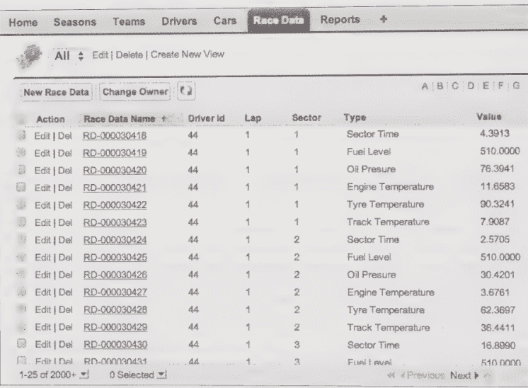
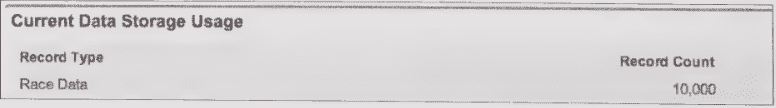
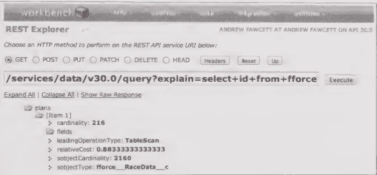
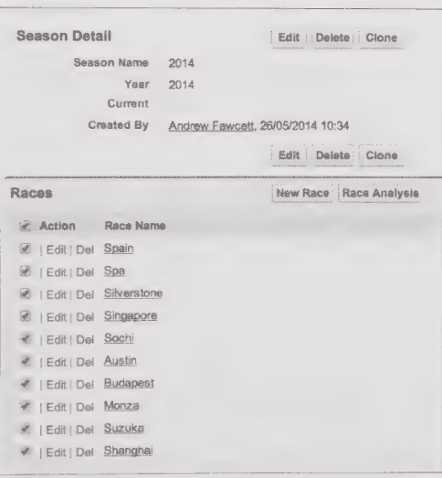
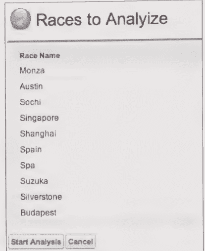

# 11 异步处理和大数据量

本章介绍在 Force.com 平台上开发企业级应用程序的两个重要方面。虽然异步处理和大数据量不一定相关联，但平台更大的 governor 限制和处理能力大多出现在异步处理模式中。不过，在查询大量数据时，确保交互式用户体验仍然响应迅速也非常重要。

在本章中，我们将首先回顾如何通过了解如何分析查询并利用标准索引和自定义索引，确保 SOQL 查询尽可能高效。这将有助于应用程序中的交互式和批处理（或异步）进程，以及它们利用原生平台功能（如报表）的方式。

随后，我们将探讨将应用程序处理迁移到异步模式的选项、最佳实践、设计和易用性注意事项，再次利用 **Service** 层作为应用程序的共享支柱，最后了解在对应用程序进行容量测试时的一些想法和注意事项。本章将涵盖以下主题：

- 为容量测试创建测试数据
- 索引、选择性和查询优化
- 异步执行上下文
- 容量测试

## 为容量测试创建测试数据

在本章中，我们将使用 `RaceData__c` 对象。我们将为其添加更多字段，并运行脚本将其填充一些测试数据量，然后探讨访问它和处理其中数据的不同方式。

在 **Formula1** 赛车世界中，比赛期间会从车手和赛车上捕获大量数据。这些信息用于进行实时或赛后分析，以便进一步改进或排查问题。由于涉及数据量巨大，FormulaForce 应用程序会考虑汇总这些数据的方式，以便在需要时可以轻松删除并稍后重新加载。

以下功能将添加到 FormulaForce 应用程序中，以处理此信息并帮助演示本章中描述的 Force.com 功能。此功能的 Apex 类和 Visualforce 页面包含在本章的示例代码中。

- 一个可对赛车数据进行 *What-If* 分析的 Visualforce 页面
- 一个用于验证并将赛车数据与参赛者关联的 Batch Apex 进程

本章示例代码还包含对 **Race Data** 对象的更新，如下：

1. **Type** 字段表示赛车数据的类型，例如，**油压**、**发动机温度**、**扇区时间**、**燃油量**、**进站时间**等等。
2. **Value** 字段是取决于 **Type** 字段的数值。
3. **Lap** 和 **Sector** 字段是表示捕获数据所在的圈数和扇区数的数字字段。
4. **Year**、**Race Name** 和 **Driver Id** 字段是文本字段，稍后将其组合在一起可用于形成键，以便将每个 **Race Data** 记录与相应的 **Contestant** 记录关联（该记录与 **Driver**、**Race** 和 **Season** 对象有其自身的关系）。在此用例中，我们假设生成这些原始数据的电子系统不知道或不想了解 Salesforce ID，因此 FormulaForce 应用程序必须正确解析与 **Contestant** 记录的关系。
5. **Contestant** 查询字段引用适用的 **Contestant** 记录。由于传入的原始数据不包含 Salesforce 记录 ID，此字段最初未填充。FormulaForce 应用程序的逻辑将稍后填充此字段，如本章后面所示。
6. 一个新的 Race Data ID 外部 ID 字段已添加到 Contestant 对象。Contestants Domain 类中的 Apex 代码已更新，以确保添加 Contestants 时自动填充此字段，并且在处理新 Race Data 时可以使用其值，以便正确将 Race Data 记录与 Contestant 记录关联。

Race Data 对象对其 Name 字段使用 Auto Number 字段类型。这确保数据的插入顺序也被保留。

> 请注意，我们已将 Race Data ID 字段添加到之前版本的包中已发布的对象，同时 Contestants Domain 类已更新以填充新记录的此字段。订户组织中已存在的记录不会包含此值。Force.com 提供了一种在安装（和卸载）包后执行 Apex 代码的方法，以便您可以包含触发 Batch Apex 作业的代码，以用适当的值更新现有记录中的此字段值。请参阅 Apex 开发人员指南中的 System.InstallHandler 接口。

## 使用 Apex 脚本创建 Race Data 对象

和我一样，我怀疑你是否拥有一支真正的 Formula1 车队或赛车来提供原始数据输入。我们将使用 Apex 脚本生成测试数据，尽管在现实中，赛车数据可以通过 CSV 文件导入或通过 Salesforce API 与汽车本身集成来插入。

此测试脚本将生成 10,000 行数据，这足以探索本章中描述的平台功能以及 Force.com SOQL 分析器的行为，后者会根据行数做出不同的选择。

由于正在创建（如果重新运行脚本则删除）大量数据，您必须通过所选 IDE 或开发者控制台的 Execute Anonymous 提示符逐个运行以下每个 Apex 语句，以遵守 governor 限制：

1. 运行 `TestData.resetTestSession();`
2. 运行 `TestData.purgeVolumeData(false);`
3. 运行 `TestData.purgeVolumeData(true);`
4. 运行 `TestData.createVolumeData(2017, 'Spain', 52, 4);`

前面步骤中的步骤 1 将运行一个脚本，清除其他 FormulaForce 对象中的所有其他数据，以便为本章余下部分设置测试 Season、Race 和 Driver 数据。您可以重复步骤 4 为其他比赛生成另外 10,000 条 Race Data 记录——我们将在本章后面这样做。此步骤可能需要几分钟才能完成。

脚本执行完毕后，前往 Race Data 选项卡并查看数据。Value 列中显示的值是随机值，因此您的结果会有所不同。



如果您查看存储使用情况页面，还应该看到以下行数：



## 索引、选择性和查询优化

在本节中，我们将回顾 Force.com 平台维护的系统索引和自定义索引在何时用于使查询更高效，以及在返回较大查询结果后，您的 Apex 逻辑可以最有效地消耗这些索引的方式。

### 标准索引和自定义索引

与其他数据库一样，Force.com 在操作记录数据时维护数据库索引，以确保在查询数据时可以使用这些索引来提高查询性能。由于 Force.com 多租户平台的设计，它拥有自己的数据库索引实现（而不是使用底层 Oracle 数据库索引），该实现会考虑每个租户的需求。默认情况下，它为以下字段维护标准索引：

- ID
- Name
- OwnerId
- CreateDate
- CreatedById
- LastModifiedDate
- LastModifiedById
- SystemModStamp
- RecordType
- 任何主细关系字段
- 任何查询关系字段
- 任何标记为 Unique 的字段
- 任何标记为 External Id 的字段

将应用程序部署到订户组织后，您还可以请求 Salesforce 考虑在前面列表未涵盖的字段上创建其他自定义索引，例如应用程序逻辑用于过滤记录的字段，包括自定义公式字段以及订户添加到您对象中的自定义字段。


公式字段可以被索引，前提是公式结果是确定的，这意味着它不使用任何动态数据或时间函数，例如 TODAY 或 NOW，也不对通过查找字段或任何其他非确定性公式字段的相关字段进行引用。

由于创建和维护索引会消耗平台资源，自定义索引无法打包，因为是否启用它们的决定取决于仅在订阅者组织中才存在的条件。

尽管对象可以包含数百万条记录，但标准索引最多只索引 100 万条记录，自定义索引最多索引 333,333 条记录。这些限制会影响是否使用索引，具体取决于使用的查询和筛选条件。本章后续内容将更详细地讨论此问题。

关于 Race Data 对象，平台将默认索引以下字段。只有通过联系 Salesforce 支持并启用订阅者组织，才能创建其他自定义索引，例如在 Type__c 字段上。

| 字段 | 标准索引 |
|---|---|
| 创建者 | 是（查找字段） |
| 最后修改者 | 是（查找字段） |
| 名称 | 是 |
| 所有者 | 是 |
| Contestant__c | 是（查找字段） |
| Race__c | 是（查找字段） |
| DriverId__c | 否 |
| Lap__c | 否 |
| RaceName__c | 否 |
| Sector__c | 否 |
| Type__c | 否 |
| Value__c | 否 |
| Year__c | 否 |

在“设置”中，导航到“对象”并找到 Race Data 对象。在查看“标准字段”或“自定义字段及关系”相关列表中列出的字段时，观察“索引”列。这是确定字段是否应用了标准或自定义索引的最简单方法。

因此，如果查询按系统或自定义索引覆盖的字段进行筛选，Force.com 查询优化器将考虑该索引。这意味着索引的存在并不表示一定会被使用。最终决定取决于查询的选择性。

> 默认情况下，Salesforce 不会在其索引中包含含有空值的行（针对相应字段）。在这种情况下，虽然 **参赛者** 字段默认已编入索引，但它最初包含空值，因此最初索引将无效（这一事实与为什么在筛选条件中使用空值会阻止 Force.com 查询优化器使用索引有关，将在下一节中讨论）。但是，您可以联系 Salesforce 支持，讨论在索引中包含空值的启用事宜。

## 确保查询利用索引

选择适当索引的过程适用于通过 API 和 Apex 使用 SOQL 进行的查询，也适用于 **报告和列表视图**。索引的使用取决于 SOQL 语句是否具有选择性。以下提供了选择性和非选择性的定义：

- Salesforce 使用 **选择性** 一词来描述能够利用 Salesforce 幕后维护的索引来筛选记录数据的查询，从而使此类查询更高效，并更快地返回结果。

- 相反，**非选择性** 一词意味着给定查询未利用索引；因此，在大多数情况下，其性能不会很好。它将超时，或者对于记录数大于 100,000 的对象，会导致运行时异常。

在非选择性查询情况下，平台将扫描对象中的所有记录，并对每条记录应用筛选；这被称为 **全表扫描**。但是，这不一定是最慢的选择，具体取决于记录数量和筛选条件。

本章部分的主要目标是解释 Salesforce 为给定查询选择索引所需的条件。这取决于多个因素，包括构建应用程序查询时以及订阅者组织中对象中的记录数量。

## 影响索引使用的因素

决定是否使用索引有两个因素。首先，查询的 **筛选条件**（在 SOQL 术语中为 `WHERE` 子句）必须符合所使用的运算符和条件的某些规则。其次，对象中的 **记录总数** 与应用筛选条件后预计返回的记录数量之间的比较。

筛选条件当然必须引用已为其定义标准或自定义索引的字段。之后，可以使用一元、AND、OR 和 LIKE 运算符来筛选记录。但是，其他运算符（如否定运算符、通配符和文本比较运算符），以及在筛选条件中使用 null，都很容易导致查询无法使用索引。例如，更明确指定所需行的筛选条件 `Type__c = 'Sector Time'` 更有可能利用索引（假设该字段已启用自定义索引），而例如 `Type__c != 'Pit Stop Time'` 则会导致平台执行全表扫描，因为平台无法利用其在该列各行中维护的数据分布内部统计信息。

要使用索引，筛选后的记录数必须低于对象中总记录数的某个百分比。您可能会问，Salesforce 如何在不实际执行查询的情况下知道这些信息？虽然他们没有提供完整详细信息，但他们确实描述了所谓的预查询，使用平台在维护标准或自定义索引时捕获的统计数据。这些统计数据有助于根据字段值了解数据分布。例如，执行加载示例数据的脚本时，`Type__c` 字段包含 **进站停留时间** 值的行所占百分比为 0.16 百分比，因此，如果存在自定义索引且查询的筛选条件足够具有选择性（例如 `Type__c = 'PitStop Time'`），则将使用索引。

针对 **扇区时间** 的查询，例如 `Type__c = 'Sector Time'`，将返回 1664 条记录，占所选总行数的 16.64%。因此，虽然筛选条件具有选择性，但筛选后的记录数超过了自定义索引的阈值：10% 或最多 333,333 条记录。因此，在此情况下，不会使用索引。这可能导致超时或运行时异常。因此，为避免这种情况，必须使查询更具选择性，例如，通过启用自定义索引并将 `Lap__c` 或 `Sector__c` 添加到筛选条件中。

Salesforce 提供了关于如何处理大数据量的更多详细信息，例如完整记录了用于选择索引的筛选记录数容差（注意，这些容差因标准或自定义索引而异）以及关于其如何在 Oracle 数据库中存储数据的一些见解，这些有助于更好地理解相关问题。在我看来，这些是必读材料，可以在各种白皮书和 Wiki 页面中找到。其中一些如下：

- 查询与搜索优化速查表: http://resources.docs.salesforce.com/rel1/doc/en-us/static/pdf/salesforce_query_search_optimization_developer_cheatsheet.pdf
- 大数据量部署最佳实践: http://www.salesforce.com/docs/en/cce/ldv_deployments/salesforce_large_data_volumes_bp.pdf
- Force.com SOQL 最佳实践：空值和公式字段: https://developer.salesforce.com/blogs/engineering/2013/02/force-com-soql-best-practices-nulls-and-formula-fields.html
- 通过查询资源反馈参数试点开发选择性 Force.com 查询: https://developer.salesforce.com/blogs/engineering/2014/04/developing-selective-force-com-queries-query-resource-feedback-parameter-pilot.html

## 查询分析

由此可见，所需索引及其使用时间等考虑因素在很大程度上取决于订阅者组织中数据增长率以及该数据中不同数据值组的分布。因此，分析通常只在与客户和 Salesforce 协作并在订阅者组织内进行。

在某些情况下，披露应用程序从 Apex 和 Visualforce 页面发出的查询，可能会帮助您和您的订阅者提前规划需要哪些索引。您还可以通过调试日志捕获代码中发出的 SOQL 查询，前提是您已通过 **订阅者支持** 功能登录。


一旦你怀疑某个 SOQL 查询正在引起问题，你就会对其进行性能分析，以确定正在使用哪些索引，从而决定如何解决问题、创建新索引，以及/或通过添加更多约束条件来减少过滤条件选中的记录数量。为此，你可以使用平台的一个功能，让平台在考虑为给定查询使用哪个索引（如果有的话）时解释其选择。同样，重要的是在订阅者组织或沙箱本身中使用此功能。

为本章的目的，以下示例利用 Salesforce REST API 上的 explain 参数，在我们运行前面脚本的包装组织中执行查询，以向 Race Data 对象填充 10,000 条记录。

开发者控制台包含查询规划器工具，可在首选项选项卡下启用。当你通过查询编辑器运行查询时，会弹出一个窗口，显示所考虑索引的说明。显示的信息基本上与本章中通过 explain 参数描述的信息相同。

本节在通过开发者工作台工具运行 SOQL 时利用 explain 参数。在这里，你可以在解释模式下运行各种查询并查看结果。结果显示了如果查询实际执行时会使用的一系列查询计划。它们按平台的偏好顺序显示。以下步骤展示了如何登录开发者工作台以获取给定查询的查询计划：

- 1. 登录开发者工作台。
- 2. 从实用工具菜单中，选择 REST 探索器。
- 3. 输入 /services/data/v30.0/query?explain= 然后粘贴你的 SOQL。你也可以在 URL 中使用最新的 Salesforce API 版本。
- 4. 单击执行。

首先，让我们尝试下面的示例，该示例未在 Type__c 字段上使用自定义索引。请注意，使用了 fforce 前缀；由于 SOQL 查询正在启用命名空间的包装组织中执行，你应该将此替换为你自己选择的命名空间。

```
select id from fforce__RaceData__c
where fforce__Type__c = 'PitStop Time'
```

以下截图显示了开发者工作台针对此查询显示的查询计划结果：



如预期，结果是 TableScan，与以下查询相比：

```
select id from fforce__RaceData__c
where CreatedDate = TODAY
```

以下截图显示了此查询的查询计划：

```
plans
  [Item 1]
    ▸ cardinality: 648
    ▸ fields
      ▸ 0: CreatedDate
    ▸ leadingOperationType: Index
    ▸ relativeCost: 1
    ▸ subjectCardinality: 2160
    ▸ subjectType: fforce__RaceData__c
  [Item 2]
    ▸ cardinality: 648
    ▸ fields
    ▸ leadingOperationType: TableScan
    ▸ relativeCost: 1.31666666666667
    ▸ subjectCardinality: 2160
    ▸ subjectType: fforce__RaceData__c
```

这会产生两个计划；然而，标准索引被选中，而非表扫描。

> cardinality 和 subjectCardinality 字段均基于 Salesforce 内部维护的上述统计信息进行估算，该信息涉及记录的分布情况（在此示例中，按 Type__c 区分的不同记录）。因此，它会给出过滤条件预计会选中的行数，与 SObject 中预计的总行数进行对比。
>
> 在此示例中，我们可以看到这些仅是估算值，因为我们知道 RaceData__c 对象中有 10,000 条记录；实际上，其中 1,664 条是 Sector Time 记录。不过，一般而言，只要这些值与实际物理记录大致相符，平台所做的就是计算一个值相对于另一个值的百分比，以决定索引是否值得使用。实际上，relativeCost 字段是最重要的；基本上，大于 1 的值意味着查询不会使用关联计划执行。

既然你已经大致了解如何获取这些信息，让我们再查看几个示例，但这次使用 100,000 条 RaceData__c 记录（使用相同记录分布的 10 场比赛数据）。在我的组织中，我也已要求 Salesforce 支持在 Type__c、Lap__c 和 Sector__c 自定义字段上启用自定义索引。为清晰起见，已移除了命名空间 fforce 前缀。

| SOQL | 生成的计划 |
|---|---|
| select id from RaceData__c where Type__c = 'PitStop Time' 与 PitStop Time 相关的记录数少于总记录数的 10%，因此使用了索引。 | { "plans" : [ { "cardinality" : 160, "fields" : [ "Type__c" ], "leadingOperationType" : "Index", "relativeCost" : 0.016, "sobjectCardinality" : 100000, "sobjectType" : "RaceData__c" }, { "cardinality" : 160, "fields" : [ ], "leadingOperationType" : "TableScan", "relativeCost" : 0.67013333333333334, "sobjectCardinality" : 100000, "sobjectType" : "RaceData__c" } ] } |
| select id from RaceData__c where Type__c = 'Sector Time' 由于与 Sector Time 相关的记录数大于总记录数的 10%，因此选择了表扫描计划。 | { "plans" : [ { "cardinality" : 16640, "fields" : [ ], "leadingOperationType" : "TableScan", "relativeCost" : 1.0272, "sobjectCardinality" : 100000, "sobjectType" : "RaceData__c" }, { "cardinality" : 16640, "fields" : [ "fforce__Type__c" ], "leadingOperationType" : "Index", "relativeCost" : 1.664, "sobjectCardinality" : 100000, "sobjectType" : "RaceData__c" } ] } |

select id from RaceData__c where Type__c = 'Sector Time' and RaceName__c = 'Spa'

同样，即使通过添加比赛名称使查询更具选择性，还是选择了表扫描。在这里，建议在比赛名称上添加自定义索引，因为它很可能是常见的过滤条件。

```
{
    "plans" : [ {
        "cardinality" : 1000,
        "fields" : [ ],
        "leadingOperationType" :
        "TableScan",
        "relativeCost" : 0.68833333333333334,
        "sobjectCardinality" : 100000,
        "sobjectType" : "fforce__RaceData__c"
    }, {
        "cardinality" : 16640,
        "fields" : [ "fforce__Type__c" ],
        "leadingOperationType" : "Index",
        "relativeCost" : 1.664,
        "sobjectCardinality" : 100000,
        "sobjectType" : "fforce__RaceData__c"
    } ]
}
```

select id from RaceData__c where Type__c != 'PitStop Time'

由于使用了否定运算符，因此选择了表扫描计划。

```
{
    "plans" : [ {
        "cardinality" : 100000,
        "fields" : [ ],
        "leadingOperationType" :
        "TableScan",
        "relativeCost" : 2.8333333333333335,
        "sobjectCardinality" : 100000,
        "sobjectType" : "RaceData__c"
    } ]
}
```

| SOQL | 生成的计划 |
| :--- | :--- |
| select id from RaceData__c where Type__c != 'PitStop' and Lap__c >=20 and Lap__c <40 尽管使用了否定运算符，但通过添加有自定义索引支持的更具选择性的条件，平台选择了使用索引而非表扫描。 | { "plans" : [ { "cardinality" : 10000, "fields" : [ "Lap__c" ], "leadingOperationType" : "Index", "relativeCost" : 1.0, "sobjectCardinality" : 100000, "sobjectType" : "RaceData__c" }, { "cardinality" : 40000, "fields" : [ ], "leadingOperationType" : "TableScan", "relativeCost" : 1.5333333333333334, "sobjectCardinality" : 100000, "sobjectType" : "RaceData__c" } ] } |

## 精简表

在内部，Salesforce 将给定记录的标准对象字段数据和自定义字段数据存储在两个独立的物理 Oracle 表中。因此，虽然你看不到，但当你执行 SOQL 查询以返回标准字段和自定义字段的混合结果时，这在内部需要一个 Oracle SQL 查询，并需要进行内部数据库连接。

如果 Salesforce 支持确定避免此连接可以加快给定查询集的速度，他们可以创建一个精简表。此类表对 Force.com 开发者不可见，并由平台自动与你的对象记录保持同步，包括任何标准或自定义索引。


精简表可以包含您、订户以及 Salesforce 认为合适的常用标准字段和自定义字段，全部位于同一个 Oracle 表中，从而避免了连接（其内部代价是复制记录数据）。如果 SOQL、报表或列表视图查询使用了这些字段或其子集，平台会自动使用精简表而不是连接来提高性能。作为额外好处，内部所需的记录大小更小，这意味着用于在平台中移动记录块的数据带宽可以得到更好的利用。

这显然是平台的一项高级功能，但值得考虑，作为在订户组织中提升查询性能的一种额外手段。

> 如果在 Force.com 环境中更改相应对象的字段类型或添加新字段，精简表不会保持同步。此外，精简表不会在沙箱环境中复制。因此，每当发生此类更改时，您或您的订户都需要再次联系 Salesforce 支持。还请注意，精简表无法打包；它们仅适用于订户组织的配置。

## 处理大型结果集

在大多数 Apex 场景中，无论是单独读取还是作为形成聚合查询结果的一部分，最多只能读取 50,000 条记录。但是，可以应用一个上下文参数，允许读取不限数量的记录。然而，此上下文不允许任何数据库更新。在本节中，我们将回顾以下三种管理大型数据集的方式：

- 在 Apex 中处理最多 50k 条结果集
- 在 Apex 中处理不限结果集
- 通过 Salesforce API 处理不限结果集

### 在 Apex 中处理最多 50k 条结果集

读取 50,000 条记录的问题之一是，您可能会触及其他管控器，例如堆限制。虽然堆限制在异步上下文中有所增加，但仍可能根据正在执行的处理而被触及。请查看以下示例，用于为每条 Race Data 记录生成附件：

```
List<Attachment> attachments = new List<Attachment>();
for(RaceData__c raceData : [select Id from RaceData__c])
attachments.add(
new Attachment(
Name = 'Some Attachment',
ParentId = raceData.Id,
Body = Blob.valueOf('Some Text'.repeat(1000)));
insert attachments;
```

> 要试用本章中的示例，您需要 Partner Portal Developer Edition 组织，它附带 250 MB 的记录和文档存储空间。

如果您尝试从执行匿名窗口执行上述代码，将收到以下错误，因为代码会迅速达到 6 MB 堆大小限制：

```
System.LimitException: Apex heap size too large: 6022466
```

此问题的解决方案是利用所谓的 SOQL FOR 循环（如下所示）；它允许记录数据以每次 200 条记录的分块形式返回到 Apex 代码，从而避免所有附件记录在堆上堆积：

```
for(List<RaceData__c> raceDataChunk :
[select Id from RaceData__c]) {
List<Attachment> attachments = new List<Attachment>();
for(RaceData__c raceData : raceDataChunk)
attachments.add(
new Attachment(
Name = 'Some Attachment',
ParentId = raceData.Id,
Body = Blob.valueOf('Some Text'.repeat(1000)));
insert attachments;
}
```

此代码完成后，将在一个执行上下文中生成超过 80 MB 的附件数据！请注意，在这样做时，上述代码在技术上确实违反了批量化规则，因为外层分块循环中包含一个 DML 语句。对于拆分为 200 条记录分块的 10,000 条记录，这将导致 50 个分块，因此将消耗 150 个可用 DML 语句中的 50 个。在这种情况下，目的可以证明手段的合理性，因此这只是需要注意的一点。

### 在 Apex 中处理不限结果集

在本节中，将创建一个新的 Race Analysis 页面，以允许用户查看动态应用于所选 Race Data 的各种计算和模拟的结果。最终，请想象一下，页面允许用户输入调整和其他参数以应用于计算，并重放赛事数据，以查看比赛可能会以何种不同的方式结束。

出于本章的目的，我们专注于仅查询 **赛事数据** 对象。标准行限制将 50,000 条记录（大约 5 场比赛的数据量）从 SOQL 查询中返回。对 FormulaForce 应用程序进行了以下更改，以交付此页面；如果您希望部署它们，这些更改存在于与本章关联的代码示例中：

- 已向 **RaceService** 类添加新的 **analyzeData** 方法。
- 已创建 **RaceDataSelector** 类来封装查询逻辑。
- 已为 Visualforce 页面创建 **RaceAnalysisController**。
- 已创建 **raceanalysis** Visualforce 页面。
- 已向 **Race__c** 对象添加新的 **Race Analysis** 列表自定义按钮。此按钮已添加到 **Season** 详细信息页面上与 **Races** 相关的列表中。

用户现在可以从相关列表中选择一条或多条 **Race** 记录进行处理，操作如下：



接下来的显示将在开始计算之前确认所选的比赛。此按钮会调用 RaceService.analyzeData 方法，并尝试查询适用的 RaceData__c 记录。



### 生成更多 Race Data

为了演示如何读取超过 50,000 条记录，我们需要生成更多 Race Data。为此，我们可以重新运行本章早些时候运行过的一部分脚本，以生成最多 100,000 条记录（这将几乎填满 Partner Portal Developer Edition 组织）。

从匿名 Apex 提示符中，为每个比赛执行以下 Apex 代码；这应该会在 Race Data 对象中生成 100,000 条记录（您可以通过设置下的数据存储页面进行验证）：

```
TestData.createVolumeData(2017, 'Monza', 52, 4);
```

再运行上述代码八次，每次将比赛名称更改为 Austin、Sochi、Singapore、Shanghai、Spa、Suzuka、Silverstone 和 Budapest（请注意，西班牙的 Race Data 已在早些时候生成）。

请注意，若出于任何原因需要清除数据，请重复调用以下内容，然后进入回收站并删除所有组织数据：

```
TestData.purgeVolumeData(false);
```

### 利用 Visualforce 和 Apex 只读模式

开始分析按钮会调用服务来查询赛事数据并分析数据；出于本章的目的，它按以下方式输出查询的行总数：

```apex
ApexPages.addMessage(
    new ApexPages.Message(
    ApexPages.Severity.Info,
    'Just read ' + Limits.getQueryRows() +
    ' rows from RaceData__c'));
```

如上一张屏幕截图所示，选择所有 10 个比赛（单击“显示 5 个更多”链接以显示更多相关列表记录）。单击“开始分析”按钮以显示一条消息，确认处理的记录数超过了标准 50,000。


之所以能够实现这一点，是因为 Visualforce 页面通过 apex:page 元素上的 readOnly 属性启用了只读模式，如下所示：

```xml
<apex:page
    standardController="Race__c"
    extensions="RaceAnalysisController"
    recordSetVar="Races"
    readOnly="true">
```

此模式也可以通过在 Apex 计划类或 Apex 远程操作方法上的 @ReadOnly Apex 属性来启用。顾名思义，缺点是不能有任何 DML 语句，因此我们无法更新数据库。对于此用例，此限制不是问题。请注意，通过使用 JavaScript Remoting，您可以创建带有和不带有 @ReadOnly 的方法组合。目前，此属性不能与 @AuraEnabled 同时使用。


> 请注意，在此模式下，其他 governors 仍处于活动状态，例如 heap 和 CPU 超时。您也可以考虑将此模式与前面所述的 SOQL FOR LOOP 方法结合使用。此外，SOQL 聚合查询也会从中受益（因为这些查询也会占用 SOQL 查询行 governor）。

## 使用 Salesforce API 处理无限制结果集

使用 Salesforce SOAP 和 REST API 检索记录数据时，Salesforce 不限制可查询的最大行数，因为在这些上下文中，消耗和处理结果记录数据的资源位于平台外。

不过，需要牢记的一项注意事项是每日 API 限制——虽然您可以读取无限量的数据，但数据仍是从 Salesforce 服务器分块返回的，检索每个块都会消耗一次 API 调用。虽然不太友好，但 Salesforce Bulk API 在检索更多记录时更高效，并且对 Salesforce 服务器的 API 调用次数更少。

## 异步执行上下文

Salesforce 致力于确保您的应用程序及其自身的交互式用户体验（浏览器或移动端响应时间）尽可能达到最佳。在多租户环境中，它使用 governors 作为管理此问题的一种方式。另一种方法是提供一种途径，让您将代码处理从前台（交互式）移至后台（异步模式）。本章节讨论了在此上下文中可用的设计注意事项、实现选项和优势。

由于后台运行的代码，按定义，不会阻碍用户正在使用的页面的响应时间，因此 Salesforce 可以并且确实会根据服务器当时的负载，对异步进程的执行时间和频率进行限流。因此，它目前不提供确切的 SLA 来保证异步代码何时运行，也不保证 Apex 定时代码会在分配的时间准确运行。平台的这一方面有时会让等待关键业务流程完成的最终用户感到沮丧。但是，在设计、实现、用户界面和消息传递方面，有一些注意事项可以在很大程度上帮助管理他们的期望。

好消息是，平台会奖励您在异步模式下运行代码，在 Heap、SOQL 查询和 CPU governor 等方面为您提供更高的 governors。完整详情可在其文档中找到（试图在书中记录它们行不通，因为它们不断改进，在某些情况下甚至被删除）。

> 了解执行 Governors 和限制：http://www.salesforce.com/us/developer/docs/apexcode/Content/apex_gov_limits.htm.

## 一般异步设计注意事项

平台提供了一些执行异步代码的简单方法。然而，常被忽略的是错误处理和一般用户体验注意事项。本节介绍了在将任务或进程移至异步或后台（使用更面向最终用户的术语）时，从功能角度需要考虑的要点：

- 后台工作类型：我将后台执行的工作分为两类，应用程序和最终用户：
  - 应用程序是指应用程序为支持未来的最终用户任务所需的工作，例如定期重新计算、主要数据操作或从外部服务加载数据。
  - 最终用户是指与最终用户活动相关（通常由其启动）的工作，该活动恰好需要的平台资源超过交互式（或前台）上下文中可用的资源。对于业务分析师和最终用户来说，后者可能更难以接受，他们始终要求实时响应时间。如果您发现这是唯一的途径，请重点关注用户交互和消息传递方面，如下所示。
- 用户体验：在执行后台工作时，精心设计的用户体验可以起到决定性作用，特别是在平台选择对工作进行排队或减速处理时。以下是一些需要牢记的注意事项：
- 启动后台工作：决定用户如何启动后台进程。是通过按钮显式启动，还是通过计划作业或作为执行另一项任务的副作用间接启动？从用户界面按钮显式启动后台工作，让您有机会设定期望。一个关键点是工作是处于排队状态还是已经实际启动；如果用户不知道这一点，他们可能会倾向于尝试再次启动工作，从而可能导致两个作业并行处理！如果您决定间接启动进程，请务必专注于错误处理和恢复，以确保用户在稍后某个时间点能够收到任何重要失败的通知。
- 进度条指示器：这些可用于让用户监控作业从开始到结束的进度。在工作进度期间提供消息也有助于用户了解正在发生的情况。
- 监控：确保用户可以在会话之间或其他任务之间继续监控进度也很重要。用户通常可能会关闭标签页或注销，因此请考虑提供一种方式，让用户返回启动作业的位置，并让用户界面识别作业仍在处理中，使用户能够恢复对作业的监控。
- 消息传递和日志：考虑您的后台进程如何与最终用户通信，通知其已完成的工作以及发生的任何错误。虽然电子邮件可能是默认选择，但请考虑此类电子邮件容易丢失，并寻找与平台和应用程序环境更一致的替代通知和日志方法。以下是一些需要牢记的注意事项：
  - 日志：理想情况下，通过关联日志（例如日志自定义对象）将日志信息持久化在应用程序中，并与作业正在处理的记录关联的其他自定义对象一起存储，以便最终用户可以利用关联列表上下文查看日志条目。
  - **未处理的异常：** 它们由平台捕获并在 **Apex 作业** 页面上显示。该页面的问题是不够用户友好，并且缺乏上下文，无法知道作业实际正在处理哪些记录（仅 Apex 类名可能不足以确定这一点）。尝试处理异常，通过面向最终用户的消息进行路由。有些 Apex 异常无法处理，仍需要管理员或支持顾问检查。您的交互式监控解决方案也可以查询 `AsyncApexJob` 来获取此类消息。
  - **通知：** 作业完成或出错失败的通知可以通过电子邮件发送；但是，也可以考虑作为日志替代方案创建子记录。与用户相关的任务或 Chatter 帖子也效果不错。利用组织中存储信息的选项的好处在于，这些也可以是显示自定义按钮以重新启动进程的位置。
  - **并发性：** 考虑如果两个或多个用户同时尝试运行您的作业，或者正在处理的数据在两个作业之间重叠会发生什么。请注意，计划作业执行时也可能发生这种情况。您可能希望在作业处理期间将 Apex 作业 ID 存储在适当的记录上，以有效锁定它，防止其他作业处理，直到它被清除为止。
  - **错误恢复：** 考虑用户是否需要重新运行仅处理失败记录的作业，或者作业是否可以简单地设计为可重入的，这意味着它会检查以前的作业是否已经对相同数据执行过，并在过程中清理或重置。

### 在异步模式下运行 Apex

在 Force.com 中实现异步代码有三种方式；所有这些方式在与交互式执行上下文相比，都运行在相同的默认扩展 governors 下。

如前所述，无法保证代码何时执行。Salesforce 监控每次执行的频率和长度，调整一个队列，该队列考虑整个实例的性能，而不仅仅是订户组织。它还限制了滚动 24 小时期间内异步作业的数量。有关更多详细信息，请参见 *了解执行 Governors 和限制* 部分。Salesforce 提供了一份详细的白皮书，描述了排队情况。


Force.com 中的异步处理: https://developer.salesforce.com/page/Asynchronous_Processing_in_Force_com.

> 可以通过 Apex Scheduler 的 execute 方法在异步上下文中执行代码。这还提供了增强的控制器限制。根据所涉及的处理，您可能会选择从 execute 方法启动 Batch Apex 作业。否则，如果您需要一次性的计划执行，可以使用 Database.scheduleBatch 方法。

## @future

考虑在使用 @future 作业时遵循以下实施准则：

- 避免向异步队列中添加大量 @future 作业（请考虑 Batch Apex）。
- 方法必须快速执行，否则可能会面临平台限流，这会延迟执行。
- 实现起来更简单，因为只需添加方法注解。
- 通常，出队并执行工作所需的时间少于 Batch Apex。
- 您可以通过方法注解表达特定控制器的增加，以根据您的需求自定义控制器限制。
- 参数类型仅限于简单类型和列表。
- 传入列表参数时要小心，确保使用大列表进行容量测试。
- 无法跟踪执行，因为未返回 Apex 作业 ID。
- 从 Apex 触发器执行时应谨慎考虑；@future 方法应进行批量处理，如果存在批量数据加载的可能性，则更有可能触及 @future 作业的每用户每日限制。
- 您无法启动另一个 @future、Batch Apex 或 Queueables 作业。如果您的打包代码可以由订阅者组织中的代码（例如开发者 X 编写的代码）调用，则这尤其成问题。如果他们有自己的 @future 方法间接调用您对该功能的使用，将会发生异常。因此，请尽量避免从打包的 Apex 触发器上下文中使用这些功能。

> 我推荐使用 Queueables 而非 @future，因为它们在可传递信息类型方面具有更多灵活性，并且提交后更容易跟踪。

## Queueables

考虑在使用 Queueables 时遵循以下实施准则：

- 避免向异步队列中添加大量作业（请考虑 Batch Apex）。
- 方法必须快速执行，否则可能会面临平台限流，这会延迟执行。
- 实现 `Queueable` 接口和 execute 方法。然后，使用 `System.enqueueJob` 方法启动作业：
  `public void execute(QueueableContext context)`
- 实现 `Queueable` 的对象可以包含表示要执行的工作的可序列化状态。这可以是复杂的列表、映射或您自己的 Apex 类型。
- 通常，出队并执行工作所需的时间少于 Batch Apex。
- 处理列表时要小心，确保使用大容量列表进行容量测试，以确保作业能够用最大数据量完成。
- 您可以跟踪执行，因为返回了 **Apex 作业 ID**。
- 从 Apex 触发器执行时应谨慎考虑。使用 `Queueables` 应进行批量处理，如果存在批量数据加载的可能性，则更有可能触及 @future 作业的每用户每日限制。
- 您可以在同步上下文中启动最多 50 个 `queueables` 作业。
- 您只能在现有的 `queueable` 作业中启动一个 `queueable` 作业；这称为链式调用。链的深度不限，但随着深度增加，平台会减慢作业之间的间隔。此外，开发者版组织的深度限制为 5。
- 如果代码尝试在现有 `queueable` 上下文中发出多个 `queueable` 作业，将发生错误。如果您的打包代码可以由订阅者组织中的代码（例如开发者 X 编写的代码）调用，则这尤其成问题。如果他们有自己的异步方法间接调用您对该功能的使用，将会发生异常。因此，请尽量避免从打包的 Apex 触发器上下文中使用这些功能。
- 可以同时运行的 queueables 作业比 Batch Apex 更多。确切限制未记录。但是，请务必避免淹没系统，通过实施控制链式调用和并发性的逻辑来实现。

## Batch Apex

在我们的场景中，加载到 Salesforce 中的 **Race Data** 记录默认不会将自身与适用的 **Contestant** 记录关联。如前所述，**Contestant** 记录具有一个 **Race Data Id** 字段，该字段包含由 **Year**、**Race Name** 和 **Driver Id** 字段拼接而成的 Apex 计算的唯一值。

以下 Batch Apex 作业旨在处理所有 **Race Data** 记录，计算复合 **Contestant Race Data Id** 字段，并将记录与相关 **Contestant** 记录关联更新。以下示例突出了在此上下文中 Selector 和 Service 层模式的几个其他用法：

- `RaceDataSelector` 类用于提供所需的 `QueryLocator` 方法，将 SOQL 逻辑（在此示例中虽简单）封装在 Selector 层中。

- `RaceService.processData` 方法（添加以支持此作业）接收记录的 ID，而不是传递给 execute 方法中的 `scope` 参数的记录。这种通用方法避免了对记录数据过时的任何担忧，因为 Batch Apex 在作业开始时序列化了所有记录数据。

- 按照标准做法，Service 层不处理异常；这些异常抛给调用者并由调用者适当处理。在此示例中，使用新的 `LogService` 类捕获抛出的异常并将其记录到自定义对象中，利用 Apex 作业 ID 作为区分其他作业日志条目的手段。请注意，`LogService` 的使用仅用于说明；它未在本章示例代码中实现。

- 在 `finish` 方法中，新的 `NotificationService` 封装逻辑，能够通知最终用户（可能通过电子邮件、任务或 Chatter，如前所述）作业结果，并传递 Apex 作业 ID，以便它可以利用存储在日志自定义对象和/或 `ApexAsyncJob` 中的信息为用户形成合适的消息。同样，这仅用于说明。

以下代码显示了处理赛车数据记录的 Batch Apex 作业的实现：

```java
public class ProcessRaceDataJob
implements Database.Batchable<SObject> {
public Database.QueryLocator start(
Database.BatchableContext ctx) {
return
RaceDataSelector.newInstance().selectAllQueryLocator();
}

public void execute(
Database.BatchableContext ctx, List<RaceData__c> scope) {
try {
Set<Id> raceDataIds =
new Map<Id, SObject>(scope).keySet();
RaceService.processData(raceDataIds);
}
catch (Exception e) {
LogService.log(ctx.getJobId(), e);
}
}

public void finish(Database.BatchableContext ctx) {
NotificationService.notify(
ctx.getJobId(), 'Process Race Data');
}
}
```

请注意，即使启动 Apex 作业的代码也在 Service 方法中实现；这允许封装某些并发性和配置的预检查。要运行此作业，已在 Race Data 对象上放置了一个列表视图自定义按钮以启动该过程。控制器调用 Service 方法以按如下方式启动作业：

```
Id jobId = RaceService.runProcessDataJob();
```

考虑在使用 Batch Apex 时遵循以下实施准则：

- 组织中最多可运行 5 个活动 Apex 作业。
- **Apex Flex Queue**（可在 **Setup** 下使用）最多可排队 100 个作业。平台会在作业完成时自动从队列中删除项目。您也可以通过 UI 或 API 重新排序队列中的项目。队列中的作业具有特殊的保持状态。


- 如果组织中已有 100 个作业正在排队或执行，将抛出异常。
- 实现 Batch Apex 更为复杂，因为它需要三个方法。
- 通常，出队和执行所需时间可能为几分钟或几小时。
- 通常，执行所需时间（取决于项目数量）可能为数小时。
- 最多可处理 5000 万条数据库记录或 5 万个迭代器项目。
- 来自 `start` 方法的记录或迭代器项目会被平台缓存，并通过 `execute` 方法传回，而不是来自数据库的当时最新记录。根据作业执行所需的时间，在此期间此类信息在数据库中可能已发生更改。
- 考虑在每个 `execute` 方法中重新读取记录数据，以获取最新的记录状态。
- 可以通过其 Apex 作业 ID 追踪 Batch Apex 的进度。
- 不建议从 Apex 触发器执行（从批量化角度来看），尤其是当你期望用户使用批量数据加载工具时。
- 可以从另一个 Batch Apex 作业（从 finish 方法）启动另一个 Batch Apex 作业。
- 将默认作用域大小（平台传递给每个 `execute` 方法调用的记录数量）校准到控制器和吞吐量的最佳使用状态。
- 提供订阅组织配置（通过受保护的自定义设置或自定义元数据）以更改默认作用域大小 200。

请注意，从另一个 Batch Apex 作业启动 Batch Apex 作业的能力是一个非常强大的功能，可用于通过各个阶段处理大量数据或实现清理过程。这通常被称为 **Batch Apex 链式**。但是，请记住，第二个作业启动成功与否没有保证，因此请确保已仔细考虑错误处理和恢复情况。

## Batch Apex 作业的性能

如前所述，平台最终控制作业何时运行以及运行多长时间。但是，有一些技巧可用于改进情况：

- 快速启动：确保你的 `start` 方法通过利用索引尽可能快地返回。
- 校准：传递给 `execute` 方法的记录作用域大小需要进行校准。这需要在每个 `execute` 可传递的最大记录数（目前为 2000）与处理记录所需的控制器之间取得平衡。前面的示例使用 2000，因为该操作本身开销较低。这意味着只需要 50 个块来执行作业（鉴于本章创建的测试卷数据），通常这允许作业更快执行，因为每次活动爆发一次完成更多工作。在卷测试时，利用 Limits 类并配合一些调试语句来确定代码使用了多少控制器，如果可以承受，则应用增加的作用域大小。请注意，如果做错了（例如，订阅组织中的数据复杂性超过你为测试数据所校准的程度），可以通过订阅组织中的受保护自定义设置进一步调整。
- Batch Apex 作业的频率：如果你的应用程序提交 Batch Apex 作业的频率更高，也许是因为它们从 Apex 触发器（不推荐）或许多用户使用的用户界面功能执行，你的应用程序将很快使组织的 Batch Apex 队列泛滥并达到 5 的并发限制，从而为你的 Batch Apex 作业或其他应用程序的作业不留空间。请仔细考虑需要提交作业的频率，以及是否可以在应用程序中排队工作，以便由 Batch Apex 计划作业在稍后时间消耗。Summer'14 Batch Apex Flex Queue 将有助于减少此问题。

## 在 Apex DML 中使用外部引用

RaceService.processData 服务方法演示了在执行 DML 以关联记录时使用外部 ID 字段的绝佳示例。请注意，在以下代码中，不需要查询 Contestant__c 记录来确定要放置在 RaceData__c.Contestants__c 字段中的适用记录 ID。相反，Contestants__r 关系字段用于存储 Contestant__c 对象的实例，其中仅填充了外部 ID 字段，因为它也是唯一的，并且可以以这种方式代替 ID 使用。

```
public void processData(Set<Id> raceDataIds)
{
    fflib_SObjectUnitOfWork uow =
    Application.UnitOfWork.newInstance();
    for (RaceData__c raceData :
    (List<RaceData__c>)
    Application.Selector.selectById(raceDataIds))
    {
     raceData.Contestant__r =
     new Contestant__c(
     RaceDataId__c =
     Contestants.makeRaceDataId(
     raceData.Year__c,
     raceData.RaceName__c,
     raceData.DriverId__c));
     uow.registerDirty(raceData);
     }
    uow.commitWork();
}
```

如果在 DML 更新期间（由前面示例中的 Unit Of Work 执行）按外部 ID 查找失败，将抛出 DML 异常，例如：

> 外部键外部 ID：2014-suzuka-98 未在实体 Contestant__c 的字段 RaceDataId__c 中找到

不使用或显式查找 Salesforce ID 即可关联记录的这种方法，也可在 Salesforce SOAP 和 REST API 以及各种数据加载器工具中使用。但是，在数据加载器场景中，赛季、比赛和驱动程序 ID 值需要在 CSV 文件中预先串联。


## 卷测试

在本章中，我们使用了 Apex 代码生成其他数据，以探索平台如何应用索引以及 Batch Apex 的使用。无论是否只有至少 200 条记录，始终执行一些卷测试都很重要，以确保你的触发器已批量化。测试更多数据可让你更好地了解软件中的其他限制，例如查询性能和任何 Visualforce 可扩展性问题。

卷测试中最大的陷阱之一是测试数据的质量。获取实际客户数据通常并不容易，因此我们必须通过变化记录中的字段值来模拟信息分布，以便正确模拟软件不仅在记录更多的负载下，而且在负载下具有不同值分散情况时的行为。这将暴露出只有在记录批次中的数据值更改时才可能显现的其他错误。例如，本章中使用的 Apex 脚本可以更新为在驱动程序之间应用不同的 PitStop 策略，按每位驱动程序每场比赛变化这些类型的记录。

第二个挑战是了解一个过程需要多长时间，例如 Batch Apex 作业。由于这是多租户环境，时间可能会有很大差异。这并不意味着你不应该在一天中的不同时间尝试几次，并大致了解不同数据卷下作业需要多长时间。你还应该在卷测试期间尝试你的 Batch Apex 作用域大小。作用域大小越高，要执行的工作块越少，通常，作业执行所需的流逝时间也越少。

正如本章所见，只需 100,000 条记录即可将 Partner Developer Edition 组织填充到接近 250 MB 的容量。Partner Portal 测试组织提供增加到 1 GB，以便你可以进一步推进卷测试。你还应该鼓励与较大客户建立关系，在其沙箱中使用应用程序的 Beta 包版本。

最后，考虑生成卷数据的其他方法；批量加载 CSV 文件可行，但可能导致数据多样性降低，因为 CSV 文件通常是静态的且不易编辑。投资一些离平台代码可能非常有价值，这些代码要么生成动态 CSV 文件，要么直接调用 Salesforce API 或 Bulk API 将数据直接推送到组织中。另外，请记住，在执行此操作的同时，你也在测试你的 Apex 触发器代码。


## Summary

在本章中，我们了解到，不仅要了解记录的数量，还要了解其中数据的分布方式，这都会影响索引的需求，以确保查询性能，而无需依赖昂贵的表扫描，或者在 Apex Trigger 的情况下，避免运行时异常。确保你和你的客户了解应用索引的最佳方式，对交互式和批处理性能都至关重要。

异步执行上下文为交互式上下文中可用的资源限制（governor limits）提供了扩展和灵活的控制，但需要从一开始就仔细考虑用户体验，以确保用户始终了解后台正在发生和未发生的情况。当没有即时用户界面来传递和解决错误时，消息传递是关键。不要依赖 Apex Jobs 页面；相反，应尝试通过与应用程序中驱动后台进程的关键记录相关的自定义日志对象来上下文化错误信息，允许相关列表帮助以上下文方式传递关于作业状态和结果的信息。

后台进程的执行不仅限于你的应用程序，而是会影响整个订阅组织，因此应用程序提交到后台的进程频率需要仔细考虑。了解应用程序作业和最终用户作业之间的区别；后者更可能淹没组织并导致延迟，或者更糟，导致最终用户不得不重试请求。考虑利用 Apex Scheduler 实现自己的应用程序队列，以便为以后处理排队不同的工作项。Salesforce 允许最多排队 100 个 Batch Apex 作业，使订阅者能够控制优先级。Queueables 比 @future 更灵活，因此推荐使用。Queueables 支持更多并发作业并能更快出队，但在变量数量方面不如 Batch Apex 灵活。

在下一章中，我们将不再将打包组织作为主要的开发环境，而是转移到支持多个开发人员的环境，该环境由源代码控制和持续集成支持的应用程序开发生命周期所支撑，以确保您可以实时查看测试执行情况，并对应用程序源代码进行审计。
