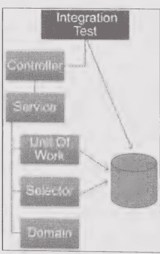
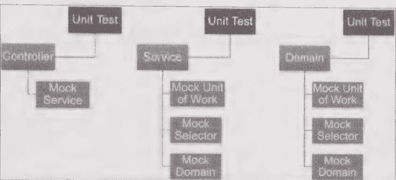
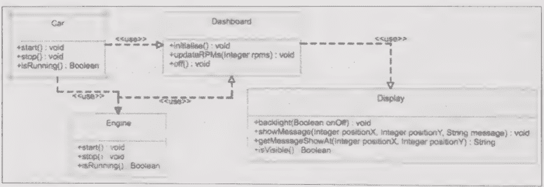

# 12 Unit Testing

单元测试是开发人员用来维护健康、强健代码库的关键技术。这种方法允许开发人员编写更小的测试，以调用给定方法或代码单元的更多变体排列。将每个方法视为一个独立的可测试代码片段，不仅意味着该方法的当前使用更不容易回归，未来的使用也得到了保护。它使开发人员能够专注于更多排列，例如错误场景和当前正在使用之外的参数值。

单元测试与集成测试不同，集成测试是将许多方法调用作为整体业务流程的一部分进行测试。两者在 Force.com 上都有其位置。在本章中，我们将探讨何时使用其中一种而非另一种。

要了解如何采用单元测试，我们首先需要了解依赖注入。这是动态将依赖类方法的行为替换为测试或存根行为的能力。使用所谓的依赖方法模拟实现（例如从数据库读取）可以避免反复进行资源密集型测试数据设置的需求。我们将探讨依赖注入的实现方式，包括使用 Force.com 平台附带的 Apex stub API。

最后，本章展示了如何将单元测试应用到本书前面介绍的 Apex 企业模式中。使用流行的开源 ApexMocks 模拟框架配合 Apex stub API，开发人员可以为控制器、服务、领域和选择器类编写单元测试。

本章将介绍单元测试的以下方面：

- 探索单元测试与系统测试之间的差异
- 了解依赖注入及其实现方式
- 利用 Apex stub API
- 将 ApexMocks 模拟框架应用于 FormulaForce

### Comparing Unit testing and Integration Testing

单元测试与集成测试之间的大部分差异在于所测试代码的范围和测试目标。很可能您在 Force.com 上一直在混合使用这两种测试，而自己却未意识到。

首先，让我们考虑维基百科对 **集成测试** 的定义：

> 集成测试（有时称为集成和测试，缩写为 I&T）是软件测试中的一个阶段，在该阶段中，单个软件模块被组合并在一起作为一个组进行测试。它发生在单元测试之后、验证测试之前。集成测试以已进行单元测试的模块作为输入，将它们分组为更大的集合，对这些集合应用集成测试计划中定义的测试，并将准备好进行系统测试的集成系统作为输出。

一般来说，关于编写 Apex 测试的大部分公开指南都属于这一集成测试类别。的确，覆盖 Apex Trigger 代码的唯一方法是物理地写入数据库。还有必要测试解决方案的声明性方面（单元测试只测试代码）以及这些方面如何影响更广泛的应用程序流程。

当我阅读上述维基百科描述时，它描述了我在发现如何在这个平台上编写真正的单元测试之前一直在编写的 Apex 测试（稍后将详细介绍）。从视觉上看，我的测试将如下图所示。



我会编写 Apex 测试代码来设置我的记录或执行我的控制器代码或服务层代码（以测试 API）。此代码将相应地更新或查询数据库。

然后我会编写测试代码来查询结果记录，以断言行为是否符合我的预期。这种方法确保了功能中涉及的所有类都被执行：例如服务、领域、工作单元、选择器和领域。它还确保它们仅在我正在测试的场景中做了所需的事情，以实现完成最终用户或 API 进程的总体目标。

集成测试对于测试关键流程仍然是必要的，确实，为了打包解决方案所需的 Apex Triggers 代码覆盖率也需要集成测试。然而，它们确实有一些缺点：

- 执行时间：由于每个测试方法都需要设置、更新和查询数据库来执行，所有或单个测试方法可能开始花费越来越长的时间来执行，从而降低开发人员的生产力。

- 场景覆盖率：由于上述性能问题，引入更多样化的场景可能变得不那么实用。这会阻止开发人员进行彻底的测试（我们讨厌等待！）。这反过来又降低了代码覆盖率和测试的价值。这最终增加了开发人员未能发现 bug 的风险。

- 代码覆盖率挑战：获得 100% 的代码覆盖率是理想目标，但在某些场景中可能无法实现。例如，无法在集成测试中模拟某些系统事件的错误处理。

- 确保对其他开发人员的前瞻性和可靠性：像 Scrum 这样的方法论教会我们以增量方式编写代码，并按市场需求及时编写。然而，开发人员通常意识到未来的需求，并希望构建框架、引擎或库来支持当前和未来的需求。可能无法编写集成测试来确保当那个时候到来时，此类代码对其他开发人员来说是强健和可靠的。

### Introducing Unit Testing

在本章中，我们将发现单元测试有助于解决上述挑战。当与集成测试结合使用时，生成的测试套件为您的应用程序创建了一组更强大、更高效的 Apex 测试。

了解和编写单元测试通常看起来很困难，因为这需要你学习其他概念，其中一些概念决定了你如何编写应用程序代码。关注点分离、依赖注入、模拟和测试驱动开发等概念是你在搜索单元测试时会遇到的概念。我们将在本章中探讨这些概念。当然，你现在已经非常熟悉 SOC 及其在 Apex 企业模式中的应用了。

请考虑维基百科对单元测试的定义：

> 直觉上，可以将单元视为应用程序中最小的可测试部分。
> 在过程式编程中，一个单元可以是整个模块，但更常见的是单个函数或过程。在面向对象编程中，一个单元通常是整个接口，例如类，但也可以是单个方法。
> 单元测试是程序员或偶尔由白盒测试人员在开发过程中创建的简短代码片段。

通过这个定义，单元测试与集成测试之间最大的差异显而易见。单元测试可能覆盖代码库中潜在任何类的方法，而不仅仅是外层控制器类或服务类。此外，目标是仅测试所选方法中的代码执行和行为，而不测试其他内容。

困难部分可能是阻止正在进行单元测试的方法所调用的其他方法的执行。这是通过用存根代码（或所谓的模拟代码）替换真实生产代码的部分（仅在测试上下文中）来完成的，这些代码模拟这些方法的行为。然后，你正在单元测试的方法仍然可以执行。理想情况下，该方法应该对这种替换（即注入）毫不知情。

例如，控制器方法的单元测试应该只测试该方法的行为，例如与视图状态的交互或处理 UI 请求和响应与服务层调用。服务层方法做什么并不感兴趣。开发人员不应在单元测试代码中考虑依赖方法的任何此类要求（例如数据库设置）。

同样，在测试服务层逻辑时，它对工作单元、选择器和领域类的使用并不感兴趣或关注。但是，这些依赖项需要解决。下一节将讨论如何注入依赖项。


下图显示了一系列针对特定类的单元测试，这些测试使用依赖类方法的模拟替代品，以避免需要关心它们的需求：



依赖类的模拟版本应模仿调用方法（即你正在测试的方法）的预期，例如通过返回值或抛出异常。配置模拟是你需要掌握的单元测试关键设置方面。它可以让你编写非常复杂且多样的测试。我们将在本章后面详细介绍模拟。

同时，如果在开发测试代码时你不熟悉模拟方法，这个 http://en.wikipedia.org/wiki/Mock_object 链接是一个有用的介绍。当然，互联网上有许多其他网站描述其优势。以下是维基百科页面的摘录：

> '在面向对象编程中，模拟对象是以受控方式模仿真实对象行为的模拟对象。程序员通常创建模拟对象来测试其他对象的行为，这很大程度上类似于汽车设计师使用碰撞测试假人来模拟人类在车辆撞击中的动态行为。
> 
> 在单元测试中，模拟对象可以模拟复杂真实对象的行为，因此当真实对象不切实际或不可能纳入单元测试时，它们非常有用。如果实际对象具有以下任何特征，那么使用模拟对象来代替它可能很有用。

开发者在单元测试上投入越多，集成测试和最终用户发现缺陷的可能性就越小。但是请记住，证明方法在隔离状态下工作并不能证明你的应用程序按设计运行。集成测试仍然是测试应用程序的关键工具。

## 依赖注入、模拟和单元测试

到这个阶段，你可能在想，使用代码在测试执行期间如何在技术上替换或 *注入*（使用正确的术语）不同的已编译代码。为了说明依赖注入的各种选项，让我们从一个简单的代码示例开始。我们将在本章后面探讨如何将单元测试应用于 Apex Enterprise 模式。

下图显示了 `Car` 类模型的 **统一建模语言 (UML)**，该模型在设计时考虑了 SOC（关注点分离）。引擎、仪表板和数字读数显示等职责已被分离。这是一个纯 Apex 代码示例，用于说明如何使用依赖注入 (DI) 来管理类之间的依赖关系：



以下是 `Car` 类的代码。它依赖于 `Dashboard` 和 `Engine` 类中的方法。调用者必须设置并提供这些类的实例，方法才能正确运行：

```
public class Car {
    private Engine engine;
    private Dashboard dashboard;
    private Boolean isRunning;

    public Car(Engine engine, Dashboard dashboard) {
        this.dashboard = dashboard;
        this.engine = engine;
    }

    public void start() {
        dashboard.initialise();
        engine.start();
    }

    public void stop() {
        engine.stop();
        dashboard.off();
    }

    public Boolean isRunning() {
        return engine.isRunning();
    }
}
```

start 和 stop 方法包含确保仪表板和引擎相应初始化的功能。以下是 Dashboard 类的代码，它需要 Display 类的实例，该类处理信息的显示：

```
public class Dashboard {

    private Display display;

    public Dashboard(Display display) {
        this.display = display;
    }

    public void initialise() {
        display.backlight(true);
        display.showMessage(10, 20, 'Hello Driver!');
    }

    public void updateRPMs(Integer rpms) {
        display.showMessage(10, 10, 'RPM: ' + rpms);
    }

    public void off() {
        display.backlight(false);
    }

}
```

`Dashboard` 类上的方法与 `Display` 类集成，以在汽车数字显示屏的各个位置显示消息。`Display` 类没有依赖项，因此为简单起见此处未显示。（如果你想查看其代码，可以参考本章的示例代码）。最后，`Engine` 类显示如下：

```
public class Engine {

private Dashboard dashboard;
private Boolean isRunning;

public Engine(Dashboard dashboard) {
    this.dashboard = dashboard;
}

public void start() {
    dashboard.updateRPMs(1000);
    isRunning = true;
}

public void stop() {
    dashboard.updateRPMs(0);
    isRunning = false;
}

public Boolean isRunning() {
    return isRunning;

}
}
```

`Engine` 类中的方法调用 `Dashboard` 类上的方法，以向驱动程序更新引擎的 **每分钟转数 (RPM)**。

> 这是示例代码。实际代码可能包括表示各种硬件传感器的类。

首先让我们看看 Car 的集成测试是什么样子：

```
@IsTest
private class CarTest {

@IsTest
private static void integrationTestStartCar() {
    // Given
    Display display = new Display();
    Dashboard dashboard = new Dashboard(display);
    Engine engine = new Engine(dashboard);

    // When
    Car car = new Car(engine, dashboard);
    car.start();

    // Then
    System.assertEquals(true, car.isRunning());
    System.assertEquals(true, engine.isRunning());
    System.assertEquals(true, display.isVisible());
    System.assertEquals('Hello Driver!',
        display.getMessageShowAt(10, 20));
    System.assertEquals('RPM:1000',
        display.getMessageShowAt(10, 10));
}
}
```

> 此测试的设置看起来很简单，但想象一下，如果每个构建的类都需要创建其他配置和数据，设置逻辑可能会迅速增长。这个集成测试本身是完全有效且有用的。但是，正如我之前提到的，你不能仅仅因为彻底单元测试了方法，就假设当把所有东西放在一起时一切仍然可以工作！
> 
> 前面的测试代码分为三个主要部分：Given、When 和 Then。这种方法和思维来源于另一种称为行为驱动开发 (BDD) 的实践。你可以阅读 Martin Fowler 的网站上的更多内容。https://martinfowler.com/bliki/GivenWhenThen.html

## 决定在单元测试中测试什么和不测试什么

在本节中，让我们回顾我们想要编写哪种类型的单元测试，以及这些测试应该针对前面示例中的某些方法断言什么。

让我们考虑一下，在编写仅测试 Car.start 方法中以下逻辑的单元测试时，我们会断言什么。（请记住，我们目前不感兴趣测试 dashboard.initialise 或 engine.start 方法）：

```
public void start() {
    dashboard.initialise();
    engine.start();
}
```

对于此方法，我们会断言 dashboard.initialise 和 engine.start 方法实际上已被调用。因此，在此方法的单元测试中，我们只测试 start 方法的行为。在单独的单元测试中，我们也会测试 Dashboard.initialise 和 Engine.start 方法本身。

> 仅测试方法的行为或实现（例如，它调用了哪些方法），与断言值相比可能看起来很奇怪。但是，有时断言某些方法已被调用（以及被调用的次数）以及任何可能存在的参数已传递给它们，是验证代码按预期工作的关键。断言方法返回的值，作为测试正确行为的一种手段，在单元测试中也是有效的。

对于再次显示在以下代码中的 Engine.start 方法，我们希望断言 dashboard.updateRPMs 方法已使用正确的空转 RPM 值被调用，并且引擎状态已正确设置为运行中：

```
public void start() {
    dashboard.updateRPMs(1000); // Idle speed
    isRunning = true;
}
```

我们不关心该方法是否更新了显示器；那是直接测试 Dashboard.updateRPMs 方法的另一个单元测试的关注点。

以下是 Dashboard.updateRPMs 方法的代码。在为该方法编写单元测试时，我们应该验证传递给 rpms 参数的任何值是否已正确传递给 Display.showMessage 方法：

```
public void updateRPMs(Integer rpms) {
    display.showMessage(10,10, 'RPM: ' + rpms);
}
```


为了仅针对这些方法编写单元测试，我们需要 dashboard、display 和 engine 变量引用编译器能识别为具有所需方法的对象。但同时还需要允许我们将这些方法的实际实现替换为特殊的仅测试版本，以便记录方法何时被调用，从而断言行为。我们需要的是 Dashboard、Engine 和 Display 类的模拟实现。

## 构造函数依赖注入

前面的代码在类之间建立了显式的硬编码依赖。为绕过此问题，可以应用 CDI。这种方法已在 Java 等其他语言中使用。在以下示例中，Apex 接口用于表达你希望独立测试的各个代码单元之间的依赖关系。

> 不需要将此应用于所有方法调用依赖；仅应用于你想要进行单元测试的那些依赖。Apex Enterprise 模式主要关注 Services、Domain、Selector 和 Unit of Work 类。

通过利用给定接口可有多种实现的能力，我们可以改变执行哪种实现。我们可以执行方法的实际实现（由前面的类提供），或者仅测试其模拟行为，通常在测试本身中定义。因此，取决于正在编写的测试类型（集成测试或单元测试），你将相应的实现传递给 Car 类的构造函数。

为支持这种注入方式，必须更改以下三项：

- 首先，创建接口以反映 Engine、Dashboard 和 Display 类上的方法。以下代码展示了如何定义这些接口：

```java
public interface IEngine {
    void start();
    void stop();
    Boolean isRunning();
}
public interface IDashboard {
    void initialise();
    void updateRPMs(Integer rpms);
    void off();
}
public interface IDisplay {
    void backlight(Boolean onOff);
    void showMessage(Integer positionX, Integer positionY, String message);
    String getMessageShowAt(Integer positionX, Integer positionY);
    Boolean isVisible();
}
```

- 其次，类的实际实现必须实现这些接口，因为接口是基于它们的方法的。这通常只需要声明类实现接口：

```java
public class Engine implements IEngine {
public class Dashboard implements IDashboard {
public class Display implements IDisplay {
```

- 最后，代码库中必须引用接口类型而非具体类。例如，Car 构造函数现在接受接口类型，用于调用方法的成员类型 engine 和 dashboard 也是如此：

```java
public class Car {
    private IEngine engine;
    private IDashboard dashboard;
    private Boolean isRunning;

    public Car(IEngine engine, IDashboard dashboard) {
        this.dashboard = dashboard;
        this.engine = engine;
    }
}
```

> 请注意，本章前面展示的 Car 类集成测试无需修改仍可正常工作，因为它使用的实际实现实现了这些接口。

## 使用 CDI 和模拟实现单元测试

现在也可以实现接口的模拟实现。这些模拟类可以根据你需要模拟的行为以及要断言的内容，尽可能简单或复杂。请注意，不需要完全实现所有方法；存根即可。实现测试场景所需的内容即可：

```java
private class MockDashboard implements IDashboard {
    public Boolean initialiseCalled = false;
    public Boolean updateRPMsCalled = false;
    public Integer updateRPMsCalledWith = null;
    public void initialise() { initialiseCalled = true; }
    public void updateRPMs(Integer rpms) {
        updateRPMsCalled = true;
        updateRPMsCalledWith = rpms;
    }
    public void off() { }
}
```

```java
private class MockEngine implements IEngine {
    public Boolean startCalled = false;
    public void start() { startCalled = true; }
    public void stop() { }
    public Boolean isRunning() { return true; }
}
```

```java
private class MockDisplay implements IDisplay {
    public Boolean showMessageCalled = false;
    public String showMessageCalledWithMessage = null;
    public void backlight(Boolean onOff) { }
    public void showMessage(Integer positionX, Integer positionY, String message) {
        showMessageCalled = true;
        showMessageCalledWithMessage = message;
    }
    public String getMessageShowAt(Integer positionX, Integer positionY) { return null; }
    public Boolean isVisible() { return false; }
}
```

> 如果需要，可以将这些模拟类的实现封装在 Apex 测试类或单个类中，作为内部类。

在进行上述更改并引入模拟类后，Car 类对象模型的实现现在支持通过 CDI 进行单元测试。

以下每个单元测试都位于本章示例代码中的相应测试类中，例如 CarTest、EngineTest 和 DashboardTest。

以下是 Car.start 方法的单元测试：

```java
@IsTest
private static void whenCarStartCalledDashboardAndEngineInitialised() {
    // Given
    MockDashboard mockDashboard = new MockDashboard();
    MockEngine mockEngine = new MockEngine();

    // When
    Car car = new Car(mockEngine, mockDashboard);
    car.start();

    // Then
    System.assert(car.isRunning());
    System.assert(mockDashboard.initialiseCalled);
    System.assert(mockEngine.startCalled);
}
```


> 请注意测试方法使用的命名方法。这是有意为之，因为单元测试通常会产生许多小型单元测试方法。拥有如本节所示的命名约定有助于一眼看出测试涵盖的内容。再次强调，此约定借鉴了本章前面提到的 BDD 原则。

请注意，该测试不需要任何设置来满足 engine 和 dashboard 依赖项的设置要求，例如构造 Display 类的实例。

模拟类还可以记录作为参数传递的值以便后续断言。以下是 Engine.start 方法的单元测试：

```java
@IsTest
private static void whenStartCalledDashboardUpdated() {
    // Given
    MockDashboard mockDashboard = new MockDashboard();

    // When
    Engine engine = new Engine(mockDashboard);
    engine.start();

    // Then
    System.assert(engine.isRunning());
    System.assert(mockDashboard.updateRPMsCalled);
    System.assertEquals(1000,
        mockDashboard.updateRPMsCalledWith);
}
```

它使用 dashboard 的模拟实现来确认 Dashboard.updateRPMs 方法正确接收了相应的值。

最后，以下是 Dashboard.updateRPMs 方法的单元测试：

```java
@IsTest
private static void whenUpdateRPMsCalledMessageIsDisplayed() {

    // Given
    MockDisplay mockDisplay = new MockDisplay();

    // When
    Dashboard dashboard = new Dashboard(mockDisplay);
    dashboard.updateRPMs(5000);

    // Then
    System.assert(mockDisplay.showMessageCalled);
    System.assertEquals('RPM:5000',
        mockDisplay.showMessageCalledWithMessage);
}
```

它使用 display 的模拟实现来验证正确行为，并在调用方法时计算并将显示值传递给 display：

> 使用接口实现依赖注入会在生产代码中增加接口的开发和使用开销。Salesforce 在引入本章后面将描述的 Apex Stub API 时对其进行了改进。由于 Stub API 仍然相对新，你可能仍然会看到通过接口实现 DI。Apex Enterprise Patterns 库在 Stub API 到来之前就使用了它。另请记住，正如本书前面各节所见，Apex 接口在提供架构演进的灵活性以及降低耦合方面还有许多其他用途，可在本书定义的明确边界与你的逻辑之间定义此类边界。


## 其他依赖注入方式

构造函数模式的一种变体是使用设置器方法将引用注入到正在进行单元测试的类的实例中。这些方法应使用 @TestVisible 注解，以便这些方法不会被用于覆盖实例设置来指向依赖类的真实实例（这些实例可能在构造函数中设置）。

本书前面讨论的工厂模式也可用于注入模拟实现的替代实现。工厂方法不要求为每个类的构造函数声明依赖项列表。相反，通过调用工厂方法来获取接口的实例。

> 使用工厂依赖注入而非 CDI 是否偏好，取决于是否需要前置声明依赖项。Apex Enterprise 模式库选择使用工厂模式而非 CDI 进行注入，因为服务、域和选择器等层在整个应用程序代码库中定义良好且应用一致。

本书前面章节中使用的 Application 类工厂允许你通过调用每个相应工厂上的相应方法，来实现服务、域或选择器实现的运行时注入。

以下 Application 类工厂方法允许你获取实现指定服务、工作单元、域或选择器类的对象实例。这些是前面章节中用于在运行时实现各种动态配置行为的相同方法：

```
Application.Service.newInstance
Application.Domain.newInstance
Application.Selector.newInstance
Application.UnitOfWork.newInstance
```

必须将结果强制转换为适用的 Apex 类或接口。

以下方法可用于在给定服务、域或选择器类的测试设置期间注册替代实现。

```
Application.Service.setMock
Application.Domain.setMock
Application.Selector.setMock
Application.UnitOfWork.setMock
```

前面的 newInstance 方法随后将优先返回这些实例，而不是你在 Application 类中配置的真实类的实例。

在前面一章中，RaceService 已创建并实现了 IRaceService。以下 RaceController 类的单元测试利用此接口和 Application.Service.setMock 方法。要向工厂注册 IRaceService 接口的模拟实现。为了实现一个验证控制器的记录 ID 是否正确传递到所调用服务方法的单元测试：

```
@IsTest
private static void whenAwardPointsCalledIdPassedToService() {

    // Given
    MockRaceService mockService = new MockRaceService();
    Application.Service.setMock(IRaceService.class, mockService);

    // When
    Id raceId = fflib_IDGenerator.generate(Race__c.SObjectType);
    RaceController raceController =
        new RaceController(
            new ApexPages.StandardController(
                new Race__c(Id = raceId)));
    raceController.awardPoints();

    // Then
    System.assert(mockService.awardChampionshipPointsCalled);
    System.assertEquals(new Set<Id> { raceId },
        mockService.awardChampionshipPointsCalledWithRaceIds);
}
```

> 为简洁起见，此处未显示 MockRaceService，但它遵循与本章前面所示的其他模拟类相同的模式。请参阅本章示例代码中包含的 RaceControllerTestMockingDemo 类中的相关内容。另请回想，RaceService.service 方法使用 Application 服务工厂来创建要执行的服务实例。

## 依赖注入框架的优势

迄今为止，我们已经讨论了通过使用工厂或构造函数并实现 Apex 接口来注入要模拟的类的替代模拟实现，从而实现依赖注入的方法。DI 框架为开发人员提供了访问某些底层语言运行时功能的方式，这些功能可以提供更直接的方式来实现这些方面。

因此，DI 框架倾向于帮助开发人员以更少的样板代码（例如使用接口）更轻松地获得 DI 的好处，尤其是在旧代码库中。然而，开发人员仍可能需要编写如上所见的模拟实现，并通过 SOC 仔细管理类之间的依赖关系。

例如，Java 利用其反射 API 允许在运行时进行注入，而无需接口。Java Spring 框架通过允许通过 XML 文件进行配置来扩展此功能，以允许不同的运行时配置。某些框架还会拦截原生 *new* 运算符的使用。这避免了实现前面代码中概述的基于工厂或构造函数的注入方法的需要。

Apex 运行时的相对较新的补充是 **Apex Stub** API。这是 Salesforce 作为其平台一部分提供的此类 DI 框架之一。它不覆盖 *new* 运算符。开发人员仍需要实现如前所述的注入方法。然而，它确实使在旧代码库中（未应用接口的地方）采用模拟变得更加容易。本章剩余部分将继续更详细地探索此 API，并且将在其之上构建框架。

## 使用 Apex Stub API 编写单元测试

**Apex Stub** API 仅适用于 Apex 测试上下文。因此，它不能用于在测试之外实现 DI。为此，您仍需利用 Apex 接口。

利用这些 API 需要了解以下内容：

- 实现 Stub 提供程序接口：系统提供的 `System.StubProvider` Apex 接口实际上是一种回调式接口。它允许您的模拟代码在测试中针对正在模拟的类进行方法调用时得到通知。您可以多次实现此接口，每个模拟类一次，或者使用单个实现来构建复杂的通用模拟框架。FinancialForce.com 的 Apex Mocks 开源框架就是一个我们将在后面审查的此类框架。

- 模拟的动态创建存根：平台会通过 Test.createStub 方法自动创建您希望模拟的类的实例。使用 Stub API 时，您不需要创建 Apex 接口来执行 DI。唯一的要求是向平台提供 Test.StubProvider 接口的实现，以便在测试执行期间调用创建的存根实例上的方法时进行回调。

## 使用 Test.StubProvider 实现模拟类

使用 System.StubProvider 实现模拟处理代码只需实现一个方法，而无需逐个实现正在模拟的每个方法。这是因为此接口是所有可能方法签名的通用接口。

如以下 MockDashboard 类的实现所示，此接口上的 handleMethodCall 方法会传递模拟代码所需的所有信息，以识别哪个对象的哪个方法已被调用。

```
private class MockDashboard implements System.StubProvider {

    public Boolean initialiseCalled = false;

    public Object handleMethodCall(
        Object stubbedObject,
        String stubbedMethodName,
        Type returnType,
        List<Type> listOfParamTypes,
        List<String> listOfParamNames,
        List<Object> listOfArgs) {

        // Record method call
        if(stubbedMethodName == 'initialise') {
            initialiseCalled = true;
        }

        return null;
    }
}
```

再次强调，此模拟实现仅实现了满足所执行测试的模拟要求所需的最低限度。它只验证 initialise 方法是否被调用。

> Salesforce 提供了一组丰富的参数，以允许对此方法进行更通用的实现。我们将在本章后面通过 Apex Mocks 框架审查这些参数。

## 为模拟类创建动态存根

实现 System.StubProvider 后，仍无法将 MockDashboard 类的实例传递给 Car 类，因为它无法强制转换为 dashboard 的实例。要使此成为可能，必须调用平台提供的 Test.createStub 方法。这在内部创建 Dashboard 类的实例，但将方法调用路由到提供的存根提供程序，而不是实际代码。

我决定在这些示例中遵循的一种约定是，通过模拟类上的自己的 createStub 方法来封装对此方法的调用。这减少了调用它时的重复量（样板代码），并在编写单元测试代码时更易于使用，如您将在下一节中看到。

```
private class MockDashboard implements System.StubProvider {
    public Boolean initialiseCalled = false;

    public Object handleMethodCall(... ) {
    ...
    }

    public Dashboard createStub() {
    return (Dashboard) Test.createStub(Dashboard.class, this);
    }
}
```

## 使用 Apex Stub API 的模拟示例

实现 MockDashboard 类后，我们可以在单元测试中使用它。生成的单元测试类似于使用 Apex 接口所示的测试：

```
@IsTest
private static void
whenCarStartCalledDashboardAndEngineInitialised() {
// Given
MockDashboard mockDashboard = new MockDashboard();


MockEngine mockEngine = new MockEngine();

// When
Car car = new Car(
    mockEngine.createStub(),
    mockDashboard.createStub());
car.start();

// Then
System.assert(car.isRunning());
System.assert(mockDashboard.initialiseCalled);
System.assert(mockEngine.startCalled);
}

本单元测试中使用的示例单元测试代码和模拟对象已在 CarTestApexStubAPIDemo 类中实现。

与 Apex 接口方法的主要区别在于使用适用的 createStub 方法创建被模拟类的桩实例。

以下代码显示了前一单元测试中使用的 MockEngine 类的 handleMethodCall 方法。它说明了如何为 Engine.isRunning 方法返回模拟响应：

```
public Object handleMethodCall(
    Object stubbedObject,
    String stubbedMethodName,
    Type returnType,
    List<Type> listOfParamTypes,
    List<String> listOfParamNames,
    List<Object> listOfArgs) {
    // Record method call
    if(stubbedMethodName == 'isRunning') {
        isRunningCalled = true;
        return true;
    } else if(stubbedMethodName == 'start') {
        startCalled = true;
    }
    return null;
}
```

以下代码显示了来自 MockDisplay 类的 handleMethodCall 方法（有关完整代码，请参见 DashboardTestApexStubAPIDemo 类）以及 listOfArgs 参数的用法：

```
public Object handleMethodCall(
    Object stubbedObject,
    String stubbedMethodName,
    Type returnType,
    List<Type> listOfParamTypes,
    List<String> listOfParamNames,
    List<Object> listOfArgs) {

    // Record method call and parameter values
    if(stubbedMethodName == 'showMessage') {
        showMessageCalled = true;
        showMessageCalledWithMessage = (String) listOfArgs[2];
    }
    return null;
}
```

前面的模拟处理程序代码监控 Dashboard updateRPMs 方法调用 showMessage 方法。随后它会存储参数值以便后续断言，而不仅仅是记录方法本身被调用的事实。

以下单元测试代码利用这一点来测试在调用 updateRPMs 方法时，是否将正确信息传递给显示器：

```
@IsTest
private static void whenUpdateRPMsCalledMessageIsDisplayed() {

    // Given
    MockDisplay mockDisplay = new MockDisplay();

    // When
    Dashboard dashboard = new Dashboard(mockDisplay.createStub());
    dashboard.updateRPMs(5000);

    // Then
    System.assert(mockDisplay.showMessageCalled);
    System.assertEquals('RPM:5000',
        mockDisplay.showMessageCalledWithMessage);
}
```

## 使用 Apex Stub API 时的注意事项

以下是有关 Apex Stub API 的一些常规说明和注意事项：

- 在应用程序代码中使用 Apex `new` 运算符时，它仍会创建实际类型。因此，你仍需利用依赖注入约定（如本章中描述的一种约定），将你希望在单元测试中模拟的任何依赖类的替代实现注入进去。

- 类间依赖边界处显式定义的接口并非严格要求，但可能是进一步强化 SOC 边界或对应用程序进行更多配置的有用手段。

- 并非所有方法和类都可以使用 `Test.createStub` 方法进行桩化。示例包括内部类和 get/set 访问器。此外，返回 `Iterator` 的方法也不能桩化。有关完整列表，请参阅 *Apex 开发者指南*。

- 静态方法也无法进行桩化，这是出于设计考虑，因为这些方法不支持依赖注入。尽管 Service 层设计约定使用了静态方法，但这些方法的实际实现会通过服务工厂，使用实例方法来访问实际的服务实现。这可以在示例代码中包含的 `RaceService` 中看到。

- 关于可模拟内容的其他限制，例如私有方法和构造函数，可能看起来像是一种遗漏。但是，原则上，你在单元测试中只应该测试类的公共行为。一旦模拟了对象方法，用于实例化对象的构造函数就不再重要，因为你的模拟代码决定了每个方法返回的内容。

- 请记住，方法签名的更改可能会破坏模拟实现中对参数和返回类型的晚期绑定引用。在这方面，基于显式接口的模拟实现具有优势，因为如果你进行了破坏性更改，会出现编译错误。如下一节将讨论的那样，模拟框架可以帮助降低这种风险。

## 使用 Apex Stub API 配合模拟框架

为小型代码库实现模拟类，或作为理解单元测试概念的辅助手段（如本章所做）是可以的。但是，对于较大的代码库，这很快会变得繁琐且成为维护负担。Apex Stub API 的设计之初就是为了处理任何类形状。

stubbedObject 参数可用于确定所调用方法所属的类型。这允许创建单个 System.StubProvider 实现，该实现可以实现更高级的服务，供单元测试利用，而无需反复编写自己的模拟类。对模拟方法播放预配置的响应，并记录其接收到的每个方法调用以供后续断言，就是这种情况的一个示例。

模拟框架的概念并不新鲜。有许多成熟的框架，例如面向 Java 的流行 Mockito 框架，或面向 JavaScript/NodeJS 应用的 Jasmine 框架。但是，模拟在 Apex 中是一个相对较新的概念和功能，因此基于 Apex 的模拟框架领域仍在发展中。

FinancialForce.com 已发布一个名为 ApexMocks 的开源模拟框架。虽然它早于 Apex Stub API 的出现，但已更新以与该 API 协同工作。其优势在于，用于为 Apex Mocks 创建模拟类的代码生成器不再需要；同样也不再需要显式使用 Apex 接口。

在本章余下部分，我们将通过使用 ApexMocks 框架（现已包含在本章的示例代码中）来回顾模拟框架的优势。我们将首先将其应用于我们的示例 Car 类模型，然后应用于 FormulaForce 应用程序中的单元测试场景。就本人而言，完整的演示内容足以写成一整本书。你可以通过其 README 文件上的各种博客和文档链接了解 ApexMocks 的更多信息，https://github.com/financialforcedev/fflib-apex-mocks/blob/master/README.md。

> 应将 ApexMocks 的原始构思和创建归功于 Paul Hardaker。作为一名经验丰富的 Java 开发者，他来到该平台并习惯使用 Mockito，于是很快就想知道能否在该平台上创建类似的单元测试设施。因此，ApexMocks 的 API 设计大量借鉴了 Mockito。自那以后，该框架不断发展壮大，获得了社区的多项其他提交和支持，包括在 Dreamforce 上的演示。我所了解的许多单元测试知识也归功于 Paul 的指导。谢谢！

## 了解 ApexMocks 的工作原理

CarTestApexMocksDemo 测试类中的 whenCarStartCalledDashboardAndEngineInitialised 单元测试方法使用 ApexMocks 库。此单元测试的结构与本章到目前为止所查看的单元测试类似。它创建模拟对象，运行要测试的方法，并断言结果。

主要区别在于，你不需要为希望模拟的类编写任何代码。相反，你使用 ApexMocks 框架来配置模拟响应，并断言记录了哪些方法。然后，通过其与 Apex Stub API 的集成，它会创建一个围绕任何你希望模拟的类的桩。

ApexMocks 框架中的主类是 fflib_ApexMocks。此类为你实现了 System.StubProvider 接口。它会自动回显对被调用模拟方法的任何模拟响应，并记录它们被调用以及使用了什么参数。这适用于你要求它模拟的类上的所有公共方法。

使用 ApexMocks的大部分技巧在于知道如何配置调用模拟方法时它给出的模拟响应，以及如何编写匹配逻辑来断言不仅方法何时被调用，还包括被调用的次数和使用了什么参数。这一后续功能非常强大，为验证代码行为提供了一些复杂的选项。

以下代码初始化 ApexMocks 框架（每个测试方法都需要此操作）：

```
@IsTest
private static void
whenCarStartCalledDashboardAndEngineInitialised() {

fflib_ApexMocks mocks = new fflib_ApexMocks();
```


## 接下来创建你需要的模拟实现：

```
// Given
Dashboard mockDashboard =
(Dashboard) mocks.factory(Dashboard.class);
Engine mockEngine =
(Engine) mocks.factory(Engine.class);
```

以下代码免去了你在被测试代码执行期间编写返回测试值的模拟方法的需求。在 ApexMock 术语中，此配置代码被称为 **存根** 代码。你必须按照如下所示，将存根代码包装在 startStubbing 和 stopStubbing 方法调用之间：

```
mocks.startStubbing();
mocks.when(mockEngine.isRunning()).thenReturn(true);
mocks.stopStubbing();
```

> 在这个阶段，语法可能有点难以理解，但我保证你会习惯的！正如我之前所述，ApexMocks API 的很多灵感都来自 Java Mockito 库。以至于互联网上的文章和文档也应该能帮助你学习该 API，同时也包括 GitHub 仓库提供的文档。

你的眼睛没有欺骗你；前面的代码正在调用你试图为其模拟响应的方法。首先，这是一个编译时引用，因此比我们在直接使用 Apex Stub API 时使用的晚期绑定字符串引用要安全得多。

其次，因为 mockEngine 指向一个动态生成的存根，它并不调用此方法的真实实现。相反，它在框架中注册：下一次方法调用 thenReturn，应将给定值存储为此方法的响应。这个值将在测试的稍后时间点返回，当时该模拟方法在测试用例上下文中再次被调用。在这种情况下，当 Car.isRunning 方法调用 engine.isRunning（如果你需要刷新记忆关于实现的作用，请参考 Car 代码）时，它会返回值 true。

单元测试的下一部分，即实际被测试的代码，则更加熟悉：

```
// When
Car car = new Car(mockEngine, mockDashboard);
car.start();
```

断言 `Dashboard.initialise` 和 `Engine.start` 方法已被调用，以及 `Car.isRunning` 返回的值符合预期，这与调用手写模拟类方法也略有不同：

```
// Then
System.assertEquals(true, car.isRunning());
((Dashboard) mocks.verify(mockDashboard, 1)).initialise();
((Engine) mocks.verify(mockEngine, 1)).start();
}
```

由于 Apex 的显式转换要求，最后两行与你在等效的 Java Mockito 示例中看到的并不完全匹配。这会让语法更难阅读。在 Java Mockito 中，它看起来会像：

```
mocks.verify(mockDashboard, 1).initialise();
mocks.verify(mockEngine, 1).start();
```

断言代码是传统 `System.assert` 和对 `fflib_ApexMocks.verify` 方法的调用的混合，随后是对被模拟方法的调用。同样，这种经过编译器检查的引用优于晚期绑定字符串引用。

`verify` 方法接受模拟对象的实例和一个数字。这个数字允许你断言该方法只被调用了一次且仅一次。一旦 `verify` 方法退出并且模拟方法被调用，传递给 `verify` 方法的预期结果就会被检查。如果未满足——无论是因为方法未被调用，还是被调用了多次——框架实际上会让模拟方法使用 `System.assert` 来停止测试，并附带描述原因的异常消息。

另一个示例是 `DashboardTestApexMocksDemo` 类中的 `whenUpdateRPMsCalledMessageIsDisplayed` 测试方法。它使用了一种更高级的形式来断言所需的模拟方法已被调用。这种方法不仅验证了该方法被调用，还验证了它使用了特定的参数值：

```
@IsTest
private static void whenUpdateRPMsCalledMessageIsDisplayed() {
    fflib_ApexMocks mocks = new fflib_ApexMocks();

    // Given
    Display mockDisplay = (Display) mocks.factory(Display.class);

    // When
    Dashboard dashboard = new Dashboard(mockDisplay);
    dashboard.updateRPMs(5000);

    // Then
    ((Display) mocks.verify(mockDisplay, 1)).
    showMessage(10, 10, 'RPM:5000');
}
```

前面的 `verify` 方法用法与之前的测试没有不同。然而，接下来的模拟方法调用说明了 ApexMocks 验证逻辑的一个非常酷的特性。传递给模拟方法调用的参数会被框架用于与先前测试期间该方法先前执行时记录的参数进行比较。如果检测到任何差异，将抛出断言并停止测试。

> 前面的一些示例内联包含了 `System.assert` 方法调用。你编写的其他单元测试可能不需要使用此语句，因为它们仅通过 `verify` 方法断言正确的依赖方法已被调用。这可能会在 **Salesforce 安全审查** 扫描器中导致误报，因为 verify 方法不被识别为断言质量的方法。如果发生这种情况，你可以添加一个注释中性断言来安抚扫描器，或者在你附加到审查的误报文档中记录原因。

## ApexMocks 匹配器

正如你所见，使用 ApexMocks 有两个关键部分：通过存根设置模拟响应，以及通过验证来断言行为。这两个功能都支持自定义返回哪些模拟值或在 verify 期间匹配哪些参数的能力。

例如，如果你正在单元测试的代码使用不同参数多次调用模拟方法，你可以在测试代码的存根阶段，使用一种称为匹配器的约定来改变返回的模拟值。

> 如果这是你想要覆盖的测试用例，还可以配置框架在调用模拟方法时抛出异常。

当断言行为时，如果你希望检查模拟方法被调用两次——一次使用一组特定的参数值，第二次使用另一组不同的参数值——那么可以使用匹配器来表达这种期望的结果。

匹配器是一个高级功能，但值得你投入更多时间去学习。

### ApexMocks 与 Apex 企业模式

如前所述，支持库或 **Apex 企业模式** 通过 Application 类中的工厂提供依赖注入设施。此设施也与使用 ApexMocks 和 Apex Stub API 兼容。以下章节包含使用 ApexMocks 对先前章节中介绍的应用程序架构中的各层进行单元测试的示例。

### 单元测试控制器方法

以下测试位于 RaceControllerTest 类中，演示了如何模拟服务层类：

```
@IsTest
private static void whenAwardPointsCalledIdPassedToService() {

    fflib_ApexMocks mocks = new fflib_ApexMocks();

    // Given
    RaceServiceImpl mockService = 
        (RaceServiceImpl) mocks.factory(RaceServiceImpl.class);
    Application.Service.setMock(RaceService.class, mockService);

    // When
    Id raceId = fflib_IDGenerator.generate(Race__c.SObjectType);
    RaceController raceController =
        new RaceController(
            new ApexPages.StandardController(
                new Race__c(Id = raceId)));
    raceController.awardPoints();

    // Then
    ((RaceServiceImpl) mocks.verify(mockService, 1).
        awardChampionshipPoints(new Set<Id> { raceId }));
}
```

考虑上述测试代码中的以下显著方面：

- 一般而言，控制器仅使用服务类或选择器类。如果使用了其他类，这可能被视为代码评审的讨论点？也许控制器内部的关注点分离需要进一步审查？

- 此测试仅创建 Service 类的模拟实例，并确认该方法使用来自控制器的正确参数值被调用。不需要模拟响应。然而，ApexMocks 框架确实允许对模拟方法抛出异常。因此，可以编写另一个测试来确认控制器中的错误处理是否正常工作。

### 单元测试服务方法

以下测试方法位于 RaceServiceTest 类中，演示了如何模拟实现工作单元、领域和选择器层的类：

```
@isTest
private static void
whenAwardChampionshipPointsCallsDomainAndCommits() {

fflib_ApexMocks mocks = new fflib_ApexMocks();

// Given - Create mocks
fflib_SObjectUnitOfWork mockUow = (fflib_SObjectUnitOfWork)
mocks.factory(fflib_SObjectUnitOfWork.class);
RacesSelector mockSelector = (RacesSelector)
mocks.factory(RacesSelector.class);
Contestants mockDomain = (Contestants)
mocks.factory(Contestants.class);

// Given - Configure mock responses
Id testRaceId =
fflib_IDGenerator.generate(Race__c.SObjectType);
Id testContestantId =
fflib_IDGenerator.generate(Contestant__c.SObjectType);
List<Race__c> testRacesAndContestants = (List<Race__c>)
fflib_ApexMocksUtils.makeRelationship(
    List<Race__c>.class,
    new List<Race__c> { new Race__c ( Id = testRaceId) },
    Contestant__c.Contestant__c,
    new List<List<Contestant__c>> {
        new List<Contestant__c> {
            new Contestant__c ( Id = testContestantId ) }});
```


```java
mocks.startStubbing();
mocks.when(mockSelector.SObjectType()).
thenReturn(Race__c.SObjectType);
mocks.when(mockSelector.selectByIdWithContestants(
    new Set<Id> { testRaceId })).
thenReturn(testRacesAndContestants);
mocks.when(mockDomain.SObjectType()).
thenReturn(Contestant__c.SObjectType);
mocks.stopStubbing();
```

```
// Given - Inject mocks
Application.UnitOfWork.setMock(mockUow);
Application.Selector.setMock(mockSelector);
Application.Domain.setMock(mockDomain);

// When
RaceService.awardChampionshipPoints(
    new Set<Id> { testRaceId });

// Then
((RacesSelector) mocks.verify(mockSelector, 1)).
    selectByIdWithContestants(new Set<Id> { testRaceId }));
((Contestants) mocks.verify(mockDomain, 1)).
    awardChampionshipPoints(mockUow);
((fflib_SObjectUnitOfWork) mocks.verify(mockUow, 1)).
    commitWork();
}
```

考虑前面测试代码中的以下显著方面：

- fflib_ApexMocksUtils.makeRelationship 方法用于在内存中构建包含子记录的记录列表。此实用方法（ApexMocks 的一部分）绕过了在模拟此数据结构时的平台限制。此方法对于返回您正在模拟的选择器方法所返回的更复杂记录集非常有用。

- 在调用 Application.Selector.setMock 和 Application.Domain.setMock 方法以注入 RacesSelector 和 Contestants 域类的模拟实现之前，模拟框架用于模拟这些类模拟实例的 SObjectType 方法的响应，这些方法由 setMock 方法调用。模拟此方法可确保模拟的选择器实例已正确注册到 Selector 工厂。

- fflib_IDGenerator.generate 方法（ApexMocks 的一部分）用于生成内存 ID，用于填充从模拟选择器返回的模拟记录。这些相同的 ID 用于确认传递给选择器的内容，因为相同的 ID 也传递给了服务方法。

- Contestants 域类添加了默认构造函数，这是 Test.createStub 方法所要求的，该方法由 fflib_ApexMocks.factory 方法使用。

### 对域方法进行单元测试

以下测试方法可在 ContestantsTest 类中找到，并演示了如何模拟选择器方法响应以返回在内存中创建的数据库行。它还显示，断言相同的记录随后被传递到模拟的工作单元以进行更新：

```
@IsTest
private static void whenAwardChampionshipPointsUowRegisterDirty() {

    fflib_ApexMocks mocks = new fflib_ApexMocks();

    // Given
    fflib_SObjectUnitOfWork mockUow = (fflib_SObjectUnitOfWork)
        mocks.factory(fflib_SObjectUnitOfWork.class);
    Application.UnitOfWork.setMock(mockUow);
    Id testContestantId =
        fflib_IDGenerator.generate(Contestant__c.SObjectType);
    List<Contestant__c> testContestants =
        new List<Contestant__c> {
            new Contestant__c (
                Id = testContestantId,
                RacePosition__c = 1 ));
    // When
    Contestants contestants = new Contestants(testContestants);
    contestants.awardChampionshipPoints(mockUow);

    // Then
    ((fflib_SObjectUnitOfWork)
        mocks.verify(mockUow, 1)).registerDirty(
        fflib_Match.sObjectWith(
        new Map<SObjectField, Object>{
            Contestant__c.Id => testContestantId,
            Contestant__c.RacePosition__c => 1,
            Contestant__c.ChampionshipPoints__c => 25 }));
}
```

考虑前面测试代码中的以下显著方面：

- 测试代码中会创建一个内存中的记录列表并将其传递给域类构造函数。然后调用正在进行单元测试的 awardChampionshipPoints 方法，以确定它是否正确地与工作单元进行交互。

- 使用自定义的 ApexMocks 匹配器来检查传递给模拟的 fflib_SObjectUnitOfWork.registerDirty 方法的 SObject 是否为预期的方法。匹配器还帮助测试代码确认已计算正确的冠军积分。有关 ApexMocks 的更多信息，请参阅前面的章节。

- 由于此测试使用模拟的工作单元，因此不执行 DML 操作。

### 对选择器方法进行单元测试

选择器方法要测试的主要逻辑是动态构建 SOQL 字符串。理想情况下，如果可以模拟 Database.query 方法，那么就可以围绕复杂的选择器方法编写单元测试，以断言生成的 SOQL 字符串。由于目前这不可能，因此模拟选择器类的好处很小。相反，您的选择器类可以通过作为集成测试的一部分执行来获得覆盖率和验证。

### 摘要

集成测试关注通过服务公开的控制器方法或 API 的范围，以测试代码的完整堆栈。它需要设置数据库、执行要测试的代码并查询数据库。这些测试对于确保应用程序的所有组件都交付预期行为至关重要。

为了使单个代码组件、类和方法尽可能健壮且面向未来，开发人员可以孤立地测试每个方法，而无需承担设置数据库或更新数据库的开销。因此，单元测试运行速度更快。单元测试可以提高覆盖率，因为可以使用模拟来模拟更多边界情况测试场景，这些场景在数据库上原本不可能或难以设置。

单元测试需要了解一些其他模式，例如依赖注入和模拟。依赖注入可以通过多种方式实现，使用构造函数、工厂和设置器方法。您使用的依赖注入方法将取决于您的个人偏好和/或您正在使用的库的偏好。如果需要，可以混合使用多种依赖注入方法。

实现模拟的一种方法是使用 Apex 接口。利用表示代码库依赖项之间边界的接口的多种实现，可以分别实现实际代码和测试代码。

当被测试的代码不知道正在使用哪种实现时，模拟最有效。Apex Stub API 允许为类创建动态模拟，而无需使用 Apex 接口。这对于现有代码库或使用 Apex 接口没有意义或会增加开销的场景非常有用。

ApexMocks 是一个模拟框架库，它减少了构建模拟对象所涉及的工作，消除了手动编写它们的需要。基于 Mockito，它提供高级设施来配置模拟方法响应或抛出异常，以帮助测试错误处理。此框架还记录已调用的模拟方法，并提供复杂的匹配语法来断言调用了哪些方法。

本书中使用的 Apex Commons 开源库利用工厂模式来提供内置方法，用于注入服务、工作单元、域和选择器层的模拟实现。

归根结底，单元测试及其相关先决条件是一个难以掌握的概念，并且需要大量的前期工作。最初从一些简单示例开始，并继续利用现有的 Apex 测试方法，直到准备好扩展。一旦掌握了 API 和概念，它就会变得得心应手，并可以帮助打开通往其他开发编码实践（例如测试驱动开发）的大门。

在本书的最后一章中，我们将退后一步，了解如何围绕多个开发人员扩展开发，并在进行更改时设置测试的持续和自动化执行。
