# 13 源代码控制和持续集成

迄今为止，我们一直在 FormulaForce 应用程序的打包组织中进行更改。在这种情况下，由于您是唯一的开发人员，这工作得还算不错。但是，当添加更多开发人员和团队时，其他考虑因素就发挥作用了，主要是代码更改的可追溯性，以及当多个开发人员同时在开发组织中工作时冲突的实际影响。

本章将使打包组织承担更多的仓库专用角色，仅在需要创建 beta 或发布包时访问，不再像我们之前那样用于日常开发。如果您的客户希望您证明围绕软件开发流程和生命周期的控制的合规性和可审计性，这一原则对您和您的客户来说可能非常重要。

随着代码库的增长以及任何给定时间对其的贡献数量增加，更频繁地监控代码质量很重要。在尝试将软件发布给客户之前发现 Apex 测试失败既令人沮丧又代价高昂。持续集成与源代码控制系统协同工作，以自动化的方式验证应用程序的完整性和质量（通过您的测试），通常由开发人员向源代码控制提交更改来触发。

在本章中，您将学习以下内容：

- 开发者工作流程
- 使用源代码控制进行开发
- 连接到持续集成


- 从源代码控制发布
- 自动化回归测试

## 开发工作流程与基础设施

开发工作流程描述了开发人员的日常活动，目的是获取最新构建、进行更改，并将其提交回维护源代码当前整体状态的仓库。拥有稳健、定义明确的开发工作流程、支持工具和基础设施，对任何开发团队的效率至关重要。

开发人员首先想知道的是源代码在哪里，基本上是一个源代码控制系统，例如 Git。接下来是如何将其转换为可执行的形式。Salesforce 提供一个名为 Migration Toolkit 的工具包，可帮助编写脚本，使用名为 Ant 的流行开发者脚本语言将组件部署到 Salesforce 组织。我们将在本章中构建这样的脚本。本章后面所述的持续集成构建服务器也会使用此类脚本。

Migration Toolkit 还提供了一种从 Salesforce 组织中提取源代码的方法，这些源代码包含表示应用程序所需的所有组件，而不仅仅是 Apex 和 Visualforce 源文件，还包括描述自定义对象、字段、选项卡以及几乎任何其他可打包组件的 XML 文件。我们将使用此功能提取打包组织的当前状态，以便最初用所有所需组件文件填充 Git 仓库，以便在我们迄今一直在其中开发的打包组织之外维护源代码的进一步更改。

## Salesforce 开发者体验 (DX)

撰写本文时，Salesforce 宣布了 Salesforce DX。这是一种面向企业开发人员需求的新型开发者体验。其目标是提供额外的工具和 API，以更好地促进基于源代码控制的开发，并实现完整的开发生命周期：

- 临时组织：这些是可按需创建和删除的特殊组织类型。因此，无需清理组织（您可以将此视为云端工作区）。您还可以提供 JSON 配置文件为组织设置各种配置，例如多货币，甚至命名空间（尽管您的打包组织也在使用相同的命名空间）。
- Heroku 流：Heroku 命令行已扩展了额外功能，例如创建临时组织以及将本地文件夹结构的内容与附加组织的内容同步的能力。

详细信息仅限于年度 Salesforce Dreamforce 事件上宣布的内容。前述要点旨在让您了解他们宣布的一些内容，这些内容将在未来几年内逐步推出。

与此同时，以下小节为您提供了一种使用当前工具（无论是来自 Salesforce 还是社区）实现源代码控制开发的方法。此外，随着 Salesforce DX 在多个版本中继续成熟，这里介绍的某些方法可能仍然需要。

## 打包组织与沙箱组织与开发者组织

如前所述，在一个组织中拥有多名开发人员可能会迅速变得不切实际。他们可能会意外覆盖彼此的更改，做出其他人可能不想看到的自定义对象或设置更改，并更快地消耗该组织的每日 API 限制，最终阻止所有人进行更改。

在打包组织方面，还有另一个更重要的原因，那就是能够确切知道应用程序代码在一个版本和下一个版本之间应用了哪些更改。这是您和您的客户希望在任何时间都有信心能够了解的事情。

还有控制功能发布或回滚更改的能力，如果这些更改已经在打包组织中完成，则此操作会更加困难。出于这些原因，通常将对打包组织的访问权限限制在负责发布包的人员，从而从概念上将打包组织视为仅一个仓库。

沙箱组织通常用于企业组织内的自定义解决方案开发，其中沙箱已使用生产组织的副本进行初始化。这可以包括数据、已安装的包和其他自定义项。撰写本文时，沙箱组织可通过合作伙伴门户配置的企业版组织获得（最多五个）。沙箱可以作为开发者组织的替代方案。一个优势是能够将父组织配置为默认的空白状态，然后利用沙箱刷新流程有效地清理组织，为新的构建部署做好准备。请注意，即将推出的 Salesforce DX 临时组织在某些方面与沙箱组织类似。请注意，如果您正在使用字段集，沙箱组织目前不允许定义 **可用字段**。

## 创建和准备您的开发者组织

在 *第 1 构建、发布和支持您的应用程序* 的 *所需和推荐组织* 章节中，我建议您创建一个开发者组织。如果您尚未这样做，请访问合作伙伴门户或 `https://developer.salesforce.com/` 并获取一个新的开发者组织（或简称为 DE 组织）或 Salesforce DX 临时组织（如果您有权使用此功能）。

由于此应用程序使用引用这些组件的 Lightning 组件和 FlexiPages，您需要在开发者组织上启用 **我的域**，以便本章中的部署能够成功。

获得此组织后，您可能希望花一些时间进一步清除 Salesforce 放入此类组织中的示例包、Apex 代码或配置，因为这些组件将在后续的开发者工作流程中与您自己的组件合并，您希望避免将它们提交到源代码控制，或者更糟的是，将它们添加到您的包中。Salesforce DX 临时组织在设计上是空的。

Salesforce 原生不支持清除 DE 组织，但大多数开发人员都熟悉在从源代码控制获取新构建之前清理其工作环境（在 Force.com 开发中即其 DE 组织）的功能。这可以避免在开发过程中不需要的类、对象和字段累积，例如在实施策略更改或功能重新定义时，导致先前提交的组件被重命名或删除。这可能会意外泄露回您的代码库中。幸运的是，有一个开源解决方案利用 Migration Toolkit 来清除 DE 组织，我们将在后面探讨。Salesforce DX 临时组织也有相同的问题，但可以更轻松地删除并替换为新组织。

> 由于创建和管理包安装的开销，通常 DE 组织也会被测试工程师和团队其他成员用于测试或预览正在开发的功能。也就是说，在发布开发周期的各个阶段，从代码的稳定构建创建 Beta 包是值得考虑的，以便在最终上传流程之前进行额外的合理性和冒烟测试。包的上传和安装可以通过 Tooling 和 Metadata API 实现自动化。

在本章中，我们将从打包组织中提取应用程序组件为文件，然后上传到 GitHub 仓库，以便以比在 Salesforce 组织中允许的方式更强大的方式跟踪和审计更改。然后，我们将使用此仓库填充创建的 DE 组织，进行一些更改，并将这些更改提交回仓库。这被称为开发者工作流程。

## 开发者工作流程

在选择合适的源代码控制系统来存储应用程序代码时有许多选项。在本书中，我们将使用 GitHub 作为远程源代码控制存储和本地源代码控制仓库。


这里的目的不是规定使用哪些工具，而是介绍一种您可以根据需要进行调整并稍后探索不同选项的 Force.com 开发流程的总体演练。下图展示了本章将逐步讲解的开发工作流：


以下各点与上述图示相关：

- 1. 选择源代码控制产品和服务器是一项重要决策，您应考虑安全性、可访问性和持久性。您的应用程序源代码需要安全管理，仅供授权人员访问，理想情况下应通过企业中员工入职和离职时的清晰流程来管理。您选择存储源代码控制服务器的位置也进一步增加了这一点的重要性。如果出于可访问性原因，您选择使用众多基于云的源代码控制托管服务之一，或者确实自行管理（例如通过 Amazon EC2），请从每个位置执行持久性测试，确保服务器高效运行（开发人员讨厌等待！）。最后，请确保您已定义并测试了备份和恢复流程，重点是尽量减少开发人员在最坏情况发生时的停机时间。本章的下一节将介绍如何从打包组织的内容填充 GitHub 仓库。

- 2. 将存储在源代码控制服务器中的文件填充到本地仓库是大多数开发人员执行的初始活动。如前所述，这应尽可能高效。如果您使用的是基于云的服务器，同步远程仓库和本地仓库所需的带宽量非常重要。有些源代码控制产品在这方面提供的实现比其他产品更高效。Git 专门针对这种场景进行了定制，能够在本地克隆整个或特定分支的仓库（包含文件历史记录），然后根据需要逐步更新。大多数常见的源代码控制产品都为 GUI 和标准命令行界面提供了出色的选择。在本章中，我们将使用 GitHub 的 GUI 将仓库克隆到本地文件夹，以便进行开发流程的下一步。

- 3. **Apache Ant** 开源工具为创建标准构建（部署）脚本及其他您可能想要构建的自定义开发工具提供了一个良好的操作系统平台无关的解决方案。

- 4. 在最基本的形式中，Ant 构建脚本仅利用 Salesforce 迁移工具 Ant 任务 `sf:deploy`，将本地仓库的内容部署到指定的开发者组织。但是，正如我们将在后面的章节中讨论的那样，它也构成了您持续集成解决方案的一部分。

- 5. 一旦部署到开发者组织，用于在 Force.com 上开发的工具范围从使用 **设置** 菜单、**架构构建器**（常被忽略）、**开发者控制台**、Force.com IDE（Eclipse）的组合，到其他已出现的第三方 IDE。

- 6. 关键要求是，一旦开发人员准备好提交到源代码控制，就需要有能力将本地存储的组件文件与开发者组织的内容进行同步。大多数基于桌面的 IDE 都提供了实现此目的的方法，尽管您也可以利用迁移工具包提供的 Ant 构建脚本通过 `sf:retrieve` Ant 任务来完成。我将在本章稍后介绍我如何执行此操作。

- 7. 一旦文件从开发者组织同步完成，开发人员可以使用标准的源代码控制提交流程来审查其更改并将更改提交到源代码控制服务器（Git 要求开发人员先提交到其本地仓库）。我们将为此使用 GitHub GUI。在本章稍后，我们将看到如何使用此操作自动触发构建，以确认开发人员更改与源代码控制当前状态的集成未造成任何损坏，方法是自动执行所有 Apex 单元测试。

> 更高级的开发流程还可以利用持续集成在预验证提交后，最终允许开发人员更改（针对所谓的功能分支所做的更改）与主分支进行传播或合并。这种高级流程之一被称为 **GitFlow**，描述了代码从开发/功能分支流向发布分支的分阶段处理过程。通过 Google 搜索此术语，阅读有关这种更高级开发流程的更多信息。

请注意，只有在第 4 步之后，开发人员才能真正开始高效工作，因此值得定期与开发人员确认开发流程的这一部分对他们是否运行良好。同样，第 5 步是他们花费大部分时间的地方。请尽可能让开发人员有自由选择使其各自最高效的工具，但仍需在商定开发流程的范围内工作。

调试仍然是在 Force.com 上开发中最耗时的方面之一。请确保所有开发人员都完全掌握 Salesforce 以及您选择的 IDE 环境提供的所有最新工具和方法。有效利用调试日志过滤器也可以节省大量时间来浏览大型调试日志，因为调试日志限制为 2 MB。通常，开发人员会求助于 System.debug 以获取所需的洞察。请确保在安全审查之前删除这些内容。尽管真实的支持性调试条目可以讨论和允许（建议您使用适当的调试级别），但临时性调试条目无论如何都应作为一般做法的一部分被删除。Salesforce 的交互式 Apex 调试器可通过 Force.com IDE 使用 Eclipse 调试器 UI 获得。这可以通过与 Salesforce 就某些组织进行对话来启用。

## 使用源代码控制进行开发

既然我们对一般开发流程有了更多了解，让我们深入探讨一下可以使用的一些工具和方法。

在此示例中，我们将使用以下工具来填充和管理我们选择的源代码控制仓库（在此例中为 Git）的内容。为了提供一种便捷的方式来探索更分布式解决方案的优势，我们将使用 GitHub 作为 Git 的托管实例（还有其他可用选项，包括更广泛的开发流程功能）：

- **GitHub**: 确保您拥有 GitHub 账户。公共账户是免费的，但您也可以出于本章目的使用私有账户。从 `https://desktop.github.com/` 下载出色的 GitHub GUI。本章将使用 Mac 版，但这并不意味着无法在 Windows 版中找到并执行等效操作；两个客户端都非常易于使用！

- **Apache Ant v1.9 或更高版本**: 要确定是否已安装此工具；在终端提示符处键入 `ant -version` 以进行确认。如果未安装，可以从 `http://ant.apache.org/` 下载。

- **Force.com 迁移工具包**: 可从 `https://developer.salesforce.com/page/Tools` 下载。README 文件中的说明建议将 `ant-salesforce.jar` 文件复制到 Apache Ant 安装文件夹中。我不建议这样做，而是更倾向于将此类构建工具存储在源代码中的 `/lib` 文件夹内。这样可以让所有开发人员以无缝方式更轻松地升级，而无需每次都执行下载。

- Force.com IDE: Force.com IDE 是由 Salesforce 运行的开源项目。它会定期获得更新和改进，例如支持开发 Lightning 组件以及唯一的交互式 Apex 调试器（如需访问权限，请联系您的 Salesforce 联系人）。有关更多信息和下载说明，请访问 https://developer.salesforce.com/page/Force.com_IDE。

## 填充您的源代码控制仓库

填充源代码控制仓库时的一个关键决策是文件夹结构。

下表显示了一个您可以考虑的结构：

| 文件夹 | 用途 |
| :--- | :--- |
| / | 尽可能保持根目录内容整洁，通常此处唯一的文件是 Ant build.xml 文件。您可能还会有一个 README.md 文件，这是提供重要用法和文档链接的常见 Git 约定。这是一个简单的文本文件，使用简单的记号语法（称为 Markdown）来表示章节、粗体、斜体等。 |
| /lib | 此文件夹包含运行 Ant 构建脚本所需的任何二进制文件、配置文件或脚本文件，这些文件代表构建工具和依赖项，通常放在根目录中。这是一个可选文件夹，但在本章中用于存储 ant-salesforce.jar 文件，而不是让开发人员自行安装。 |
| /src | 此文件夹包含 Force.com 源文件，其结构与 Ant sf:retrieve 任务返回的文件夹结构以及 Force.com IDE 等 IDE 所期望的结构保持一致。 |
| /source（备选） | 请注意，如果您的应用程序包含来自其他平台的其他源代码控制工件，您可能需要考虑设立一个更通用的 /source 文件夹，允许使用 /source/salesforce/src 然后 /source/heroku 等路径。 |

如果您希望按照本章中的步骤进行操作，请基于 chapter-12 分支中包含的源代码进行。如果您希望直接查看最终结果，请跳转到示例代码仓库中的 chapter-13 分支，以审查 build.xml 和 package.xml 文件。


执行以下步骤以创建新仓库并将其克隆，从而在计算机上创建本地仓库并用初始内容填充它：

- 1. 从 Web 浏览器登录到您的 GitHub 帐户，并从用户旁边的下拉菜单中选择创建新仓库的选项。同时选择创建默认 README 文件的选项。


> 如果您计划在本章后面尝试持续集成步骤，那么就当前配置而言，最简单的选项是创建公共仓库。关于如何配置 Jenkins 与 GitHub 身份验证的深入演示超出了本章的范围。

- 2. 从 Web 浏览器中新仓库的项目页面，找到页面右下侧边栏底部的“克隆或下载”按钮。点击其上的“在桌面打开”按钮以打开 GitHub 桌面客户端并开始克隆仓库，或者手动打开 GitHub 桌面客户端并选择“克隆到计算机”选项。
- 3. 前述克隆过程应已提示您在硬盘上选择存储本地仓库的位置。请记下此位置，因为我们将在后续步骤中填充此位置。
- 4. 在仓库文件夹的根目录下创建 /lib 文件夹。
- 5. 将本章示例代码文件夹 /lib 中的以下文件复制到前一步创建的新 /lib 文件夹中：
  - 复制 ant-salesforce.jar 文件
  - 复制 ant-salesforce.xml 文件
  - 复制 ant-contrib-1.0b3.jar 文件
- 6. 在仓库文件夹的根目录下创建 /src 文件夹。
- 7. 将您在之前章节中使用的 build.xml 文件复制到仓库文件夹的根目录中。

在本章中，我们将更新 Ant build.xml 脚本文件，以便在需要时将应用程序源代码部署到新的开发者版 org。在此之前，我们将使用 salesforce-ant.jar 文件提供的 Ant sf:retrieve 任务，以组件源文件的形式检索迄今您一直在开发的 FormulaForce 包的最新内容，我们将把这些内容迁移到源代码控制中。

> 请注意，我们执行此步骤是由于本书所采用的方法，即从打包 org 开始进行开发。如果您不是从这一点开始，则可以按手动描述创建 /src 文件夹和 package.xml 文件。话虽如此，您可能希望在打包 org 内进行一些初步探索，以建立带有某些初始对象的包和命名空间。

以下 build.xml 目标检索打包 org 中定义的包的内容并填充 /src 文件夹。请确保您的包名称为 FormulaForce。如果不是，请按如下方式更新 packageNames 属性：

```
<target name="retrieve.package">
    <sf:retrieve
        username="${sf.username}"
        password="${sf.password}"
        retrieveTarget="${basedir}/src"
        packageNames="FormulaForce"/>
</target>
```

> 您可以在登录打包 org 时，看到 Salesforce 页面标头右上角黑色横幅中显示的包名称。

使用您自己的用户名、密码和令牌执行以下命令（全部在一行命令行上）以执行检索目标。首先确保已将位置更改为本地仓库的根文件夹：

```
ant retrieve.package
  -Dsf.username=yourusername
  -Dsf.password=yourpasswordyourtoken
```

您应该在本地仓库文件夹中看到类似下面的内容：

| 文件夹 | 文件夹 | 文档 |
|---|---|---|
| src | applications | Application.cls |
| bin | classes | Application.cls-meta.xml |
| .git | labels | Cars.cls |
| | layouts | Cars.cls-meta.xml |
| | objects | CarsSelector.cls |
| | pages | CarsSelector.cls-meta.xml |
| | permissionsets | ComplianceController.cls |
| | quickActions | Compliance...-ls-meta.xml |
| | tabs | ComplianceService.cls |
| | triggers | Compliance...-ls-meta.xml |
| Documents | Documents | ComplianceServiceTest.cls |
| build.xml | package.xml | ContestantController.cls |
| README.md | | ContestantC...-ls-meta.xml |

> 您可能会在检索的代码和元数据文件中找到对包命名空间的引用。应将其删除，否则文件可能无法在非托管开发者 org 中部署或执行。您可以使用文件搜索实用程序查找此类引用。例如，打开 /layouts/Contestant__c-Contestant Layout.layout 文件并搜索 QuickActionName，然后删除命名空间引用。

在准备将此内容提交到本地仓库（在您可以上传或推送到 GitHub 远程仓库之前必需）之前，打开由检索操作创建的 package.xml 文件并将其转换为更通用的形式。前一过程创建的文件包含包中每个组件的显式列表。

这意味着，如果开发人员在 /classes、/pages 和 /objects 等子文件夹中添加新组件文件，则除非先更新 package.xml 文件，否则这些文件不会随后自动部署。

为避免开发人员需要记住执行此操作，可以将 package.xml 文件更新为使用通配符。例如，打开 package.xml 文件并用通配符字符替换显式引用，如以下示例所示：

```
<types>
    <members>*</members>
    <name>ApexClass</name>
</types>
<types>
    <members>*</members>
    <name>ApexPage</name>
</types>
```

```
<types>
<members>*</members>
<name>ApexTrigger</name>
</types>
```

还要从 package.xml 文件中删除 fullName、apiAccessLevel 和 namespacePrefix 标记。对 package.xml 文件中的大多数组件类型重复上述方法，而不仅仅是前面示例中所示的那些，但 **子组件** 除外。

如果将前面的示例与之前创建的 package.xml 文件进行比较，您会注意到原始 package.xml 文件中的某些组件是 CustomObject 组件的子组件，例如 FieldSet、WebLink、CustomField 和 ListView。此外，不需要多个 CustomLabel 条目。因此，它们根本不需要通配符条目，因为它们将通过其父文件部署，例如，通过包含字段的 CustomObject 组件的 .object 文件。

请注意，FormulaForce 包中实际包含的组件列表仍位于打包 org 中。package.xml 文件在源代码控制中的作用和目的不同，并且更针对开发者 org 部署进行了优化。

最后，使用 GitHub UI 工具将前面的更改提交并同步到本地仓库，并上传或推送（使用正确的 Git 术语）。如果您运行该工具，应该会看到它已经在报告硬盘上的仓库文件夹中检测到新文件，如以下 Mac 版工具屏幕截图所示。只需输入摘要和说明，然后单击 **提交并同步**。

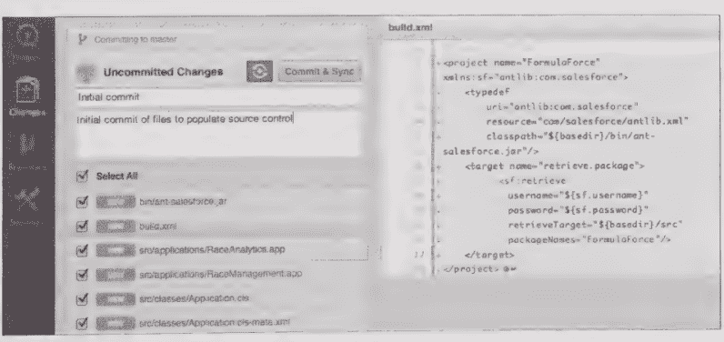

请注意，这将在一个操作中同时提交到本地仓库并推送到远程仓库。通常，开发人员会处理一组更改，并在决定将所有更改作为一个操作推送到远程仓库之前，本地增量式提交。

> 如果您不熟悉 Git，这可能有点令人困惑，因为您已经在仓库文件夹中实际复制或更新了文件。但是，为了将更改推送到存储在 GitHub 服务器上的远程 Git 仓库，您必须先更新 .git 文件夹中保存的仓库状态的本地副本，.git 文件夹是仓库文件夹根目录下的隐藏文件夹。您绝不应编辑或查看此文件夹，因为它完全由 Git 管理。

## 用于清理和构建应用程序的 Ant 构建脚本

现在，我们已为应用程序创建了初始源代码控制内容，让我们将其部署到开发者 org。在此之前，我们将更新 build.xml 文件以清理 org（以防它已用于开发应用程序的早期版本）。

Salesforce 不提供用于完全清理开发者 org 中先前部署或创建的任何组件的 Ant 任务。但是，它确实通过其 Force.com 迁移工具包提供了一种方式来部署所谓的 destructivePackage.xml 文件，该文件包含要删除的组件列表。不幸的是，当 org 中存在组件依赖项时，这需要一些帮助。FinancialForce.com 已通过 undeploy.xml Ant 脚本提供了一个开源解决方案，该脚本封装了此过程并解决了依赖项不足的问题。

从 FinancialForce.com 存储库（https://github.com/financialforcedev/df12-deployment-tools）的 /lib 文件夹下载以下文件，并将它们与 ant-salesforce.jar 文件一起放入之前创建的 /lib 文件夹中：

- exec_anon.xml
- undeploy.xml
- xmltask.jar
- ml-ant-http-1.1.3.jar
- ant-contrib-1.0b3.jar


接下来，Ant 脚本通过执行现有的 `deploy` 目标（用于部署前几章中的示例源代码）进行了更新。然后，通过将前面的任务导入构建文件中，`undeploy` 目标将作为 `deploy` 目标的依赖目标可用，这意味着它会在执行该目标之前被调用。以下示例构建脚本突出了这些更改：

```xml
<project name="FormulaForce"
  xmlns:sf="antlib.com.salesforce" default="deploy">
  <property name="sf.server"
    value="https://login.salesforce.com"/>
  <import file="${basedir}/lib/exec_anon.xml"/>
  <import file="${basedir}/lib/undeploy.xml"/>

  <target name="deploy" depends="undeploy">
    <sf:deploy
      username="${sf.username}"
      password="${sf.password}"
      serverurl="${sf.server}"
      RunAllTests="true"
      deployRoot="${basedir}/src"/>
  </target>
</project>
```

执行以下命令（全部在一行命令中）以运行前面的脚本（确保使用您的开发者组织用户名、密码和令牌）：

```bash
ant
-Dsf.username=yourdevusername
-Dsf.password=yourdevpasswordyourdevtoken
```

> 由于正在执行的 `undeploy` 目标比较复杂，似乎会向控制台输出相当多的消息。几分钟后，它将开始执行 `deploy` 目标。一旦收到整个脚本已成功完成的确认，您可以通过登录到该组织来确认应用程序已部署。

一旦您确信 `build.xml` 文件工作正常，请返回到 GitHub UI 应用程序，并像之前一样，使用 **提交并同步** 按钮提交您的更改并推送到 GitHub 服务器的远程仓库。

恭喜！您现在已经离开了家（打包组织）并搬到了您自己的全新开发者组织中。这也意味着您现在可以允许其他开发人员通过使用他们自己的开发者组织来遵循相同的开发流程，从而独立地开始在您的代码库上工作。

> Salesforce 不会自动授予使用迁移工具部署的应用程序、选项卡、页面、对象和字段的访问权限。因此，您会发现，在查看这些组件之前，您需要将权限集分配给开发者组织用户。这样做是确保这些组件随新组件保持最新且有效的好方法。一般来说，以系统管理员身份进行测试并不能可靠地确认您的应用程序在最终用户场景中正常工作。Salesforce 之所以采用此政策，正是为了让开发人员考虑需要应用哪些权限，即使是在开发者组织中也是如此。


## 在开发者组织中开发与在打包组织中开发

既然您已离开打包组织并进入开发者组织，您将不再在其提供的相关命名空间上下文中开发或执行代码。如果您回想一下关于执行上下文的章节，请记住，在打包组织中执行的 Apex 代码的调试日志引用了两个命名空间：打包组织命名空间和默认命名空间。虽然在打包组织中所有内容都会隐式在此命名空间中运行，但默认命名空间中永远不会运行任何内容。

如您所注意到的，在打包组织中编写 Apex 代码时，您不需要像在安装了您包的订阅者组织中那样，为自定义对象或字段加上该命名空间前缀。相反，在打包组织中，这整体上是隐式完成的，这使得导出到源代码控制更加容易，因为目标开发者组织环境中未分配命名空间（因为它只能分配一次）。

在开发者组织中开发和执行代码时，所有内容都在默认命名空间中运行。在开发者组织中开发时，请记住以下差异：

- Apex 功能（例如 @deprecated 注解和 Version 类）可帮助实现应用程序 Apex API，但这些功能在打包组织外不受支持，会导致开发者组织中出现编译失败。这里的主要缺点是无法按需使用 @deprecated 属性来停用旧的 Apex API。我不建议使用 Version 类进行行为版本控制，原因如第 9 章“提供集成和可扩展性”中所述。

- 利用动态 Apex 创建和填充 SObject 实例和字段的 Apex 测试，将需要通过自动感应动态应用命名空间前缀，无论 Apex 测试是否在命名空间上下文中运行。以下代码片段是确定代码是否在命名空间上下文中运行的好方法。您可以将其放在测试工具类中：

```
DescribeSObjectResult seasonDescribe =
  Season__c.SObjectType.getDescribe();
String namespace =
  seasonDescribe.getName()
  .removeEnd(seasonDescribe.getLocalName())
  .removeEnd('__');
```

- 利用 Type.forName 创建 Apex 类实例的 Apex 测试（例如，为应用程序插件功能编写的测试）也需要将命名空间前缀动态应用于提供给插件配置的类名（例如，第 9 章“提供集成和可扩展性”中介绍的自定义元数据类型）。

本章后面我们将讨论持续集成。该过程将自动在打包组织中执行测试部署和 Apex 测试执行，从而继续确保您的测试在命名空间上下文中成功运行。

## 从 Ant 利用 Metadata API 和 Tooling APIs

迁移工具包实际上用一些方便的 Ant 任务封装了 Metadata API，我们一直在前面的 Ant 脚本中使用这些任务。该工具包本身是用 Java 编写的，并符合 Ant 框架所需的必要接口和基类，以允许表示任务的 XML 元素（例如 sf:retrieve 和 sf:deploy 任务）被注入到构建脚本中。

虽然您可以采用与 Salesforce 相同的方法来开发自己的 Ant 任务，以处理与您的应用程序相关的更多自定义任务以及/或设置或部署期间的常见任务自动化，但要做到这一点，您需要是 Java 程序员。作为替代方案，并添加一些支持 Ant 任务（那些复制到您的 /lib 文件夹中），您实际上可以直接从 Ant 脚本语言调用这些 API。

在前一章中，我们了解了如何编写 Ant 宏来调用 Metadata API 的包安装和卸载功能，这无需 Java 代码即可实现。如果您正在开发扩展另一个包的应用程序，Ant 的此功能非常有用，因为您可以通过扩展我们之前运行的部署脚本，轻松在部署之前自动安装/升级包。

之前导入到 build.xml 文件中的 FinancialForce.com 的开源 exec_anon.xml 文件实际上包含一个 Ant 宏，该宏利用 Tooling API 能够匿名调用 Apex 代码，类似于 Force.com IDE 和开发者控制台工具提供的功能。

在前几章中，我们利用 SeasonService.createTestSeason 方法在应用程序的自定义对象中创建测试记录数据。使用 Ant executeApex 任务，现在可以从 Ant 脚本调用该方法，以便在开发者组织中自动创建一些有用的数据。这种方法将帮助开发人员、测试人员或业务分析人员轻松试用或演示最新构建中的新功能，手动数据设置如下：

```
<target name="deploy" depends="undeploy">
<sf:deploy
    username="${sf.username}"
    password="${sf.password}"
    serverurl="${sf.server}"
    deployRoot="${basedir}/src"/>
<executeApex
    username="${sf.username}"
    password="${sf.password}">
SeasonService.createTestSeason();
</executeApex>
</target>
```


## 更新您的源代码控制仓库

一旦应用程序部署到开发者组织中，在随后在 Force.com 上进行开发时，您有多种选项和工具可供选择。您的选择将影响您的更改如何返回到源代码控制仓库。确保开发团队中的每个人都对开发工作流的这一方面心中有数，不仅关系到他们的效率，还有助于防止工作丢失或流氓文件进入源代码控制。

像“设置”菜单和架构构建器这样的基于浏览器的工具，比基于 XML 的格式更容易编辑自定义对象、字段、页面布局和权限集。然而，对于开发的其他方面，基于浏览器的开发者控制台在编辑 Apex 和 Visualforce 代码时并非人人都喜欢。我个人更喜欢使用 Force.com IDE 等桌面工具来编辑这类文件。

您可以独占或组合使用基于浏览器或桌面的方法。重要的是要记住，哪种方法会自动将本地仓库文件与组织保持同步，哪种方法不会。

- **基于浏览器的开发**：您通过基于浏览器的工具（包括开发者控制台）所做的任何更改都将保留在开发者组织中，不会自动进入本地仓库文件夹，因此，它们对 Git 工具不可见，您无法将其提交到源代码控制。

- **基于桌面的开发**：如果您使用 Force.com IDE 等桌面工具，并将其映射到仓库的本地文件夹位置，您在此处所做的编辑将通过此类工具在本地仓库文件夹和开发者组织之间自动同步。

- **基于浏览器和桌面的开发**：此选项允许开发者充分利用手头的工具，但代价是增加了一些复杂性，并且在收集所有更改以提交到源代码控制时需要额外考虑。

## 基于浏览器的开发和源代码控制

要下载使用基于浏览器的开发工具所做的更改到本地仓库文件夹，可以再次使用 Ant 脚本和迁移工具包，采用与之前使用 sf:retrieve Ant 任务从打包组织下载包内容时类似的方法。

以下 Ant 脚本将根据 package.xml 文件中列出的组件类型刷新 /src 文件夹的内容（同样，随着您使用新平台功能，可能需要不时将新组件类型添加到此文件中）：

```
<target name="retrieve">
<sf:retrieve
username="${sf.username}"
password="${sf.password}"
serverurl="${sf.server}"
retrieveTarget="${basedir}/src"
unpackaged="${basedir}/src/package.xml"/>
</target>
```

要运行前述目标，请使用以下命令（全部在一行命令行中）：

```
ant retrieve
-Dsf.username=yourdevusername
-Dsf.password=yourdevpasswordyourdevtoken
```

命令完成后，您可以使用 Git 工具审查更改的文件，并相应地接受、忽略或丢弃（恢复到上次提交的版本）。以下是您可能遇到的这种方法的一些用例以及处理它们的方式：

- **下载的其他文件**：如前所述，package.xml 文件中使用了通配符，以便更轻松地添加和删除文件。缺点是，对于某些组件（如应用程序和页面布局），您可能会发现这些组件的一些标准文件也会在仓库文件夹中创建。一个解决方案是不再为这些元数据类型使用通配符，另一个是利用 .gitignore 文件防止这些文件成为提交候选项。使用 GitHub UI 工具，您可以右键单击这些文件并选择“忽略”。如果 .gitignore 文件不存在，这将创建一个 .gitignore 文件并将相应文件添加到其中。由于此文件也会提交到仓库，因此您只需执行一次此操作。

- **文件内容顺序差异或其他元素**：有时，当您未直接在基于浏览器的工具中修改相应组件时，Git 工具也会标记文件更改。这可能发生在平台升级后出现新功能或进行组织范围的配置更改（例如启用多货币支持）时，或者在 XML 元素的顺序发生变化但对对象的整体效果相同时也会发生。如果您经常遇到这些更改，并且它们导致您乐于接受的更改，那么起初接受它们以减少未来出现的虚假差异可能很诱人。但是，不要让此类基于浏览器的开发差异得不到解释，根本原因可能非常重要！开发者之间使用不同的组织类型或组织模板也可能导致此类问题。确保所有开发者都从同一个注册页面获取他们的开发者组织，并且组织类型相同。

## 基于桌面的开发和源代码控制

使用基于桌面的工具和源代码控制的主要好处是，它们允许您编辑 Force.com 源文件，同时与源代码控制和附加的 Salesforce 开发者版组织进行同步。在 Force.com IDE 中，默认情况下不会在每次保存文件时自动上传到附加的开发者组织，请右键单击“包资源管理器”中的项目节点，并在 Force.com 子菜单下选择 **Work Online**。只要这些工具正在编辑来自本地仓库文件夹位置的文件，文件编辑就会自动被源代码控制系统（在本例中为 Git）看到。

- Force.com IDE 提供了一种轻松将 Git 仓库文件夹与项目关联的方法。只需打开 Force.com IDE，从 **File** 菜单中选择 **Import...**，从导入向导列表中选择 **Projects from Git**，然后单击 Next。

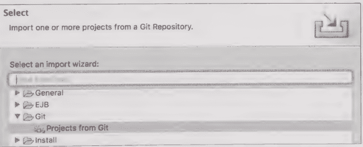

选择 **Existing local repository**，如果未显示您的仓库，请单击 **Add** 并导航到先前用于下载 GitHub 仓库的文件夹。最后，使用新项目向导单击 **Import**，然后单击 **Finish**：

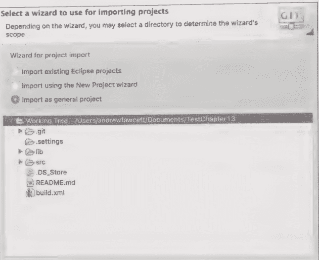

为您的项目指定一个合适的名称并单击 **Finish**。此项目现在已连接到您的本地 Git 仓库。如果您已安装 eGIT 插件，Eclipse IDE 内置了对 Git 的支持，因此您可以选择使用 GitHub 桌面工具，或继续在 Eclipse 中操作。

要将项目与 Salesforce 连接，您需要向项目添加 **Force.com IDE** 功能。右键单击 **Package Explorer** 中的项目，然后在 **Force.com** 子菜单下选择 **Add Force.com Nature** 选项。您将看到一条提醒您需要提供连接详细信息以完成连接的提示：


再次右键单击 Package Explorer 中的项目，然后在 Force.com 子菜单下选择 Project Properties 选项。使用本章前面部署到的开发者版组织完成登录详细信息，然后单击 Apply。

> 单击 Apply 后，系统可能会询问您是否要重新获取并覆盖项目中的所有 Force.com 组件。请选择 No。这是因为项目文件夹已包含源代码，并且您使用的组织是从相同的文件夹内容填充的，向导无需下载。

Force.com IDE 项目向导会在仓库根文件夹中创建 /.settings 文件夹、/Referenced Packages 文件夹以及 .project 和 salesforce.schema 文件。您可以使用 .gitignore 功能将这些文件从源代码控制可见性中省略，除非您的团队所有人都使用 Force.com IDE。此屏幕截图显示了创建后项目的外观，使您可以立即开始编辑 Apex 代码：

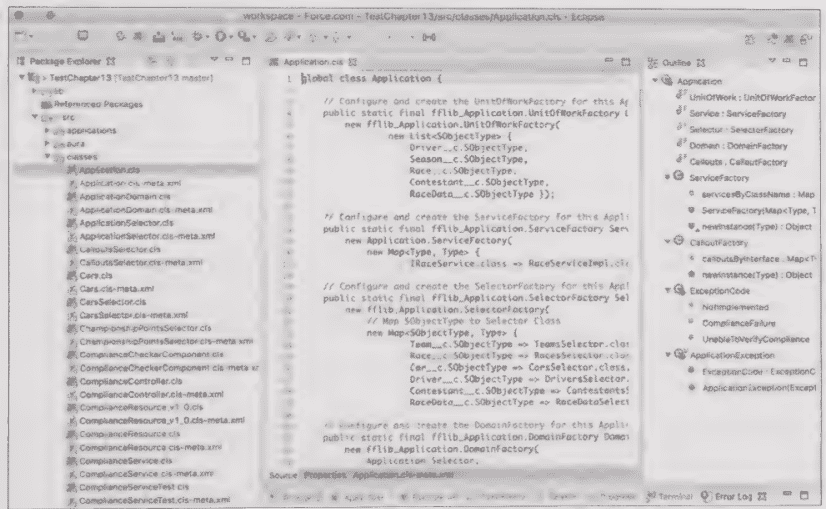


你还可以编辑表示自定义对象和字段的文件：

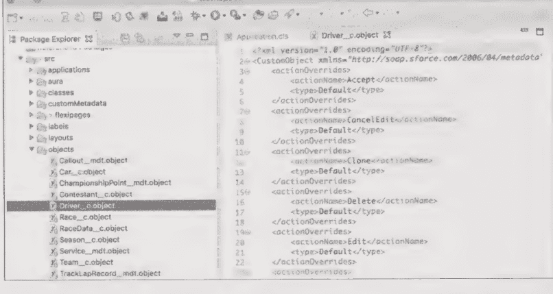

如果你选择将这种开发方法与基于浏览器的方法相结合，Force.com IDE 提供了一种从桌面工具内部刷新文件的方法。只需右键单击文件夹并选择相应选项即可。此功能实际上执行的检索操作与前面部分通过 Ant `build.xml` 脚本描述的操作类似。因此，请注意在附加文件或文件更改方面可能出现类似的副作用。

## 连接持续集成

到目前为止，我们一直依赖开发人员，确保他们推送到 GitHub 远程仓库的更改不会在应用程序的其他地方造成回归，方法是在提交前运行 Apex 测试。这始终是一种良好的做法！

然而，这并不总是确定代码质量的完全可靠手段，因为由于其他开发人员也在推送他们的更改，主代码库可能已经发生了变化。当集成在一起时，它们可能导致测试甚至代码无法编译。持续集成会监控源代码控制仓库的更改，并自动在完全集成的源代码库上启动其自身构建。失败会报告给最后向仓库推送代码的开发人员。

在本章的这一部分，我们将使用流行的 Jenkins 持续集成服务器来探索这一过程，该服务器使用 Ant 脚本执行构建步骤。在开始设置之前，让我们花点时间回顾一下我们将要使用的 CI 过程。

### 持续集成过程

下图显示了我们将在接下来的几个部分中设置的 CI 过程。一旦有了像这样的基本 CI 设置，你就可以开始添加其他功能，例如代码文档生成、静态代码分析、安全代码扫描器和自动化回归测试（我们稍后将简要讨论）。

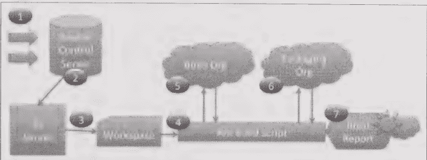

以下是 CI 过程：

- 1. 开发人员对源代码控制进行多次提交，就像我们在本章前面通过 GitHub UI 桌面客户端所做的那样。
- 2. CI 服务器可以（可配置）轮询源代码控制服务器（在本例中为 GitHub 远程仓库）以检测更改。
- 3. 一旦检测到更改，它就会将最新源代码下载到本地工作区文件夹中。
- 4. CI 服务器配置的一部分是告知其 Ant `build.xml` 脚本的位置，以便在工作区设置好后执行。
- 5. 构建组织（build org）只是一个专门指定用于 CI 过程的开发组织。我们将稍后为此目的创建一个，不过，使用 Salesforce DX 时，可以动态创建和删除临时组织。与部署过程类似，相同的 Ant 脚本用于将代码部署到构建组织（从而确认代码编译）并运行 Apex 测试。
- 6. 如前所述，开发组织用于开发非托管环境（而非托管环境）中的更改。一些通常适用的约束，例如更改之前发布的 `global` Apex 类的能力，不被强制执行。在此步骤中，会针对打包组织执行验证性仅检查部署，以确认代码在需要时仍可部署到打包组织以供发布。此步骤还有助于验证代码和测试是否继续在托管命名空间上下文中执行。此部署仅为检查，无论结果如何，都不会对打包组织进行任何更改。
- 7. 最后，CI 服务器将记录构建的日志和结果以供分析，记录成功构建与失败构建的数量，并提供关于源代码控制中源代码整体健康状况的报告和通知。如果存在失败，可以选择向特定团队成员以及特定目标（最近进行更改的人）发送电子邮件。确保团队停止手头工作并处理损坏的构建非常重要。损坏的构建存在的时间越长，就越难解决，尤其是在发生进一步更改时。

## 为持续集成更新 Ant 构建脚本

在设置 CI 服务器之前，我们需要确保 Ant 脚本为其提供了合适的入口点。这与前面步骤中开发人员使用的类似。以下是专为 CI 服务器设计的入口点目标。更复杂的脚本可能涉及开发人员用法和 CI 用法之间的某些复用。

以下目标将清理构建组织（因为依赖于 `undeploy` 目标），然后将其部署到构建组织。随后将执行第二次部署，以对打包组织执行仅检查部署。如果你在跟进，请将更改提交到 `build.xml` 文件，以便 Jenkins 服务器在从 GitHub 下载最新源代码时可以看到新目标。

```
<target name="deploy.jenkins" depends="undeploy">
  <sf:deploy
    username="${sf.username}"
    password="${sf.password}"
    serverurl="${sf.server}"
    runAllTests="true"
    deployRoot="${basedir}/src"/>
  <sf:deploy
    username="${sf.package.username}"
    password="${sf.package.password}"
    serverurl="${sf.server}"
    checkOnly="true"
    runAllTests="true"
    deployRoot="${basedir}/src"/>
</target>
```

## 安装、配置和测试 Jenkins 持续集成服务器

设置 Jenkins 服务器是一个超出本章范围的广泛话题。不过，开始使用的一个好方法是访问 http://jenkins-ci.org/ 并下载适用于你操作系统的预构建安装包之一。在此示例中，我下载了 Mac pkg 文件。安装后，我可以导航到 http://localhost:8080，发现 Jenkins 正在等待我！

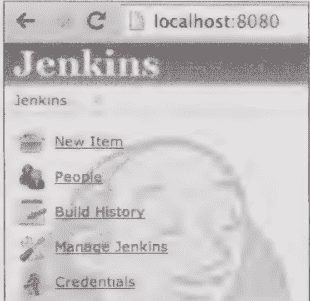

Jenkins 具有插件系统，允许对其基本功能进行许多自定义扩展，只需单击管理 Jenkins，然后单击管理插件以查找 GitHub 插件：

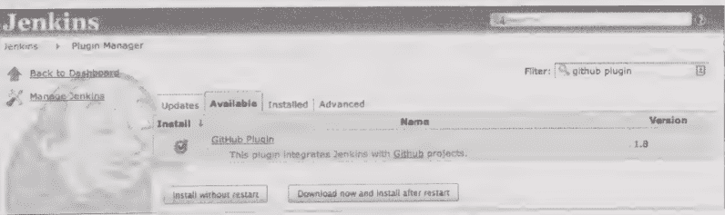

安装此插件后，你可以创建一个指向 GitHub 仓库和 Ant 脚本的 Jenkins 作业，以执行前面定义的 `deploy.jenkins` 目标。在 Jenkins 主页面上，单击 **新建项目** 并选择 **构建一个自由风格的软件项目** 选项。完成以下步骤以创建构建项目：

- 1. 使用适当的名称完成 **项目名称** 字段，例如 `FormulaForce Build`。
- 2. 在 **GitHub 项目** 字段中，输入你 GitHub 仓库的完整 URL，例如 `https://github.com/afawcett/formulaforce-chapter13`。
- 3. 在 **源代码管理** 部分下，选择 **Git**。
- 4. 在 **仓库 URL** 字段中，输入你的 GitHub 仓库 URL，它与前述 URL 不同，格式为 `https://github.com:githubuser/repositoryname.git`，例如 `https://github.com:afawcett/formulaforce-chapter13.git`。
- 5. 如果你的仓库是私有而非公共的，则需要确保在 Jenkins 和你的 GitHub 账户之间交换了部署密钥。这涉及生成一个密钥并将其复制粘贴到 GitHub 仓库设置的 **部署密钥** 部分中。出于本书的目的，建议你使用公共 GitHub 仓库。
- 6. 虽然不建议在生产 Jenkins 服务器上这样做，但让我们将其设置为每分钟轮询一次仓库更改。在 **生成触发器** 部分，选择 **轮询 SCM** 并在 **计划** 字段中输入 `*/1 * * * *`。
- 7. 向下滚动项目设置页面至 **生成** 部分，并从 **添加生成步骤** 下拉菜单中选择 **调用 Ant**。
- 8. 在 **目标** 字段中，输入 `deploy.jenkins`（与在 `build.xml` 文件中创建的 Ant 目标名称一致）。
- 9. 单击 **高级** 按钮，然后单击 **属性** 字段右侧的黑色向下箭头图标以展开它，这样你就可以输入多个属性。我们先前创建的 `deploy.jenkins` Ant 目标需要 `username` 和 `password` 参数来部署到构建组织并执行针对打包组织的检查部署。按如下方式在单独行上输入属性名称-值对：

```
sf.username=buildorgusername
sf.password=buildorgpasswordbuildorgtoken
sf.package.username=packagingorgusername
sf.package.password=packagingorgpasswordpackagingorgtoken
```

- 10. 单击页面底部的 **保存** 按钮。


一分钟后，Jenkins 发现还没有构建并开始构建。但是，如果你等不及，也可以单击项目，然后单击 **立即构建** 按钮！

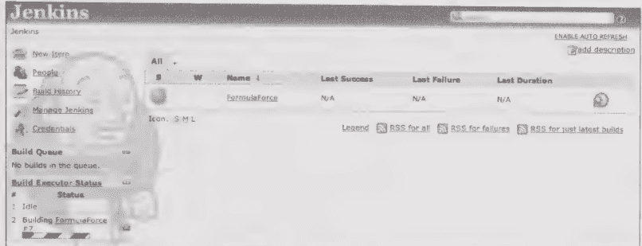

如果单击构建本身的超链接（在侧边栏中显示），您可以实时监控 Ant 脚本日志，就像手动运行它一样：

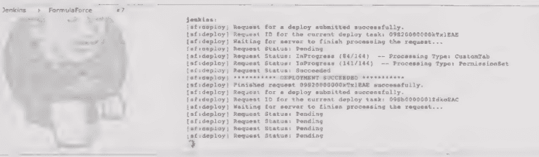

此构建完成后，Jenkins 将恢复监控 GitHub 仓库的更改，并在检测到更改时自动启动新构建。

## 进一步探索 Jenkins 和 CI

本节仅浅尝辄止地介绍了使用 Jenkins 和 Ant 脚本可以实现的功能。您可以扩展 Ant 脚本，如前所述执行其他检查，甚至编写自定义逻辑以将统计信息写回到您自己的 Salesforce 生产环境。通过对仓库进行一些小更改和一些大更改，继续进一步探索此过程，以查看效果。

例如，尝试更改某个全局 Apex 方法的方法名（例如，将 ComplianceService.report 改为 ComplianceService.reportX），以及 ComplianceResource 和 ComplianceResource_1_0 中调用它的方法。虽然这在开发者组织和构建组织中可以编译，但最终会导致 Jenkins 构建出现以下错误，因为检查部署到打包组织失败，因为已发布的全局方法不能被删除或重命名。在这种情况下，Jenkins 将报告以下构建失败：

```
classes/ComplianceService.cls -- Error: Global/WebService identifiers cannot be removed from managed application: Method: LIST<fforce>. ComplianceService.VerifyResult> report(SET<Id>) (line 1, column 8)
```

Jenkins 仪表板显示该项目有一个深色云图标，因为最近两次构建中有一次失败了。是时候修复构建了：

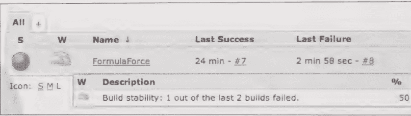

一旦新构建成功完成，Jenkins 就会用一些阳光奖励您：


## 从源代码控制发布

当您准备好为应用程序发布 beta 版或正式版软件包时，将把源代码从源代码控制中转移到您的打包组织。幸运的是，这也可以借助以下 Ant 脚本目标来实现。请注意，与 deploy Ant 目标不同，此目标不会尝试清理目标组织！

```
<target name="deploy.package">
    <sf:deploy
        username="${sf.username}"
        password="${sf.password}"
        serverurl="${sf.server}"
        runAllTests="true"
        deployRoot="${basedir}/src"/>
</target>
```

通过运行前述 Ant 目标，更新打包组织的过程只能部分实现自动化，因为您仍然需要登录到打包组织以添加那些通过与包中现有组件的关系而不会自动添加的全新组件。

以下是一组建议步骤，用于更新并确认打包组织的内容与源代码控制的内容匹配：

- 1. 运行以下命令（全部在同一行命令行上）：
  ```
  ant deploy.package
  -Dsf.username=packagingusername
  -Dsf.password=packagingpasswordpackagingtoken
  ```
- 2. 登录到打包组织并查看软件包的内容。您可以使用 **添加组件** 页面来确定是否存在目前未包含在软件包中但现在位于打包组织中的组件。
- 3. 将 /src 文件夹重命名为 /src.frommsc 并创建一个新的 /src 文件夹。然后，按照本章开头用于从打包组织下载文件的命令行，运行 retrieve.package Ant 目标。
- 4. 使用您喜欢的文件比较工具比较 /src 和 /src.frommsc 文件夹。查看差异，以确定打包组织或源代码控制系统中是否存在不属于正在打包的应用程序的更改！
- 5. 根据最佳实践，确认您的软件包依赖项仍然符合预期。然后，像前几章讨论的那样以常规方式执行上传。

## 自动化回归测试

虽然 Apex 测试是监控应用程序中回归问题的关键工具，但它们可以测试的功能限制和范围很小，尤其是用于执行大量或用户界面测试（例如使用 JavaScript 的客户端）时。

> 您可能会好奇 Jenkins 使用的 Ant 脚本为何要部署两次，因为检查部署到打包组织将确认 Apex 代码是否编译以及所有 Apex 测试是否成功完成。原因是，构建组织使用最新构建进行部署后，可以继续用于其他目的，例如执行更多回归测试步骤。

以下是实施更多测试方法时需要考虑的事项：

- 可以使用本章前面描述的方法，从 Ant 脚本中执行 Apex 代码，当时我们通过调用 SeasonService.createTestSeason 方法将示例数据填充到开发者组织中。您可以扩展此方法，在 Ant 中使用循环构造来创建大量数据或启动更多 Batch Apex 作业（Apex 测试只允许处理一次 200 条记录的单个批次），暂停等待完成，并断言结果。
- Salesforce 数据加载器实际上是一个带有命令行界面的 Java 程序。因此，您可以考虑使用它将数据加载到构建组织中，以便针对不同的数据集进行测试，并与前述用于在测试之间清理记录的 Apex 代码结合使用。
- 一旦数据加载到构建组织中，您可以使用多种 Salesforce 测试工具来执行测试。例如，Selenium WebDriver 工具是一个绝佳的选择，因为它提供无头模式（无需物理屏幕）且可以在多个操作系统上运行。此工具允许您测试包含大量 JavaScript 的 Visualforce 页面（http://docs.seleniumhq.org/projects/webdriver/）。

## 总结

在本书的最后一章中，我们了解了如何使用工业级源代码控制工具、开发流程和 Jenkins 等服务器，将开发人员资源扩展到企业应用程序的开发中。

本章中描述的某些步骤，与在单个打包组织中开发或使用其他手动方法在开发者组织之间导出和合并更改相比，起初可能显得过度且过于复杂。最终，手动解决冲突会浪费更多时间，更不用说丢失更改的风险增加了。

当然，如果您的业务旨在接受开发流程审计，那么采用更受控的方法，并对谁有权访问不仅源代码，还有发布机制（即您的打包组织）实施更严格的控制，是必不可少的。

例如，将您的 Force.com 开发流程开放给 Git 等工具，可以实现更好的开发人员交互，用于代码审查以及仔细暂存开发中的功能以供发布等方面。此类工具还能更深入地了解围绕您开发流程的统计信息，从而让您随时间进一步优化开发标准和生产力。
