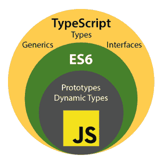

## Spring Boot 和 Angular – 全景图

首先，我们想感谢您购买本书，本书为开发者创建，旨在学习如何使用开发行业中使用的标准构建全栈 Web 应用程序。本书是基于我们在培训和研讨会中开发的应用程序量身定制的。所以，让我们开始我们的冒险吧。

本章将作为 Java Spring Boot 和 Angular 基础的简短回顾，让您对进行它们的 Web 开发将涉及的内容有一个概念。您还将了解到社区规模之大，以及 Angular 可用的支持使其成为开发应用程序的可靠选择。

在本章中，我们将涵盖以下主题：

- 介绍 Spring Boot
- 使用 Spring Boot 的优势
- Java 17 的新特性
- 介绍 Angular
- 使用 Angular 的优势

## 技术要求

我们将构建的应用程序的 GitHub 仓库可以在 https://github.com/PacktPublishing/Spring-Boot-and-Angular 找到。

每个章节都有一个目录，其中包含项目已完成的<|message|>

> **注意**
> 
> 由于我们将涵盖的大多数主题将由理论和一些示例代码组成，因此 *第 1 章 Spring Boot and Angular – The Big Picture* 至 *第 4 章 设置数据库和 Spring Data JPA* 不会有任何目录。实际项目将在 *第 5 章 使用 Spring 构建 API* 开始。

## 介绍 Spring Boot

**Spring Boot** 是 Pivotal 的开源微框架。它是企业级框架，供开发者在 **Java 虚拟机（JVMs）** 上创建独立应用程序。其主要重点是缩短您的代码，以便更轻松地运行应用程序。

该框架扩展了 Spring Framework，为您提供了一种更具主见的配置应用程序方式。此外，它还具有内置的自动配置功能，可根据您的设置配置 Spring Framework 和第三方包。Spring Boot 利用这些知识避免在配置时出现代码错误，因为它在设置应用程序时减少了样板代码。

现在，让我们讨论使用 Spring Boot 的主要优势。

## 使用 Spring Boot 的优势

以下是使用 Spring Boot 开发应用程序的四个主要优势：

- **自动配置：** 当您配置 Spring Boot 应用程序时，它会下载运行应用程序所需的所有依赖项。它还将根据您应用的设置，使用相关第三方包配置您的 Spring Framework。因此，Spring Boot 避免了样板代码和配置错误，您可以直接开始开发 Spring 应用程序。
- **主见的方法：** Spring Boot 使用基于应用程序需求的狭窄方法安装依赖项。它将安装应用程序所需的所有软件包，并取消手动配置的想法。
- **Spring 启动器：** 您可以在初始化过程中选择一系列启动依赖项来定义应用程序的预期需求。Spring Starter 的一个例子是 Spring Web，它允许您在无需配置运行应用程序所需的依赖项的情况下初始化基于 Spring 的 Web 应用程序。相反，它将自动安装 Apache Tomcat Web 服务器和用于身份验证功能的 Spring Security。
- **创建独立应用程序：** Spring Boot 可以运行不依赖外部 Web 服务器的独立应用程序。例如，我们可以嵌入 Tomcat 服务器并运行应用程序。


## Spring 与 Spring Boot 的区别

那么，Spring 和 Spring Boot 有什么区别？在使用 Spring Boot 之前是否需要先学习 Spring Framework？让我们从第一个问题开始。

下表显示了这两个框架的区别：

| spring | spring boot |
|---|---|
| 开发者为项目配置依赖项。 | 使用 Spring Starters，Spring Boot 将配置运行应用程序所需的所有依赖项。 |
| Spring 是一个用于构建应用程序的 Java EE 框架。 | Spring Boot 通常用于构建 REST API。 |
| Spring 简化了 Java EE 应用程序的开发，因为 Spring JDBC、Spring MVC 和 Spring Security 等模块已提供。 | Spring Boot 提供依赖项的配置，减少了模块布局的样板代码。这使得运行应用程序变得更容易。 |
| 依赖注入（DI）和控制反转（IOC）是 Spring 构建应用程序的主要特性。 | Spring Boot Actuator 是一个功能，它公开了有关应用程序的运行信息，例如指标和流量。 |

我们可以确定 Spring Boot 是构建在 Spring 之上的，主要区别在于 Spring Boot 会自动配置运行 Spring 应用程序所需的依赖项。因此，关于在使用 Spring Boot 之前是否需要学习 Spring Framework 的问题，答案是否定的——Spring Boot 只是 Spring 的扩展，它使配置更快，因为它采用了有主见的方法。

现在，让我们看看在 Spring 和 Spring Boot 中配置 Web 应用程序所需的依赖项。

## Spring 和 Spring Boot 的依赖示例

在 Spring 中，我们的应用程序运行所需的最小依赖项是 Spring Web 和 Spring Web MVC：

```
<dependency>
    <groupId>org.springframework</groupId>
    <artifactId>spring-web</artifactId>
    <version>5.3.5</version>
</dependency>
```

```
</dependency>
<dependency>
    <groupId>org.springframework</groupId>
    <artifactId>spring-webmvc</artifactId>
<version>5.3.5</version>
</dependency>
```

Spring Boot 只需要 spring-boot-starter-web，它是应用程序运行的 Spring Starter。必要的依赖项会在构建时自动添加，因为 starter 将负责配置：

```
<dependency>
<groupId>org.springframework.boot</groupId>
<artifactId>spring-boot-starter-web</artifactId>
<version>2.4.4</version>
</dependency>
```

在 Spring 中需要考虑的另一件事是，我们需要定义一些配置，例如调度 servlet 和映射，以便我们的应用程序在服务器上运行：

```
public class SpringInitializer implements WebApplicationInitializer {
@ Override
public void onStartup(ServletContext container) {
AnnotationConfigWebApplicationContext context =
    new AnnotationConfigWebApplicationContext();
context.setConfigLocation("com.springexample");
container.
addListener(new          ContextLoaderListener(context));
ServletRegistration.Dynamic dispatcher =
    container. addServlet("dispatcher",
        new  DispatcherServlet(context));
dispatcher.setLoadOnStartup(1);
dispatcher.addMapping("/");
    }
}
```

初始化调度 servlet 之后，我们还需要使用 @EnableWebMvc 并拥有一个带有 @Configuration 注解的 Configuration 类，在其中我们将为应用程序实例化一个视图解析器。

## 密封类

**密封类**在 Java 16 中处于第二个预览阶段。假设，例如，我们在代码中创建了一个类。我们可以假设该类可以在我们的应用程序中被任何子类扩展。因此，通过使我们的类密封，我们可以确保我们的类不能被子类扩展。如果我们想允许某些子类扩展我们的类，我们可以使用 `permits` 关键字来标识我们想要授予权限的特定类，如以下示例所示：

```
public sealed class Animal permits Cat, Dog, Horse
```

## 外部函数和内存 API

引入了一个新的 API 用于访问和使用 Java 运行时之外的代码，它通过应用外部函数（JVM 之外的代码）并安全地访问外部内存（JVM 不处理的内存）来实现。API 允许 Java 应用程序在没有 **Java Native Interface (JNI)** 的情况下调用本地库。

该 API 旨在用纯 Java 开发模型和更好的性能来取代 JNI，同时访问堆外数据并省略不安全的操作。

## 外部内存 API

Java 今天的一个常见问题是访问堆外数据。**堆外数据**是存储在 Java 运行时外部内存中的数据。我们可以说这是一个第三方库。访问此数据对性能至关重要，因为 Java 垃圾收集器仅在堆上数据上工作，这使它们避免了垃圾收集的不可预测性。以下 API 用于处理堆外数据：

+   - **The ByteBuffer API**: 此 API 允许您在堆外数据中创建直接 ByteBuffers，以便数据可以在 Java 运行时之外管理。然而，ByteBuffer 的主要缺点是其最大大小为 2 GB，并且不会及时释放，导致应用程序的运行时性能变慢。
+   - **The Sun.misc.Unsafe API**: Unsafe API 暴露了在堆外数据上工作的访问操作。此 API 使此过程高效，因为 **Just-in-Time (JIT)** 编译器优化了访问操作。然而，不建议使用 Unsafe API，因为我们允许访问任何内存位置。
+   - **The Foreign Function and Memory API**: 此 API 解决了访问内存位置的困境并牺牲运行时性能，因为它提供了类和接口，应用程序可以执行以下操作：
+     - Allocate Foreign Memory
+     - Manipulate and access foreign memory
+     - Call Foreign Functions

## 使用 switch 语句的模式匹配

模式匹配是在 switch 语句中测试模式和复杂表达式的想法。此新功能允许 switch 语句更具扩展性和灵活性，以接受复杂表达式。

## Applet API

**Applet API** 在 Java 中很少使用，因为所有浏览器都已删除对 Java 浏览器插件的支持。

## 实验性 AOT 和 JIT 编译器

实验性的基于 Java 的 **ahead-of-time (AOT)** 和 **JIT** 编译器已被移除，因为其功能使用有限。

这些只是应用于 Java 17 的一些更改。现在，让我们学习 Angular，这是当今顶级的 JavaScript 框架之一，以及使用 Angular 框架开发前端的优势。

## 介绍 Angular

**Angular** 是一个由 Google 维护的免费开源 JavaScript 框架。它主要用于开发 Web 应用程序，并已扩展其功能，可使用插件创建移动和桌面应用程序。Angular 使用基于组件的代码，是渐进式的，并提供许多库和扩展，可缩短开发大型应用程序的时间。

截至撰写本文时，Angular 在构建前端应用程序方面非常流行。它是为三星、Upwork、PayPal 和 Google 等大型知名公司开发应用程序的主要框架。它还拥有非常活跃的社区，在 GitHub 上有 76,000 个星标，约有 1,500 人为该框架做出贡献。此外，它还有数千个功能性 NPM 库，您可以使用它们来加快开发速度。

## Angular 历史

在它成为 Angular 之前，Google 开发的第一个框架是 **AngularJS** 或 Angular 版本 1。尽管开发人员通常对此感到困惑，因为他们认为 AngularJS 和 Angular 相似，但 AngularJS 是由 Google 员工 *Miško Hevery* 作为开源框架发布的，他开发 AngularJS 是为了更快地开发 Web 应用程序。

AngularJS，您可以使用 JavaScript 或 Dart，随着其社区变得更广泛而变得流行。与此同时，Ionic 框架发布了，它允许开发人员使用 AngularJS 构建原生移动应用程序。




图 1.1 – TypeScript – 超集语言

正如我们所见，TypeScript 构建于 ES6 和 JavaScript 之上，旨在为开发添加更多功能。TypeScript 的某些组件包括泛型、类型和接口，我们知道这些与**面向对象编程（OOP）**直接相关。现在，让我们来看另一个优势。

## 静态类型数据

TypeScript 可以定义静态类型数据，从而允许变量具有严格的类型。与普通 JavaScript 相比，如果存在任何与类型相关的错误（即在运行时才会捕获的错误），编译器会发出警告。因此，TypeScript 可以在编译时提示这些问题，从而避免生产环境中的错误。

## 可预测性和可维护性

由于 TypeScript 是强类型的，这有助于实现可预测性。例如，变量被声明为数字，因此在整个应用程序中它将始终保持为数字，并且由于所有参数也都是严格类型的，函数将指定如何实现它们。此外，TypeScript 还具有可维护性，因为它让开发者能够在编译时调试应用程序。

## IDE 支持

由于 TypeScript 正成为一种更广泛使用的语言，越来越多的 IDE 开始支持它。IDE 提供了多项功能，如代码导航、自动补全和插件。

Microsoft Visual Studio 是用于 TypeScript 的主要 IDE。不过，也有一些 IDE 和编辑器可用于运行 TypeScript：

- **Atom：** 一个跨平台编辑器
- **Eclipse：** 一个带有 TypeScript 插件的 IDE
- **Visual Studio Code：** 微软开发的一个轻量级跨平台编辑器

## 面向对象编程（OOP）

TypeScript 是一种**面向对象的语言**，这意味着它支持类、接口和继承等概念。随着我们将应用程序开发为对象，OOP 具有很好的可扩展性，如果我们正在开发不断增长的应用，这是一个优势。

## 早期发现缺陷

浏览器不能直接理解 TypeScript。相反，它们使用**转译器**，将代码编译成普通 JavaScript。在这里，所有与语法和类型相关的错误都会被捕获，从而让开发者可以专注于代码逻辑。

这些只是 TypeScript 语言的优势。现在，让我们看看 Angular 本身的好处。

## 支持大型企业应用

Angular 被认为是一个一体化框架，因为构建应用所需的大部分标准功能都已包含在内。这包括模块。例如，要在 Angular 应用中使用表单，我们必须导入 FormsModule 和 ReactiveformsModule。其他例子包括导航和路由。Angular 提供了 RouterModule，让你可以在应用内创建路由。

## 单页应用

Angular 是一个**单页应用（SPA）**，这意味着当用户从一个页面导航到另一个页面时，页面不会重新加载，因为获取的是服务器的数据。此外，客户端的资源是独立的，并且已经加载到浏览器中，这有助于提升应用的加载性能。

## 渐进式 Web 应用（PWA）

**渐进式 Web 应用（PWA）** 如今正成为一种趋势。它们是一种解决方案，允许 Web 应用在移动应用以及不同平台上运行，既支持在线也支持离线。得益于 Angular 的 schematics，将 Angular 配置为 PWA 非常简单——只需一行代码，你的 Angular 应用就配置好了。PWA 还可以使用 PWA Builder 上传到 Android Play Store 和 Microsoft Store。

以下命令使用 Angular CLI 将我们的应用转换为 PWA：

```
ng add @angular/pwa
```

## Angular CLI

我们不需要从头创建或配置 Angular。相反，我们可以使用 Angular CLI，它有助于安装必要的依赖项，以便成功运行我们的 Angular 应用。尽管 schematics 功能负责创建所需文件、安装包，以及

```
<li><a href="#">About</a></li>
    <li><a href="#">Contact Us</a></li>
</ul>
</div>
</nav>
```

导航栏必须出现在我们应用的每个页面上。这个过程会导致冗余代码，这意味着我们必须一遍又一遍地重复这段代码。然而，在 Angular 中，它已被开发成一个组件，允许我们在应用的不同部分重用这段代码。一个特定的选择器被分配给导航栏代码，并用作该组件的 HTML 标签，如下列代码所示：

```
<!--example selector for the navigation bar component-->
<app-navigation-bar/>
```

## 跨平台支持

Angular 用于构建 Web 应用，以及原生移动和桌面应用。现在可以通过 Ionic、NativeScript 和 Electron 等框架来实现这一点。除了 PWA，Ionic 和 NativeScript 也可用于使用 Angular 创建移动应用。另一方面，Electron 是一个框架，它使用类似的代码库将你的 Angular 应用转换为桌面应用。这一特性使 Angular 非常灵活，因为一个框架就能覆盖你的应用的所有平台。

## Web 组件

Angular 支持**Web 组件**，也被称为 **Angular 元素**。这里的理念是将应用拆分成更小的部分，并将其分发成独立的应用程序或包，从而可以在其他应用中进行分发和使用。Angular 元素涵盖了微前端的概念。每个元素都有一个部署管道。该组件还可以用于不同的 JavaScript 框架，如 React 和 Vue。

## 支持懒加载

在客户端浏览器中加载所有 JavaScript 代码可能会引发一些问题。如果应用变得更大，更多的代码会被打包到一个 chunk 中。我们不希望引导加载所有代码，因为这会导致应用在首次启动时加载缓慢。我们只想按需加载所需的内容。Angular 的懒加载功能解决了这个问题。它只加载特定路由所需的模块、组件、服务、指令以及应用的其他元素。这一功能缩短了用户初次打开应用时的加载时间。

在下面的代码中，我们将一些路由定义为一个数组，并以对象形式添加新路由。要启用懒加载，我们必须使用 loadChildren 属性按需加载模块：

```
const route: Routes = [
  {
    path: "about",
    loadChildren: () =>
      import("./src/app/AboutModule").then(m =>
        m.AboutModule)
  },
  {
    path: "contact",
    loadChildren: () =>
      import("./src/app/ContactModule").then(m =>
        m.ContactModule)
  }
];
```

在上述代码中，当用户导航到 about 路径时，只会加载 AboutModule，它包含该特定路由的资源。除非用户导航到 contact 路径，否则不会加载 ContactModule 下的资源。

## 总结

在本章中，你了解到 Spring Boot 是一个用于 Spring 的开源框架扩展，它主要解决了配置 Spring Framework 时的样板代码问题。此外，它还提供了 Spring Starters，开发者可以使用它们让 Spring Boot 自动配置所需的依赖项。

另一方面，Angular 是一个基于组件的框架，使用 TypeScript 语言构建，从而赋予它面向对象编程的能力。此外，它支持跨平台，允许开发者创建 Web、移动和桌面应用。Angular 是最顶尖的 JavaScript 框架之一，因为它被多家大公司使用，并得到了 Google 和庞大社区的支持。

在下一章中，你将了解必须安装在计算机上的软件，并为全栈开发设置开发环境。


