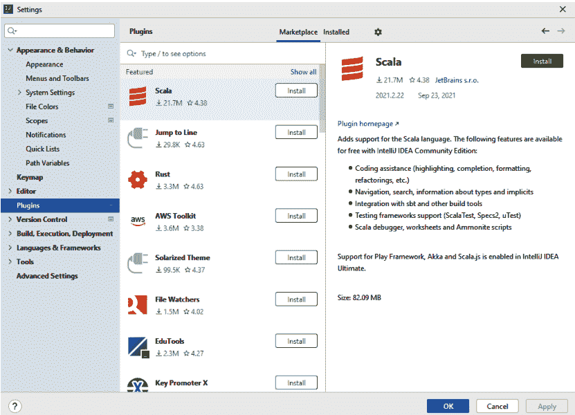
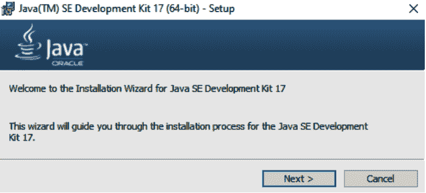
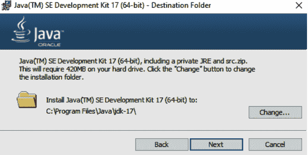
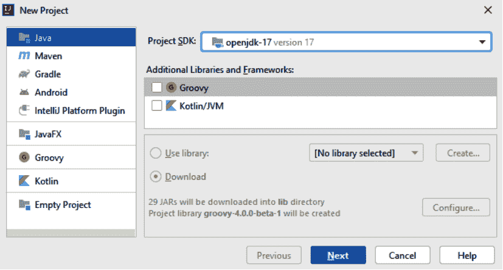
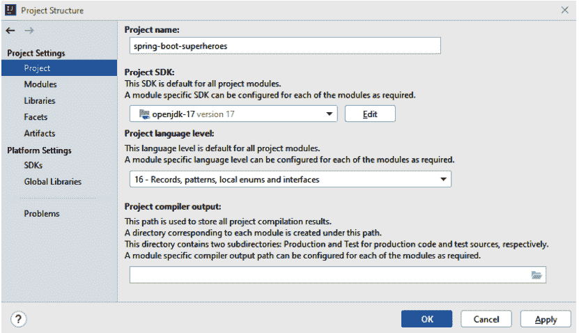
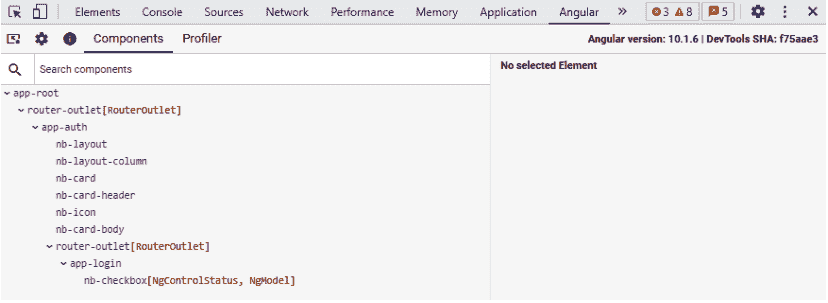

## 设置开发环境

在上一章中，你简要了解了 Spring Boot 及其优势。我们还探讨了 Java 17 的最新特性。Angular 也是如此；你对 Angular 及其用于开发前端应用的优势有了概览。

本章将教你如何设置计算机的开发环境来开发你的全栈 Java 和 Angular 应用。我们将介绍不同的 IDE 和文本编辑器来编写代码，并在开始开发前确保一切都已配置好。

从一开始就正确安装所有内容将帮助我们避免问题，并在开发过程中不间断地编写代码。

在本章中，我们将涵盖以下主题：

- 安装 VS Code 和 IntelliJ IDEA
- 安装 Java 17
- 安装 SDKMAN
- 使用 Java 17 设置 IntelliJ IDEA
- 安装 REST Client VS Code 或 JetBrains 和 Angular DevTools
- 安装 Git 版本控制

## 技术要求

以下是你需要安装的软件的链接：

- **下载 VS Code（适用于 Windows、Mac 和 Linux）**：https://code.visualstudio.com/download
- **IntelliJ IDEA for Windows**：https://www.jetbrains.com/idea/download/#section=windows
- **IntelliJ IDEA for Mac**：https://www.jetbrains.com/idea/download/#section=mac
- **IntelliJ IDEA for Linux**：https://www.jetbrains.com/idea/download/#section=linux
- **下载 Java 17**：https://www.oracle.com/java/technologies/javase/jdk17-archive-downloads.html
- **Angular DevTools**：https://chrome.google.com/webstore/detail/angular-devtools/ienfalfjdbdpebioblfackkekamfmbnh
- **Node.js and Node Package Manager**：https://nodejs.org/en/
- **PostgreSQL for Windows**：https://www.postgresql.org/download/windows/
- **PostgreSQL for Mac**：https://www.postgresql.org/download/macosx/
- **PostgreSQL for Linux**：https://www.postgresql.org/download/linux/
- **Git Version Control**：https://git-scm.com/

## 安装 VS Code 和 IntelliJ IDEA

本节将指导你完成 VS Code 或 IntelliJ IDEA 的安装和配置。我们将查看文本编辑器和 IDE 的功能分解，以及开发过程中可使用的插件。

### VS Code

从 https://code.visualstudio.com/download 下载 VS Code 安装程序。我们建议无论你的机器操作系统如何都安装 VS Code，因为 VS Code 轻量但为 Angular 开发提供了许多插件。此外，VS Code 是 JavaScript 开发者最常用的文本编辑器。该编辑器支持 TypeScript、代码格式化和代码导航，并提供许多扩展，特别是在开发 Angular 应用时。以下是开发过程中可使用的一些有价值的扩展：

- **Code Spell Check**：这是一个用于检查源代码拼写的扩展，有助于我们避免因拼写错误导致的问题。
- **Prettier**：这是一个代码格式化工具，可在每次保存后对文件应用适当的对齐和缩进。
- **Angular Snippets**：这是一个 Angular 开发者常用的扩展，它为 Angular、TypeScript 和 HTML 添加了代码片段，可在开发中使用片段即时生成代码，从而节省大量时间。
- **Angular Files**：这是一个非常有价值的扩展，特别是在你不熟悉 Angular CLI 命令时；该扩展将添加一个菜单，可在不使用 CLI 的情况下生成 Angular 组件、模块和服务。
- **Angular2-Switcher**：此扩展允许我们使用快捷键在 Angular 文件之间导航。
- **REST Client**：这是 VS Code 中用于测试后端 API 的扩展。无需使用第三方应用程序，我们就可以使用 REST Client 在 VS Code 中发送请求。
- **JSON to TS**：此扩展非常方便，可自动将 JSON 对象转换为前端的 TypeScript 模型。
- **Angular Language Service**：这是 Angular 开发必不可少的插件之一。该扩展提供 **Angular Code Completion**、**Angular Diagnostic Messages** 和 **Go to definition** 功能，使开发更快。

至此 VS Code 安装和配置结束。你的 VS Code 文本编辑器现已可用于 Angular 开发。

### IntelliJ IDEA

该 IDE 是使用 Java 开发应用程序时最受欢迎的 IDE 之一。IDE 提供了许多功能来使开发更轻松、更快。以下是 IntelliJ IDEA 提供的工具列表：

- **Terminal**：IntelliJ IDEA 带有内置终端。我们可以根据开发所使用的语言在终端中执行任何命令。终端可通过按 *Alt + F12* 访问。
- **Quick fixes**：IntelliJ IDEA 可即时检测语法错误。借助此功能，IntelliJ IDEA 还会为开发者建议快速修复，以便轻松纠正代码中的错误。快速修复可通过 IntelliJ IDEA 检测到错误时出现的小灯泡访问。
- **IntelliSense**：IntelliSense 也称为 **smart code completion**。IntelliJ IDEA 分析代码片段并显示建议以即时完成代码。
- **Advanced refactoring**：IntelliJ IDEA 提供广泛的重构选项。IDE 使开发者能够自动重构代码。重构也可以在重构菜单中访问。
- **Navigation and search**：这是 IntelliJ IDEA 最常用的功能之一，尤其是在大型项目中。它帮助开发者查找和导航资源，并且可以搜索 IDE 中所有可用的控件。
- **Detecting duplicates:** 这有助于开发者查找代码中的重复项并向开发者提供建议。

你应该前往 https://www.jetbrains.com/idea/download/ 下载安装程序。此外，你可以下载社区版，即 IntelliJ IDEA 的免费版本。

成功下载 IDE 后，运行安装程序，过程非常简单。它将自动在我们的机器上安装 IDE。成功安装 IntelliJ IDEA 后，我们将安装插件/扩展，这些插件/扩展将在开发过程中帮助我们。

要安装插件，请打开 IntelliJ IDEA 并按 Ctrl + Alt + S。这将打开设置窗口，然后你应前往 Plugins 菜单以访问市场：



图 2.1 – IntelliJ IDEA 插件市场

它将列出可为开发添加的所有可用插件。我们将安装以下插件：

- **Lombok:** 一个提供注解的扩展，可防止反复编写 getter 和 setter 方法；注解提供功能齐全的构建器。
- **Maven Helper:** 用于 Maven 项目的工具，有助于分析冲突的依赖项。它可以以树形显示已安装的依赖项，并允许开发者检查它们的关系。
- **Junit 5 Mockito Code Generator**：一个扩展，可帮助我们生成编写测试时常用的样板代码。
- **Eclipse Code Formatter**：一个工具，可将 Eclipse 的代码格式化程序直接集成到 IntelliJ IDEA 中。当开发者同时使用 Eclipse 和 IntelliJ IDE 时，此工具在解决标准代码风格问题方面非常有用。
- **Tabnine**：一个工具，允许开发者基于数百万个 Java 程序完成代码行。它有助于减少标准错误，并借助 AI 使开发者能够更快地编码。
- **Add to gitignore**：这允许开发者直接在 IDE 中将特定文件添加到 `.gitignore` 以被忽略，而无需逐一输入路径。

至此 IntelliJ IDEA 的安装和配置结束。你的机器上的 IDE 已全部设置好。

## 安装 Java 17

本节将解释 Java 17 是什么，并指导你在 Windows、macOS 和 Linux 上安装该工具包。

Java 17 是一个 **Java Development Kit (JDK)**，用于使用 Java 编程语言构建应用程序和组件。它是最新 **long-term support (LTS)** 版本，这意味着供应商（Oracle）将长期支持该版本，包括安全问题的修补。

### Windows 安装

执行以下步骤在 Windows 上安装 Java 17：

1. 前往 https://www.oracle.com/java/technologies/downloads/#jdk17-windows：

| Linux | macOS | Windows |
|---|---|---|
| Product/file description | File size | Download |
| x64 Compressed Archive | 170.64 MB | https://download.oracle.com/java/17/latest/jdk-17_windows-x64_bin.zip (sha256) |
| x64 Installer | 151.99 MB | https://download.oracle.com/java/17/latest/jdk-17_windows-x64_bin.exe (sha256) |
| x64 MSI Installer | 150.88 MB | https://download.oracle.com/java/17/latest/jdk-17_windows-x64_bin.msi (sha256) |

图 2.2 – Java 17 安装程序


## 设置开发环境

+   2. 根据你的操作系统选择安装程序，通过点击链接下载。
+   
+      下载成功后，打开安装程序，它会提示你逐步进行安装，你可以按照提示操作。



图 2.3 – Java 17 安装设置

+   3. 点击 **Next**，这时会询问将 JDK 17 放置在你机器上的位置。你可以选择设置 JDK 的首选路径，但通常使用默认路径。



图 2.4 – Java 17 安装目标文件夹

+   4. 现在，这将在你的机器上自动安装 JDK 17，安装成功后。以下文件也会被复制到该位置：

```
"C:\Program Files\Common Files\Oracle\Java\javapath\java.exe"
"C:\Program Files\Common Files\Oracle\Java\javapath\javaw.exe"
"C:\Program Files\Common Files\Oracle\Java\javapath\javac.exe"
"C:\Program Files\Common Files\Oracle\Java\javapath\jshell.exe"
```

我们现在已成功在 Windows 机器上安装了 Java 17。接下来，我们将向你展示在 macOS 上安装 Java 17 的步骤。

## macOS 安装

在 macOS 中选择 Java 17 安装程序时需要考虑一些事项。首先，我们需要知道 JDK 17 的安装包含版本表示法，表示特性、临时和更新版本。例如，如果你安装的是临时版 1、更新版 1 和补丁版 1，安装程序名称将如下所示：

- **macOS x64 系统：**
  `jdk-17.1.1.1_macos-x64_bin.dmg`
  `jdk-17.1.1.1_macos-x64_bin.tar.gz`
- **macOS aarch64（64 位 ARM）系统：**
  `jdk-17.1.1.1_macos-aarch64_bin.dmg`
  `jdk-17.1.1.1_macos-aarch64_bin.tar.gz`

执行以下步骤在 macOS 上安装 Java 17：

+   1. 要下载安装程序，请前往 https://www.oracle.com/java/technologies/downloads/#jdk17-mac 并根据你的操作系统架构选择安装程序。你可以下载 `.dmg` 或 `tar.gz` 安装程序。
+   2. 双击 `.dmg` 文件以启动安装程序。Finder 窗口将会出现，其中包含 `.pkg` 文件的名称。双击 JDK 17 `.pkg` 图标以开始安装。
+   3. 点击 **Continue**，安装窗口将会出现。点击 **Install** 后，将显示以下消息：**Installer is trying to install new software. Enter your password to allow this.**
+   4. 接下来，输入你的管理员用户名和密码并点击 **Install software to continue**，这将自动在你的机器上安装软件。

我们现在已成功在 macOS 上安装了 Java 17。接下来，我们将向你展示在 Linux 平台上安装 Java 17 的步骤。

## Linux 安装

在 Linux 系统上安装 Java 17 时，我们也需要像选择 macOS 安装程序时一样注意版本表示法。版本格式表示特性、临时和更新版本。因此，例如，如果我们下载的是临时版 1、更新版 1 和补丁版 2，则安装程序名称将如下所示：

- **Linux x64 系统：** `jdk-17.1.1.2_linux-x64_bin.tar.gz`
- **Linux aarch64 系统：** `jdk-17.1.1.2_aarch64_bin.tar.gz`

你可以使用归档文件或 **Red Hat Package Manager (RPM)** 在 Linux 平台上安装 JDK：

- **归档文件 (.tar.gz)** 将在任意位置安装 JDK 的私有版本，而不影响其他 JDK 安装。捆绑包适用于 Linux x64 和 Linux aarch64。
- **RPM 包 (.rpm)** 将执行 JDK 的系统范围安装，并要求用户具有 root 访问权限。

### Linux 平台上的 64 位

要为 64 位 Linux 平台安装 JDK，可以从以下 URL 下载 tar.gz 归档文件，也称为 tarball：https://www.oracle.com/java/technologies/downloads/#jdk17-linux。

我们看到的文件如下：

- **Linux 64：** `jdk-17.interim.update.patch_linux-x64_bin.tar.gz`
- **Linux aarch64：** `jdk-17.interim.update.patch_linux-aarch64_bin.tar.gz`

成功下载 tarball 文件后，接受许可协议并将 .tar.gz 文件放置在你想要安装 JDK 的目录中。

解压文件并按如下方式安装下载的 JDK：

```
tar zxvf jdk-17.interim.update.patch_linux-x64_bin.tar.gz
```

或使用以下代码：

```
tar zxvf jdk-17.interim.update.patch_linux-aarch64_bin.tar.gz
```

成功安装 JDK 后，我们可以看到它现在已安装在名为 `jdk-17.interim.update.patch` 的目录中。

### RPM 为基础的 Linux 平台上的 64 位

我们可以使用 RPM 二进制文件为 RPM 为基础的 Linux 平台（如 Oracle 和 Red Hat）安装 JDK。在安装 JDK 之前，我们必须首先确保我们具有 root 访问权限。你可以通过运行 su 命令并输入超级密码来获得 root 访问权限。

RPM 文件可以从 https://www.oracle.com/java/technologies/downloads/#jdk17-linux 下载，我们得到以下文件：

- **Linux 64**：`jdk-17.interim.update.patch_linux-x64_bin.rpm`
- **Linux aarch64**：`jdk-17.interim.update.patch_linux-aarch64_bin.rpm`

使用以下命令安装包：

```
rpm -ivh jdk-17.interim.update.patch_linux-x64_bin.rpm
```

或使用以下命令：

```
rpm -ivh jdk-17.interim.update.patch_linux-aarch64_bin.rpm
```

执行命令后，JDK 已成功安装在我们的机器上。然后，为了将来进行版本升级，我们可以执行以下命令：

```
rpm -Uvh jdk-17.interim.update.patch_linux-x64_bin.rpm
```

或使用以下命令：

```
rpm -Uvh jdk-17.interim.update.patch_linux-aarch64_bin.rpm
```

我们已在不同操作系统上完成 JDK 17 的安装和配置。在下一节中，我们将安装 SDKMAN。

## 安装 SDKMAN

本节将解释 SDKMAN 在开发 Java 应用程序中的用途。本节还将指导你如何在 Windows、macOS 和 Linux 上安装 SDKMAN。

**SDKMAN (Software Development Kit Manager)** 是管理机器上并行 Java 版本的工具。我们可以在计算机上拥有多个已安装的 Java 版本。你也可以直接使用 SDKMAN 安装 Java。它将自动安装最新稳定版本或你指定的版本。

SDKMAN 主要为 Unix 操作系统创建，但也支持其他操作系统的 Bash 和 ZSH shell。

### SDKMAN 功能

以下是 SDKMAN 的功能：

- SDKMAN 使 Java 的安装变得更容易。我们只需执行一个命令并指定要安装的版本，它就会完成所有工作。
- SDKMAN 还支持 Java 开发包。它可以安装 JVM 的 SDK，例如 Groovy 和 Kotlin。
- SDKMAN 可以在所有 Unix 平台上运行：macOS、Cygwin、Solaris 和 Linux。

### SDKMAN 命令

要查看 SDKMAN 支持的所有 SDK，我们可以执行以下命令：

```
sdk list
```

该命令将列出我们可以在机器上下载的所有 SDK 和 Java 库管理器。

要安装特定 SDK，例如我们想要安装 Java 的最新 SDK，执行以下命令：

```
sdk install java
```

如果我们想要安装 SDK 的特定版本，我们将在命令中指定版本，如下所示：

```
sdk install java 15-open
```

要在计算机上安装了多个版本时在版本之间切换，我们将执行以下命令：

```
sdk default java 15-open
```

### macOS 和 Linux 上的安装

只需几个命令即可在 macOS 和 Linux 上安装 SDKMAN。为了安装 SDKMAN，我们将执行以下命令：

```
curl -s https://get.sdkman.io | bash
```

按照所有安装 SDKMAN 的说明后，打开一个新终端并执行以下命令：

```
source "$HOME/.sdkman/bin/sdkman-init.sh"
```


该命令将成功在你的终端中安装管理器。要检查安装是否成功，我们可以执行以下命令：

```
sdk version
```

这将显示安装在你机器上的当前 SDKMAN 版本。

## Windows 上的安装

由于 SDKMAN 需要 Bash 工具，因此我们在 Windows 上安装 SDKMAN 需要几个步骤。在这种情况下，我们首先需要的是一个 Git Bash 环境（MinGW）：

- 1. 首先，我们将安装 7-Zip，并在成功安装后，我们将执行以下命令在 Git Bash 环境中创建一个符号链接，将 7-Zip 作为 zip 命令使用：

```
ln -s /c/Program\ Files/7-Zip/7z.exe /c/Program\ Files/Git/mingw64/bin/zip.exe
```

现在我们可以使用我们在 Linux 中使用的命令来安装 SDKMAN。

- 2. 要安装 SDKMAN，我们将执行以下命令：

```
export SDKMAN_DIR="/c/sdkman" && curl -s "https://get.sdkman.io" | bash
```

- 3. 安装完成后，重新启动 Git Bash shell 以运行 SDKMAN 命令。我们可以执行以下命令来验证我们的安装是否成功：

```
sdk version
```

它将提示我们终端中安装的 SDKMAN 的当前版本。

我们已在不同的操作系统上完成在我们的机器上安装和配置 SDKMAN。在下一节中，我们将使用已安装的 Java 17 配置 IntelliJ IDEA。

## 使用 Java 17 设置 IntelliJ IDEA

我们在前面的章节中已在我们的机器上安装了 IDE（IntelliJ IDEA）和 Java 17。现在，我们将指导你如何为新项目和现有项目配置 Java 17。

### 在新项目中使用 Java 17

我们只需要以下几个步骤即可在新的 Java 项目中使用 Java 17：

- 1. 打开你的 IntelliJ IDEA 终端并选择 File | New | New Project。



图 2.5 – 在 IntelliJ IDEA 中创建新项目

我们将看到前面的模态框并选择我们需要开发的项目类型。我们还可以看到我们可以为项目选择所需的 SDK 版本。

- 2. 我们将使用 Java 17，因此我们需要选择 OpenJDK-17。

- 3. 点击 Next 并配置你的项目名称和目录。这将使用所选的 SDK 版本设置你的 Java 应用程序。

我们现在已成功使用 JDK 17 配置了新项目。现在我们要使用 JDK 17 配置现有项目。

### 在现有项目中使用 Java 17

将项目从旧版本升级到 Java 17 后，我们需要遵循几个步骤才能使我们的应用程序正常工作。首先，请记住将升级到 Java 17 的步骤只是升级中的一般配置。它取决于项目的当前版本。此外，你的项目中使用的某些代码和依赖项可能已被弃用。

我们只需要几个步骤即可在现有的 Java 项目中使用 Java 17：

- 1. 打开你的 IntelliJ IDEA IDE 并打开你的现有项目。
- 2. 在菜单中选择 File 并选择 Project Structure。我们将看到一个模态框，在其中我们可以配置我们的项目设置。
- 3. 在 Project SDK 字段下，我们将选择 openjdk-17 以在项目中使用 Java 17。我们还可以选择 Project language level 以使用 Java 17 的一些新功能，例如密封类和 switch 的模式匹配。请记住，在更改 Project language level 时，请确保在 Modules 选项卡下为模块也设置了相同的级别。



图 2.6 – IntelliJ IDEA 项目设置

我们现在已完成使用 Java 17 配置项目。在下一节中，我们将为 Java 和 Angular 开发安装有用的工具，例如 REST Client 和 Angular DevTools。

## 安装 REST Client VS Code 或 JetBrains 和 Angular DevTools

在本节中，我们将指导你安装 REST Client 和 Angular DevTools。REST Client 是 RESTful API 中的必备工具。它是向你开发的 API 发送 HTTP 请求以调试代码在端点上的流程及其响应的工具。有几个第三方平台可用于 API 测试，例如 Postman，但 REST Client 可以直接安装在你的 IDE 中。

```json
{
  "name": "sample",
  "rate": 5
}
```

我们现在已成功在 VS Code 中安装了 REST Client，并且可以测试 RESTful API。现在，我们将向你展示如何安装 Angular DevTools，这对于调试 Angular 应用程序非常重要。

### 安装 Angular DevTools

Angular DevTools 是一个 Chrome 扩展。要安装该扩展，你可以直接从 `https://chrome.google.com/webstore/detail/angular-devtools/ienelfjdbdpebioblflackkekamfmbnh` 安装并按照以下步骤操作：

- 1. 点击 **Add to chrome**，我们就可以直接在浏览器上使用 Angular DevTools。请记住，我们只能在 **development mode** 下运行的 Angular 应用程序上使用 Angular DevTools。
- 2. 我们将在开发者工具中看到添加了一个名为 **Angular** 的新标签页。
- 3. 运行你的 Angular 项目并选择 **Angular** 标签页。



图 2.8 – Angular DevTools 安装

Angular DevTools 将有两个标签页：**Components** 标签页，将显示你的应用程序结构，以及 **Profiler** 标签页，用于识别应用程序性能和瓶颈。

我们已成功安装 Angular DevTools。最后但同样重要的是，我们将安装 Git 版本控制，这对于代码版本控制和团队协作非常有用。

### 安装 Git 版本控制

安装 **Git**，一个分布式版本控制系统，将是我们开发中需要的最后一件事。Git 对开发人员很重要，因为它用于保存你项目的不同版本和存储库的阶段。如果你在代码中做了更改导致应用程序崩溃并且你无法再修复它，Git 还可以帮助你恢复存储库的最近工作版本。

前往 http://git-scm.com/ 并点击屏幕上的 **Download** 按钮下载并安装 Git。

现在你已从本最后一节中了解了 Git 版本控制，从哪里获取它，它的作用以及为什么它至关重要。让我们总结一下所有内容。

## 摘要

至此，我们已到达本章的结尾。让我们回顾一下你学到的宝贵内容。你已学习如何安装 VS Code、其功能以及我们在 Angular 开发中可以使用的基本扩展。

你还学习了如何安装 IntelliJ IDEA、其功能以及我们在 Java 开发中将使用的插件。你还学习了如何安装 Java 17 并在 IntelliJ IDEA 中将其与新项目和现有项目配置。

SDKMAN 是一个开发工具包管理器，它使我们能够切换 JDK 版本并直接安装 Java 开发包。REST Client 是一种无需在我们的机器上下载任何第三方工具即可测试 RESTful API 的工具。

Angular DevTools 是 Angular 的 Chrome 扩展程序，为 Angular 应用程序提供调试和性能分析功能。最后但同样重要的是，Git 版本控制是一种用于创建代码历史记录的工具，你可以在其中快速回滚或创建应用程序的新版本。

在下一章中，我们将重点关注 Spring Boot 及其功能。
