## 迈向 Spring Boot

在上一章中，你学习了如何设置开发环境以使用 Java 开发 REST API 以及使用 Angular 应用程序。我们还安装了 SDKMAN！来管理多个 Java 版本、REST 客户端来在不使用第三方工具的情况下测试 API、Angular DevTools 来调试你的 Angular 应用程序，以及 Git 用于代码版本控制和协作。

本章现在将教你 Spring Boot 的概念。我们将深入探讨 Spring Boot 的基础知识以及开发后端应用程序所需学习的基本内容。我们还将学习如何使用 Spring Initializr 创建 Spring Boot 项目。

在本章中，我们将涵盖以下主题：

- 理解 Spring Boot
- 使用 Spring Initializr
- 依赖注入
- Beans 和注解

### 技术要求

以下是完成本章所需的内容：

- **用于构建后端**：JetBrains’ IntelliJ IDEA 和 Java 17 SDK
- **用于生成 Java 项目**：Spring Initializr

> **注意**
> 第 1 章到第 4 章将没有存储库目录，因为这里的大多数主题只是理论并且包含一些示例代码。实际的应用程序项目将在第 5 章 Building APIs with Spring 中开始。


## 理解 Spring Boot

我们已经在 *第 1 章，Spring Boot 和 Angular – 全面概览* 中讨论了 Spring 的概述。在本节中，我们将更深入地理解在构建后端应用程序时 Spring Boot 的核心概念，但在开始之前，让我们先回顾一下 Spring Boot 是什么以及它的主要优势。

**Spring Boot** 是 Pivotal 的一个开源微框架。它是一个企业级框架，供开发者在 **Java 虚拟机 (JVMs)** 上创建独立应用程序。其主要关注点是缩短你的代码长度，让你更轻松地运行应用程序。

该框架扩展了 Spring Framework，允许以更具主见的方式配置你的应用程序。此外，它还内置了自动配置功能，可根据你的设置配置 Spring Framework 和第三方包。

以下是 Spring Boot 的主要优势：

- **自动配置：** 在配置 Spring Boot 应用程序时，它会下载运行应用程序所需的所有依赖项。
- **主见式方法：** Spring Boot 使用一种狭窄的方法来根据应用程序的需求安装依赖项。手动配置被移除，因为它会添加应用程序所需的包。
- **Spring 启动器：** 我们可以选择一组启动依赖项来定义应用程序在初始化过程中的预期需求。一个例子是 Spring Web，它允许我们初始化基于 Spring 的 Web 应用程序。

现在，我们知道了 Spring Boot 是什么及其优势。让我们现在讨论 Spring Boot 的架构。

## Spring Boot 架构

Spring Boot 由不同的层和类组成，用于处理后端中的数据和逻辑。四个层及其用途如下：

1. **表示/展示层：** 表示层负责将 JSON 参数解释为对象。该层是上层，也负责处理身份验证和 HTTP 请求。在完成 JSON 翻译和身份验证后，我们将进入业务层。
2. **业务层：** 业务层顾名思义，处理应用程序中的所有业务逻辑。它由执行授权和额外验证的服务类组成。
3. **持久层：** 持久层主要负责存储逻辑，将对象与数据库行相互转换以插入数据。
4. **数据库层：** 数据库层执行 **创建、读取、更新和删除 (CRUD)** 操作。该层可以包含多个数据库。

Spring Boot 架构依赖于 Spring Framework。该框架使用其所有功能，例如 Spring 模型-视图-控制器 (MVC)、Spring Data 和 Spring Core。唯一的区别是 Spring Boot 不需要数据访问对象 (DAO) 和 DAOimpl 类。

现在，让我们讨论 Spring Boot 流程架构，我们将看到数据在应用程序内部是如何处理的。

## Spring Boot 流程架构

Spring Boot 流程架构将解释 HTTP 请求是如何处理的以及各层如何通信。流程由控制器、服务层、数据库和模型组成。为了更好地理解，让我们看一下下面的图表。

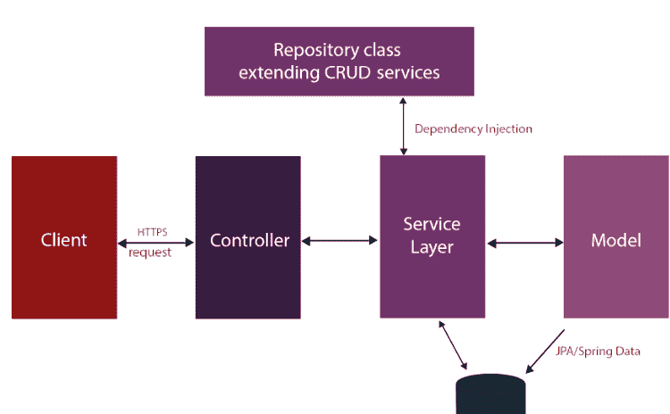

图 3.1 – Spring Boot 流程架构

在 Spring Boot 流程架构中，首先发生的是客户端发送请求（HTTPS 请求）到控制器。控制器映射请求并决定如何处理它。接下来，它调用服务层，在服务层执行所有业务逻辑，并从仓库类获取操作所需的额外依赖项。服务层还负责对表示为模型的数据执行逻辑，并将由 JPA 用于插入数据库。

我们已经了解了 Spring Boot 架构的流程。现在，我们将讨论表述性状态转移 (REST) 及其概念。

## 理解 REST

在开始构建后端应用程序之前，我们必须先了解 REST 的概念，因为这是我们将应用于后端以使其可被客户端应用程序消费的主要架构方法。

REST 是一种 Web 服务，其主要目标是使 Web 服务更有效。它允许通过统一资源标识符 (URI) 直接访问应用程序，并且可以以 XML 或 JSON 格式提供资源，使其更灵活。

URI 是两个应用程序之间通信发生的地方。可以把它想象成一座桥梁，后端和前端通过它进行通信。客户端（前端）请求一个资源并返回一个以 XML 或 JSON 格式表示的响应。请求资源时使用以下 HTTP 方法：

- GET：用于获取和读取资源。
- POST：创建新资源。
- PUT：更新现有资源。
- DELETE：删除资源。

让我们以一个简单的现实世界示例（博客应用程序）来说明如何使用 HTTP 方法和提供的端点访问资源：

- GET `/user/{id}/blogs`：获取特定用户的博客列表。
- POST `/user/{id}/blog`：为特定用户创建博客。
- PATCH `/user/{id}/blog/{blog_id}`：更新特定用户的现有博客。
- DELETE `/user/{id}/blog/{blog_id}`：删除特定用户的现有博客。

在前面的示例中，我们使用 HTTP 方法和端点请求资源。端点以 XML 或 JSON 对象的形式在响应体中返回。REST 还支持标准状态码，用于定义我们的请求是否成功。常用的状态码列表如下：

- 200：请求的成功状态
- 201：表示对象已成功创建
- 400：表示请求错误 – 通常发生在请求体无效时
- 401：未授权访问资源
- 404：表示资源未找到
- 500：表示内部服务器错误

## 基于 Web 的界面

使用 Spring Initializr 的第一种方式是通过基于 Web 的界面。应用程序可通过 https://start.spring.io 访问。打开链接后，你会看到以下表单：

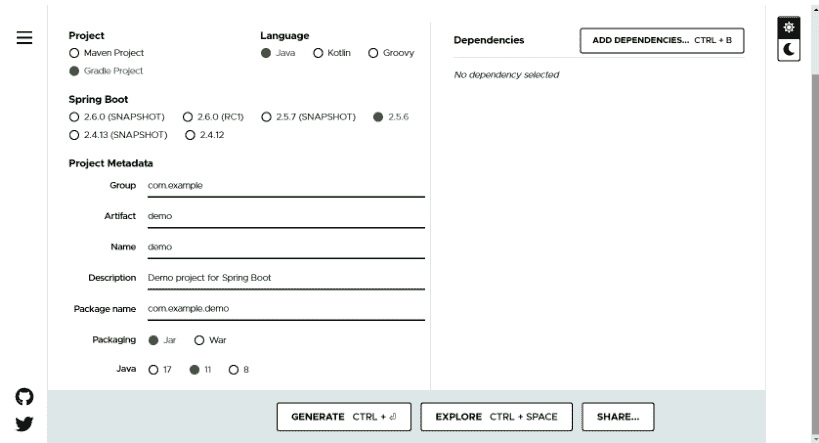

图 3.3 – Spring Initializr

表单会要求你提供有关项目的一些基本信息。第一个问题是，*你选择使用 Maven 还是 Gradle 来构建项目？* 该应用还需要诸如你将使用的语言、构件名称、项目名称、要使用的包名以及构建应用程序时将使用的 JDK 版本等信息。

现在，在界面的右侧，你会看到 **添加依赖项** 按钮。**添加依赖项** 功能是 Spring Initializr 最重要的功能之一，因为它允许我们根据项目需求选择依赖项。例如，我们需要一个具有 JPA 访问的关联数据库；我们应该添加 Spring Data JPA。

因此，在下面的示例中，我们添加了 **Lombok、Spring Web、Spring Data JPA、PostgreSQL 驱动程序** 和 **Spring Data Reactive Redis**。在构建示例应用程序的过程中，我们将讨论每个依赖项。

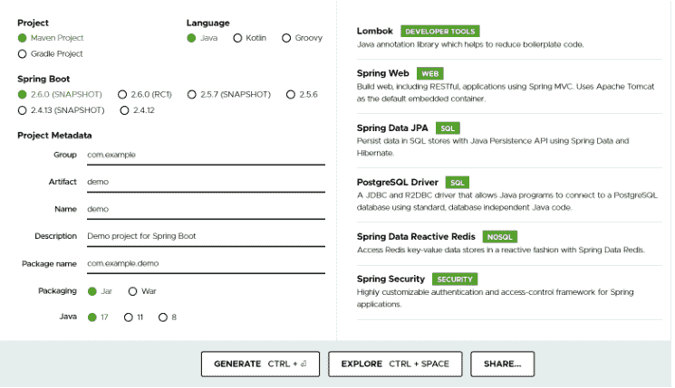

图 3.4 – 使用依赖项生成 Spring Boot

我们可以在前面的示例中看到，我们已经在项目中添加了所需的依赖项。最后一步是通过点击 **生成** 按钮生成我们的应用程序；这将下载一个 zip 文件，其中包含我们的应用程序。在生成项目之前，我们可以点击 **浏览** 按钮来检查项目结构并验证配置。

成功下载生成的 Spring Boot 应用程序后，我们将解压文件，现在就可以使用自己选择的 IDE 打开 Spring Boot 项目了。最后，我们准备好编写代码了，但在开始之前，让我们先查看 Spring Initializr 生成的项目结构。


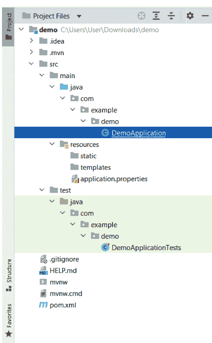

Figure 3.5 – A generated Spring Boot application

从生成的项目中可以看出，其中包含的应用程序代码并不多。然而，该项目由以下内容组成：

- DemoApplication.java：一个包含应用程序引导 main() 函数的类
- DemoApplicationTests.java：用于单元测试的空 JUnit 测试类
- Pom.xml：包含应用程序所需依赖项的 Maven 构建规范
- Application.properties：用于添加配置属性的属性文件

我们可以看到在生成的项目中包含了空目录，例如 static 文件夹；这很重要，因为它用于放置静态内容，如 CSS 和 JavaScript 文件。

我们已成功使用 Web 界面生成了 Spring Boot 项目。现在，我们将直接在 IntelliJ IDEA 中使用 Spring Initializr。

## Via IntelliJ IDEA

生成 Spring Boot 项目的另一种方法是直接在 IntelliJ IDEA 中使用 Spring Initializr；请注意，这仅在 IntelliJ 的 Ultimate 版中可用。如果您使用的是 Community 版，可以在以下链接安装 Spring Assistant：`https://plugins.jetbrains.com/plugin/10229-spring-assistant`。这将添加一个 Spring Assistant 选项来生成您的 Spring Boot 项目。

执行以下步骤：

- 1. 打开 IntelliJ IDEA 后选择 **New Project** 开始生成项目，这将打开一个新模态窗口。
- 2. 选择 **Spring Initializr**，这将打开一个表单，其界面与 Spring Initializr Web 界面相同。
- 3. 它会要求输入项目名称、将使用的语言、artifact 名称以及用于构建项目的 SDK 版本：

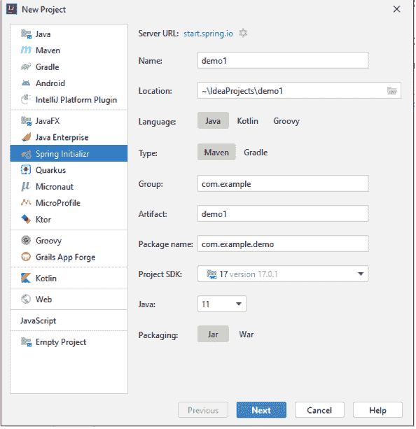

Figure 3.6 – The form for using Spring Initializr with IntelliJ IDEA

我们可以在前面的图中看到，我们已为项目填写了所有必需的详细信息。

- 4. 单击 **Next** 按钮将把我们重定向到 **Dependencies** 选择。我们将选择 Spring Boot 开发所需的依赖项，这与我们在 Spring Initializer 界面中输入的内容相同。
- 5. 成功勾选依赖项后，单击 **Finish**，我们的 Spring Boot 应用程序即已配置。最后，我们准备好编写代码了。

我们已成功通过 Spring Initializr Web 界面和内置的 IntelliJ IDEA 生成了 Spring Boot 应用程序。在下一节中，我们将学习 Spring Boot 中最重要且最常用的概念之一——依赖注入。

## Dependency injection

我们已成功生成了自己的 Spring Boot 项目，现在，我们将开始学习 Spring 的概念，其中我们需要理解的最重要的概念之一是 **dependency injection**。在我们使用 Spring Boot 开发后端时，我们将在整个开发过程中主要使用依赖注入，因为这使我们的 Java 程序模块化并能够更轻松地切换实现。

依赖注入是 **object-oriented programming languages** 的基本特性，但首先，让我们讨论控制反转的概念，即依赖注入试图实现的目标。

## Inversion of control

**Inversion of Control (IoC)** 是用于面向对象编程语言的设计模式。IoC 是反转程序流程的概念，它用于解耦应用程序中的组件，使代码片段可重用且模块化。因此，IoC 设计模式将为我们提供一种将自定义类注入应用程序其他类的方法。

注入的类将在应用程序的不同部分实例化。我们不让类自行决定其实现或进行代码修复，而是允许注入依赖项来根据情况改变类的流程、性能和代码。因此，IoC 主要提供灵活性和模块化，但它在设计应用程序时还提供其他诸多优势：

- 控制对象的生命周期，我们可以将某些对象定义为单例，而某些对象可以拥有其实例。
- 它使应用程序更易于维护，因为由于可重用组件，代码量减少。
- 测试组件更易于管理，因为我们可以隔离组件并模拟其依赖项，而不覆盖单元测试中不包含的其他代码。

我们已了解 IoC 模式及其对开发应用程序的优势。现在，我们将使用依赖注入，这使我们能够实现该模式。

## The basics of dependency injection

我们已经讨论了 IoC 的工作原理，它是通过向对象提供依赖项来决定实现来实现的。因此，这个想法主要是 **dependency injection**。我们允许对象或类接受其他可以提供不同类实现的依赖项，而无需再次编写它们，使我们的代码灵活且可重用。依赖注入可以通过不同方式实现，下面是以下实现。

## Constructor-based dependency injection

**Constructor-based dependency injection** 可以通过创建一个具有构造函数的对象类来实现，参数为特定类型，表示我们可以设置的依赖项。

让我们看一下以下代码示例：

```
package com.springexample;

/* Class for Student */
public class Student {
    private Grades grades;

    public Student(Grades grades) {
        this.grades = grades;
    }
    public void retrieveGrades() {
        grades.getGrades();
    }
}
```

在前面的示例中，`Student` 类有一个构造函数，`public Student() {}`，它接受类型为 `Grades` 的参数。构造函数允许我们在 `Student` 中注入一个 `Grades` 对象，从而使 `Grades` 对象的所有实现都可在 `Student` 对象中访问。现在，我们已在 `Student` 中访问了 `getGrades()` 方法。要使用 `Student` 对象，我们将执行以下示例：

```
package com.springexample;
import org.springframework.context.ApplicationContext;
import org.springframework.context.support.
ClassPathXmlApplicationContext;
```

```
public class Main {
    public static void main(String[] args) {
        ApplicationContext context =
            new ClassPathXmlApplicationContext("Beans.xml");

        Student student =
            (Student) context.getBean("student");
        student.retrieveGrades();
    }
}
```

我们可以在前面的示例中看到，我们已在 main 类中实例化了一个新的 student，通过获取 Beans.xml 文件的 bean。Beans.xml 文件是我们基于构造的注入的主要配置文件，我们将在其中定义我们的 bean 以及它们的依赖项。

让我们检查一下 Beans.xml 的以下示例是什么样的：

```
<?xml version = "1.0" encoding = "UTF-8"?>

<beans xmlns =
    "http://www.springframework.org/schema/beans"
    xmlns:xsi = "http://www.w3.org/2001/XMLSchema-instance"
    xsi:schemaLocation =
    "http://www.springframework.org/schema/beans
    http://www.springframework.org/schema/beans/
    spring-beans-3.0.xsd">

    <!-- Definition for student bean -->
    <bean id = "student"
        class = "com.springexample.Student">
        <constructor-arg ref = "grades"/>
    </bean>

    <!-- Definition for grades bean -->
    <bean id = "grades"
        class ="com.springexample.Grades"></bean>

</beans>
```

在前面的示例中，我们已将 Student 和 Grades 对象定义为 bean。唯一的区别是 Student 对象有一个引用 grades 的 constructor-arg；这表明我们正在将 Grades 对象注入到我们的 Student 对象中。

我们已通过使用 Beans.xml 配置实现了基于构造的依赖。我们也可以直接在代码中使用注解来配置我们的 bean 及其依赖项。

让我们看一下如何使用注解配置 bean 和依赖项的以下示例：

```
@Configuration
public class AppConfig
{
    @Bean
    public Student student() {
        return new Student(grades());
    }

    @Bean
    public Grades grades() {
        return new Grades();
    }
}
```

我们可以在前面的示例中看到，我们不是使用 XML，而是使用注解来标识我们的 bean 和配置。例如，@Configuration 注解表示 AppConfig 类是 bean 定义的来源，而 @Bean 注解在我们的应用程序中定义 bean。随着我们在本章的深入，我们将深入讨论注解和 bean。

我们已成功学习了如何通过使用 Bean.xml 和注解实现基于构造的依赖注入。现在，让我们继续 setter-based dependency injection 的实现。

## Setter-based dependency injection

依赖项的注入可以在容器调用我们类的 setter 方法时实现。因此，我们不是为类创建构造函数，而是创建一个将设置对象依赖项的函数。


让我们看一个基本的代码示例：

```
package com.springexample;

/* Class for Student */
public class Student {
    private Grades grades;

    public void setGrades(Grades grades) {
        this.grades = grades;
    }
    public Grades getGrades() {
        return grades;
    }
    public void retrieveGrades() {
        grades.getGrades();
    }
}
```

在前面的示例中，我们可以看到我们创建了一个名为 setGrades() 的 setter 方法，它接受一个 Grades 对象，其主要功能是为 grades 依赖项设置一个值。

我们不使用带参数的构造函数，而是使用 setter 将我们的依赖项注入到对象中。

要使用 Student 对象，让我们看下面的示例：

```
package com.springexample;
import org.springframework.context.ApplicationContext;
import org.springframework.context.support.ClassPathXmlApplicationContext;

public class Main {
    public static void main(String[] args) {
        ApplicationContext context = new ClassPathXmlApplicationContext("Beans.xml");

        Student student = (Student) context.getBean("student");
```

```
student.retrieveGrades();
}
}
```

我们可以看到在前面的示例中，它与我们使用基于 setter 的对象和基于构造函数的对象的方式相同。这里的区别在于我们在 Bean.xml 中如何配置我们的 bean。

让我们看一下基于 setter 的依赖注入的 Beans.xml 示例：

```
<?xml version = "1.0" encoding = "UTF-8"?>

<beans xmlns = "http://www.springframework.org/schema/beans"
    xmlns:xsi = "http://www.w3.org/2001/XMLSchema-instance"
    xsi:schemaLocation = "http://www.springframework.org/schema/beans http://www.springframework.org/schema/beans/ spring-beans-3.0.xsd">

    <!-- Definition for student bean -->
    <bean id = "student" class = "com.springexample.Student">
        <property name="grades" ref = "grades"/>
    </bean>

    <!-- Definition for grades bean -->
    <bean id = "grades" class = "com.springexample.Grades"></bean>

</beans>
```

我们在 Beans.xml 中配置了 bean，前面的示例中的 Student 和 Grades 对象。这里的唯一区别是我们声明依赖项时。我们使用 property 标签而不是 constructor-arg 来定义我们的依赖项。

我们已成功使用基于 setter 的依赖注入创建了我们的对象，现在，我们将讨论基于字段的依赖注入。

## 基于字段的依赖注入

顾名思义，**基于字段的依赖注入** 是一种将对象的依赖项直接注入到字段中的概念。我们不会创建构造函数或 setter 方法来注入我们的依赖项，而是会使用 @Autowired 注解进行注入。

让我们看一下将依赖项注入到字段的以下示例：

```
package com.springexample;

/* Class for Student */
public class Student {
    @Autowired
    private Grades grades;
}
```

在前面的示例代码中，我们可以看到我们没有创建构造函数或 setter 方法来注入我们的依赖项。相反，我们只使用了 @Autowired 注解来注入 Grades 对象。

基于字段的注入乍一看可能很简洁，我们的代码中只有注解且方法更少，但 @Autowired 依赖背后发生了很多事情。例如，它使用反射来注入依赖项，这比基于构造函数和 setter 的注入成本更高；它还违反了 **单一职责原则**。我们可以直接在字段中添加更多依赖项而不会收到警告。

我们已经学习了依赖注入的基础知识以及在 Java 应用程序中实现它的不同方式。现在，我们将讨论 Spring 中注解和 bean 的概念和重要性。

## 注解和 bean

**注解和 bean** 是开发 Spring 应用程序的重要组成部分。它们被认为是 Spring 的构建块，使我们的代码更少样板且更易于维护。

**Spring 注解** 用于定义不同类型的 bean。它们只是元数据的一种形式，用于标记我们的代码以提供信息。相反，**bean** 是实例化和创建的对象，可以与其他 bean 注入。我们将在本节中继续讨论更多内容。

## 注解类型

Spring 中的注解根据其功能分为不同的类型。以下是按各自类别分组的注解。

## 核心注解

**核心注解** 用于在我们的应用程序中利用 Spring DI 引擎。它们可以在 `org.springframework.beans.factory.annotation` 和 `org.springframework.context.annotation` 包中找到。以下是核心注解的列表：

- `@Required`：这应用于 bean 的 setter 方法中，并意味着在配置时必须为 bean 注入依赖项，否则将抛出 `BeanInitializationException`。让我们看一下如何使用 `@Required` 注解的以下示例：

```
public class Car
{
private String brand;
@Required
    public void setBrand(String brand)
    {
        this.brand = brand;
    }
    public Integer getBrand()
    {
        return brand;
    }
}
```

在前面的示例中，我们可以看到 `setBrand()` 方法被 `@Required` 注解；这表明 brand 必须在初始化时填充。

- `@Autowired`：我们在 DI 中多次遇到 `@Autowired` 注解，它主要用于在不使用构造函数和 setter 方法的情况下注入依赖项。让我们看一下如何使用 `@Autowired` 注解的以下示例：

```
package com.springexample;

public class Car {
    @Autowired
    private Brand brand;
}
```

我们可以看到在前面的示例中，`@Autowired` 直接应用于字段。这是因为注解使用反射来注入依赖项，涉及的流程比构造函数和 setter 方法更多。

- @ComponentScan：该注解是类级别注解，用于指示我们希望扫描 bean 的包。@ComponentScan 可以接受关于要扫描哪些特定包的参数，如果不提供任何参数，则允许当前包和所有子包。让我们看一下如何使用 @ComponentScan 的以下示例：

```
@Configuration
@ComponentScan
public class SpringApp
{
    private static ApplicationContext applicationContext;
    @Bean
    public SpringBean springBean()
    {
        return new SpringBean();
    }
    public static void main(String[] args) {
        applicationContext = new AnnotationConfigApplicationContext(SpringComponentScanApp.class);
    }
}
```

我们可以看到在前面的示例中，@ComponentScan 应用于 Spring App 类，并且通常与 @Configuration 注解一起实现。假设 SpringApp 位于 com.example.spring.app 包下；这将扫描该包及其子包，如果存在 bean。

- @Configuration：该注解也是类级别注解，用于指示一个类是 Spring 容器在运行时处理的 bean 定义的来源。让我们看一下如何使用 @ComponentScan 注解的以下示例：

```
@Configuration
public class SpringApp {
    @Bean(name="demoBean")
    public DemoBean service()
    {
    }
}
```

我们可以看到在前面的示例中，@Configuration 注解应用于 SpringApp 类，这表明 SpringApp 将是 bean 的来源。

- @Bean：该注解是方法级别注解，用于告诉方法生产一个 bean。让我们看一下如何使用 @Bean 注解的以下示例：

```
@Configuration
public class AppConfig {
    @Bean
    public BeanExample beanExample() {
        return new BeanExampleImpl();
    }
}
```

在前面的示例中，@Bean 注解应用于 beanExample 方法。一旦 JavaConfig 遇到该方法，它将被执行并将返回值注册为 BeanFactory 中的 bean，如果未指定名称，则名称与方法名相同。

@Bean 注解也可以在 Spring XML 中配置，等效配置如下：

```
<beans>
    <bean name="transferService" class="com.acme.TransferServiceImpl"/>
</beans>
```

## 刻板印象注解

刻板印象注解主要用于在应用程序上下文中即时创建 Spring bean。

以下是刻板印象注解的列表：

- @Component：这是主要的刻板印象注解。与 @Bean 注解一样，@Component 注解用于定义 bean 或 Spring 组件。两者之间的区别在于 @Component 应用于类级别，而 @Bean 应用于方法级别。

另一个区别是，如果类在 Spring 容器之外，@Component 类也不能用于创建 bean，而我们即使在 Spring 容器之外找到类也可以使用 @Bean 创建 bean。让我们看一下如何使用 @Component 注解的以下示例：

```
@Component
public class Car
```


我们可以在前面的示例中看到 @Component 被应用到了 Car 类上。这意味着在运行时会创建一个 car bean。我们也需要记住 @Component 不能与 @Configuration 注解一起使用。

- @Service：该注解用于服务层，表示一个类用于执行业务逻辑、进行计算以及调用外部 API。@Service 是一种 @Component 注解。
- @Repository：该注解用于直接访问数据库的类。这是表示一个类执行数据访问对象角色的标志。
- @Controller：用于 Spring 控制器类的注解。它也是 @Component 注解的一种，用于 Spring MVC 以及使用 @RequestMapping 注解的方法，用于 REST。

## Spring Boot 注解

这些注解是专门为 Spring Boot 创建的，这主要是多个注解的组合。以下是 Spring Boot 注解的列表：

- @EnableAutoConfiguration：该注解用于自动配置类路径中存在的 bean，然后配置它以运行方法。该注解现在很少使用，因为 @SpringBootApplication 已在 Spring 1.2.0 中发布。
- @SpringBootApplication：该注解是 @EnableAutoConfiguration、@ComponentScan 和 @Configuration 的组合。

## REST 注解

这些是用于创建端点、指定 HTTP 请求并序列化返回对象的专用注解。以下列表展示了不同的 REST 注解：

- @RequestMapping：用于创建端点并映射 Web 请求。该注解可用于类或方法。
- @GetMapping：映射 HTTP GET 请求，用于获取数据，等同于 @RequestMapping(method = RequestMethod.GET)。
- @PostMapping：映射 HTTP POST 请求，用于创建数据，等同于 @RequestMapping(method = RequestMethod.POST)。
- @PutMapping：映射 HTTP PUT 请求，用于更新数据，等同于 @RequestMapping(method = RequestMethod.PUT)。
- @DeleteMapping：映射 HTTP DELETE 请求，用于删除数据，等同于 @RequestMapping(method = RequestMethod.DELETE)。
- @PatchMapping：映射 HTTP PATCH 请求，用于对数据进行部分更新，等同于 @RequestMapping(method = RequestMethod.PATCH)。
- @RequestBody：用于将 HTTP 请求与方法参数中的对象绑定。Spring 框架将 HTTP 请求体绑定到带有 @RequestBody 注解的参数。
- @ResponseBody：将方法的返回值附加到响应体。该注解表示返回对象应序列化为 JSON 或 XML 格式。
- @PathVariable：用于从 URI 获取值。允许在方法中定义多个 @PathVariable 实例。
- @RequestParam：用于从 URL 获取查询参数。
- @RequestHeader：用于提取有关传入 HTTP 请求头的详细信息。我们在方法参数中使用此注解。
- @RestController：这是 @Controller 和 @ResponseBody 注解的组合。该注解的重要性在于它避免了为每个方法标注 @ResponseBody。

我们已经了解了不同类型的注解及其在 Spring 中的用途。现在，我们将在下一节中讨论并进一步理解 bean 在 Spring 应用中的实际定义和重要性。

## 理解 beans

我们在上一节中多次遇到过 beans。我们已经学习了如何使用 @Bean 和 @Component 注解创建和初始化 bean，但主要问题是，*在 Spring 应用中 bean 的主要用途是什么？*

bean 是我们需要理解的 Spring Framework 的核心概念。学习其目的和功能对于有效使用 Spring Framework 至关重要。

要在 Spring 中定义一个 bean，它是由 Spring IoC 容器管理的构成应用程序骨干的对象。这些是我们主要用于数据以及注入依赖以创建多个实现的对象。为了更好地理解，让我们看一些 bean 的示例。

假设我们有一个名为 Car 的领域类：

```java
public class Car
{
```
```java
private Brand brand;
public Car (Brand brand)
{
this.brand = brand;
}
}
```

我们可以看到在示例中，car 需要一个 `Brand` 依赖。`Brand` 类具有以下代码：

```java
public class Brand
{
    private String name;
    private int year;
    public Brand(String name, int year)
    {
        this.name = name;
        this.year = year;
    }
}
```

典型的做法是创建 `Brand` 类的新实例，并在创建新的 `Car` 类时将其作为参数传递。这种方法可以正常工作，但在我们有很多类时可能会引起问题。因此，更好的流程是：与其自行构造依赖，对象可以从 IoC 容器中以 bean 的形式获取其依赖。

所以，我们需要做的只是使用注解或 XML 配置 bean 和依赖关系，以识别特定对象所需的依赖关系。让我们将前面的示例转换为 bean：

```java
@Component
public class Car
{
    . . . .
}
```

我们将使用 `@Component` 注解标注 `Car` 类，以标识该类为 Bean：

```java
@Configuration
@ComponentScan(basePackageClasses = Car.class)
public class Config
```
```java
{
    @Bean
    public Brand getBrand() {
        return new Brand("Toyota", 2021);
    }
}
```

接下来我们需要做的是创建一个配置类。在前面的示例中，我们使用 @Configuration 和 @ComponentScan 注解了该类，以标识这是我们的配置类；这将生成一个类型为 Brand 的 Bean，已将 Brand 类配置为 Bean。我们只需要在应用程序上下文中获取 bean，依赖关系就已经注入了：

```java
ApplicationContext context = new
AnnotationConfigApplicationContext(Config.class);
Car car = context.getBean("car", Car.class);
// execute function
car.getName()
car.getYear()
```

在前面的示例代码中，我们可以看到我们已在应用程序上下文中提取了 Car bean。因此，我们可以自动使用 Brand 依赖的 getter 方法；这意味着 IoC 容器管理 bean 及其依赖关系。

## 总结

至此，本章结束。让我们回顾一下你学到的宝贵内容。你已经学习了 Spring Boot 的基础知识、其架构以及 REST 的基础。你还学习了如何使用 Spring Initializr 创建自己的 Spring Boot 项目。

依赖注入允许对象或类接受可以实现不同类的其他依赖，而无需再次编写它们。注解定义了不同类型的 bean；它们只是标记我们代码以提供信息的元数据形式。

最后，bean 是由 Spring IoC 容器管理的构成应用程序骨干的对象。

在下一章中，我们将学习如何设置数据库并使用 Spring Data JPA。

## 使用 PSQL 容器连接数据库

本节将教我们如何通过常规方法、使用安装程序或通过 Docker 容器，在终端中设置和配置 PostgreSQL。但首先，让我们讨论一下 PostgreSQL 是什么以及它的优势。

## PostgreSQL

**PostgreSQL** 是一种开源对象关系数据库系统，使用 SQL 语言存储和处理复杂且庞大的工作负载。PostgreSQL 还支持 *SQL（关系型）* 和 *JSON（非关系型）* 查询。由于其灵活性和丰富的功能，它通常被用作地理空间和分析应用的主要数据存储。它的社区已在 20 多年里持续改进和支持它，以为数据库系统添加更多功能和可靠性。

PostgreSQL 的灵活性意味着它被广泛用于开发应用程序。以下是一些日常用例：

- **科学数据**：研究项目在存储数据方面可能要求苛刻，需要有效高效的处理。PostgreSQL 提供了分析功能和强大的 SQL 引擎，可以处理大量数据。
- **金融行业**：由于其分析能力和与 MATLAB 和 R 等数学软件的易于集成，PostgreSQL 被金融公司使用。
- **Web 应用**：PostgreSQL 也被广泛用于 Web 应用，因为现在的应用程序需要处理成千上万的数据。它与现代 Web 框架兼容，例如 Node.js、Hibernate PHP 和 Django。
- **政府 GIS 数据**：PostgreSQL 提供诸如 PostGIS 的扩展，提供处理几何数据的功能。

## PostgreSQL 的功能

以下是 PostgreSQL 提供的一些功能列表：

- **兼容多种数据类型**：PostgreSQL 兼容多种数据类型：
  - **结构化**：数组、日期和时间、**通用唯一标识符（UUIDs）**、和范围
  - **自定义**：自定义类型、和复合
  - **原始**：字符串、整数、数字、和布尔
  - **几何**：多边形、圆、线、和点
  - **文档**：XML、JSON/JSONB、和键值


- **支持 SQL 的不同特性**：它提供 SQL 的各种特性，例如以下内容：
    - 多种索引，如 B-tree 和表达式
    - SQL 子查询
    - 复杂的 SQL 查询
    - **多版本并发控制（MVCC）**
    - 表分区
- **数据完整性兼容性**：它还提供数据完整性，包括以下内容：
    - 主键
    - 外键
    - 显式锁
    - 建议锁
    - `UNIQUE`
    - `NOT NULL`
- **安全数据库**：它遵循标准安全协议，包括以下内容：
    - 诸如 **轻量级目录访问协议（LDAP）**、SCRAM-SHA-256 和 **安全支持提供程序接口（SSPI）** 之类的身份验证
    - 支持列级和行级安全
- **高度可扩展**：它提供多种功能，使其可修改，例如以下内容：
    - JSON/SQL 路径表达式
    - 存储过程和函数
    - 与外部数据包装器的兼容性

现在我们已经概述了 PostgreSQL 的特性和用例，让我们继续在终端上安装它。

## 安装 PostgreSQL

我们有两种方法在开发终端上设置 PostgreSQL。这两种方法如下：

- **常规方法**：直接从 PostgreSQL 网站下载安装程序。
- **Docker 容器中的 PostgreSQL**：直接将我们的应用程序连接到容器。

### 常规方法 – 在 Windows、macOS 和 Linux 上安装

PostgreSQL 主要为类 Unix 平台开发。然而，它被创建为可移植的，可以在 Windows 和 macOS 平台上安装。

我们需要采取的第一步是通过此 URL 下载 PostgreSQL 安装程序：https://www.enterprisedb.com/downloads/postgres-postgresql-downloads。

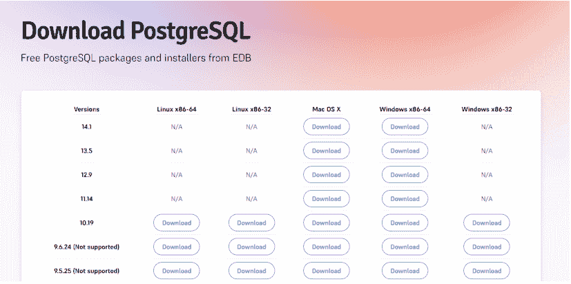

图 4.1 – PostgreSQL 安装

三个操作系统的步骤相同，我们只需要配置一些设置：

1. 点击最新版本（**14.1**）并根据您的操作系统下载安装程序。

2. 下载成功后，打开安装程序，点击 **Next**，并指定 PostgreSQL 将安装的路径：

    图 4.2 – PostgreSQL 安装程序（指定安装路径）

    在前面的示例中，我们选择了默认安装路径。再次点击 Next，它会询问我们想要安装哪些组件。我们选择的组件如下：

    - **PostgreSQL Server**：安装运行数据库的服务器
    - **pgAdmin 4**：用于与数据库交互的 GUI 管理工具
    - **Stack Builder**：允许我们下载和安装与 PostgreSQL 兼容的驱动程序的 GUI
    - **命令行工具**：使用命令行工具与 PostgreSQL 交互。

    图 4.3 – PostgreSQL 安装程序（选择所需的组件）

3. 再次点击 **Next**，系统会要求您指定存储数据的目录：

    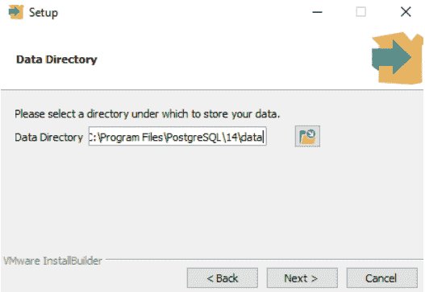

    图 4.4 – PostgreSQL 安装程序（选择数据的目录）

    在前面的示例中，我们可以看到默认路径与 PostgreSQL 安装位置相同，并且创建了一个名为 data 的新文件夹。建议您使用默认路径。

4. 点击 **Next**，这将让您为超级用户（`postgres`）配置密码。

5. 点击 **Next**，这将允许您设置 `postgres` 数据库使用的端口。

6. 再次点击 **Next**，系统现在会询问数据库集群应使用什么区域设置：

    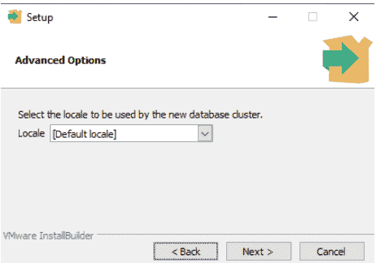

    图 4.5 – PostgreSQL 安装程序（为数据库集群选择区域设置）

    在前面的示例中，我们已将 [Default locale] 选为数据库的区域设置。

7. 再次点击 **Next**，将显示我们配置的所有设置；在继续之前请确保所有详细信息正确。

8. 查看后，点击 **Next**，现在将在我们的终端中安装 PostgreSQL。

    安装后，我们可以通过检查当前安装的版本来验证 PostgreSQL 是否成功安装。

9. 为此，打开 **SQL Shell (psql)** 并输入我们的数据库信息，例如 Server、Port、Database、Username 和 Password。

10. 由于我们使用了默认设置，我们可以一直按 *Enter* 直到密码确认。成功验证密码后，执行 `select version()` 命令以显示当前安装的 PostgreSQL：

    ```
    Server [localhost]:
    Database [postgres]:
    Port [5432]:
    Username [postgres]:
    Password for user postgres:
    psql (13.4)
    WARNING: Console code page (437) differs from Windows code page (1252)
            8-bit characters might not work correctly. See psql reference
            page "Notes for Windows users" for details.
    Type "help" for help.

    postgres=# select version();
            version
    ------------------------------------------------------------
     PostgreSQL 13.4, compiled by Visual C++ build 1914, 64-bit
    (1 row)

    postgres=#
    ```

    图 4.6 – PostgreSQL 安装程序（显示 PostgreSQL 的版本）

    在前面的示例中，我们可以看到我们已成功在终端上安装了 **PostgreSQL 版本 13.4**。

现在，让我们学习如何使用 Docker 安装和配置 PostgreSQL。

### Docker 容器中的 PostgreSQL

我们已使用常规安装程序在终端上安装了 PostgreSQL；现在，我们将学习如何使用 Docker 配置 PostgreSQL。此方法将帮助我们跳过配置 PostgreSQL 的复杂步骤，以便我们开始开发并提供数据库管理的 GUI：

1. 您需要做的第一步是在终端上安装 Docker。您可以在以下链接安装 Docker：`https://docs.docker.com/get-docker/`。有关 Docker 系统要求和安装步骤的文档，您可以参考此链接：`https://docs.docker.com/desktop/windows/install/`。

2. 成功安装 Docker 后，打开 Docker Desktop 并在终端上启动 Docker。然后，打开命令行并执行以下命令：

    ```bash
    docker run --name postgresql-container -p 5434:5434 -e POSTGRES_PASSWORD=pass -d postgres
    ```

    前面的命令将从 Docker Hub 拉取 PostgreSQL。命令中的 postgresql-container 部分可以替换，因为这是我们可以定义的一个容器名称。POSTGRES_PASSWORD 参数是 postgres 管理员的密码，我们也可以配置它。

3. 执行命令后，我们可以通过执行 `docker ps -a` 命令或查看 Docker Desktop 来验证新创建的容器，以检查正在运行的容器列表：

    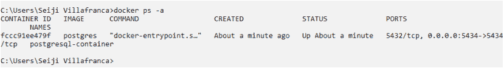

    图 4.7 – 使用 Docker 的 PostgreSQL 安装

    在前面的示例中，我们已执行 `docker ps -a` 命令，我们可以看到我们的 PostgreSQL 镜像已被拉取：

    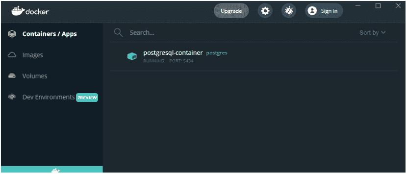

    图 4.8 – 使用 Docker 的 PostgreSQL 安装（在 Docker Desktop 中查看容器）

4. 我们也可以在 Docker Desktop 中查看已拉取的 postgresql-container 并在终端中验证其状态。

我们已成功使用 Docker 配置了 PostgreSQL。我们可以通过使用终端 IP 地址和端口创建新服务器将其连接到 pgAdmin。

我们已在终端中配置了 PostgreSQL 数据库。现在，我们将学习 Spring Data JPA 及其在开发 Spring 应用程序中的重要性。

## Spring Data JPA

Spring Data JPA（Java Persistence API）是用于在 Java 应用程序中管理关系数据的广泛使用的规范。它有助于开发 Spring，因为它通过不实现读写操作减少了样板代码。它还处理 JDBC 基于的数据库访问和对象关系映射所涉及的复杂过程。

在讨论 Spring Data JPA 之前，让我们讨论其明确的优势以及为什么它在 Spring 开发中常用。

### Spring Data JPA 的优势

以下是 Spring Data JPA 的优势：

- **无代码仓库**：Spring Data JPA 推广 *无代码* 仓库，这意味着我们不必编写仓库模式，这会产生大量重复代码。它提供了一组接口，我们可以使用它来扩展我们的类以应用数据特定的实现。


例如，我们在应用程序中有 BlogRepository 类；当我们用 CrudRepository<Blog, Long> 接口扩展它时，它将具有以下功能的 方法：

- 持久化、更新和删除一个或多个博客实体
- 通过主键查找一个或多个博客
- 统计所有博客
- 验证单个博客是否存在

通过 Spring Data JPA 提供的接口扩展存储库包括所有数据相关方法，这使我们能够更专注于业务逻辑。

- **样板代码减少：** Spring Data JPA 为方法提供内置实现。正如第一个优点所述，我们只需要专注于业务逻辑，不再需要编写读写操作，如接口下所写。这也防止了人为错误，因为所有实现都已为我们注册。
- **生成的查询：** Spring Data JPA 还可以根据方法名称创建查询。例如，如果我们想通过作者查询单个博客，我们需要做的唯一一步是在接口上创建一个以 findBy 开头的方法名称，Spring 将解析名称并创建查询：

```
public interface BlogRepository
extends CrudRepository<Blog, Long> {
Blog findByAuthor(String author);
}
```

在前面的示例中，我们创建了 findByAuthor() 方法，这将允许 Spring 生成查询并将参数设置为绑定参数值。一旦我们调用该方法，它将执行查询。

## Spring Data JPA 提供的存储库

Spring Data JPA 提供存储库，提供不同的方法用于数据相关实现。存储库如下：

- CrudRepository：接口存储库，提供创建、读取、更新和删除（CRUD）的基本操作。
- PagingAndSortingRepository：扩展 CrudRepository 并添加一个名为 findAll 的方法，可以按排序方式检索结果并分页。
- JpaRepository：添加特定 JPA 方法并具有 CrudRepository 和 PagingAndSortingRepository 的所有功能。它还添加了诸如 flush() 的方法，该方法刷新持久化上下文，以及 deleteInBatch()，该方法批量删除记录。

- **Repository：** 这是我们需要用 JPA 存储库扩展以使实体具有内置操作的接口。

在前面的示例中，我们有一个 Villain 实体。为了实现 CRUD 操作，我们将创建一个 VillainRepository 接口并用 CrudRepository 扩展它，类型为 Villain 和 UUID：

```
@Repository
public interface VillainRepository extends
CrudRepository<Villain, UUID> {

    // custom composite repository here
}
```

- **Service：** 这是我们将使用我们创建的存储库的地方。我们可以使用 @Autowired 注解注入存储库并调用 JPA 和自定义定义的方法：

```
@Service
public class VillainService {
private final VillainRepository villainRepository;

@Autowired
public VillainService (VillainRepository
villainRepository) {
    this. villainRepository = villainRepository;
}

    public Iterable<Villain> findAllVillains() {
        return villainRepository.findAll();
    }

    public Villain findVillainById(UUID id) {
        return findOrThrow(id);
    }
}
```

在前面的示例中，我们可以看到我们使用 @Autowired 注解将 VillainRepository 注入到 VillainService 中。

让我们继续使用同一个文件中的以下方法：

```
public void removeVillainById(UUID id) {
    villainRepository.deleteById(id);
}

public Villain addVillain(Villain villain) {
    return villainRepository.save(villain);
}

public void updateVillain(UUID id, Villain villain) {
    findOrThrow(id);
    villainRepository.save(villain);
}

private Villain findOrThrow(final UUID id) {
    return villainRepository
        .findById(id)
        .orElseThrow(
            () -> new NotFoundException("Villain by id " +
            id + " was not found")
        );
}
```

我们还通过使用内置的 JPA 实现创建了方法，例如 save()、deleteById()、findAll() 和 findById()，这些方法在 CrudRepository 接口中可以找到。服务现在可以注入到我们的控制器或其他服务中以使用这些方法。

我们现在已经了解了 Spring Data JPA、其优势以及 Spring JPA 上的实现概述。在下一节中，我们将学习如何向 Spring Boot 应用程序添加 Spring Data JPA 和 PostgreSQL 依赖项。

## 添加 Spring Data JPA 和 PostgreSQL 依赖项

本节将向我们的应用程序添加 Spring Data JPA、PostgreSQL 和其他有价值的依赖项。我们将使用 Spring Initializr 和现有 Spring Boot 项目添加依赖项。

### 使用 Spring Initializr 添加

使用 Spring Initializr 创建 Spring Boot 应用程序后添加依赖项很简单。我们只需要在生成项目之前在 Initializr 上选择依赖项即可：

1. 首先要做的是前往 `https://start.spring.io/` 或打开你的 IntelliJ IDEA（适用于 Ultimate 用户）以打开 Spring Initializr（有关 *使用 Spring Initializr* 部分的回顾，请参阅 *第 3 章，迈向 Spring Boot*）。

2. 选择你的项目是否使用 Maven 或 Gradle 并设置所需配置，即 **Group、Artifact、Name、Description、Package name、Packaging** 以及项目的 **Java** 版本。

3. 接下来，点击右上角的 **Add Dependencies** 并选择以下依赖项：

   - **Spring Data JPA**：此依赖项用于添加 Spring Data JPA，用于内置数据存储相关实现。
   - **H2 Database**：这是一个支持 JDBC API 和 R2DBC 访问的内存数据库，通常用于单元测试。
   - **PostgreSQL Driver**：这是一个 JDBC 和 R2DBC 驱动程序，将允许 Java 应用程序连接到 PostgreSQL 数据库。

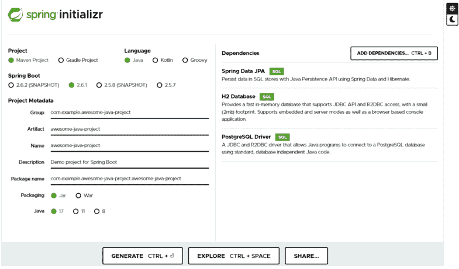

图 4.9 — 在 Spring Initializr 中添加依赖项

成功添加依赖项后，我们可以看到我们的依赖项已列出。

4. 点击 **GENERATE**，它将下载我们已生成的项目。

5. 解压 ZIP 文件并在你的 IDE 上打开项目。如果你使用 Maven 开发项目，请在 `src` 文件夹中打开 `pom.xml`，或如果你使用 Gradle，请打开 `build.gradle`，它也位于 `src` 文件夹中：

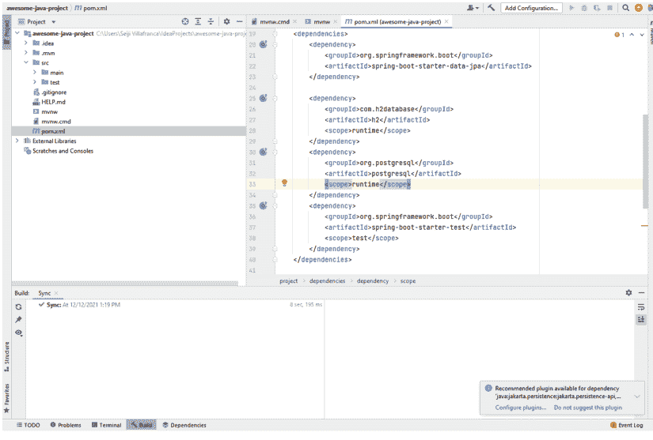

图 4.10 – Spring Boot 应用程序（pom.xml 的视图）

在前面的示例中，我们可以看到 Spring Boot 应用程序使用 Maven 生成，并且我们可以看到我们的 `pom.xml` 文件已包含我们在 Spring Initializr 中添加的依赖项：

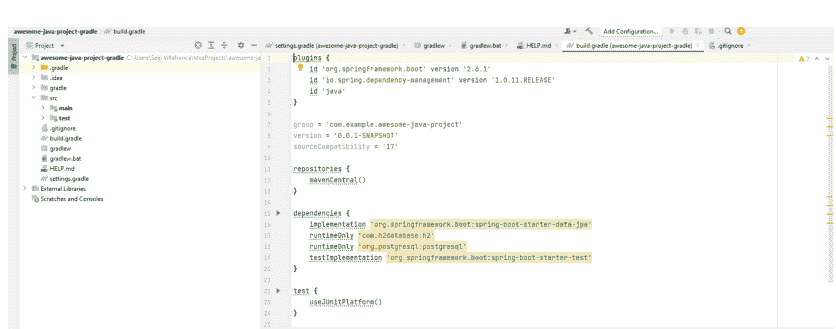

图 4.11 – Spring Boot 应用程序（build.gradle 的视图）

现在，在前面的示例中，Spring Boot 应用程序使用 Gradle 生成，我们可以看到依赖项列表已添加到 build.gradle 文件下。

我们现在将依赖项添加到现有 Spring Boot 应用程序。

### 添加现有项目

在前面的示例中，我们添加了依赖项以使用 Spring Initializr 生成 Spring Boot 应用程序。现在，我们将依赖项添加到现有应用程序。向现有 Spring 应用添加依赖项很简单；我们只需要修改 pom.xml（Maven）或 build.gradle（Gradle）文件。

要使用 Maven 安装 Spring Data JPA、H2 数据库和 PostgreSQL Driver，我们将以 XML 形式添加依赖项，如下所示：

```
<dependencies>
    <dependency>
        <groupId>org.springframework.boot</groupId>
        <artifactId>spring-boot-starter-data-jpa</artifactId>
    </dependency>

    <dependency>
        <groupId>com.h2database</groupId>
        <artifactId>h2</artifactId>
```


```
<scope>runtime</scope>
</dependency>

<dependency>
    <groupId>org.postgresql</groupId>
    <artifactId>postgresql</artifactId>
    <scope>runtime</scope>
</dependency>

<dependency>
    <groupId>org.springframework.boot</groupId>
    <artifactId>spring-boot-starter-test</artifactId>
    <scope>test</scope>
</dependency>
</dependencies>
```

And for a Spring application using Gradle, we will add the dependencies as follows:

```
dependencies {
    implementation 'org.springframework.boot:spring-boot-starter-data-jpa'
    runtimeOnly 'com.h2database:h2'
    runtimeOnly 'org.postgresql:postgresql'
}
```

IntelliJ will automatically recognize the added dependencies and install them for the project, and we can successfully build and run the Spring Boot application on the fly.

We have learned how to add Spring Data JPA and PostgreSQL Driver to our Spring Boot application. In the next section, we will learn how to connect our Spring Boot application to our PostgreSQL database.

## Connecting to a database

We have already configured our PostgreSQL database and initialized our Spring Boot application with the needed dependencies. Now, we will learn how to connect our PostgreSQL to our application. There are two ways we can connect to our database – the first is through Spring JDBC, and the other is Spring Data JPA. Spring Data JPA is the most convenient way to connect to our database, but we will demonstrate both methods in this section.

## Configuring the database properties

The first thing we need to do is configure the database properties in our Spring Boot application. We need to specify the server URL of the database, the admin username, and the password by adding the following source code to the application.properties file:

```
spring.datasource.url=jdbc:postgresql://localhost:5432/springDB
spring.datasource.username=postgres
spring.datasource.password=password
```

In the preceding example, we can see that we have configured the basic connection settings for our PostgreSQL. springDB on the URL will be the name of the database in PostgreSQL, which should already exist on our server.

## Connecting using Spring JDBC

The first method to connect to the database is by using Spring JDBC. We will add an additional dependency to our application for us to use this method.

To add JDBC, we will add the following code to our pom.xml (Maven) or build.gradle (Gradle) files:

```
<dependency>
    <groupId>org.springframework.boot</groupId>
    <artifactId>spring-boot-starter-jdbc</artifactId>
</dependency>
```

After successfully adding the JDBC dependency, we can now use JdbcTemplate to execute queries on our application:

```
import org.springframework.beans.factory.annotation.Autowired;
import org.springframework.boot.SpringApplication;
import org.springframework.boot.autoconfigure.SpringBootApplication;
import org.springframework.jdbc.core.JdbcTemplate;

@SpringBootApplication
public class AwesomeJavaProject {
    @Autowired
    private JdbcTemplate jdbcTemplate;
    public static void main(String[] args) {
```

```
SpringApplication.run(AwesomeJavaProject.class,
    args);
}
@Override
public void run(String... args) throws Exception {
    String sql = "INSERT INTO blog (title, author,
    body) VALUES ("+ "'Awesome Java Project',
    'Seiji Villafranca', 'This is an
    awesome blog for java')";

    int rows = jdbcTemplate.update(sql);
}
}
```

In the preceding example, we can execute database statements such as INSERT in our application and call the update() method to modify data in the database.

## Connecting using Spring Data JPA

The second method is by using the Spring Data JPA plugin. The first step we need to take is to add additional details to the application.properties file:

```
spring.jpa.hibernate.ddl-auto=update
spring.jpa.show-sql=true
spring.jpa.properties.hibernate.dialect=org.hibernate.dialect.PostgreSQLDialect
spring.jpa.properties.hibernate.format_sql=true
```

After adding the new settings, we can now create Entity and Repository for a specific table in our application – for example, we have a Blog table:

```
package net.codejava;
import javax.persistence.*;
@Entity
@Table(name = "blog")
public class Blog {
    @Id
    @GeneratedValue(strategy = GenerationType.IDENTITY)
```

```
private Integer id;

private String title;
private String body;
private String author;
}
```

In the preceding example, we have created a Blog class and annotated it with @Entity and @Table to indicate that this is an object connected to our database table:

```
package net.codejava;
import org.springframework.data.jpa.repository.JpaRepository;

public interface BlogRepository extends JpaRepository<Blog,
Integer> {
}
```

After creating our entity, we have made the repository for the blog, which can be extended by the repositories provided by JPA. BlogRepository can now be injected into our services or controllers to read, add, modify, or delete data on our database.

## Summary

That brings you to the end of this chapter. Let’s have a recap of the valuable things you have learned. You learned how to set up PostgreSQL on your local machine using the installer or Docker container.

You have also learned about the concepts and advantages of Spring Data JPA in Spring Boot and how to add it to your application, which is helpful in creating services with CRUD capabilities with less boilerplate code.

Last but not least, you learned how to connect your Spring Boot application with the PostgreSQL database using JDBC and Spring Data JPA.

In the next chapter, we will be learning how to start our server, how to add controllers, models, and services in our code, and about Redis for caching.
