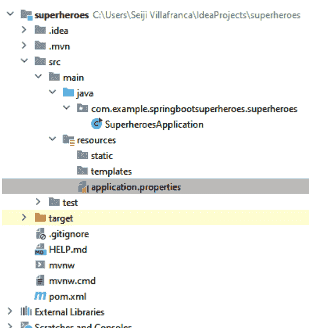
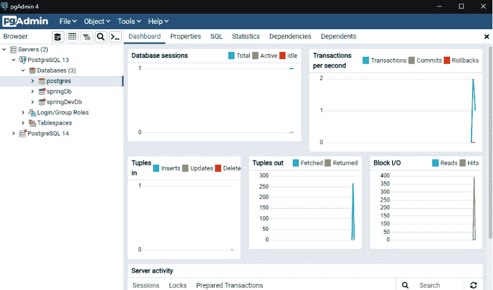
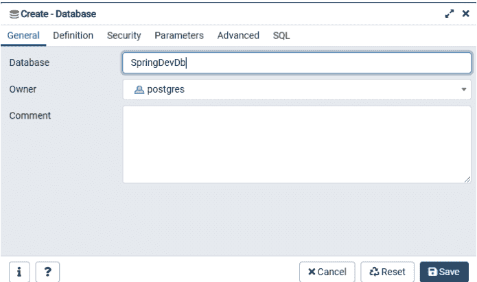
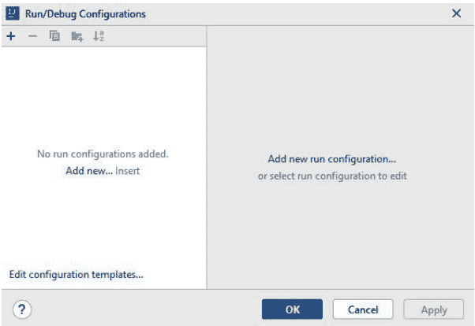
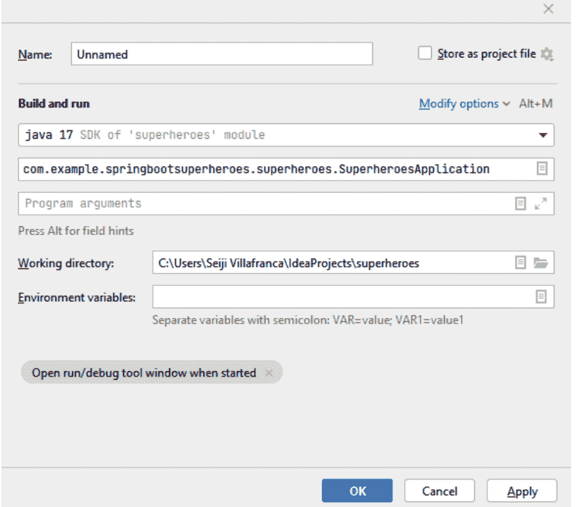
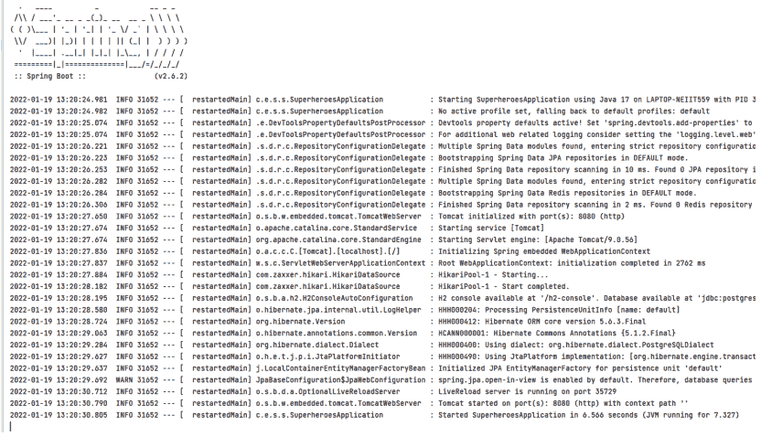

## Building APIs with Spring

In the previous chapter, you learned about the concepts and advantages of PostgreSQL and set it up on your local machine using the installer or the Docker container. You know how to configure Spring Data Java Persistence API (Spring Data JPA) on our project and use its provided repositories to perform Create, Read, Update, and Delete (CRUD) operations on our database with less boilerplate code. Lastly, you have also learned to connect your application with PostgreSQL using the Java Database Connectivity (JDBC) driver and Spring Data JPA.

This chapter will create your Spring Boot application programming interface (API) project; we will focus on coding, making our models, and adding controllers and services to develop our endpoints. We will also add Remote Dictionary Server (Redis) for caching to help improve our application performance.

In this chapter, we will cover the following topics:
- Starting the server
- Adding models
- Writing services
- Adding controllers
- Adding Redis for caching

## Technical requirements

There are no technical requirements for this chapter.

The link to the finished version of this chapter can be found here:

```
https://github.com/PacktPublishing/Spring-Boot-and-Angular/tree/main/Chapter-05/superheroes
```

## Starting the server

In this section, we will now attempt to run our Spring Boot application on our server but first, let’s have a recap of the previous chapter: we learned how to configure Spring Data JPA and connect our application to our PostgreSQL database, and—most importantly—we have installed all of the needed dependencies in our application. These are all prerequisites before running the Spring Boot application.

In the following examples, we will be using an application named `spring-boot-superheroes`. We will generate a new Spring Boot application using Spring Initializr with the same dependencies. Throughout developing our application, we will also show you several ways to write the different parts of your API, such as how to write models, services, and controllers. These are the most common ways used now in the industry. Still, first things first: let’s proceed with running our Spring Boot application.

We assume that you have already generated your Spring Boot application with the needed dependencies. However, if you have missed this part or are unsure whether all dependencies are included on your generated project, let’s list again all the dependencies we installed in the previous chapter, as follows:
- **Spring Data JPA**: Dependency for adding Spring Data JPA used for built-in data store-related implementation.
- **PostgreSQL Driver**: A JDBC and **Reactive Relational Database Connectivity (R2DBC)** driver that will allow the connection of Java applications to the PostgreSQL database.
- **H2 Database**: An in-memory database that supports JDBC API and R2DBC access; this is commonly used for unit testing.

If you have successfully initialized your application with the listed dependencies, open your project in your preferred **integrated development environment (IDE)**; we will be using IntelliJ for Spring Boot in the following examples. Then, proceed as follows:
1. Expand the project folder; we will see several folders inside, as indicated in the following screenshot:




图5.1 – Spring Boot 应用程序的项目结构

在上面的截图中，我们可以看到 Spring Boot 应用程序中的文件和文件夹。我们可以在 src/main/java 下找到主类 SuperHeroesApplication。这个主类将用于在服务器上运行我们的应用程序。

application.properties 也是一个我们需要配置的重要文件，因为所有用于连接数据库的必要属性都放在这里。

2. 打开 application.properties 文件，并设置以下配置：

   ```properties
   spring.main.allow-bean-definition-overriding=true
   spring.datasource.url=jdbc:postgresql://localhost:5432/{{databasename}}
   spring.datasource.username=postgres
   spring.datasource.password=pass
   spring.jpa.hibernate.ddl-auto=update
   ```

   ```properties
   spring.jpa.show-sql=true
   spring.jpa.properties.hibernate.dialect=org.hibernate.dialect.PostgreSQLDialect
   spring.jpa.properties.hibernate.format_sql=true
   ```

   此配置将允许我们连接到本地机器上的 **PostgreSQL 数据库**。请记住，该数据库应存在于我们的 PostgreSQL 服务器上；否则，我们的应用程序将无法成功运行。如果你还没有创建数据库，请打开 **pgAdmin** 并输入主密码；在左侧面板中，展开 **服务器** 部分。

3. 你将在本地机器上看到 PostgreSQL 实例。右键单击该实例，选择 **连接服务器**，然后输入 `postgres` 用户的密码。现在即可访问我们服务器上的数据库，如下图所示：

   

   图5.2 – 使用 pgAdmin 访问 PostgreSQL 服务器

4. 成功访问服务器后，右键单击 **数据库**，选择 **创建**，然后点击 **数据库**；这将打开以下弹窗：

   图5.3 – 创建数据库

   在上面的截图中，我们将数据库命名为 SpringDevDB，并在“所有者”字段中设置了 postgres 用户值。点击保存，我们的数据库就在服务器上准备好了。

5. 我们的 Spring Boot 应用程序现在已准备好运行在服务器上；在 IntelliJ IDE 中，单击面板右上角的“添加配置”。这将打开一个弹窗，我们将在其中配置运行应用程序的入口点，如下图所示：

   

   

   图5.4 – 为 Spring Boot 添加配置

6. 单击上图中显示的 **添加新的运行配置...**，然后选择 **应用程序**。在 **主类** 字段下，输入主类 `SuperheroesApplication`，这将自动用类的正确完全限定名填充程序参数，如下图所示：

   

   图5.5 – 应用程序的配置

   点击 **应用**，然后点击 **确定** 以保存配置更改。

7. 在 IDE 的右上角面板中，选择已创建的配置，然后点击绿色播放图标运行项目。应用程序将在已安装的 Tomcat 服务器上以默认端口 8080 运行；我们也可以使用终端检查 Spring Boot 项目是否已在服务器上成功启动。你可以在下面的截图中看到运行过程：

   

   在上面的截图中，我们可以看到我们的应用程序已成功启动；我们还连接到了 PostgreSQL 数据库，现在可以开始编写代码了。

我们将在下一节中尝试创建我们的应用程序模型。

## 添加模型

在本节中，我们将为应用程序编写代码，首先要创建的是模型。简单来说，模型是我们应用程序的对象；模型将作为我们的实体，并定义数据库中的表。

一旦我们创建模型并运行应用程序，在注解的帮助下，它也会在我们的数据库中自动生成表，这将在本示例中讨论。

### 使用 DTO 和 Lombok 创建模型

我们将首先展示如何使用 Lombok 和**数据传输对象（DTO）**来编写模型。首先，我们将讨论 DTO。

#### DTO

DTO 负责在进程之间传递数据，以减少方法调用的次数。DTO 是**普通 Java 对象（POJO）**，通常由数据访问器组成。

DTO 对于创建实体的表示形式非常有用，可以为客户端提供视图，而不会影响模式和设计。让我们看一个 DTO 的示例用例。你可以在这里看到：

```java
public class Blog {
private String id;
private String title;
private String description;
private String author;
public Blog(String title, String description,
        String author) {
    this.name = title;
    this.description = description;
    this.author = author;
}
}
```

在上面的代码中，我们创建了一个示例域模型，它将表示数据库中的实体。在某些情况下，向客户端发送数据时我们不希望包含某些信息，这时 DTO 就派上用场了。我们将为博客模型创建两个 DTO，分别用于获取和创建数据，如下所示：

```java
public class BlogDTO {
    private String title;
    private String description;
}
```

在上面的示例 DTO 中，我们创建了一个用于检索数据的 BlogDTO 类；我们的目标是隐藏作者姓名，因此不将其作为 DTO 中的字段。代码如下所示：

```java
public class BlogCreationDTO {
    private String title;
    private String description;
    private String author;
}
```

我们创建的下一个 DTO 是 BlogCreationDTO，它将用于创建新的博客。我们可以看到，创建新博客所需的所有字段都被包含了。

创建的 DTO 将在后续部分用于我们的控制器。

#### Lombok

Lombok 是一个第三方库，用于通过注解减少样板代码。Lombok 让我们避免重复代码，尤其是在创建模型时，例如 getter 和 setter 方法。

让我们比较一下不使用 Lombok 的模型和使用 Lombok 的模型，如下所示：

```java
public class Blog {
    private String title;
    private String description;
    private String author;
    public Blog() {}
    public Blog(String title, String description,
        String author) {
    super();
    this.name = title;
    this.description = description;
    this.author = author;
}

public String getAuthor() {return author;}
public void setAuthor(String author) {
this.author = author; }
public String getTitle() {return title;}
public void setTitle(String title) {
this.title = title; }
public String getDescription() {return description;}
public void setDescription(String description) {
this.description = description; }

@Override public String toString()
{return "Blog ["
    + "author=" + author + ", title=" + title
    + ", " + " description =" + description + "]";
}
}
```

在上面的代码示例中，我们创建了一个不使用 Lombok 的博客模型；可以看到，我们为每个字段创建了 getter 和 setter 方法，还创建了有参和无参构造函数。这个例子中的代码仍然是可管理的。

然而，如果我们的模型需要包含更多字段，我们就需要为新字段创建 setter 和 getter，这会在模型中产生更多样板代码，并牺牲代码的可维护性。

类和注解应如下面的代码块所示：

```java
@Data
@AllArgsConstructor
@NoArgsConstructor
public class Blog {
    private String title;
    private String description;
    private String author;
}
```

在上面的代码块中，我们使用 Lombok 创建了博客模型，可以看到模型中省略了大量代码。@Data 注解生成 setter 和 getter 方法、toString() 方法和一个包含必需参数的构造函数。

@AllArgsConstructor 和 @NoArgsConstructor 分别负责生成全参构造函数和无参构造函数。

使用 Lombok 的优势在前面的示例中显而易见；它使代码更易于阅读且更不容易出错，促进了代码的轻松清理和维护，还提供了便捷的日志记录和调试功能。

### 模型应用

现在我们已经了解了 DTO 和 Lombok 的重要性，让我们回到 Spring Boot 应用程序。在 java 文件夹下，右键单击该包并选择 Package（新建包）。这将显示一个小窗口，允许你输入新包名。

在本示例中，我们将创建一个名为 antiHero 的新包。完成新包后，我们将在 antiHero 下创建两个新包，分别称为 dto 和 entity。你可以在下面的截图中看到这些包：


Figure 5.7 – Project structure after the creation of packages

我们的项目结构现在应该与前面的截图中展示的一样。首先创建我们的实体；右键单击我们创建的实体包，然后单击 New | JPA | Entity。这将打开一个用于创建新实体的模型。我们将把我们的实体命名为 AntiHeroEntity 并单击 OK 按钮。该过程在以下截图中进行了说明：

Figure 5.8 – Creating an entity

我们将在实体包下看到一个新生成的类，其代码如下：

```
package com.example.springboot.superheroes.superheroes.antiHero.entity;

import javax.persistence.Entity;
import javax.persistence.Table;

@Entity
@Table(name = "anti_hero_entity")
public class AntiHeroEntity {
}
```

实体已自动生成，并带有 @Entity 和 @Table 注解，这些注解将用于将此模型标识为数据库中的对象。当前代码将存在一些问题，指出实体没有主键（PK）；在这种情况下，我们将向我们的模型添加以下内容：

- @Data：Lombok 注解，将设置 getter 和 setter 方法、toString() 方法以及 @RequiredArgsConstructor。
- @AllArgsConstructor：用于生成带有所有字段作为参数的构造函数的 Lombok 注解。
- @NoArgsConstructor：用于生成无参数构造函数的 Lombok 注解。
- @Id：在 javax.persistence.* 下找到，这将确定模型的 PK。
- @GeneratedValue：用于在 PK 上确定将使用哪种生成类型。
- @NotNull：在 javax.validation.constraints 下找到，并验证特定字段不能为空。

依赖项应通过向 pom.xml 添加以下代码来安装：

```
<dependency>
  <groupId>org.springframework.boot</groupId>
  <artifactId>spring-boot-starter-validation</artifactId>
</dependency>
```

在向 pom.xml 添加依赖项后，右键单击您的项目并选择 Maven | Reload project 以安装新的依赖项。

在成功向我们的模型添加 Lombok 注解、PK、验证和字段后，我们将拥有以下代码：

```
package com.example.springbootsuperheroes.superheroes.antiHero.entity;
...

import java.text.SimpleDateFormat;
import java.util.Date;
import java.util.UUID;
import javax.persistence.*;
import javax.validation.constraints.NotNull;
import lombok.AllArgsConstructor;
import lombok.Data;
import lombok.NoArgsConstructor;
...
```

在添加所有前述包之后，我们现在可以开始编写我们的类和注解，如下所示：

```
@Data
@Entity
@Table
@AllArgsConstructor
@NoArgsConstructor
public class AntiHeroEntity {

    @Id
    @GeneratedValue(strategy = GenerationType.AUTO,
                    generator = "UUID")
    @Column(nullable = false, updatable = false)
    private UUID id;

    @NotNull(message = "First Name is required")
    private String firstName;

    private String lastName;
    private String house;
```

```
private String knownAs;
private String createdAt =
    new SimpleDateFormat("dd-MM-yyyy HH:mm:ss z")
        .format(new Date());
}
```

在前面的代码块中，我们可以看到我们添加了一个 UUID 类型的 PK；当我们向数据库插入新的反英雄数据时，它将被自动生成。该类型使用 @GeneratedValue 注解定义，其中我们还指明策略将使用自动生成器。我们还添加了多个字段，用于存储反英雄信息。

我们已成功创建了我们的实体；现在，我们将为反英雄实体创建一个 DTO。右键单击 dto 包，选择 New | Java class，我们将把新类命名为 AntiHeroDto。成功创建 DTO 后，我们将把以下代码放入其中：

```
package com.example.superheroes.antiHero.dto;

import java.util.UUID;
import javax.validation.constraints.NotNull;
import lombok.Getter;
import lombok.Setter;

@Getter
@Setter
public class AntiHeroDto {

    private UUID id;

    @NotNull(message = "First Name is required")
    private String firstName;

    private String lastName;
    private String house;
    private String knownAs;
}
```

在前面的代码示例中，我们添加了字段，这些字段是我们希望在向客户端发送反英雄数据时仅显示的；在这种情况下，我们在 DTO 中移除了 createdAt 字段。我们还添加了 @Getter 和 @Setter 注解以生成 DTO 的 getter 和 setter 方法，最后，我们还添加了 @NotNull 验证以使我们的约束与实体匹配。

我们已成功在应用程序中使用 Lombok 创建了我们的 DTO 和模型。在下一节中，我们将使我们的服务负责 Spring Boot 应用程序的 CRUD 功能。

## Writing services

在本节中，我们现在将为我们的应用程序编写服务，但首先，让我们讨论一下服务在 Spring Boot 中的主要目的。服务是放置所有业务逻辑的类；在这里，我们将借助 JPA 仓库编写我们的 CRUD 功能。在这种情况下，我们不仅会创建我们的服务类，还会创建我们的 JPA 仓库。

### JPA repository

如第 4 章《Setting Up the Database and Spring Data JPA》中所述，JPA 仓库是用于在 Java 应用程序中管理关系数据的广泛使用的规范。它通过不实现读写操作来帮助 Spring 开发减少样板代码。

在 Spring Boot 中创建 JPA 仓库非常简单；话虽如此，JPA 库提供了诸如 CrudRepository 等类，我们可以用来扩展我们的类。让我们在我们的 Spring Boot 应用程序示例中创建一个。按以下步骤操作：

- 1. 右键单击我们的 antiHero 包，选择 New，然后单击 Package 选项。
- 2. 创建一个名为 repository 的新包。
- 3. 创建新包后，右键单击 repository 包，选择 New，然后单击 Class 选项。
- 4. 当小模态弹出时，切换到 Interface 选项并将接口命名为 AntiHeroRepository。以下代码将被生成：

```
package com.example.springboot.superheroes.superheroes.antiHero.repository;

import com.example.springboot.superheroes.superheroes.antiHero.entity.AntiHeroEntity;
import org.springframework.data.repository.CrudRepository;

import java.util.UUID;

public interface AntiHeroRepository {
}
```

我们已创建了我们的接口，但这只是一个简单的接口。我们将通过扩展 CrudRepository 类来扩展我们的接口，将其转换为 JPA 仓库，如下所示：

```
public interface AntiHeroRepository extends
CrudRepository<AntiHeroEntity, UUID> {
}
```

AntiHeroRepository，如我们已经用 CrudRepository<Type, ID> 扩展的那样，将具有以下功能的方法：

- 持久化、更新和删除其中一个博客实体
- 通过其 PK 查找一个或多个博客
- 统计所有博客
- 验证单个博客是否存在

我们已成功创建了我们的 JPA 仓库；下一步是进行我们的服务。我们的目标是创建一个服务，该服务将具有获取整个列表、通过 PK 获取单个数据库、插入新数据、更新所选数据和删除数据的能力。我们可以通过 JPA 仓库提供的以下方法实现这一点：

- findAll()：获取特定实体中所有现有数据
- findById(Id)：通过 PK 查找特定数据库
- save()：在表中插入新数据
- save(data)：在表中更新现有数据
- deleteById(id)：通过 PK 删除表中的特定数据

现在我们已成功确定了服务所需的<|message|>


```
public AntiHeroEntity findAntiHeroById(UUID id) {
    return findById(id);
}

public void removeAntiHeroById(UUID id) {
    repo.deleteById(id);
}

public AntiHeroEntity addAntiHero(
    AntiHeroEntity antiHero) {
    return repo.save(antiHero);
}

public void updateAntiHero(UUID id,
    AntiHeroEntity antiHero) {
    repo.save(antiHero);
}
}
```

让我们讨论前面的代码；我们已向服务添加了多个方法，下面将更详细地解释这些方法：

- Iterable<AntiHeroEntity> findAllAntiHeroes(): 此方法调用 AntiHeroRepository 中的 findAll()，它返回一个 AntiHeroEntity 的 Iterable 实例。
- AntiHeroEntity findAntiHeroById(UUID id): 此方法调用 AntiHeroRepository 中的 findById(id)，它基于 Id 值返回一个单一的 AntiHeroEntity 实例。
- removeAntiHeroById(UUID id): 此方法调用 AntiHeroRepository 中的 deleteById(id)，它基于 Id 值删除一个单一的 AntiHeroEntity 实例。
- void AntiHeroEntity addAntiHero(AntiHeroEntity antiHero): 此方法调用 AntiHeroRepository 中的 save() 并在数据库中插入一个新的 AntiHeroEntity 实例。
- void updateAntiHero(UUID id, AntiHeroEntity antiHero): 此方法调用 AntiHeroRepository 中的 save(antiHero)，它在数据库中更新特定的 AntiHeroEntity 实例。

成功为服务添加方法后，我们将向 AntiHeroService 添加 @AllArgsConstructor 和 @Service 注解。@AllArgsConstructor 是 Lombok 的一个注解，它会生成一个需要每个字段各一个参数的构造方法；在我们的示例中，这将生成以下代码：

```
public AntiHeroService(AntiHeroRepository repo) {
    this.repo = repo;
}
```

这样就可以将我们的 AntiHeroRepository 依赖注入到服务中了。

另一方面，@Service 注解在我们希望 Spring Context 根据其分类自动检测类时是有效的。

我们现在已成功创建了带有 CRUD 方法的服务，但如果在调用服务时出现问题怎么办？例如，我们传递的反英雄的标识符（ID）可能不存在。我们希望捕获错误并向用户返回一个可理解的消息。现在，我们将为服务创建运行时异常处理。

## Runtime exceptions

运行时异常也称为未检查异常。这些是编程错误，会在应用程序当前执行时发生。这应由开发人员直接预防。

这里列出了一些已知的运行时异常：

- IndexOutOfBoundsException: 当我们访问数组字符串或可迭代对象的超出范围的索引时，会发生此异常，如以下代码片段所示：

```
String[] array = new String[100];
String name = array[200]; // throws index out of bounds
as array variable only has a length of 100
```

- IllegalArgumentException: 当方法被非法参数传递时，会发生此异常，如以下代码片段所示：

```
public class Hero {
    int number;
    public void givePositiveNumber(int number) {
        if(number < 0)  throw new
            IllegalArgumentException(
            Integer.toString(number));
        else { m = number; }
    }
```

```
}
public static void main(String[] args) {
    Hero h = new Hero();
    // throws illegal argument exception as -1 is a
    // negative number
    h.givePositiveNumber(-1);
}
}
```

- NullPointerException: 当访问的变量不指向任何对象或 simply 为 null 时，会发生此异常，如以下代码片段所示：

```
public void doAction(ExampleObject obj) {  obj.
doActionOnMethod();
}
// call doAction()
// throws null pointer exception as we are accessing a
// method on a null object
doAction(null)
```

这些只是我们在应用程序中常用的常见运行时异常；我们也可以使用 RunTimeException 类创建运行时异常。在此示例中，让我们创建一个 NotFoundException 运行时异常，我们将用它来获取不存在的 ID。操作如下：

1. 在主包下，创建一个名为 exception 的新包；在成功创建包后，创建一个名为 NotFoundException 的类。我们将扩展创建的类以继承 RunTimeException 类，并添加以下代码：

```
public class NotFoundException extends RuntimeException {

    public NotFoundException(String message) {
        super(message);
    }

    public NotFoundException(String message,
                            Throwable cause) {
        super(message, cause);
    }
}
```

```
public NotFoundException(Throwable cause) {
    super(cause);
}
}
```

在前面的代码片段中，我们声明了具有不同参数的多个 NotFoundException 方法；成功创建自定义异常后，我们现在可以在服务中使用它。

2. 返回 AntiHeroService，我们将添加以下方法：

```
private AntiHeroEntity findOrThrow(final UUID id) {
    return repo
        .findById(id)
        .orElseThrow(
            () -> new NotFoundException("Anti-hero
            by id " + id + " was not found")
        );
}
```

在前面的代码示例中，我们创建了一个名为 findOrThrow() 的新方法；它也调用 findById() 方法。唯一的区别是它检查给定的 ID 是否存在于数据库中；否则，它将根据我们的代码抛出异常。在这种情况下，我们希望抛出 NotFoundException 运行时异常。

3. 之后，我们现在可以在 findAntiHeroById() 上使用它，将 findById() 替换为 findOrThrow() 方法，并在 updateAntiHero() 和 deleteAntiHero() 方法中也添加它，以在更新或删除之前检查数据是否存在。实现此目的的代码如下所示：

```
public AntiHeroEntity findAntiHeroById(UUID id) {
    return findOrThrow(id);
}

public void updateAntiHero(UUID id,
                    AntiHeroEntity antiHero) {
    findOrThrow(id);
    repo.save(antiHero);
}
```

我们现在已成功为应用程序创建了服务。下一节将讨论如何创建控制器并在代码中定义端点。

## Adding controllers

本节将讨论控制器在应用程序中的使用方式以及如何创建它们。**Controllers** 负责拦截传入请求并将请求的有效负载转换为数据的内部结构；这也是我们将定义端点路径以供前端应用程序访问的地方。

在创建控制器时，我们将使用以下注解，如下所述：

- `@RestController`: 这是 `@Controller` 注解的专用形式；与使用 `@Controller` 注解相比，它已包含 `@Controller` 和 `@ResponseBody` 注解，无需在每个方法上指定 `@ResponseBody` 注解。
- `@RequestMapping`: 这是一个用于将 **HyperText Transfer Protocol (HTTP)** 请求映射到 **REpresentational State Transfer (REST)** 控制器的方法的注解。它也是定义控制器基础路径的地方。
- `@GetMapping`: 将 HTTP GET 请求映射到方法上；该注解是 `@RequestMapping(method = RequestMethod.GET)` 的快捷方式。
- `@PutMapping`: 将 HTTP PUT 请求映射到方法上；该注解是 `@RequestMapping(method = RequestMethod.PUT)` 的快捷方式。
- `@PostMapping`: 将 HTTP POST 请求映射到方法上；该注解是 `@RequestMapping(method = RequestMethod.POST)` 的快捷方式。
- `@DeleteMapping`: 将 HTTP DELETE 请求映射到方法上；该注解是 `@RequestMapping(method = RequestMethod.DELETE)` 的快捷方式。
- `@PathVariable`: 此注解用于获取端点参数的值。
- `@Valid`: 此注解用于检查对象的有效性；它通常用于请求体，以检查传递的请求是否为有效对象。

我们已成功确定将用于控制器的注解。现在我们可以创建控制器。在 `antiHero` 包下，创建一个名为 `controller` 的新包，并在完成 `controller` 包后，创建一个名为 AntiHeroController 的新类。

在 AntiHeroController 类中，我们将使用 `@AllArgsConstructor`、`@RestController` 和 `@RequestMapping` 注解，如下所示：

```
@AllArgsConstructor
@RestController
@RequestMapping("api/v1/anti-heroes")
public class AntiHeroController {

}
```


我们的控制器现在已配置完成；下一步是将我们的依赖项放置在控制器内部。我们使用了 @AllArgsConstructor 注解。我们无需创建带参数的构造方法；我们只需要定义依赖项。

首先，我们将确定 AntiHeroService 类，其中包含我们所有的 CRUD 逻辑。下一个是 ModelMapper；这很重要，因为当我们将其用作响应时，我们需要将实体转换为 DTO，反之亦然，如果我们想从请求体中读取对象。ModelMapper 将轻松地将实体的值映射到具有相同属性的 DTO 对象。

要安装该依赖项，我们只需将以下代码添加到我们的 pom.xml 文件中：

```
<!--Dto mapper-->
<dependency>
    <groupId>org.modelmapper</groupId>
    <artifactId>modelmapper</artifactId>
    <version>2.3.9</version>
</dependency>
```

成功添加 ModelMapper 依赖项后，我们需要在配置中将我们的 ModelMapper 依赖项定义为 Bean，以便在应用程序中使用它。为此，我们将在主包下创建一个名为 config 的新包，并创建一个名为 ModelMapperConfig 的新类。创建新类后，我们将添加一个用 @Bean 注解的方法并返回 ModelMapper 的新实例。代码在以下代码段中说明：

```
@Configuration
public class ModelMapperConfig {

    @Bean
    public ModelMapper modelMapper() {
        return new ModelMapper();
    }
}
```

我们的配置已全部完成，现在我们可以将 AntiHeroService 和 ModelMapper 添加到我们的控制器中，如下所示：

```
@AllArgsConstructor
@RestController
@RequestMapping("api/v1/anti-heroes")
public class AntiHeroController {
    private final AntiHeroService service;
```
```
private final ModelMapper mapper;
}
```

我们现在拥有了带有所需依赖项的控制器。现在，让我们创建两个函数，将我们的实体转换为 DTO，或反之亦然。如前所述，我们将使用 ModelMapper 依赖项来创建这些方法，在这种情况下，我们将添加以下代码：

```
private AntiHeroDto convertToDto(AntiHeroEntity entity) {
    return mapper.map(entity, AntiHeroDto.class);
}

private AntiHeroEntity convertToEntity(AntiHeroDto dto) {
    return mapper.map(dto, AntiHeroEntity.class);
}
```

我们在前面的代码示例中创建了两个函数。首先，我们创建了 convertToDto() 方法，它将给定的 AntiHeroEntity 实例转换为 AntiHeroDto 实例，为此我们使用了 ModelMapper 的 map() 方法来映射实体的值。第二个函数是 convertToEntity() 方法，它将 DTO 转换为实体。

现在，我们可以为我们的 CRUD 方法创建映射。让我们首先开始一个方法，根据 id 值返回特定实体；我们将使用 @GetMapping 注解来标识这将使用 GET 请求，并将 /{id} 添加为参数以指示我们可以将实体 ID 作为动态参数传递到端点。

在创建方法时，我们将使用 @PathVariable 注解来获取端点中 /{id} 的值并将其定义为 UUID 类型。最后，我们将调用 AntiHeroService 下的 service.findAntiHeroById() 函数并传递检索到的 ID 以获取数据库中的实体，并将使用 convertToDto() 函数将其转换为 DTO。代码在以下代码段中说明：

```
@GetMapping("/{id}")
public AntiHeroDto getAntiHeroById(@PathVariable("id") UUID id)
{
    return convertToDto(service.findAntiHeroById(id));
}
```

现在，要创建创建映射，我们将使用 @PostMapping 注解来标识这将使用 POST 请求，我们将使用 @RequestBody 注解来获取请求体上的对象，我们也可以使用 @Valid 注解来检查对象是否有效实体。

在创建函数时，我们将调用 convertToEntity() 方法将对象转换为实体，并调用 service.addAntiHero() 方法将转换后的实体插入数据库。代码在以下代码段中说明：

```
@PostMapping
public AntiHeroDto postAntiHero(@Valid @RequestBody AntiHeroDto antiHeroDto) {
    var entity = convertToEntity(antiHeroDto);
    var antiHero = service.addAntiHero(entity);
    
    return convertToDto(antiHero);
}
```

接下来我们需要创建的是 PUT 映射。我们将使用 @PutMapping 注解来标识这将使用 PUT 请求，与我们创建 GET 映射的方式相同。我们将添加 /{id} 作为参数，并将使用 @RequestBody 注解来获取请求体上的对象以及 @PathVariable 注解来获取参数中 id 的值。

在实现函数时，我们还将调用 convertToEntity() 方法并调用 service.updateAntiHero(id, entity) 方法使用 DTO 值更新特定实体。代码在以下代码段中说明：

```
@PutMapping("/{id}")
public void putAntiHero(
    @PathVariable("id") UUID id,
    @Valid @RequestBody AntiHeroDto antiHeroDto
) {
    if (!id.equals(antiHeroDto.getId())) throw new ResponseStatusException(
        HttpStatus.BAD_REQUEST,
        "id does not match."
    );
    
    var antiHeroEntity = convertToEntity(antiHeroDto);
    service.updateAntiHero(id, antiHeroEntity);
}
```

接下来，我们将创建 DELETE 映射。我们将使用 @DeleteMapping 注解来标识这将使用 DELETE 请求。我们还将添加 /{id} 作为参数以接收我们需要删除的实体的 ID，并将添加 @PathVariable 注解来获取 id 的值。

要实现该方法，我们只需调用 service.removeAntiHeroById() 方法来删除数据库中的特定实体，如下所示：

```
@DeleteMapping("/{id}")
public void deleteAntiHeroById(@PathVariable("id") UUID id) {
    service.removeAntiHeroById(id);
}
```

最后，我们需要创建一个方法来返回数据库中的所有实体。我们实现此功能的一种方法是使用 StreamSupport 将检索到的列表转换为流并将每个对象转换为 DTO，但在首先，我们将创建一个返回 List<AntiHeroDto> 类型并带有 @GetMapping 注解的方法。完成方法后，我们现在将调用 service.findAllAntiHeroes() 方法以获取数据库中的实体。由于这返回一个 Iterable 实例，我们将将其转换为流并使用 Collectors.toList() 转换为列表。代码在以下代码段中说明：

```
var antiHeroList = StreamSupport
    .stream(service.findAllAntiHeroes().spliterator(),
            false)
    .collect(Collectors.toList());
```

成功检索并将数据转换为列表后，我们希望每个对象都转换为 DTO。我们可以通过将列表转换为流来实现。调用 convertToDto() 方法并再次将其转换为列表，如下所示：

```
antiHeroList
    .stream()
    .map(this::convertToDto)
    .collect(Collectors.toList());
```

我们将在响应中返回转换后的列表，我们的方法现在将如下所示：

```
@GetMapping
public List<AntiHeroDto> getAntiHeroes() {
    var antiHeroList = StreamSupport
        .stream(service.findAllAntiHeroes().spliterator(),
                false)
        .collect(Collectors.toList());

    return antiHeroList
        .stream()
```
```
.map(this::convertToDto)
.collect(Collectors.toList());
}
```

我们已成功在控制器上创建了映射，我们的代码应如下所示：

```
@AllArgsConstructor
@RestController
@RequestMapping("api/v1/anti-heroes")
public class AntiHeroController {
    private final AntiHeroService service;
    private final ModelMapper mapper;

...

    public AntiHeroDto getAntiHeroById(
        @PathVariable("id") UUID id) {
        return convertToDto(service.findAntiHeroById(id));
    }

    @DeleteMapping("/{id}")
    public void deleteAntiHeroById(
        @PathVariable("id") UUID id) {
        service.removeAntiHeroById(id);
    }

    @PostMapping
    public AntiHeroDto postAntiHero(
        @Valid @RequestBody AntiHeroDto antiHeroDto) {
        var entity = convertToEntity(antiHeroDto);
        var antiHero = service.addAntiHero(entity);

...
        return mapper.map(dto, AntiHeroEntity.class);
    }

}
```


我们已经完成了 Spring Boot 应用的开发，我们创建了定义对象结构的模型和 DTO，我们构建了负责业务逻辑的服务，并且我们创建了将 HTTP 请求映射到应用中的控制器，因此我们的端点将按预期工作。

不过，我们仍然可以在性能方面改进后端，而这可以通过缓存机制来实现。在下一节中，我们将讨论 Redis 的概念和应用。

## 为缓存添加 Redis

在本节中，我们将讨论 Redis，它可以提升 REST 应用的性能。Redis 是一个开源的、内存中的键值数据存储，它允许数据驻留在内存中以实现低延迟和更快的 数据访问。与传统数据库相比，Redis 不需要磁盘访问，所有数据都缓存在内存中，这提供了更快的响应。

它现在被广泛使用，尤其是在接收数百万请求的 大型应用中。它兼容不同的数据结构，如字符串、列表、集合、哈希、位图和地理空间，并且兼容发布/订阅（Pub/Sub），用于实时聊天应用。

## 安装 Redis 服务器

在使用 Redis 于我们的 Spring Boot 应用之前，我们需要在终端中安装 Redis 服务器。让我们讨论如何在不同的操作系统上安装 Redis。

## macOS

Redis 在 macOS 系统中安装简单；我们可以使用 Homebrew 安装 Redis 并执行以下命令：

```
brew install redis
```

安装成功后，我们可以使用以下命令将 Redis 服务器设置为自动启动：

```
brew services start redis
```

并且我们已成功在 macOS 上安装并运行了 Redis 服务器。

## Ubuntu Linux

要在 Ubuntu 操作系统上安装 Redis，我们将执行以下命令：

```
sudo apt-get install redis-server
```

这将自动安装并在 6379 端口启动 Redis 服务器，并且我们已成功在 Linux 上安装并运行了 Redis 服务器。

## Windows

要在 Windows 上安装 Redis，我们可以从以下链接安装不同版本：https://github.com/microsoftarchive/redis/releases，下载 .zip 或 .msi 文件，并解压到您选择的目录。运行 Redis-server.exe 文件以在 6379 端口启动 Redis 服务器。

因此，我们已成功在 Windows 上安装并运行了 Redis 服务器。现在我们可以在 Spring Boot 应用中使用 Redis。

## 在 Spring Boot 上配置 Redis

我们已成功在本地机器上配置并启动了 Redis 服务器；下一步是在我们开发的 Spring Boot 项目中使用 Redis。我们现在将按以下步骤操作：

- 1. 我们需要做的第一件事是包含 Redis 依赖；为此，我们需要在 pom.xml 文件中添加以下代码：

```
<!-- Redis -->
<dependency>
    <groupId>org.springframework.data</groupId>
    <artifactId>spring-data-redis</artifactId>
    <version>2.4.5</version>
</dependency>
<dependency>
    <groupId>redis.clients</groupId>
    <artifactId>jedis</artifactId>
    <version>3.5.1</version>
    <type>jar</type>
</dependency>
```

成功添加 Redis 依赖后，我们将在 config 包下添加 Redis 配置，该配置将定义 Redis 服务器的连接属性。

- 2. 创建一个名为 RedisConfig 的类。我们将使用 @Configuration 注解来标识该类是否具有在应用执行时引导的 Bean 定义方法。我们还将向我们的类添加以下方法：

```
@Bean
JedisConnectionFactory jedisConnectionFactory() {
    RedisStandaloneConfiguration
    redisStandaloneConfiguration =
```

```
new RedisStandaloneConfiguration();

return new JedisConnectionFactory(
    redisStandaloneConfiguration);
}
```

jedisConnectionFactory() 是用于标识我们 Redis 服务器连接属性的方法；由于我们未指定连接属性，因此它使用默认值。

不过，如果我们的 Redis 服务器托管在不同的服务器上，使用不同的端口，或具有用户名和密码，我们可以使用以下方法：

- redisStandaloneConfiguration.setHostName("host")：这设置 Redis 服务器运行的 主机统一资源定位符（URL）。
- redisStandaloneConfiguration.setPort("port")：这设置应用将连接的端口。
- redisStandaloneConfiguration.setUsername("username")：这设置 Redis 服务器的用户名。
- redisStandaloneConfiguration.setPassword("password")：这设置 Redis 服务器的密码。

下一步是使用连接工厂创建 Redis 模板；这用于 Redis 数据交互。它允许在对象与存储在 Redis 服务器中的二进制数据之间自动序列化与反序列化。

3. 我们将创建一个方法，该方法也将使用 @Bean 注解；我们将创建一个新的 Redis 模板并使用以下代码设置连接工厂：

```
RedisTemplate<UUID, Object> template = new
RedisTemplate<>();
template.setConnectionFactory(jedisConnectionFactory());
```

成功使用连接工厂创建模板实例后，我们还可以根据数据结构定义序列化器。如果我们想使用默认序列化器，即 JdkSerializationRedisSerializer，我们只需返回一个模板实例即可。

4. 在以下代码片段中，我们为不同的数据结构使用了不同的序列化器：

```
@Bean
public RedisTemplate<UUID, Object> redisTemplate() {
    RedisTemplate<UUID, Object> template =
        new RedisTemplate<>();
    template.setConnectionFactory(
```

```
jedisConnectionFactory();
template.setKeySerializer(
    new StringRedisSerializer());
template.setHashKeySerializer(
    new StringRedisSerializer());
template.setHashKeySerializer(
    new JdkSerializationRedisSerializer());
template.setValueSerializer(
    new JdkSerializationRedisSerializer());
template.setEnableTransactionSupport(true);
template.afterPropertiesSet();

    return template;
}
}
```

5. 我们需要做的最后一件事是在我们的实体上添加 @RedisHash 注解。这作为对象作为聚合根存储在 Redis 哈希上的标记；在我们的示例中，我们将在 AntiHeroEntity 上使用它，如下所示：

```
@RedisHash("AntiHero")
public class AntiHeroEntity {
...
}
```

并且这将成功使用 Redis 服务器在我们的 Spring Boot 应用中缓存数据，因为操作正在执行。

## 总结

至此，本章已结束。让我们回顾一下您学到的宝贵内容。您已学习如何使用 IntelliJ 在 Tomcat 服务器上启动 Spring Boot 应用。您还了解了如何通过创建实体、使用 Lombok 和 DTO、借助 JPA 仓库编写具有 CRUD 逻辑的服务、以及使用 HTTP 注解创建控制器并使用 ModelMapper 在实体和 DTO 之间转换，来逐步创建一个完整的 Spring Boot 应用。

最后，您还学习了如何配置 Redis 服务器并在 Spring Boot 应用中使用它。

您在此处学到的技能将使您的代码更具可读性和简洁性，因为使用了 Lombok 和 JPA 仓库。

在下一章中，我们将学习如何使用 springdoc-openapi 和 Swagger UI 为我们的 API 创建文档。
