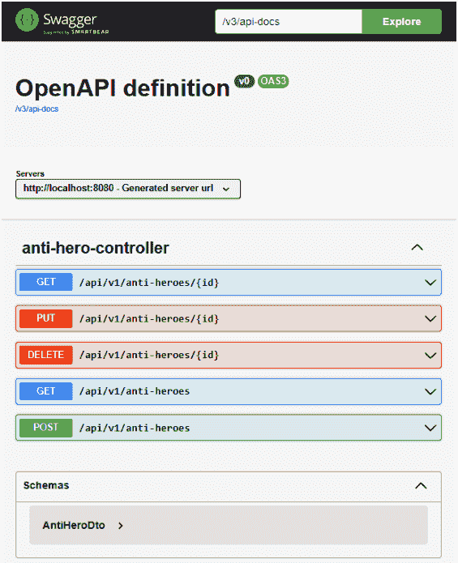
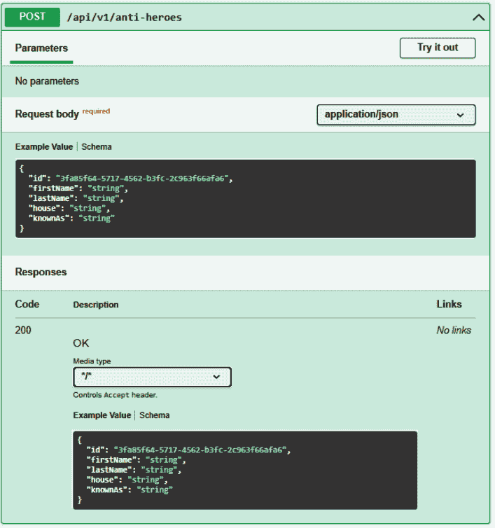
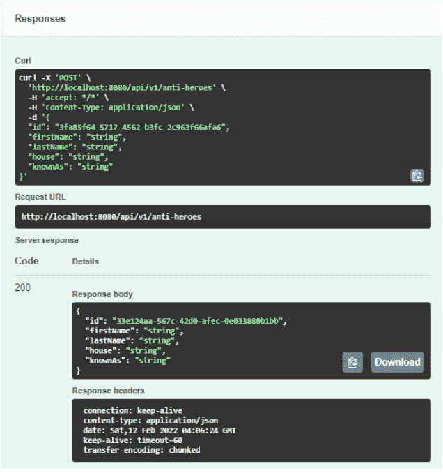
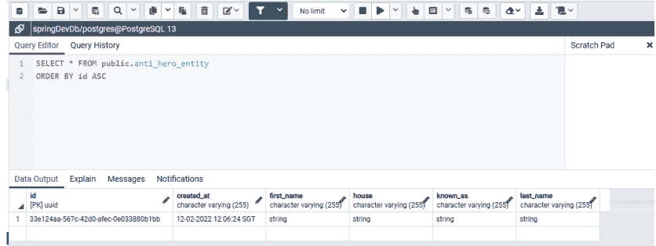
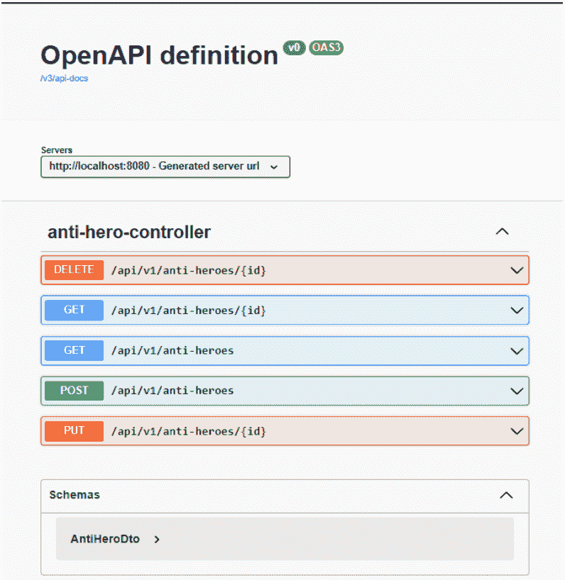

## 使用 OpenAPI 规范记录 API

在上一章中，我们学习了如何开发我们的 Spring Boot 应用。首先，我们配置了应用以使用 IntelliJ 在服务器上运行。然后，我们开发了 REST 应用的不同部分，例如模型和实体，它们充当对象；服务，它们保存业务逻辑并调用 JPA 仓库在数据库中执行 CRUD 操作；以及控制器，它们定义端点。我们还学习了如何应用 Redis，它添加了缓存机制以提升 REST API 的性能。

本章将重点介绍为我们的 Spring Boot 项目创建文档。我们将重点介绍配置 `springdoc-openapi` 和 Swagger UI，并为我们开发的端点即时生成文档。

在本章中，我们将涵盖以下主题：

- 设置 `springdoc-openapi`
- 设置 Swagger UI

## 技术要求

以下链接将带您进入本章的完成版本：https://github.com/PacktPublishing/Spring-Boot-and-Angular/tree/main/Chapter-06/superheroes。

## 设置 springdoc-openapi

在本节中，我们将在 Spring Boot 应用中配置 `springdoc-openapi`。由于我们在上一章中开发了 REST API，我们接下来需要做的就是为我们的端点创建文档。这是一个必不可少的部分，尤其是在开发行业中，因为这将告诉开发者可以实现哪些端点、所需请求及其格式是，


以及调用端点时应期望的响应体。这也有助于减少 API 集成方面的错误和冲突，因为可用的端点是透明的。然而，手动创建文档的主要缺点是它繁琐且容易出错。这就是 springdoc-openapi 发挥作用的地方。

首先，让我们讨论一下 springdoc-openapi 是什么。springdoc-openapi 是一个库，可自动化 Spring Boot 项目中 API 文档的生成。这种自动化之所以成为可能，是因为该库使用注解、类结构和 Spring 配置来识别可用的 API。

springdoc-openapi 可以生成必要的 JSON/YAML 和 HTML API 文档，这些文档可以通过我们在应用程序上新生成的 URL 查看。它还支持多个框架和协议，包括以下内容：

- spring-boot
- JSR-303，特别是针对 @NotNull、@Min、@Max 和 @Size
- swagger-ui
- OAuth 2

现在，让我们讨论 springdoc-openapi 的属性和插件。

## springdoc-openapi 的属性

我们可以根据自己的偏好修改 springdoc-openapi 的行为和设置。它具有不同的属性，我们可以在 application.properties 文件下设置其值。

以下是 springdoc-openapi 中一些常用的属性：

- springdoc.swagger-ui.path：默认值是 /swagger-ui.html。它定义了访问 HTML 文档的路径。
- springdoc.swagger-ui.enabled：默认值是 true。它启用或禁用 swagger-UI 端点。
- springdoc.swagger-ui.configUrl：默认值是 /v3/api-docs/swagger-config。它是一个用于检索外部配置文档的 URL。
- springdoc.swagger-ui.layout：默认值是 BaseLayout。它是 Swagger UI 用于显示文档的顶级布局。
- springdoc.swagger-ui.tryItOutEnabled：默认值是 false。它启用或禁用 Try it out 部分，用户可以在此测试端点。
- springdoc.swagger-ui.filter：默认值是 false。它启用或禁用过滤并添加一个文本框以放置过滤条件。它可以是布尔值或字符串；这将作为过滤表达式。
- `springdoc.swagger-ui.operationsSorter`：这对 API 的操作列表应用排序。值可以是 `'alpha'`（按路径字母排序）、`'method'`（按 HTTP 方法排序），或一个将识别排序标准的函数。
- `springdoc.swagger-ui.tagsSorter`：这对 API 的操作列表应用排序。值可以是 `'alpha'`（按路径字母排序）或一个将识别排序标准的函数。

## springdoc-openapi 的插件

springdoc-openapi 也有我们可以用来生成文档的插件。让我们来看看。

### *springdoc-openapi-maven-plugin*

springdoc-openapi-maven-plugin 在构建期间生成 JSON 和 YAML OpenAPI 描述。插件也在集成阶段工作。要启用插件，我们需要在 pom.xml 文件的 `<plugin>` 部分添加以下声明：

```xml
<plugin>
    <groupId>org.springframework.boot</groupId>
    <artifactId>spring-boot-maven-plugin</artifactId>
    <version>${spring-boot-maven-plugin.version}</version>
    <configuration>
        <jvmArguments>
            -Dspring.application.admin.enabled=true
        </jvmArguments>
    </configuration>
    <executions>
        <execution>
            <goals>
                <goal>start</goal>
                <goal>stop</goal>
            </goals>
        </execution>
    </executions>
</plugin>
```

我们刚刚添加了 `spring-boot-maven-plugin` 插件。复制上述代码并粘贴到你的 `.pom` 文件中。

```
<id>integration-test</id>
<goals>
    <goal>generate</goal>
</goals>
</execution>
</executions>
<configuration>
    <apiDocsUrl>
        http://localhost:8080/v3/api-docs</apiDocsUrl>
    <outputFileName>openapi.json</outputFileName>
    <outputDir>/home/springdoc/output-folder</outputDir>
    <skip>false</skip>
    <headers>
        <header1-key>header1-value</header1-key>
    </headers>
</configuration>
</plugin>
```

在前面的示例 XML 代码中，我们添加了多个属性以对 OpenAPI 应用自定义配置。我们手动设置了输出文件名、目录和用于生成 API 文档的头部。

## springdoc-openapi-gradle-plugin

springdoc-openapi-gradle-plugin 从 Gradle 构建为 Spring Boot 应用程序生成 OpenAPI 规范。要启用插件，我们必须在 plugins 部分放置以下代码：

```
plugins {
    id "org.springframework.boot" version "${version}"
    id "org.springdoc.openapi-gradle-plugin"
        version "${version}"
}
```

一旦插件和依赖项已添加，以下任务将被创建：

- generateOpenApiDocs：运行以生成 OpenAPI 文档的任务。generateOpenApiDocs 会向应用程序的文档 URL 发出 REST 调用，以将 OpenAPI 文档以 JSON 格式存储。
- forkedSpringBootRun：使用此任务在后台运行 Spring Boot 应用程序。

我们还可以通过指定以下属性来自定义 openapi-gradle-plugin 的行为：

- apiDocsUrl：可以下载 Open API 文档的 URL
- outputDir：文档生成的目录
- outputFileName：生成的输出文件名
- waitTimeInSeconds：在调用 REST API 生成 OpenAPI 文档之前，等待 Spring Boot 应用程序启动的时间（秒）
- forkProperties：运行 Spring Boot 应用程序所需的一个系统属性
- groupedApiMappings：一组可以从中下载 OpenAPI 文档的 URL

要使用这些属性，我们必须使用 generateOpenApiDocs 指定它们：

```
openApi {
    apiDocsUrl.set("https://localhost:4000/api/docs")
    outputDir.set(file("$buildDir/docs"))
    outputFileName.set("swagger-test.json")
    waitTimeInSeconds.set(310)
    forkProperties.set("-Dspring.profiles.active=special")
    groupedApiMappings.set(
        ["https://localhost:8000/v3/api-docs/group-1" to "swagger-group-1.json",
        "https://localhost:8000/v3/api-docs/group-2" to "swagger-group-2.json"])
}
```

至此，我们已经了解了可在 OpenAPI 文档中使用的属性和插件。现在，让我们为我们的 Spring Boot 应用程序配置插件。

## 配置 springdoc-openapi

现在，我们将在 Spring Boot 应用程序中安装和配置 springdoc-openapi。首先，我们必须将依赖项添加到之前创建的项目中。前往 pom.xml 文件并添加以下 XML 代码：

```
<dependency>
    <groupId>org.springdoc</groupId>
```

```
<artifactId>springdoc-openapi-ui</artifactId>
<artifactId>            <version>1.6.4</version>
</dependency>
```

成功安装 OpenAPI 依赖项后，我们可以运行 Spring Boot 项目。服务器启动后，我们可以前往 http://localhost:8080/v3/api-docs/ 来访问 OpenAPI 文档的 JSON 格式。你将看到所有端点及其关联的 HTTP 请求都显示为 JSON 对象。以下是我们项目生成的 JSON 文档片段：

```
{
  "servers": [
    {
      "url": "http://localhost:8080/",
      "description": "Generated server url"
    }
  ],
  "paths": {
    "/api/v1/anti-heroes/{id}": {
      "get": {
        "tags": [
          "anti-hero-controller"
        ],
        "operationId": "getAntiHeroById",
        "parameters": [
          {
            "name": "id",
            "in": "path",
            "required": true,
            "schema": {
              "type": "string",
              "format": "uuid"
            }
          }
        ],
        "responses": {
          "200": {
            "description": "OK",

```


```
"content" : {
    "*/*" : {
        "schema": {
            "$ref": "#/components/schemas/AntiHeroDto" ...
// other created paths UPDATE DELETE and CREATE Inputs
```

在这里，我们可以看到生成的 JSON 对象显示了项目中可用的端点。它与操作 ID 一起显示，操作 ID 是方法的默认名称；它还指定了参数及其所需类型，以及端点的可能响应。

我们使用了可以访问 OpenAPI 的默认 URL。我们可以通过应用程序的 `springdoc.api-docs.path` 属性（在 properties 文件中）来更改 URL。例如，我们将其设置为 `springdoc.api-docs.path=rest-docs`，这意味着我们现在可以通过 http://localhost:8080/rest-docs/ 访问 JSON 文档。

我们还可以通过访问 http://localhost:8080/v3/api-docs.yaml 来获取文档的 YAML 版本。

至此，我们已成功使用 springdoc-openapi 为端点生成了文档。在下一节中，我们将学习如何配置、访问和使用 Swagger UI。

## 设置 Swagger UI

**Swagger UI** 是一种文档工具，允许用户直接从浏览器调用项目中的可用 API。这是一个更具交互性的工具，能够对 API 进行更详细和实用的使用。Swagger UI 也是开源的，因此有更多社区支持该工具。

### 安装和使用 Swagger UI

Swagger UI 已经包含在 `springdoc-openapi-ui` 依赖中。我们通过添加以下代码来包含 OpenAPI 扩展代码：

```
<dependency>
    <groupId>org.springdoc</groupId>
    <artifactId>springdoc-openapi-ui</artifactId>
    <version>1.6.4</version>
</dependency>
```

OpenAPI 依赖包含 Swagger UI 扩展；我们可以通过以下 URL 访问 UI：http://localhost:8080/swagger-ui.html。这将打开 Swagger UI 的 **OpenAPI 定义** 页面：



图 6.1 – Swagger UI 的 OpenAPI 定义页面

在这里，我们可以看到 Swagger UI 已成功访问。我们在 Spring Boot 项目中创建的端点及其 HTTP 方法也会显示出来。让我们讨论一下 Swagger UI 文档的不同部分。

我们在 Swagger UI 中首先看到的是，它包含一个文本输入框，以及 Explore 按钮。Swagger UI 就是从这里获取它将渲染的端点列表。在前面的示例中，我们可以看到默认值是 v3/api-docs。这意味着我们使用 OpenAPI 库生成的 JSON 文档正被 Swagger 用来获取可用端点。

我们可以更改此值，并访问包含 JSON 或 YAML 格式的 OpenAPI 文档的 URL。接下来我们将看到的是项目中可用端点的列表。在前面的示例中，我们开发的五个端点都列在 Swagger UI 中。这不仅仅是一个列表，因为 Swagger UI 工具是交互式的，允许我们试用可用的端点。



图 6.2 – 反英雄的 POST 请求

我们可以展开 `/api/v1/anti-heroes` 端点，在我们的数据库中创建一个新的 Anti-Hero 对象，因为它使用的是 POST HTTP 方法。它指定了我们需要在请求体中传递的对象的 schema。该 schema 定义了属性的名称和类型。在本例中，Anti-Hero 实体具有以下 schema：

```json
{
  "id": "3fa85f64-5717-4562-b3fc-2c963f66afa6",
  "firstName": "string",
  "lastName": "string",
  "house": "string",
  "knownAs": "string"
}
```

```
"lastName": "string",
"house": "string",
"knownAs": "string"
}
```

示例端点中还指定了可能的响应。可能的响应状态为 200，表示成功。它还会返回数据库中新建的实体。

我们想要测试该端点并向数据库中插入一些示例数据。为此，我们必须单击右上角的 Try it out 按钮，然后单击 Execute 按钮来调用端点。一旦 API 调用成功，我们将看到以下输出：



图 6.3 – POST 请求的响应

在这里，我们可以看到 API 成功返回，因为它返回了状态码 200 和数据库中新建的实体。

我们可以通过访问 pgAdmin 来检查我们的端点是否已成功将数据插入表中，如下面的截图所示：



图 6.4 – 验证数据是否已从 POST 请求插入

在前面的示例中，我们可以看到数据已成功插入到我们的表中。现在，我们可以通过获取、更新或删除我们在数据库中创建的数据来测试其他可用的端点。

我们已经成功浏览了 Swagger UI 工具并与可用端点进行了交互，但我们也可以像使用 OpenAPI 文档一样，通过属性来根据我们的偏好和需求修改 Swagger UI。我们还可以修改访问 Swagger UI 的 URL；例如，我们可以在 `application.properties` 文件中放置 `springdoc.swagger-ui.path=/{custom-path}.html`。

我们还可以修改的另一个行为是端点的排序行为。我们可以更改端点在列表中的排列方式，可以按 alpha（按字母数字排列）或 method（按方法排列），也可以使用自定义函数来更改排序方式。为此，我们可以在 `application.properties` 文件中放置 `springdoc.swagger-ui.operationsSorter=(sort behavior)`。

在本例中，我们将使用 `springdoc.swagger-ui.operationsSorter=method`。我们将看到以下输出：



图 6.5 – 按方法排列的端点

正如我们所看到的，我们的端点现在按 HTTP 方法排列。

## 在 Swagger UI 中显示分页信息

Swagger UI 还可以与使用分页的端点集成。我们可以指定页码、每页列表的大小以及排序表达式。为了在 Swagger UI 中集成分页参数，我们需要添加 springdoc-open-data-rest 依赖。

要添加该库，我们必须在 `pom.xml` 文件中添加以下代码：

```xml
<dependency>
    <groupId>org.springdoc</groupId>
    <artifactId>springdoc-openapi-data-rest</artifactId>
    <version>1.6.4</version>
</dependency>
```

成功添加该库后，让我们修改 `AntiHeroesController` 下的 `getAntiHeroes` 方法，以实现可用的分页功能：

```java
... import org.springframework.data.domain.Pageable;

@GetMapping
public List<AntiHeroDto> getAntiHeroes(Pageable pageable) {
    int toSkip = pageable.getPageSize() *
                 pageable.getPageNumber();

    var antiHeroList = StreamSupport
        .stream(service.findAllAntiHeroes().spliterator(), false)
        .skip(toSkip).limit(pageable.getPageSize())
        .collect(Collectors.toList());

    return antiHeroList
        .stream()
        .map(this::convertToDto)
        .collect(Collectors.toList());
}
```

现在，让我们展开使用 GET 方法的 `api/v1/anti-heroes`：


图 6.6 – 反英雄的 GET 方法

在这里，我们可以看到 Parameters 部分有一个 pageable 属性，我们可以指定要检索的页面、每页的大小以及排序表达式。现在，我们可以执行它来从数据库检索数据。

## 总结

至此，本章已结束。让我们回顾一下你学到的有价值的内容。

首先，你了解了 springdoc-openapi 的可用特性和属性，以及如何配置和使用 OpenAPI 规范来为我们的 API 调用生成 JSON 和 YAML 文档。你还学习了如何访问 Swagger UI，这是一个直接在浏览器中调用 API 的交互式文档工具。我们模拟了发送测试调用和修改某些行为（如域名 URL 和排序顺序）的过程。这种新掌握的为 API 生成文档的知识在实际应用中非常有用。开发人员可以利用这些知识轻松识别可使用的 API，以及它们的参数和对象响应。

在下一章中，我们将学习跨源资源共享（CORS）、Spring Security 和 JSON Web 令牌（JWT）的概念。


