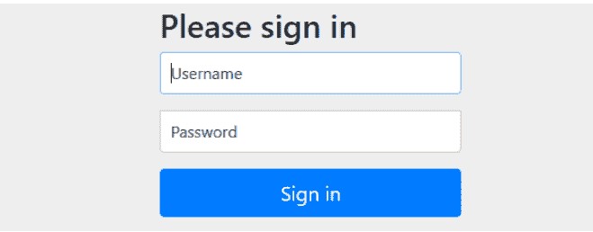
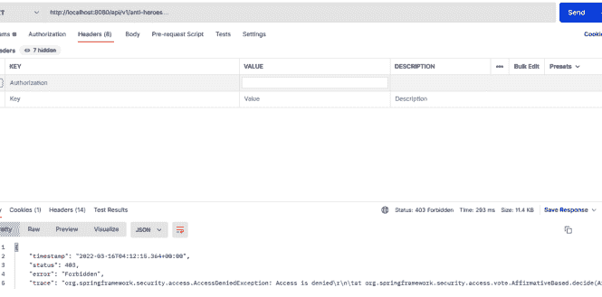
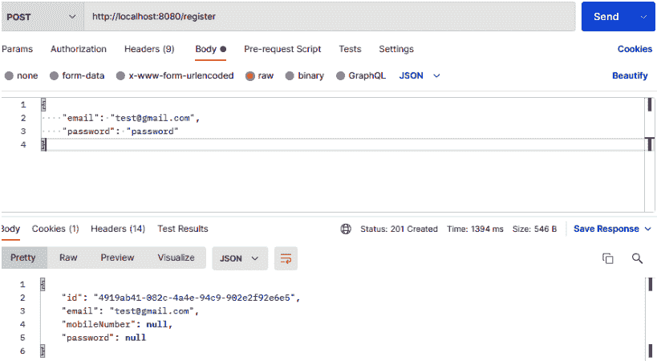
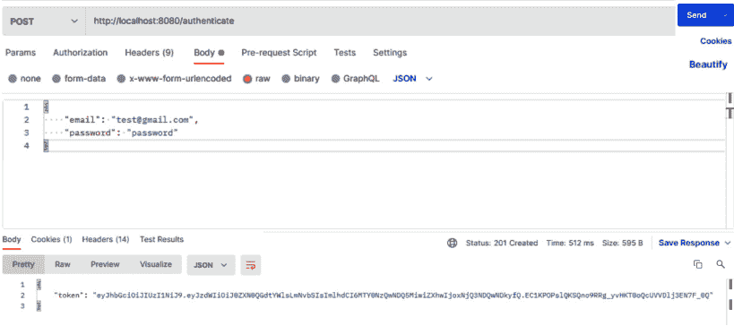
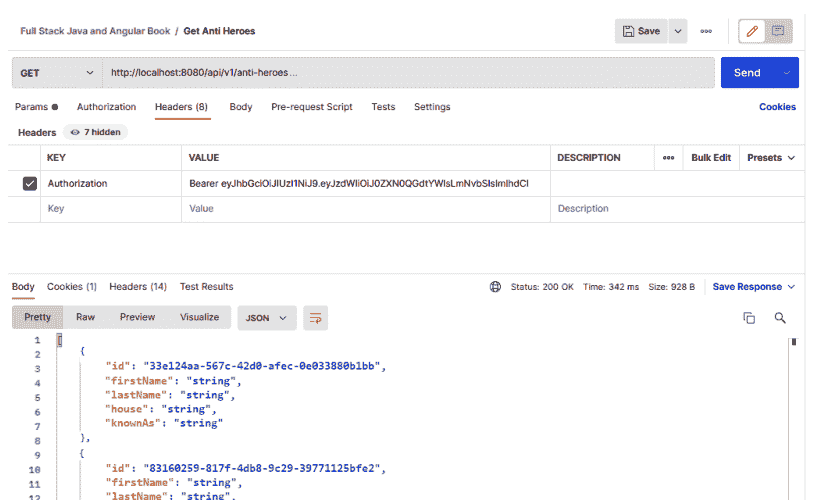

## 使用 JWT 添加 Spring Boot 安全

在上一章中，我们主要学习了如何在 Spring Boot 项目中为我们创建的 API 生成自动化文档。我们学习了如何添加和使用 springdoc-openapi 的特性和属性，如何在项目上配置插件，以及如何访问生成的 JSON 和 YAML 文档。我们还学习了如何实现 Swagger UI 以使我们的文档具有交互性，并在浏览器上直接测试端点。

本章现在将重点关注我们应用程序的安全方面。我们将讨论跨源资源共享（CORS）的概念以及它如何保护我们的应用程序。我们还将讨论 Spring Boot 中 Spring Security 的特性和实现、JSON Web Token（JWT）概念以及身份即服务（IDaaS）。

在本章中，我们将涵盖以下主题：

- 理解 CORS
- 添加 CORS 策略
- 理解 Spring Security
- Spring Boot 中的身份验证和授权
- IDaaS

### 技术要求

本章代码的完成版本链接在此处：https://github.com/PacktPublishing/Spring-Boot-and-Angular/tree/main/Chapter-07/superheroes。

## 理解 CORS

在作为开发者创建应用程序时，我们可能已经多次遇到 CORS 这个术语。尽管如此，我们仍可能会问这样的问题：CORS 有什么作用？或者在我们的应用程序中实现 CORS 有什么优势？带着这些问题，我们将在本节中深入探讨 CORS 的概念和特性，并了解它如何用于保护我们的应用程序。

CORS 是一种基于头的机制，允许服务器定义一组允许访问应用程序资源的主域、方案或端口。CORS 通常用于 REST API。不同的前端应用程序可以访问我们在后端应用程序下的 API，尤其是在复杂的架构中。我们不希望我们的 API 被未知应用程序访问，而 CORS 负责保护这一部分。

让我们看一个跨源请求的简单示例。假设我们有一个前端应用程序，其域名为 https://domain-one.com，而后端应用程序的域名为 https://domain-two.com。我们可以看到我们的应用程序使用不同的域名提供服务，一旦前端应用程序向后端发送请求，这就被视为跨源请求。

我们绝不能忘记，浏览器默认会限制跨源请求，除非请求资源的源包含正确的 CORS 头并且在后端应用程序中被允许，否则同源请求是唯一允许请求资源的请求。这只是 CORS 工作原理的一个简单示例。让我们看一下 CORS 概念的更详细概述。

### CORS 的工作原理

CORS 是一种基于头的机制，这意味着实现跨源共享的第一步是添加新的 HTTP 头，这些头将描述允许访问资源的源列表。这些头可以描述为我们通信的钥匙。HTTP 头分为两类，分别是：

- 请求头
- 响应头

### 请求头

请求头是客户端使用 CORS 机制所需的头。它们如下：

- Origin：这表示请求客户端的源或简单地说是前端应用程序的主机。
- Access-Control-Request-Method：此头在预检请求上使用，以指示用于发出请求的 HTTP 方法。
- Access-Control-Request-Headers：此头在预检请求上使用，以指示用于请求的一组 HTTP 头。

让我们看一个使用请求头的请求示例：

```
curl -i -X OPTIONS localhost:8080/api/v1 \
-H 'Access-Control-Request-Method: GET' \
-H 'Access-Control-Request-Headers: Content-Type, Accept' \
-H 'Origin: http://localhost:4200
```

### 响应头

响应头是服务器随响应发送回的头。它们如下：

- Access-Control-Allow-Origin：这是一个用于指定在服务器上访问资源的源的头。
- Access-Control-Expose-headers：此头指示浏览器可以访问的头。
- Access-Control-Max-Age：这是一个指示预检请求过期信息的头。
- Access-Control-Allow-Credentials：这是一个指示浏览器可以在请求具有有效凭据时访问响应的头。
- Access-Control-Allow-Headers：此头指示允许在请求中使用的头列表。
- Access-Control-Allow-Methods：这是一个指示允许在服务器中使用的请求方法列表的头。

让我们看一个我们希望使用给定头的响应示例：

```
HTTP/1.1 204 No Content
Access-Control-Allow-Origin: *
Access-Control-Allow-Methods: GET,HEAD,PUT,PATCH,POST,DELETE
Vary: Access-Control-Request-Headers
Access-Control-Allow-Headers: Content-Type, Accept
Content-Length: 0
Date: Sun, 16 Nov 2022 3:41:08 GMT+8
Connection: keep-alive
```

这些是我们将用于允许 CORS 机制的标准头，但跨源共享在多种不同场景下工作。

### 简单请求

这些请求不会触发 CORS 预检请求，并且在没有初始请求的情况下将被发送到服务器进行验证。要将请求视为简单请求，它应满足以下条件：

- 使用 POST 和 GET 方法。
- 包含可以手动设置的头，例如 Accept、Accept-Language、Content-Language 和 Content-Type。
- Content-Type 应具有以下类型之一：text/plain、multipart/form-data 或 application/x-www-form-urlencoded。
- 请求中未使用 ReadableStream 对象。

让我们看一个简单请求的示例：

```
GET /content/test-data/ HTTP/1.1
Host: example.host
User-Agent: Mozilla/5.0 (X11; Linux x86_64) AppleWebKit/537.36 (KHTML, like Gecko) Chrome/77.0.3865.90 Safari/537.36
Accept: text/html,application/xhtml+xml,application/
xml;q=0.9,*/*;q=0.8
Accept-Language: en-us,en;q=0.5
Accept-Encoding: gzip,deflate
Connection: keep-alive
Origin: https://frontend.com
```

此请求将在客户端和服务器之间执行简单交换。作为响应，服务器返回带有 Access-Control-Allow-Origin: * 的头，这意味着资源或端点可以被任何源访问。

### 预检请求

浏览器使用 OPTIONS 方法发送测试或第一个 HTTP 请求，以验证请求是否被允许或安全。预检请求总是在跨源请求上发生，因为预检请求检查不同源是否允许或被允许访问资源。

让我们看一个预检请求的示例：

```
OPTIONS /content/test-data/ HTTP/1.1
Host: example.host
User-Agent: Mozilla/5.0 (X11; Linux x86_64) AppleWebKit/537.36 (KHTML, like Gecko) Chrome/77.0.3865.90 Safari/537.36
```

```
Accept: text/html,application/xhtml+xml,application/
xml;q=0.9,*/*;q=0.8
Accept-Language: en-us,en;q=0.5
Accept-Encoding: gzip,deflate
Connection: keep-alive
Origin: https://frontend.com
Access-Control-Request-Method: POST
Access-Control-Request-Headers: X-PINGOTHER, Content-Type
```

前面的示例显示预检请求使用 OPTIONS 请求方法来执行预检请求。OPTIONS 方法用于从服务器识别更多信息，以了解实际请求是否被允许。

我们还可以看到 Access-Control-Request-Method 和 Access-Control-Request-Headers 被识别。这表示在实际请求中要使用的请求头和请求方法。

以下是头信息：

```
HTTP/1.1 204 No Content
Date: Sun, 16 Nov 2022 3:41:08 GMT+8
Server: Apache/2
Access-Control-Allow-Origin: https://frontend.com
Access-Control-Allow-Methods: POST, GET, OPTIONS
Access-Control-Allow-Headers: X-PINGOTHER, Content-Type
Access-Control-Max-Age: 86400
Vary: Accept-Encoding, Origin
Keep-Alive: timeout=2, max=100
Connection: Keep-Alive
```

现在，在前面的示例中，这是预检请求后返回的示例响应。Access-Control-Allow-Origin 表明仅在指定域（示例中为 https://frontend.com）上允许访问资源。Access-Control-Allow-Methods 确认 POST 和 GET 是有效方法。Access-Control-Allow-Headers 确保 X-PINGOTHER 和 Content-Type 是实际请求的有效头。

我们已经学习了 CORS 的基本概念；现在，我们将在下一节中在我们的 Spring Boot 应用程序中实现 CORS。


## 添加 CORS 策略

我们已经学习了 CORS 的工作原理以及它给我们的应用程序安全带来的优势。现在，我们将在 Spring Boot 项目中配置并实现 CORS 策略。

在我们的项目中配置 CORS 有几种方式。我们将逐一讨论它们。

### 为每个方法应用 CORS

我们可以在单个端点上启用 CORS；这意味着我们可以为其他端点指定不同的允许源。让我们看一下以下示例：

```java
@CrossOrigin
@GetMapping
public List<AntiHeroDto> getAntiHeroes(Pageable pageable) {
    // code implementation
}
```

在我们的 Spring Boot 项目中，我们有 `getAntiHeroes()` 方法。要在特定方法上启用 CORS，我们将使用 `@CrossOrigin` 注解。我们可以看到我们没有配置任何其他设置，这将应用以下内容：

- 允许所有源。
- 允许的 HTTP 方法是为该方法配置的方法（在此方法中，允许的 HTTP 方法是 GET）。
- 预检响应的缓存时间为 30 分钟。

我们也可以通过添加 origin、methods、`allowedHeaders`、`exposedHeaders`、`allowedCredentials` 和 `maxAge` 的值来指定 CORS 策略的配置：

```java
@CrossOrigin(origins = "origin.example")
@GetMapping
public List<AntiHeroDto> getAntiHeroes(Pageable pageable) {
    // code implementation
}
```

### 在控制器级别应用 CORS

在之前的配置中，我们为每个方法添加了 CORS。现在，我们将在控制器级别添加 CORS 策略。让我们看一下以下示例：

```java
@CrossOrigin
@AllArgsConstructor
@RestController
@RequestMapping("api/v1/anti-heroes")
public class AntiHeroController {
    // methods
}
```

我们可以看到 `@CrossOrigin` 添加在类级别。这意味着 CORS 策略将被添加到 `AntiHeroController` 下的所有方法中。

### 在控制器和方法级别应用 CORS

我们可以在应用程序中同时在控制器和方法级别组合应用 CORS。让我们看一下以下示例：

```java
@CrossOrigin(allowedHeaders = "Content-Type")
@AllArgsConstructor
@RestController
@RequestMapping("api/v1/anti-heroes")
public class AntiHeroController {
    private final AntiHeroService service;
    private final ModelMapper mapper;

    @CrossOrigin(origins = "http://localhost:4200")
    @GetMapping
    public List<AntiHeroDto> getAntiHeroes(Pageable pageable) {
        // code implementation
    }
}
```

我们可以在示例中看到，我们已在控制器和方法级别同时应用了 `@CrossOrigin` 注解。`@CrossOrigin(allowedHeaders = "Content-Type")` 将用于 `AntiHeroController` 下的所有方法，而 `@CrossOrigin(origins = "http://localhost:4200")` 仅应用于 `getAntiHeroes()` 方法，因此其他方法将允许所有源。

### 全局 CORS 配置

我们实现 CORS 策略的最后一种方式是使用 **全局配置**，这意味着我们的 CORS 策略适用于项目中所有现有的方法。实现全局 CORS 配置有几种方式，我们将看到如何使用 `CorsFilter` 实现 CORS：

1. 第一步是为我们的 CORS 策略添加一个配置类。为此，请转到项目的 config 文件夹并创建一个名为 `CorsConfig` 的新类。我们将添加 `@Configuration` 注解以在应用程序启动时将此类标识为配置，并且我们应该有以下代码：

```java
@Configuration
public class CorsConfig {

}
```

2. 下一步是创建我们的 `CorsFilter` Bean。我们只需创建一个带有 `@Bean` 的新方法，该方法返回一个 `CorsFilter` 对象：

```java
@Bean
CorsFilter corsFilter() {
    CorsConfiguration corsConfiguration =
        new CorsConfiguration();
}
```

3. 在 `corsFilter()` 方法下，我们将放置所有 CORS 设置。我们将实例化一个 `CorsConfiguration` 对象，我们将通过调用多个方法来设置属性。我们将使用的这些方法如下：

- `setAllowCredentials()` 方法指示浏览器是否应使用凭据（如 cookie）发送跨源请求。这意味着如果我们检索 cookie 和跨站请求伪造（CSRF）令牌，我们希望将此选项设置为 `true`：

```java
corsConfiguration.setAllowCredentials(true);
```

- `setAllowedOrigins()` 方法允许我们设置可以访问我们端点的允许源。这些是受信任的前端应用程序的域名。在以下示例中，我们设置了 `http://localhost:4200`，它将是前端应用程序的开发服务器：

```java
corsConfiguration.setAllowedOrigins(Arrays.asList("http://localhost:4200"));
```

- `setAllowedHeaders()` 方法允许我们配置 HTTP 请求中允许的标头列表。在前面的示例中，我们设置了可在请求中使用的多个标头：

```java
corsConfiguration.setAllowedHeaders(
    Arrays.asList(
        "Origin",
        "Access-Control-Allow-Origin",
        "Content-Type",
        "Accept",
        "Authorization",
        "Origin, Accept",
        "X-Requested-With",
        "Access-Control-Request-Method",
        "Access-Control-Request-Headers"
    )
);
```

- `setExposedHeaders()` 方法允许我们指定来自服务器的响应标头列表。我们可以使用此方法将响应的标头限制在安全措施上：

```java
corsConfiguration.setExposedHeaders(
    Arrays.asList(
        "Origin",
        "Content-Type",
        "Accept",
        "Authorization",
        "Access-Control-Allow-Origin",
        "Access-Control-Allow-Origin",
        "Access-Control-Allow-Credentials"
    )
);
```

- `setAllowedMethods()` 方法将允许我们添加授权用于访问端点的 HTTP 请求方法。在以下示例中，我们将 GET、POST、PUT、DELETE 和 OPTIONS 配置为允许的方法，因为我们只是在构建一个简单的创建、读取、更新和删除（CRUD）应用程序：

```java
corsConfiguration.setAllowedMethods(
    Arrays.asList("GET", "POST", "PUT", "DELETE",
    "OPTIONS")
);
```

4. 我们需要做的最后一步是注册 CORS 配置。我们将实例化一个新的 `UrlBasedCorsConfigurationSource()` 并使用 `registerCorsConfiguration()` 方法进行注册。第一个参数是 `"/**"`，它表示配置适用于应用程序中找到的所有方法，第二个参数是 `corsConfiguration`，即我们创建的配置：

```java
var urlBasedCorsConfigurationSource =
    new UrlBasedCorsConfigurationSource();

urlBasedCorsConfigurationSource.registerCorsConfiguration(
    "/**",
    corsConfiguration
);
return new CorsFilter(urlBasedCorsConfigurationSource);
```

5. 注册后，我们将使用配置源作为 `CorsFilter` 的参数，这就是在成功配置 CORS 设置后我们的 `corsFilter()` 方法的样子：

```java
@Bean
CorsFilter corsFilter() {
    CorsConfiguration corsConfiguration =
        new CorsConfiguration();
    corsConfiguration.setAllowCredentials(true);
    corsConfiguration.setAllowedOrigins(
        Arrays.asList("http://localhost:4200"));

    corsConfiguration.setAllowedHeaders(
        Arrays.asList("Origin",
            "Access-Control-Allow-Origin",
            "Content-Type","Accept","Authorization",
            "Origin, Accept","X-Requested-With",
            "Access-Control-Request-Method",
            "Access-Control-Request-Headers"));

    corsConfiguration.setExposedHeaders(
        Arrays.asList("Origin","Content-Type",
        "Accept","Authorization",
        "Access-Control-Allow-Origin",
        "Access-Control-Allow-Origin",
        "Access-Control-Allow-Credentials"));
    corsConfiguration.setAllowedMethods(
        Arrays.asList("GET", "POST", "PUT", "DELETE",
        "OPTIONS")
    );

    var urlBasedCorsConfigurationSource =
        new UrlBasedCorsConfigurationSource();
    urlBasedCorsConfigurationSource
        .registerCorsConfiguration(
            "/**",
            corsConfiguration
        );

    return new CorsFilter(
        urlBasedCorsConfigurationSource);
}
```

启动应用程序后，我们现在将 CORS 配置应用于项目中的所有方法。我们已成功在应用程序中实现 CORS 策略，但这只是我们保护应用程序的方式之一。

在下一节中，我们将讨论 Spring Security 的概念以及如何在 Spring Boot 项目中实现它。

## 理解 Spring Security

**Spring Security** 是一个应用级安全框架，在 Spring Boot 应用程序中广泛使用。它是一个灵活的身份验证框架，提供了 Java 应用程序的大多数标准安全需求。Spring Security 流行的原因在于它允许开发人员即时将不同的授权和身份验证提供程序与可用的其他模块集成。


由于我们在应用程序中使用了 Spring Security，因此无需从头编写与安全相关的任务，因为 Spring Security 已在内部提供了这些功能。

让我们进一步讨论 Spring Security 的概念。

## Spring Security 的特性

Spring Security 主要专注于将身份验证和授权集成到应用程序中。两者相比，**身份验证**是指验证用户可以访问你的应用程序并识别用户身份。这主要指登录页面本身。另一方面，**授权**用于更复杂的应用程序；这与特定用户在应用程序内可以执行的操作或动作相关。

授权可以通过集成角色来实现用户访问控制。Spring Security 还提供了不同的密码编码器——单向转换密码——如下所示：

- `BCryptPasswordEncoder`
- `Argon2PasswordEncoder`
- `Pbkdf2PasswordEncoder`
- `SCryptPasswordEncoder`

上述列表是最常用的密码编码器，在使用 Spring Security 时可以直接访问。它还提供了不同的功能来帮助你满足安全需求，如下所示：

- **轻量级目录访问协议 (LDAP)**：一种用于在互联网协议上包含和访问分布式目录信息服务的协议。
- **记住我**：此功能提供记住来自单台机器的用户的能力，以防止再次登录。
- **单点登录 (SSO)**：此功能允许用户使用单个账户访问多个应用程序，集中用户信息。
- **软件本地化**：此功能提供使用我们首选语言开发用户界面的能力。
- **HTTP 授权**：此功能提供授权。
- **基本访问认证**：此功能提供基础认证流程，要求请求提供用户名和密码。
- **摘要访问认证**：此功能提供更安全的认证，在访问资源前确认用户身份。
- **Web 表单认证：** 将生成一个表单，直接从 Web 浏览器对用户凭据进行认证。

Spring Security 为应用程序提供了广泛的功能。在这种情况下，Spring Security 的设计是根据其功能划分为独立的 Java Archive (JAR) 文件，只需为我们的开发安装所需的部分即可。

以下是 Spring Security 模块中包含的 JAR 文件列表：

- `spring-security-core`：应用程序使用 Spring Security 的标准需求。Spring-security-core 由核心认证类和接口组成。
- `spring-security-web`：此 JAR 文件用于 Web 认证和基于 URL 的访问控制。它位于 `org.springframework.security.web` 下。
- `spring-security-config`：此 JAR 文件用于实现 Spring Security 配置，使用 XML 和 Java。所有类和接口都位于 `org.springframework.security.config` 下。
- `spring-security-ldap`：此 JAR 文件是实现应用程序中 LDAP 所必需的。所有类和接口都位于 `org.springframework.security.ldap` 下。
- `spring-security-oauth2-core`：此 JAR 文件用于实现 OAuth 2.0 授权框架和 OpenID Connect Core。类位于 `org.springframework.security.oauth2.core` 下。
- `spring-security-oauth2-client`：此 JAR 文件提供 OAuth 登录和 OpenID 客户端支持。所有类和接口都位于 `org.springframework.security.oauth2.client` 下。
- `spring-security-openid`：此 JAR 文件用于 OpenID Web 认证支持，以使用外部 OpenID 服务器验证用户。
- `spring-security-test`：此 JAR 文件用于支持 Spring Security 应用程序的测试。
- `spring-security-cas`：此 JAR 文件使用 CAS SSO 服务器实现 Web 认证。所有类和接口都位于 `org.springframework.security.cas` 下。
- `spring-security-acl`：此 JAR 文件用于将安全集成到应用程序的领域对象中。我们可以在 `org.springframework.security.acls` 下访问类和接口。

我们现在已经了解了 Spring Security 提供的不同特性和模块。在下一节中，我们将学习如何在 Spring Boot 应用程序中使用 Spring Security 实现身份验证和授权。

## Spring Boot 中的身份验证和授权

我们在上一节中已经讨论了 Spring Security 的概念；现在，我们将学习如何将 Spring Security 集成到我们的 Spring Boot 应用程序中。随着我们进入示例，我们将使用 Spring Boot Security 的所有模块和功能。

身份验证和授权是我们实现应用程序安全时最常见的概念。这些是我们为使应用程序安全而应用的两种验证。

### 配置 Spring Boot 并实现身份验证

我们将首先在应用程序中实现身份验证。我们首先需要在项目中添加 Spring Boot Security 依赖项。要添加依赖项，我们将在 pom.xml 中添加以下内容：

```
<dependency>
    <groupId>org.springframework.boot</groupId>
    <artifactId>spring-boot-starter-security</artifactId>
</dependency>
```

重新加载项目以安装新依赖项并运行服务器。让我们尝试访问 localhost:8080 在浏览器中打开 Spring Boot 应用程序项目。如我们所见，由于我们安装了 Spring Boot Security，登录页面现在已应用于我们的项目：



图 7.1 – 从 Spring Boot Security 集成的登录页面

要为登录创建凭据，我们可以在 application.properties 文件下配置用户名和密码，放置以下设置：

```
spring.security.user.name=admin
spring.security.user.password=test
```

在前面的示例中，我们使用了 admin 作为用户名，test 作为密码用于 Spring Boot Security 登录，这将允许我们成功登录到我们的应用程序。

我们现在已成功为项目设置了 Spring Boot Security，并且这会自动将身份验证应用于我们的端点。我们下一步需要做的是为我们的安全添加配置；我们希望覆盖默认配置并为我们的应用程序实现自定义登录端点，以便提供对我们其他端点的访问。

要开始配置，让我们首先在 config 文件下创建一个名为 SecurityConfig 的新类。我们将扩展我们的新 SecurityConfig 类以继承 WebSecurityConfigurerAdapter。此适配器允许我们覆盖和自定义 WebSecurity 和 HttpSecurity 的配置，并在扩展类后，我们将覆盖前两种方法：

```
@Override
protected void configure(AuthenticationManagerBuilder auth)
throws Exception {
    //We will place the customized userdetailsservice here in
the following steps
}

@Bean(name = BeanIds.AUTHENTICATION_MANAGER)
@Override
public AuthenticationManager authenticationManagerBean() throws Exception {
    return super.authenticationManagerBean();
}
```

我们将在 WebSecurityConfigurerAdapter 上覆盖的第一个方法是 configure(AuthenticationManagerBuilder auth) 方法，它接受 AuthenticationManagerBuilder，用于构建 LDAP 认证、基于 JDBC 的认证、添加自定义 UserDetailsService 以及添加 AuthenticationProviders。在这种情况下，我们将使用它来访问 userDetailsServiceMethod() 以自定义我们的认证。我们将在以下步骤中执行此操作，因为我们尚未创建我们修改的 UseDetailsService。

第二个方法是 authenticationManagerBean()；我们覆盖此方法是为了在我们的应用程序中将 AuthenticationManager 暴露为 Bean，我们稍后将在 AuthenticateController 中使用它。下一步是实现我们希望对 HTTP 请求的配置。为此，我们将覆盖 configure(HttpSecurity http) 方法。


HttpSecurity 允许我们调用方法来实现针对 HTTP 请求的基于 Web 的安全请求配置。默认情况下，安全配置将应用于所有 HTTP 请求，但我们也可以使用 requestMatcher() 方法仅设置特定请求。HttpSecurity 与 Spring Security XML 配置相同。

让我们讨论 HttpSecurity 下的标准方法：

- `csrf()`: 启用 CSRF 保护。此项默认启用。
- `disable()`: 禁用初始配置；调用该方法后可以应用新版本。
- `antMatcher("/**")`: 默认情况下，我们的配置将应用于所有 HTTP 请求。我们可以使用 antMatcher() 方法指定要应用配置的 URL 模式。
- `antMatchers("/**")`: 与 antMatcher() 方法类似，但接受要应用配置的模式列表。
- `permitAll()`: 指定任何 URL 端点都可以被任何人访问。
- `anyRequest()`: 适用于任何类型的 HTTP 请求。
- `authenticated()`: 指定任何 URL 端点都可以被任何已认证用户访问。
- `exceptionHandling()`: 异常处理配置。
- `sessionManagement()`: 此方法通常用于管理用户可以同时活跃的会话数量；例如，我们配置 `sessionManagement().maximumSessions(1).expiredUrl("/login?expired")`，这表示当用户已在另一终端登录并尝试登录到另一个实例时，将自动将其从其他实例注销。
- `sessionCreationPolicy()`: 允许我们为会话何时创建制定策略；可能的值为 ALWAYS、IF_REQUIRED、NEVER 和 STATELESS。

在我们的代码中，让我们为安全配置一个基本配置。让我们将以下代码放在 `configure(HttpSecurity http)` 方法内：

```java
@Override
protected void configure(HttpSecurity http) throws Exception {
    http
        // first chain
        .csrf()
        .disable()
        // second chain
        .antMatcher("/**")
        .authorizeRequests()
        // third chain
        .antMatchers("/**")
        .permitAll()
        // fourth chain
        .and()
        .sessionManagement()
        .sessionCreationPolicy(
            SessionCreationPolicy.STATELESS);
}
```

在前面的示例配置中，我们为应用程序实现了多个配置。你可以注意到我们已将方法分为链式调用。这是为了显示方法彼此相关。

第一个链式调用 `.csrf().disable()` 禁用了 CSRF 保护的使用。这只是一个示例，在构建应用程序时不建议禁用 CSRF。第二个链式调用 `.antMatcher("/**").authorizeRequests()` 表示任何请求都被授权可被任何用户访问，而不管角色。

这可以通过在 `hasRole()` 方法中指定角色来修改，从而根据分配的角色限制用户。第三个链式调用是 `.antMatchers("/**").permitAll()`，这表示任何用户都可以访问所有 URL，最后，`sessionManagement().sessionCreationPolicy(SessionCreationPolicy.STATELESS)` 表示 Spring Security 不应创建任何会话。

我们已成功创建了 SecurityConfig，其中包含我们对 Spring Security 的所有配置；我们的代码应如下所示：

```java
@AllArgsConstructor
@Configuration
@EnableGlobalMethodSecurity(prePostEnabled = true)
public class SecurityConfig extends
        WebSecurityConfigurerAdapter {
    // removed some code for brevity

    @Override
    protected void configure(HttpSecurity http) throws
    Exception {
        http
            // first chain
            .csrf()
            .disable()
            // second chain
            .antMatcher("/**")
            .authorizeRequests()
            // third chain
            .antMatchers("/**")
            .permitAll()
            // fourth chain
            .and()
            .sessionManagement()
            .sessionCreationPolicy(
                SessionCreationPolicy.STATELESS);
    }
}
```

现在，我们将进入下一步，在其中为我们的用户实体创建端点。

## Creating user endpoints

在实现 CRUD 时，我们需要创建用户端点。我们需要开发这些端点，使其可用于在数据库中注册新用户。在本示例中，我们将重复本章“使用 OpenAPI Specification 记录 API”中讨论的开发端点的步骤，但我们还将为用户实体创建完整的 CRUD 功能。

让我们创建一个新的用户包，并在用户包下创建 controller、data、entity、repository 和 service 包。

### Creating the user entity

让我们首先通过在 entity 包下创建一个名为 UserEntity 的新类来创建用户实体，并放置以下代码：

```java
@Entity
@Data
@AllArgsConstructor
@NoArgsConstructor
public class UserEntity {

    @Id
    @GeneratedValue(strategy = GenerationType.AUTO,
                    generator = "UUID")
    @Column(nullable = false, updatable = false)
    private UUID id;

    @Column(unique = true)
    private String email;

    private String mobileNumber;
    private byte[] storedHash;
    private byte[] storedSalt;

    public UserEntity(String email, String mobileNumber) {
        this.email = email;
        this.mobileNumber = mobileNumber;
    }
}
```

在前面的示例中，我们为 UserEntity 分配了多个属性。我们使用 `@Entity` 对其进行注解以指示这是一个 Java Persistence API (JPA) 实体。我们为其配置了电子邮件地址、手机号码、storedHash 和 storedSalt 属性。storedHash 和 storedSalt 将用于哈希和验证用户的密码。

### Creating the user DTO

创建用户实体后，我们将制作数据传输对象 (DTO)。DTO 是我们通常用于响应或隐藏不必要属性的对象。我们将在 data 包下创建一个名为 UserDto 的新类，并放置以下代码：

```java
@Data
@AllArgsConstructor
@NoArgsConstructor
public class UserDto {

    private UUID id;
    private String email;
    private String mobileNumber;
    private String password;
}
```

### Creating the user repository

下一步我们需要做的是为用户创建仓库。在 repository 包下，创建一个名为 UserRepository 的新类，并通过添加以下代码扩展 JpaRepository 类：

```java
@Repository
public interface UserRepository extends JpaRepository<UserEntity, UUID> {
    @Query(
        "" +
        "SELECT CASE WHEN COUNT(u) > 0 THEN " +
        "TRUE ELSE FALSE END " +
        "FROM UserEntity u " +
        "WHERE u.email = ?1"
    )
    Boolean selectExistsEmail(String email);

    UserEntity findByEmail(String email);
}
```

在前面的示例中，我们使用 JpaRepository 扩展了 UserRepository，这为我们的仓库授予了所有 CRUD 能力。我们还创建了两个带有 `@Query` 注解的方法，用于检查电子邮件地址是否已存在。

### Creating the user service

下一步是现在创建我们的用户服务，在其中我们将实现应用程序的业务逻辑。在 service 包下，我们将创建一个名为 UserService 的新类。

在服务创建后，我们将放置 `@AllArgsConstructor` 用于构造函数注入依赖项，并放置 `@Service` 注解以让 Spring 知道这是一个服务层，并在注解和依赖注入后将 `ModelMapper` 和 `UserRepository` 注入到我们的服务中。

我们可以创建两个方法，允许我们将实体转换为 DTO，反之亦然，通过放置以下代码：

```java
private UserDto convertToDto(UserEntity entity) {
    return mapper.map(entity, UserDto.class);
}

private UserEntity convertToEntity(UserDto dto) {
    return mapper.map(dto, UserEntity.class);
}
```

现在，我们将创建基本 CRUD 功能的代码：

- **Getting all users**: 要获取所有用户，我们将放置以下代码：

```java
public List<UserDto> findAllUsers() {
    var userEntityList =
        new ArrayList<>(repo.findAll());

    return userEntityList
        .stream()
        .map(this::convertToDto)
        .collect(Collectors.toList());
}
```

示例代码返回所有用户列表并转换为 DTO。

- **Getting users by ID**: 要通过 ID 获取特定用户，我们将放置以下代码：

```java
public UserDto findUserById(final UUID id) {
    var user = repo
        .findById(id)
        .orElseThrow(
            () -> new NotFoundException("User by id " + id +
                " was not found")
        );

    return convertToDto(user);
}
```

此示例方法使用用户仓库的 `findById()` 方法检索特定用户。


+   - **创建新用户**：创建用户是最重要的方法，因为这将是凭据的注册方式。我们将把它分为三种方法——第一种是 `createSalt()` 方法，它将允许我们为用户的密码创建盐。

让我们放置 `createSalt()` 方法的代码：

```
private byte[] createSalt() {
    var random = new SecureRandom();
    var salt = new byte[128];
    random.nextBytes(salt);

    return salt;
}
```

下一个方法是 `createPasswordHash()`，它将允许我们对用户的密码进行哈希。我们使用 SHA-512 哈希算法和提供的盐来创建该方法。以下是 `createPasswordHash()` 实现的代码：

```
private byte[] createPasswordHash(String password, byte[] salt)
    throws NoSuchAlgorithmException {
    var md = MessageDigest.getInstance("SHA-512");
    md.update(salt);

    return md.digest(
        password.getBytes(StandardCharsets.UTF_8));
}
```

最后一个方法是 `createUser()` 方法本身。我们将首先检查是否提供了密码，然后使用我们创建的 `selectExistsEmail()` 方法检查电子邮件地址是否已存在。接下来，在所有验证通过后，使用 `createSalt()` 方法生成盐，并使用 `createPasswordHash()` 对密码进行哈希。最后，将新用户保存到数据库中。以下是 `createUser()` 实现的代码：

```
public UserDto createUser(UserDto userDto, String password)
    throws NoSuchAlgorithmException {
    var user = convertToEntity(userDto);

    if (password.isBlank()) throw new
        IllegalArgumentException(
        "Password is required."
 );

var existsEmail =
    repo.selectExistsEmail(user.getEmail());
if (existsEmail) throw new BadRequestException(
    "Email " + user.getEmail() + " taken"
);

byte[] salt = createSalt();
byte[] hashedPassword =
    createPasswordHash(password, salt);

user.setStoredSalt(salt);
user.setStoredHash(hashedPassword);

repo.save(user);

return convertToDto(user);
}
```

+   - **更新和删除用户：** 我们需要添加的最后两个方法是 `updateUser()` 和 `deleteUser()`。这是一种不同的实现方法，可以让我们编辑用户的详细信息或在数据库中删除用户。

让我们看一下以下代码实现：

```
public void updateUser(UUID id, UserDto userDto, String password)
    throws NoSuchAlgorithmException {
    var user = findOrThrow(id);
    var userParam = convertToEntity(userDto);

    user.setEmail(userParam.getEmail());
    user.setMobileNumber(userParam.getMobileNumber());

    if (!password.isBlank()) {
        byte[] salt = createSalt();
        byte[] hashedPassword =
```

```
createPasswordHash(password, salt);

user.setStoredSalt(salt);
user.setStoredHash(hashedPassword);
}

repo.save(user);
}

public void removeUserById(UUID id) {
findOrThrow(id);
repo.deleteById(id);
}
private UserEntity findOrThrow(final UUID id) {
return repo
.findById(id)
.orElseThrow(
() -> new NotFoundException("User by id " + id + " was not found")
);
}
```

我们已经为用户实体创建了所需的服务。现在，最后一步是创建我们的控制器。

## 创建用户控制器

用户的最后一个要求是创建控制器。我们将在带注解的服务下为 findAllUsers()、findUserById()、deleteUserById()、createUser() 和 putUser() 创建方法，并使用特定的 HTTP 请求。

让我们看一下以下代码实现：

```
@AllArgsConstructor
@RestController
public class UserController {

private final UserService userService;

@GetMapping("/api/v1/users")
```

## JWT

JWT 是一种用于通信数据的 URL 安全方法。JWT 可以被视为包含大量信息的 JSON 对象的加密字符串。它包括一个额外的结构，由使用 JSON 格式的头部负载组成。JWT 可以使用消息认证码 MAC 进行加密或签名。JWT 是通过组合头部和负载 JSON 创建的，整个令牌使用 Base64-URL 编码。

## 何时使用 JWT

JWT 主要用于无法维护客户端状态的 RESTful Web 服务，因为 JWT 包含与用户相关联的一些信息。它可以为每次请求向服务器提供状态信息。JWT 用于需要客户端身份验证和授权的应用程序。

## JWT 示例

让我们看一下以下 JWT 示例：

```
eyJhbGciOiJIUzI1NiIsInR5cCI6IkpXVCJ9.eyJzdWIiOiIxMjM0NTY3ODkwIiwibmFtZTsi6IlNlaWppIFZpbGxGxhZnJhb mNhIiwiaWF0IjoxNTE2MjM5MDIyfQ.uhmdFM4ROwnerVam-zdYojURqrgL7WQRBRj-P8kVv6s
```

给定的示例中的 JWT 由三部分组成——我们可以看到它是用点 (.) 字符分隔的。第一个字符串是编码的头部，第二个字符串是编码的负载，最后一个字符串是 JWT 的签名。

以下块是解码结构的示例：

```
// Decoded header
{
  "alg": "HS256",
  "typ": "JWT"
}
// Decoded Payload
{
  "sub": "1234567890",
  "name": "Seiji Villafranca",
  "iat": 1516239022
}
// Signature
HMACSHA256(
  base64UrlEncode(header) + "." +
```

```
base64UrlEncode(payload),
secret-key
)
```

我们可以在前面的示例中看到，三部分都是 JSON 对象，头部包含用于签名 JWT 的算法，负载包含可用于定义状态的信息，签名对头部和负载进行编码并附加了密钥。

## JWT 实现

我们已经了解了 JWT 的概念和用途；现在，我们将在 Spring Boot 项目中实现 JWT 生成。我们希望创建一个身份验证端点，当提交有效凭据时将返回有效的 JWT。

第一步是将 JWT 依赖项添加到我们的 Spring Boot 项目中。

让我们将以下 XML 代码添加到 pom.xml 中：

```
<dependency>
    <groupId>io.jsonwebtoken</groupId>
    <artifactId>jjwt-impl</artifactId>
    <version>0.11.2</version>
</dependency>
<dependency>
    <groupId>io.jsonwebtoken</groupId>
    <artifactId>jjwt-jackson</artifactId>
    <version>0.11.2</version>
</dependency>
```

接下来，我们需要在项目包下创建一个名为 jwt 的包，并在创建后创建名为 controllers、filters、models、services 和 util 的包。我们将开始为身份验证端点创建必要的模型。

## 创建身份验证模型

我们需要为身份验证创建三个模型。第一个模型用于请求，下一个用于响应，最后一个包含用户信息并实现 Spring Security 中的 UserDetails。

对于请求模型，在 models 包下创建一个名为 AuthenticationRequest 的新类。模型的实现在以下代码中显示：

```
@Data
@NoArgsConstructor
@AllArgsConstructor
public class AuthenticationRequest implements Serializable {

    private String email;
    private String password;
}
```

请求只需要电子邮件地址和密码，因为这些是我们需要验证的凭据。

然后，对于响应模型，创建一个名为 AuthenticationResponse 的新类；模型的实现在以下代码中显示：

```
@Data
@NoArgsConstructor
@AllArgsConstructor
public class AuthenticationResponse implements Serializable {

    private String token;
}
```

响应模型仅包含令牌；在凭据验证后返回 JWT。

最后，对于用户主体模型，创建一个名为 UserPrincipal 的新类；模型的实现在以下代码中显示：

```
@AllArgsConstructor
public class UserPrincipal implements UserDetails {

    private final UserEntity userEntity;

    @Override
    public Collection<? extends GrantedAuthority>
        getAuthorities() {
        return null;
```


```

}

@Override
public String getPassword() {
    return null;
}

@Override
public String getUsername() {
    return this.userEntity.getEmail();
}
// Code removed for brevity. Please refer using the
// GitHub repo.
@Override
public boolean isEnabled() {
    return false;
}
}
```

用户主体模型（UserPrincipal）实现了 `UserDetails`，作为我们在 Spring Security 中的自定义用户。我们重写了多个方法，例如 `getAuthorities()`（获取用户的授权列表）、`isAccountNonLocked()`（检查用户是否被锁定）、`isAccountNonExpired()`（验证用户是否有效且未过期），以及 `isEnabled()`（检查用户是否处于启用状态）。

## 创建身份验证工具类

我们需要为身份验证创建工具类；这些工具将负责 JWT 的生成、验证、过期检查以及信息提取。这些方法将用于验证我们的令牌。

我们将在 `util` 包下创建一个名为 `JwtUtil` 的类，并使用 `@Service` 注解标注该类。让我们从工具类所需的方法开始。

让我们创建生成有效令牌所需的前两个方法：

```
private String createToken(Map<String, Object> claims, String subject) {
    Keys.
    return Jwts
        .builder()
```

```
.setClaims(claims)
.setSubject(subject)
.setIssuedAt(new Date(System.currentTimeMillis()))
.setExpiration(new Date(System.currentTimeMillis() +
                1000 * 60 * 60 * 10))
    .signWith(SignatureAlgorithm.HS256, SECRET_KEY)
.compact();
}
public String generateToken(UserDetails userDetails) {
    Map<String, Object> claims = new HashMap<>();
    return createToken(claims, userDetails.getUsername());
}
```

上述实现调用了 JWT 扩展中的几个方法：

- `builder()` 方法：负责构建 JWT。
- `setClaims()` 方法：设置 JWT 的声明（claims）。
- `setSubject()` 方法：设置主题；在此处，该值为用户的电子邮件地址。
- `setIssuedAt()` 方法：设置 JWT 的创建时间。
- `setExpiration()` 方法：设置 JWT 的过期时间。
- `signWith()` 方法：使用提供的密钥和算法对 JWT 进行签名。

接下来需要实现的方法是声明提取。我们将主要使用此方法来获取有用信息，例如令牌的主题和过期时间。

让我们看看下面的代码实现：

```
public <T> T extractClaim(String token, Function<Claims, T> claimsResolver) {
    final Claims claims = extractAllClaims(token);
    return claimsResolver.apply(claims);
}

private Claims extractAllClaims(String token) {
    return Jwts
        .parserBuilder()
        .setSigningKey(SECRET_KEY)
```

```
.build()
.parseClaimsJws(token)
.getBody();
}
```

`extractAllClaims()` 方法接收令牌，并使用应用程序提供的密钥。我们调用了 `parseClaimsJWS()` 方法来从 JWT 中提取声明。

现在，我们将创建一些方法，用于提取并检查令牌是否已过期，以及使用我们已创建的 `extractClaims()` 方法提取用户名。

让我们看看下面的代码实现：

```
public Date extractExpiration(String token) {
    return extractClaim(token, Claims::getExpiration);
}
private Boolean isTokenExpired(String token) {
    return extractExpiration(token).before(new Date());
}
public String extractUsername(String token) {
    return extractClaim(token, Claims::getSubject);
}
```

我们使用了 `getExpiration` 和 `getSubject` 内置函数来从声明中获取过期时间和主题。

最后，我们将创建一个方法，用于验证令牌尚未过期，或验证使用令牌的用户是否有效。

让我们看看下面的代码实现：

```
public Boolean validateToken(String token,
                        UserDetails userDetails) {
    final String username = extractUsername(token);
    return (
        username.equals(userDetails.getUsername()) &&
        !isTokenExpired(token)
    );
}
```

## 创建身份验证服务

现在，我们将为身份验证创建服务。我们知道，服务负责应用程序的逻辑。我们将实现以下方法：使用哈希验证密码是否正确，检查用户是否拥有有效的凭据，并提供一种方法来覆盖默认的身份验证。

第一步是在 `service` 包下创建一个名为 `ApplicationUserDetailsService` 的新类，我们将使用 Spring Security 中的 `UserDetailsService` 来实现该类。我们将重写 `loadUserByUsername()` 方法，并执行以下代码：

```
@Override
public UserDetails loadUserByUsername(String email)
    throws UsernameNotFoundException {
    return new UserPrincipal(
        userService.searchByEmail(email));
}
```

上述代码调用了 `searchByEmail()` 方法，这是我们用于检查用户是否存在的自定义实现，并且我们将用户作为 `UserPrincipal` 对象返回。

下一步是创建 `verifyPasswordHash()` 方法，该方法将验证用户的密码。

让我们看看下面的代码实现：

```
private Boolean verifyPasswordHash(
    String password,
    byte[] storedHash,
    byte[] storedSalt
) throws NoSuchAlgorithmException {
    // Code removed for brevity. Please refer to the GitHub
    // repo

    for (int i = 0; i < computedHash.length; i++) {
        if (computedHash[i] != storedHash[i]) return false;
    }

    // The above for loop is the same as below

    return MessageDigest.isEqual(computedHash, storedHash);
}
```

我们创建的方法接受密码、存储的盐和用户的哈希值。我们将首先检查 `storedHash` 的长度是否为 64，以及 `storedSalt` 的大小是否为 128，以验证其是否为 64 字节。然后，我们将使用存储的盐和密码的消息摘要来计算哈希值，最后，我们将通过比较计算出的哈希值和存储的哈希值来检查密码是否匹配。

我们需要实现的最后一个方法是 `authenticate()` 方法。这是我们的身份验证端点将调用的主要方法。

让我们看看下面的代码实现：

```
public UserEntity authenticate(String email, String password)
throws NoSuchAlgorithmException {
    if (
        email.isEmpty() || password.isEmpty()
    ) throw new BadCredentialsException("Unauthorized");

    var userEntity = userService.searchByEmail(email);

    if (userEntity == null) throw new
        BadCredentialsException("Unauthorized");

    var verified = verifyPasswordHash(
        password,
        userEntity.getStoredHash(),
        userEntity.getStoredSalt()
    );

    if (!verified) throw new
        BadCredentialsException("Unauthorized");

    return userEntity;
}
```

该方法首先使用 `searchByEmail()` 方法检查用户是否存在，并使用我们创建的 `verifyPasswordHash()` 方法检查密码是否有效。

## 创建身份验证控制器

现在，我们将创建身份验证的控制器。这将为我们的登录创建主要端点。第一步是在 `controllers` 包下创建一个名为 `AuthenticateController` 的类，接下来，我们将使用以下实现来编写 `authenticate()` 方法：

```
@RestController
@AllArgsConstructor
class AuthenticateController {

    private final AuthenticationManager authenticationManager;
    private final JwtUtil jwtTokenUtil;
    private final ApplicationUserDetailsService userDetailsService;

    @RequestMapping(value = "/authenticate")
    @ResponseStatus(HttpStatus.CREATED)
    public AuthenticationResponse authenticate(
        @RequestBody AuthenticationRequest req

    ) throws Exception {
        UserEntity user;

        try {

            user = userDetailsService.authenticate(
                req.getEmail(), req.getPassword());

        } catch (BadCredentialsException e) {
            throw new Exception("Incorrect username or password", e);
        }
    }
```

然后，我们通过调用 `userDetailsService` 中的 `loadUserByUsername` 来获取用户的详细信息，但别忘了像这样传入用户的电子邮件地址：

```
var userDetails = userDetailsService.loadUserByUsername(user.getEmail());

System.out.println(userDetails);
var jwt = jwtTokenUtil.generateToken(userDetails);
```


```
return new AuthenticationResponse(jwt);
}
}
```

`authenticate()` 方法接受一个 `AuthenticationRequest` 请求体，其中需要电子邮件地址和密码。我们将使用之前创建的 `service.authenticate()` 来检查凭据是否有效。一旦确认，我们就可以使用工具类中的 `generateToken()` 生成令牌并返回一个 `AuthenticationResponse` 对象。

## 创建认证过滤器

我们需要完成的最后一步是为我们的认证创建过滤器。我们将使用过滤器来验证每个 HTTP 请求中请求头中的有效 JWT。我们需要确保过滤器对每个请求只被调用一次。我们可以通过使用 `OncePerRequestFilter` 来实现这一点。我们将使用过滤器扩展我们的过滤器类，以确保过滤器对特定请求只执行一次。

现在，让我们创建我们的认证过滤器；首先，让我们在 `filters` 包下创建一个名为 `JwtRequestFilter` 的类，并将此类的 `OncePerRequestFilter` 进行扩展，然后我们将重写 `doFilterInternal()` 方法，该方法具有 `HttpServletRequest`、`HttpServletResponse` 和 `FilterChain` 参数。我们还将注入 `ApplicationUserDetailsService` 和 `JwtUtil` 用于凭据和令牌验证。

我们的代码如下所示：

```
@AllArgsConstructor
@Component
public class JwtRequestFilter extends OncePerRequestFilter {

    private final ApplicationUserDetailsService
        userDetailsService;

    private final JwtUtil jwtUtil;

    @Override
    protected void doFilterInternal(
        HttpServletRequest request,
        HttpServletResponse response,
        FilterChain chain
    ) throws ServletException, IOException {
```
```
```java
}
}
```
```

现在，对于该方法的实现，我们需要做的第一件事是从请求头中提取 JWT。让我们实现以下代码：

```
```java
//JWT Extraction
final String authorizationHeader =
    request.getHeader("Authorization");

String username = null;
String token = null;

if (
    authorizationHeader != null &&
        authorizationHeader.startsWith("Bearer ")
) {
    token = authorizationHeader.substring(7);
    username = jwtUtil.extractUsername(token);
}
```
```

前面的代码通过 *authorization* 键从头中检索 JWT，并且当检索到令牌时，我们将提取用户名以检查用户是否存在。

然后，下一步是使用检索到的用户名加载用户详细信息并检查令牌是否有效且尚未过期。如果令牌有效，我们将从用户详细信息和授权用户列表创建一个 `UsernamePasswordAuthenticationToken`。

我们将在我们的安全上下文中设置新的已认证主体；让我们看一下以下代码实现：

```
```java
//JWT Extraction section
// JWT Validation and Creating the new
// UsernamePasswordAuthenticationToken
if (
        username != null &&
        SecurityContextHolder.getContext()
            .getAuthentication() == null
) {
        UserDetails userDetails =
```
```
```
this.userDetailsService
    .loadUserByUsername(username);

if (jwtUtil.validateToken(token, userDetails)) {
    var usernamePasswordAuthenticationToken =
        new UsernamePasswordAuthenticationToken(
            userDetails,
            null,
            userDetails.getAuthorities()
        );
    usernamePasswordAuthenticationToken.setDetails(
        new WebAuthenticationDetailsSource()
            .buildDetails(request)
    );
    SecurityContextHolder
        .getContext()
        .setAuthentication(
            usernamePasswordAuthenticationToken);
}
}
chain.doFilter(request, response);
}
```

我们已经成功为我们的请求创建了一个过滤器，并且我们的认证端点都已配置完毕。我们需要做的唯一一件事是完成我们的配置。我们希望使用我们的自定义认证修改 `UserDetailsService`。

为此，我们将返回到我们的 `SecurityConfig` 文件并在我们的 `configure(AuthenticationManagerBuilder auth)` 方法上放置以下代码实现：

```
private final ApplicationUserDetailsService userDetailsService;

@Override
protected void configure(AuthenticationManagerBuilder auth)
throws Exception {
    auth.userDetailsService(userDetailsService);
}
```

下一步我们需要添加我们创建的过滤器；在 `configure (HttpSecurity http)` 方法下，我们将放置以下代码：

```
private final JwtRequestFilter jwtFilter;

@Override
protected void configure(HttpSecurity http) throws Exception {
    ... Http security configurations
    http.addFilterBefore(jwtFilter,
        UsernamePasswordAuthenticationFilter.class);
}
```

现在我们的安全配置已完成，我们的最后一步是为我们的反英雄端点添加认证。向反英雄端点发出请求时需要有效的 JWT。

为此，我们将使用 `@PreAuthorize("isAuthenticated()")` 注释 `AntiHeroController` 以将端点配置为认证过程：

```
@PreAuthorize("isAuthenticated()")
public class AntiHeroController {
... methods
}
```

我们已成功在我们的应用程序上实现了 Spring Security 和 JWT；让我们模拟创建的端点。

我们将发送一个 HTTP GET 请求到反英雄控制器以获取所有反英雄的列表：



图 7.2 – 获取反英雄列表时出现 403 Forbidden

当我们向其中一个反英雄发送示例请求时，这现在将返回 403 错误，因为它需要来自请求头的有效令牌。在这种情况下，我们需要使用 `/register` 端点创建一个新用户：



图 7.3 – 用户注册

成功创建用户后，这现在是一个有效凭据，我们可以使用 `/authenticate` 端点登录：



图 7.4 – 新凭据登录

我们可以看到在前面的示例中，我们的登录是成功的，并且 `/authenticate` 端点返回了一个有效令牌。我们现在可以在请求头中使用该令牌向反英雄端点发送请求：



图 7.5 – 反英雄端点成功返回列表

我们可以看到在前面的示例中，我们已在授权头中使用了生成的令牌，并且我们收到了 200 响应并返回了反英雄列表。

我们现在已成功为我们的 Spring Boot 应用程序使用 Spring Security 创建了自定义认证和授权。在下一节中，我们将讨论与安全相关的另一个主题，称为 IDaaS。

## IDaaS

在上一节中，我们使用 Spring Security 创建了自定义登录认证。我们利用了 Spring Security 的一些功能，并使用 JWT 来存储用户状态和验证凭据。然而，这个示例不足以可靠和安全地为我们的应用程序实现认证。

如今，大型和企业应用程序需要多种安全功能来防止可能发生的漏洞。这些功能可以包括架构和
其他服务的实现，例如 SSO 和 **多因素认证 (MFA)**。这些功能可能很麻烦，并且可能需要多个冲刺来修改，从而导致开发时间更长。这就是 IDaaS 派上用场的地方。

IDaaS 是一种交付模型，允许用户从云中连接、认证和使用身份管理服务。IDaaS 有助于加快开发过程，因为所有认证和授权流程都在后台提供。

它通常被大型和企业应用程序使用，因为它提供的优势和功能。IDaaS 系统利用云计算的力量来处理 **身份访问管理 (IAM)**，确保正确的用户访问资源。这非常有帮助，因为公司无需担心安全和 IAM 责任，而这些责任由于网络安全威胁的适应而要求很高。

## IDaaS 类型

市场上有多几种 IDaaS 可用；一些提供商仅向客户提供目录，其他提供商提供多套功能，包括 SSO 和 MFA，但我们将 IDaaS 分为两类：

- 基础 IDaaS
- 企业 IDaaS

### 基础 IDaaS

中小型企业通常使用基础 IDaaS。它通常提供 SSO 和 MFA 以及用于存储凭据的云目录。

基础 IDaaS 提供商还打包了更简单的界面，使用户能够处理配置和管理任务。

### 企业 IDaaS

与基础 IDaaS 相比，企业 IDaaS 更复杂，并被大型和企业企业使用。这通常用于扩展组织的 IAM 基础设施并为 Web、移动和 API 环境提供访问管理。

IDaaS 应具备的五个要求：

- **SSO：** 使用单次认证让用户能够访问所有平台和应用程序的能力
- **MFA：** 增加安全层，要求用户出示两份有效证据来证明其身份
- **云目录：** 提供可存储数据和凭据的云目录
- **访问安全：** 用于应用程序的基于策略的管理以提高安全性


- **预配置（Provisioning）**：提供自动化在应用程序与服务提供商之间交换用户身份的能力，使用**跨域身份管理系统（SCIM）**。

这些是 IDaaS 所需的五个特性。

如果你想知道有哪些可以使用的 IDaaS 示例，以下是一些服务提供商：

- **Google Cloud Identity**：Google Cloud Identity 为用户提供广泛的安全功能，以实现身份验证、访问管理和授权。它是一个企业级 IDaaS，具有多项安全功能，例如 SSO、MFA、自动化用户配置和上下文感知访问。

要了解更多关于 Google Cloud Identity 的信息，可以访问 https://cloud.google.com/identity。

- **Okta Workforce Identity**：Okta 是市场上顶级的 IDaaS 提供商之一。它也是一个企业级 IDaaS 提供商，拥有多项基本和高级功能，例如 SSO、MFA、通用目录、B2B 集成和 API 访问管理。

Okta 和 Auth0 在 2021 年左右联手，提供身份平台和解决方案，例如通用登录、免密码身份验证和机器对机器通信。

要了解更多关于 Auth0 和 Okta 的信息，可以访问以下链接：https://auth0.com/ 和 https://www.okta.com/workforce-identity/。

- **Azure Active Directory**：与其他提供商一样，Azure Active Directory 也是一个企业级 IDaaS 解决方案。它为用户提供广泛的安全解决方案，具备多种功能，例如身份治理、统一身份管理和免密码身份验证，而且最棒的是，它有一个可免费使用的基础层级。

要了解更多关于 Azure Active Directory 的信息，可以访问 https://azure.microsoft.com/en-us/services/active-directory/。

## 小结

至此，我们已到达本章结尾。让我们回顾一下你所学的有价值的内容。你已经了解了 CORS 的概念和重要性，以及它如何为访问资源提供安全性。我们讨论了在 Spring Boot 应用程序中实现 CORS 的不同方式，即方法级别、控制器级别，以及两种方式的组合。

我们还学习了 Spring Security 的概念和特性，并讨论了在应用程序中实现自定义身份验证和授权。最后，我们还学习了 IDaaS，这是一种允许用户从云端连接、认证并使用身份管理服务的交付模式。

在下一章中，我们将学习如何将事件记录器集成到我们的 Spring Boot 应用程序中。
