## Part 3: 前端开发
Frontend Development

本部分包含开发 Angular 13 应用程序的真实场景。以下章节包含在本部分中：

- *Chapter 10, Setting Up Our Angular Project and Architecture*
- *Chapter 11, Building Reactive Forms*
- *Chapter 12, Managing States with NgRx*
- *Chapter 13, Saving, Deleting, and Updating with NgRx*
- *Chapter 14, Adding Authentication in Angular*
- *Chapter 15, Writing Tests in Angular*

## 10
Setting Up Our Angular Project
and Architecture

在上一章中，您了解了 JUnit 的概念，JUnit 是一个测试框架，提供诸如 fixtures、测试套件和类等功能来测试我们应用程序中的方法。您还了解了 AssertJ 与 JUnit 的应用，它提供了一种更灵活的方式来断言我们单元测试中的对象，最后，您还了解了 Mockito 的重要性，它使我们能够模拟对象和服务，从而在单元测试中省略数据库的使用。

在本章中，我们将使用 Angular 开始构建前端应用程序；我们将处理 Angular 的主要基础知识，例如组件、模块、指令和路由。我们还将指出组织 Angular 项目的一些最佳实践。

在本章中，我们将涵盖以下主题：

- Organizing features and modules
- Structuring components
- Adding Angular material

### Technical requirements

本章完成版本的链接在这里：https://github.com/PacktPublishing/Spring-Boot-and-Angular/tree/main/Chapter-10/superheroes。

### Organizing features and modules

在本节中，我们将讨论如何组织和构建 Angular 项目以使其优化且可维护。由于 Angular 被认为是一个 Model View Whatever (MVW) 框架，Angular 开发人员可以自由地在开发项目时实现他们选择的模式。这可能会令人困惑，因为您在从一个项目切换到另一个项目时会遇到不同的结构和标准。为了解决这个难题，我们将介绍行业中常用的一种结构或某种基线结构，您通常会在 Angular 项目中找到。

然而，在我们继续主要主题之前，让我们先讨论如何创建我们的 Angular 项目，以及在编码 Angular 之前我们需要了解的基本概念。如果您已经了解 Angular，可以跳过这部分，直接进入 Organizing the folder structure 部分。

### Generating an Angular project

我们可以使用一个名为 Angular CLI 的工具来创建或设置 Angular 项目的依赖项。我们可以通过使用单个命令来搭建项目，该命令负责下载依赖项并生成运行 Angular 项目所需的必要文件。Angular CLI 是一个方便的工具，因为它还提供了多个命令，可以帮助我们在 Angular 中生成样板代码。

要安装 Angular CLI，我们应该确保机器上已安装 Node.js，并且我们将执行 npm install -g @angular/cli 命令。执行命令后，我们可以验证我们的 Angular CLI 是否已成功安装——我们将有一个新的全局 ng 命令，可以用来检查已安装 CLI 的版本。

要检查版本，我们将执行 ng --version 命令，我们将得到以下输出：

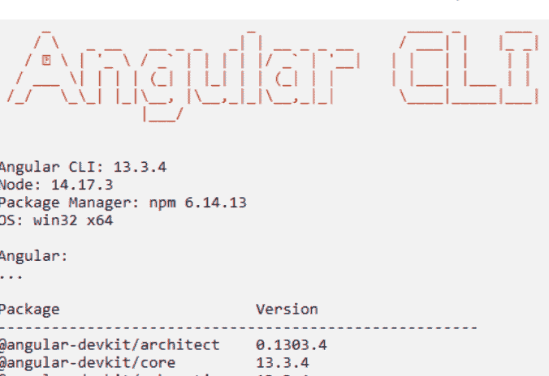

Figure 10.1 – Installed version of the Angular CLI

在前面的输出中，我们可以看到在执行 ng -- version 命令后，显示了您机器上安装的 Angular CLI 和 Node.js 的版本。目前，我们安装了 Angular CLI 版本 13，这意味着一旦我们搭建 Angular 项目，它将是版本 13。

成功安装 Angular CLI 后，我们现在可以为我们的项目执行多个命令。以下是我们可以在 Angular CLI 中使用的一些命令：

- ng new <project name> [options]: 创建或搭建新的 Angular 项目
- ng serve <project> [options]: 构建并提供您的 Angular 应用程序
- ng generate <schematic> [options]: 使用特定 schematic 生成和修改文件
  我们可以生成的一些 schematics 如下：
  - Component
  - Module
  - Directive
  - Guard
- ng build<project> [options]: 将 Angular 应用程序编译到名为 dist 的输出目录中，这将用于生产
- ng test <project> [options]: 在 Angular 项目中运行单元测试

这些只是 Angular CLI 中最常用的一些命令。有关完整命令，您可以访问 Angular 的文档 https://angular.io/cli。

我们知道了可以在 Angular CLI 中使用的命令。现在，让我们通过在所需路径上执行 ng new superheroes 命令来生成我们的 Angular 项目。这将询问一些问题，例如“您想添加 Angular 路由吗？”和“您想使用哪种样式表格式？”我们可以在这些问题中选择 Yes 和 Syntactically Awesome Style Sheet (SASS)，因为我们需要路由和 SASS 来构建我们的应用程序。

完成此步骤后，这将搭建一个名为 superheroes 的新 Angular 项目，并负责配置 web pack、创建所需设置并下载项目的依赖项。搭建完成后，在 Visual Studio Code 或您喜欢的任何 IDE 中打开 superheroes 项目。我们将看到 Angular 应用程序已配置好，可以在我们的本地服务器上运行。


Figure 10.2 – Folder structure and dependencies installed after scaffolding

要运行我们的项目，我们可以按 Ctrl + ` 快捷键打开 VS Code 终端并执行 ng serve 命令。我们也可以使用 package.json 文件中定义的脚本。在这种情况下，我们可以执行 npm run start 来运行我们的应用程序。我们将在以下截图的终端中看到 Angular 是否在我们的本地服务器上成功运行：

```
{
  "name": "superheroes",
  "version": "0.0.0",
  "scripts": {
    "ng": "ng",
    "start": "ng serve",
    "build": "ng build",
    "watch": "ng build --watch --configuration development",
    "test": "ng test"
  },
  "private": true,
  "dependencies": {
    "@angular/animations": "~13.3.0",
    "@angular/common": "~13.3.0",
    "@angular/compiler": "~13.3.0",
    "@angular/core": "~13.3.0",
    "@angular/forms": "~13.3.0",
    "@angular/platform-browser": "~13.3.0",
    "@angular/platform-browser-dynamic": "~13.3.0",
    "@angular/router": "~13.3.0",
    "rxjs": "~7.5.0",
    "tslib": "^2.3.0",
    "zone.js": "~0.11.4"
  },
  "devDependencies": {
    "@angular-devkit/build-angular": "~13.3.4",
    "@angular/cli": "~13.3.4",
    "@angular/compiler-cli": "~13.3.0",
    "@types/jasmine": "~3.10.0",
    "@types/node": "~12.11.1",
    "jasmine-core": "~4.0.0",
    "karma": "~6.3.0",
    "karma-chrome-launcher": "~3.1.0",
    "karma-coverage": "~2.1.0",
    "karma-jasmine": "~4.0.0",
    "karma-jasmine-html-reporter": "~1.7.0",
    "typescript": "~4.6.2"
  }
}
```

```
> ng serve

✓ Browser application bundle generation complete.

Initial Chunk Files   | Names      | Raw Size
vendor.js             | vendor     | 1.97 MB |
polyfills.js          | polyfills  | 294.85 kB |
styles.css, styles.js | styles     | 173.69 kB |
main.js               | main       | 50.13 kB |
runtime.js            | runtime    | 6.52 kB |
                      | Initial Total | 2.49 MB

Build at: 2022-05-01T06:57:57.874Z - Hash: 5cb655001d470ea8 - Time: 3719ms

** Angular Live Development Server is listening on localhost:4200, open your browser on http://localhost:4200/ **

✓ Compiled successfully.
```

Figure 10.3 – Folder structure and dependencies installed after scaffolding

在成功运行我们的 Angular 应用程序后，我们现在可以使用默认 URL（http://localhost:4200）在浏览器中打开该应用，并将看到我们 Angular 项目的默认页面：

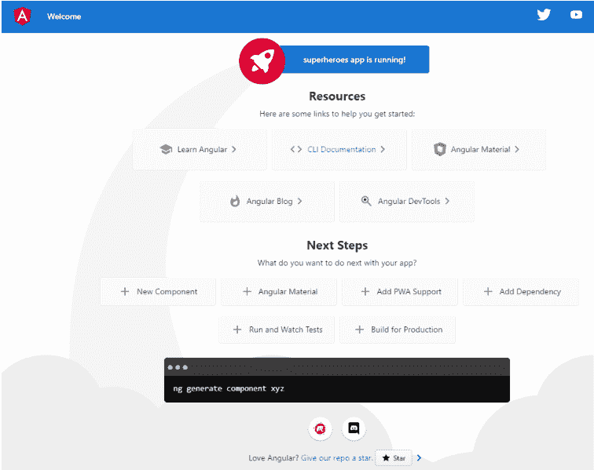

Figure 10.4 – Angular default page

我们已成功在本地配置并启动了 Angular 应用程序。现在，让我们讨论构建应用程序时将使用的概念。

## Angular features

Angular 框架是一个基于组件的框架，允许我们开发可重用的组件以促进代码的可重用性和可维护性。它提供了许多功能，使我们的前端开发更加强大。在本节中，我们将讨论 Angular 的基本特性和基础知识，它们是其构建块；请注意，我们不会在这里讨论所有功能，因为我们将更侧重于项目的组织。

要了解更多关于特性的信息，您可以访问 Angular 的官方文档：https://angular.io/start。

### Components

组件是 Angular 中的主要构建块。它们负责定义视图的行为和外观。组件使用 @Component 装饰器进行注解，该装饰器分配多种类型的元数据，描述组件的 HTML、CSS 和选择器。

以下是生成组件的命令：

```
ng generate component <component-name>
ng g c <component-name>
```

以下是一个组件的代码示例：

```
import { Component } from '@angular/core';

@Component({
  selector: 'app-root',
  templateUrl: './app.component.html',
  styleUrls: ['./app.component.scss']
})
export class AppComponent {
  title = 'superheroes';
}
```

组件具有一个称为数据绑定的功能，允许我们将数据传递到视图中。数据绑定可用于向用户显示值、响应用户事件以及修改样式。Angular 绑定分为两组：

- One-way binding
- Two-way binding

### One-way binding

顾名思义，这里的数据只在一个方向流动。它可以从组件到视图或反之亦然。

在 Angular 中实现单向绑定的方法有几种，最常见的两种方法是使用插值和属性绑定。

#### Interpolation

**Interpolation** 是一种单向绑定技术，允许我们在 HTML 中的字符串字面量中显示表达式。插值使用 {{ }}（双大括号）在 HTML 代码中表示表达式。

让我们看一下以下示例代码：

```
// app.component.ts
export class AppComponent {
    title = 'superheroes';
}

<!--app.component.html -->
<!-- INTERPOLATE TITLE -->
<span> Title: {{title}} </span>
```

在前面的示例中，我们使用插值在视图中显示 title 变量的值。使用插值，我们还可以在模板表达式中使用运算符。

#### Property binding

**Property binding** 允许我们在组件中绑定 HTML 元素属性。由于我们绑定了 HTML 元素属性，当绑定值发生变化时，视图也会发生变化。我们可以绑定到 HTML 元素属性，如 class、href、disabled 和 src。

让我们看一下如何使用属性绑定的示例代码：

```
// app.component.ts
export class AppComponent {
    isDisabled = true;
}

<!--app.component.html -->
<button [disabled]="isDisabled">Can't be clicked</button>
```

在前面的示例中，我们将 isDisabled 变量绑定到按钮的 disabled 属性。由于我们将 isDisabled 的值设置为 true，按钮将被禁用。

### Two-way binding

**Two-way binding** 是一种双向数据流。模型所做的任何更改都会同时反映在视图中，视图中的任何修改都会更新到组件中。双向数据绑定有助于处理表单，因为我们希望模型在表单值更新时得到更新，反之亦然。

要实现双向绑定，使用 ngModel 指令。

#### ngModel

ngModel 是一个用于在 Angular 中实现双向绑定的指令。它属于 @angular/forms 中的 Forms 模块。ngModel 一旦绑定到输入字段或其他表单元素，就会为该元素提供属性绑定和事件绑定。让我们看一下以下示例代码：

```
// app.component.ts
export class AppComponent {
  model = 'seiji';
}

<!--app.component.html -->
<input [(ngModel)]="model"/>
```

在前面的示例代码中，我们使用 ngModel 指令将 model 值绑定到输入元素。这种语法也被称为香蕉盒，它用方括号和圆括号将 ngModel 包裹起来。该指令将使用属性绑定将模型的值与输入字段绑定，并利用 ngModelChange 监听输入值变化。

### Directives

**Directives** 是 Angular 的一个功能，帮助我们操作 **Document Object Model (DOM)**。我们可以修改 DOM 元素的布局、行为和视图。指令分为三类：**components** 是其中一类，另外两类是 **attribute** 和 **structural** 指令。

#### Structural directives

**Structural directives** 是可以修改 DOM 布局的指令，通过添加、更新或删除元素，下面列出了 Angular 中的一些结构指令：

- *ngIf: 一个用于根据条件在 DOM 中添加或删除元素的指令：

```
<div *ngIf="condition">Will show if the condition is true</div>
```

- *ngFor: 一个用于从特定列表中迭代的项目重复 HTML 元素的指令：

```
// this will display all the users for each row
<tr *ngFor="let user of users;">
    <td>{{user.firstName }}</td>
    <td>{{user.lastName}}</td>
</tr>
```

- *ngSwitch: 一个允许我们使用 switch case 机制添加或删除 HTML 元素的指令。如果提供的表达式匹配，HTML 元素将被显示：

```
//evaluates the hero variable and displays the name of
the hero base on its value
<div [ngSwitch]="hero">
    <div *ngSwitchCase="'Dr. Strange'">
        Stephen Strange</div>
    <div *ngSwitchCase="'Hawkeye'">Clint Barton</div>
    <div *ngSwitchCase="'Hulk'">Bruce Banner</div>
</div>
```

#### Attribute directives

属性指令是用于更改或修改元素外观或行为的指令。与结构指令相比，属性指令不能在 DOM 中添加或删除元素。

以下是 Angular 中一些属性指令：

- ngClass: 一个用于向 HTML 元素添加 CSS 类或从中移除的指令；这使我们能够动态更改元素的外观：

```
//adds an error class on the input element if the
//control value is invalid
<input type="text" [ngClass]="control.isInvalid ?
'error': ''" />
```

- ngStyle: 一个允许我们更改 HTML 元素样式的指令：

```
// the color of the element will base on the value of
// the color variable
<div [ngStyle]="{'color': color}"> Angular Framework </
div>
```


## 模块

**模块**是 Angular 框架的基本特性之一。随着我们的应用变得越来越复杂，它将由大量组件、指令和服务组成的大型代码块构成。这将影响应用代码库的可维护性。Angular 框架提供了一种组织和分组代码块的方式，称为模块。

Angular 框架中的模块帮助我们开发应用，并促进关注点分离。它们使我们能够根据功能对代码块进行分类和组织。Angular 本身也是使用模块构建的；`@angular/core` 框架是主要的 Angular 模块，它提供了 Angular 的核心功能和服务。

### 创建模块

我们将使用 `@NgModule` 装饰器来创建一个模块。它由多种类型的元数据组成，这些元数据使我们能够定义所创建模块中包含的组件、服务、管道和其他模块。

下面的示例代码展示了模块可用的属性：

```
@NgModule({
  declarations: [],
  imports: [],
  providers: [],
  exports: [],
  bootstrap: [],
  entrycomponents: []
})
```

现在让我们讨论每个属性的功能：

- **声明（Declarations）**：这是放置应用组件、指令和管道的地方。请记住，组件、指令和管道必须只在一个模块中声明。
- **提供者（Providers）**：这是放置服务的地方，以便它们可用于依赖注入。
- **导入（Imports）**：这是放置应用中的一个或多个其他模块的地方。一旦我们导入某个特定模块，导入模块中的所有组件、管道和指令都可以使用。
- **导出（Exports）**：这是放置组件、指令和管道的地方，以便在导入后可供其他模块使用。
- **引导（Bootstrap）**：这是放置模块主组件的地方。Bootstrap 属性主要用于 Angular 应用的根模块（`AppModule`），因为根模块的职责是在应用启动时加载第一个视图。

- **入口组件（Entry components）**：这是放置应用中应动态加载的组件的地方。

下图展示了 NgModule 在 Angular 应用中的工作方式：

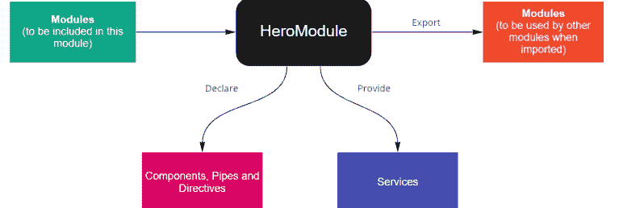

图 10.5 – Angular 模块的流程图

### 服务与依赖注入

**服务**也是 Angular 的宝贵特性之一。它是在应用的不同组件中可以重复使用的代码。

服务的主要职责如下：

- 在不同组件中复用逻辑
- 实现 API 通信和数据访问
- 促进单一职责，因为它将组件的独立功能分离开来

要在应用中创建服务，我们将创建一个类，并使用 @Injectable 装饰器对其进行注解。要在应用的根级别注册服务，我们将在 @Injectable 装饰器中添加以下内容：

```
@Injectable({
  providedIn: 'root',
})
```

一旦我们在根级别设置了 providedIn 元数据的值，这将在整个应用中创建该服务的单个共享实例。另一方面，如果我们想在特定模块中提供服务，我们将把服务放在 @NgModule 的 providers 元数据中：

```
@NgModule({
  providers: [Service1]
})
```

既然我们已经讨论了 Angular 的一些基本特性，接下来我们将重点讨论如何构建 Angular 应用的结构。

### 创建 Angular 文件夹结构

Angular 框架被视为一个 MVW 框架，这意味着我们的应用有许多可能的结构方式。在这里，我们将讨论一种最佳实践或最常用的结构，它可以帮助你的 Angular 应用具有可扩展性和可维护性。

在前一部分中，我们了解到 Angular 代码块可以分组并组织到模块中；模块是构建 Angular 应用结构的一个很好的起点。我们可以实施的第一步是根据功能对模块进行分组和分类。下面列出的是我们的模块分类。

### 根模块

**根**模块是应用的主模块。这是 Angular 应用启动时加载的第一个模块。当我们搭建一个名为 `AppModule` 的 Angular 应用时，根模块会自动生成，并位于 `src/app` 文件夹下。

### 特性模块

**特性**模块是我们放置应用特定功能模块的地方。这意味着我们代码使用的大部分内容都在这个模块中。我们将在模块下创建组件、管道和指令，还可以通过将带有路由的组件放在页面文件夹中来分离组件。

让我们来看一个名为 `AntiHeroModule` 的特性模块的示例文件夹结构：

```
src
├─ app
│  ├─ anti-hero
│  │  ├─ components
│  │  │  ├─ shared.component.ts
│  │  ├─ directives
│  │  │  ├─ first.directive.ts
│  │  │  ├─ another.directive.ts
│  │  ├─ pages
│  │  │  ├─ form
│  │  │  │  ├─ form.component.ts
│  │  │  ├─ list
│  │  │  │  ├─ list.component.ts
│  │  │  ├─ anti-hero.component.ts
│  │  │  ├─ anti-hero.component.html
│  │  │  ├─ anti-hero.component.css
│  │  │  ├─ index.ts
│  │  ├─ pipes
│  │  │  ├─ first.pipe.ts
│  │  ├─ anti-hero.module.ts
│  │  ├─ anti-hero.routing.module.ts
│  │  ├─ index.ts
```

在这里的文件夹结构中，我们将 anti-hero 模块分成了几个部分。第一个文件夹是 components 文件夹，它包含此模块中共享的所有组件。这些也可以称为哑组件（dumb components），我们将在下一节讨论。

接下来的两个是 directives 和 pipes 文件夹，它们包含 AntiHeroModule 中使用的指令和管道。最后，pages 文件夹包含 AntiHeroModule 中具有直接路由的组件。这些也可以称为智能组件（smart components）。我们还包含了 index.ts 文件，即 barrel 文件，它将为导出组件、指令和管道提供一个集中的位置。

### 共享模块

共享模块是在整个应用中使用和共享的模块；它由我们在应用不同部分需要使用的组件、管道和指令组成。请记住，共享模块不应依赖应用中的其他模块。

共享模块创建在 src/app/shared 文件夹下。

让我们看一下应用中共享模块的示例文件夹结构：

```
|— src
| |— app
| | |— shared
| | | |— layout
| | | | |— footer
| | | | | |— footer.component.ts
| | | | | |— footer.component.html
| | | | |— header
| | | | | |— header.component.ts
| | | | | |— header.component.html
| | | | |— layout.module.ts
| | | |— index.ts
```

### 特性模块下的代码块

我们想要在特性模块下创建代码块；首先需要搭建的是 AntiHeroModule。执行 ng g m anti-hero 命令，在 src/app 文件夹下生成该模块。

现在，在 anti-hero 文件夹下，我们将创建以下文件夹：

- components：将包含在此模块中共享的组件。
- pipes：将包含 anti-hero 模块使用的所有管道。
- directives：将包含 anti-hero 模块将使用的所有指令。
- pages：将包含具有直接路由的组件。

创建完这些文件夹后，我们现在将为 anti-hero 模块创建页面组件。我们将添加两个页面，第一个页面用于显示 anti-hero 列表，第二个页面是一个表单，允许我们查看、创建或修改列表中所选英雄。我们可以执行 ng g c anti-hero/pages/pages/form 和 ng g c anti-hero/pages/list 命令来创建这两个页面。这将在 pages 文件夹下创建两个新组件：form 和 list。

成功创建页面组件后，我们还将为 anti-hero 模块添加一个路由模块。我们将执行 ng g m anti-hero/anti-hero-routing --flat 命令，并将以下代码放入路由模块中：

```
import {NgModule} from "@angular/core";
import {RouterModule, Routes} from "@angular/router";
import {ListComponent} from "./pages/list/list.component";
import {FormComponent} from "./pages/form/form.component";

const routes: Routes = [
  {
    path: "",
    component: ListComponent,
  },
  {
    path: "form",
    component: FormComponent,
  },
];
@NgModule({
```


```
declarations: [ListComponent, FormComponent],
imports: [RouterModule.forChild(routes)],
exports: [RouterModule]
})
export class AntiHeroRoutingModule {}
```

在前面的示例代码中，我们为表单和列表页面定义了路由。这意味着页面组件将在我们的应用程序中拥有直接路由，并且我们还将 ListComponent 定义为此模块的基础路由。

在成功创建页面组件并定义路由后，我们希望根模块（AppModule）拥有 AntiHeroModule 的路由。

为实现此目的，我们将在 app-routing.module.ts 中放置以下代码：

```
import { NgModule } from '@angular/core';
import { RouterModule, Routes } from '@angular/router';
const routes: Routes = [
  {
    path: "",
    redirectTo: "anti-heroes",
    pathMatch: "full",
  },
  {
    path: "anti-heroes",
    loadChildren: () =>
      import("./anti-hero/anti-hero.module").then((m) =>
        m.AntiHeroModule),
  }
];
@NgModule({
  imports: [RouterModule.forRoot(routes)],
})
export class AppRoutingModule { }
```

在前面的示例代码中，我们使用懒加载为 AntiHeroModule 创建了一个路由。一旦我们访问 {baseUrl}/anti-heroes URL，这将加载 AntiHeroModule 并重定向到基础路由，即 ListComponent。我们还使用了 RouterModule.forRoot() 来导入路由，因为这是根模块。

在成功为 AppModule 定义路由后，我们现在可以看到应用程序的当前结构：

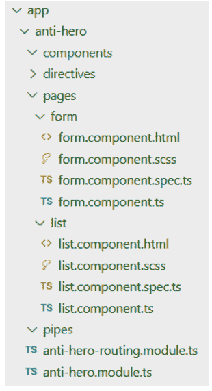

图 10.6 – 创建 anti-hero 功能后的文件夹结构

现在我们已经在 Angular 中完成了功能模块，我们只有 pages 文件夹。我们将在开发应用程序时稍后添加其他块，例如组件和指令。下一步是创建共享模块。

## 共享模块下的块

现在，我们下一个目标是在共享模块下创建块。我们将共享模块定义为在整个应用程序中共享的组件、指令和管道，并且不得依赖于其他模块。为创建我们的共享模块，我们将执行 ng g m shared 命令。这将在新的 shared 文件夹中创建一个新的 shared 文件夹和模块文件。

现在在完成共享模块后，我们可以生成将被归类到此模块中的块。在我们的应用程序中，我们可以将 navbar 和 footer 作为共享组件包含在内，因为它们将在应用程序的每个部分中使用。

我们将执行 ng g c shared/layout/navbar 和 ng g c shared/layout/footer 命令来搭建 navbar 和 footer。我们可以看到 FooterComponent 和 NavbarComponent 已自动添加到 shared.module.ts 文件中，因为 Angular 检测到最接近组件的模块：

```
@NgModule({
  declarations: [
    NavbarComponent,
    FooterComponent
  ],
  imports: [CommonModule]
})
export class SharedModule { }
```

请记住在 NgModule 的 exports 元数据中添加 navbar 和 footer 组件，并且我们将在不同模块中导入共享模块：

```
@NgModule({
  declarations: [
    NavbarComponent,
    FooterComponent
  ],
  exports: [NavbarComponent, FooterComponent]
  imports: [CommonModule]
})
```

我们也可以通过执行 ng g c shared/directive/directive-name 和 ng g c shared/pipes/pipe-name 命令根据应用程序的需求在 shared 文件夹下添加共享指令和管道。在成功创建块后，我们将具有以下文件夹结构：

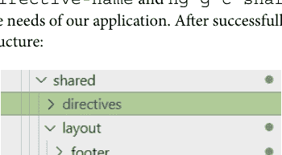

图 10.7 – 创建共享模块后的文件夹结构

我们还必须记住，共享模块不需要路由模块，因为它没有需要在应用程序中路由的组件。

## 核心模块下的块

我们需要创建的最后一个模块是核心模块。核心模块是我们共享在整个应用程序中的服务，并且它们只有一个实例。总是进入核心模块的一个服务是身份验证服务。

为创建我们的共享模块，我们将在完成核心模块后执行 ng g m core; 命令。我们将通过运行 ng g s core/services/authenticate 命令来搭建 authenticate 服务。

在成功创建 authenticate 服务后，我们将在 core.module.ts 文件下提供它以将服务包含在模块中。我们也可以根据应用程序的需求通过添加 models 文件夹在核心模块下添加共享模型。现在，我们具有以下文件夹结构：

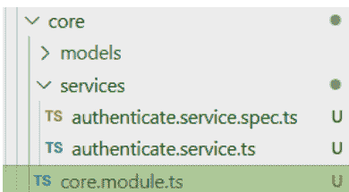

图 10.8 – 创建共享模块后的文件夹结构

我们将在开发应用程序的过程中制作 authenticate 服务的内容，但现在我们已经创建了 Angular 应用程序的基础结构，我们将使用此结构来构建项目的其他部分。现在，我们将讨论如何在 Angular 中构建组件的结构。

## 构建组件

我们已经通过根据其使用和功能对模块进行分类来构建 Angular 应用程序，这将有利于代码重用和可维护性。然而，在特定模块下可能仍会创建大量组件，这将进一步提高应用程序的可维护性。在本节中，我们将讨论在组件级别构建 Angular 架构的另一种策略。

## 智能和哑或展示组件

构建 Angular 应用程序最常见且推荐的 **组件级架构** 是智能和哑组件架构。在上一节中，我们根据在应用程序中使用的方式将模块拆分为不同的类别。

此架构也提供了相同的概念。我们将组件分为两种类型——即 **智能组件** 和 **哑** 或 **展示组件**。

让我们讨论每种组件类型的特征。

### 智能组件

**智能组件** 也称为应用程序级组件或容器组件。这些组件的主要职责是与服务通信并从请求中消费数据。由于它们很智能，它们包含获取应用程序数据的所有依赖项和订阅。

智能组件可以被视为在我们的应用程序中具有直接路由的页面组件，并且它们是持有哑组件的父组件。让我们看一下创建智能组件的以下示例代码：

```
@Component({
  selector: 'app-home',
  template: `
    <h2>User List</h2>
    <div>
      <table class="table">
        <tbody>
          <tr (click)="selectUser(user)" *ngFor="let user of users">
            <td>{{user.firstName}}</td>
            <td>
              <span>{{user.lastName}}</span>
            </td>
          </tr>
        </tbody>
      </table>
    </div>
  `,
  styleUrls: ['./home.component.css']
}
```

```
})
export class HomeComponent implements OnInit {
  users: User[] = [];
  constructor(private userService: UserService) {
  }
  ngOnInit() {
    this.userService.getUsers()
      .subscribe(users => this.users = users);
  }
  selectUser(user: User) {
    // action
  }
}
```

在前面的示例代码中，我们创建了一个名为 HomeComponent 的组件，它将在表格中显示用户列表。我们还注入了 UserService 来从 HTTP 请求中获取用户。我们知道此组件将成功显示用户，但我们可以看出我们的模板很庞大，并且随着我们向此组件添加更多功能，它可能会变得过于复杂。

我们想要做的是省略仅用于展示目的的元素。在此场景中，我们希望从 HomeComponent 中移除表格，并且我们将具有以下代码：

```
@Component({
  selector: 'app-home',
  template: `
    <h2>User List</h2>
    <div>
      <!--we will place that dumb component here later-->
    </div>
  `,
  styleUrls: ['./home.component.css']
})
export class HomeComponent implements OnInit {
  users: User[] = [];
  constructor(private userService: UserService) {
  }
  ngOnInit() {
    this.userService.getUsers()
```


```
.subscribe(users => this.users = users);
}
selectUser(user: User) {
    // action
}
}
```

在前面的重构代码中，我们移除了显示用户列表的表格。我们只希望智能组件处理依赖注入、订阅和操作。我们现在已经成功创建了智能组件，下一步是创建展示组件。

## Dumb or presentation components

**Dumb components**，也称为展示组件，负责在应用中显示数据。它们不应有依赖和订阅，因为它们的唯一目的是在视图中呈现数据。

让我们创建之前省略的表格作为一个 dumb 组件：

```
@Component({
  selector: 'users-list',
  template: `
    <table class="table">
      <tbody>
        <tr (click)="selectUser(user)" *ngFor="let user of users">
          <td>{{user.firstName}}</td>
          <td>
            <span>{{user.lastName}}</span>
          </td>
        </tr>
      </tbody>
    </table>
  `,
  styleUrls: ['./users-list.component.css']
})
export class UsersListComponent {
  @Input()
  users: User[];
```

```
```typescript
@Output('user')
userEmitter = new EventEmitter<User>();
  selectUser(user:User) {
        this.userEmitter.emit(user);
  }
}
```
```

在前面的示例代码中，我们为显示用户列表的表格创建了一个单独的组件。由于 dumb 组件没有注入依赖，组件将需要从智能组件接收数据。为此，我们添加了一个 @Input 绑定属性来从 HomeComponent 接收用户列表；另一方面，我们还添加了一个 @Output 绑定属性将操作冒泡到父组件或智能组件。

记住 dumb 组件必须没有任何逻辑或操作；在这种情况下，我们将使用 EventEmitter 在父组件中传递事件，并且父组件将负责需要完成的步骤。在示例代码中，一旦点击一行，我们就会将用户传递给 userEmitter，而 HomeComponent 将检索它。

成功创建 UserListComponent 后，我们现在可以在 HomeComponent 中使用它，并且我们将有以下代码：

```
```typescript
@Component({
  selector: 'app-home',
  template: `
    <h2>User List</h2>
    <div>
        <users-list users="users"
          (user)="selectUser($event)"/>
    </div>
  `,
  styleUrls: ['./home.component.css']
})
export class HomeComponent implements OnInit {
  users: User[] = [];
  constructor(private userService: UserService) {
  }
  ngOnInit() {
      this.userService.getUsers()
```

```
.subscribe(users => this.users = users);
}
selectUser(user: User) {
    // action
}
}
```

在前面的示例代码中，我们可以看到我们已将 UsersListComponent 用作 HomeComponent 的子组件。它接受由 HomeComponent 检索的用户列表，并在点击特定行时发出事件。至此，我们已完成对智能组件和 dumb 组件概念的讨论。

## Implementing smart and dumb components in the project

让我们现在在我们的 Angular 项目中实现智能和 dumb 组件架构。我们将在 AntiHeroModule 下创建我们的组件。我们已经制作了我们的智能组件，这些是 pages 文件夹中的表单和列表组件。

我们始终将智能组件放在 pages 文件夹中，因为这些将是我们应用中的容器组件。下一步是创建我们的 dumb 组件。我们将创建两个 dumb 组件，即 anti-hero-form 和 anti-hero-list 组件。要创建组件，执行 ng g c anti-hero/components/anti-hero-form anti-hero/components anti-hero-list 命令。成功生成两个 dumb 组件后，让我们放置以下代码。

对于 AntiHeroListComponent，我们将把以下代码放入 anti-hero-list.component.html 文件中：

```
<table>
    <thead>
        <th *ngFor="let item of headers">{{item.headerName}}</th>
    </thead>
    <tbody>
        <tr (click)="selectAntiHero(item)" *ngFor ="let item of antiHeroes">
            <ng-container *ngFor="let header of headers">
                <td>{{item[header.fieldName]}}</td>
            </ng-container>

</tr>
</tbody>
</table>
```

在前面的 HTML 代码中，我们创建了一个表格，其中标题和项目绑定到 antiHeroes 变量。我们还绑定了标题和反英雄的键值以动态显示值。

现在，让我们在 AntiHeroList 组件中添加接收和发出数据的属性：

### anti-hero-list.component.ts

```
export class AntiHeroListComponent implements OnInit {
  @Input() headers: Array<{headerName: string, fieldName: keyof AntiHero}> = [];
  @Input() antiHeroes: Array<AntiHero> = [];
  @Output() antiHero = new EventEmitter();

  constructor() { }
  ngOnInit(): void {
  }
  selectAntiHero(antiHero: AntiHero) {
    this.antiHero.emit(antiHero);
  }
}
```

现在，在反英雄组件的 TypeScript 文件中，我们定义了三个属性，这些属性是我们 dumb 组件从智能组件接收数据并向其发出事件所必需的。

第一个属性是 headers 属性，它具有 @Input 注解。这将获取 {headerName: string, fieldName: keyof AntiHero} 类型的数组，该数组将被迭代以显示列标题并显示每个反英雄项目的字段值。第二个属性是 antiHeroes，它也具有 @Input 注解。这将接受要显示在每一行中的反英雄列表，最后是 antiHero 属性，它用 @Output 注解。这会在用户点击单行时将选定的反英雄发出到父组件。

我们还在 anti-hero/models/anti-hero.interface.ts 中添加了一个名为 AntiHero 的接口，该接口将用于转换对象类型。

我们将有以下接口代码：

```
export interface AntiHero {
    firstName: string;
    lastName: string;
    house: string;
    kownAs: string;
}
```

在前面的代码示例中，我们创建了一个 AntiHero 接口，它将用作我们对象的蓝图。反英雄对象的属性与我们在 Spring 应用中定义的属性相同。

在为我们的对象创建接口后，我们现在将在 AntiHeroModule 中声明并导入我们的组件和模块。

让我们看一下以下代码：

### anti-hero.module.ts

```
@NgModule({
  declarations: [
    AntiHeroListComponent,
    AntiHeroFormComponent,
    ListComponent,
    FormComponent
  ],
  imports: [
    CommonModule,
    AntiHeroRoutingModule,
  ]
})
export class AntiHeroModule { }
```

在我们的 anti-hero.module.ts 文件中，我们希望确保我们的智能组件和 dumb 组件都被声明；否则，我们在编译时会遇到错误。我们还希望检查是否已导入 AntiHeroRoutingModule 以使用路由。

让我们现在添加额外的样式以改善应用的用户界面。让我们看一下以下代码：

### anti-hero-list.component.scss

```
```scss
table, th, td {
    border: 1px solid;
    border-collapse: collapse;
    border: 1px solid;
}
```
```

我们还在组件中添加了简单的 CSS 代码来设置表格样式。现在，我们已成功创建了 AntiHeroListComponent。下一步是在 ListComponent 页面上使用此展示组件。让我们看一下以下代码示例：

```
```typescript
export class ListComponent implements OnInit {
  // sample data of anti-hero
  antiHeroes: AntiHero[] = [
    {
      firstName: "Eddie",
      lastName: "Brock",
      house: "New York",
      knownAs: "Venom"
    }
  ]
  headers: {headerName: string, fieldName: keyof
      AntiHero}[] = [
    {headerName: "First Name", fieldName: "firstName"},
    {headerName: "Last Name", fieldName: "lastName"},
    {headerName: "House", fieldName: "house"},
    {headerName: "Known As", fieldName: "knownAs"},
  ]
  constructor() { }
  ngOnInit(): void {
  }
  selectAntiHero(antiHero: AntiHero) { }
}
```


在 ListComponent 的 TypeScript 文件中，我们创建了 `headers` 的定义，以及一个用于反英雄列表显示的 `antiHeroes` 示例列表。这只是临时性的，因为我们只是想测试展示组件能否成功显示反英雄列表。我们还创建了 `selectAntiHero()` 函数，以便将来在选中某个特定反英雄时实现相应功能。

现在让我们为 AntiHeroList 定义输入和输出属性。让我们看看下面的代码：

## anti-hero-list.component.html

```
<!-- Dumb component anti hero list -->
<app-anti-hero-list [antiHeroes]="antiHeroes" [headers]="headers" (antiHero)="selectAntiHero($event)"></app-anti-hero-list>
```

现在，在 ListComponent 的 HTML 文件中，我们已将 `headers` 和 `antiHeroes` 绑定到 `app-anti-hero-list` 的属性上。我们还使用了 `selectAntiHero()` 函数，以便在 `antiHero` 发出操作时捕获该事件。

成功实现我们的展示组件后，我们可以运行应用程序并在浏览器中打开它。我们应该会看到以下结果：

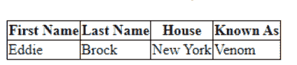

从结果中我们可以看到，展示组件已成功显示了来自父组件的数据。至于表单组件，我们将在下一章中实现其功能，因为创建表单将是另一个不同的话题。

现在，我们已经了解了智能组件和哑组件的概念、结构和实现。在下一节中，我们将使用一个 UI 框架来帮助我们改进 Angular 应用程序的界面。

## 添加 Angular Material

我们已经使用模块级别的核心、功能和共享架构，以及组件级别的智能组件和哑组件架构，对 Angular 应用程序进行了组织。现在，我们准备通过为组件设置样式来自定义和改进外观与 UI。我们都知道，从零开始编写 CSS 代码并开发基础样式对我们开发人员来说是另一个挑战。除了操心代码的逻辑层面之外，这还会给我们带来额外的负担。而 Angular Material 正是大显身手的地方！

**Angular Material** 是由 Google 创建的一个库，为 Angular 应用程序提供了丰富的 UI 组件，例如表格、卡片、输入框和日期选择器。这意味着我们不必从头开始为组件设置样式，因为 Material 库中的组件列表已经可以直接使用。

Angular Material 在底层提供了大量且不断增长的组件。它提供了包含这些组件的模块，这些组件可用于 Angular 应用程序，并可导入到特定的应用程序模块中；这些组件是可复用的，并且由于内置了许多可供我们使用的属性，因此它们在外观和交互体验方面易于定制。

让我们在 Angular 项目中配置 Angular Material。

## 配置 Angular Material

Angular Material 在 Angular 项目中配置起来很简单，因为它提供了一个 schematic，只需一条命令即可安装 Angular Material 的所有依赖项。要安装 Angular Material，我们将执行以下命令：

```
ng add @angular/material
```

执行该命令后，在安装资源之前它会询问一些问题：

+   - **选择预构建主题名称，或选择“custom”作为自定义主题：** Angular Material 提供了预构建主题，你也可以配置自己的自定义主题。
+   - **设置全局 Angular Material 排版样式：** 选择“是”将应用 Angular Material 的全局排版。
+   - **为 Angular Material 设置浏览器动画：** 选择“是”将在我们的根模块中安装 `BrowserAnimationsModule`。当我们想要使用 Angular Material 的动画时，这很重要。

回答完所有问题后，它现在将安装 Angular Material。这将为我们的项目执行以下操作：

+   1. 将依赖项（`@angular/material` 和 `@angular/cdk`）添加到 `package.json`。
+   2. 将 Roboto 字体添加到 `index.html` 文件：
+   3. 将 Material Design 图标字体添加到 `index.html` 文件：

```
<link href="https://fonts.googleapis.com/css2?family=Roboto:wght@300;400;500&display=swap" rel="stylesheet">
```

```
<link href="https://fonts.googleapis.com/icon?family=Material+Icons" rel="stylesheet">
```

+   4. 添加以下 CSS 样式：
+     - 将 `html` 和 `body` 的高度设置为 100%
+     - 将 Roboto 设置为默认字体
+     - 移除 `body` 的外边距：

```
html, body { height: 100%; }
body { margin: 0; font-family: Roboto, "Helvetica Neue", sans-serif; }
```

在我们的应用程序中成功安装 Angular Material 后，我们现在就可以在应用程序中使用这些组件了。

## 实现 Angular Material

我们现在将在 Angular 项目中实现 Angular Material 组件。正如我们之前提到的，Angular Material 提供了大量可用于构建应用程序的组件。在这个示例项目中，我们将只定义应用程序中会使用到的组件。让我们列出将要实现的组件。

### 按钮组件

使用 Material Design 样式增强的原生 `<button>` 或 `<a>` 元素。

我们可以使用以下代码导入按钮组件：

```
import {MatButtonModule} from '@angular/material/button';
```

以下是按钮组件的示例：

```
<div class="example-button-row">
    <button mat-raised-button>Basic</button>
    <button mat-raised-button
        color="primary">Primary</button>
    <button mat-raised-button
        color="accent">Accent</button>
    <button mat-raised-button color="warn">Warn</button>
    <button mat-raised-button disabled>Disabled</button>
    <a mat-raised-button href="
        https://material.angular.io/target=" _blank>Link</a>
</div>
```

在上面的 Material 按钮代码示例中，我们可以看到我们正在使用 Material Design 的内置指令来改变按钮的样式和外观。该示例代码将产生以下输出：

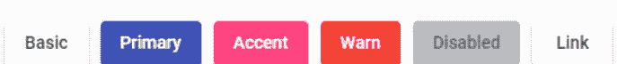

图 10.10 – Material 按钮的示例输出

### 图标组件

该组件允许我们向应用程序添加基于矢量的图标，并且同时支持图标字体和 SVG 图标。

我们可以使用以下代码导入图标组件：

```
import {MatIconModule} from '@angular/material/icon';
```

以下是图标组件的示例：

```
<mat-icon color="primary">delete</mat-icon>
<mat-icon color="accent">fiber_new</mat-icon>
<mat-icon color="warn">pageview</mat-icon>
```

在上面的代码示例中，我们可以使用 `mat-icon` 组件创建图标。它有几个输入属性（例如 `color`），允许我们自定义图标的颜色。该示例代码将产生以下输出：

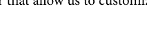

图 10.11 – Material 图标的示例输出

### 表格组件

该组件允许我们添加具有 Material Design 样式的数据表格。Material 表格基于 CDK 数据表格的基础构建。有关如何实现 CDK 数据表格的更多信息，请参阅 https://material.angular.io/cdk/table/overview 上的文档。

我们可以使用以下代码导入表格组件：

```
import {MatTableModule} from '@angular/material/table';
```

以下是表格组件的示例：

```
```html
<table mat-table [dataSource]="data" class="mat-elevation-z8">

  <!-- Position Column -->
  <ng-container matColumnDef="id">
    <th mat-header-cell *matHeaderCellDef> ID </th>
    <td mat-cell *matCellDef="let element">
      {{element.position}} </td>
  </ng-container>

  <!-- Name Column -->
  <ng-container matColumnDef="name">
    <th mat-header-cell *matHeaderCellDef> Name </th>
    <td mat-cell *matCellDef="let element">
      {{element.name}} </td>
  </ng-container>

  <tr mat-header-row *matHeaderRowDef="columns"></tr>
  <tr mat-row *matRowDef="let row; columns: columns;"></tr>
</table>
```
```

在上面的示例中，我们可以看到表格使用了几个属性。第一个属性是 `dataSource` 属性，它将接受要显示的数据列表。下一个属性是 `matColumnDef`，它定义了每一列的字段名，这些字段名应包含在绑定到 `matHeaderRowDef` 属性的 `columns` 变量中。最后，`matHeaderCellDef` 和 `matCellDef` 属性会显示实际的列名和关联值，如下面的截图所示：

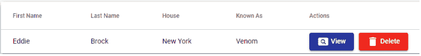

图 10.12 – Material 表格的示例输出

### 工具栏组件

该组件允许我们添加具有 Material Design 样式的工具栏。它通常用作页眉、标题和导航按钮的容器。


我们可以使用以下代码导入工具栏组件：

```typescript
import {MatToolbarModule} from '@angular/material/toolbar';
```

以下是工具栏组件的示例：

```html
<p>
  <mat-toolbar color="primary">
    <button mat-icon-button class="example-icon"
      aria-label="Example icon-button with menu icon">
      <mat-icon>menu</mat-icon>
    </button>
    <span>Angular CRUD</span>
  </mat-toolbar>
</p>
```

在前面的代码示例中，我们使用 mat-toolbar 组件创建了一个工具栏元素。mat-toolbar 组件使用内容投影，允许我们自定义其内容。示例代码将具有以下输出：


Figure 10.13 – Example output for the Material toolbar

## Form field component

此组件允许我们包装 Material 组件以应用文本字段样式，例如下划线、提示消息和浮动标签。以下组件可以在 `<mat-form-field>` 内使用：

- `input matNativeControl>` 和 `<textarea matNativeControl>`: 可以通过添加 `import {MatInputModule} from '@angular/material/input';` 来使用
- `<mat-select>`: 可以通过添加 `import {MatSelectModule} from '@angular/material/select';` 来使用
- `<mat-chip-list>`: 可以通过添加 `import {MatChipsModule} from '@angular/material/chips';` 来使用

以下是表单字段组件的示例：

```html
<p>
  <mat-form-field appearance="legacy">
```

```
<mat-label>Legacy form field</mat-label>
    <input matInput placeholder="Placeholder">
</mat-form-field>
</p>
<p>
    <mat-form-field appearance="standard">
        <mat-label>Standard form field</mat-label>
        <input matInput placeholder="Placeholder">
    </mat-form-field>
</p>
<p>
    <mat-form-field appearance="fill">
        <mat-label>Fill form field</mat-label>
        <input matInput placeholder="Placeholder">
    </mat-form-field>
</p>
<p>
    <mat-form-field appearance="outline">
        <mat-label>Outline form field</mat-label>
        <input matInput placeholder="Placeholder">
    </mat-form-field>
</p>
```

在前面的代码示例中，我们使用 mat-form-field 组件创建了一个工具栏元素。mat-form-field 组件应具有 mat-label 组件及其内容为带有 matInput 指令的输入元素。示例代码将具有以下输出：

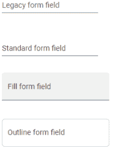

Figure 10.14 – Example output for the Material form field

有关 Angular Material 组件列表的更多信息，请参阅 `https://material.angular.io/components` 处的文档。

现在我们已经列出了将在应用程序中使用的 Material 组件，让我们将 Material Design 应用于我们的组件。

我们需要做的第一步是创建我们的 Material 模块。Material 模块将包含在共享模块中，以便我们可以在整个应用程序中使用 Material 设计组件。要在我们的 Angular 应用程序中生成 Material 模块，我们将执行以下命令：`ng g m material`。成功生成 Material 模块后，我们将添加来自 Angular Material 的必要模块：

```typescript
@NgModule({
  imports: [
    CommonModule,
    MatToolbarModule,
    MatIconModule,
    MatButtonModule,
    MatTableModule,
    MatFormFieldModule,
    MatSelectModule,
    MatInputModule,
  ],
  exports: [
    MatToolbarModule,
    MatIconModule,
    MatButtonModule,
    MatTableModule,
    MatFormFieldModule,
    MatSelectModule,
    MatInputModule,
  ]
})
export class MaterialModule { }
```

我们可以看到在前面的示例中，我们还导出了 Material 模块，因为我们将在应用程序的不同模块中使用它们。

现在我们已经为应用程序导入了所需的模块，让我们转换组件。

## Navbar component

**navbar component** 位于共享模块下。我们将使用工具栏 material 来创建我们的 navbar 组件。要实现此功能，我们将放置以下代码：

```html
<p>
    <mat-toolbar color="primary">
        </button>
        <span>Angular CRUD</span>
    </mat-toolbar>
</p>
```

在前面的示例中，我们使用了 mat-toolbar 元素来使用工具栏 material。我们还可以添加 color 属性来设置工具栏样式并添加其他元素。

我们还需要在 `SharedModule` 下导入 `MaterialModule`，以便它识别 `MatToolbarModule`，它将输出以下内容：


Figure 10.15 – The look of the navbar component after implementing Material

## Anti-hero list component

此组件位于 anti-hero 模块下。我们将使用表格 material 来创建我们的列表组件。要实现此功能，我们将为 `anti-hero-list.component.html` 放置以下代码：

```html
<table mat-table [dataSource]="antiHeroes" class="mat-elevation-z8">

    <!-- Data for columns -->
    <ng-container *ngFor="let item of headers"
        [matColumnDef]="item.fieldName">
        <th mat-header-cell *matHeaderCellDef>
            {{item.headerName}} </th>
        <td mat-cell *matCellDef="let element">
            {{element[item.fieldName]}} </td>
    </ng-container>
    <!-- Actions for specific item -->
```

```
<ng-container matColumnDef="actions">
    <th mat-header-cell *matHeaderCellDef>
        Actions </th>
    <td mat-cell *matCellDef="let element">
        <button (click)="selectAntiHero(element, 0)"
            mat-raised-button color="primary">
            <mat-icon>pageview</mat-icon> View
        </button>
        &nbsp;
        <button (click)="selectAntiHero(element, 1)"
            mat-raised-button color="warn">
            <mat-icon>delete</mat-icon> Delete
        </button>
    </td>
</ng-container>
<tr mat-header-row *matHeaderRowDef="headerFields">
</tr>
<tr mat-row *matRowDef="let row; columns:
    headerFields"></tr>
</table>
```

我们将为 anti-hero-list.component.ts 放置此内容：

```
export class AntiHeroListComponent implements OnInit {
    @Input() headers: Array<{headerName: string, fieldName: keyof AntiHero}> = [];
    @Input() antiHeroes: Array<AntiHero> = [];
    @Output() antiHero = new EventEmitter<{antiHero: AntiHero, action :TableActions}>();
    headerFields: string[] = [];

    ngOnInit(): void {
        this.getHeaderFields();
    }
    getHeaderFields() {
        this.headerFields = this.headers.map((data) =>
            data.fieldName);
    }
```

```
```typescript
this.headerFields.push("actions");
}
selectAntiHero(antiHero: AntHero, action: TableActions) {
  this.antiHero.emit({antiHero, action});
}
}
```
```

在前面的示例代码中，我们仍然在应用程序中使用相同的变量；保存反英雄列表的 `antiHeroes` 变量现在绑定到 `dataSource` 属性，我们还迭代了 `headers` 属性以显示列名及其相关值。最后，我们创建了一个名为 `headerFields` 的新变量，其中包含 `fieldName` 以显示反英雄项目的数值。

我们还需要在 `AntiHeroModule` 下导入 `MaterialModule`，以便它识别 `MatTableModule`，它将具有以下输出：

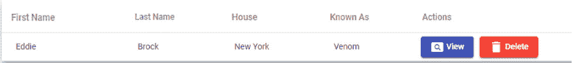

Figure 10.16 – The look of the table component after implementing Material

## Command bar component

我们将在 anti-hero 模块下创建一个新的 dumb 组件。我们将执行 `ng g c anti-hero/components/anti-hero-command-bar` 命令，我们将为 `anti-hero-command-bar.html` 放置以下代码：

```html
<p>
    <mat-toolbar>
        <button mat-raised-button color="primary"
                (click)="emitAction(0)">
            <mat-icon>fiber_new</mat-icon> Create
        </button>
        &nbsp;
        <button mat-raised-button color="warn"
                (click)="emitAction(0)">
            <mat-icon>delete</mat-icon> Delete All
        </button>
    </mat-toolbar>
</p>
```


我们将把以下内容放置到 anti-hero-command-bar.ts 中：

```
export class AntiHeroCommandBarComponent implements OnInit {
  @Output() action = new EventEmitter<CommandBarActions>()
  constructor() { }
  ngOnInit(): void {
  }
  emitAction(action: CommandBarActions) {
    this.action.emit(action);
  }
}
```

在前面的示例代码中，我们还使用了工具栏模块来创建我们的命令栏组件。由于这是一个哑组件，我们应该只将操作发出给其父组件，而不持有任何依赖关系。成功创建命令栏后，我们将得到以下输出：


图 10.17 – 实现 Material 后命令栏组件的外观

现在，我们将通过在以下页面上放置组件来完成应用程序布局：

- app.component.html:

```
<app-navbar></app-navbar>
<div class="container">
  <router-outlet></router-outlet>
</div>
```

- list.component.html:

```
<!--Dumb component command bar →
<app-anti-hero-command-bar>
</app-anti-hero-command-bar>-- Dumb component anti hero list -->
<app-anti-hero-list [antiHero]="antiHeroes"
[header]="headers"></app-anti-hero-list>
```

成功实现上述代码后，我们现在将拥有以下布局：


图 10.18 – 列表组件页面的布局

我们现在已经使用 Material Design 创建了我们的反英雄页面组件。随着后续章节的进行，我们将实现操作按钮和表单组件的功能。

## Summary

至此，本章已结束。让我们回顾一下你学到的宝贵内容；你已学习了 Angular 的概念和基础知识，同时也学会了如何使用 Angular CLI 脚手架搭建 Angular 项目并创建组件、指令和模块。你还学习了一些组织 Angular 组件、模块以及项目其他部分的最佳实践。这对于项目的可维护性尤其有用，特别是对于企业级应用。

在下一章中，我们将学习如何构建 Reactive 表单、基本表单控件以及在 Angular 中分组表单控件。我们还将实现 FormBuilder 并验证表单输入。

## Building Reactive Forms

在上一章中，我们已经学习了如何在模块和组件级别构建 Angular 应用程序，这促进了代码的可维护性，尤其是在企业级应用中。我们已将模块组织为三类：核心模块、共享模块和功能模块。我们还将组件分为两类：智能组件和哑组件，这将检索数据并具有依赖关系的组件与仅用于展示目的的组件分开。

我们还讨论了如何配置和实现 Angular Material，这是一个 UI 库，为我们的 Angular 应用提供即用型组件和基础样式。

在本章中，我们现在将开始学习如何在 Angular 中使用响应式表单构建表单。我们将了解表单组、表单控件和表单数组，并在表单中创建验证。

在本章中，我们将涵盖以下主题：

- 理解响应式表单
- 基本表单控件
- 分组表单控件
- 使用 FormBuilder 服务生成控件
- 验证表单输入

### Technical requirements

以下是本章完成版本的链接：

https://github.com/PacktPublishing/Spring-Boot-and-Angular/tree/main/Chapter-11

## Understanding reactive forms

**Angular framework** 的一个优势是它已经提供了其表单扩展。一旦我们创建了 Angular 应用，就可以在 `@angular/forms` 包下找到这些扩展。有两种可用的表单构建方式。这些是 **template-driven forms** 和 **reactive forms**；它们各自拥有表单扩展，这对开发者来说是有利的，因为这不需要安装额外的包来创建表单。

同时，我们可以确保每个 Angular 应用都使用单一库来构建表单。在本节中，我们将更专注于如何在应用中实现响应式表单，因为这是开发 Angular 应用表单时常用的方法，但在进入响应式表单之前，让我们先讨论一下模板驱动方法的简要介绍。

## The template-driven approach

模板驱动表单顾名思义，是在模板（HTML）上声明和验证的表单。它使用 ngForm 指令，将 HTML 表单转换为模板驱动表单并创建顶级 FormGroup，而 ngModel 指令则为表单元素创建 FormControl。

要使用模板驱动表单，我们必须将 FormsModule 导入到想要使用模板驱动表单的模块中。在以下代码示例中，我们已将 FormsModule 导入到 `app.module.ts` 文件中：

```
...
import { FormsModule } from '@angular/forms';
@NgModule({
  declarations: [
    AppComponent
  ],
  imports: [
    BrowserModule,
    AppRoutingModule,
    FormsModule
  ],
  providers: [],
  bootstrap: [AppComponent]
})
export class AppModule { }
```

我们一定不要忘记导入 FormsModule，因为我们的应用将无法识别 ngForm 和 ngModel 指令。

```
```html
<input type="text" name="firstname" ngModel>
</p>
<p>
    <label for="lastname">Last Name</label>
    <input type="text" name="lastname" ngModel>
</p>
<p>
    <label for="email">Email </label>
    <input type="text" id="email" name="email" ngModel>
</p>
</form>
```
```

最后，我们将添加一个 ngSubmit 事件来提交表单组件的数据。我们将 ngSubmit 事件添加到 form 标签中，并在组件类中添加一个方法来接收数据。让我们看一下以下代码示例：

```
```text
<!--HTML template -- >
<form #userForm="ngForm" (ngSubmit)="onSubmit(userForm)">

<!--typescript file (Component class) -- >
onSubmit(contactForm) {
    console.log(userForm.value);
}
```
```

在前面的代码示例中，一旦用户点击表单的 **Submit** 按钮，这将调用 onSubmit( ) 方法，并将表单控件值作为 JSON 对象显示在我们的控制台中；这现在允许我们使用表单值在实现业务逻辑时发送数据。

成功实施所有步骤后，我们现在将拥有模板驱动表单的最终模板：

```
```html
<form #userForm="ngForm" (ngSubmit)="onSubmit(userForm)">
<p>
    <label for="firstname">First Name</label>
    <input type="text" name="firstname" ngModel>
</p>
<p>
    <label for="lastname">Last Name</label>
    <input type="text" name="lastname" ngModel>
</p>
```

```
<p>
    <label for="email">Email </label>
    <input type="text" id="email" name="email" ngModel>
</p>
<button type="submit">Submit</button>
</form>
```

## When to use template-driven forms

模板驱动表单在 Angular 应用中非常灵活且易于实现。然而，这种方法有一些限制，并且在可维护性方面会产生影响；以下是使用模板驱动方法构建表单的最佳场景：

- 当从 AngularJS 迁移到 Angular2 时，使用模板驱动表单更容易，因为两者都使用 ngModel 指令。
- 模板驱动表单更适合简单且小的表单，这些表单不需要复杂的验证，因为验证是在模板级别应用的。这可能是一个缺点，因为在大型应用中维护验证会很困难，同时它在对表单控件应用验证方面也有局限性。

在上述第二个场景中，响应式表单优先于模板驱动表单，因为复杂表单可以用响应式表单更好地处理，尤其是在实现验证方面。让我们现在了解响应式表单的概念。

## The reactive approach

响应式表单是在 Angular 应用中构建表单的第二种方法；这是最常用的方法，因为它比模板驱动表单更有效地处理复杂表单。响应式表单也称为模型驱动表单，我们在组件类中定义表单的结构，而不是在模板中定义。

我们在将其绑定到 HTML 表单之前在类中定义验证，这意味着逻辑和验证模式现在将与 HTML 模板分离，并由组件的 TypeScript 部分维护。

## Using reactive forms

我们使用响应式表单的第一步是导入 ReactiveFormsModule；这通常导入到应用的根模块或共享模块中。ReactiveFormsModule 包含所有指令——例如 formGroup 和 formControlName——这些指令将允许我们实现响应式表单；它也位于 @angular/forms 包下。


成功导入 `ReactiveFormsModule` 后，下一步是创建我们的 HTML 表单模板，并使用 `FormGroup`、`FormControl` 和 `FormArray` 创建一个模型。这些是响应式表单的三个构建块，我们将用它们来绑定表单模板，并在下面更详细地介绍：

- `FormControl`：这代表表单中单个表单元素；它存储表单元素的值，使我们能够从每个输入中检索数据。
- `FormArray`：这是一组表单控件，允许我们动态添加和删除控件以接受表单中的更多值。
- `FormGroup`：这是一组表单控件；它也可以包含另一个表单组或表单数组。

假设我们有一个 `HeroesComponent`，我们将通过在类组件中编写以下代码来创建一个 `FormGroup`：

```
userForm = new FormGroup({})
```

在前面的代码示例中，我们实例化了一个新的 `FormGroup` 并将其分配给 `userForm` 变量；这只是一个表单组，我们尚未向模型添加表单控件。要添加表单控件，我们将放置以下代码：

```
userForm = new FormGroup({
  email: new FormControl(),
  firstName: new FormControl(),
  lastName: new FormControl(),
});
```

我们可以看到在前面的示例中，我们向 `FormGroup` 添加了三个表单控件；现在它可以绑定到应用程序中的 HTML 表单模板，以捕获表单元素的值和状态。

让我们现在使用 `formGroup` 和 `formControlName` 指令创建一个 HTML 表单模板：

```
<form [formGroup]="userForm" (ngSubmit)="onSubmit()">
  <p>
    <label for="email">Email </label>
    <input type="text" id="email" name="email"
      formControlName="email">
  </p>
  <p>
    <label for="firstname">First Name </label>
```

```
<input type="text" id="firstname" name="firstName" formControlName="firstname">
</p>
<p>
<label for="lastname">Last Name </label>
<input type="text" id="lastname" name="lastname" formControlName="lastName">
</p>
<p>
<button type="submit">Submit</button>
</p>
</form>
```

在示例代码中，我们可以看到模板几乎与模板驱动表单的模板相同。唯一的区别是我们使用 formGroup 和 formControlName 指令来绑定我们的表单。formGroup 指令用于绑定组件类中的 userForm 表单组；另一方面，formControlName 指令用于绑定 userForm 表单组中定义的表单控件的值和状态。最后，我们仍然使用 ngSubmit 事件在表单中的提交按钮被点击时调用一个方法。

我们现在已在应用程序中成功创建了一个响应式表单，但这仅涵盖了响应式表单的基本功能和概念。本章的以下部分中，我们将讨论表单控件和表单组的功能和能力。

## 基本表单控件

本节将现在讨论响应式表单中表单控件的更多概念。我们已经在上一节中创建了表单控件的示例，但现在，我们将了解有关 Angular 中表单控件的功能和能力的更多信息。

表单控件代表表单中单个表单元素；它们存储表单元素的值，使我们能够检索每个输入的数据。这可以是输入、textarea 或任何接受值的元素。在 Angular 中使用时，表单控件可以通过添加 new FormControl('') 代码来实例化；我们可以看到它接受一个单一参数来定义控件的值。这些值可以为空，因为表单控件可以重置。

表单控件就像 JSON 对象的属性一样，但与 JSON 相比，每个控件都有其方法，可帮助我们控制、修改和验证值。

接下来，让我们看看表单控件的不同方法和功能。

- `reset()`：将表单控件从其默认值重置。它还将控件标记为 pristine 和 untouched。

**参数：**

- `formState`：定义控件的初始值和禁用状态。

- `options`：一个对象，定义控件的配置，即值更改时如何传播更改并发出事件。我们可以在表单控件中设置以下选项：

- `onlySelf`：设置为 `true` 时，控件的更改不会影响其他控件。

以下是使用 reset() 方法的代码：

```
reset(formState?: TValue | FormControlState<TValue>,
options?: { onlySelf?: boolean; emitEvent?: boolean; }):
void
```

- `registerOnChange()`：注册一个监听器，在表单控件值更改时发出事件。

**参数：**

- `function`：值更改时调用的方法，如下所示：

```
registerOnChange(fn: Function): void
```

- `registerOnDisabledChange()`：注册一个监听器，在控件的 isDisabled 状态更改时发出事件。

**参数：**

- `function`：禁用状态更改时调用的方法，如下所示：

```
registerOnDisabledChange(fn: (isDisabled: boolean) =>
void): void
```

我们现在已经了解了可以在表单控件中使用的不同方法。现在，让我们看看一些表单控件不同用法的示例。

## 初始化表单控件

有几种方法可以初始化我们的表单控件。我们可以设置特定表单控件的值、禁用状态和验证器。让我们看看以下示例：

- **使用初始值初始化表单控件：**

```
const control = new FormControl('Hero!'); console.
log(control.value); // Hero
```

在前面的代码示例中，我们使用默认值 Hero 实例化了一个表单控件。我们可以通过访问从 AbstractControl 继承的 value 属性来访问值。

- 使用初始值和禁用状态初始化表单控件：

```
const control = new FormControl({ value: 'Hero',
  disabled: true });
// get the status
console.log(control.value, control.status); //Hero,
//DISABLED
```

在前面的代码示例中，我们使用对象值实例化了一个表单控件。这初始化了表单控件的值和禁用状态。我们可以通过访问从 AbstractControl 继承的 status 属性来访问值。

- 使用初始值和内置验证器数组初始化表单控件：

```
const control = new FormControl('', [Validators.email,
Validators.required]);
// get the status
console.log(control.status); // INVALID
```

我们在前面的代码示例中使用空字符串值实例化了一个表单控件。第二个参数是一个验证器数组，这将返回无效状态，因为不应该有空值并且应该是有效的电子邮件格式。

## 重置表单控件

我们可以使用 reset() 方法重置表单控件的值和禁用状态。让我们看看不同用法的以下代码示例：

- 将控件重置为特定值：

```
const control = new FormControl('Tony Stark')
console.log(control.value); // Tony Stark
control.reset('Iron Man');
console.log(control.value); // Iron Man
```

在前面的代码示例中，我们使用参数使用了 reset() 方法。参数允许我们将表单控件重置为特定值。

- 将控件重置为初始值：

```
const control = new FormControl('Tony Stark')
console.log(control.value); // Tony Stark
```

在前面的代码示例中，我们调用了具有 `Observable` 类型的 `statusChanges` 属性，我们可以订阅它以监听表单控件状态的更改。在这种情况下，一旦我们禁用表单控件，它将发出新的状态，即 `DISABLED`。

我们已经了解了表单控件的功能和功能；现在，我们将讨论如何使用表单组和表单数组对表单控件进行分组。

## 对表单控件进行分组

本节将现在讨论如何在应用程序中对表单控件进行分组。表单包含几个相关的控件，因此有必要对它们进行分组以获得更好的结构。响应式表单提供两种对表单控件进行分组的方式，如下所示：

- **表单组：** 创建一个具有固定表单控件集的表单。表单组也可以包含另一组表单组以处理复杂表单。
- **表单数组：** 创建一个具有动态表单控件的表单。它可以添加和删除表单控件，同时也可以包含其他表单数组以处理复杂表单。

## 创建表单组

表单组允许我们按组控制表单控件的值和状态。我们还可以使用其名称访问表单组内的单个表单控件。要创建表单组，让我们按照以下步骤操作：

- 1. 假设我们有一个 `HeroComponent`；例如，第一步是从 `@angular/forms` 包中导入 `FormGroup` 和 `FormControl` 类，如下所示：

```
```typescript
import { FormGroup, FormControl } from '@angular/forms';
```
```

- 2. 下一步是创建 `FormGroup` 实例。在此示例中，我们希望使用 `firstName`、`lastName` 和 `knownAs` 表单控件创建一个新的表单组：

```
```typescript
export class HeroComponent {
  heroForm = new FormGroup({
    firstName: new FormControl(''),
    lastName: new FormControl(''),
    knownAs: new FormControl('')
  });
}
```
```

在前面的代码示例中，我们创建了一个名为 `heroForm` 的新表单组。同时，我们将三个表单控件作为对象参数添加到 `heroForm` 表单中。


3. 下一步是将表单组实例与视图中的表单元素进行绑定：

```
<form [formGroup]=" heroForm ">
    <label for="first-name">First Name: </label>
    <input id="first-name" type="text"
        formControlName="firstName">
    <label for="last-name">Last Name: </label>
    <input id="last-name" type="text"
        formControlName="lastName">
    <label for="known-as">Known As: </label>
    <input id="known-as" type="text"
        formControlName="knownAs"> </form>
```

在上面的代码示例中，我们使用了 formGroup 指令将 heroForm 表单绑定到表单元素中。我们还必须使用 formControlName 指令将每个表单控件与输入元素绑定。

4. 最后一步是获取整个表单组的值。我们将使用 ngSubmit 事件调用一个方法，并通过访问 value 属性来获取表单值，如下所示：

```
//hero.component.html
<form [formGroup]="heroForm" (ngSubmit)="onSubmit()">
//hero.component.ts
onSubmit() {
// Will display value of form group in a form of JSON
    console.warn(this.heroForm.value);
}
```

我们已经创建并绑定了一个示例表单组，但这只是一个简单的表单组，它引入的是控件的线性结构。现在，让我们创建一个包含表单组的表单组。

## 创建嵌套表单组

表单组也可以包含另一个表单组，而不是包含一组控件。想象一个 JSON 对象，它有属性的值是另一个 JSON 对象。这种对象无法通过简单的线性表单控件来处理，我们必须创建另一组表单组来容纳这种对象。

让我们按以下步骤来创建嵌套表单组：

- 1. 我们将使用前面的表单示例；在这种情况下，我们想向表单中添加一个新的 address 属性，但并不是将它作为表单控件的新实例，而是将它声明为表单组的新实例：

```
```typescript
export class HeroComponent {
  heroForm = new FormGroup({
    firstName: new FormControl(''),
    lastName: new FormControl(''),
    knownAs: new FormControl(''),
    address: new FormGroup({
      street: new FormControl(''),
      city: new FormControl(''),
      country: new FormControl('')
    })
  });
}
```
```

在上面的代码示例中，我们添加了一个 `address` 属性作为新的表单组实例。我们还在表单组内部添加了新的表单控件，分别是 `street`、`city` 和 `country`。这现在被视为一个嵌套表单组。

- 2. 下一步是将嵌套表单组绑定到视图中的表单元素：

```
```html
<div formGroupName="address">
  <label for="street">Street: </label>
  <input id="street" type="text"
    formControlName="street">
  <label for="city">City: </label>
  <input id="city" type="text"
    formControlName="city">

  <label for="country">Country: </label>
  <input id="country" type="text"
    formControlName="country">
</div>
```
```

在上面的代码示例中，我们使用了 formGroupName 指令来绑定 address 表单组。请记住，这个元素应该位于 heroForm 表单组内部；我们还使用了 formControlName 指令来绑定嵌套表单组下的控件。现在，我们也可以像前面的例子那样再次使用 ngSubmit 事件，并调用 value 属性来获取整个表单的值。

我们已经使用表单组创建了简单和复杂的表单。现在，让我们讨论另一种使用表单数组来分组控件的方式。

## 创建表单数组

表单数组非常有用，尤其是当我们希望在运行时向表单中添加或移除控件时。这使我们能够在应用程序中拥有灵活的表单，同时处理更复杂的对象集合。要创建表单数组，让我们看一下以下步骤：

- 1. 我们将使用前面的表单示例；在这种情况下，我们想向表单中添加一个新的 powers 属性，并将其声明为一个新的 FormArray 实例：

```
export class HeroComponent implements OnInit {
  powerFormArray: FormArray;
  constructor() {
    this.powerFormArray=
      this.heroForm.get("powers") as FormArray;
  }
  ngOnInit() {
    heroForm = new FormGroup({
      ... controls from previous example
      powers: new FormArray([])
    })
  }
}
```

在上面的代码示例中，我们在 heroForm 表单组内部创建了一个新的 FormArray 实例。它在初始化时接受一个空数组，不包含任何表单控件。我们还将这个表单数组的实例赋值给一个变量，以便在视图中访问该数组。

- 2. 下一步是创建能够在表单数组中添加和移除表单控件实例的方法：

```
addPower() {
  (this.form.get("powers") as FormArray).push(new
FormControl();
}
deletePower(i: number) {
  (this.form.get("powers") as
    FormArray).removeAt(i);
}
```

在上面的代码示例中，我们创建了两个将要用于表单数组的方法。`addPower()` 方法允许我们在 power 表单数组中添加一个新的表单控件实例；它按名称获取表单数组的实例，并推入一个新的表单控件实例。

另一方面，`deletePower()` 方法按名称获取表单数组的实例，并使用 `removeAt()` 方法和要删除的控件的索引来移除特定的表单控件。

- 3. 最后一步是将表单数组实例与视图中的表单元素进行绑定：

```
<ng-container formArrayName="powers">
  <label for="tags">Tags</label>
  <div class="input-group mb-3" *ngFor="let _ of powerFormArray.controls; index as i">
    <input type="text" class="form-control" [formControlName]="i" placeholder="Power Name">
    <button (click)="deletePower(i)" class="btn btn-danger" type="button">Delete</button>
  </div>
  <button class="btn btn-info me-md-2" type="button" (click)="addPower()">Add</button>
</ng-container>
```

在上面的代码示例中，我们使用 formArrayName 指令将 powers 表单数组与视图绑定。我们还使用了 ngFor 指令来遍历表单数组中的所有控件；我们还需要获取每个控件的索引，以便将其传递给 `deletePower()` 方法。

成功创建表单数组后，我们现在可以看到表单的视图：

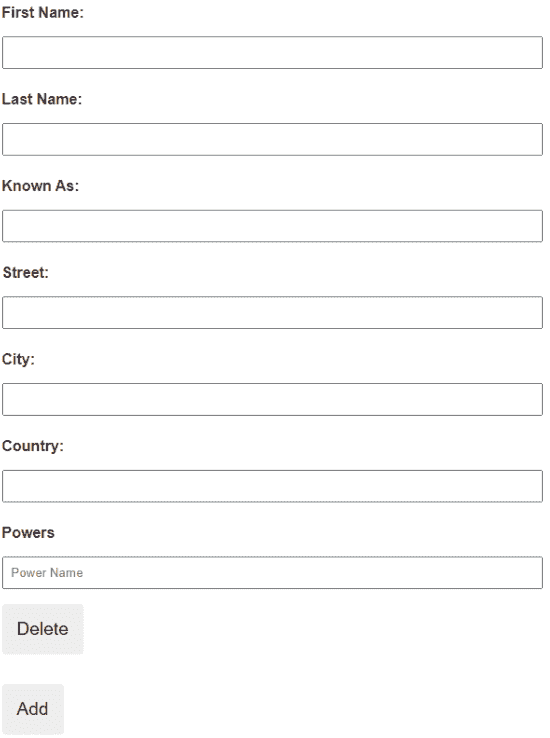

图 11.1 – 带有表单组和表单数组的 Hero 表单

我们已经成功使用表单组和表单数组创建了响应式表单。现在，我们将使用 FormBuilder 服务来简化应用程序中创建表单的语法。

## 使用 FormBuilder 服务生成控件

在上一节中，我们使用表单组、表单数组和表单控件成功创建了响应式表单。然而，从语法中可以看出，创建表单变得重复。我们总是在实例化新的表单控件、表单数组和表单组实例，这在大型表单中并不理想。FormBuilder 为这个问题提供了解决方案。

这是一个可以注入到我们的组件中的服务，用于生成组、控件和数组，而无需实例化新的实例。要使用 FormBuilder 创建响应式表单，我们将遵循以下步骤：

- 1. 我们将使用 FormBuilder 改造上一节中的表单。第一步是从 @angular/forms 中将 FormBuilder 服务导入到我们的组件中：

```
import { FormBuilder } from '@angular/forms';
```

- 2. 下一步是将 FormBuilder 服务注入到我们的组件中：

```
export class HeroComponent implements OnInit {
  powerFormArray: FormArray;
  constructor(private fb: FormBuilder) {}
  ... code implementation
}
```

- 3. 最后一步是使用 FormBuilder 服务的方法来创建并生成控件：

```
export class HeroComponent implements OnInit {
  heroForm = this.fb.group({
    firstName: [''],
    lastName: [''],
    knownAs: [''],
    address: this.fb.group({
      street: [''],
      city: [''],
      country: [''],
    }),
    powers: this.fb.array([])
  });

  constructor(private fb: FormBuilder) {}
  ... code implementation
}
```

在上面的示例中，我们可以看到我们的表单与上一节创建的表单具有相同的结构。主要的区别在于我们使用 FormBuilder 的方法来创建表单。我们使用了 `group()` 方法生成表单组，`array()` 方法生成表单数组，并使用一个带有空字符串值的数组来生成控件并设置其默认值。


The output for this code will be the same. FormBuilder methods are mainly for making our reactive forms clean and readable. Now, we will discuss how to add validations to our controls.

## Validating form input

We have now created and simplified our reactive form in the previous section, but we want to make our forms accurate in accepting data and at the same time create a user-friendly experience for the user to let them know easily what the valid values for each control are. Now, we will learn how to add validations to our reactive forms.

In reactive forms, we are adding validators as parameters directly to the form controls in the component class instead of adding them as an attribute in the template.

## Built-in validators

Angular provides several built-in validator functions that we can use directly in our forms. Let’s have a look at some of these:

- static min(min: number) — Requires the value of the control to be equal to or greater than the given number:

```
form = this.fb.group({
  name: [10, [Validators.min(4)]]
});
console.log(this.form.status) // returns VALID
static max(max: number) - requires the value of the control to be equal to or less than the given number.
form = this.fb.group({
  name: [3, [Validators.max (4)]]
});
console.log(this.form.status) // returns VALID
```

- static required(control: AbstractControl<any, any>) — Controls must not have a non-empty value:

```
form = this.fb.group({
  name: ['test value', [Validators.required]]
});
console.log(this.form.status) // returns VALID
```

- `static requiredTrue(control: AbstractControl<any, any>)`—Controls must have a value of true:

```
form = this.fb.group({
  name: [true, [Validators.requiredTrue]]
});
console.log(this.form.status) // returns VALID
```

- `static minLength(minLength: number)`—Used for arrays and strings, this requires that the length of the value should be equal to or greater than the given number:

```
form = this.fb.group({
  name: ['test', [Validators.minLength (4)]]
});
console.log(this.form.status) // returns VALID
```

- `static maxLength(maxLength: number)`—Used for arrays and strings, this requires that the length of the value should be equal to or less than the given number:

```
form = this.fb.group({
  name: ['test', [Validators.maxLength (4)]]
});
console.log(this.form.status) // returns VALID
```

## Custom validators

Other than the built-in validators, we can also create custom validators, which is helpful if our forms require more complex verification and checking.

Let’s have a look at the following example custom validator:

```
import { AbstractControl, ValidationErrors, ValidatorFn } from
"@angular/forms";
export function checkHasNumberValidator(): ValidatorFn {
  return (control: AbstractControl): ValidationErrors |
    null => {
      const error = /\d/.test(control.value);
      return error ? {hasNumbers: {value: control.value}} :
        null;
    };
}
```

```
```typescript
constructor(private fb: FormBuilder) {
  this.form = this.fb.group({
    id: [''],
    firstName: [''],
    lastName: [''],
    house: [''],
    knownAs: ['']
  })
}
<!-- Please refer to the anti-hero-form.component.ts file
in the GitHub repo, Thank you -->
```
```

- 2. Then, create an HTML template, like so:

```
```html
<!-- Please refer to the anti-hero-form.component.html
file in the GitHub repo, Thank you -->
```
```

In the implemented code in our component class, the first thing we did was create a form group object. We have added several controls that resemble the properties of the anti-hero object. Our goal here is to use the same form for creating and updating an anti-hero detail. In this case, we have also added several Input() bindings and methods to our class to help the form identify which actions are currently being done:

- `selectedId`: This will accept the ID of the anti-hero if the actions are updated.
- `actionButtonLabel`: This will change depending on the action being done (Create or Update).
- `checkAction()`: If selectedId has a value, this will change the value of actionButtonLabel to "Update".
- `patchDataValues()`: This will be used for patching the values of the selected anti-hero in the form controls.
- `emitAction()`: Emits the value of the form and the action into the parent component.
- `clear()`: Calls the reset() method to clean the form.

- 3. The next step is to use the anti-hero form in our form page component. Under the `anti-hero/pages/form` file, we will place the anti-hero form in the HTML template, and at the same time, check the current route if it has the ID of the selected anti-hero in the parameters. Here are the steps:

- i. Add the anti-hero form to the HTML template:

```
```html
<app-anti-hero-form [selectedId]="id"></app-anti-hero-form>
```
```

ii. Add the activated router to capture the ID:

```
```typescript
export class FormComponent implements OnInit {
  id = "";
  constructor(private router: ActivatedRoute) { }
  ngOnInit(): void {
    this.id = this.router.snapshot.params['id'];
  }
}
```
```

4. The next step is now to create a route for our page form component. In the `anti-hero-routing.module.ts` file, we will add the following entry to our routes:

```
```typescript
{
  path: "form",
  children: [
    {
      path: "",
      component: FormComponent
    },
    {
      path: ":id",
      component: FormComponent
    }
  ]
},
```
```

In the preceding code example, we have created two routes that redirect to FormComponent. The first route is for the create action, which has a baseURL/anti-heroes/form route, and the second route is for the update action, which has a baseURL/anti-heroes/form/:id route. This means that we are using the same components for our two actions, and the id parameters act as our indicator of which action is currently being done.

5. The last step is to add navigations to the list component. We will add several methods that will call navigate methods to redirect us to the form component depending on the selected action, as follows:

- `list.component.html`:

```
```html
<!-- Dumb component command bar -->
<app-anti-hero-command-bar
```
```

```
(action)="executeCommandBarAction($event)"></app-anti-hero-command-bar>
<!-- Dumb component anti hero list -->
<app-anti-hero-list [antiHeroes]="antiHeroes" (antiHero)="selectAntiHero($event)" [headers]="headers"></app-anti-hero-list>
```

- `list.component.ts`:

```
selectAntiHero(data: {antiHero: AntiHero, action: TableActions}) {
<!-- Please refer to the list.component.ts file in the GitHub repo, Thank you-->
    this.router.navigate(['anti-heroes', 'form', data.antiHero.id]);
}
executeCommandBarAction(action: CommandBarActions) {
    switch(action) {
        case CommandBarActions.Create: {
            this.router.navigate(["anti-heroes", "form"]);
            return;
        }
        case CommandBarActions.DeleteAll: {
            return;
        }
        default: ""
    }
}
```

After accomplishing all the steps, we will now have the following form output:

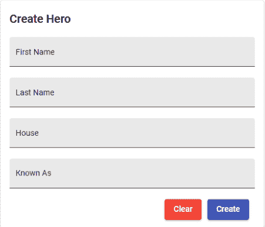

Figure 11.2 – Form UI for creating an anti-hero

## Summary

With this, we have reached the end of this chapter; let’s have a recap of the valuable things you have learned. You have learned about the concepts and implementation of Angular reactive forms, and we have implemented FormGroup, FormBuilder, and formControlName directives to bind input values to capture data in our form. We have also discussed how to group form controls for binding nested properties and create form arrays in our reactive forms. This is primarily useful if some objects we want to display have array values.

At the same time, we want to accept a list of entries from users. Lastly, we have also learned how to implement validations for form controls to handle and verify user input, which will be beneficial for the user experience and help avoid unexpected errors.

In the next chapter, we will learn about the concepts and implementation of state management in Angular applications; we will discuss the idea of the Redux pattern and the NgRx library in terms of how they can improve the application architecture.


## 12