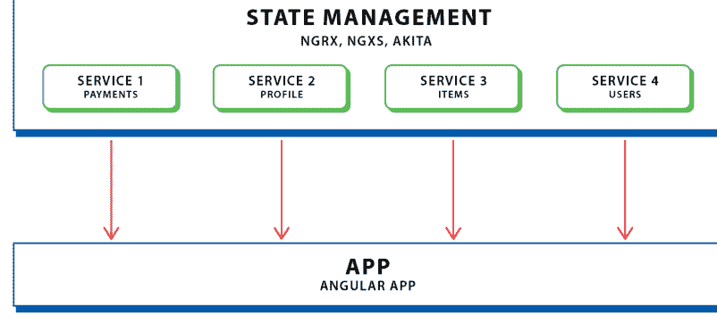
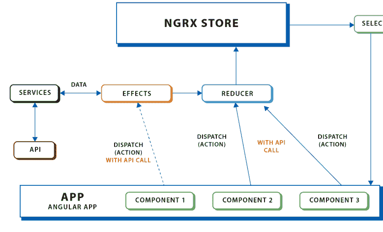
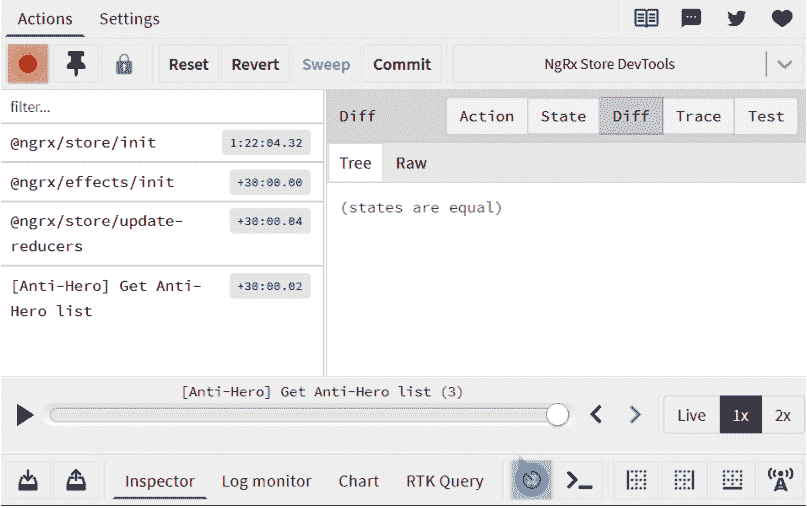

## 使用 NgRx 管理状态

在上一章中，我们学习了响应式表单的概念和特性。我们实现了 `FormGroup`、`FormBuilder` 和 `formControlName` 来在应用程序的表单元素中绑定输入值。我们还讨论了如何对表单控件进行分组以绑定嵌套属性，并在响应式表单中创建表单数组。

之后，我们学习了如何为表单控件实现验证以处理和验证用户输入。这将有利于用户体验并帮助我们避免意外的错误。

在本章中，我们将向我们的应用程序添加一个新的食谱，并学习如何实现状态管理，特别是 **NgRx**，以处理 Angular 应用程序中的数据。

在本章中，我们将涵盖以下主题：

- 理解管理大型应用程序状态的复杂性
- 状态管理与全局状态
- 开始使用并设置 NgRx
- 编写一个 action
- 编写一个 effect
- 编写一个 reducer
- 编写一个 selector 并在组件中使用 selector 并分派它
- 配置 store

## 技术要求

以下链接将带您进入本章代码的完成版本：https://github.com/PacktPublishing/Spring-Boot-and-Angular/tree/main/Chapter-12/superheroes。

在前面的图形说明中，我们可以看到我们有四个不同的服务负责管理不同类型的数据；每个功能都从这些服务中检索其所需的数据。

正如我们所见，检索是分散的，因为功能从不同的源或服务检索数据。这导致了多个数据流，并且随着需要更多服务和功能而变得更大。

这也可能导致每个组件持有的数据不一致，因为来源来自不同的服务，从而导致应用程序中出现一些意外的错误。现在，让我们来看一下使用状态管理的数据流。

## 使用状态管理的数据流

在之前的数据流中，我们看到数据流未得到优化，这可能导致应用程序出现若干问题，因为数据流的方向非常复杂。在 Angular 应用程序中实现状态管理时，我们将具有以下数据流：



图 12.2 – 使用状态管理的数据流

在前面的图形说明中，我们可以看到应用程序的所有服务都由状态管理处理。我们仍然使用服务从数据库中检索数据。这里的显著区别在于，我们的功能现在是在状态中访问所有检索到的数据，而不是直接在服务中访问它。

这允许数据单向流动，并且所有在应用程序中使用的数据的来源只有一个。通过这种方法，可以避免状态不一致、可能的错误和多次 API 调用。

有了这些，我们已经了解了状态管理在开发应用程序，特别是在企业级应用程序中的重要性。

现在，让我们讨论更多关于状态管理概念和全局状态的内容。

## 状态管理与全局状态

正如前一节所讨论的，状态管理是一个扩展或库，它允许我们在应用程序中以单一方向管理数据的流动。

这是由于全局状态的存在，全局状态将包含所有数据。为了了解状态管理的工作原理，让我们讨论状态管理的每个构建块。

### 全局状态/store

**全局状态**，也称为 **store**，是状态管理中最关键的元素。全局状态的主要职责是存储 API 检索到的所有数据，或简单地在应用程序中使用的所有数据。

这意味着 Angular 应用程序中的所有组件都将在全局状态中检索数据。将其视为 Angular 应用程序的数据库，但以 JSON 对象的形式存在，我们可以在其中获取每个属性作为切片。

### Actions

**Actions** 表示应用程序中的唯一事件。它们直接在我们的组件中使用 `dispatch()` 函数调用，这有助于识别应执行哪些事件，例如修改状态或调用 API 以检索数据。

Actions 只是简单的接口；`type` 属性标识分派了什么 action。这个简单的字符串只是 action 的定义，我们可以向 actions 添加属性以获取 API 或状态所需的数据。

让我们看一个 action 接口的示例：

```
{
  type: '[Blog] Add Blog',
  title: string;
  author: string;
  content: string;
}
```

前面的示例 action 在创建新博客时被分派。这是在点击 **Submit** 按钮时调用的，并且诸如 `title`、`author` 和 `content` 之类的信息被添加为附加元数据以传递给 effect 或 reducer。

### Reducers

**Reducers** 是状态管理的决策者。它们根据 action 类型决定处理哪些 action。Reducers 也是可以更改状态值的对象。

Reducers 是纯函数并同步处理状态转换；让我们看一个 reducer 的示例：

```
```typescript
export const blogReducer = createReducer( initialState,
  on(BlogActions.addBlog, (state, {blog}) => ({ ...state,
    blogs: [...state.blogs, blog]})
  );
```
```

在前面的示例中，我们为 `addBlog()` action 创建了一个 reducer。这允许我们在分派 `addBlog()` action 后在博客的状态中添加一个新的博客对象。

我们将在本章的 *Writing a reducer* 部分更详细地讨论 reducers。

### Selectors

**Selectors** 是纯函数，允许我们检索 store 中的数据切片。它是一种变更检测机制，当状态的值发生变化时，它会比较状态的部分，并且只有在检测到更改时才发送状态。这是一种称为 **memorization** 的做法。

Selectors 在组件中使用以获取 UI 中使用的数据。它作为 Observable 返回，监听状态变化。

让我们看一个 selector 的示例：

```
```typescript
// selector for list of blogs
// blog.selector.ts
export const selectBlogList = (state: AppState) => state.blogs;

// blog component
// blog.component.ts
blogs$ = this.store.select<Array<Blog>>(selectBlogList);
  this.blogs$.subscribe(data => {
```
```

```
console.log(data) // list of blogs from the state;
});
```

在前面的示例中，我们为博客切片创建了一个 selector，以及一个返回博客元数据的函数，称为 selectBlogList()。我们在博客组件中使用此函数作为 select 函数的参数以通过订阅 selector 检索数据。订阅将在博客切片的值发生变化时发出。我们将在本章的下一节更详细地讨论 selectors。

### Effects

Effects 是 NgRx 库使用的特定元素；这是一个由 RxJs 驱动的副作用模型，处理外部交互，例如 API 调用、WebSocket 消息和基于时间的事件。使用 effects，我们可以将组件与外部源的交互隔离并减少其职责。让我们看一下有副作用和没有副作用的应用程序之间的比较。

### 没有副作用的应用程序

以下是没有副作用的应用程序：

```
export class BlogPageComponent {
  movies: Blog[];
  constructor(private blogService: MoviService) {}
  ngOnInit() {
    this.blogService
      .getAll()
      .subscribe(blogs => this.blogs = blogs);
  }
}
```

在前面的代码示例中，我们有一个组件具有以下几个职责：

- 管理博客的状态（组件具有其博客状态）
- 使用博客服务调用外部 API 以获取博客列表
- 在组件内部修改博客的状态

这意味着每个具有服务依赖的组件也都有其数据状态。现在，让我们看一个有副作用的应用程序的示例。


## 带有副作用的应用

下面是一个带有副作用的应用：

```typescript
export class BlogsPageComponent {
  blogs$: Observable<Blog[]> = this.store.select(state =>
    state.blog);

  constructor(private store: Store<{ blogs: Blog[] }>) {}

  ngOnInit() {
    this.store.dispatch({ type: '[Blog Page] Load Blog' });
  }
}
```

在前面的代码示例中，我们可以看到博客页面组件的代码已被精简，同时其职责也变得不那么复杂。现在，组件的职责是派发一个 action，以便 effect 能够识别需要调用哪个服务来检索数据。

让我们来看一个博客状态的 effect 示例：

```typescript
@Injectable()
export class BlogEffects {
  loadBlogs$ = createEffect(() => this.actions$.pipe(
    ofType('[Blog Page] Load Blog'),
    mergeMap(() => this.blogService
      .getAll().pipe(
        map(blogs => ({ type: '[Blogs API] Blogs Loaded Success', payload: blogs })),
        catchError(() => EMPTY)
      )
    )
  );
  constructor(private actions$: Actions,
              private blogService: BlogService) {}
}
```

在前面的代码示例中，我们创建了一个名为 loadBlogs$ 的新 effect。该 effect 负责调用 blog 服务中的 getAll() 方法从外部端点检索博客列表。同时，它还负责派发一个新的 action，将检索到的博客列表传递给 reducer 以修改 store。我们将在本章下一节讨论如何编写 effects。

至此，我们已经看到了构成状态管理的全部构建块。让我们来看一个关于状态管理中数据流的详细图形说明：



图 12.3 – 使用 NgRx 状态管理时的数据流

在前面的图形说明中，我们可以看到我们的 UI 组件只有一个职责，那就是派发 action。如果 action 需要调用 API，则会调用 effect 使用服务来调用 API，并在获取到响应数据后，effect 还会派发一个 action 来调用 reducer 修改 store。

另一方面，如果从组件发送的 action 会改变状态，则不需要任何副作用，并调用与该 action 类型匹配的 reducer。store 中的所有更改都将被 selectors 检测到，并向 UI 组件发出最新状态以供使用。

至此，我们已经了解了围绕状态管理的必要概念以及数据流与状态管理的构建块。在下一节中，我们将学习如何设置和配置 Angular 中最著名的状态管理库之一：NgRx。

## 开始使用并设置 NgRx

要使用 NgRx 状态管理，我们必须安装 @ngrx/store 库；它将包含允许我们配置 store 并创建 reducer 和 action 的所有函数。

要安装 @ngrx/store 库，我们必须执行以下命令：

```
ng add @ngrx/store
```

前面的命令将执行以下步骤：

- 1. 更新 package.json，通过将 @ngrx/store 添加到依赖项中。
- 2. 运行 npm install 以安装依赖项。
- 3. 更新 src/app/app.module.ts，通过将 StoreModule.forRoot(reducers, {}) 添加到 imports 数组中。

在执行此命令之前，请确保 @ngrx/store 的版本与您的 Angular 版本保持一致；在我们的项目中，我们的 Angular 版本是 13.3.0，这意味着我们需要使用 @ngrx/store 的 13 版本。

还提供了一些标志，允许我们使用自定义设置安装 @ngrx/store。以下是我们可以使用的一系列标志：

- - --path: 指定要导入 StoreModule 的模块的路径。
- - --project: 在 angular.json 中定义项目的名称。
- - --module: 包含要导入 StoreModule 的模块的文件名。
- - --minimal: 如果设置为 true，则提供根状态管理的最小设置。它在模块中导入 StoreModule.forRoot() 并使用空对象。
- - --statePath: 状态将被创建的路径。
- - --stateInterface: 定义状态的接口。

## 将 NgRx 添加到我们的 Angular 项目中

现在，让我们将其添加到我们的 Angular 项目中。我们只想使用最小设置，因为我们将逐步添加 reducer 和 store。成功执行 ng add @ngrx/store 命令后，我们的项目中将有以下更改：

```
// app.module.ts
imports: [
  ... other modules
  StoreModule.forRoot({}, {}),
```

在前面的代码示例中，我们可以看到一个名为 `StoreDevtoolsModule` 的新模块已被添加；这将允许我们在本地运行应用程序时使用 DevTools。

使用 DevTools 的下一步是向浏览器添加 Redux 扩展。要添加此扩展，请前往以下链接之一以获取您各自的浏览器：

- - **Google Chrome:** `https://chrome.google.com/webstore/detail/redux-devtools/lmhkpm...`
- - **Mozilla Firefox:** `https://addons.mozilla.org/en-US/firefox/addon/reduxdevtools/`

在首选浏览器中添加此扩展后，使用导入的 `StoreDevToolModule` 模块运行 Angular 项目将被此扩展自动检测到。它将提供一个用于查看状态的界面：



图 12.4 – Redux DevTools 扩展的界面

前面的屏幕截图显示我们的 Redux DevTools 扩展已被激活；一旦我们在浏览器标签中打开 Angular 项目，随着我们编写代码，我们将看到更多 Redux DevTools 的实际效果。

现在我们已经配置了 store 并在应用程序中安装了 NgRx DevTools，我们准备好为我们的状态管理编写构建块了。

## 编写 action

状态管理的第一个构建块是我们将编写 action。在编写 action 时，我们可以遵循一些规则，以便在应用程序中拥有良好的 action：

- - **Upfront**: 编写 action 应该始终在开发功能之前进行。这为我们提供了应用程序中应实现内容的概览。
- - **Divide**: 我们应该始终根据事件来源和相关数据对 action 进行分类。
- - **Many**: 编写更多数量的 action 并不是问题。它更有益，因为更多的 action 能更好地概述应用程序的流程。
- - **Event-Driven**: 在您将事件的描述与其处理方式分开时捕获 *事件*。
- - **Descriptive**: 始终使用 type 元数据提供有意义的信息。这有助于调试状态。

让我们来看一个将博客列表设置到我们状态中的示例 action：

```
import { createAction, props } from '@ngrx/store';
export const setBlogList = createAction(
  '[Blog] Set Blog List',
  props<{ blogs: ReadonlyArray<Blog> }>(),
);
```

在前面的代码示例中，我们使用了 `createAction()` 函数来创建我们的 action。`createAction()` 函数还返回一个返回 action 接口对象的函数；在这种情况下，它将返回 "[Blog] Set blog list" 作为 action 类型，并将博客数组作为附加属性。

要派发 action，我们将使用 `dispatch()` 函数并使用 `setBlogList` 作为参数：

```
ngOnInit() {
    store.dispatch(setBlogList({ blogs: this.blogs }));
}
```

## 在项目中实现 action

我们项目的首要目标是创建整个周期，从我们的 API 获取反英雄列表并将其放入我们的 store。第一步是获取我们需要的 action；让我们来看一下我们应该为此功能创建的两个 action：

- - `getAntiHeroList`: 此 action 将从我们的 Spring 项目提供的外部 API 中检索博客列表。
- - `setAntiHeroList`: 此 action 将检索到的博客列表放入我们的 store。


现在我们已经确定了要创建的操作列表，在 `anti-heroes` 文件夹中，我们将创建一个 `state/anti-hero.actions.ts` 文件，在其中放置所有操作。

让我们在 `anti-hero.actions.ts` 文件中放置以下代码：

```
```typescript
import { createAction, props } from '@ngrx/store';
import { AntiHero } from '../models/anti-hero.interface';
export enum AntiHeroActions {
  GET_ANTI_HERO_LIST = '[Anti-Hero] Get Anti-Hero list',
  SET_ANTI_HERO_LIST = '[Anti-Hero] Set Anti-Hero list',
}
export const getAntiHeroList = createAction(
  AntiHeroActions.GET_ANTI_HERO_LIST,
);
export const setAntiHeroList = createAction(
  AntiHeroActions.SET_ANTI_HERO_LIST,
  props<{ antiHeroes: ReadonlyArray<AntiHero> }>(),
);
```
```

在前面的代码示例中，我们创建了两个用于获取和设置反英雄列表的操作。第一个操作 `getAntiHeroList` 只有一个参数，即类型。这不需要任何附加属性，因为它只会调用 API 通过 effects 获取反英雄列表。

另一方面，第二个操作 `setAntiHeroList` 有两个参数：类型和一个名为 `antiHero` 的附加属性。这将通过 reducers 使用检索到的反英雄列表设置 store 的值。

将我们的操作定义设为代码中的枚举也是非常优秀的做法，因为这将帮助我们在应用程序的其他部分使用定义时避免拼写错误。

至此，我们已成功创建了反英雄列表功能所需的 action。现在，我们将讨论如何编写 effects 来调用 API 并检索反英雄列表。

## 编写 effect

我们在上一节中成功创建了操作。现在，我们将创建 effects，使其负责调用我们的外部 API。

Effects 不包含在 `@ngrx/store` 库中；我们将安装一个单独的库，以便能够使用 effects 的函数。

要在我们的应用程序中安装 effects，我们必须执行以下命令：

```
ng add @ngrx/effects
```

前面的命令将执行以下步骤：

- 1. 使用 @ngrx/effects 依赖项更新 package.json 文件。
- 2. 运行 npm install 以安装添加的依赖项。
- 3. 将 EffectsModule.forRoot() 添加到 app.module.ts 文件的 imports 数组中。

有一些可用的标志允许我们使用自定义设置安装 @ngrx/effects；以下是我们可以使用的一系列标志：

- - --path: 指定要导入 EffectsModule 的模块的路径。
- - --project: angular.json 中定义项目的名称。
- - --skipTests: 当设置为 false 时，这会创建一个测试文件。
- - --module: 包含要导入 EffectsModule 的模块的文件的名称。
- - --minimal: 如果设置为 true，则提供根 effects 的最小设置。它在模块中导入 EffectsModule.forRoot() 并使用空对象。
- - --group: 将 effects 文件分组到 effects 文件夹中。

在成功将 effect 的依赖项添加到我们的应用程序后，我们可以创建我们的 effects。在 anti-heroes/state 文件夹下，我们必须创建一个名为 anti-hero.effects.ts 的新文件。我们需要做的第一件事是创建一个具有 @Injectable 注解的类：

```
@Injectable()
export class AntiHeroEffects {
  constructor(
    private actions$: Actions,
    private antiHeroService: AntiHeroService,
    private router: Router
  ) {}
}
```

在前面的代码示例中，我们可以看到 effects 也是服务类，可以被其他服务注入；我们已将以下服务注入到 AntiHeroEffects 中：

- - Actions: 来自 @ngrx/effects 的服务，返回我们可以分配类型的可观察对象。这将在分派 action 时充当标识符。
- - **AntiHeroService**: 我们创建的服务，其中包含反英雄的外部 API，位于 `anti-hero/services/anti-hero.service.ts` 下。
- - **Router**: 在 API 调用后用于重定向。

在创建我们的 `AntiHeroEffect` 类并注入我们的服务后，我们可以开始创建我们的 effects。我们首先需要考虑的是，由于我们有 `GET_ANTI_HERO_LIST` 和 `SET_ANTI_HERO_LIST` 操作，我们需要哪种类型的 effect 来获取反英雄。

我们应该创建一个类型为 `GET_ANTI_HERO_LIST` 的 effect，并且可以调用 `AntiHeroService` 中的 `getAntiHeroes()` 函数。

要创建此 API，我们可以编写以下代码：

```
```typescript
import { Actions, createEffect, ofType } from '@ngrx/effects';
getAntiHeroes$ = createEffect(() => {
    return this.actions$.pipe(
        ofType(AntiHeroActions.GET_ANTI_HERO_LIST),
        mergeMap(() => this.antiHeroService.getAntiHeroes()
        )
    }, {dispatch: true}
);
```
```

在前面的代码示例中，我们使用 `createEffect()` 函数创建了我们的 effects；它返回一个具有两个参数的 action：

- - `ofType(AntiHeroActions.GET_ANTI_HERO_LIST)`: 第一个参数使用 `ofType` 操作符，定义了 effect 的 action 类型。这意味着如果分派了 `GET_ANTI_HERO_LIST` action，则会调用此 effect。
- - `mergeMap(() => this.antiHeroService.getAntiHeroes())`: 第二个参数使用 `mergeMap` 操作符，这将允许我们调用 `getAntiHeroes()` 函数以调用端点。

至此，我们已为 `GET_ANTI_HERO_LIST` 操作创建了 effect，但这尚未完成。在获取反英雄列表后，我们希望分派另一个 action，将反英雄列表设置到我们的 state 中。为此，我们可以使用以下代码：

```
```typescript
mergeMap(() => this.antiHeroService.getAntiHeroes()
    .pipe(
        map(antiHeroes => ({ type: AntiHeroActions.SET_ANTI_HERO_LIST, antiHeroes })),
        catchError(() => EMPTY)
    ));
```
```

在前面的代码中，我们向我们的 mergeMap 操作符添加了一个 pipe；它调用一个 map 操作符，返回 ({ type: AntiHeroActions.SET_ANTI_HERO_LIST, antiHeroes })。这将分派另一个 action，其类型为 SET_ANTI_HERO_LIST，并且具有来自 API 检索到的反英雄列表的附加 antiHeroes 对象。

我们用于获取反英雄列表功能的 effects 已完成。最后一步是将 AntiHeroEffects 添加到我们的 effects 模块中。正如我们可能还记得的，我们的反英雄模块是懒加载的，这意味着我们不会将 AntiHeroEffects 添加到 app.module.ts 文件中位于 EffectsModule.forRoot([])；否则，我们需要在 anti-hero.module.ts 文件的 imports 中添加 EffectsModule.forFeature([AntiHeroEffects])。这意味着此 effects 类仅在此模块下使用。

至此，我们已成功配置并创建了反英雄列表功能的 effects。在下一节中，我们将编写修改 state 的 reducers。

## 编写 reducer

NgRx states 是不可变对象；我们不能通过直接赋值修改它们的值，而唯一可以更改它们状态的方式是通过 reducers。

Reducers 有我们应该实现的不同部分，如下所示：

- - 定义 state 属性的接口或类型
- - 参数，由初始 state 和当前 action 组成
- - 根据分派的 actions 处理 state 更改的函数列表

我们将在 anti-heroes/state/anti-hero reducers.ts 文件下创建这些 reducer 部分。

### State 接口

State 接口定义了 state 的形状；它包含属性或 state 的切片。在我们的应用程序中，我们需要一个属性来保存反英雄列表。

要实现接口，我们可以使用以下代码：

```
export interface AntiHeroState {
  antiHeroes: ReadonlyArray<AntiHero>;
}
```

### 初始 state

我们需要实现的下一个部分是初始 state；它定义了 state 切片的初始值是什么。在我们的反英雄 state 中，我们将 antiHeroes 切片设置为一个空数组。


### 选择特性状态

在选择特性状态时，我们将使用 `createSelector()` 和 `createFeatureSelector()` 函数来创建选择器。让我们看一个选择器选择位于特性状态（BlogState）下的博客列表的示例：

// blogs.selectors.ts
import { createSelector, createFeatureSelector } from '@ngrx/store';

export const selectBlogsState =
createFeatureSelector<BlogsState>('blogsState')

export const selectBlogs = () => createSelector
  selectBlogsState,
  (state: BlogsState) => state.blogs
)
```

在前面的代码示例中，第一步是创建特性选择器，它将返回整个 BlogState。在这里，我们使用了 `createFeatureSelector()` 和状态的键来标识我们想要选择的目标特性状态。

第二步是创建博客切片的主选择器；`createSelector()` 有两个参数，其中第一个是 BlogState 特性选择器，第二个是一个函数，其中特性选择器返回的 BlogState 是参数。返回值是博客切片。

## 在项目中实现选择器

到目前为止，我们已经学习了如何使用 `createFeatureSelector()` 和 `createSelector()` 函数创建选择器。现在，让我们在项目中实现它们。首先需要识别的是状态或切片。第一个需要选择器的切片是位于 AntiHeroState 下的博客切片。请记住 AntiHeroState 不是我们的根状态；这意味着我们将为以下状态拥有一个特性选择器。

我们需要的第二个选择器是 antiHeroes 切片的选择器，其中包含通过 API 获取的反英雄数组。最后，我们想要的第三个选择器将需要根据 id 参数从列表中选择特定的 antiHero 数据。

要创建所有这些选择器，请将以下代码放在 `anti-hero/state/anti-hero.selectors.ts` 文件中：

// select the AntiHeroState
export const selectAntiHeroState =
createFeatureSelector<AntiHeroState>('antiHeroState')

// selecting all antiheroes
export const selectAntiHeroes = () => createSelector(
  selectAntiHeroState,
  (state: AntiHeroState) => state.antiHeroes
)
// selecting an antihero base on id
export const selectAntiHero = (id: string) => createSelector(
  selectAntiHeroState,
  (state: AntiHeroState) => state.antiHeroes.find(d =>
    d.id === id)
)
```

成功创建所有选择器后，我们可以在 `anti-hero/pages/list.component.ts` 文件中使用它们，通过添加以下代码：

```
antiHeroes$ = this.store.select(selectAntiHeroes());
constructor(
  private router: Router,
  private store: Store<AppState>,
) { }
ngOnInit(): void {
  this.assignAntiHeroes();
}
assignAntiHeroes() {
  this.antiHeroes$.subscribe((data) => {
    this.antiHeroes = data;
  });
}
```

在前面的代码示例中，我们使用了 `selectAntiHeroes()` 选择器从状态中获取反英雄数组。`antiHeroes$` 是一个 Observable，在订阅后返回 `antiHero` 切片的当前状态。

最后，我们必须获取反英雄列表特性。我们可以通过在列表组件的 `ngOnInit()` 钩子中分发 `GET_ANTI_HERO_LIST` 操作来实现。这将调用我们之前创建的效果，该效果调用获取反英雄列表的端点：

```
ngOnInit(): void {
  this.store.dispatch({type: AntiHeroActions.GET_ANTI_HERO_LIST});
  this.assignAntiHeroes();
}
```

至此，我们已成功为组件创建了选择器，以便从状态中检索数据。在下一节中，我们将讨论可为 store 实现的可用配置。

## 配置 store

在前面的章节中，我们创建了 NgRx 的所有构建块，完成了应用程序的完全功能 store。在本节中，我们将学习如何使用运行时检查配置 NgRx store。

## 运行时检查

运行时检查用于配置 NgRx store，以便开发人员遵循 NgRx 和 Redux 核心概念和最佳实践。这对于刚接触 NgRx 的开发人员尤其有用；它们会根据激活的运行时检查显示与开发相关的错误。

`@ngrx/store` 提供了六个内置运行时检查：

- `strictStateImmutability`: 检查状态是否未被修改（默认值：开启）
- `strictActionImmutability`: 检查操作是否未被修改（默认值：开启）
- `strictStateSerializability`: 检查状态是否可序列化（默认值：开启）
- `strictActionSerializability`: 检查操作是否可序列化（默认值：关闭）
- `strictActionWithinNgZone`: 检查操作是否在 NgZone 内分发（默认值：关闭）
- `strictActionTypeUniqueness`: 检查注册的操作类型是否唯一（默认值：关闭）

要更改运行时检查的默认配置，我们将使用根 store 配置对象上的 `runtimeChecks` 属性。每个运行时检查的值可以通过赋值为 `true` 来激活检查，或赋值为 `false` 来停用检查：

```
@NgModule({
  imports: [
    StoreModule.forRoot(reducers, {
```

```
```javascript
runtimeChecks: {
  strictStateImmutability: true,
  strictActionImmutability: true,
  strictStateSerializability: true,
  strictActionSerializability: true,
  strictActionWithinNgZone: true,
  strictActionTypeUniqueness: true,
},
}),
],
})
```
```

### strictStateImmutability

这是 NgRx 的第一条规则。它默认激活，运行时检查会验证开发人员是否修改了状态对象。

**违反此规则的示例：**

```
```javascript
export const reducer = createReducer(initialState, on(addBlog,
  (state, { blog }) => ({
  // Violation 1: we assign a new value to loading
  state.loading = false,
    // Violation 2: `push` modifies the array
    // state.blogs.push(blog) })) );
```
```

**修复此违规：**

```
```javascript
export const reducer = createReducer( initialState, on(addBlog,
  (state, { blog }) =>
  // Fix: We are returning the state as a whole object with
  // the new values
    ({ ...state,
      loading: false,
      blogs: [...state.blogs, blog],
    })) );
```
```

### strictActionImmutability

此运行时检查与 `strictStateImmutability` 类似，但针对的是操作。此运行时检查验证开发人员是否修改了操作。此检查默认激活。

**违反此规则的示例：**

```
export const reducer = createReducer(initialState, on(addBlog,
(state, { blog }) => ({
// Violation: it's not allowed to modify an action
blog.id = uniqueID();
return { ...state, blogs: [...state.blogs, blog]
} })) );
```

**修复此违规：**

```
//blog.actions.ts
export const addBlog = createAction( '[Blog List] Add Blog',
// Fix: we will return the object in the action with the
// new value
(description: string) =>
({ id: uniqueID(), description }) );

//blog.reducer.ts
export const reducer = createReducer(
initialState,
on(addBlog, (state, { blog }) => ({
...state,
blogs: [...state.blogs, blog],
})) );
```

### strictStateSerializability

此运行时检查验证放置在状态中的值是否可序列化。这对于持久化状态以便将来重新水合至关重要。此检查默认停用。

**违反此规则的示例：**

```
export const reducer = createReducer(
initialState,
on(addBlog, (state, { blog }) => ({
...state,
blogs: [...state.blogs, blog],
// Violation: a Date type is not a serializable value.
```

```
```typescript
createdOn: new Date()
}));
```
```

**修复此违规：**

```
```typescript
export const reducer = createReducer(
  initialState,
  on(addBlog, (state, { blog }) => ({
    ...state,
    blogs: [...state.blogs, blog],
    // Fix: We should convert the date into a JSON Object.
    createdOn: new Date().toJSON()
  }))
);
```
```

### strictActionSerializability

此运行时检查与 `strictStateSerializability` 类似，但针对操作。它检查状态是否可序列化。这由 Redux DevTools 用于调试错误。

**违反此规则的示例：**

```
```typescript
const createBlog = createAction(
  '[Blog List] Add Blog',
  blog => ({ blog,
  // Violation, a function is not serializable
  logBlog: () => { console.log(blog); }, }));
```
```

**修复此违规：**

```
```typescript
const createBlog = createAction(
  '[Blog List] Add Blog',
  // Fix: we should use props to receive parameters
  props<{blog: Blog}>()
);
```
```

### strictActionWithinNgZone

此运行时检查验证操作是否由 NgZone 内的异步任务分发。此检查默认停用。


#### 此规则的示例违规：

// Callback outside NgZone
// Violation: the createBlog actions is invoked outside the
// ngZone
callbackOutsideNgZone() {
    this.store.dispatch(createBlog ());
}
```

#### 此违规的修复方法：

```
import { NgZone } from '@angular/core';
constructor(private ngZone: NgZone) {}
    // use run() function to call the dispatch inside the
    // NgZone
function callbackOutsideNgZone() {
    this.ngZone.run(
        () => {  this.store.dispatch(createBlog());
    }
}
```

### strictActionTypeUniqueness

此运行时检查可防止开发人员多次注册相同的操作类型。此检查默认情况下处于停用状态。

#### 此规则的示例违规：

//Violation: two actions have the same type
export const addBlog = createAction('[Blog] Add Blog'); export const modifyBlog = createAction('[Blog] Add Blog');
```

#### 此违规的修复方法：

//Violation: two actions have the same type
export const addBlog = createAction('[Blog] Add Blog'); export const modifyBlog = createAction('[Blog] Modify Blog');
```
