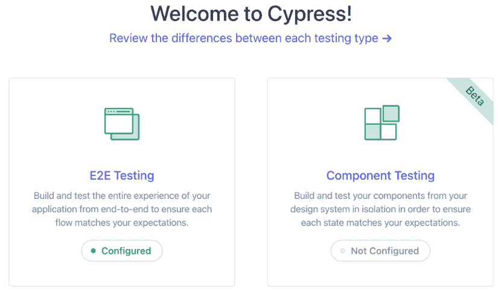
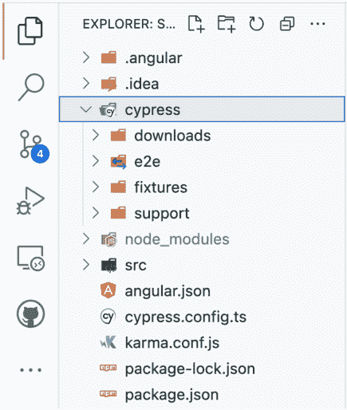
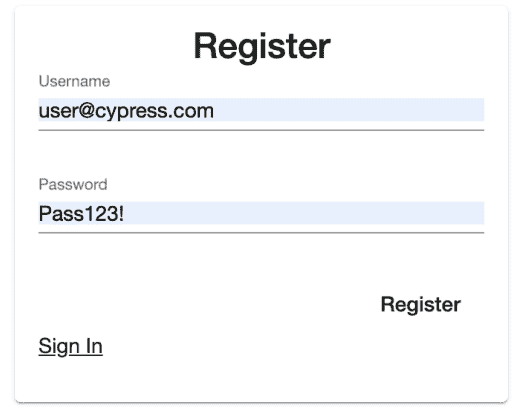
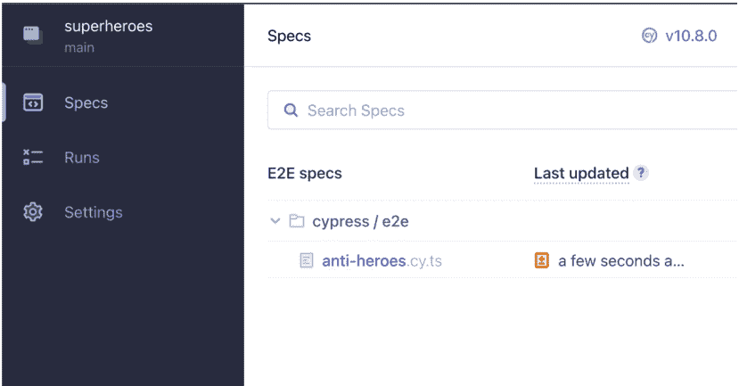
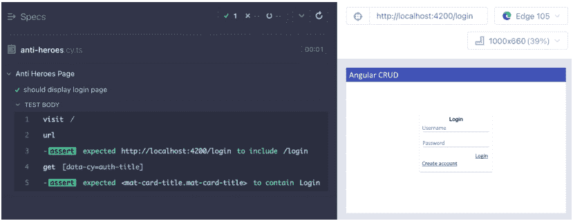
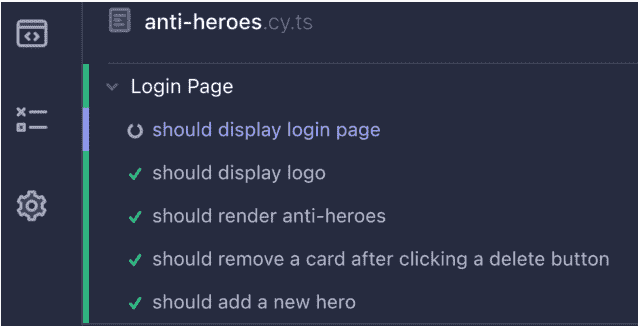
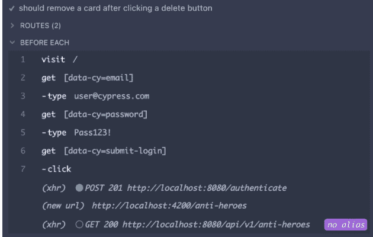
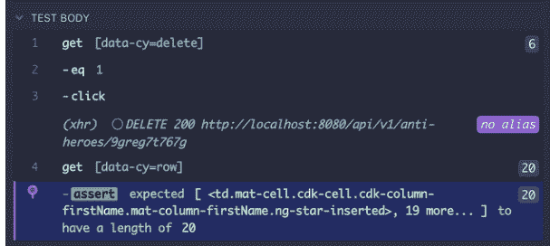
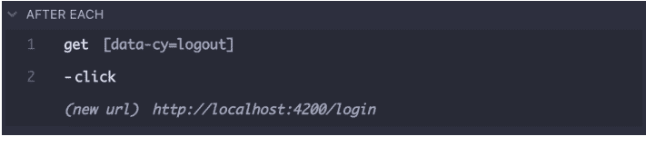

## 15

## 在 Angular 中编写测试

在上一章中，我们学习了如何通过添加用户身份验证、检索用户信息和保护路由来保护 Angular 应用程序。

如果我告诉你，在前端编写测试可以很有趣和令人兴奋呢？本章将向你展示 Cypress E2E，即端到端测试的开发者体验有多好。为什么前端开发者喜欢 Cypress 框架？

本章将教你如何编写基本的 Cypress 测试以及如何为测试模拟 HTTP 请求。

在本章中，我们将涵盖以下主题：

- 使用 Cypress 入门
- 编写简单的 Cypress 测试
- 模拟 HTTP 响应和拦截 HTTP 请求

### 技术要求

以下链接将带你进入本章的完成版本：https://github.com/PacktPublishing/Spring-Boot-and-Angular/tree/main/Chapter-15/superheroes。

## 使用 Cypress 入门

在本节中，你将学习 Cypress 是什么以及如何开始使用它。

Cypress 是一个用于测试 Web 应用程序的端到端框架。你可以在 HTML 标签中编写测试 ID，并断言 HTML 标签是否以你期望的方式呈现。

让我们定义一下端到端是什么意思。端到端是指用户在登陆你的 Web 应用程序后使用你的应用程序的方式，完成登录、注册、结账、查看个人资料、注销、填写表单等任务。

例如，你可以在不同的示例用例或场景中测试或检查你的 Web 应用程序的 UI：

- 登陆页价值主张的句子包含单词 sale
- 网站某个部分的组件计数是你所期望的
- 在结账页的篮子中的商品在点击 Clear 按钮后被清空
- 当 Web 应用程序的 URL 为 domain.com/login 时，存在登录表单

这些场景是 Web 应用程序中需要测试的示例。Cypress 是一个测试框架，你可以在其中编写和运行设置和配置不需要花费太多时间的测试。

现在，让我们看看 Cypress 如何安装。

## 安装

要开始使用 Cypress，我们必须从 npm 仓库安装它，运行以下命令：

```
npm i-D cypress @testing-library/cypress
```

前面的 npm 命令将在 dev 依赖包中安装 Cypress 和 cypress 测试库。@testing-library 是 Web 开发中一组常见的测试实用程序，使开发者的生活更轻松

在下一节中，我们将学习必须向 package.json 文件的 npm 脚本中添加什么，以便我们可以在本章后面运行测试。

## npm 脚本

为了让我们以后更轻松地运行 Cypress 测试，最好在 package.json 文件中添加一个新的 npm 脚本，以帮助我们轻松运行命令。在 package.json 文件的 scripts 块中插入以下键/值对：

```
"test": "npx cypress open"
```

前面的键/值对帮助你通过在终端中运行 npm run test 命令来运行测试。同时运行全栈应用程序以及终端中的 npm run test 命令以启动 Cypress。

一个交互式浏览器应用将打开，你可以在其中运行你的测试。*Figure 15.1* 显示了运行 `npm run test` 命令后 Cypress 仪表板上显示的欢迎消息。在这里，我们将使用 **E2E Testing**，因此点击该框继续：



Figure 15.1 – The Cypress dashboard

*Figure 15.2* 显示了将自动添加到你的 Angular 应用程序目录中的文件夹和文件。这些是任何使用 Cypress 的 Web 应用程序所必需的。由于我们使用 TypeScript，我们将稍后添加更多内容，但我们稍后再做。现在，只需点击 **Continue** 按钮；你将被带到以下屏幕：


## 配置文件

我们向你的项目添加了以下文件：

- `cypress.config.ts` – 用于 E2E 测试的 Cypress 配置文件。
- `cypress/support/e2e.ts` – 在每次 E2E 规范之前捆绑并加载的支持文件。
- `cypress/support/commands.ts` – 用于创建自定义 Cypress 命令和覆盖现有命令的有用支持文件。
- `cypress/fixtures/example.json` – 添加了一个示例 fixtures 文件/文件夹。

继续

图 15.2 – 配置文件

图 15.3 显示你可以选择不同的浏览器来运行你的 E2E 测试。你可以从 Chrome、Microsoft Edge 和 Firefox 中选择。我们将在此停止，因为我们还没有编写任何测试，并且我们仍需要帮助 Cypress 学习 TypeScript。通过在终端中按 Ctrl + C 停止 Cypress 运行：

选择浏览器

选择你首选的浏览器用于 E2E 测试。

- Chrome v105
- Edge v105
- Electron v102
- Firefox v104

在 Edge 中启动 E2E 测试

切换测试类型

图 15.3 – 选择浏览器

图 15.4 显示了生成的 cypress 文件夹，它们包含内部的其他文件夹，以及用于编辑 Cypress 部分默认行为的 cypress.config.ts 文件。我们稍后会讨论 cypress.config.ts 文件：



图 15.4 – Cypress 文件夹和文件

## Cypress 的 TypeScript

为了帮助 Cypress 理解 TypeScript，我们必须将 tsconfig.json 文件添加到 cypress 文件夹的根目录。创建一个新文件并将其命名为 tsconfig.json；然后，编写以下配置：

```json
{
  "extends": "../tsconfig.json",
  "compilerOptions": {
    "types": ["cypress", "@testing-library/cypress"],
    "isolatedModules": false,
    "allowJs": true,
    "experimentalDecorators": true,
    "skipLibCheck": true
  },
  "include": [
    "./**/*.ts",
  ],
  "exclude": []
}
```

前面的代码继承了我们 Angular 应用根目录下的 tsconfig.json 文件。然后，我们将 cypress 和 @testing-library/cypress 添加到 tsconfig.json 文件中，这将帮助 Cypress 理解 Cypress 目录中的任何 TypeScript 文件。数组显示我们正在包含目录各层级中的这些 TypeScript 文件。

现在我们已经为 TypeScript 设置了 Cypress，让我们更新 Angular 应用中的 cypress.config.ts 文件。

## 更新 Cypress 配置文件

什么是 Cypress 配置文件？cypress.config.ts 文件用于存储针对环境、超时、文件夹/文件、截图、视频、下载、浏览器、视口等特定于 Cypress 的任何配置。

你可以通过提供想要添加的任何可选配置来修改 Cypress 的默认行为。因此，使用以下代码更新 cypress.config.ts 文件：

```ts
import { defineConfig } from "cypress";

export default defineConfig({
  e2e: {
    setupNodeEvents(on, config) {
      // implement node event listeners here
    },
    baseUrl: "http://localhost:4200",
    video: false,
  },
});
```

前面的代码配置了 Cypress 的基础 URL，Angular 在此运行。还有一个视频配置，用于禁用端到端测试录制。我们仅使用 baseUrl 和 Cypress 配置的 video 属性。

在下一节中，我们将开始编写一些简单的 Cypress 测试，以帮助你建立编写测试的信心，并了解在 Cypress 中编写测试是多么容易。

## 编写 Cypress 测试

在本节中，我们将开始编写简单的 Cypress 测试，以了解使用 Cypress 编写测试是多么有趣和容易。我们将通过在身份验证表单的 HTML 标签中添加测试属性来开始测试。我们将编辑 auth-form.component.html 文件来编写 test-id 属性。以下是 auth-form.component.html 行中更改的内容：

```html
<mat-card-title data-cy="auth-title">{{title}}</mat-card-title>
```

你可以在前面的代码中看到我们添加的属性。data-cy 是 Cypress 将用于定位我们想要测试的 HTML 元素的测试 ID 属性。

现在我们添加了第一个测试 ID，让我们进入 cypress 目录中的 e2e 文件夹并创建一个新文件。文件名需要包含 `.cy`。将新文件命名为 `anti-heroes.cy.ts` 然后添加以下代码：

```ts
/// <reference types="cypress"/>

describe("Anti Heroes Page", () => {
  // basic test
  it("should display login page", () => {
    cy.visit("/");
    cy.url().should("include", "/login");
    cy.get("[data-cy=auth-title]").should("contain", "Login");
  });
});
```

前面的代码提供了我们测试的第一个描述。首先，我们添加对 Cypress 类型的引用，以便使用 TypeScript 获得额外的工具。

然后，我们有 describe 函数，用于分组测试。describe 函数有两个参数。第一个参数是一个字符串，它传递 describe 函数将使用的名称。第二个参数是一个回调函数，将包含 describe 函数下的所有测试。

it 函数也接受一个用于测试名称的字符串和一个用于测试细节的回调函数。第一个 it 函数测试未通过身份验证的用户是否可以在访问 Angular 应用 URL 的根域时看到登录页面。

cy 是一个对象，你可以在其中链接不同类型的命令。我们使用 visit 命令，它允许我们在运行测试时编写我们将用于导航到 localhost:4200 的 URL。`cy.url()` 断言 URL 可以在登录子页面上找到。我们还通过 `data-cy="auth-title"` 属性测试 mat-card-title，该属性在此测试中包含单词 Login。

正如你所见，第一个测试很容易编写。编写测试的设置也很简单。但在运行第一个测试之前，让我们为测试创建一个用户：



图 15.5 – 用于 E2E 测试的用户（Angular 应用登录页面）

在图 15.5 中，我们为 E2E 测试创建一个用户。user@cypress.com 用户名只是一个虚构的电子邮件地址，你不需要使用。你可以使用任何你想要的电子邮件地址。我们将使用 user@cypress.com 用户登录我们的应用并像真实用户一样使用 Web 应用。

现在，打开你的终端并运行 `npm run test` 命令来运行 Angular 的 E2E 测试。转到 Cypress 仪表板的 Specs 部分以找到 E2E 规范列表：



图 15.6 – E2E 规范

图 15.6 显示了用于测试的 E2E 规范文件列表。这里只有一个规范文件；这是我们之前创建的那个。

点击 anti-heroes 规范以运行我们创建的测试并查看它是否通过或失败：



图 15.7 – 通过的测试

图 15.7 显示我们编写的两个断言都通过了。这意味着登录子页面是未通过身份验证的用户在登陆根域页面后被重定向到的页面。通过的测试还告诉我们用户看到的表单标题是 Login 而不是 Register。

如果你将 `should("contain", "Login");` 改为 `should("contain", "Register");`，测试将失败，这表明测试是准确的，并且它不会只是通过我们编写的任何内容。

至此，我们已经使用 Cypress 编写了一个简单的 E2E 测试，并看到我们的测试正在通过。在下一节中，我们将模拟 HTTP 响应并拦截 Angular 应用发送的 HTTP 请求，这样我们就不再需要后端应用来运行这些测试了。

## 模拟 HTTP 响应和拦截 HTTP 请求

**模拟测试**可以帮助我们隔离和专注于测试，而不是外部依赖的状态或行为。在本节中，我们将模拟服务器的 HTTP 响应并拦截 Angular 应用的 HTTP 请求以进行测试。我们将拦截 HTTP 请求，以便我们可以向 Angular 发送伪造的响应，而不会污染我们的开发数据库。

我们将首先在 cypress 目录的根目录添加一个新文件。将文件命名为 `global.d.ts`。global.d.ts 文件，也称为全局库，提供了一种在 TypeScript 代码中全局可用接口和类型的方法。

创建 global.d.ts 文件后，在其中写入以下代码：

```ts
/// <reference types="cypress"/>

declare namespace Cypress {
    interface Chainable {
        getCommand(url: string, responseBody: Array<any>):
            Chainable<any>;
        deleteCommand(url: string): Chainable<any>;
        postCommand(url: string, requestBody: any):
            Chainable<any>;
    }
}
```

前面的代码允许我们使用自定义可链式命令，这将在我们在编写 cy 后按点时为我们提供 IntelliSense。

现在我们添加了 global.d.ts，让我们安装一个可以生成唯一通用 ID，也称为 UUID 的库，并将其用作我们将创建的伪对象的临时 ID 以响应 Angular 的 HTTP 请求。


下面的npm命令将安装一个名为uuid的npm库，帮助我们生成所需的UUID：

```
npm i uuid
```

我们还需要为安装的uuid库安装类型定义：

```
npm i -D @types/uuid
```

上面的npm命令将安装uuid的TypeScript类型。

现在，我们需要一个文件来存放Cypress测试中的fixtures。fixture是对象或数组的固定状态，用作运行测试的基线：

+   1. 进入应用程序中cypress目录下的fixtures文件夹。创建两个JSON文件，分别命名为anti-heroes.json和user.json。
+   2. 从 https://github.com/PacktPublishing/Spring-Boot-and-Angular/blob/main/Chapter-15/superheroes/cypress/fixtures/anti-heroes.json 复制文件内容，粘贴到anti-heroes.json文件中。
+   3. 接着，从 https://github.com/PacktPublishing/Spring-Boot-and-Angular/blob/main/Chapter-15/superheroes/cypress/fixtures/user.json 复制文件内容，粘贴到user.json文件中。

上述JSON对象是我们将在fixtures中使用的对象。我们将把它们用作响应体，以发送模拟响应。

现在，让我们更新cypress目录下support文件夹中的commands.ts文件。使用以下代码：

```
// @ts-check
///<reference path="../global.d.ts" />
/// <reference types="cypress"/>
import { v4 as uuidv4 } from "uuid";
Cypress.Commands.add("getCommand", (url: string, responseBody: Array<any>) => {
    cy.intercept("GET", url, {
        statusCode: 200,
        body: responseBody,
    });
});
```
```
Cypress.Commands.add("deleteCommand", (url: string) => {
    cy.intercept("DELETE", url, {
        statusCode: 200,
    });
});
Cypress.Commands.add("postCommand", (url: string, requestBody: any) => {
    requestBody.id = uuidv4();
    cy.intercept("POST", url, {
        statusCode: 201,
        body: requestBody,
    });
});
```

上面的代码实现了我们在global.d.ts文件中编写的自定义可链式命令。getCommand、deleteCommand和postCommand需要以字符串形式的URL来拦截任何HTTP请求。这些自定义可链式命令需要一个状态，该状态将是一个fixture。

+   5. 现在，让我们在anti-heroes.cy.ts中编写更多测试。但首先，我们必须为要编写的测试添加更多的测试ID。

转到auth-form.component.html，并用以下代码进行更新：

```
<mat-card>
    <mat-card-title
        data-cy="auth-title">{{title}}</mat-card-title>
    <mat-card-content>
        <form [formGroup]="form"
            (ngSubmit)="submit()">
            <p *ngIf="error" class="error">
                {{ error }}
            </p>
            <p>
                <mat-form-field>
                    <input type="text"
                        matInput placeholder="Username"
                        formControlName="email"
                        data-cy="email">
                </mat-form-field>
```
```
</p>
<p>
    <mat-form-field>
        <input type="password"
            matInput placeholder="Password"
            formControlName="password"
            data-cy="password">
    </mat-form-field>
</p>
<div class="button">
    <button type="submit"
        mat-button data-cy="submit-login">
        {{title}}</button>
</div>
<p *ngIf="title == 'Login'" class="link"
    [routerLink]="['register']"
    routerLinkActive="router-link-active">
    Create account</p>
<p *ngIf="title == 'Register'"
    class="link" [routerLink]="['']"
    routerLinkActive="router-link-active">
    Sign In</p>
</form>
</mat-card-content>
</mat-card>
```

上述代码包含四个data-cy属性，它们将用作目标选择器。你可以在mat-card-title、inputs和button元素中找到data-cy选择器。

6. 接下来要更新的文件是navbar.component.html。使用以下代码更新该文件：

```
<p>
    <mat-toolbar color="primary">
        <span data-cy="logo">Angular CRUD</span>
    </mat-toolbar>
</p>
```

上述代码包含一个data-cy属性，你可以在span元素中找到它。

7. 接下来，我们需要更新anti-hero-list-component.html文件：

```
<table mat-table [dataSource]="antiHeroes" class="mat-elevation-z8">
    <!-- Data for columns -->
    <ng-container *ngFor="let item of headers" [matColumnDef]="item.fieldName">
        <th mat-header-cell *matHeaderCellDef>
            {{item.headerName}} </th>
        <td mat-cell *matCellDef="let element" data-cy="row"> {{element[item.fieldName]}}
        </td>
    </ng-container>
    <!-- Actions for specific item -->
    <ng-container matColumnDef="actions">
        <th mat-header-cell *matHeaderCellDef>
            Actions </th>
        <td mat-cell *matCellDef="let element">
            <button (click)="selectAntiHero(element, 0)" mat-raised-button color="primary" data-cy="view">
                <mat-icon>pageview</mat-icon> View
            </button>
            &nbsp;
            <button (click)="selectAntiHero(element, 1)" mat-raised-button color="warn" data-cy="delete">
                <mat-icon>delete</mat-icon> Delete
            </button>
        </td>
    </ng-container>
    <tr mat-header-row *matHeaderRowDef="headerFields"></tr>
    <tr mat-row *matRowDef="let row; columns: headerFields"></tr>
</table>
```

上述代码包含三个data-cy属性，你可以在td元素和两个button元素中找到它们。

8. 接下来，我们必须使用以下代码编辑anti-hero-command-bar.component.html文件：

```
<p>
  <mat-toolbar>
    <button mat-raised-button color="primary"
      (click)="emitAction(0)" data-cy="create">
      <mat-icon>fiber_new</mat-icon> Create
    </button>
    &nbsp;
    <button mat-raised-button color="warn"
      (click)="emitAction(1)" data-cy="delete-all">
      <mat-icon>delete</mat-icon> Delete All
    </button>
    <button mat-button color="danger"
      (click)="logOut()" data-cy="logout">
      <mat-icon>logout</mat-icon> logout
    </button>
  </mat-toolbar>
</p>
```

上述代码包含三个选择器，你可以在button元素中找到它们。

9. 最后一个要更新的文件是anti-hero-form.component.html：

```
<mat-card class="form-card">
  <h2>{{ selectedAntiHero ? "Update/View Hero" : "Create Hero" }}</h2>
  <form class="anti-hero-form" [formGroup]="form">
    <mat-form-field class="example-full-width" appearance="fill"><mat-label>
      First Name</mat-label>
      <input matInput formControlName="firstName" placeholder="Ex. Tony" data-cy="firstName"/>
    </mat-form-field><mat-form-field class="example-full-width" appearance="fill">
      <mat-label>Last Name</mat-label>
```
```
<input matInput formControlName="lastName" placeholder="Ex. Stark" data-cy="lastName"/>
</mat-form-field>
<mat-form-field class="example-full-width" appearance="fill"><mat-label>House</mat-label>
<input matInput formControlName="house" placeholder="Ex. California" data-cy="house"/>
</mat-form-field><mat-form-field class="example-full-width" appearance="fill">
<mat-label>Known As</mat-label>
<input matInput formControlName="knownAs" placeholder="Ex. Iron Man" data-cy="knownAs"/>
</mat-form-field><div class="button-group">
<button mat-raised-button color="primary" (click)="emitAction()" data-cy="action">{{ actionButtonLabel }}</button>
&nbsp;
<button mat-raised-button color="warn" (click)="clear()">Clear</button>
</div>
</form>
</mat-card>
```

上述代码包含五个输入，你可以在input元素和button元素中找到它们。

至此，我们已经为后续要测试的HTML元素添加了必要的测试ID属性。当我们开始在anti-heroes.cy.ts文件中编写测试时，将需要上述提到的data-cy测试ID。

10. 现在，让我们开始在anti-heroes.cy.ts中编写测试。以下是新代码：

```
/// <reference types="cypress"/>
describe("Login Page", () => {
  beforeEach(() => {
    cy.fixture("anti-heroes").then(function (data) {
      /* register custom commands. */
      cy.getCommand("/api/v1/anti-heroes", data);
      cy.deleteCommand("/api/v1/anti-heroes/*");
```


```
});
cy.visit("/");
cy.fixture("user").then((data: { email: string;
    password: string }) => {
    cy.get("[data-cy=email]").type(data.email);
    cy.get("[data-cy=password]")
        .type(data.password);
    cy.get("[data-cy=submit-login]").click();
});
});
afterEach(() => {
    cy.get("[data-cy=logout]").click();
});
it.skip("should display login page", () => {
    cy.visit("/");
    cy.url().should("include", "/login");
    cy.get("[data-cy=auth-title]").should("contain",
        "Login");
});
});
```

前面的代码展示了一个 describe 函数，其中包含另外两个函数。

describe 函数中的第一个函数称为 beforeEach，它在每次测试开始运行前执行。beforeEach 函数保持其状态并在测试中使用它。此函数适用于测试必须做的事情与其他测试必须做的事情完全相同的情况——例如，访问特定 URL、登录以及使用 getCommand 和 deleteCommand 等自定义可链式命令拦截 HTTP 调用。

describe 函数中的第二个函数称为 afterEach。afterEach 函数在每次测试结束时运行。此函数适用于清理或在测试中注销用户。beforeEach 和 afterEach 函数为我们节省了大量可重复的代码。

11. 现在，让我们在 anti-heroes.cy.ts 文件中添加一些测试。复制以下代码并将其放在我们编写的第一个测试下方：

```
it("should display logo", () => { cy.get("[data-cy=logo]")
.should("contain", "Angular CRUD");
});
it("should render anti-heroes", () => {
```

```
```javascript
cy.fixture("anti-heroes").then(function (data) {
  cy.get("[data-cy=row]").should("have.length", 24);
});

it("should remove a card after clicking a delete button", () => { const index = 1;
  cy.get("[data-cy=delete]").eq(index).click();
  cy.get("[data-cy=row]").should("have.length", 20);
});

it("should add a new hero", () => { const firstName = "Bucky";
  const lastName = "Barnes";
  const house = "Marvel";
  const knownAs = "The Winter Soldier";
  cy.get("[data-cy=create]").click();
  cy.get("[data-cy=firstName]").type(firstName);
  cy.get("[data-cy=lastName]").type(lastName);
  cy.get("[data-cy=house]").type(house);
  cy.get("[data-cy=knownAs]").type(knownAs);
  cy.postCommand("/api/v1/anti-heroes", {
    firstName,lastName,house,knownAs,});
  cy.get("[data-cy=action]").click();
  cy.fixture("anti-heroes").then(function (data) {
    cy.get("[data-cy=row]").should("have.length", 24);
  });
});
```
```

前面的代码展示了我们将用于 Cypress 的测试。你可以看到 fixture 需要一个字符串，即 JSON 文件的名称。fixture 的数据是匿名函数的参数。

我们断言 24 是因为对于我们使用 data-cy="row" 的每个对象都有四个元素，这是我们在用户界面上构建 HTML 元素的方式。anti-heroes.json 文件的数组中也有六个对象。

新添加的测试展示了如何使用 eq 关键字和索引号从渲染的 UI 的列表或数组中选择特定对象。

新添加的测试还展示了如何通过调用 click 和 type 函数将文本写入输入字段。然后，你可以使用 postCommand 自定义可链式命令来拦截 HTTP POST 请求。

+   12. 最后，在运行测试之前，通过调用 skip 使我们之前编写的简单测试跳过，如下所示：

```
it.skip("should display login page", () => {
```

前面的代码将简单测试从运行更改为不运行。

anti-heroes.cy.ts 规范文件的完整代码可以在 https://github.com/PacktPublishing/Spring-Boot-and-Angular/blob/main/Chapter-15/superheroes/cypress/e2e/anti-heroes.cy.ts 找到。

现在，我们可以运行 anti-heroes.cy.ts 规范文件来查看是否一切都会通过，如下图所示：



图 15.8 – 通过的测试

图 15.8 显示 should display login page 测试被跳过，而其余测试都通过了。

你可以看到 beforeEach 函数内部发生了什么，如下所示：



图 15.9 – BEFORE EACH DOM 快照

图 15.9 显示了 beforeEach 函数所采取的步骤。这些是 Web 应用程序的 DOM 快照。

让我们也检查一下 anti-heroes.cy.ts 规范文件的测试主体。你应该会看到以下信息：



图 15.10 – TEST BODY DOM 快照

图 15.10 显示了在测试主体中采取的步骤。这些是你编写在 anti-heroes.cy.ts 文件中的操作。

我们还可以看到 afterEach 函数内部发生了什么。你应该能够看到以下输出：



图 15.11 – AFTER EACH DOM 快照

图 15.11 显示了 afterEach 函数内部的步骤。在这里，你可以看到 afterEach 函数注销了用户并将用户重定向到应用程序的登录页面。

这就是编写 Cypress 测试的方式。现在，让我们总结一下本章所涵盖的内容。

## Summary

至此，你已到达本章的结尾。首先，你学习了 Cypress 是什么以及设置和编写端到端测试是多么容易。你还学习了如何拦截 HTTP 请求并模拟 HTTP 响应。

在下一章中，你将学习如何将前端和后端应用程序打包成单个可执行的 JAR 文件。
